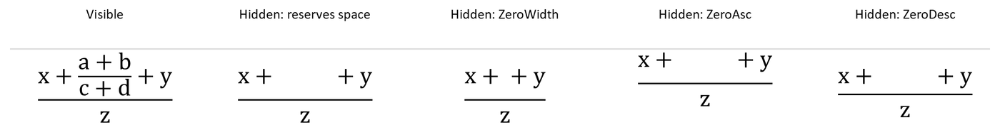

## **개요**

PowerPoint는 수식을 Office Math Markup Language(OMML)로 저장합니다. Aspose.Slides for Android via Java를 사용하면 프로그래밍 방식으로 동일한 유형의 수학 콘텐츠를 만들 수 있습니다: 분수, 근호, 함수, 극한, N-ary 연산자, 행렬, 배열 및 서식이 지정된 수학 블록.

PowerPoint에서 사용자는 일반적으로 **삽입 > 수식**에서 수식을 추가합니다:


그 결과는 슬라이드에 편집 가능한 수학 텍스트가 됩니다:


Aspose.Slides는 세 개의 주요 객체를 통해 해당 수학 텍스트를 생성합니다:

- 수학 도형은 [addMathShape](https://reference.aspose.com/slides/androidjava/com.aspose.slides/ishapecollection/)으로 생성되며 수식을 포함하는 도형입니다.
- [MathPortion](https://reference.aspose.com/slides/androidjava/com.aspose.slides/mathportion/)은 도형 텍스트 프레임 내부에 수학 콘텐츠를 저장합니다.
- [MathParagraph](https://reference.aspose.com/slides/androidjava/com.aspose.slides/mathparagraph/)은 하나 이상의 [MathBlock](https://reference.aspose.com/slides/androidjava/com.aspose.slides/mathblock/) 객체를 포함합니다.

아래 대부분의 예제는 코드를 간결하고 읽기 쉽게 유지하기 위해 [MathematicalText](https://reference.aspose.com/slides/androidjava/com.aspose.slides/mathematicaltext/) 및 [IMathElement](https://reference.aspose.com/slides/androidjava/com.aspose.slides/imathelement/)의 유창한 메서드를 사용합니다.

MathML 내보내기 시나리오에 대해서는 [Export Math Equations from Presentations on Android](/slides/ko/androidjava/exporting-math-equations/)를 참조하세요.

## **수식 만들기**

이 예제는 [addMathShape](https://reference.aspose.com/slides/androidjava/com.aspose.slides/ishapecollection/#addMathShape-float-float-float-float-)을 사용하여 수학 도형을 만들고 피타고라스 정리를 추가합니다:


```java
import com.aspose.slides.*;

Presentation presentation = new Presentation();
try {
    ISlide slide = presentation.getSlides().get_Item(0);

    IAutoShape mathShape = slide.getShapes().addMathShape(20, 20, 700, 120);
    IMathParagraph mathParagraph = ((MathPortion) mathShape.getTextFrame().getParagraphs()
            .get_Item(0).getPortions().get_Item(0)).getMathParagraph();

    IMathBlock equation = new MathematicalText("c")
            .setSuperscript("2")
            .join("=")
            .join(new MathematicalText("a").setSuperscript("2"))
            .join("+")
            .join(new MathematicalText("b").setSuperscript("2"));

    mathParagraph.add(equation);

    presentation.save("pythagorean-theorem.pptx", SaveFormat.Pptx);
} finally {
    presentation.dispose();
}
```

{}
[addMathShape](https://reference.aspose.com/slides/androidjava/com.aspose.slides/ishapecollection/#addMathShape-float-float-float-float-)은 이미 수학 단락을 포함하고 있는 도형을 생성합니다. 첫 번째 [MathPortion](https://reference.aspose.com/slides/androidjava/com.aspose.slides/mathportion/)에 접근하고, [getMathParagraph](https://reference.aspose.com/slides/androidjava/com.aspose.slides/imathportion/#getMathParagraph--)을 호출한 다음, 수학 블록이나 수학 요소를 추가합니다.
{}

## **분수 추가**

[divide](https://reference.aspose.com/slides/androidjava/com.aspose.slides/imathelement/#divide-com.aspose.slides.IMathElement-)을 사용하여 분수를 만들 수 있습니다. [MathFractionTypes](https://reference.aspose.com/slides/androidjava/com.aspose.slides/mathfractiontypes/)를 사용하여 분수 스타일을 선택할 수 있습니다.


```java
import com.aspose.slides.*;

Presentation presentation = new Presentation();
try {
    ISlide slide = presentation.getSlides().get_Item(0);

    IAutoShape mathShape = slide.getShapes().addMathShape(20, 20, 700, 100);
    IMathParagraph mathParagraph = ((MathPortion) mathShape.getTextFrame().getParagraphs()
            .get_Item(0).getPortions().get_Item(0)).getMathParagraph();

    IMathFraction fraction = new MathematicalText("1")
            .divide("x", MathFractionTypes.Skewed);

    mathParagraph.add(new MathBlock(fraction));

    presentation.save("fraction.pptx", SaveFormat.Pptx);
} finally {
    presentation.dispose();
}
```

쌓인 분수의 경우 [MathFractionTypes.Bar](https://reference.aspose.com/slides/androidjava/com.aspose.slides/mathfractiontypes/#Bar)을 사용합니다:

```java
import com.aspose.slides.*;

IMathFraction stackedFraction = new MathematicalText("x + 1").divide("y - 1", MathFractionTypes.Bar);
```

## **근호 추가**

[radical](https://reference.aspose.com/slides/androidjava/com.aspose.slides/imathelement/#radical-com.aspose.slides.IMathElement-)을 사용하여 제곱근, 세제곱근 또는 기타 근을 만들 수 있습니다. 현재 요소가 밑이 되고, 인수가 차수가 됩니다.


```java
import com.aspose.slides.*;

Presentation presentation = new Presentation();
try {
    ISlide slide = presentation.getSlides().get_Item(0);

    IAutoShape mathShape = slide.getShapes().addMathShape(20, 20, 700, 100);
    IMathParagraph mathParagraph = ((MathPortion) mathShape.getTextFrame().getParagraphs()
            .get_Item(0).getPortions().get_Item(0)).getMathParagraph();

    IMathRadical radical = new MathematicalText("x")
            .radical("n");

    mathParagraph.add(new MathBlock(radical));

    presentation.save("radical.pptx", SaveFormat.Pptx);
} finally {
    presentation.dispose();
}
```

## **함수 및 극한 추가**

`sin(x)`, `log(x)`와 같은 함수 또는 사용자 정의 함수 이름에 대해 [asArgumentOfFunction](https://reference.aspose.com/slides/androidjava/com.aspose.slides/imathelement/#asArgumentOfFunction-com.aspose.slides.IMathElement-) 또는 [function](https://reference.aspose.com/slides/androidjava/com.aspose.slides/imathelement/#function-com.aspose.slides.IMathElement-)을 사용합니다. 극한의 경우 `lim`을 [MathLimit](https://reference.aspose.com/slides/androidjava/com.aspose.slides/mathlimit/)에 넣거나 [setLowerLimit](https://reference.aspose.com/slides/androidjava/com.aspose.slides/imathelement/#setLowerLimit-com.aspose.slides.IMathElement-)를 사용합니다.


```java
import com.aspose.slides.*;

Presentation presentation = new Presentation();
try {
    ISlide slide = presentation.getSlides().get_Item(0);

    IAutoShape mathShape = slide.getShapes().addMathShape(20, 20, 700, 100);
    IMathParagraph mathParagraph = ((MathPortion) mathShape.getTextFrame().getParagraphs()
            .get_Item(0).getPortions().get_Item(0)).getMathParagraph();

    IMathFunction limit = new MathematicalText("lim")
            .setLowerLimit("x→∞")
            .function("x");

    mathParagraph.add(new MathBlock(limit));

    presentation.save("functions-and-limits.pptx", SaveFormat.Pptx);
} finally {
    presentation.dispose();
}
```

사용자 정의 함수 이름의 경우, 함수 이름을 현재 요소로 만들고 해당 인수와 함께 [function](https://reference.aspose.com/slides/androidjava/com.aspose.slides/imathelement/#function-com.aspose.slides.IMathElement-)을 호출합니다:

```java
import com.aspose.slides.*;

IMathFunction customFunction = new MathematicalText("f").function("x + 1");
```

## **N-ary 연산자 및 적분 추가**

합계, 합집합, 교집합 및 기타 큰 연산자에 대해서는 [nary](https://reference.aspose.com/slides/androidjava/com.aspose.slides/imathelement/#nary-int-com.aspose.slides.IMathElement-com.aspose.slides.IMathElement-)를 사용합니다. 적분에는 [integral](https://reference.aspose.com/slides/androidjava/com.aspose.slides/imathelement/#integral-int-com.aspose.slides.IMathElement-com.aspose.slides.IMathElement-)를 사용합니다. 두 메서드 모두 하한 및 상한을 설정할 수 있습니다.


```java
import com.aspose.slides.*;

Presentation presentation = new Presentation();
try {
    ISlide slide = presentation.getSlides().get_Item(0);

    IAutoShape mathShape = slide.getShapes().addMathShape(20, 20, 700, 120);
    IMathParagraph mathParagraph = ((MathPortion) mathShape.getTextFrame().getParagraphs()
            .get_Item(0).getPortions().get_Item(0)).getMathParagraph();

    IMathBlock summationBase = new MathematicalText("x")
            .setSuperscript("k")
            .join(new MathematicalText("a").setSuperscript("n-k"));

    IMathNaryOperator summation = summationBase.nary(MathNaryOperatorTypes.Summation, "k=0", "n");

    mathParagraph.add(new MathBlock(summation));

    presentation.save("nary-operators.pptx", SaveFormat.Pptx);
} finally {
    presentation.dispose();
}
```

N-ary 연산자는 선택적 한계가 있는 큰 연산자에 사용됩니다. `+`, `-`, `=`와 같은 단순 연산자는 보통 [MathematicalText](https://reference.aspose.com/slides/androidjava/com.aspose.slides/mathematicaltext/)로 추가되어 표현식에 결합됩니다.

적분의 경우 [integral](https://reference.aspose.com/slides/androidjava/com.aspose.slides/imathelement/#integral-int-com.aspose.slides.IMathElement-com.aspose.slides.IMathElement-)을 사용합니다:

```java
import com.aspose.slides.*;

IMathBlock integralBase = new MathematicalText("x").join(new MathematicalText("dx").toBox());
IMathNaryOperator integral = integralBase.integral(MathIntegralTypes.Simple, "0", "1");
```

## **행렬 추가**

행과 열에는 [MathMatrix](https://reference.aspose.com/slides/androidjava/com.aspose.slides/mathmatrix/)를 사용합니다. 행렬은 기본적으로 괄호가 포함되지 않으므로 괄호, 대괄호 또는 중괄호가 필요할 때 행렬을 감싸야 합니다.


```java
import com.aspose.slides.*;

Presentation presentation = new Presentation();
try {
    ISlide slide = presentation.getSlides().get_Item(0);

    IAutoShape mathShape = slide.getShapes().addMathShape(20, 20, 700, 120);
    IMathParagraph mathParagraph = ((MathPortion) mathShape.getTextFrame().getParagraphs()
            .get_Item(0).getPortions().get_Item(0)).getMathParagraph();

    MathMatrix matrix = new MathMatrix(2, 3);
    matrix.set_Item(0, 0, new MathematicalText("1"));
    matrix.set_Item(0, 1, new MathematicalText("x"));
    matrix.set_Item(1, 0, new MathematicalText("x"));
    matrix.set_Item(1, 1, new MathematicalText("2"));
    matrix.set_Item(1, 2, new MathematicalText("y"));

    mathParagraph.add(new MathBlock(matrix));

    presentation.save("matrix.pptx", SaveFormat.Pptx);
} finally {
    presentation.dispose();
}
```

## **수식 배열 추가**

[toMathArray](https://reference.aspose.com/slides/androidjava/com.aspose.slides/imathelement/#toMathArray--)를 사용하여 정렬된 수식이나 수직 스택 표현식이 필요할 때 사용합니다.


```java
import com.aspose.slides.*;

Presentation presentation = new Presentation();
try {
    ISlide slide = presentation.getSlides().get_Item(0);

    IAutoShape mathShape = slide.getShapes().addMathShape(20, 20, 700, 140);
    IMathParagraph mathParagraph = ((MathPortion) mathShape.getTextFrame().getParagraphs()
            .get_Item(0).getPortions().get_Item(0)).getMathParagraph();

    IMathArray equationArray = new MathematicalText("x")
            .join("y")
            .toMathArray();

    mathParagraph.add(new MathBlock(equationArray));

    presentation.save("equation-array.pptx", SaveFormat.Pptx);
} finally {
    presentation.dispose();
}
```

### **주변 요소와 배열 정렬**

[setBaseJustification](https://reference.aspose.com/slides/androidjava/com.aspose.slides/imatharray/#setBaseJustification-int-)은 배열의 수직 정렬을 인접한 수학 요소에 비례해 제어합니다. 아래 예제는 첫 번째 행, 배열 중앙, 마지막 행과의 정렬을 비교합니다.

다음 예제는 각각 3개의 행과 인접 요소 `A=` 및 `=B`를 가진 세 개의 동일한 배열을 생성합니다. 모든 수학 텍스트는 24pt Cambria Math를 사용합니다. 배열 정렬만 변경됩니다.

```java
import com.aspose.slides.*;
import android.graphics.Color;

class MathTextFactory {
    MathematicalText createText(String value) {
        MathematicalText text = new MathematicalText(value);
        text.getFormat().setFontHeight(24);
        text.getFormat().setLatinFont(new FontData("Cambria Math"));
        return text;
    }
}

MathTextFactory factory = new MathTextFactory();
Presentation presentation = new Presentation();
try {
    presentation.getSlideSize().setSize(780, 200, SlideSizeScaleType.DoNotScale);
    ISlide slide = presentation.getSlides().get_Item(0);

    int[] alignments = { MathVerticalAlignment.Top, MathVerticalAlignment.Center, MathVerticalAlignment.Bottom };
    String[] alignmentNames = { "Top", "Center", "Bottom" };

    for (int i = 0; i < alignments.length; i++) {
        IAutoShape label = slide.getShapes().addAutoShape(ShapeType.Rectangle, 20 + i * 260, 10, 240, 30);
        label.getFillFormat().setFillType(FillType.NoFill);
        label.getLineFormat().getFillFormat().setFillType(FillType.NoFill);
        label.getTextFrame().setText(alignmentNames[i]);
        IPortionFormat labelFormat = label.getTextFrame().getParagraphs().get_Item(0).getPortions().get_Item(0).getPortionFormat();
        labelFormat.setFontHeight(16);
        labelFormat.getFillFormat().setFillType(FillType.Solid);
        labelFormat.getFillFormat().getSolidFillColor().setColor(Color.BLACK);

        IAutoShape mathShape = slide.getShapes().addMathShape(20 + i * 260, 60, 240, 130);
        mathShape.getTextFrame().getTextFrameFormat().setAnchoringType(TextAnchorType.Top);
        IMathParagraph mathParagraph = ((IMathPortion) mathShape.getTextFrame().getParagraphs().get_Item(0).getPortions().get_Item(0)).getMathParagraph();
        mathParagraph.setJustification(MathJustification.LeftJustified);

        IMathElement[] rows = { factory.createText("x+y=3"), factory.createText("x-y=1"), factory.createText("x=2") };
        MathArray equationArray = new MathArray(rows[0]);
        equationArray.getArguments().add(rows[1]);
        equationArray.getArguments().add(rows[2]);
        equationArray.setBaseJustification(alignments[i]);
        MathematicalText leftText = factory.createText("A=");
        MathematicalText rightText = factory.createText("=B");
        IMathBlock equation = new MathBlock(leftText).join(equationArray).join(rightText);
        mathParagraph.add(equation);
    }

    presentation.save("equation-array-alignment.pptx", SaveFormat.Pptx);
} finally {
    presentation.dispose();
}
```

다음 비교는 PowerPoint에서 저장된 프레젠테이션을 보여줍니다. 각 배열 옆의 `A=` 및 `=B` 위치를 확인하세요.


### **행 간격 구성**

[setRowSpacingRule](https://reference.aspose.com/slides/androidjava/com.aspose.slides/imatharray/#setRowSpacingRule-int-)은 배열 내 행에 대한 간격 규칙을 선택합니다. [setRowSpacing](https://reference.aspose.com/slides/androidjava/com.aspose.slides/imatharray/#setRowSpacing-long-)은 명시적 간격 규칙을 위한 숫자 값을 제공하며 사전 설정 규칙에서는 무시됩니다.

정확한 간격의 경우 값은 포인트 단위입니다. 비례 간격의 경우 반줄 단위로 측정됩니다: 예제의 값 `3`은 1.5줄을 의미합니다. 명시적 값을 지정할 때는 두 속성을 모두 설정하세요; 숫자 값만 변경해도 간격 규칙이 선택되지 않습니다.

아래 예제는 동일한 수식, 정렬 및 글꼴 설정을 가진 다섯 개의 프레젠테이션을 저장합니다. 처음 세 개는 사전 설정을 사용하고, 마지막 두 개는 명시적 값을 보여줍니다.

```java
import com.aspose.slides.*;

class MathTextFactory {
    MathematicalText createText(String value) {
        MathematicalText text = new MathematicalText(value);
        text.getFormat().setFontHeight(24);
        text.getFormat().setLatinFont(new FontData("Cambria Math"));
        return text;
    }
}

MathTextFactory factory = new MathTextFactory();
int[] rules = { MathRowSpacingRule.SingleLineGap, MathRowSpacingRule.OneAndAHalfLineGap, MathRowSpacingRule.TwoLineGap, MathRowSpacingRule.Exactly, MathRowSpacingRule.Multiple };
int[] spacingValues = { 0, 0, 0, 20, 3 };
String[] ruleNames = { "SingleLineGap", "OneAndAHalfLineGap", "TwoLineGap", "Exactly", "Multiple" };

for (int i = 0; i < rules.length; i++) {
    String fileName = "equation-array-" + ruleNames[i] + ".pptx";
    Presentation presentation = new Presentation();
    try {
        IAutoShape mathShape = presentation.getSlides().get_Item(0).getShapes().addMathShape(20, 20, 600, 300);
        IParagraph paragraph = mathShape.getTextFrame().getParagraphs().get_Item(0);
        paragraph.getParagraphFormat().setSpaceBefore(0);
        paragraph.getParagraphFormat().setSpaceAfter(0);
        IMathParagraph mathParagraph = ((IMathPortion) paragraph.getPortions().get_Item(0)).getMathParagraph();
        mathParagraph.setJustification(MathJustification.LeftJustified);

        IMathElement[] rows = { factory.createText("x+y=3"), factory.createText("x-y=1"), factory.createText("x=2") };
        MathArray equationArray = new MathArray(rows[0]);
        equationArray.getArguments().add(rows[1]);
        equationArray.getArguments().add(rows[2]);
        equationArray.setBaseJustification(MathVerticalAlignment.Center);
        equationArray.setRowSpacingRule(rules[i]);
        equationArray.setRowSpacing(spacingValues[i]);
        MathematicalText leftText = factory.createText("A=");
        MathematicalText rightText = factory.createText("=B");
        IMathBlock equation = new MathBlock(leftText).join(equationArray).join(rightText);
        mathParagraph.add(equation);

        presentation.save(fileName, SaveFormat.Pptx);
    } finally {
        presentation.dispose();
    }
}
```

배열 행 간격은 단락 간격과 별개입니다. [setSpaceBefore](https://reference.aspose.com/slides/androidjava/com.aspose.slides/iparagraphformat/#setSpaceBefore-float-) 및 [setSpaceAfter](https://reference.aspose.com/slides/androidjava/com.aspose.slides/iparagraphformat/#setSpaceAfter-float-)는 배열 행 사이가 아니라 포함된 단락 주변에 공간을 추가합니다. 마찬가지로 [IMathParagraph.setJustification](https://reference.aspose.com/slides/androidjava/com.aspose.slides/imathparagraph/#setJustification-int-)은 전체 수학 단락을 수평으로 배치하며, 배열의 수직 정렬 설정을 대체하지 않습니다.

## **삼각 함수 추가**

[asArgumentOfFunction](https://reference.aspose.com/slides/androidjava/com.aspose.slides/imathelement/#asArgumentOfFunction-com.aspose.slides.IMathElement-)을 사용하여 인수가 현재 요소이고 함수 이름이 알려진 경우 사용합니다.


```java
import com.aspose.slides.*;

Presentation presentation = new Presentation();
try {
    ISlide slide = presentation.getSlides().get_Item(0);

    IAutoShape mathShape = slide.getShapes().addMathShape(20, 20, 700, 100);
    IMathParagraph mathParagraph = ((MathPortion) mathShape.getTextFrame().getParagraphs()
            .get_Item(0).getPortions().get_Item(0)).getMathParagraph();

    IMathFunction cosine = new MathematicalText("2x")
            .asArgumentOfFunction(MathFunctionsOfOneArgument.Cos);

    mathParagraph.add(new MathBlock(cosine));

    presentation.save("trigonometric-function.pptx", SaveFormat.Pptx);
} finally {
    presentation.dispose();
}
```

## **아래 첨자 및 위 첨자 추가**

인덱스와 거듭제곱을 위해 아래 첨자 및 위 첨자 도우미를 사용합니다. 인덱스가 기준의 왼쪽에 표시되어야 할 경우 [setSubSuperscriptOnTheLeft](https://reference.aspose.com/slides/androidjava/com.aspose.slides/imathelement/#setSubSuperscriptOnTheLeft-com.aspose.slides.IMathElement-com.aspose.slides.IMathElement-)을 사용합니다.


```java
import com.aspose.slides.*;

Presentation presentation = new Presentation();
try {
    ISlide slide = presentation.getSlides().get_Item(0);

    IAutoShape mathShape = slide.getShapes().addMathShape(20, 20, 700, 100);
    IMathParagraph mathParagraph = ((MathPortion) mathShape.getTextFrame().getParagraphs()
            .get_Item(0).getPortions().get_Item(0)).getMathParagraph();

    IMathLeftSubSuperscriptElement scripts = new MathematicalText("Y")
            .setSubSuperscriptOnTheLeft("1", "n");

    mathParagraph.add(new MathBlock(scripts));

    presentation.save("subscript-superscript.pptx", SaveFormat.Pptx);
} finally {
    presentation.dispose();
}
```

## **구분자 추가**

[enclose](https://reference.aspose.com/slides/androidjava/com.aspose.slides/imathelement/#enclose-char-char-)을 사용하여 표현식 안에 구분자를 넣습니다. 여러 요소를 포함하는 구분자 표현식에 구분 문자도 설정할 수 있습니다.


```java
import com.aspose.slides.*;

Presentation presentation = new Presentation();
try {
    ISlide slide = presentation.getSlides().get_Item(0);

    IAutoShape mathShape = slide.getShapes().addMathShape(20, 20, 700, 100);
    IMathParagraph mathParagraph = ((MathPortion) mathShape.getTextFrame().getParagraphs()
            .get_Item(0).getPortions().get_Item(0)).getMathParagraph();

    IMathDelimiter delimiter = new MathematicalText("x")
            .join("y")
            .join("z")
            .enclose('<', '>');
    delimiter.setSeparatorCharacter('|');

    mathParagraph.add(new MathBlock(delimiter));

    presentation.save("delimiters.pptx", SaveFormat.Pptx);
} finally {
    presentation.dispose();
}
```

### **구분자 크기 및 정렬**

`true`를 [setGrowToMatchOperandHeight](https://reference.aspose.com/slides/androidjava/com.aspose.slides/imathdelimiter/#setGrowToMatchOperandHeight-boolean-)에 전달하면 큰 피연산자 주위에 괄호가 확대되고, `false`를 전달하면 정상 크기를 유지합니다. 두 가지 [MathDelimiterShape](https://reference.aspose.com/slides/androidjava/com.aspose.slides/mathdelimitershape/) 값 중 하나와 함께 [setDelimiterShape](https://reference.aspose.com/slides/androidjava/com.aspose.slides/imathdelimiter/#setDelimiterShape-int-)을 사용합니다. `Centered`는 괄호를 등식 축의 가운데(= 기호 중간)와 맞춥니다. `Match`는 포함된 내용에 맞춰 정렬합니다. 두 설정은 구분자에만 영향을 미치며 내부 표현식은 그대로 유지됩니다.

예제는 `x`의 지수에 분수를 배치하여 표현식이 기준선 위로 더 크게 확장되게 합니다. 네 개의 수식 모두 동일한 괄호와 글꼴 설정을 사용합니다.

```java
import com.aspose.slides.*;

Presentation presentation = new Presentation();
try {
    ISlide slide = presentation.getSlides().get_Item(0);
    for (int row = 0; row < 2; row++) {
        for (int column = 0; column < 2; column++) {
            IMathFraction fraction = new MathematicalText("a + b").divide("c + d");
            IMathSuperscriptElement power = new MathematicalText("x").setSuperscript(fraction);
            IMathDelimiter delimiter = power.enclose('(', ')');
            delimiter.setGrowToMatchOperandHeight(row == 0);
            delimiter.setDelimiterShape(column == 0 ? MathDelimiterShape.Centered : MathDelimiterShape.Match);

            IAutoShape mathShape = slide.getShapes().addMathShape(20 + 330 * column, 20 + 120 * row, 300, 100);
            MathPortion portion = (MathPortion) mathShape.getTextFrame().getParagraphs().get_Item(0).getPortions().get_Item(0);
            portion.getPortionFormat().setFontHeight(32);
            IMathBlock equation = new MathematicalText("y = ").join(delimiter);
            portion.getMathParagraph().add(equation);
        }
    }
    presentation.save("delimiter-sizing.pptx", SaveFormat.Pptx);
} finally {
    presentation.dispose();
}
```

PowerPoint에서 행을 비교하여 확대 효과를 확인하십시오. 상단 행에서는 괄호가 지수를 둘러싸도록 확대되어 두 형태가 동일하게 보입니다. 하단 행에서는 확대가 꺼져 있습니다. 왼쪽의 작은 괄호(`Centered`)는 = 기호와 맞추어지고, 오른쪽의 괄호(`Match`)는 표현식 위에 더 높게 위치합니다.


## **테두리 상자 추가**

분수에 [toBorderBox](https://reference.aspose.com/slides/androidjava/com.aspose.slides/imathelement/#toBorderBox--)을 호출하면 전체 표현식을 프레임합니다. 반환된 [IMathBorderBox](https://reference.aspose.com/slides/androidjava/com.aspose.slides/imathborderbox/)은 기본적으로 네 면을 모두 표시합니다. 개별 면을 제거하려면 [setHideTop](https://reference.aspose.com/slides/androidjava/com.aspose.slides/imathborderbox/#setHideTop-boolean-), [setHideBottom](https://reference.aspose.com/slides/androidjava/com.aspose.slides/imathborderbox/#setHideBottom-boolean-), [setHideLeft](https://reference.aspose.com/slides/androidjava/com.aspose.slides/imathborderbox/#setHideLeft-boolean-), [setHideRight](https://reference.aspose.com/slides/androidjava/com.aspose.slides/imathborderbox/#setHideRight-boolean-)를 사용합니다.

예제는 동일한 분수를 한 슬라이드에 여섯 개 배치합니다. 취소 표시를 위해 네 면을 모두 숨기고 [setStrikethroughBottomLeftToTopRight](https://reference.aspose.com/slides/androidjava/com.aspose.slides/imathborderbox/#setStrikethroughBottomLeftToTopRight-boolean-)에 `true`를 전달하면 상승 대각선(↗)이, [setStrikethroughTopLeftToBottomRight](https://reference.aspose.com/slides/androidjava/com.aspose.slides/imathborderbox/#setStrikethroughTopLeftToBottomRight-boolean-)에 `true`를 전달하면 하강 대각선(↘)이 표시됩니다. 또한 [setStrikethroughHorizontal](https://reference.aspose.com/slides/androidjava/com.aspose.slides/imathborderbox/#setStrikethroughHorizontal-boolean-) 또는 [setStrikethroughVertical](https://reference.aspose.com/slides/androidjava/com.aspose.slides/imathborderbox/#setStrikethroughVertical-boolean-)을 사용하여 보이는 면을 조합할 수 있습니다.

```java
import com.aspose.slides.*;

Presentation presentation = new Presentation();
try {
    presentation.getSlideSize().setSize(540, 220, SlideSizeScaleType.DoNotScale);
    ISlide slide = presentation.getSlides().get_Item(0);

    class FractionBuilder {
        IMathBorderBox addFraction(float x, float y, boolean hideBorder) {
            IMathFraction fraction = new MathematicalText("x+1").divide("y+2");
            IMathBorderBox box = fraction.toBorderBox();
            box.setHideTop(hideBorder);
            box.setHideBottom(hideBorder);
            box.setHideLeft(hideBorder);
            box.setHideRight(hideBorder);

            IAutoShape shape = slide.getShapes().addMathShape(x, y, 160, 90);
            MathPortion portion = (MathPortion) shape.getTextFrame().getParagraphs().get_Item(0).getPortions().get_Item(0);
            portion.getPortionFormat().setFontHeight(28);
            portion.getMathParagraph().add(new MathBlock(box));
            return box;
        }
    }

    FractionBuilder builder = new FractionBuilder();
    builder.addFraction(10, 10, false);

    IMathBorderBox partial = builder.addFraction(190, 10, false);
    partial.setHideTop(true);
    partial.setHideRight(true);

    builder.addFraction(370, 10, true).setStrikethroughBottomLeftToTopRight(true);
    builder.addFraction(10, 120, true).setStrikethroughTopLeftToBottomRight(true);
    builder.addFraction(190, 120, true).setStrikethroughHorizontal(true);
    builder.addFraction(370, 120, false).setStrikethroughVertical(true);

    presentation.save("border-box.pptx", SaveFormat.Pptx);
} finally {
    presentation.dispose();
}
```


이 분수에서 가로 취소선은 분수선과 겹칩니다. 세로 취소선은 분자와 분모를 모두 가로지르며 주변 테두리는 보입니다. 이러한 선은 전체 표현식을 장식합니다. 일반 텍스트의 취소선은 텍스트 실행의 문자에 적용됩니다. PowerPoint에서 프레젠테이션을 다시 열어도 분자와 분모를 독립적으로 편집할 수 있습니다.

## **Phantom 요소로 가시성 및 레이아웃 제어**

표현식을 [MathPhantom](https://reference.aspose.com/slides/androidjava/com.aspose.slides/mathphantom/)으로 감싸면 가시성과 수식에 기여하는 공간을 독립적으로 제어할 수 있습니다. [IMathPhantom](https://reference.aspose.com/slides/androidjava/com.aspose.slides/imathphantom/) 메서드는 다음을 제어합니다:

| Method | Effect |
| --- | --- |
| [setShow](https://reference.aspose.com/slides/androidjava/com.aspose.slides/imathphantom/#setShow-boolean-) | `false`를 전달하면 표현식을 숨깁니다. 아래 메서드가 `true`가 아닌 한 그 차원은 레이아웃에 계속 기여합니다. |
| [setZeroWidth](https://reference.aspose.com/slides/androidjava/com.aspose.slides/imathphantom/#setZeroWidth-boolean-) | 표현식의 가로 너비를 0으로 처리하여 인접 요소가 더 가깝게 이동하도록 합니다. |
| [setZeroAsc](https://reference.aspose.com/slides/androidjava/com.aspose.slides/imathphantom/#setZeroAsc-boolean-) | 기준선 위의 높이인 상승값을 0으로 처리합니다. 이는 인접 요소 위에 예약된 공간을 줄일 수 있습니다. |
| [setZeroDesc](https://reference.aspose.com/slides/androidjava/com.aspose.slides/imathphantom/#setZeroDesc-boolean-) | 기준선 아래의 깊이인 하강값을 0으로 처리합니다. 이는 분수선이나 표현식 아래의 다른 콘텐츠를 인접 요소에 더 가깝게 만들 수 있습니다. |

기준선은 일반적인 수학 문자들이 놓이는 기준선입니다. 콘텐츠를 숨겨도 차원은 제거되지 않으며, 차원을 0으로 처리해도 표현식이 삭제되지 않습니다. 기본 표현식은 [getBase](https://reference.aspose.com/slides/androidjava/com.aspose.slides/imathphantom/#getBase--)을 통해 여전히 사용할 수 있습니다. [setShow](https://reference.aspose.com/slides/androidjava/com.aspose.slides/imathphantom/#setShow-boolean-)에 `true`를 전달하면 다시 표시되며 차원 설정은 그대로 유지됩니다.

아래 예제는 나란히 다섯 가지 변형을 생성합니다: 보이는 분수, 공간을 유지하는 숨김 분수, 그리고 하나의 차원만 0으로 처리된 세 개의 숨김 분수. 각 변형은 동일한 주변 표현식과 24pt Cambria Math를 사용합니다. 모든 수식 도형은 회색 가이드가 표시한 동일한 상단 위치를 가집니다. 외부 분수의 분자에 phantom을 배치하면 수직 레이아웃 변화를 보기 쉽게 합니다.

```java
import com.aspose.slides.*;
import android.graphics.Color;

class MathTextFactory {
    MathematicalText createText(String value) {
        MathematicalText text = new MathematicalText(value);
        text.getFormat().setFontHeight(24);
        text.getFormat().setLatinFont(new FontData("Cambria Math"));
        return text;
    }
}

MathTextFactory factory = new MathTextFactory();
Presentation presentation = new Presentation();
try {
    presentation.getSlideSize().setSize(1000, 180, SlideSizeScaleType.DoNotScale);
    ISlide slide = presentation.getSlides().get_Item(0);

    String[] labels = { "Visible", "Hidden: reserves space", "Hidden: ZeroWidth", "Hidden: ZeroAsc", "Hidden: ZeroDesc" };

    IAutoShape guide = slide.getShapes().addAutoShape(ShapeType.Line, 10, 60, 980, 0);
    guide.getLineFormat().getFillFormat().setFillType(FillType.Solid);
    guide.getLineFormat().getFillFormat().getSolidFillColor().setColor(Color.LTGRAY);

    for (int i = 0; i < labels.length; i++) {
        int left = 10 + i * 200;

        IAutoShape label = slide.getShapes().addAutoShape(ShapeType.Rectangle, left, 10, 190, 30);
        label.getFillFormat().setFillType(FillType.NoFill);
        label.getLineFormat().getFillFormat().setFillType(FillType.NoFill);
        label.getTextFrame().setText(labels[i]);

        IPortionFormat labelFormat = label.getTextFrame().getParagraphs().get_Item(0).getPortions().get_Item(0).getPortionFormat();
        labelFormat.setFontHeight(14);
        labelFormat.getFillFormat().setFillType(FillType.Solid);
        labelFormat.getFillFormat().getSolidFillColor().setColor(Color.BLACK);

        MathematicalText fractionNumerator = factory.createText("a+b");
        MathematicalText fractionDenominator = factory.createText("c+d");
        MathFraction fraction = new MathFraction(fractionNumerator, fractionDenominator);
        MathPhantom phantom = new MathPhantom(fraction);
        phantom.setShow(i == 0);
        phantom.setZeroWidth(i == 2);
        phantom.setZeroAsc(i == 3);
        phantom.setZeroDesc(i == 4);

        MathematicalText leftText = factory.createText("x+");
        MathematicalText rightText = factory.createText("+y");
        IMathBlock numerator = new MathBlock(leftText).join(phantom).join(rightText);
        MathematicalText denominator = factory.createText("z");
        MathFraction equation = new MathFraction(numerator, denominator);

        IAutoShape shape = slide.getShapes().addMathShape(left, 60, 190, 100);
        shape.getTextFrame().getTextFrameFormat().setAnchoringType(TextAnchorType.Top);

        IMathPortion mathPortion = (IMathPortion) shape.getTextFrame().getParagraphs().get_Item(0).getPortions().get_Item(0);
        IMathParagraph mathParagraph = mathPortion.getMathParagraph();
        mathParagraph.add(new MathBlock(equation));
    }

    presentation.save("math-phantom.pptx", SaveFormat.Pptx);
} finally {
    presentation.dispose();
}
```



## **항 그룹화**

[group](https://reference.aspose.com/slides/androidjava/com.aspose.slides/imathelement/#group-char-int-int-)을 사용하여 표현식 위나 아래에 그룹화 문자를 배치합니다. 그룹화된 항에 라벨을 붙이려면 한계를 추가합니다.


```java
import com.aspose.slides.*;

Presentation presentation = new Presentation();
try {
    ISlide slide = presentation.getSlides().get_Item(0);

    IAutoShape mathShape = slide.getShapes().addMathShape(20, 20, 700, 120);
    IMathParagraph mathParagraph = ((MathPortion) mathShape.getTextFrame().getParagraphs()
            .get_Item(0).getPortions().get_Item(0)).getMathParagraph();

    IMathLimit grouped = new MathematicalText("x + y")
            .group('\u23DF', MathTopBotPositions.Bottom, MathTopBotPositions.Top)
            .setLowerLimit("any text");

    mathParagraph.add(new MathBlock(grouped));

    presentation.save("grouped-terms.pptx", SaveFormat.Pptx);
} finally {
    presentation.dispose();
}
```

## **수학 요소 서식 지정**

서식 도우미는 식을 명확하게 할 때만 사용합니다. 예를 들어, [overbar](https://reference.aspose.com/slides/androidjava/com.aspose.slides/imathelement/#overbar--)은 수학 요소 위에 바를 놓습니다.


```java
import com.aspose.slides.*;

Presentation presentation = new Presentation();
try {
    ISlide slide = presentation.getSlides().get_Item(0);

    IAutoShape mathShape = slide.getShapes().addMathShape(20, 20, 700, 100);
    IMathParagraph mathParagraph = ((MathPortion) mathShape.getTextFrame().getParagraphs()
            .get_Item(0).getPortions().get_Item(0)).getMathParagraph();

    IMathBar overbar = new MathematicalText("ABC").overbar();

    mathParagraph.add(new MathBlock(overbar));

    presentation.save("overbar.pptx", SaveFormat.Pptx);
} finally {
    presentation.dispose();
}
```

### **기존 수식의 텍스트 서식 지정**

기존 수식 전체의 텍스트 서식을 지정하려면 각 수학 블록의 요소 트리를 순회합니다. [IMathElement.getChildren](https://reference.aspose.com/slides/androidjava/com.aspose.slides/imathelement/#getChildren--)은 즉시 자식만 반환하므로, 재귀적으로 호출하여 분수, 첨자·아래첨자, 근호 및 기타 중첩 구조 안의 텍스트에 접근합니다. 시작 요소가 [MathematicalText](https://reference.aspose.com/slides/androidjava/com.aspose.slides/mathematicaltext/)인 경우 현재 요소와 자식을 모두 확인합니다.

이 예제는 `input.pptx`에 `z = xᵢ / ∛y`와 같은 수식이 포함되어 있다고 가정합니다. 여기서 분수의 분자에 아래첨자, 분모에 근호가 있습니다. 블록의 최상위 요소만 처리하면 분수 내부 텍스트를 놓칠 수 있습니다. 예제는 슬라이드 텍스트 프레임에서 수학 부분을 찾아 [IMathPortion.getMathParagraph](https://reference.aspose.com/slides/androidjava/com.aspose.slides/imathportion/#getMathParagraph--)을 통해 블록에 접근하고, 각 텍스트 요소의 [getFormat](https://reference.aspose.com/slides/androidjava/com.aspose.slides/mathematicaltext/#getFormat--) 메서드를 통해 [setFontHeight](https://reference.aspose.com/slides/androidjava/com.aspose.slides/baseportionformat/#setFontHeight-float-)을 사용해 글꼴 크기를 28pt로 설정합니다.

```java
import com.aspose.slides.*;

class MathTextFormatter {
    void formatMathText(IMathElement element) {
        if (element instanceof MathematicalText) {
            MathematicalText text = (MathematicalText) element;
            text.getFormat().setFontHeight(28);
        }

        for (IMathElement child : element.getChildren()) {
            formatMathText(child);
        }
    }
}

MathTextFormatter formatter = new MathTextFormatter();
Presentation presentation = new Presentation("input.pptx");
try {
    for (ISlide slide : presentation.getSlides()) {
        for (IShape shape : slide.getShapes()) {
            if (!(shape instanceof IAutoShape)) {
                continue;
            }

            IAutoShape autoShape = (IAutoShape) shape;
            if (autoShape.getTextFrame() == null) {
                continue;
            }

            for (IParagraph paragraph : autoShape.getTextFrame().getParagraphs()) {
                for (IPortion portion : paragraph.getPortions()) {
                    if (portion instanceof IMathPortion) {
                        IMathPortion mathPortion = (IMathPortion) portion;
                        for (IMathBlock block : mathPortion.getMathParagraph()) {
                            formatter.formatMathText(block);
                        }
                    }
                }
            }
        }
    }

    presentation.save("formatted-equations.pptx", SaveFormat.Pptx);
} finally {
    presentation.dispose();
}
```

저장된 프레젠테이션은 처리된 각 수식의 모든 수준에서 업데이트된 텍스트 서식을 포함하며, 텍스트 내용과 수학 구조를 유지합니다.

## **빠른 참조**

| 작업 | 주요 API |
| --- | --- |
| 수학 텍스트 만들기 | [MathematicalText](https://reference.aspose.com/slides/androidjava/com.aspose.slides/mathematicaltext/) |
| 요소 결합 | [IMathElement.join](https://reference.aspose.com/slides/androidjava/com.aspose.slides/imathelement/) |
| 분수 만들기 | [IMathElement.divide](https://reference.aspose.com/slides/androidjava/com.aspose.slides/imathelement/) |
| 위첨자 및 아래첨자 추가 | [setSuperscript](https://reference.aspose.com/slides/androidjava/com.aspose.slides/imathelement/), [setSubscript](https://reference.aspose.com/slides/androidjava/com.aspose.slides/imathelement/) |
| 함수 추가 | [function](https://reference.aspose.com/slides/androidjava/com.aspose.slides/imathelement/), [asArgumentOfFunction](https://reference.aspose.com/slides/androidjava/com.aspose.slides/imathelement/) |
| 근호 추가 | [IMathElement.radical](https://reference.aspose.com/slides/androidjava/com.aspose.slides/imathelement/) |
| 극한 추가 | [setLowerLimit](https://reference.aspose.com/slides/androidjava/com.aspose.slides/imathelement/), [setUpperLimit](https://reference.aspose.com/slides/androidjava/com.aspose.slides/imathelement/) |
| 왼쪽 스크립트 추가 | [setSubSuperscriptOnTheLeft](https://reference.aspose.com/slides/androidjava/com.aspose.slides/imathelement/) |
| 합계 및 적분 추가 | [nary](https://reference.aspose.com/slides/androidjava/com.aspose.slides/imathelement/), [integral](https://reference.aspose.com/slides/androidjava/com.aspose.slides/imathelement/) |
| 행렬 추가 | [MathMatrix](https://reference.aspose.com/slides/androidjava/com.aspose.slides/mathmatrix/) |
| 수식 배열 추가 | [toMathArray](https://reference.aspose.com/slides/androidjava/com.aspose.slides/imathelement/) |
| 구분자 추가 | [enclose](https://reference.aspose.com/slides/androidjava/com.aspose.slides/imathelement/) |
| 바 및 테두리 추가 | [overbar](https://reference.aspose.com/slides/androidjava/com.aspose.slides/imathelement/), [toBorderBox](https://reference.aspose.com/slides/androidjava/com.aspose.slides/imathelement/) |
| 항 그룹화 | [group](https://reference.aspose.com/slides/androidjava/com.aspose.slides/imathelement/) |

## **FAQ**

**기존 PowerPoint 수식을 편집할 수 있나요?**

예. 프레젠테이션을 열고, [MathPortion](https://reference.aspose.com/slides/androidjava/com.aspose.slides/mathportion/)을 포함하는 도형을 찾아 [getMathParagraph](https://reference.aspose.com/slides/androidjava/com.aspose.slides/imathportion/#getMathParagraph--)을 호출한 뒤 해당 단락의 수학 블록을 업데이트합니다.

**수식이 편집 가능한 PowerPoint 수학으로 저장되나요?**

예. PPTX로 저장하면 Aspose.Slides가 수식을 편집 가능한 Office 수학 콘텐츠로 기록합니다.

**수식을 LaTeX로 내보낼 수 있나요?**

예. 해당 [IMathPortion](https://reference.aspose.com/slides/androidjava/com.aspose.slides/imathportion/)에서 수식의 [IMathParagraph](https://reference.aspose.com/slides/androidjava/com.aspose.slides/imathparagraph/)을 가져와 [IMathParagraph.toLatex](https://reference.aspose.com/slides/androidjava/com.aspose.slides/imathparagraph/#toLatex--)를 호출하면 직접 내보낼 수 있습니다. 전체 예제는 [Export Math Equations from Presentations in Android via Java](/slides/ko/androidjava/exporting-math-equations/#export-math-equations-to-latex)를 참조하세요.