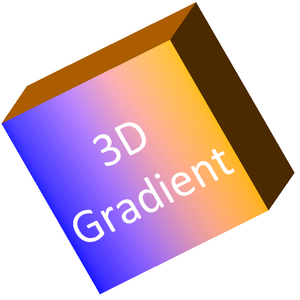

## **개요**

Aspose.Slides for C++는 모양과 텍스트에 대한 PowerPoint 스타일 3D 서식을 생성, 편집, 보존 및 렌더링할 수 있습니다. 이 문서에서는 회전, 돌출, 베벨, 조명, 재료, 그라디언트 또는 사진 채우기, 3D 텍스트와 같은 3D 효과를 다룹니다.

{}
이 문서는 PowerPoint 모양 및 텍스트에 대한 3D 서식 효과에 관한 것입니다. 독립형 3D 모델 파일을 삽입하거나 편집하는 방법에 관한 것이 아닙니다. 슬라이드를 이미지, PDF 또는 HTML로 내보낼 때 Aspose.Slides는 해당 3D 효과를 내보낸 2D 출력에 렌더링합니다.
{}

## **3D 서식 개념**

[IShape::get_ThreeDFormat](https://reference.aspose.com/slides/cpp/aspose.slides/ishape/get_threedformat/) 메서드를 사용하여 모양에 3D 서식을 적용합니다. 이 메서드는 해당 모양의 3D 장면을 제어하는 [IThreeDFormat](https://reference.aspose.com/slides/cpp/aspose.slides/ithreedformat/)을 반환합니다.

텍스트의 경우 [ITextFrameFormat::get_ThreeDFormat](https://reference.aspose.com/slides/cpp/aspose.slides/itextframeformat/get_threedformat/) 메서드를 사용합니다. 이는 모양 본문 대신 텍스트 프레임에 3D 서식을 적용합니다.

가장 중요한 메서드는 다음과 같습니다.

| 메서드 | 제어하는 내용 | 사용 시점 |
|---|---|---|
| [get_Camera](https://reference.aspose.com/slides/cpp/aspose.slides/ithreedformat/get_camera/) | 시점, 사전 설정 카메라 유형, 회전, 확대/축소 및 원근. | 3D 공간에서 객체를 회전하거나 PowerPoint 3D 회전 사전 설정에 맞춥니다. |
| [get_LightRig](https://reference.aspose.com/slides/cpp/aspose.slides/ithreedformat/get_lightrig/) | 조명 사전 설정, 방향 및 조명 회전. | 3D 표면에서 하이라이트와 그림자 표시 방식을 변경합니다. |
| [set_Material](https://reference.aspose.com/slides/cpp/aspose.slides/ithreedformat/set_material/) | 표면 재료(예: 플랫, 매트, 플라스틱 또는 메탈). | 같은 형상을 더 평평하게, 부드럽게, 광택 있게, 또는 금속처럼 보이게 합니다. |
| [set_ExtrusionHeight](https://reference.aspose.com/slides/cpp/aspose.slides/ithreedformat/set_extrusionheight/) | 모양이 전면에서 뒤쪽으로 얼마나 확장되는지. | 평면 모양을 눈에 보이는 두꺼운 3D 객체로 전환합니다. |
| [get_ExtrusionColor](https://reference.aspose.com/slides/cpp/aspose.slides/ithreedformat/get_extrusioncolor/) | 돌출된 면의 색상. | 깊이를 보이게 하거나 측면 색을 전면 채우기와 일치시킵니다. |
| [set_Depth](https://reference.aspose.com/slides/cpp/aspose.slides/ithreedformat/set_depth/) | PowerPoint 3D 서식에서 사용하는 추가 3D 깊이. | 특히 베벨 및 재료 설정과 함께 모양이나 텍스트의 깊이를 미세 조정합니다. |
| [get_BevelTop](https://reference.aspose.com/slides/cpp/aspose.slides/ithreedformat/get_beveltop/) 및 [get_BevelBottom](https://reference.aspose.com/slides/cpp/aspose.slides/ithreedformat/get_bevelbottom/) | 전면과 후면에 튀어나오거나 둥근 가장자리. | 날카롭고 평평한 면 대신 부드럽거나 성형된 가장자리를 추가합니다. |
| [get_ContourColor](https://reference.aspose.com/slides/cpp/aspose.slides/ithreedformat/get_contourcolor/) 및 [set_ContourWidth](https://reference.aspose.com/slides/cpp/aspose.slides/ithreedformat/set_contourwidth/) | 3D 객체 주위의 외곽선. | 렌더링된 출력에서 객체 경계를 강조합니다. |

## **3D 모양 만들기**

평면 모양이 설득력 있게 3D로 보이려면 보통 네 가지 설정이 필요합니다.

- 카메라 설정, 기본 전면 보기에서 돌출이 숨겨질 수 있기 때문입니다.
- 조명 설정, 조명이 면과 측면을 읽기 쉽게 만들기 때문입니다.
- 재료 설정, 표면이 빛 렌더링에 영향을 주기 때문입니다.
- 돌출 또는 깊이 설정, 평면 모양에 두께가 필요하기 때문입니다.

다음 예제는 사각형을 만들고 전면에 텍스트를 추가한 뒤 3D 서식을 적용합니다. 카메라 회전 값은 도 단위이며 돌출 높이는 100포인트입니다. 예제는 슬라이드를 기본 크기의 두 배인 PNG 이미지로 렌더링하고 프레젠테이션을 PPTX로 저장합니다.

```cpp
#include <DOM/CameraPresetType.h>
#include <DOM/FillType.h>
#include <DOM/IAutoShape.h>
#include <DOM/ICamera.h>
#include <DOM/IColorFormat.h>
#include <DOM/IFillFormat.h>
#include <DOM/ILightRig.h>
#include <DOM/IParagraph.h>
#include <DOM/IParagraphFormat.h>
#include <DOM/IPortionFormat.h>
#include <DOM/IShapeCollection.h>
#include <DOM/ISlide.h>
#include <DOM/ITextFrame.h>
#include <DOM/IThreeDFormat.h>
#include <DOM/LightRigPresetType.h>
#include <DOM/LightingDirection.h>
#include <DOM/MaterialPresetType.h>
#include <DOM/Presentation.h>
#include <DOM/ShapeType.h>
#include <Export/SaveFormat.h>
#include <IImage.h>
#include <drawing/color.h>

using namespace Aspose::Slides;
using namespace Aspose::Slides::Export;
using namespace System::Drawing;

const auto imageScale = 2.0f;

auto presentation = System::MakeObject<Presentation>();
auto slide = presentation->get_Slide(0);

auto shape = slide->get_Shapes()->AddAutoShape(ShapeType::Rectangle, 200.0f, 150.0f, 200.0f, 200.0f);

shape->get_TextFrame()->set_Text(u"3D");
shape->get_TextFrame()->get_Paragraph(0)->get_ParagraphFormat()->get_DefaultPortionFormat()->set_FontHeight(64.0f);

auto frontColor = Color::get_CornflowerBlue();
shape->get_FillFormat()->set_FillType(FillType::Solid);
shape->get_FillFormat()->get_SolidFillColor()->set_Color(frontColor);

auto extrusionColor = Color::get_Blue();
shape->get_ThreeDFormat()->get_Camera()->set_CameraType(CameraPresetType::OrthographicFront);
shape->get_ThreeDFormat()->get_Camera()->SetRotation(20.0f, 30.0f, 40.0f);
shape->get_ThreeDFormat()->get_LightRig()->set_LightType(LightRigPresetType::Flat);
shape->get_ThreeDFormat()->get_LightRig()->set_Direction(LightingDirection::Top);
shape->get_ThreeDFormat()->set_Material(MaterialPresetType::Flat);
shape->get_ThreeDFormat()->set_ExtrusionHeight(100.0);
shape->get_ThreeDFormat()->get_ExtrusionColor()->set_Color(extrusionColor);

auto thumbnail = slide->GetImage(imageScale, imageScale);
thumbnail->Save(u"shape_3d.png");
thumbnail->Dispose();

presentation->Save(u"shape_3d.pptx", SaveFormat::Pptx);
presentation->Dispose();
```

렌더링된 슬라이드 이미지에서는 사각형이 두꺼운 3D 블록으로 표시됩니다:


## **카메라로 모양 회전하기**

PowerPoint에서 3D 회전은 3‑D 회전 창에서 설정합니다. X, Y, Z 회전 값은 카메라 API를 통해 설정한 회전에 해당합니다.


Aspose.Slides에서는 [IThreeDFormat::get_Camera](https://reference.aspose.com/slides/cpp/aspose.slides/ithreedformat/get_camera/)를 통해 카메라에 접근합니다. 이 예제는 사각형을 만들고 직교 전면 뷰를 선택한 뒤 X, Y, Z 회전을 각각 20, 30, 40도 로 설정합니다. 파일을 저장하지 않고 메모리 내에서 모양을 구성합니다:

```cpp
#include <DOM/CameraPresetType.h>
#include <DOM/IAutoShape.h>
#include <DOM/ICamera.h>
#include <DOM/IShapeCollection.h>
#include <DOM/ISlide.h>
#include <DOM/IThreeDFormat.h>
#include <DOM/Presentation.h>
#include <DOM/ShapeType.h>

using namespace Aspose::Slides;

auto presentation = System::MakeObject<Presentation>();
auto slide = presentation->get_Slide(0);

auto shape = slide->get_Shapes()->AddAutoShape(ShapeType::Rectangle, 200.0f, 150.0f, 200.0f, 200.0f);

shape->get_ThreeDFormat()->get_Camera()->set_CameraType(CameraPresetType::OrthographicFront);
shape->get_ThreeDFormat()->get_Camera()->SetRotation(20.0f, 30.0f, 40.0f);

presentation->Dispose();
```

카메라는 뷰어가 객체를 보는 방식을 변경할 때 사용합니다. 슬라이드의 2D 모양 기하학을 변경하지 않으며, PowerPoint와 Aspose.Slides가 렌더링할 때 사용되는 3D 시점을 바꿉니다.

### **템플릿 모양에서 카메라 방향 복사하기**

템플릿 모양의 카메라 방향을 일치시키려면 [get_CameraType](https://reference.aspose.com/slides/cpp/aspose.slides/icamera/get_cameratype/)으로 사전 설정을 읽고 [set_CameraType](https://reference.aspose.com/slides/cpp/aspose.slides/icamera/set_cameratype/)으로 적용합니다. 예제는 `template.pptx`를 열고 첫 번째 슬라이드의 첫 번째 모양에서 두 번째 모양으로 카메라 방향을 복사합니다. 두 모양 모두 이미 3D 조명을 가지고 있으며 두 번째 모양에는 명시적인 카메라 회전이 없습니다.

[GetRotation](https://reference.aspose.com/slides/cpp/aspose.slides/icamera/getrotation/)은 각도를 도 단위로 반환합니다. 인덱스 `0`은 위도, 인덱스 `1`은 경도, 인덱스 `2`는 회전입니다. 이 순서대로 각도를 [SetRotation](https://reference.aspose.com/slides/cpp/aspose.slides/icamera/setrotation/)에 전달합니다. 소스에 명시적인 회전이 없으면 `GetRotation`은 null 포인터를 반환하므로 두 번째 모양의 각도는 설정하지 않습니다. `(0, 0, 0)`의 명시적인 회전은 세 개의 0값 배열을 반환하며 복사해야 합니다.

```cpp
#include <DOM/ICamera.h>
#include <DOM/IShape.h>
#include <DOM/ISlide.h>
#include <DOM/IThreeDFormat.h>
#include <DOM/Presentation.h>
#include <Export/SaveFormat.h>
#include <system/array.h>

using namespace Aspose::Slides;
using namespace Aspose::Slides::Export;

auto presentation = System::MakeObject<Presentation>(u"template.pptx");
auto slide = presentation->get_Slide(0);

auto sourceCamera = slide->get_Shape(0)->get_ThreeDFormat()->get_Camera();
auto destinationCamera = slide->get_Shape(1)->get_ThreeDFormat()->get_Camera();

destinationCamera->set_CameraType(sourceCamera->get_CameraType());
auto angles = sourceCamera->GetRotation();
if (angles != nullptr)
{
    destinationCamera->SetRotation(angles[0], angles[1], angles[2]);
}

presentation->Save(u"camera-copy.pptx", SaveFormat::Pptx);
presentation->Dispose();
```

`camera-copy.pptx`를 PowerPoint에서 다시 열면 오른쪽 화살표가 왼쪽 사각형과 동일한 카메라 사전 설정 및 회전을 갖게 됩니다. 두 모양 모두 동일한 조명 및 돌출 깊이를 사용합니다.


## **돌출 및 깊이 추가하기**

돌출은 모양을 전면에서 뒤쪽으로 확장시켜 두껍게 보이게 합니다. PowerPoint에서 깊이 제어는 이 눈에 보이는 두께를 설정하고 색상 제어는 측면 색을 설정합니다.


두께를 위해 [IThreeDFormat::set_ExtrusionHeight](https://reference.aspose.com/slides/cpp/aspose.slides/ithreedformat/set_extrusionheight/)을, 측면 색을 위해 [IThreeDFormat::get_ExtrusionColor](https://reference.aspose.com/slides/cpp/aspose.slides/ithreedformat/get_extrusioncolor/)을 설정합니다. 이 예제는 사각형에 100포인트 돌출을 적용하고 측면을 보라색으로 지정한 뒤 카메라를 회전시켜 두께를 보여줍니다. 파일을 저장하지 않고 메모리 내에서 모양을 구성합니다:

```cpp
#include <DOM/CameraPresetType.h>
#include <DOM/ILightRig.h>
#include <DOM/LightRigPresetType.h>
#include <DOM/LightingDirection.h>
#include <DOM/MaterialPresetType.h>
#include <DOM/IAutoShape.h>
#include <DOM/ICamera.h>
#include <DOM/IColorFormat.h>
#include <DOM/IShapeCollection.h>
#include <DOM/ISlide.h>
#include <DOM/IThreeDFormat.h>
#include <DOM/Presentation.h>
#include <DOM/ShapeType.h>
#include <drawing/color.h>

using namespace Aspose::Slides;
using namespace System::Drawing;

auto presentation = System::MakeObject<Presentation>();
auto slide = presentation->get_Slide(0);

auto shape = slide->get_Shapes()->AddAutoShape(ShapeType::Rectangle, 200.0f, 150.0f, 200.0f, 200.0f);

shape->get_ThreeDFormat()->get_Camera()->set_CameraType(CameraPresetType::OrthographicFront);
shape->get_ThreeDFormat()->get_Camera()->SetRotation(20.0f, 30.0f, 40.0f);
shape->get_ThreeDFormat()->get_LightRig()->set_LightType(LightRigPresetType::Flat);
shape->get_ThreeDFormat()->get_LightRig()->set_Direction(LightingDirection::Top);
shape->get_ThreeDFormat()->set_Material(MaterialPresetType::Flat);
shape->get_ThreeDFormat()->set_ExtrusionHeight(100.0);

auto extrusionColor = Color::get_Purple();
shape->get_ThreeDFormat()->get_ExtrusionColor()->set_Color(extrusionColor);

presentation->Dispose();
```

[IThreeDFormat::set_Depth](https://reference.aspose.com/slides/cpp/aspose.slides/ithreedformat/set_depth/) 메서드는 3D 모양의 깊이를 설정합니다. [set_ExtrusionHeight](https://reference.aspose.com/slides/cpp/aspose.slides/ithreedformat/set_extrusionheight/) 메서드는 이 예제와 같이 돌출 효과의 높이를 제어합니다.

## **3D 효과와 함께 그라디언트 또는 사진 채우기 사용하기**

3D 서식은 모양 채우기와 독립적입니다. 전면에 단색, 그라디언트, 패턴 또는 사진 채우기를 적용하면서 동일한 카메라, 조명, 재료 및 돌출 설정을 사용할 수 있습니다.

이 예제는 전면에 파란색‑주황색 그라디언트를 적용하고 150포인트 돌출에 어두운 주황색을 적용합니다. 그라디언트 정지는 0과 100에서 시작과 끝을 나타냅니다. 카메라 회전 값은 도 단위이며 슬라이드는 기본 크기의 두 배인 PNG 이미지로 렌더링됩니다:

```cpp
#include <DOM/CameraPresetType.h>
#include <DOM/FillType.h>
#include <DOM/IAutoShape.h>
#include <DOM/ICamera.h>
#include <DOM/IColorFormat.h>
#include <DOM/IFillFormat.h>
#include <DOM/IGradientFormat.h>
#include <DOM/IGradientStopCollection.h>
#include <DOM/ILightRig.h>
#include <DOM/IParagraph.h>
#include <DOM/IParagraphFormat.h>
#include <DOM/IPortionFormat.h>
#include <DOM/IShapeCollection.h>
#include <DOM/ISlide.h>
#include <DOM/ITextFrame.h>
#include <DOM/IThreeDFormat.h>
#include <DOM/LightRigPresetType.h>
#include <DOM/LightingDirection.h>
#include <DOM/MaterialPresetType.h>
#include <DOM/Presentation.h>
#include <DOM/ShapeType.h>
#include <IImage.h>
#include <drawing/color.h>

using namespace Aspose::Slides;
using namespace System::Drawing;

const auto imageScale = 2.0f;

auto presentation = System::MakeObject<Presentation>();
auto slide = presentation->get_Slide(0);

auto shape = slide->get_Shapes()->AddAutoShape(ShapeType::Rectangle, 200.0f, 150.0f, 250.0f, 250.0f);
shape->get_TextFrame()->set_Text(u"3D Gradient");
shape->get_TextFrame()->get_Paragraph(0)->get_ParagraphFormat()->get_DefaultPortionFormat()->set_FontHeight(64.0f);

auto firstGradientColor = Color::get_Blue();
auto secondGradientColor = Color::get_Orange();
shape->get_FillFormat()->set_FillType(FillType::Gradient);
shape->get_FillFormat()->get_GradientFormat()->get_GradientStops()->Add(0.0f, firstGradientColor);
shape->get_FillFormat()->get_GradientFormat()->get_GradientStops()->Add(100.0f, secondGradientColor);

auto extrusionColor = Color::get_DarkOrange();
shape->get_ThreeDFormat()->get_Camera()->set_CameraType(CameraPresetType::OrthographicFront);
shape->get_ThreeDFormat()->get_Camera()->SetRotation(10.0f, 20.0f, 30.0f);
shape->get_ThreeDFormat()->get_LightRig()->set_LightType(LightRigPresetType::Flat);
shape->get_ThreeDFormat()->get_LightRig()->set_Direction(LightingDirection::Top);
shape->get_ThreeDFormat()->set_Material(MaterialPresetType::Flat);
shape->get_ThreeDFormat()->set_ExtrusionHeight(150.0);
shape->get_ThreeDFormat()->get_ExtrusionColor()->set_Color(extrusionColor);

auto thumbnail = slide->GetImage(imageScale, imageScale);
thumbnail->Save(u"gradient_3d.png");
thumbnail->Dispose();

presentation->Dispose();
```

렌더링된 출력은 전면의 그라디언트를 유지하고 돌출을 별도로 렌더링합니다:



사진 채우기를 사용하려면 이미지를 프레젠테이션에 추가하고 모양 채우기에 할당합니다. 이 예제는 작업 디렉터리에 "image.jpg" 파일이 존재한다고 가정합니다. 사진을 사각형에 맞게 늘리고 150포인트 돌출을 적용하며 카메라 회전을 도 단위로 설정합니다. 파일을 저장하거나 렌더링하지 않고 메모리 내에서 모양을 구성합니다:

```cpp
#include <DOM/CameraPresetType.h>
#include <DOM/ILightRig.h>
#include <DOM/LightRigPresetType.h>
#include <DOM/LightingDirection.h>
#include <DOM/MaterialPresetType.h>
#include <DOM/FillType.h>
#include <DOM/IAutoShape.h>
#include <DOM/ICamera.h>
#include <DOM/IColorFormat.h>
#include <DOM/IFillFormat.h>
#include <DOM/IImageCollection.h>
#include <DOM/IPictureFillFormat.h>
#include <DOM/IShapeCollection.h>
#include <DOM/ISlide.h>
#include <DOM/ISlidesPicture.h>
#include <DOM/IThreeDFormat.h>
#include <DOM/PictureFillMode.h>
#include <DOM/Presentation.h>
#include <DOM/ShapeType.h>
#include <drawing/color.h>
#include <system/io/file.h>

using namespace Aspose::Slides;
using namespace System::Drawing;
using namespace System::IO;

auto presentation = System::MakeObject<Presentation>();
auto slide = presentation->get_Slide(0);

auto shape = slide->get_Shapes()->AddAutoShape(ShapeType::Rectangle, 200.0f, 150.0f, 250.0f, 250.0f);

auto imageData = File::ReadAllBytes(u"image.jpg");
auto image = presentation->get_Images()->AddImage(imageData);

shape->get_FillFormat()->set_FillType(FillType::Picture);
shape->get_FillFormat()->get_PictureFillFormat()->get_Picture()->set_Image(image);
shape->get_FillFormat()->get_PictureFillFormat()->set_PictureFillMode(PictureFillMode::Stretch);

auto extrusionColor = Color::get_DarkOrange();
shape->get_ThreeDFormat()->get_Camera()->set_CameraType(CameraPresetType::OrthographicFront);
shape->get_ThreeDFormat()->get_Camera()->SetRotation(10.0f, 20.0f, 30.0f);
shape->get_ThreeDFormat()->get_LightRig()->set_LightType(LightRigPresetType::Flat);
shape->get_ThreeDFormat()->get_LightRig()->set_Direction(LightingDirection::Top);
shape->get_ThreeDFormat()->set_Material(MaterialPresetType::Flat);
shape->get_ThreeDFormat()->set_ExtrusionHeight(150.0);
shape->get_ThreeDFormat()->get_ExtrusionColor()->set_Color(extrusionColor);

presentation->Dispose();
```

사진은 전면에 렌더링되고 돌출은 3D 측면 표면으로 렌더링됩니다:


## **텍스트에 3D 서식 적용하기**

모양 3D 서식은 모양 본문에 영향을 주고, 텍스트 3D 서식은 텍스트 프레임에 영향을 줍니다. 이는 글자 자체에 돌출, 재료, 조명 및 카메라 설정이 필요한 WordArt와 같은 효과에 유용합니다.

다음 예제는 주황‑흰색 그리드 패턴 텍스트를 만들고 위쪽 아치를 적용하며 [ITextFrameFormat::get_ThreeDFormat](https://reference.aspose.com/slides/cpp/aspose.slides/itextframeformat/get_threedformat/)을 통해 3D 설정을 구성합니다. 돌출 높이와 깊이는 포인트 단위이며 조명 회전은 도 단위입니다. 모양 채우기와 외곽선은 숨겨져 있어 텍스트만 보이게 합니다. 예제는 기본 슬라이드 크기의 두 배인 PNG 이미지로 렌더링하고 프레젠테이션을 PPTX로 저장합니다:

```cpp
#include <DOM/CameraPresetType.h>
#include <DOM/FillType.h>
#include <DOM/IAutoShape.h>
#include <DOM/ICamera.h>
#include <DOM/IColorFormat.h>
#include <DOM/IFillFormat.h>
#include <DOM/ILightRig.h>
#include <DOM/ILineFillFormat.h>
#include <DOM/ILineFormat.h>
#include <DOM/IParagraph.h>
#include <DOM/IParagraphFormat.h>
#include <DOM/IPatternFormat.h>
#include <DOM/IPortion.h>
#include <DOM/IPortionFormat.h>
#include <DOM/IShapeCollection.h>
#include <DOM/ISlide.h>
#include <DOM/ITextFrame.h>
#include <DOM/ITextFrameFormat.h>
#include <DOM/IThreeDFormat.h>
#include <DOM/LightRigPresetType.h>
#include <DOM/LightingDirection.h>
#include <DOM/MaterialPresetType.h>
#include <DOM/PatternStyle.h>
#include <DOM/Presentation.h>
#include <DOM/ShapeType.h>
#include <DOM/TextShapeType.h>
#include <Export/SaveFormat.h>
#include <IImage.h>
#include <drawing/color.h>

using namespace Aspose::Slides;
using namespace Aspose::Slides::Export;
using namespace System::Drawing;

const auto imageScale = 2.0f;

auto presentation = System::MakeObject<Presentation>();
auto slide = presentation->get_Slide(0);

auto shape = slide->get_Shapes()->AddAutoShape(ShapeType::Rectangle, 200.0f, 150.0f, 250.0f, 250.0f);

shape->get_FillFormat()->set_FillType(FillType::NoFill);
shape->get_LineFormat()->get_FillFormat()->set_FillType(FillType::NoFill);
shape->get_TextFrame()->set_Text(u"3D Text");

auto portion = shape->get_TextFrame()->get_Paragraph(0)->get_Portion(0);
portion->get_PortionFormat()->get_FillFormat()->set_FillType(FillType::Pattern);

auto foregroundColor = Color::get_DarkOrange();
auto backgroundColor = Color::get_White();
portion->get_PortionFormat()->get_FillFormat()->get_PatternFormat()->get_ForeColor()->set_Color(foregroundColor);
portion->get_PortionFormat()->get_FillFormat()->get_PatternFormat()->get_BackColor()->set_Color(backgroundColor);
portion->get_PortionFormat()->get_FillFormat()->get_PatternFormat()->set_PatternStyle(PatternStyle::LargeGrid);

shape->get_TextFrame()->get_Paragraph(0)->get_ParagraphFormat()->get_DefaultPortionFormat()->set_FontHeight(128.0f);

auto textFrameFormat = shape->get_TextFrame()->get_TextFrameFormat();
textFrameFormat->set_Transform(TextShapeType::ArchUp);
textFrameFormat->get_ThreeDFormat()->set_ExtrusionHeight(3.5);
textFrameFormat->get_ThreeDFormat()->set_Depth(3.0);
textFrameFormat->get_ThreeDFormat()->set_Material(MaterialPresetType::Plastic);
textFrameFormat->get_ThreeDFormat()->get_LightRig()->set_Direction(LightingDirection::Top);
textFrameFormat->get_ThreeDFormat()->get_LightRig()->set_LightType(LightRigPresetType::Balanced);
textFrameFormat->get_ThreeDFormat()->get_LightRig()->SetRotation(0.0f, 0.0f, 40.0f);
textFrameFormat->get_ThreeDFormat()->get_Camera()->set_CameraType(CameraPresetType::PerspectiveContrastingRightFacing);

auto thumbnail = slide->GetImage(imageScale, imageScale);
thumbnail->Save(u"text_3d.png");
thumbnail->Dispose();

presentation->Save(u"text_3d.pptx", SaveFormat::Pptx);
presentation->Dispose();
```

텍스트는 곡선 형태로 돌출된 3D 레터링으로 렌더링됩니다:


## **3D 모양에서 텍스트를 평면으로 유지하기**

텍스트를 읽기 쉬우면서 모양의 3D 외관을 유지하려면 [ITextFrame::get_TextFrameFormat](https://reference.aspose.com/slides/cpp/aspose.slides/itextframe/get_textframeformat/)를 통해 [ITextFrameFormat::set_KeepTextFlat](https://reference.aspose.com/slides/cpp/aspose.slides/itextframeformat/set_keeptextflat/)을 호출합니다. 값이 `true`이면 텍스트가 3D 장면에서 제외됩니다. `false`이면 텍스트가 장면에 참여해 3D 방향을 따릅니다.

이 설정은 모양의 3D 서식을 제거하지 않습니다: 카메라, 조명, 재료 및 돌출은 [IShape::get_ThreeDFormat](https://reference.aspose.com/slides/cpp/aspose.slides/ishape/get_threedformat/)을 통해 그대로 유지됩니다. 또한 일반 회전과도 다릅니다. [IShape::set_Rotation](https://reference.aspose.com/slides/cpp/aspose.slides/ishape/set_rotation/)은 슬라이드 평면에서 모양을 회전시키고, [ITextFrameFormat::set_RotationAngle](https://reference.aspose.com/slides/cpp/aspose.slides/itextframeformat/set_rotationangle/)은 텍스트의 사용자 정의 회전을 제어합니다. 텍스트를 3D 장면에서 제외해도 이 각도들은 초기화되지 않습니다.

다음 독립형 예제는 텍스트가 포함된 파란 사각형을 만들고 원본 옆에 복제합니다. 두 모양 모두 동일한 3D 서식을 갖지만 텍스트 설정만 다릅니다: 왼쪽은 `false`, 오른쪽은 `true`. 카메라 각도는 도 단위이며 돌출 높이는 40포인트입니다. 예제는 프레젠테이션을 PPTX로 저장하고 비교 슬라이드를 기본 크기의 두 배인 PNG로 렌더링합니다:

```cpp
#include <DOM/ITextFrameFormat.h>
#include <DOM/TextAlignment.h>
#include <DOM/TextAnchorType.h>
#include <DOM/CameraPresetType.h>
#include <DOM/FillType.h>
#include <DOM/IAutoShape.h>
#include <DOM/ICamera.h>
#include <DOM/IColorFormat.h>
#include <DOM/IFillFormat.h>
#include <DOM/ILightRig.h>
#include <DOM/IParagraph.h>
#include <DOM/IParagraphFormat.h>
#include <DOM/IPortionFormat.h>
#include <DOM/IShapeCollection.h>
#include <DOM/ISlide.h>
#include <DOM/ITextFrame.h>
#include <DOM/IThreeDFormat.h>
#include <DOM/LightRigPresetType.h>
#include <DOM/LightingDirection.h>
#include <DOM/MaterialPresetType.h>
#include <DOM/Presentation.h>
#include <DOM/ShapeType.h>
#include <Export/SaveFormat.h>
#include <IImage.h>
#include <drawing/color.h>

using namespace Aspose::Slides;
using namespace Aspose::Slides::Export;
using namespace System::Drawing;

auto presentation = System::MakeObject<Presentation>();
auto slide = presentation->get_Slide(0);

auto shape = slide->get_Shapes()->AddAutoShape(ShapeType::Rectangle, 70.0f, 160.0f, 240.0f, 140.0f);

shape->get_TextFrame()->set_Text(u"Readable text");
shape->get_TextFrame()->get_Paragraph(0)->get_ParagraphFormat()->get_DefaultPortionFormat()->set_FontHeight(28.0f);
shape->get_TextFrame()->get_Paragraph(0)->get_ParagraphFormat()->set_Alignment(TextAlignment::Center);
shape->get_TextFrame()->get_TextFrameFormat()->set_AnchoringType(TextAnchorType::Center);
shape->get_FillFormat()->set_FillType(FillType::Solid);
shape->get_FillFormat()->get_SolidFillColor()->set_Color(Color::get_CornflowerBlue());

shape->get_ThreeDFormat()->get_Camera()->set_CameraType(CameraPresetType::OrthographicFront);
shape->get_ThreeDFormat()->get_Camera()->SetRotation(30.0f, 30.0f, 0.0f);
shape->get_ThreeDFormat()->get_LightRig()->set_LightType(LightRigPresetType::Flat);
shape->get_ThreeDFormat()->get_LightRig()->set_Direction(LightingDirection::Top);
shape->get_ThreeDFormat()->set_Material(MaterialPresetType::Flat);
shape->get_ThreeDFormat()->set_ExtrusionHeight(40.0);
shape->get_ThreeDFormat()->get_ExtrusionColor()->set_Color(Color::get_RoyalBlue());
shape->get_TextFrame()->get_TextFrameFormat()->set_KeepTextFlat(false);

auto clonedShape = slide->get_Shapes()->AddClone(shape, 400.0f, 160.0f);
auto flatTextShape = System::ExplicitCast<IAutoShape>(clonedShape);
flatTextShape->get_TextFrame()->get_TextFrameFormat()->set_KeepTextFlat(true);

presentation->Save(u"keep_text_flat.pptx", SaveFormat::Pptx);
auto image = slide->GetImage(2.0f, 2.0f);
image->Save(u"keep_text_flat.png");
image->Dispose();
presentation->Dispose();
```

왼쪽에서는 텍스트가 3D 방향을 따르고, 오른쪽에서는 텍스트가 평면을 유지해 더 읽기 쉽습니다. 두 사각형 모두 동일한 눈에 보이는 돌출 및 3D 방향을 유지합니다.


## **내보내기 및 렌더링 동작**

Aspose.Slides는 PPTX와 같은 PowerPoint 형식으로 저장할 때 3D 서식을 보존합니다. 고정 레이아웃 형식으로 렌더링하거나 내보낼 때 3D 장면은 2D 결과로 래스터화되거나 출력에 그려집니다. 이는 슬라이드를 [PNG](/slides/ko/cpp/convert-powerpoint-to-png/)로 렌더링하거나, [PDF](/slides/ko/cpp/convert-powerpoint-to-pdf/)로 내보내거나, [HTML](/slides/ko/cpp/convert-powerpoint-to-html/)로 내보내거나, [비디오 변환](/slides/ko/cpp/convert-powerpoint-to-video/)을 위한 프레임을 생성할 때 적용됩니다.

주의할 점:

- 내보낸 이미지와 PDF는 인터랙티브하지 않습니다. 객체는 내보낸 후에 뷰어가 회전시킬 수 없습니다.
- 최종 모습은 카메라, 라이트 릭, 재료, 돌출, 채우기 및 슬라이드 스케일링의 조합에 따라 달라집니다.
- 상속되거나 테마 기반 서식 값을 확인하려면 [실제 모양 속성](/slides/ko/cpp/shape-effective-properties/)을 읽으세요.
- 일부 출력 형식은 편집 가능한 PowerPoint 3D 서식을 저장할 수 없습니다. 이러한 형식에서는 시각적 결과가 렌더링되며 편집 가능한 3D 설정으로 보존되지 않습니다.

## **FAQ**

**Aspose.Slides가 인터랙티브 3D 프레젠테이션을 만들 수 있나요?**

Aspose.Slides는 모양과 텍스트에 대한 PowerPoint 3D 효과를 만들고 렌더링합니다. 내보낸 이미지, PDF 또는 HTML 페이지를 인터랙티브 3D 씬으로 만들어 뷰어가 회전할 수 있게 하지는 않습니다. PPTX에서는 지원되는 형식에서 3D 서식이 PowerPoint에서 편집 가능하게 유지됩니다.

**3D 모델과 3D 효과의 차이는 무엇인가요?**

3D 모델은 프레젠테이션에 삽입되는 별도의 3D 객체입니다. 3D 효과는 회전, 돌출, 베벨, 조명 및 재료와 같은 일반 PowerPoint 모양이나 텍스트에 적용되는 서식입니다. 이 문서는 3D 효과에 대해 다룹니다.

**보이는 3D 모양에 필요한 설정은 무엇인가요?**

최소한 카메라 회전과 돌출 또는 깊이를 설정해야 합니다. 실제로는 조명 릭과 재료도 설정하여 렌더링된 면에 명확한 하이라이트와 그림자를 제공하는 것이 좋습니다.

**모양과 텍스트 모두에 3D 효과를 적용할 수 있나요?**

예. 모양 본문에는 [IShape::get_ThreeDFormat](https://reference.aspose.com/slides/cpp/aspose.slides/ishape/get_threedformat/)을, 텍스트에는 [ITextFrameFormat::get_ThreeDFormat](https://reference.aspose.com/slides/cpp/aspose.slides/itextframeformat/get_threedformat/)을 사용합니다.

**이미지, PDF, HTML 또는 비디오 프레임으로 내보낼 때 3D 효과가 나타나나요?**

예. Aspose.Slides는 슬라이드 이미지, PDF 출력, HTML 출력 및 비디오 변환을 위한 프레임을 생성할 때 3D 효과를 렌더링합니다. 내보낸 출력에는 렌더링된 모습이 포함되며, 편집 가능한 3D 객체는 포함되지 않습니다.

**상속 및 테마 설정이 적용된 최종 3D 값을 읽을 수 있나요?**

예. 최종 카메라, 라이트 릭, 베벨 및 관련 3D 값을 읽으려면 [실제 모양 속성](/slides/ko/cpp/shape-effective-properties/)에 설명된 효과적 서식 API를 사용하세요.