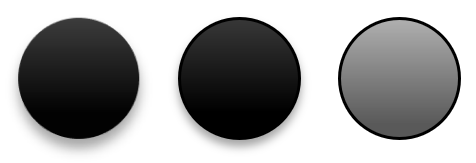

## **소개**

프레젠테이션 테마는 색상, 글꼴, 배경 스타일, 채우기, 선 및 효과의 조정된 세트를 정의합니다. 테마 인식 객체는 각 시각 속성을 고정값으로 저장하는 대신 이러한 공유 정의를 참조하므로 테마 변경 시 한 번에 많은 객체를 업데이트할 수 있습니다.

Aspose.Slides에서 프레젠테이션 수준의 테마는 [Presentation::get_MasterTheme](https://reference.aspose.com/slides/cpp/aspose.slides/presentation/get_mastertheme/)을 통해 사용할 수 있습니다. 프레젠테이션에는 하위 수준에서 테마 오버라이드가 포함될 수도 있습니다. 마스터는 [MasterThemeManager::get_OverrideTheme](https://reference.aspose.com/slides/cpp/aspose.slides.theme/masterthememanager/get_overridetheme/)을 통해 프레젠테이션 테마를 오버라이드할 수 있고, 레이아웃이나 개별 슬라이드는 [IOverrideThemeManager::get_OverrideTheme](https://reference.aspose.com/slides/cpp/aspose.slides.theme/ioverridethememanager/get_overridetheme/)을 사용할 수 있습니다. 실제로 슬라이드에 적용되는 효과적인 테마는 다음과 같은 상속 체인을 통해 결정됩니다: 프레젠테이션 테마 → 마스터 오버라이드 → 레이아웃 오버라이드 → 슬라이드 오버라이드.


아래 섹션에서는 가장 일반적인 테마 작업 흐름을 보여줍니다: 테마 검사, 색상 및 글꼴 변경, 테마 복사 또는 적용, 배경 및 효과 스타일 업데이트, 그리고 상속 및 오버라이드가 해결된 후 효과적인 값을 읽는 방법.

## **테마 검사**

[MasterTheme](https://reference.aspose.com/slides/cpp/aspose.slides.theme/mastertheme/) 객체는 테마의 [get_ColorScheme](https://reference.aspose.com/slides/cpp/aspose.slides.theme/mastertheme/get_colorscheme/), [get_FontScheme](https://reference.aspose.com/slides/cpp/aspose.slides.theme/mastertheme/get_fontscheme/), [get_FormatScheme](https://reference.aspose.com/slides/cpp/aspose.slides.theme/mastertheme/get_formatscheme/) 메서드를 제공합니다. 변경하기 전에 이러한 컬렉션을 검사하는 것은 프레젠테이션이 외부 소스에서 온 경우 특히 유용합니다. 스타일 항목의 수와 내용이 다양할 수 있기 때문입니다.

다음 예제는 주요 테마 속성을 읽고 테마에 저장된 배경, 채우기, 선 및 효과 스타일의 개수를 보고합니다:

```cpp
#include <DOM/IColorFormat.h>
#include <DOM/IFonts.h>
#include <DOM/Presentation.h>
#include <DOM/Theme/IColorScheme.h>
#include <DOM/Theme/IEffectStyleCollection.h>
#include <DOM/Theme/IFillFormatCollection.h>
#include <DOM/Theme/IFontScheme.h>
#include <DOM/Theme/IFormatScheme.h>
#include <DOM/Theme/ILineFormatCollection.h>
#include <DOM/Theme/IMasterTheme.h>
#include <system/console.h>

using namespace Aspose::Slides;
using namespace System;

auto presentation = MakeObject<Presentation>(u"input.pptx");

auto theme = presentation->get_MasterTheme();
auto formatScheme = theme->get_FormatScheme();

Console::WriteLine(u"Theme name: {0}", theme->get_Name());
Console::WriteLine(u"Accent 1: {0}", theme->get_ColorScheme()->get_Accent1()->get_Color());
Console::WriteLine(u"Major Latin font: {0}", theme->get_FontScheme()->get_Major()->get_LatinFont()->get_FontName());
Console::WriteLine(u"Minor Latin font: {0}", theme->get_FontScheme()->get_Minor()->get_LatinFont()->get_FontName());
Console::WriteLine(u"Background fill styles: {0}", formatScheme->get_BackgroundFillStyles()->get_Count());
Console::WriteLine(u"Fill styles: {0}", formatScheme->get_FillStyles()->get_Count());
Console::WriteLine(u"Line styles: {0}", formatScheme->get_LineStyles()->get_Count());
Console::WriteLine(u"Effect styles: {0}", formatScheme->get_EffectStyles()->get_Count());
```

파일에 여러 마스터가 사용된 경우 모든 슬라이드가 동일한 효과적인 테마를 가진다고 가정하지 마십시오. 슬라이드와 연결된 마스터를 검사하고 레이아웃 또는 슬라이드 오버라이드가 존재할 수 있는 경우 이 문서 뒤에 소개된 효과적인 테마 작업 흐름을 사용하십시오.

## **테마 색상 변경**

테마 인식 채우기, 선 및 텍스트는 [SchemeColor](https://reference.aspose.com/slides/cpp/aspose.slides/schemecolor/) 열거형의 논리적 색상을 참조할 수 있습니다. 테마의 [IColorScheme](https://reference.aspose.com/slides/cpp/aspose.slides.theme/icolorscheme/)에서 해당 항목을 변경하면 해당 테마 색상을 아직 참조하고 있는 모든 객체가 새로운 값으로 해석됩니다. 직접 RGB 색상을 사용하는 객체는 테마 색상 업데이트의 영향을 받지 않습니다.

다음 엔드‑투‑엔드 예제는 `Accent4`를 사용하는 도형을 만들고, 테마의 `Accent4` 색상을 빨간색으로 바꾸고, 프레젠테이션을 저장한 뒤 다시 열어 효과적인 채우기 색상을 출력합니다:

```cpp
#include <DOM/FillType.h>
#include <DOM/IAutoShape.h>
#include <DOM/IColorFormat.h>
#include <DOM/IFillFormat.h>
#include <DOM/IFillFormatEffectiveData.h>
#include <DOM/IShapeCollection.h>
#include <DOM/ISlide.h>
#include <DOM/Presentation.h>
#include <DOM/SchemeColor.h>
#include <DOM/ShapeType.h>
#include <DOM/Theme/IColorScheme.h>
#include <DOM/Theme/IMasterTheme.h>
#include <Export/SaveFormat.h>
#include <drawing/color.h>
#include <system/console.h>

using namespace Aspose::Slides;
using namespace Aspose::Slides::Export;
using namespace System;
using namespace System::Drawing;

auto presentation = MakeObject<Presentation>();
auto slide = presentation->get_Slide(0);

auto shape = slide->get_Shapes()->AddAutoShape(ShapeType::Rectangle, 10.0f, 10.0f, 100.0f, 100.0f);
shape->get_FillFormat()->set_FillType(FillType::Solid);
shape->get_FillFormat()->get_SolidFillColor()->set_SchemeColor(SchemeColor::Accent4);

presentation->get_MasterTheme()->get_ColorScheme()->get_Accent4()->set_Color(Color::get_Red());
presentation->Save(u"theme-color.pptx", SaveFormat::Pptx);

auto savedPresentation = MakeObject<Presentation>(u"theme-color.pptx");
auto savedSlide = savedPresentation->get_Slide(0);
auto savedShape = savedSlide->get_Shape(0);
auto effectiveFill = savedShape->get_FillFormat()->GetEffective();
Console::WriteLine(u"Effective fill color: {0}", effectiveFill->get_SolidFillColor());
```

사각형이 `Accent4`에 계속 연결되어 있기 때문에 테마가 변경되면 표시 색상이 빨간색으로 바뀝니다. 도형에 직접 색상을 지정하면 이후 `Accent4` 변경이 해당 채우기에 영향을 주지 않습니다.

### **추가 팔레트 색상 사용**

PowerPoint는 테마 색상에 색상 변환을 적용하여 밝고 어두운 변형을 생성합니다. Aspose.Slides는 이러한 변환을 [ColorTransformOperation](https://reference.aspose.com/slides/cpp/aspose.slides/colortransformoperation/)을 통해 제공합니다.


**1** - 메인 테마 색상.

**2** - 메인 테마 색상에서 파생된 밝고 어두운 변형.

다음 예제는 `Accent4`를 기반으로 여섯 개의 사각형을 만들고, 그 중 다섯 개에 밝기 변환을 적용한 뒤 결과를 저장합니다:

```cpp
#include <DOM/ColorTransformOperation.h>
#include <DOM/FillType.h>
#include <DOM/IAutoShape.h>
#include <DOM/IColorFormat.h>
#include <DOM/IColorOperationCollection.h>
#include <DOM/IFillFormat.h>
#include <DOM/IShapeCollection.h>
#include <DOM/ISlide.h>
#include <DOM/Presentation.h>
#include <DOM/SchemeColor.h>
#include <DOM/ShapeType.h>
#include <Export/SaveFormat.h>

using namespace Aspose::Slides;
using namespace Aspose::Slides::Export;
using namespace System;

auto presentation = MakeObject<Presentation>();
auto shapes = presentation->get_Slide(0)->get_Shapes();

auto shape1 = shapes->AddAutoShape(ShapeType::Rectangle, 10.0f, 10.0f, 50.0f, 50.0f);
auto fillFormat1 = shape1->get_FillFormat();
fillFormat1->set_FillType(FillType::Solid);
fillFormat1->get_SolidFillColor()->set_SchemeColor(SchemeColor::Accent4);

auto shape2 = shapes->AddAutoShape(ShapeType::Rectangle, 10.0f, 70.0f, 50.0f, 50.0f);
auto fillFormat2 = shape2->get_FillFormat();
auto solidFillColor2 = fillFormat2->get_SolidFillColor();
fillFormat2->set_FillType(FillType::Solid);
solidFillColor2->set_SchemeColor(SchemeColor::Accent4);
solidFillColor2->get_ColorTransform()->Add(ColorTransformOperation::MultiplyLuminance, 0.2f);
solidFillColor2->get_ColorTransform()->Add(ColorTransformOperation::AddLuminance, 0.8f);

auto shape3 = shapes->AddAutoShape(ShapeType::Rectangle, 10.0f, 130.0f, 50.0f, 50.0f);
auto fillFormat3 = shape3->get_FillFormat();
auto solidFillColor3 = fillFormat3->get_SolidFillColor();
fillFormat3->set_FillType(FillType::Solid);
solidFillColor3->set_SchemeColor(SchemeColor::Accent4);
solidFillColor3->get_ColorTransform()->Add(ColorTransformOperation::MultiplyLuminance, 0.4f);
solidFillColor3->get_ColorTransform()->Add(ColorTransformOperation::AddLuminance, 0.6f);

auto shape4 = shapes->AddAutoShape(ShapeType::Rectangle, 10.0f, 190.0f, 50.0f, 50.0f);
auto fillFormat4 = shape4->get_FillFormat();
auto solidFillColor4 = fillFormat4->get_SolidFillColor();
fillFormat4->set_FillType(FillType::Solid);
solidFillColor4->set_SchemeColor(SchemeColor::Accent4);
solidFillColor4->get_ColorTransform()->Add(ColorTransformOperation::MultiplyLuminance, 0.6f);
solidFillColor4->get_ColorTransform()->Add(ColorTransformOperation::AddLuminance, 0.4f);

auto shape5 = shapes->AddAutoShape(ShapeType::Rectangle, 10.0f, 250.0f, 50.0f, 50.0f);
auto fillFormat5 = shape5->get_FillFormat();
auto solidFillColor5 = fillFormat5->get_SolidFillColor();
fillFormat5->set_FillType(FillType::Solid);
solidFillColor5->set_SchemeColor(SchemeColor::Accent4);
solidFillColor5->get_ColorTransform()->Add(ColorTransformOperation::MultiplyLuminance, 0.75f);

auto shape6 = shapes->AddAutoShape(ShapeType::Rectangle, 10.0f, 310.0f, 50.0f, 50.0f);
auto fillFormat6 = shape6->get_FillFormat();
auto solidFillColor6 = fillFormat6->get_SolidFillColor();
fillFormat6->set_FillType(FillType::Solid);
solidFillColor6->set_SchemeColor(SchemeColor::Accent4);
solidFillColor6->get_ColorTransform()->Add(ColorTransformOperation::MultiplyLuminance, 0.5f);

presentation->Save(u"theme-color-palette.pptx", SaveFormat::Pptx);
```

이 변형들은 여전히 테마 색상을 기반으로 합니다. `Accent4`가 나중에 변경되면 변환된 색상은 새로운 `Accent4` 값으로 다시 계산됩니다.

### **`SchemeColor` 값을 `IColorScheme` 슬롯에 매핑**

[SchemeColor](https://reference.aspose.com/slides/cpp/aspose.slides/schemecolor/) 열거형은 `Text1`, `Background1`, `Text2`, `Background2`를 사용하고, [IColorScheme](https://reference.aspose.com/slides/cpp/aspose.slides.theme/icolorscheme/)은 동일한 테마 슬롯을 `Dark1`, `Light1`, `Dark2`, `Light2`로 노출합니다. 매핑은 고정되어 있습니다:

* `Text1` = `Dark1`
* `Background1` = `Light1`
* `Text2` = `Dark2`
* `Background2` = `Light2`

이는 동일한 테마 슬롯에 대한 다른 이름일 뿐이며, 한 형태에서 다른 형태로 동적으로 변환되는 값이 아닙니다.

## **테마 글꼴 변경**

테마 글꼴 스키마는 제목용 주요 글꼴 세트와 본문용 부글꼴 세트를 포함합니다. [FontScheme::get_Major](https://reference.aspose.com/slides/cpp/aspose.slides.theme/fontscheme/get_major/) 및 [FontScheme::get_Minor](https://reference.aspose.com/slides/cpp/aspose.slides.theme/fontscheme/get_minor/) 메서드가 해당 세트를 노출합니다.

PowerPoint 호환 테마 글꼴 식별자는 텍스트 서식에 사용할 수 있습니다:

* `+mn‑lt` - 본문 글꼴 라틴어 (Minor Latin Font)
* `+mj‑lt` - 제목 글꼴 라틴어 (Major Latin Font)
* `+mn‑ea` - 본문 글꼴 동아시아어 (Minor East Asian Font)
* `+mj‑ea` - 제목 글꼴 동아시아어 (Major East Asian Font)
* `+mn‑cs` - 본문 글꼴 복합 스크립트 (Minor Complex Script Font)
* `+mj‑cs` - 제목 글꼴 복합 스크립트 (Major Complex Script Font)

다음 예제는 주요 라틴 테마 글꼴을 사용하는 제목 하나와 부 라틴 테마 글꼴을 사용하는 본문 라인 하나를 만든 뒤, 테마 글꼴을 변경하고 결과를 저장합니다:

```cpp
#include <DOM/Fonts/FontData.h>
#include <DOM/IAutoShape.h>
#include <DOM/IFonts.h>
#include <DOM/IParagraph.h>
#include <DOM/IParagraphCollection.h>
#include <DOM/IPortion.h>
#include <DOM/IPortionCollection.h>
#include <DOM/IPortionFormat.h>
#include <DOM/IShapeCollection.h>
#include <DOM/ISlide.h>
#include <DOM/ITextFrame.h>
#include <DOM/Presentation.h>
#include <DOM/ShapeType.h>
#include <DOM/Theme/IFontScheme.h>
#include <DOM/Theme/IMasterTheme.h>
#include <Export/SaveFormat.h>

using namespace Aspose::Slides;
using namespace Aspose::Slides::Export;
using namespace System;

auto presentation = MakeObject<Presentation>();
auto slide = presentation->get_Slide(0);

auto heading = slide->get_Shapes()->AddAutoShape(ShapeType::Rectangle, 40.0f, 40.0f, 500.0f, 60.0f);
heading->get_TextFrame()->set_Text(u"Theme heading");
heading->get_TextFrame()->get_Paragraph(0)->get_Portion(0)->get_PortionFormat()->set_LatinFont(MakeObject<FontData>(u"+mj-lt"));

auto body = slide->get_Shapes()->AddAutoShape(ShapeType::Rectangle, 40.0f, 120.0f, 500.0f, 60.0f);
body->get_TextFrame()->set_Text(u"Theme body text");
body->get_TextFrame()->get_Paragraph(0)->get_Portion(0)->get_PortionFormat()->set_LatinFont(MakeObject<FontData>(u"+mn-lt"));

presentation->get_MasterTheme()->get_FontScheme()->get_Major()->set_LatinFont(MakeObject<FontData>(u"Aptos Display"));
presentation->get_MasterTheme()->get_FontScheme()->get_Minor()->set_LatinFont(MakeObject<FontData>(u"Arial"));
presentation->Save(u"theme-fonts.pptx", SaveFormat::Pptx);
```

제목은 주요 글꼴을 따르고 본문 텍스트는 부 글꼴을 따릅니다. 테마 식별자가 아닌 명시적인 글꼴 이름이 지정된 경우 테마 글꼴 스키마가 변경되어도 자동으로 전환되지 않습니다.

주요 및 부 글꼴 컬렉션에는 키릴 문자, 아랍어, 일본어, 조지아어, 타이나와 같은 개별 문자 체계에 대한 글꼴 매핑도 포함될 수 있습니다. 이러한 매핑을 검사, 추가, 교체 또는 제거하려면 [Script‑Specific Theme Fonts](/slides/ko/cpp/script-specific-font-mappings/)를 참조하십시오.

{}
프레젠테이션 글꼴에 대한 자세한 내용은 [PowerPoint Fonts](/slides/ko/cpp/powerpoint-fonts/)를 확인하십시오.
{}

### **테마 글꼴 참조 해석**

텍스트를 검사할 때 [IFontData::get_FontName](https://reference.aspose.com/slides/cpp/aspose.slides/ifontdata/get_fontname/)에 `+mn‑lt`와 같은 테마 참조가 포함될 수 있습니다. 해당 참조를 해석하려면 적절한 [IThemeEffectiveData](https://reference.aspose.com/slides/cpp/aspose.slides.theme/ithemeeffectivedata/)와 함께 [IFontData::GetFontName](https://reference.aspose.com/slides/cpp/aspose.slides/ifontdata/getfontname/)를 호출하십시오. `+mj`와 `+mn` 접두사는 각각 주요와 부 글꼴 세트를 선택하고, `-lt`, `-ea`, `-cs` 접미사는 라틴, 동아시아, 복합 스크립트 글꼴을 선택합니다.

테마가 적용된 객체에 대해 [IThemeable::CreateThemeEffective](https://reference.aspose.com/slides/cpp/aspose.slides.theme/ithemeable/createthemeeffective/)를 호출하여 효과적인 테마를 얻습니다. 일반 슬라이드 텍스트의 경우 `slide->CreateThemeEffective()`를 사용하면 해당 슬라이드의 상속 테마와 로컬 오버라이드가 포함된 컨텍스트가 제공됩니다. 레이아웃이나 마스터 자체를 검사할 때는 해당 객체의 효과적인 테마를 사용하십시오. 첫 번째 마스터의 테마가 모든 슬라이드에 적용된다고 가정하지 마십시오.

다음 예제는 부 라틴 글꼴을 명시적으로 참조하는 텍스트 부분을 만들고, [IOverrideTheme::InitFontSchemeFromInherited](https://reference.aspose.com/slides/cpp/aspose.slides.theme/ioverridetheme/initfontschemefrominherited/)를 통해 슬라이드 글꼴 스키마를 초기화한 뒤 주요 및 부 라틴 글꼴을 각각 `Arial`과 `Calibri`로 설정하여 입력 파일 없이 재현 가능한 결과를 만들습니다:

```cpp
#include <DOM/Fonts/FontData.h>
#include <DOM/IAutoShape.h>
#include <DOM/IFonts.h>
#include <DOM/IParagraph.h>
#include <DOM/IPortion.h>
#include <DOM/IPortionFormat.h>
#include <DOM/IShapeCollection.h>
#include <DOM/ISlide.h>
#include <DOM/ITextFrame.h>
#include <DOM/Presentation.h>
#include <DOM/ShapeType.h>
#include <DOM/Theme/IFontScheme.h>
#include <DOM/Theme/IOverrideTheme.h>
#include <DOM/Theme/IOverrideThemeManager.h>
#include <DOM/Theme/IThemeEffectiveData.h>
#include <system/console.h>

using namespace Aspose::Slides;
using namespace System;

auto presentation = MakeObject<Presentation>();
auto slide = presentation->get_Slide(0);

auto theme = slide->get_ThemeManager()->get_OverrideTheme();
theme->InitFontSchemeFromInherited();
theme->get_FontScheme()->get_Major()->set_LatinFont(MakeObject<FontData>(u"Arial"));
theme->get_FontScheme()->get_Minor()->set_LatinFont(MakeObject<FontData>(u"Calibri"));

auto shape = slide->get_Shapes()->AddAutoShape(ShapeType::Rectangle, 20.0f, 20.0f, 400.0f, 60.0f);
shape->get_TextFrame()->set_Text(u"Text using the minor theme font");

auto portion = shape->get_TextFrame()->get_Paragraph(0)->get_Portion(0);
portion->get_PortionFormat()->set_LatinFont(MakeObject<FontData>(u"+mn-lt"));

auto font = portion->get_PortionFormat()->get_LatinFont();
auto effectiveTheme = slide->CreateThemeEffective();
auto resolvedFontName = font->GetFontName(effectiveTheme);
Console::WriteLine(u"{0} -> {1}", font->get_FontName(), resolvedFontName);

auto explicitFont = MakeObject<FontData>(u"Verdana");
auto explicitFontName = explicitFont->GetFontName(effectiveTheme);
Console::WriteLine(u"{0} -> {1}", explicitFont->get_FontName(), explicitFontName);
```

출력은 `+mn‑lt -> Calibri` 뒤에 `Verdana -> Verdana`가 표시됩니다. 저장된 참조는 변경되지 않으며, 명시적인 글꼴 이름은 그대로 반환됩니다. 부분이 `+mj‑lt`를 사용했다면 이 테마에서는 `Arial`로 해석됩니다.

테마 참조를 해석하면 테마가 지정한 글꼴 패밀리를 식별합니다. 이는 글꼴 가용성을 확인하거나 렌더링 시 대체 또는 글리프 폴백 후 실제 사용되는 글꼴 파일을 결정하지는 않습니다. 해당 별도 단계에 대해서는 [Font Selection Sequence](/slides/ko/cpp/font-selection-sequence/)와 [Font Substitution](/slides/ko/cpp/font-substitution/)를 참조하십시오.

## **테마 복사 또는 적용**

아래 작업 흐름은 서로 다른 테마 관련 문제를 해결합니다.

### **외부 테마를 마스터에 종속된 슬라이드에 적용**

PowerPoint 테마 파일(`.thmx`)이 있고 해당 마스터에 종속된 모든 슬라이드를 재스타일링하려면 [IMasterSlide::ApplyExternalThemeToDependingSlides](https://reference.aspose.com/slides/cpp/aspose.slides/imasterslide/applyexternalthemetodependingslides/)를 사용하십시오. [Presentation::get_Masters](https://reference.aspose.com/slides/cpp/aspose.slides/presentation/get_masters/) 컬렉션에서 마스터를 선택하고, 이 컬렉션은 [IMasterSlideCollection](https://reference.aspose.com/slides/cpp/aspose.slides/imasterslidecollection/)을 구현합니다. 그런 다음 테마 파일 경로를 메서드에 전달합니다.

메서드는 다음 작업을 수행합니다:

1. 선택한 마스터를 기반으로 새 마스터 슬라이드를 생성합니다.
1. 외부 테마를 새 마스터에 적용합니다.
1. 이전에 선택한 마스터에 종속되었던 모든 슬라이드에 새 마스터를 할당합니다.
1. 새로 만든 [IMasterSlide](https://reference.aspose.com/slides/cpp/aspose.slides/imasterslide/)를 반환합니다.

다음 예제는 첫 번째 마스터에 종속된 슬라이드에 외부 테마를 적용하고 프레젠테이션을 저장합니다:

```cpp
#include <DOM/IMasterSlide.h>
#include <DOM/Presentation.h>
#include <Export/SaveFormat.h>
#include <iostream>

using namespace Aspose::Slides;
using namespace Aspose::Slides::Export;
using namespace System;

auto presentation = MakeObject<Presentation>(u"presentation.pptx");
auto selectedMaster = presentation->get_Master(0);

auto themedMaster = selectedMaster->ApplyExternalThemeToDependingSlides(u"corporate-theme.thmx");
Console::WriteLine(u"Created master: {0}", themedMaster->get_Name());

presentation->Save(u"presentation-with-external-theme.pptx", SaveFormat::Pptx);
```

잘못되었거나 손상되었거나 지원되지 않는 테마는 [PptxException](https://reference.aspose.com/slides/cpp/aspose.slides/pptxexception/) 또는 해당 형식 관련 하위 클래스 중 하나를 일으킬 수 있습니다. 사용자가 제공한 경로를 검증하고 파일 시스템 접근 오류를 처리하며, 테마가 성공적으로 적용된 후에만 프레젠테이션을 저장하십시오.

선택된 마스터에 종속된 슬라이드만 재할당됩니다. 다른 마스터와 연결된 슬라이드는 기존 마스터와 테마를 유지합니다. 테마 인식 색상, 글꼴, 채우기, 선, 배경 및 효과는 외부 테마에 따라 해석됩니다. 직접 지정된 색상, 글꼴, 채우기 및 기타 명시적 서식은 변경되지 않을 수 있습니다. 레이아웃 수준 및 슬라이드 수준 오버라이드가 새 마스터에서 상속된 값보다 우선할 수도 있습니다.

테마는 실행 환경에 없는 글꼴을 참조할 수 있습니다. 일관된 렌더링 및 내보내기를 위해 필요한 글꼴을 설치하거나 [custom font sources](/slides/ko/cpp/custom-font/)를 통해 제공하거나 [font substitution](/slides/ko/cpp/font-substitution/)을 구성하십시오.

이는 직접적인 마스터 수준 작업 흐름입니다. 메서드는 `.thmx` 파일 경로만 받아들이며 슬라이드 수준이나 레이아웃 수준 테마 오버라이드를 수동으로 생성할 필요가 없습니다.

### **다중 마스터 프레젠테이션에서 서로 다른 외부 테마 적용**

관련 마스터를 미리 알 수 없는 경우 [ISlide::get_LayoutSlide](https://reference.aspose.com/slides/cpp/aspose.slides/islide/get_layoutslide/)와 [ILayoutSlide::get_MasterSlide](https://reference.aspose.com/slides/cpp/aspose.slides/ilayoutslide/get_masterslide/)를 통해 대표 슬라이드에서 마스터를 얻습니다. 테마를 적용하기 전에 원본 마스터 참조를 저장하십시오. 호출마다 프레젠테이션에 새 마스터가 생성됩니다.

다음 예제는 두 섹션의 슬라이드를 사용하여 각 마스터를 찾고, 각 그룹에 서로 다른 외부 테마를 적용합니다:

```cpp
#include <DOM/ILayoutSlide.h>
#include <DOM/IMasterSlide.h>
#include <DOM/Presentation.h>
#include <Export/SaveFormat.h>
#include <iostream>

using namespace Aspose::Slides;
using namespace Aspose::Slides::Export;
using namespace System;

auto presentation = MakeObject<Presentation>(u"multi-master-presentation.pptx");

if (presentation->get_Slides()->get_Count() < 5)
{
    std::cout << "The presentation does not contain the expected representative slides." << std::endl;
}
else
{
    auto firstGroupMaster = presentation->get_Slide(0)->get_LayoutSlide()->get_MasterSlide();
    auto secondGroupMaster = presentation->get_Slide(4)->get_LayoutSlide()->get_MasterSlide();

    if (firstGroupMaster->get_SlideId() == secondGroupMaster->get_SlideId())
    {
        std::cout << "The representative slides use the same master." << std::endl;
    }
    else
    {
        auto firstThemedMaster = firstGroupMaster->ApplyExternalThemeToDependingSlides(u"blue-theme.thmx");
        auto secondThemedMaster = secondGroupMaster->ApplyExternalThemeToDependingSlides(u"green-theme.thmx");

        Console::WriteLine(u"First themed master: {0}", firstThemedMaster->get_Name());
        Console::WriteLine(u"Second themed master: {0}", secondThemedMaster->get_Name());

        presentation->Save(u"multi-master-with-external-themes.pptx", SaveFormat::Pptx);
    }
}
```

첫 번째 호출은 `firstGroupMaster`에 종속된 슬라이드에만 영향을 주고, 두 번째 호출은 `secondGroupMaster`에 종속된 슬라이드에만 영향을 줍니다. 다른 마스터에 속한 슬라이드는 재스타일링되지 않습니다.

### **슬라이드 이동 시 원본 테마 보존**

슬라이드를 다른 프레젠테이션으로 이동하면서 원본 디자인을 유지하려면 [IMasterSlideCollection::AddClone](https://reference.aspose.com/slides/cpp/aspose.slides/imasterslidecollection/addclone/)을 사용해 소스 마스터를 대상 프레젠테이션에 복제한 뒤, [ISlideCollection::AddClone](https://reference.aspose.com/slides/cpp/aspose.slides/islidecollection/addclone/)과 복제된 마스터를 사용해 슬라이드를 복제합니다. 이렇게 하면 마스터, 레이아웃 및 연결된 테마가 함께 복사됩니다.

```cpp
#include <DOM/ILayoutSlide.h>
#include <DOM/IMasterSlide.h>
#include <DOM/IMasterSlideCollection.h>
#include <DOM/ISlide.h>
#include <DOM/ISlideCollection.h>
#include <DOM/Presentation.h>
#include <Export/SaveFormat.h>

using namespace Aspose::Slides;
using namespace Aspose::Slides::Export;
using namespace System;

auto source = MakeObject<Presentation>(u"source-theme.pptx");
auto target = MakeObject<Presentation>(u"target.pptx");

auto sourceSlide = source->get_Slide(0);

auto sourceMaster = sourceSlide->get_LayoutSlide()->get_MasterSlide();
auto clonedMaster = target->get_Masters()->AddClone(sourceMaster);
target->get_Slides()->AddClone(sourceSlide, clonedMaster, true);

target->Save(u"theme-preserved.pptx", SaveFormat::Pptx);
```

대상 슬라이드가 동일한 디자인을 유지해야 할 때 권장되는 작업 흐름입니다. 관련 없는 대상 마스터에 콘텐츠만 복제하면 테마 기반 색상, 글꼴, 배경 및 효과가 변경될 수 있습니다.

### **기존 슬라이드에 테마 값 적용**

대상 슬라이드가 현재 마스터와 레이아웃을 유지해야 하는 경우 소스 테마에서 슬라이드 수준 오버라이드를 초기화합니다. [OverrideTheme::InitColorSchemeFrom](https://reference.aspose.com/slides/cpp/aspose.slides.theme/overridetheme/initcolorschemefrom/), [OverrideTheme::InitFontSchemeFrom](https://reference.aspose.com/slides/cpp/aspose.slides.theme/overridetheme/initfontschemefrom/), [OverrideTheme::InitFormatSchemeFrom](https://reference.aspose.com/slides/cpp/aspose.slides.theme/overridetheme/initformatschemefrom/) 메서드가 세 가지 주요 테마 구성 요소를 오버라이드에 복사합니다.

```cpp
#include <DOM/ISlide.h>
#include <DOM/Presentation.h>
#include <DOM/Theme/IOverrideTheme.h>
#include <DOM/Theme/IOverrideThemeManager.h>
#include <DOM/Theme/IMasterTheme.h>
#include <Export/SaveFormat.h>

using namespace Aspose::Slides;
using namespace Aspose::Slides::Export;
using namespace System;

auto source = MakeObject<Presentation>(u"source-theme.pptx");
auto target = MakeObject<Presentation>(u"target.pptx");
auto targetSlide = target->get_Slide(0);

auto overrideTheme = targetSlide->get_ThemeManager()->get_OverrideTheme();
overrideTheme->InitColorSchemeFrom(source->get_MasterTheme()->get_ColorScheme());
overrideTheme->InitFontSchemeFrom(source->get_MasterTheme()->get_FontScheme());
overrideTheme->InitFormatSchemeFrom(source->get_MasterTheme()->get_FormatScheme());

target->Save(u"theme-applied-to-slide.pptx", SaveFormat::Pptx);
```

이 작업은 다른 슬라이드가 상속하는 테마를 바꾸지 않고 해당 슬라이드에만 사용되는 테마를 변경합니다. 로컬 오버라이드를 제거하고 상속된 값으로 돌아가려면 [OverrideTheme::Clear](https://reference.aspose.com/slides/cpp/aspose.slides.theme/overridetheme/clear/)를 호출하십시오.

### **레이아웃에 테마 오버라이드 적용**

레이아웃 수준 오버라이드는 해당 레이아웃을 사용하는 슬라이드에 적용되며, 개별 슬라이드에 자체 오버라이드가 없는 경우에만 적용됩니다. 동일한 초기화 메서드를 레이아웃의 [IOverrideThemeManager](https://reference.aspose.com/slides/cpp/aspose.slides.theme/ioverridethememanager/)를 통해 사용할 수 있습니다:

```cpp
#include <DOM/ILayoutSlide.h>
#include <DOM/ISlide.h>
#include <DOM/Presentation.h>
#include <DOM/Theme/IOverrideTheme.h>
#include <DOM/Theme/IOverrideThemeManager.h>
#include <DOM/Theme/IMasterTheme.h>
#include <Export/SaveFormat.h>

using namespace Aspose::Slides;
using namespace Aspose::Slides::Export;
using namespace System;

auto source = MakeObject<Presentation>(u"source-theme.pptx");
auto target = MakeObject<Presentation>(u"target.pptx");
auto targetSlide = target->get_Slide(0);

auto targetLayout = targetSlide->get_LayoutSlide();
auto overrideTheme = targetLayout->get_ThemeManager()->get_OverrideTheme();
overrideTheme->InitColorSchemeFrom(source->get_MasterTheme()->get_ColorScheme());
overrideTheme->InitFontSchemeFrom(source->get_MasterTheme()->get_FontScheme());
overrideTheme->InitFormatSchemeFrom(source->get_MasterTheme()->get_FormatScheme());

target->Save(u"theme-applied-to-layout.pptx", SaveFormat::Pptx);
```

많은 레이아웃과 슬라이드가 동일한 기본 디자인을 공유해야 할 때는 마스터 또는 프레젠테이션 수준 테마를 사용하고, 하나의 레이아웃 패밀리만 다른 스타일이 필요할 때는 레이아웃 오버라이드를, 진정한 예외에만 슬라이드 오버라이드를 사용하십시오. 과도한 슬라이드 수준 오버라이드는 이후 글로벌 테마 변경을 예측하기 어렵게 만들 수 있습니다.

## **테마 배경 스타일 업데이트**

테마의 배경 채우기는 [FormatScheme::get_BackgroundFillStyles](https://reference.aspose.com/slides/cpp/aspose.slides.theme/formatscheme/get_backgroundfillstyles/)에 저장됩니다. PowerPoint는 UI에서 테마 채우기와 테마 색상 및 기타 스타일 참조를 조합할 수 있기 때문에 실제 컬렉션에 물리적으로 저장된 채우기 정의보다 더 많은 배경 선택지를 표시할 수 있습니다.


배경 스타일을 사용하기 전에 저장된 컬렉션과 현재 [Background::get_StyleIndex](https://reference.aspose.com/slides/cpp/aspose.slides/background/get_styleindex/)를 검사하십시오. `StyleIndex`는 테마 채우기가 없을 때 `0`을 사용하고, 양수 값은 테마 배경‑스타일 참조를 의미합니다. 이는 `idx_get(0)`와 같이 C++ 컬렉션을 직접 인덱싱할 때 `0`이 첫 번째 항목을 의미하는 것과 다릅니다. 모든 프레젠테이션이 동일한 수의 배경 채우기 스타일을 가지고 있다고 가정하지 마십시오.

다음 예제는 사용 가능한 배경 채우기 개수를 보고하고, 첫 번째 마스터에 테마 배경 참조를 할당한 뒤 프레젠테이션을 저장합니다:

```cpp
#include <DOM/BackgroundType.h>
#include <DOM/IBackground.h>
#include <DOM/IMasterSlide.h>
#include <DOM/Presentation.h>
#include <DOM/Theme/IFillFormatCollection.h>
#include <DOM/Theme/IFormatScheme.h>
#include <DOM/Theme/IMasterTheme.h>
#include <Export/SaveFormat.h>
#include <system/console.h>

using namespace Aspose::Slides;
using namespace Aspose::Slides::Export;
using namespace System;

auto presentation = MakeObject<Presentation>(u"input.pptx");

auto backgroundStyles = presentation->get_MasterTheme()->get_FormatScheme()->get_BackgroundFillStyles();
Console::WriteLine(u"Background fill styles: {0}", backgroundStyles->get_Count());

if (backgroundStyles->get_Count() > 0)
{
    auto masterSlide = presentation->get_Master(0);
    masterSlide->get_Background()->set_Type(BackgroundType::Themed);
    masterSlide->get_Background()->set_StyleIndex(1);

    presentation->Save(u"theme-background.pptx", SaveFormat::Pptx);
}
```

시각적인 결과는 마스터가 참조하는 테마 항목 및 레이아웃이나 슬라이드 수준의 배경 오버라이드 여부에 따라 달라집니다. 슬라이드에 자체 배경이 설정된 경우 마스터 배경만 변경해도 해당 슬라이드에는 영향을 주지 않을 수 있습니다. 최종 배경을 알 필요가 있으면 [Background::GetEffective](https://reference.aspose.com/slides/cpp/aspose.slides/background/geteffective/)를 사용하십시오.

{}
`StyleIndex`를 0 기반 컬렉션 인덱스로 취급하지 마십시오. 또한 하나의 파일에서 사용한 스타일 번호를 다른 파일에 그대로 적용한다고 가정하지 마십시오. 테마 스타일 정의는 프레젠테이션마다 다릅니다.
{}

{}
직접적인 배경 서식 및 배경 상속에 대해서는 [Presentation Background](/slides/ko/cpp/presentation-background/)를 참조하십시오.
{}

## **테마 효과 업데이트**

테마 포맷 스키마에는 별도의 [FormatScheme::get_FillStyles](https://reference.aspose.com/slides/cpp/aspose.slides.theme/formatscheme/get_fillstyles/), [FormatScheme::get_LineStyles](https://reference.aspose.com/slides/cpp/aspose.slides.theme/formatscheme/get_linestyles/), [FormatScheme::get_EffectStyles](https://reference.aspose.com/slides/cpp/aspose.slides.theme/formatscheme/get_effectstyles/) 컬렉션이 포함됩니다. 일반적인 Office 테마는 시각적으로 미묘한, 보통, 강렬한 서식을 나타내는 세 개의 주요 스타일 항목을 포함하지만, 코드는 고정된 개수를 가정하지 말고 각 컬렉션을 검사해야 합니다.



C++에서 이러한 컬렉션에 접근할 때 인덱스는 0 기반이며, `idx_get(0)`은 첫 번째 저장된 스타일, `idx_get(2)`는 세 번째 스타일을 의미합니다. 도형의 스타일‑참조 인덱스는 별개의 개념으로, [IShapeStyle](https://reference.aspose.com/slides/cpp/aspose.slides/ishapestyle/)을 통해 노출됩니다. 테마 스타일을 수정하면 해당 테마 스타일을 참조하는 도형에 영향을 주며, 직접 서식이 적용된 도형은 변경되지 않을 수 있습니다.

다음 예제는 필요한 스타일 항목이 존재하는지 확인하고, 첫 번째 선 스타일을 변경하고, 세 번째 채우기 스타일을 변경하며, 세 번째 효과 스타일에 외부 그림자를 활성화하고 결과를 저장합니다:

```cpp
#include <DOM/Effects/IOuterShadow.h>
#include <DOM/FillType.h>
#include <DOM/IColorFormat.h>
#include <DOM/IEffectFormat.h>
#include <DOM/IFillFormat.h>
#include <DOM/ILineFormat.h>
#include <DOM/Presentation.h>
#include <DOM/Theme/IEffectStyle.h>
#include <DOM/Theme/IEffectStyleCollection.h>
#include <DOM/Theme/IFillFormatCollection.h>
#include <DOM/Theme/IFormatScheme.h>
#include <DOM/Theme/ILineFormatCollection.h>
#include <DOM/Theme/IMasterTheme.h>
#include <Export/SaveFormat.h>
#include <drawing/color.h>
#include <system/console.h>

using namespace Aspose::Slides;
using namespace Aspose::Slides::Export;
using namespace System;
using namespace System::Drawing;

auto presentation = MakeObject<Presentation>(u"Subtle_Moderate_Intense.pptx");
auto formatScheme = presentation->get_MasterTheme()->get_FormatScheme();
auto lineStyles = formatScheme->get_LineStyles();
auto fillStyles = formatScheme->get_FillStyles();
auto effectStyles = formatScheme->get_EffectStyles();

if (lineStyles->get_Count() < 1 || fillStyles->get_Count() < 3 || effectStyles->get_Count() < 3)
{
    Console::WriteLine(u"The theme does not contain the style entries required by this example.");
}
else
{
    auto lineStyle = lineStyles->idx_get(0);
    lineStyle->get_FillFormat()->set_FillType(FillType::Solid);
    lineStyle->get_FillFormat()->get_SolidFillColor()->set_Color(Color::get_Red());

    auto fillStyle = fillStyles->idx_get(2);
    fillStyle->set_FillType(FillType::Solid);
    fillStyle->get_SolidFillColor()->set_Color(Color::get_ForestGreen());

    auto effectFormat = effectStyles->idx_get(2)->get_EffectFormat();
    effectFormat->EnableOuterShadowEffect();
    effectFormat->get_OuterShadowEffect()->set_Distance(10.0f);

    presentation->Save(u"theme-effects.pptx", SaveFormat::Pptx);
}
```

해당 슬롯을 참조하는 도형의 경우 첫 번째 테마 선 스타일은 빨간색이 되고, 세 번째 테마 채우기 스타일은 실선 숲 녹색이 되며, 세 번째 효과 스타일은 거리 10포인트의 외부 그림자를 얻게 됩니다. 정확한 시각적 결과는 각 도형이 어떤 스타일 슬롯을 참조하고 있는지, 직접 서식이 테마를 오버라이드하는지에 따라 달라집니다.


## **도형에 대한 테마 채우기 및 선 스타일 선택**

도형은 [IShapeStyle::set_FillStyleIndex](https://reference.aspose.com/slides/cpp/aspose.slides/ishapestyle/set_fillstyleindex/)와 [IShapeStyle::set_LineStyleIndex](https://reference.aspose.com/slides/cpp/aspose.slides/ishapestyle/set_linestyleindex/)를 통해 채우기와 외곽선을 독립적으로 선택할 수 있습니다. 두 세터 모두 인덱스 `1`은 해당 테마 컬렉션의 첫 번째 항목(`idx_get(0)`)을, 인덱스 `2`는 두 번째 항목을 선택합니다.

다음 예제는 새 프레젠테이션의 기본 테마에 두 개의 채우기 스타일(금색 및 하늘색)과 두 개의 선 스타일(6pt 어두운 파랑, 12pt 어두운 빨강)을 설정하고, 세 단계에 걸쳐 슬라이드를 저장하여 PowerPoint에서 결과를 비교할 수 있게 합니다:

```cpp
#include <DOM/FillType.h>
#include <DOM/IAutoShape.h>
#include <DOM/IColorFormat.h>
#include <DOM/IFillFormat.h>
#include <DOM/ILineFormat.h>
#include <DOM/IShapeCollection.h>
#include <DOM/IShapeStyle.h>
#include <DOM/ISlide.h>
#include <DOM/Presentation.h>
#include <DOM/ShapeType.h>
#include <DOM/Theme/IFillFormatCollection.h>
#include <DOM/Theme/IFormatScheme.h>
#include <DOM/Theme/ILineFormatCollection.h>
#include <DOM/Theme/IMasterTheme.h>
#include <Export/SaveFormat.h>
#include <drawing/color.h>

using namespace Aspose::Slides;
using namespace Aspose::Slides::Export;
using namespace System;
using namespace System::Drawing;

auto presentation = MakeObject<Presentation>();
auto styles = presentation->get_MasterTheme()->get_FormatScheme();

auto goldFill = styles->get_FillStyles()->idx_get(0);
goldFill->set_FillType(FillType::Solid);
goldFill->get_SolidFillColor()->set_Color(Color::get_Gold());
auto blueFill = styles->get_FillStyles()->idx_get(1);
blueFill->set_FillType(FillType::Solid);
blueFill->get_SolidFillColor()->set_Color(Color::get_SkyBlue());

auto thinLine = styles->get_LineStyles()->idx_get(0);
thinLine->get_FillFormat()->set_FillType(FillType::Solid);
thinLine->get_FillFormat()->get_SolidFillColor()->set_Color(Color::get_DarkBlue());
thinLine->set_Width(6.0);
auto thickLine = styles->get_LineStyles()->idx_get(1);
thickLine->get_FillFormat()->set_FillType(FillType::Solid);
thickLine->get_FillFormat()->get_SolidFillColor()->set_Color(Color::get_DarkRed());
thickLine->set_Width(12.0);

auto shapes = presentation->get_Slide(0)->get_Shapes();
auto left = shapes->AddAutoShape(ShapeType::Rectangle, 100, 205, 200, 130);
auto right = shapes->AddAutoShape(ShapeType::Rectangle, 420, 205, 200, 130);
auto leftStyle = left->get_ShapeStyle();
auto rightStyle = right->get_ShapeStyle();
leftStyle->set_FillStyleIndex(1);
rightStyle->set_FillStyleIndex(2);
leftStyle->set_LineStyleIndex(1);
rightStyle->set_LineStyleIndex(1);
presentation->Save(u"01-initial.pptx", SaveFormat::Pptx);

rightStyle->set_LineStyleIndex(2);
presentation->Save(u"02-line-changed.pptx", SaveFormat::Pptx);

goldFill->get_SolidFillColor()->set_Color(Color::get_SeaGreen());
presentation->Save(u"03-theme-changed.pptx", SaveFormat::Pptx);
```

| 초기 스타일 | 오른쪽 외곽선 변경 | 첫 번째 테마 채우기 편집 |
|:---:|:---:|:---:|
|  |  |  |

다른 선 스타일을 선택하면 오른쪽 사각형의 외곽선만 변경됩니다. 첫 번째 테마 채우기를 편집하면 해당 채우기를 사용하는 모든 도형이 업데이트됩니다. 여기서는 왼쪽 사각형만 초록색으로 바뀝니다.

기존 도형에 로컬 채우기 색, 선 색 또는 선 두께가 있으면 테마 스타일의 해당 부분을 오버라이드할 수 있습니다. 스타일 인덱스를 변경해도 시각적 효과가 없으면 도형의 [direct formatting](/slides/ko/cpp/shape-formatting/)을 확인하십시오.

## **효과적인 단색 채우기가 테마 색상을 사용하는지 확인**

채우기는 객체에 직접 저장될 수도 있고, 단락, 레이아웃, 마스터, 테마 스타일 또는 다른 서식 레벨에서 상속될 수도 있습니다. [IFillFormat::GetEffective](https://reference.aspose.com/slides/cpp/aspose.slides/ifillformat/geteffective/)를 호출하여 해당 계층 구조를 불변의 [IFillFormatEffectiveData](https://reference.aspose.com/slides/cpp/aspose.slides/ifillformateffectivedata/)로 해석하십시오. 먼저 [IFillFormatEffectiveData::get_FillType](https://reference.aspose.com/slides/cpp/aspose.slides/ifillformateffectivedata/get_filltype/)을 확인하십시오. `FillType::Solid`인 경우에만 단색 채우기 속성을 읽어야 합니다.

단색 채우기의 경우 [IFillFormatEffectiveData::get_SolidFillColor](https://reference.aspose.com/slides/cpp/aspose.slides/ifillformateffectivedata/get_solidfillcolor/)는 상속, 테마 조회 및 색상 변환이 적용된 후 최종 렌더링된 RGB 값을 반환합니다. [IFillFormatEffectiveData::get_SolidFillSchemeColor](https://reference.aspose.com/slides/cpp/aspose.slides/ifillformateffectivedata/get_solidfillschemecolor/)는 해당 논리적 [SchemeColor](https://reference.aspose.com/slides/cpp/aspose.slides/schemecolor/) 슬롯(`Text1`, `Accent6` 등)을 반환합니다. `SchemeColor::NotDefined` 값은 효과적인 단색 채우기가 스킴 색상에 기반하지 않음을 의미합니다. 테마 색상 또는 직접 RGB 색상 중 하나만 사용하는 워크플로에서는 이 값이 직접 RGB 채우기를 나타냅니다.

로컬 [IColorFormat::get_SchemeColor](https://reference.aspose.com/slides/cpp/aspose.slides/icolorformat/get_schemecolor/) 값만으로 채우기를 분류하지 마십시오. 예를 들어 텍스트 부분에 로컬 스킴 색상이 정의되지 않아 `NotDefined`가 될 수 있지만, 효과적인 채우기는 테마 색상을 상속받아 `Text1`이나 `Accent6`으로 해석될 수 있습니다. 반대로 `get_SolidFillSchemeColor`는 어떤 논리적 테마 슬롯이 효과적인 색상을 만든 것인지 알려 주지만, 그 슬롯이 객체, 단락, 레이아웃, 마스터 또는 다른 서식 수준에서 왔는지는 알려주지 않습니다.

다음 예제는 프레젠테이션을 로드하고, 모든 도형 채우기와 텍스트 부분 채우기를 감사하며, 각 최종 RGB 값과 연관된 스킴 색상을 출력하고, 테마 색상 변경에 따라 업데이트되지 않을 단색 채우기를 표시합니다:

```cpp
#include <DOM/FillType.h>
#include <DOM/IAutoShape.h>
#include <DOM/IColorFormat.h>
#include <DOM/IFillFormat.h>
#include <DOM/IFillFormatEffectiveData.h>
#include <DOM/IParagraph.h>
#include <DOM/IParagraphCollection.h>
#include <DOM/IPortion.h>
#include <DOM/IPortionCollection.h>
#include <DOM/IShape.h>
#include <DOM/ITextFrame.h>
#include <DOM/Presentation.h>
#include <DOM/SchemeColor.h>
#include <system/console.h>
#include <system/object_ext.h>
#include <system/string.h>

using namespace Aspose::Slides;
using namespace System;

auto auditFill = [](const String& objectName, const SharedPtr<IFillFormat>& localFill)
{
    auto effectiveFill = localFill->GetEffective();

    if (effectiveFill->get_FillType() != FillType::Solid)
    {
        Console::WriteLine(u"{0}: fill type = {1}; not a solid fill.", objectName, effectiveFill->get_FillType());
        return;
    }

    auto rgb = effectiveFill->get_SolidFillColor();
    auto effectiveSchemeColor = effectiveFill->get_SolidFillSchemeColor();
    auto localSchemeColor = localFill->get_SolidFillColor()->get_SchemeColor();

    Console::WriteLine(u"{0}: RGB = #{1:X2}{2:X2}{3:X2}", objectName, rgb.get_R(), rgb.get_G(), rgb.get_B());
    Console::WriteLine(u"{0}: local scheme = {1}, effective scheme = {2}", objectName, localSchemeColor, effectiveSchemeColor);

    if (effectiveSchemeColor == SchemeColor::NotDefined)
    {
        Console::WriteLine(u"{0}: direct RGB or another non-scheme fill; audit as theme-independent.", objectName);
    }
    else
    {
        Console::WriteLine(u"{0}: theme-dependent through {1}.", objectName, effectiveSchemeColor);
    }
};

auto presentation = MakeObject<Presentation>(u"input.pptx");

auto slideCount = presentation->get_Slides()->get_Count();
for (int32_t slideIndex = 0; slideIndex < slideCount; slideIndex++)
{
    auto slide = presentation->get_Slide(slideIndex);

    auto shapeCount = slide->get_Shapes()->get_Count();
    for (int32_t shapeIndex = 0; shapeIndex < shapeCount; shapeIndex++)
    {
        auto shape = slide->get_Shape(shapeIndex);
        auto shapeName = String::Format(u"Slide {0}, shape {1}", slideIndex + 1, shapeIndex + 1);
        auditFill(shapeName, shape->get_FillFormat());

        if (ObjectExt::Is<IAutoShape>(shape))
        {
            auto autoShape = ExplicitCast<IAutoShape>(shape);
            auto textFrame = autoShape->get_TextFrame();
            auto paragraphCount = textFrame->get_Paragraphs()->get_Count();
            for (int32_t paragraphIndex = 0; paragraphIndex < paragraphCount; paragraphIndex++)
            {
                auto paragraph = textFrame->get_Paragraph(paragraphIndex);

                auto portionCount = paragraph->get_Portions()->get_Count();
                for (int32_t portionIndex = 0; portionIndex < portionCount; portionIndex++)
                {
                    auto portion = paragraph->get_Portion(portionIndex);
                    auto portionName = String::Format(u"{0}, paragraph {1}, portion {2}", shapeName, paragraphIndex + 1, portionIndex + 1);
                    auditFill(portionName, portion->get_PortionFormat()->get_FillFormat());
                }
            }
        }
    }
}
```

`NotDefined` 분기는 테마 색상 슬롯의 변경에 반응하지 않는 단색 채우기 목록을 제공합니다. 새로운 브랜드 팔레트를 적용해야 할 때 이러한 객체를 검토하십시오. 보고된 RGB 값은 현재 모습을 보여 주며, 스킴 값은 해당 모습이 테마와 연결되어 있는지 여부를 설명합니다.

효과적인 포맷 객체는 스냅샷입니다. 프레젠테이션 테마, 테마 오버라이드 또는 상속된 서식을 변경한 후에는 다시 `GetEffective`를 호출하고 새로운 `IFillFormatEffectiveData` 객체를 읽은 뒤 색상을 비교하거나 보고하십시오.

## **효과적인 테마 값 읽기**

원시 테마 객체는 특정 수준에서 정의된 내용을 알려 주지만, 효과적인 값은 상속 및 로컬 오버라이드가 해결된 후 슬라이드나 도형이 실제로 사용하는 값을 알려 줍니다. 슬라이드의 경우 [IThemeable::CreateThemeEffective](https://reference.aspose.com/slides/cpp/aspose.slides.theme/ithemeable/createthemeeffective/)를 호출합니다. 배경은 [Background::GetEffective](https://reference.aspose.com/slides/cpp/aspose.slides/background/geteffective/)를, 채우기는 [FillFormat::GetEffective](https://reference.aspose.com/slides/cpp/aspose.slides/fillformat/geteffective/)를 사용합니다.

다음 예제는 슬라이드에서 효과적인 테마, 배경 및 첫 번째 도형 채우기를 읽습니다:

```cpp
#include <DOM/FillType.h>
#include <DOM/IBackground.h>
#include <DOM/IBackgroundEffectiveData.h>
#include <DOM/IFillFormat.h>
#include <DOM/IFillFormatEffectiveData.h>
#include <DOM/IFontsEffectiveData.h>
#include <DOM/IShape.h>
#include <DOM/IShapeCollection.h>
#include <DOM/ISlide.h>
#include <DOM/Presentation.h>
#include <DOM/Theme/IFontSchemeEffectiveData.h>
#include <DOM/Theme/IThemeEffectiveData.h>
#include <system/console.h>

using namespace Aspose::Slides;
using namespace System;

auto presentation = MakeObject<Presentation>(u"input.pptx");
auto slide = presentation->get_Slide(0);

auto effectiveTheme = slide->CreateThemeEffective();
auto effectiveBackground = slide->get_Background()->GetEffective();

Console::WriteLine(u"Effective major Latin font: {0}", effectiveTheme->get_FontScheme()->get_Major()->get_LatinFont()->get_FontName());
Console::WriteLine(u"Effective minor Latin font: {0}", effectiveTheme->get_FontScheme()->get_Minor()->get_LatinFont()->get_FontName());
Console::WriteLine(u"Effective background fill type: {0}", effectiveBackground->get_FillFormat()->get_FillType());

if (slide->get_Shapes()->get_Count() > 0)
{
    auto effectiveFill = slide->get_Shape(0)->get_FillFormat()->GetEffective();
    Console::WriteLine(u"First shape effective fill type: {0}", effectiveFill->get_FillType());
    if (effectiveFill->get_FillType() == FillType::Solid)
    {
        Console::WriteLine(u"First shape effective fill color: {0}", effectiveFill->get_SolidFillColor());
    }
}
```

렌더링 진단, 검증 및 비교를 위해 효과적인 데이터를 사용하십시오. [Presentation::get_MasterTheme](https://reference.aspose.com/slides/cpp/aspose.slides/presentation/get_mastertheme/)만 검사하면 마스터, 레이아웃, 슬라이드 또는 도형 오버라이드가 최종 모습을 변경했는지를 놓칠 수 있습니다.

## **FAQ**

**외부 테마를 적용하면 프레젠테이션의 모든 슬라이드가 영향을 받나요?**

아니오. [IMasterSlide::ApplyExternalThemeToDependingSlides](https://reference.aspose.com/slides/cpp/aspose.slides/imasterslide/applyexternalthemetodependingslides/)는 선택한 마스터에 종속된 슬라이드만 재할당합니다. 다른 마스터를 사용하는 슬라이드는 기존 테마를 유지합니다.

**마스터를 변경하지 않고 단일 슬라이드에만 테마를 적용할 수 있나요?**

예. 슬라이드의 [IOverrideThemeManager](https://reference.aspose.com/slides/cpp/aspose.slides.theme/ioverridethememanager/)를 사용하고 오버라이드 테마를 초기화하십시오. 변경 사항은 해당 슬라이드에만 적용되며, 다른 슬라이드는 기존 테마를 계속 상속합니다.

**한 프레젠테이션에서 다른 프레젠테이션으로 테마를 옮기는 가장 안전한 방법은?**

슬라이드를 이동하면서 원본 디자인을 보존하려면 [IMasterSlideCollection::AddClone](https://reference.aspose.com/slides/cpp/aspose.slides/imasterslidecollection/addclone/)으로 소스 마스터를 대상에 복제하고, [ISlideCollection::AddClone](https://reference.aspose.com/slides/cpp/aspose.slides/islidecollection/addclone/)으로 해당 마스터와 함께 슬라이드를 복제하십시오. 이렇게 하면 마스터, 레이아웃 및 테마가 함께 유지됩니다.

**상속 및 오버라이드 후 효과적인 값을 어떻게 확인할 수 있나요?**

슬라이드 또는 레이아웃 테마에 대해 [IThemeable::CreateThemeEffective](https://reference.aspose.com/slides/cpp/aspose.slides.theme/ithemeable/createthemeeffective/)를 사용하고, [Background::GetEffective](https://reference.aspose.com/slides/cpp/aspose.slides/background/geteffective/)와 [FillFormat::GetEffective](https://reference.aspose.com/slides/cpp/aspose.slides/fillformat/geteffective/)와 같은 해당 효과적인 데이터 메서드를 사용하십시오. 이러한 API는 상속 및 오버라이드가 적용된 후 해석된 값을 반환합니다.