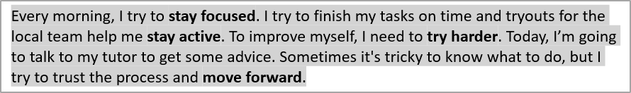

## **개요**

이 문서는 Aspose.Slides for Java를 사용하여 PowerPoint 및 OpenDocument 프레젠테이션에서 텍스트를 서식 지정하는 방법을 보여줍니다. 배경 색, 투명도, 문자 간격, 글꼴 속성, 회전, 단락 간격, 자동 맞춤 동작, 텍스트 고정, 탭 정지점 및 언어 설정을 다룹니다.

특별히 언급되지 않는 한, 예제는 [sample.pptx](sample.pptx)를 사용합니다. 첫 번째 슬라이드의 첫 번째 도형은 텍스트 상자이며, 첫 번째 단락에 아래에 표시된 텍스트가 포함됩니다. 슬라이드 및 도형 인덱스는 0부터 시작합니다. 굵게 표시된 부분을 선택하는 예제는 효과적인 서식을 사용하며, 여기에는 상속된 굵은 서식도 포함됩니다:


리터럴 텍스트나 정규식 일치를 찾고 강조하려면 [Search and Replace Text](/slides/ko/java/search-and-replace-text/)를 참조하세요.

## **텍스트 배경색 설정**

단락의 기본 강조 색을 설정하려면 [IParagraphFormat.getDefaultPortionFormat](https://reference.aspose.com/slides/java/com.aspose.slides/iparagraphformat/#getDefaultPortionFormat--)을 사용하고, 개별 텍스트 부분에 대해서는 [IBasePortionFormat.getHighlightColor](https://reference.aspose.com/slides/java/com.aspose.slides/ibaseportionformat/#getHighlightColor--)을 사용합니다.

다음 예제는 첫 번째 단락의 기본 강조 색을 연한 회색으로 설정합니다. 개별 부분에 대한 명시적인 강조 색은 이 기본값보다 우선합니다:

```java
import com.aspose.slides.*;
import java.awt.Color;

Presentation presentation = new Presentation("sample.pptx");
try {
    ISlide slide = presentation.getSlides().get_Item(0);

    IAutoShape autoShape = (IAutoShape)slide.getShapes().get_Item(0);
    IParagraph paragraph = autoShape.getTextFrame().getParagraphs().get_Item(0);

    // 전체 단락에 대한 강조 색을 설정합니다.
    paragraph.getParagraphFormat().getDefaultPortionFormat().getHighlightColor().setColor(Color.LIGHT_GRAY);

    presentation.save("gray_paragraph.pptx", SaveFormat.Pptx);
} finally {
    presentation.dispose();
}
```

결과:



아래 코드 예제는 **굵은 글꼴을 가진 텍스트 부분**의 배경색을 설정하는 방법을 보여줍니다:

```java
import com.aspose.slides.*;
import java.awt.Color;

Presentation presentation = new Presentation("sample.pptx");
try {
    ISlide slide = presentation.getSlides().get_Item(0);

    IAutoShape autoShape = (IAutoShape)slide.getShapes().get_Item(0);
    IParagraph paragraph = autoShape.getTextFrame().getParagraphs().get_Item(0);

    for (IPortion portion : paragraph.getPortions()) {
        if (portion.getPortionFormat().getEffective().getFontBold()) {
            // 텍스트 부분에 대한 강조 색을 설정합니다.
            portion.getPortionFormat().getHighlightColor().setColor(Color.LIGHT_GRAY);
        }
    }

    presentation.save("gray_text_portions.pptx", SaveFormat.Pptx);
} finally {
    presentation.dispose();
}
```

결과:


## **텍스트 단락 정렬**

텍스트 프레임 내에서 단락 정렬을 설정하려면 [IParagraphFormat.setAlignment](https://reference.aspose.com/slides/java/com.aspose.slides/iparagraphformat/#setAlignment-int-)을 사용합니다. 값은 가운데, 왼쪽 정렬, 오른쪽 정렬, 양쪽 맞춤 등으로 지정할 수 있습니다.

다음 코드 예제는 단락을 **가운데**에 정렬하는 방법을 보여줍니다:

```java
import com.aspose.slides.*;

Presentation presentation = new Presentation("sample.pptx");
try {
    ISlide slide = presentation.getSlides().get_Item(0);

    IAutoShape autoShape = (IAutoShape)slide.getShapes().get_Item(0);
    IParagraph paragraph = autoShape.getTextFrame().getParagraphs().get_Item(0);

    // 단락의 정렬을 가운데로 설정합니다.
    paragraph.getParagraphFormat().setAlignment(TextAlignment.Center);

    presentation.save("aligned_paragraph.pptx", SaveFormat.Pptx);
} finally {
    presentation.dispose();
}
```

결과:


## **줄 내에서 글꼴 정렬**

줄 내에서 크기가 다른 글꼴의 텍스트 부분을 수직으로 정렬하려면 [IParagraphFormat.setFontAlignment](https://reference.aspose.com/slides/java/com.aspose.slides/iparagraphformat/#setFontAlignment-int-)을 사용합니다. 이 설정은 전체 단락에 적용되며 각 줄 내에서 정렬을 제어합니다.

다음 독립형 예제는 한 슬라이드에 네 개의 레이블이 있는 텍스트 상자를 생성합니다. 각 단락은 18, 36, 54 포인트의 동일한 텍스트를 포함하며, 서로 다른 글꼴 정렬을 적용합니다. Arial을 사용하고 자동 맞춤 및 자동 줄바꿈을 비활성화하며, 텍스트 프레임을 한 줄에 충분히 크게 유지합니다.

```java
import com.aspose.slides.*;
import java.awt.Color;

Presentation presentation = new Presentation();
try {
    ISlide slide = presentation.getSlides().get_Item(0);

    int[] alignments = { FontAlignment.Baseline, FontAlignment.Top, FontAlignment.Center, FontAlignment.Bottom };
    String[] alignmentNames = { "Baseline", "Top", "Center", "Bottom" };
    float[] fontSizes = { 18f, 36f, 54f };

    for (int i = 0; i < alignments.length; i++) {
        IAutoShape shape = slide.getShapes().addAutoShape(ShapeType.Rectangle, 30, 20 + i * 130, 660, 120);
        shape.getFillFormat().setFillType(FillType.NoFill);
        shape.getLineFormat().getFillFormat().setFillType(FillType.NoFill);

        ITextFrame textFrame = shape.getTextFrame();
        textFrame.getTextFrameFormat().setAnchoringType(TextAnchorType.Top);
        textFrame.getTextFrameFormat().setAutofitType(TextAutofitType.None);
        textFrame.getTextFrameFormat().setWrapText(NullableBool.False);

        IParagraph label = textFrame.getParagraphs().get_Item(0);
        label.setText(alignmentNames[i]);
        label.getParagraphFormat().setAlignment(TextAlignment.Left);
        label.getParagraphFormat().getDefaultPortionFormat().setFontHeight(14);
        label.getParagraphFormat().getDefaultPortionFormat().setLatinFont(new FontData("Arial"));
        label.getParagraphFormat().getDefaultPortionFormat().getFillFormat().setFillType(FillType.Solid);
        label.getParagraphFormat().getDefaultPortionFormat().getFillFormat().getSolidFillColor().setColor(Color.GRAY);

        Paragraph paragraph = new Paragraph();
        paragraph.getParagraphFormat().setFontAlignment(alignments[i]);
        paragraph.getParagraphFormat().setAlignment(TextAlignment.Left);
        paragraph.getParagraphFormat().getDefaultPortionFormat().setLatinFont(new FontData("Arial"));
        paragraph.getParagraphFormat().getDefaultPortionFormat().getFillFormat().setFillType(FillType.Solid);
        paragraph.getParagraphFormat().getDefaultPortionFormat().getFillFormat().getSolidFillColor().setColor(Color.BLACK);

        for (float fontSize : fontSizes) {
            Portion portion = new Portion("Ag ");
            portion.getPortionFormat().setFontHeight(fontSize);
            paragraph.getPortions().add(portion);
        }

        textFrame.getParagraphs().add(paragraph);
    }

    presentation.save("font_alignment.pptx", SaveFormat.Pptx);
} finally {
    presentation.dispose();
}
```

결과:


글꼴 정렬은 글꼴 메트릭을 사용하므로 개별 글자의 눈에 보이는 가장자리가 정확히 일치하지 않을 수 있습니다. 예제에는 대문자와 하강자가 모두 포함되어 기준선과 아래쪽 정렬의 차이를 보여줍니다. 글꼴 가용성 및 대체, 사용된 문자, 글꼴 크기 차이가 결과에 영향을 미칩니다. 프레임 크기, 여백, 줄 간격, 자동 줄바꿈 및 자동 맞춤도 레이아웃에 영향을 미치므로, 모드를 비교할 때는 동일한 글꼴 및 레이아웃 설정을 사용하십시오.

이 설정은 수평 단락 정렬을 제어하는 [IParagraphFormat.setAlignment](https://reference.aspose.com/slides/java/com.aspose.slides/iparagraphformat/#setAlignment-int-) 및 도형 내에서 텍스트 블록을 수직으로 배치하는 [ITextFrameFormat.setAnchoringType](https://reference.aspose.com/slides/java/com.aspose.slides/itextframeformat/#setAnchoringType-byte-)과 다릅니다. [IBasePortionFormat.setEscapement](https://reference.aspose.com/slides/java/com.aspose.slides/ibaseportionformat/#setEscapement-float-)을 통한 위 첨자 및 아래 첨자 서식은 개별 부분을 기준선에 대해 이동시켜 단락의 줄에 대한 글꼴 정렬을 설정하는 것이 아니라 이동시킵니다.

## **텍스트 투명도 설정**

텍스트 투명도는 [IBasePortionFormat.getFillFormat](https://reference.aspose.com/slides/java/com.aspose.slides/ibaseportionformat/#getFillFormat--)에 할당된 색상의 알파 구성 요소를 통해 제어됩니다. 아래 예제에서 `alpha = 50`은 0–255 척도의 ARGB 알파 채널 값이며, 투명도 백분율이 아닙니다.

아래 코드 예제는 **전체 단락**에 투명도를 적용하는 방법을 보여줍니다:

```java
import com.aspose.slides.*;
import java.awt.Color;

int alpha = 50;

Presentation presentation = new Presentation("sample.pptx");
try {
    ISlide slide = presentation.getSlides().get_Item(0);

    IAutoShape autoShape = (IAutoShape)slide.getShapes().get_Item(0);
    IParagraph paragraph = autoShape.getTextFrame().getParagraphs().get_Item(0);

    // 텍스트의 채우기 색상을 투명 색상으로 설정합니다.
    paragraph.getParagraphFormat().getDefaultPortionFormat().getFillFormat().setFillType(FillType.Solid);
    paragraph.getParagraphFormat().getDefaultPortionFormat().getFillFormat().getSolidFillColor().setColor(new Color(0, 0, 0, alpha));

    presentation.save("transparent_paragraph.pptx", SaveFormat.Pptx);
} finally {
    presentation.dispose();
}
```

결과:


다음 코드 예제는 **굵은 글꼴을 가진 텍스트 부분**에 투명도를 적용하는 방법을 보여줍니다:

```java
import com.aspose.slides.*;
import java.awt.Color;

int alpha = 50;

Presentation presentation = new Presentation("sample.pptx");
try {
    ISlide slide = presentation.getSlides().get_Item(0);

    IAutoShape autoShape = (IAutoShape)slide.getShapes().get_Item(0);
    IParagraph paragraph = autoShape.getTextFrame().getParagraphs().get_Item(0);

    for (IPortion portion : paragraph.getPortions()) {
        if (portion.getPortionFormat().getEffective().getFontBold()) {
            // 텍스트 부분의 투명도를 설정합니다.
            portion.getPortionFormat().getFillFormat().setFillType(FillType.Solid);
            portion.getPortionFormat().getFillFormat().getSolidFillColor().setColor(new Color(0, 0, 0, alpha));
        }
    }

    presentation.save("transparent_text_portions.pptx", SaveFormat.Pptx);
} finally {
    presentation.dispose();
}
```

결과:


## **텍스트 문자 간격 설정**

[IBasePortionFormat.setSpacing](https://reference.aspose.com/slides/java/com.aspose.slides/ibaseportionformat/#setSpacing-float-)을 사용하여 텍스트 상자 내 문자 간격을 넓히거나 좁힐 수 있습니다. 예제에서는 3포인트 간격을 추가하며, 음수 값은 텍스트를 압축합니다.

다음 Java 코드가 **전체 단락**의 문자 간격을 넓히는 방법을 보여줍니다:

```java
import com.aspose.slides.*;

Presentation presentation = new Presentation("sample.pptx");
try {
    ISlide slide = presentation.getSlides().get_Item(0);

    IAutoShape autoShape = (IAutoShape)slide.getShapes().get_Item(0);
    IParagraph paragraph = autoShape.getTextFrame().getParagraphs().get_Item(0);

    // 참고: 문자 간격을 압축하려면 음수 값을 사용합니다.
    paragraph.getParagraphFormat().getDefaultPortionFormat().setSpacing(3); // 문자 간격을 확대합니다.

    presentation.save("character_spacing_in_paragraph.pptx", SaveFormat.Pptx);
} finally {
    presentation.dispose();
}
```

결과:


아래 코드 예제는 **굵은 글꼴을 가진 텍스트 부분**의 문자 간격을 넓히는 방법을 보여줍니다:

```java
import com.aspose.slides.*;

Presentation presentation = new Presentation("sample.pptx");
try {
    ISlide slide = presentation.getSlides().get_Item(0);

    IAutoShape autoShape = (IAutoShape)slide.getShapes().get_Item(0);
    IParagraph paragraph = autoShape.getTextFrame().getParagraphs().get_Item(0);

    for (IPortion portion : paragraph.getPortions()) {
        if (portion.getPortionFormat().getEffective().getFontBold()) {
            // 주의: 문자 간격을 압축하려면 음수 값을 사용합니다.
            portion.getPortionFormat().setSpacing(3); // 문자 간격을 확대합니다.
        }
    }

    presentation.save("character_spacing_in_text_portions.pptx", SaveFormat.Pptx);
} finally {
    presentation.dispose();
}
```

결과:


### **특정 글꼴에 대한 커닝 비활성화**

Aspose.Slides가 렌더링한 텍스트가 PowerPoint에 표시된 동일한 텍스트보다 약간 더 조밀하게 보이는 경우가 있습니다. 이는 PowerPoint가 특정 글꼴에 대한 커닝 데이터를 무시할 수 있기 때문이며, 해당 글꼴에 유효한 커닝 정보가 있고 PowerPoint 설정에서 커닝이 활성화되어 있어도 발생할 수 있습니다.

이러한 경우 렌더링 결과를 PowerPoint와 가깝게 만들려면 영향을 받는 글꼴을 사용하는 텍스트 부분에 대해 커닝을 비활성화할 수 있습니다. 실제 글꼴 크기보다 큰 값으로 [IBasePortionFormat.setKerningMinimalSize](https://reference.aspose.com/slides/java/com.aspose.slides/ibaseportionformat/#setKerningMinimalSize-float-)을 설정하십시오. 이 예제는 첫 번째 슬라이드의 첫 번째 도형이 텍스트 상자인 "presentation.pptx"가 필요합니다. 상속된 글꼴을 포함한 효과적인 글꼴 이름을 확인하고, Roboto를 사용하는 부분에 대해 100포인트 임계값을 설정합니다. 이렇게 하면 100포인트 미만인 해당 부분의 커닝이 비활성화됩니다:

```java
import com.aspose.slides.*;

Presentation presentation = new Presentation("presentation.pptx");
try {
    ISlide slide = presentation.getSlides().get_Item(0);

    IAutoShape autoShape = (IAutoShape)slide.getShapes().get_Item(0);
    String targetFont = "Roboto";

    for (IParagraph paragraph : autoShape.getTextFrame().getParagraphs()) {
        for (IPortion portion : paragraph.getPortions()) {
            IPortionFormatEffectiveData portionFormat = portion.getPortionFormat().getEffective();

            if ((portionFormat.getLatinFont() != null &&
                 portionFormat.getLatinFont().getFontName().equals(targetFont)) ||
                (portionFormat.getEastAsianFont() != null &&
                 portionFormat.getEastAsianFont().getFontName().equals(targetFont)) ||
                (portionFormat.getComplexScriptFont() != null &&
                 portionFormat.getComplexScriptFont().getFontName().equals(targetFont))) {
                portion.getPortionFormat().setKerningMinimalSize(100);
            }
        }
    }

    presentation.save("output.pptx", SaveFormat.Pptx);
} finally {
    presentation.dispose();
}
```

## **텍스트 글꼴 속성 관리**

글꼴 속성은 [IParagraphFormat.getDefaultPortionFormat](https://reference.aspose.com/slides/java/com.aspose.slides/iparagraphformat/#getDefaultPortionFormat--)을 통해 단락 수준에서 설정하거나, 개별 부분에 대해서는 [IPortionFormat](https://reference.aspose.com/slides/java/com.aspose.slides/iportionformat/)을 통해 설정할 수 있습니다.

다음 예제는 첫 번째 단락의 기본 글꼴을 12포인트 Times New Roman으로 설정하고 굵게, 이탤릭, 점선 밑줄 서식을 적용합니다. 개별 부분에 대한 명시적인 서식은 이러한 기본값보다 우선합니다:

```java
import com.aspose.slides.*;

Presentation presentation = new Presentation("sample.pptx");
try {
    ISlide slide = presentation.getSlides().get_Item(0);

    IAutoShape autoShape = (IAutoShape)slide.getShapes().get_Item(0);
    IParagraph paragraph = autoShape.getTextFrame().getParagraphs().get_Item(0);

    // 단락의 글꼴 속성을 설정합니다.
    paragraph.getParagraphFormat().getDefaultPortionFormat().setFontHeight(12);
    paragraph.getParagraphFormat().getDefaultPortionFormat().setFontBold(NullableBool.True);
    paragraph.getParagraphFormat().getDefaultPortionFormat().setFontItalic(NullableBool.True);
    paragraph.getParagraphFormat().getDefaultPortionFormat().setFontUnderline(TextUnderlineType.Dotted);
    paragraph.getParagraphFormat().getDefaultPortionFormat().setLatinFont(new FontData("Times New Roman"));

    presentation.save("font_properties_for_paragraph.pptx", SaveFormat.Pptx);
} finally {
    presentation.dispose();
}
```

결과:


다음 예제는 효과적인 서식이 굵게인 부분에 13포인트 Times New Roman, 이탤릭 서식 및 점선 밑줄을 적용합니다:

```java
import com.aspose.slides.*;

Presentation presentation = new Presentation("sample.pptx");
try {
    ISlide slide = presentation.getSlides().get_Item(0);

    IAutoShape autoShape = (IAutoShape)slide.getShapes().get_Item(0);
    IParagraph paragraph = autoShape.getTextFrame().getParagraphs().get_Item(0);

    for (IPortion portion : paragraph.getPortions()) {
        if (portion.getPortionFormat().getEffective().getFontBold()) {
            // 텍스트 부분에 대한 글꼴 속성을 설정합니다.
            portion.getPortionFormat().setFontHeight(13);
            portion.getPortionFormat().setFontItalic(NullableBool.True);
            portion.getPortionFormat().setFontUnderline(TextUnderlineType.Dotted);
            portion.getPortionFormat().setLatinFont(new FontData("Times New Roman"));
        }
    }

    presentation.save("font_properties_for_text_portions.pptx", SaveFormat.Pptx);
} finally {
    presentation.dispose();
}
```

결과:


## **텍스트 높이 정규화 제어**

[IBasePortionFormat.setNormaliseHeight](https://reference.aspose.com/slides/java/com.aspose.slides/ibaseportionformat/#setNormaliseHeight-byte-)을 사용하여 템플릿 타이포그래피를 재현하거나 문자 높이 차이를 조사할 수 있습니다. PowerPoint에서 정규화를 활성화하면 텍스트 부분 내 개별 문자를 수직으로 늘리거나 압축하여 눈에 보이는 높이를 균일하게 합니다. 이는 서로 다른 글꼴 간에 텍스트 높이가 동일함을 보장하지는 않습니다.

속성을 [NullableBool.True 또는 False](https://reference.aspose.com/slides/java/com.aspose.slides/nullablebool/)로 설정하면 정규화를 명시적으로 활성화하거나 비활성화합니다. `NullableBool.NotDefined`는 로컬 설정을 정의하지 않은 상태로 두어 예를 들어 단락의 [getDefaultPortionFormat](https://reference.aspose.com/slides/java/com.aspose.slides/iparagraphformat/#getDefaultPortionFormat--)에서 값을 상속받게 합니다. 이는 `False`와 같은 의미가 아닙니다. [IPortionFormat.getEffective](https://reference.aspose.com/slides/java/com.aspose.slides/iportionformat/#getEffective--)를 사용하고 [IBasePortionFormatEffectiveData.getNormaliseHeight](https://reference.aspose.com/slides/java/com.aspose.slides/ibaseportionformateffectivedata/#getNormaliseHeight--)를 읽어 실제 Boolean 값을 얻으세요.

다음 독립형 예제는 **Arial**이 설치되어 있어야 합니다. 54포인트 크기의 동일한 대문자, 소문자, 하강자, 강조 문자 두 텍스트 블록을 생성합니다. 두 단락은 기본적으로 정규화를 활성화합니다. 위쪽 부분은 명시적으로 비활성화하고, 아래쪽 부분은 상속받습니다. 프레임 크기, 여백 및 단락 간격은 동일하며, 비교 일관성을 위해 자동 줄바꿈 및 자동 맞춤을 비활성화했습니다. 예제는 `False: false`와 `NotDefined: true`를 출력한 뒤 "text_height_normalization.pptx"를 저장합니다:

```java
import com.aspose.slides.*;
import java.awt.Color;

Presentation presentation = new Presentation();
try {
    ISlide slide = presentation.getSlides().get_Item(0);

    byte[] settings = { NullableBool.False, NullableBool.NotDefined };
    String[] settingNames = { "False", "NotDefined" };

    for (int i = 0; i < settings.length; i++) {
        IAutoShape shape = slide.getShapes().addAutoShape(ShapeType.Rectangle, 30, 60 + i * 200, 660, 150);
        shape.getFillFormat().setFillType(FillType.NoFill);
        shape.getLineFormat().getFillFormat().setFillType(FillType.NoFill);

        ITextFrame textFrame = shape.getTextFrame();
        textFrame.setText("Hxgjpq ÅÉ 0123");
        textFrame.getTextFrameFormat().setAutofitType(TextAutofitType.None);
        textFrame.getTextFrameFormat().setWrapText(NullableBool.False);
        textFrame.getTextFrameFormat().setAnchoringType(TextAnchorType.Top);
        textFrame.getTextFrameFormat().setMarginTop(0);
        textFrame.getTextFrameFormat().setMarginLeft(0);

        IParagraph paragraph = textFrame.getParagraphs().get_Item(0);
        paragraph.getParagraphFormat().setAlignment(TextAlignment.Left);
        paragraph.getParagraphFormat().setSpaceBefore(0);
        paragraph.getParagraphFormat().setSpaceAfter(0);
        paragraph.getParagraphFormat().setSpaceWithin(100);
        paragraph.getParagraphFormat().getDefaultPortionFormat().setNormaliseHeight(NullableBool.True);

        IPortion portion = paragraph.getPortions().get_Item(0);
        FontData font = new FontData("Arial");
        portion.getPortionFormat().setLatinFont(font);
        portion.getPortionFormat().setFontHeight(54);
        portion.getPortionFormat().getFillFormat().setFillType(FillType.Solid);
        portion.getPortionFormat().getFillFormat().getSolidFillColor().setColor(Color.BLACK);
        portion.getPortionFormat().setNormaliseHeight(settings[i]);

        System.out.println(settingNames[i] + ": " + portion.getPortionFormat().getEffective().getNormaliseHeight());
    }

    presentation.save("text_height_normalization.pptx", SaveFormat.Pptx);
} finally {
    presentation.dispose();
}
```

아래 비교는 저장된 프레젠테이션에서 내보낸 것입니다. 위 행은 정규화가 비활성화된(`False`) 상태이며, 아래 행은 활성화된 설정을 상속받은(`NotDefined` → `True`) 상태입니다. 이 모습을 재현하려면 Arial이 설치되어 있어야 합니다.


정규화는 지정된 [getFontHeight](https://reference.aspose.com/slides/java/com.aspose.slides/ibaseportionformat/#getFontHeight--) 값을 변경하지 않고 문자 높이를 바꿉니다. 단락 [setSpaceWithin](https://reference.aspose.com/slides/java/com.aspose.slides/iparagraphformat/#setSpaceWithin-float-)은 줄 간격을 제어하고, 텍스트 프레임 [setAutofitType](https://reference.aspose.com/slides/java/com.aspose.slides/itextframeformat/#setAutofitType-byte-)은 텍스트 또는 컨테이너가 맞추도록 조정하는 방식을 제어합니다. 이러한 설정은 서로 다른 목적을 가지고 있으며 전체 레이아웃에 독립적으로 영향을 줄 수 있습니다. 단락 서식 및 상속에 대한 자세한 내용은 [Manage Paragraph](/slides/ko/java/manage-paragraph/)를 참고하십시오.

## **취소선 적용 및 제거**

텍스트 부분에 [IBasePortionFormat.setStrikethroughType](https://reference.aspose.com/slides/java/com.aspose.slides/ibaseportionformat/#setStrikethroughType-byte-)을 사용하면 원본 텍스트를 삭제하지 않고 수정, 취소된 용어 또는 이전 가격을 표시할 수 있습니다. 텍스트에 한 줄 또는 두 줄의 취소선을 적용하려면 [TextStrikethroughType.Single 또는 Double](https://reference.aspose.com/slides/java/com.aspose.slides/textstrikethroughtype/)로 설정합니다.

취소선을 제거하려면 [TextStrikethroughType.None](https://reference.aspose.com/slides/java/com.aspose.slides/textstrikethroughtype/#None)를 전달합니다. 이는 주변 서식이 취소선을 지정하더라도 효과를 명시적으로 비활성화합니다. 반면에 [TextStrikethroughType.NotDefined](https://reference.aspose.com/slides/java/com.aspose.slides/textstrikethroughtype/#NotDefined)는 로컬 설정을 정의하지 않아 예를 들어 단락에서 서식을 상속받게 합니다. 이는 취소선이 제거된다는 보장은 없습니다. 결과 서식을 읽으려면 [IPortionFormat.getEffective](https://reference.aspose.com/slides/java/com.aspose.slides/iportionformat/#getEffective--)를 사용하고 상속된 값을 포함합니다.

다음 독립형 예제는 세 개의 가격 비교를 생성합니다. 각 단락은 레이블, 이전 가격, 현재 가격에 대한 별도 부분을 가지고 있어 이전 가격에만 영향을 줍니다. 첫 번째 행은 취소선을 적용했다가 제거하고, 다른 행은 각각 단일 및 이중 취소선을 유지합니다. 이 설정을 변경하면 텍스트와 다른 서식(굵게 표시된 이전 가격 포함)이 보존됩니다:

```java
import com.aspose.slides.*;
import java.awt.Color;

Presentation presentation = new Presentation();
try {
    ISlide slide = presentation.getSlides().get_Item(0);

    IAutoShape shape = slide.getShapes().addAutoShape(ShapeType.Rectangle, 50, 50, 620, 220);
    shape.getFillFormat().setFillType(FillType.NoFill);
    shape.getLineFormat().getFillFormat().setFillType(FillType.NoFill);
    shape.getTextFrame().getParagraphs().clear();

    String[] labels = { "None: ", "Single: ", "Double: " };

    for (String label : labels) {
        Paragraph paragraph = new Paragraph();
        paragraph.getParagraphFormat().setAlignment(TextAlignment.Left);
        paragraph.getParagraphFormat().setSpaceAfter(20);

        IPortionFormat format = paragraph.getParagraphFormat().getDefaultPortionFormat();
        format.setFontHeight(28);
        FontData font = new FontData("Arial");
        format.setLatinFont(font);
        format.getFillFormat().setFillType(FillType.Solid);
        format.getFillFormat().getSolidFillColor().setColor(Color.BLACK);

        Portion labelPortion = new Portion(label);
        paragraph.getPortions().add(labelPortion);

        Portion previousPrice = new Portion("$100");
        previousPrice.getPortionFormat().setFontBold(NullableBool.True);
        paragraph.getPortions().add(previousPrice);
        Portion currentPrice = new Portion(" → $80");
        paragraph.getPortions().add(currentPrice);

        shape.getTextFrame().getParagraphs().add(paragraph);
    }

    IParagraphCollection paragraphs = shape.getTextFrame().getParagraphs();

    // 취소선을 적용하고, 첫 번째 이전 가격에서 명시적으로 제거합니다.
    paragraphs.get_Item(0).getPortions().get_Item(1).getPortionFormat().setStrikethroughType(TextStrikethroughType.Single);
    paragraphs.get_Item(0).getPortions().get_Item(1).getPortionFormat().setStrikethroughType(TextStrikethroughType.None);

    paragraphs.get_Item(1).getPortions().get_Item(1).getPortionFormat().setStrikethroughType(TextStrikethroughType.Single);
    paragraphs.get_Item(2).getPortions().get_Item(1).getPortionFormat().setStrikethroughType(TextStrikethroughType.Double);

    presentation.save("strikethrough.pptx", SaveFormat.Pptx);
} finally {
    presentation.dispose();
}
```

결과(위에서 아래 순): 취소선 없음, 단일 취소선, 이중 취소선.


## **텍스트 회전 설정**

[ITextFrameFormat.setTextVerticalType](https://reference.aspose.com/slides/java/com.aspose.slides/itextframeformat/#setTextVerticalType-byte-)을 사용하여 도형 내에 미리 정의된 텍스트 방향을 설정합니다.

다음 코드 예제는 도형의 텍스트 방향을 [TextVerticalType.Vertical270](https://reference.aspose.com/slides/java/com.aspose.slides/textverticaltype/)으로 설정하는데, 이는 텍스트를 **시계 반대 방향으로 90도** 회전시킵니다:

```java
import com.aspose.slides.*;

Presentation presentation = new Presentation("sample.pptx");
try {
    ISlide slide = presentation.getSlides().get_Item(0);

    IAutoShape autoShape = (IAutoShape)slide.getShapes().get_Item(0);
    autoShape.getTextFrame().getTextFrameFormat().setTextVerticalType(TextVerticalType.Vertical270);

    presentation.save("text_rotation.pptx", SaveFormat.Pptx);
} finally {
    presentation.dispose();
}
```

결과:


## **세로 텍스트에서 숫자를 나란히 표시**

세로 일본어 레이블에서 두 자리 숫자를 함께 유지하려면 두 숫자를 하나의 텍스트 부분에 넣고 해당 부분에 [IBasePortionFormat.setKumimoji](https://reference.aspose.com/slides/java/com.aspose.slides/ibaseportionformat/#setKumimoji-byte-)을 호출합니다. 예제는 [TextVerticalType.EastAsianVertical](https://reference.aspose.com/slides/java/com.aspose.slides/textverticaltype/#EastAsianVertical)과 40포인트 MS Gothic을 두 레이블에 사용합니다. 숫자 부분에 전달되는 [NullableBool](https://reference.aspose.com/slides/java/com.aspose.slides/nullablebool/) 값만 다릅니다:

```java
import com.aspose.slides.*;
import java.awt.Color;

Presentation presentation = new Presentation();
try {
    ISlide slide = presentation.getSlides().get_Item(0);

    byte[] settings = { NullableBool.True, NullableBool.False };
    float x = 120;

    for (byte kumimoji : settings) {
        IAutoShape label = slide.getShapes().addAutoShape(ShapeType.Rectangle, x, 48, 120, 420);
        label.getFillFormat().setFillType(FillType.NoFill);
        label.getLineFormat().getFillFormat().setFillType(FillType.NoFill);

        ITextFrame frame = label.addTextFrame("");
        frame.getTextFrameFormat().setTextVerticalType(TextVerticalType.EastAsianVertical);

        IParagraph paragraph = frame.getParagraphs().get_Item(0);
        IPortionFormat format = paragraph.getParagraphFormat().getDefaultPortionFormat();
        FontData font = new FontData("MS Gothic");
        format.setLatinFont(font);
        format.setEastAsianFont(font);
        format.setFontHeight(40);
        format.getFillFormat().setFillType(FillType.Solid);
        format.getFillFormat().getSolidFillColor().setColor(Color.BLACK);

        Portion digits = new Portion("12");
        digits.getPortionFormat().setKumimoji(kumimoji);
        
        paragraph.getPortions().clear();
        paragraph.getPortions().add(new Portion("令和"));
        paragraph.getPortions().add(digits);
        paragraph.getPortions().add(new Portion("年"));

        x += 240;
    }
    presentation.save("vertical_date.pptx", SaveFormat.Pptx);
} finally {
    presentation.dispose();
}
```

PowerPoint에서 왼쪽 레이블(`True`)은 숫자를 직립 상태로 和와 年 사이에 나란히 표시합니다. 오른쪽 레이블(`False`)에서는 쌍이 시계 방향으로 90도 회전합니다. 주변 일본어 문자는 두 레이블 모두 직립 상태를 유지합니다.


## **텍스트 프레임 사용자 정의 회전 설정**

[ITextFrameFormat.setRotationAngle](https://reference.aspose.com/slides/java/com.aspose.slides/itextframeformat/#setRotationAngle-float-)을 사용하여 [ITextFrame](https://reference.aspose.com/slides/java/com.aspose.slides/itextframe/)의 사용자 정의 회전 각도를 설정합니다.

```java
import com.aspose.slides.*;

Presentation presentation = new Presentation("sample.pptx");
try {
    ISlide slide = presentation.getSlides().get_Item(0);

    IAutoShape autoShape = (IAutoShape)slide.getShapes().get_Item(0);
    autoShape.getTextFrame().getTextFrameFormat().setRotationAngle(3);

    presentation.save("custom_text_rotation.pptx", SaveFormat.Pptx);
} finally {
    presentation.dispose();
}
```

결과:


## **단락 줄 간격 설정**

Aspose.Slides는 [IParagraphFormat.setSpaceAfter](https://reference.aspose.com/slides/java/com.aspose.slides/iparagraphformat/#setSpaceAfter-float-), [IParagraphFormat.setSpaceBefore](https://reference.aspose.com/slides/java/com.aspose.slides/iparagraphformat/#setSpaceBefore-float-) 및 [IParagraphFormat.setSpaceWithin](https://reference.aspose.com/slides/java/com.aspose.slides/iparagraphformat/#setSpaceWithin-float-)을 제공하여 단락 간격을 제어합니다. 이러한 속성은 다음과 같이 사용됩니다:

* 양수 값을 사용하면 줄 높이의 백분율로 줄 간격을 지정합니다.
* 음수 값을 사용하면 포인트 단위로 줄 간격을 지정합니다.

다음 예제는 첫 번째 단락의 내부 간격을 줄 높이의 200%(두 배 간격)로 설정합니다:

```java
import com.aspose.slides.*;

Presentation presentation = new Presentation("sample.pptx");
try {
    ISlide slide = presentation.getSlides().get_Item(0);

    IAutoShape autoShape = (IAutoShape)slide.getShapes().get_Item(0);

    IParagraph paragraph = autoShape.getTextFrame().getParagraphs().get_Item(0);
    paragraph.getParagraphFormat().setSpaceWithin(200);

    presentation.save("line_spacing.pptx", SaveFormat.Pptx);
} finally {
    presentation.dispose();
}
```

결과:


## **줄 바꿈 제어**

줄 바꿈 규칙은 좁은 텍스트 블록 및 라틴 문자와 동아시아 문자가 혼합된 프레젠테이션에서 유용합니다. 다음 메서드들은 [IParagraphFormat](https://reference.aspose.com/slides/java/com.aspose.slides/iparagraphformat/)에 속하므로 전체 단락에 적용됩니다:

- [setLatinLineBreak](https://reference.aspose.com/slides/java/com.aspose.slides/iparagraphformat/#setLatinLineBreak-byte-)은 라틴 문자 줄 바꿈 규칙을 제어합니다. 혼합 텍스트에서 이를 변경하면 인접한 동아시아 문자 및 구두점의 줄 바꿈 위치도 바뀔 수 있습니다.
- [setEastAsianLineBreak](https://reference.aspose.com/slides/java/com.aspose.slides/iparagraphformat/#setEastAsianLineBreak-byte-)은 동아시아 문자 줄 바꿈 규칙을 제어하며, 줄 시작 및 끝에 있는 문자에 대한 제한을 포함합니다.

이 규칙들은 텍스트 프레임 내 자동 줄 바꿈을 활성화하는 [ITextFrameFormat.setWrapText](https://reference.aspose.com/slides/java/com.aspose.slides/itextframeformat/#setWrapText-byte-)을 대체하지 않습니다. 줄 바꿈이 발생할 때 레이아웃에 영향을 주지만, 줄 바꿈 문자를 삽입하지는 않습니다. 명시적인 줄 바꿈은 가용 너비와 무관하게 단락 내에 새 줄을 강제로 만듭니다.

다음 독립형 예제는 중국어와 라틴 텍스트가 혼합된 좁은 텍스트 블록을 생성합니다. 두 줄 바꿈 옵션을 명시적으로 설정하고 "line_breaking.pptx"를 저장합니다. 각 규칙을 실험하려면 다른 설정을 고정한 상태에서 해당 값을 변경하십시오. 예제는 24포인트 Arial 및 SimSun을 사용하고 프레임 너비를 160포인트, 가로 마진을 0으로 설정합니다. [ITextFrameFormat.setAutofitType](https://reference.aspose.com/slides/java/com.aspose.slides/itextframeformat/#setAutofitType-byte-)은 [TextAutofitType.None](https://reference.aspose.com/slides/java/com.aspose.slides/textautofittype/)으로 호출되어 텍스트 크기와 프레임 크기가 고정됩니다.

```java
import com.aspose.slides.*;
import java.awt.Color;

Presentation presentation = new Presentation();
try {
    ISlide slide = presentation.getSlides().get_Item(0);

    IAutoShape shape = slide.getShapes().addAutoShape(ShapeType.Rectangle, 50, 50, 160, 300);
    shape.getFillFormat().setFillType(FillType.NoFill);

    ITextFrame textFrame = shape.getTextFrame();
    textFrame.getTextFrameFormat().setWrapText(NullableBool.True);
    textFrame.getTextFrameFormat().setAutofitType(TextAutofitType.None);
    textFrame.getTextFrameFormat().setMarginLeft(0);
    textFrame.getTextFrameFormat().setMarginRight(0);

    IParagraph paragraph = textFrame.getParagraphs().get_Item(0);
    paragraph.setText("中文排版测试，PowerPoint 中文演示。");

    IParagraphFormat format = paragraph.getParagraphFormat();
    format.setAlignment(TextAlignment.Left);
    format.getDefaultPortionFormat().setFontHeight(24);
    FontData latinFont = new FontData("Arial");
    format.getDefaultPortionFormat().setLatinFont(latinFont);
    FontData eastAsianFont = new FontData("SimSun");
    format.getDefaultPortionFormat().setEastAsianFont(eastAsianFont);
    format.getDefaultPortionFormat().getFillFormat().setFillType(FillType.Solid);
    format.getDefaultPortionFormat().getFillFormat().getSolidFillColor().setColor(Color.BLACK);
    format.setLatinLineBreak(NullableBool.False);
    format.setEastAsianLineBreak(NullableBool.True);

    presentation.save("line_breaking.pptx", SaveFormat.Pptx);
} finally {
    presentation.dispose();
}
```

## **걸려 있는 구두점 제어**

[IParagraphFormat.setHangingPunctuation](https://reference.aspose.com/slides/java/com.aspose.slides/iparagraphformat/#setHangingPunctuation-byte-)은 해당 구두점이 다음 줄에 차지하는 대신 텍스트 라인의 오른쪽 끝을 넘어 확장하도록 허용합니다. 전체 단락에 적용되며, 걸려 있는 들여쓰기와는 다릅니다.

다음 독립형 예제는 100포인트 너비의 텍스트 프레임에서 걸려 있는 구두점을 활성화하고 "hanging_punctuation.pptx"를 저장합니다. 24포인트 Arial과 가로 마진 0을 사용하면 마지막 마침표가 "sentence" 뒤에 남아 오른쪽 텍스트 가장자리를 넘어갑니다. 비교를 위해 속성을 [NullableBool.False](https://reference.aspose.com/slides/java/com.aspose.slides/nullablebool/)로 설정하면 마침표가 별도의 줄에 배치됩니다. 가용 너비를 고정하기 위해 자동 줄바꿈을 활성화하고 자동 맞춤을 비활성화했습니다.

```java
import com.aspose.slides.*;
import java.awt.Color;

Presentation presentation = new Presentation();
try {
    ISlide slide = presentation.getSlides().get_Item(0);

    IAutoShape shape = slide.getShapes().addAutoShape(ShapeType.Rectangle, 50, 50, 100, 200);
    shape.getFillFormat().setFillType(FillType.NoFill);

    ITextFrame textFrame = shape.getTextFrame();
    textFrame.getTextFrameFormat().setWrapText(NullableBool.True);
    textFrame.getTextFrameFormat().setAutofitType(TextAutofitType.None);
    textFrame.getTextFrameFormat().setMarginLeft(0);
    textFrame.getTextFrameFormat().setMarginRight(0);

    IParagraph paragraph = textFrame.getParagraphs().get_Item(0);
    paragraph.setText("Simple text, next sentence.");

    IParagraphFormat format = paragraph.getParagraphFormat();
    format.setAlignment(TextAlignment.Left);
    format.getDefaultPortionFormat().setFontHeight(24);
    FontData latinFont = new FontData("Arial");
    format.getDefaultPortionFormat().setLatinFont(latinFont);
    format.getDefaultPortionFormat().getFillFormat().setFillType(FillType.Solid);
    format.getDefaultPortionFormat().getFillFormat().getSolidFillColor().setColor(Color.BLACK);
    format.setHangingPunctuation(NullableBool.True);

    presentation.save("hanging_punctuation.pptx", SaveFormat.Pptx);
} finally {
    presentation.dispose();
}
```

모든 구두점이 걸릴 수 있는 것은 아닙니다. 위에서 설명한 [글꼴 및 레이아웃 조건](#control-line-breaking)도 이 비교에 적용됩니다. 글꼴, 가용 너비, 여백 또는 자동 맞춤 설정을 변경하면 눈에 보이는 차이가 사라질 수 있습니다.

## **텍스트 프레임 자동 맞춤 유형 설정**

[ITextFrameFormat.setAutofitType](https://reference.aspose.com/slides/java/com.aspose.slides/itextframeformat/#setAutofitType-byte-)은 텍스트가 컨테이너 경계를 초과할 때 동작 방식을 결정합니다. 텍스트가 축소, 넘침, 또는 도형이 자동으로 크기를 조정하도록 제어할 수 있습니다. 다음 예제는 텍스트에 맞게 도형을 크기 조정하도록 구성하고 결과를 "autofit_type.pptx"에 저장합니다:

```java
import com.aspose.slides.*;

Presentation presentation = new Presentation("sample.pptx");
try {
    ISlide slide = presentation.getSlides().get_Item(0);

    IAutoShape autoShape = (IAutoShape)slide.getShapes().get_Item(0);
    autoShape.getTextFrame().getTextFrameFormat().setAutofitType(TextAutofitType.Shape);

    presentation.save("autofit_type.pptx", SaveFormat.Pptx);
} finally {
    presentation.dispose();
}
```

자동 줄바꿈 후 라인 수를 세고 텍스트 또는 도형 너비가 결과에 어떻게 영향을 미치는지 확인하려면 [Count Rendered Lines](/slides/ko/java/manage-paragraph/)를 참조하십시오. 라인 수만으로 텍스트가 컨테이너를 초과했는지는 판단할 수 없습니다.

## **텍스트 프레임 앵커 설정**

[ITextFrameFormat.setAnchoringType](https://reference.aspose.com/slides/java/com.aspose.slides/itextframeformat/#setAnchoringType-byte-)은 텍스트가 도형 내부에서 수직으로 어떻게 배치되는지를 정의합니다(예: 위, 중간, 아래). 다음 예제는 텍스트를 첫 번째 도형의 아래쪽에 고정하고 결과를 "text_anchor.pptx"에 저장합니다:

```java
import com.aspose.slides.*;

Presentation presentation = new Presentation("sample.pptx");
try {
    ISlide slide = presentation.getSlides().get_Item(0);

    IAutoShape autoShape = (IAutoShape)slide.getShapes().get_Item(0);
    autoShape.getTextFrame().getTextFrameFormat().setAnchoringType(TextAnchorType.Bottom);

    presentation.save("text_anchor.pptx", SaveFormat.Pptx);
} finally {
    presentation.dispose();
}
```

## **텍스트 탭 설정**

[IParagraphFormat.setDefaultTabSize](https://reference.aspose.com/slides/java/com.aspose.slides/iparagraphformat/#setDefaultTabSize-float-)와 [IParagraphFormat.getTabs](https://reference.aspose.com/slides/java/com.aspose.slides/iparagraphformat/#getTabs--)을 사용하여 단락의 탭 정지를 구성합니다. 다음 예제는 기본 탭 간격을 100포인트로 설정하고 30포인트에 왼쪽 정렬 탭 정지를 추가합니다. 이러한 설정은 탭 문자를 포함한 텍스트에 영향을 줍니다:

```java
import com.aspose.slides.*;

Presentation presentation = new Presentation("sample.pptx");
try {
    ISlide slide = presentation.getSlides().get_Item(0);

    IAutoShape autoShape = (IAutoShape)slide.getShapes().get_Item(0);
    
    IParagraph paragraph = autoShape.getTextFrame().getParagraphs().get_Item(0);
    paragraph.getParagraphFormat().setDefaultTabSize(100);
    paragraph.getParagraphFormat().getTabs().add(30, TabAlignment.Left);

    presentation.save("paragraph_tabs.pptx", SaveFormat.Pptx);
} finally {
    presentation.dispose();
}
```

결과:


## **교정 언어 설정**

Aspose.Slides는 [IBasePortionFormat.setLanguageId](https://reference.aspose.com/slides/java/com.aspose.slides/ibaseportionformat/#setLanguageId-java.lang.String-)을 제공하며, 이를 통해 텍스트 부분의 교정 언어를 설정할 수 있습니다. 교정 언어는 PowerPoint에서 맞춤법 및 문법 검사를 수행할 때 사용되는 언어를 결정합니다.

다음 예제는 첫 번째 슬라이드의 첫 번째 도형이 텍스트 상자인 "presentation.pptx"와 최소 하나의 단락이 필요합니다. 첫 번째 단락의 내용을 "1。"으로 교체하고 글꼴을 SimSun으로 설정한 뒤, 교정 언어를 Simplified Chinese(`zh-CN`)로 지정합니다. 결과는 "proofing_language.pptx"에 저장됩니다:

```java
import com.aspose.slides.*;

Presentation presentation = new Presentation("presentation.pptx");
try {
    ISlide slide = presentation.getSlides().get_Item(0);
    IAutoShape autoShape = (IAutoShape)slide.getShapes().get_Item(0);

    IParagraph paragraph = autoShape.getTextFrame().getParagraphs().get_Item(0);
    paragraph.getPortions().clear();

    FontData font = new FontData("SimSun");

    Portion textPortion = new Portion();
    textPortion.getPortionFormat().setComplexScriptFont(font);
    textPortion.getPortionFormat().setEastAsianFont(font);
    textPortion.getPortionFormat().setLatinFont(font);

    // 교정 언어의 Id를 설정합니다.
    textPortion.getPortionFormat().setLanguageId("zh-CN");

    textPortion.setText("1。");
    paragraph.getPortions().add(textPortion);

    presentation.save("proofing_language.pptx", SaveFormat.Pptx);
} finally {
    presentation.dispose();
}
```

### **언어 메타데이터 복사**

템플릿에서 다국어 텍스트를 복사할 때는 [IBasePortionFormat.getLanguageId](https://reference.aspose.com/slides/java/com.aspose.slides/ibaseportionformat/#getLanguageId--)와 [IBasePortionFormat.getAlternativeLanguageId](https://reference.aspose.com/slides/java/com.aspose.slides/ibaseportionformat/#getAlternativeLanguageId--)를 모두 보존하십시오. 다음 독립형 예제는 소스 부분에 미국 영어를 기본 언어로, 프랑스어를 대체 언어로 설정하고, 텍스트와 식별자를 새 프레젠테이션의 부분에 복사합니다:

```java
import com.aspose.slides.*;

Portion source = new Portion("Hello! Bonjour!");
source.getPortionFormat().setLanguageId("en-US");
source.getPortionFormat().setAlternativeLanguageId("fr-FR");

Presentation presentation = new Presentation();
try {
    ISlide slide = presentation.getSlides().get_Item(0);

    IAutoShape shape = slide.getShapes().addAutoShape(ShapeType.Rectangle, 20, 20, 400, 80);
    IParagraph paragraph = shape.getTextFrame().getParagraphs().get_Item(0);
    paragraph.getPortions().clear();

    Portion destination = new Portion();
    destination.setText(source.getText());
    destination.getPortionFormat().setLanguageId(source.getPortionFormat().getLanguageId());
    // 소스에 대체 언어가 없으면 null이 대상 값을 지웁니다.
    destination.getPortionFormat().setAlternativeLanguageId(source.getPortionFormat().getAlternativeLanguageId());
    paragraph.getPortions().add(destination);

    presentation.save("copied_language_metadata.pptx", SaveFormat.Pptx);
} finally {
    presentation.dispose();
}
```

대체 언어가 없는 소스를 시도하려면 `"fr-FR"` 할당을 생략하십시오. 이 경우 대체 식별자는 `null`이 되며, 복사 문은 대상에 이전에 대체 언어가 할당되어 있더라도 기본값을 도입하지 않고 그 부재를 유지합니다.

이러한 식별자는 언어 메타데이터로 저장됩니다. 이를 보존한다고 해서 PowerPoint가 맞춤법 또는 문법 검사를 위해 어떤 사전을 선택한다는 의미는 아닙니다.

## **기본 언어 설정**

[LoadOptions.setDefaultTextLanguage](https://reference.aspose.com/slides/java/com.aspose.slides/loadoptions/#setDefaultTextLanguage-java.lang.String-)을 사용하면 프레젠테이션을 로드하거나 생성할 때 생성되는 텍스트의 기본 언어를 정의할 수 있습니다. 다음 예제는 기본 텍스트 언어를 미국 영어로 설정한 프레젠테이션을 만들고, 텍스트 상자를 추가한 뒤 첫 번째 텍스트 부분에 대해 `en-US`를 출력합니다:

```java
import com.aspose.slides.*;

LoadOptions loadOptions = new LoadOptions();
loadOptions.setDefaultTextLanguage("en-US");

Presentation presentation = new Presentation(loadOptions);
try {
    ISlide slide = presentation.getSlides().get_Item(0);

    // 새 사각형 도형을 텍스트와 함께 추가합니다.
    IAutoShape shape = slide.getShapes().addAutoShape(ShapeType.Rectangle, 20, 20, 150, 50);
    shape.getTextFrame().setText("Sample text");

    // 첫 번째 부분의 언어를 확인합니다.
    IPortion portion = shape.getTextFrame().getParagraphs().get_Item(0).getPortions().get_Item(0);
    System.out.println(portion.getPortionFormat().getLanguageId());
} finally {
    presentation.dispose();
}
```

## **기본 텍스트 스타일 설정**

프레젠테이션 수준에서 기본 텍스트 서식을 적용하려면 [IPresentation.getDefaultTextStyle](https://reference.aspose.com/slides/java/com.aspose.slides/ipresentation/#getDefaultTextStyle--)를 사용하십시오.

다음 예제는 새 프레젠테이션에서 최상위 단락에 대한 기본값으로 14포인트 굵은 글꼴을 설정하고 "default_text_style.pptx"에 저장합니다. 보다 구체적인 서식이 없으면 텍스트가 이러한 기본값을 상속받습니다.

```java
import com.aspose.slides.*;

Presentation presentation = new Presentation();
try {
    // 최상위 수준 단락 서식을 가져옵니다.
    IParagraphFormat paragraphFormat = presentation.getDefaultTextStyle().getLevel(0);

    if (paragraphFormat != null) {
        paragraphFormat.getDefaultPortionFormat().setFontHeight(14);
        paragraphFormat.getDefaultPortionFormat().setFontBold(NullableBool.True);
    }

    presentation.save("default_text_style.pptx", SaveFormat.Pptx);
} finally {
    presentation.dispose();
}
```

## **All-Caps 효과로 텍스트 추출**

PowerPoint에서 **All Caps** 글꼴 효과를 적용하면 원래 소문자로 입력했더라도 슬라이드에 대문자로 표시됩니다. Aspose.Slides로 해당 텍스트 부분을 가져오면 라이브러리는 입력된 그대로의 텍스트를 반환합니다. 표시된 텍스트와 일치시키려면 [TextCapType](https://reference.aspose.com/slides/java/com.aspose.slides/textcaptype/)을 확인하고 값이 `All`인 경우 반환된 문자열을 대문자로 변환하십시오.

이 예제는 첫 번째 슬라이드의 첫 번째 도형이 텍스트 상자인 "sample2.pptx"가 필요합니다. 첫 번째 단락의 첫 번째 부분에 All Caps 효과가 적용된 "Hello, Aspose!"가 포함되어 있습니다(아래 그림 참조).


아래 코드 예제는 **All Caps** 효과가 적용된 텍스트를 추출하는 방법을 보여줍니다:

```java
import com.aspose.slides.*;

Presentation presentation = new Presentation("sample2.pptx");
try {
    ISlide slide = presentation.getSlides().get_Item(0);
    
    IAutoShape autoShape = (IAutoShape)slide.getShapes().get_Item(0);
    IPortion textPortion = autoShape.getTextFrame().getParagraphs().get_Item(0).getPortions().get_Item(0);

    System.out.println("Original text: " + textPortion.getText());

    IPortionFormatEffectiveData textFormat = textPortion.getPortionFormat().getEffective();
    if (textFormat.getTextCapType() == TextCapType.All) {
        String text = textPortion.getText().toUpperCase();
        System.out.println("All-Caps effect: " + text);
    }
} finally {
    presentation.dispose();
}
```

```text
Original text: Hello, Aspose!
All-Caps effect: HELLO, ASPOSE!
```

## **FAQ**

**슬라이드의 표에서 텍스트를 어떻게 수정합니까?**

슬라이드의 표에서 텍스트를 수정하려면 [ITable](https://reference.aspose.com/slides/java/com.aspose.slides/itable/)을 사용하십시오. 셀을 순회하면서 각 셀을 [ICell.getTextFrame](https://reference.aspose.com/slides/java/com.aspose.slides/icell/#getTextFrame--)을 통해 텍스트 프레임을 업데이트하고, [IParagraph.getParagraphFormat](https://reference.aspose.com/slides/java/com.aspose.slides/iparagraph/#getParagraphFormat--)을 통해 단락 서식을 업데이트하십시오.

**PowerPoint 슬라이드의 텍스트에 그라데이션 색을 어떻게 적용합니까?**

텍스트에 그라데이션 색을 적용하려면 [IBasePortionFormat.getFillFormat](https://reference.aspose.com/slides/java/com.aspose.slides/ibaseportionformat/#getFillFormat--)을 사용하십시오. [IFillFormat.setFillType](https://reference.aspose.com/slides/java/com.aspose.slides/ifillformat/#setFillType-byte-)을 [FillType.Gradient](https://reference.aspose.com/slides/java/com.aspose.slides/filltype/)으로 설정하고, 그라데이션 정지점, 방향 및 투명도를 구성하십시오.

관련 기능: [슬라이드 내 텍스트 서식](/slides/ko/features/text-formatting/).