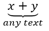

## **개요**

PowerPoint은 수식을 Office Math Markup Language(OMML) 형식으로 저장합니다. Aspose.Slides for .NET을 사용하면 프로그래밍 방식으로 동일한 종류의 수학 콘텐츠를 만들 수 있습니다: 분수, 근호, 함수, 극한, N-ary 연산자, 행렬, 배열 및 서식이 지정된 수학 블록.

PowerPoint에서 사용자는 일반적으로 **삽입 > 수식**을 통해 수식을 추가합니다:


그 결과는 슬라이드에 편집 가능한 수학 텍스트가 표시됩니다:


Aspose.Slides는 다음 세 가지 주요 객체를 통해 해당 수학 텍스트를 구축합니다:

- 수식이 포함된 모양을 만들 때 [AddMathShape](https://reference.aspose.com/slides/net/aspose.slides/ishapecollection/addmathshape/)으로 생성되는 수학 모양입니다.
- [MathPortion](https://reference.aspose.com/slides/net/aspose.slides.mathtext/mathportion/)은 모양 텍스트 프레임 내부에 수학 콘텐츠를 저장합니다.
- [MathParagraph](https://reference.aspose.com/slides/net/aspose.slides.mathtext/mathparagraph/)은 하나 이상의 [MathBlock](https://reference.aspose.com/slides/net/aspose.slides.mathtext/mathblock/) 객체를 포함합니다.

아래 대부분의 예제는 [MathematicalText](https://reference.aspose.com/slides/net/aspose.slides.mathtext/mathematicaltext/)와 [IMathElement](https://reference.aspose.com/slides/net/aspose.slides.mathtext/imathelement/)의 유창한 메서드를 사용하여 코드를 짧고 읽기 쉽게 유지합니다.

MathML 내보내기 시나리오에 대해서는 [Export Math Equations from Presentations in .NET](/slides/ko/net/exporting-math-equations/)을 참조하십시오.

## **수식 만들기**

이 예제는 [AddMathShape](https://reference.aspose.com/slides/net/aspose.slides/ishapecollection/addmathshape/)을 사용하여 수학 모양을 만들고 피타고라스 정리를 추가합니다:


```csharp
using Aspose.Slides;
using Aspose.Slides.Export;
using Aspose.Slides.MathText;

using var presentation = new Presentation();
var slide = presentation.Slides[0];

var mathShape = slide.Shapes.AddMathShape(20, 20, 700, 120);
var mathParagraph = ((MathPortion)mathShape.TextFrame.Paragraphs[0].Portions[0]).MathParagraph;

var equation = new MathematicalText("c")
    .SetSuperscript("2")
    .Join("=")
    .Join(new MathematicalText("a").SetSuperscript("2"))
    .Join("+")
    .Join(new MathematicalText("b").SetSuperscript("2"));

mathParagraph.Add(equation);

presentation.Save("pythagorean-theorem.pptx", SaveFormat.Pptx);
```

{}
[AddMathShape](https://reference.aspose.com/slides/net/aspose.slides/ishapecollection/addmathshape/)은 이미 수학 단락을 포함하는 모양을 생성합니다. 첫 번째 [MathPortion](https://reference.aspose.com/slides/net/aspose.slides.mathtext/mathportion/)에 접근하고, 해당 [MathParagraph](https://reference.aspose.com/slides/net/aspose.slides.mathtext/mathportion/mathparagraph/)을 가져온 다음, 그 안에 수학 블록이나 수학 요소를 추가합니다.
{}

## **분수 추가**

[Divide](https://reference.aspose.com/slides/net/aspose.slides.mathtext/imathelement/divide/)를 사용하여 분수를 만들 수 있습니다. [MathFractionTypes](https://reference.aspose.com/slides/net/aspose.slides.mathtext/mathfractiontypes/)로 분수 스타일을 선택할 수 있습니다.


```csharp
using Aspose.Slides;
using Aspose.Slides.Export;
using Aspose.Slides.MathText;

using var presentation = new Presentation();
var slide = presentation.Slides[0];

var mathShape = slide.Shapes.AddMathShape(20, 20, 700, 100);
var mathParagraph = ((MathPortion)mathShape.TextFrame.Paragraphs[0].Portions[0]).MathParagraph;

var fraction = new MathematicalText("1")
    .Divide("x", MathFractionTypes.Skewed);

mathParagraph.Add(new MathBlock(fraction));

presentation.Save("fraction.pptx", SaveFormat.Pptx);
```

쌓인 분수를 만들려면 [MathFractionTypes.Bar](https://reference.aspose.com/slides/net/aspose.slides.mathtext/mathfractiontypes/)를 사용합니다:

```csharp
using Aspose.Slides.MathText;

var stackedFraction = new MathematicalText("x + 1").Divide("y - 1", MathFractionTypes.Bar);
```

## **근호 추가**

[Radical](https://reference.aspose.com/slides/net/aspose.slides.mathtext/imathelement/radical/)을 사용하면 제곱근, 세제곱근 또는 기타 근호를 만들 수 있습니다. 현재 요소가 기반이 되고, 인수가 차수가 됩니다.


```csharp
using Aspose.Slides;
using Aspose.Slides.Export;
using Aspose.Slides.MathText;

using var presentation = new Presentation();
var slide = presentation.Slides[0];

var mathShape = slide.Shapes.AddMathShape(20, 20, 700, 100);
var mathParagraph = ((MathPortion)mathShape.TextFrame.Paragraphs[0].Portions[0]).MathParagraph;

var radical = new MathematicalText("x")
    .Radical("n");

mathParagraph.Add(new MathBlock(radical));

presentation.Save("radical.pptx", SaveFormat.Pptx);
```

### **제곱근 차수를 표시하거나 숨기기**

제곱근은 명시적인 2를 표시하거나 기존의 √x 표기법을 사용할 수 있습니다. [IMathRadical](https://reference.aspose.com/slides/net/aspose.slides.mathtext/imathradical/)의 [HideDegree](https://reference.aspose.com/slides/net/aspose.slides.mathtext/imathradical/hidedegree/) 속성이 어떤 형태가 나타날지 제어합니다. 두 형태 모두 차수 2와 피제곱근 x를 편집 가능한 수식에 유지합니다.


예제는 동일한 제곱근을 두 번 저장합니다. `visible-degree.pptx`에서는 2가 표시되고, `hidden-degree.pptx`에서는 숨겨집니다.

```csharp
using Aspose.Slides;
using Aspose.Slides.Export;
using Aspose.Slides.MathText;

using var presentation = new Presentation();
var slide = presentation.Slides[0];

var radical = new MathematicalText("x").Radical("2");

var shape = slide.Shapes.AddMathShape(20, 20, 200, 100);
var portion = (IMathPortion)shape.TextFrame.Paragraphs[0].Portions[0];
portion.MathParagraph.Add(new MathBlock(radical));

radical.HideDegree = false;
presentation.Save("visible-degree.pptx", SaveFormat.Pptx);

radical.HideDegree = true;
presentation.Save("hidden-degree.pptx", SaveFormat.Pptx);
```

## **함수 및 극한 추가**

함수(`sin(x)`, `log(x)` 등) 또는 사용자 정의 함수 이름에 대해서는 [AsArgumentOfFunction](https://reference.aspose.com/slides/net/aspose.slides.mathtext/imathelement/asargumentoffunction/) 또는 [Function](https://reference.aspose.com/slides/net/aspose.slides.mathtext/imathelement/function/)을 사용합니다. 극한을 표시하려면 [MathLimit](https://reference.aspose.com/slides/net/aspose.slides.mathtext/mathlimit/)에 `lim`을 넣거나 [SetLowerLimit](https://reference.aspose.com/slides/net/aspose.slides.mathtext/imathelement/setlowerlimit/)을 사용합니다.


```csharp
using Aspose.Slides;
using Aspose.Slides.Export;
using Aspose.Slides.MathText;

using var presentation = new Presentation();
var slide = presentation.Slides[0];

var mathShape = slide.Shapes.AddMathShape(20, 20, 700, 100);
var mathParagraph = ((MathPortion)mathShape.TextFrame.Paragraphs[0].Portions[0]).MathParagraph;

var limit = new MathematicalText("lim")
    .SetLowerLimit("x→∞")
    .Function("x");

mathParagraph.Add(new MathBlock(limit));

presentation.Save("functions-and-limits.pptx", SaveFormat.Pptx);
```

사용자 정의 함수 이름을 사용하려면 현재 요소를 함수 이름으로 만든 뒤, 해당 인수와 함께 [Function](https://reference.aspose.com/slides/net/aspose.slides.mathtext/imathelement/function/)을 호출합니다:

```csharp
using Aspose.Slides.MathText;

var customFunction = new MathematicalText("f").Function("x + 1");
```

## **N-ary 연산자 및 적분 추가**

[Nary](https://reference.aspose.com/slides/net/aspose.slides.mathtext/imathelement/nary/)를 사용하면 합계, 합집합, 교집합 및 기타 대형 연산자를 만들 수 있습니다. 적분은 [Integral](https://reference.aspose.com/slides/net/aspose.slides.mathtext/imathelement/integral/)을 사용합니다. 두 메서드 모두 아래·위 한계를 설정할 수 있습니다.


```csharp
using Aspose.Slides;
using Aspose.Slides.Export;
using Aspose.Slides.MathText;

using var presentation = new Presentation();
var slide = presentation.Slides[0];

var mathShape = slide.Shapes.AddMathShape(20, 20, 700, 120);
var mathParagraph = ((MathPortion)mathShape.TextFrame.Paragraphs[0].Portions[0]).MathParagraph;

var summationBase = new MathematicalText("x")
    .SetSuperscript("k")
    .Join(new MathematicalText("a").SetSuperscript("n-k"));

var summation = summationBase.Nary(MathNaryOperatorTypes.Summation, "k=0", "n");

mathParagraph.Add(new MathBlock(summation));

presentation.Save("nary-operators.pptx", SaveFormat.Pptx);
```

N-ary 연산자는 선택적 한계가 있는 대형 연산자를 위한 것이며, `+`, `-`, `=`와 같은 단순 연산자는 보통 [MathematicalText](https://reference.aspose.com/slides/net/aspose.slides.mathtext/mathematicaltext/)으로 추가하고 식에 결합합니다.

적분을 만들려면 [Integral](https://reference.aspose.com/slides/net/aspose.slides.mathtext/imathelement/integral/)을 사용합니다:

```csharp
using Aspose.Slides.MathText;

var integralBase = new MathematicalText("x").Join(new MathematicalText("dx").ToBox());
var integral = integralBase.Integral(MathIntegralTypes.Simple, "0", "1");
```

## **행렬 추가**

행과 열을 정의하려면 [MathMatrix](https://reference.aspose.com/slides/net/aspose.slides.mathtext/mathmatrix/)를 사용합니다. 기본적으로 행렬에는 괄호가 포함되지 않으므로, 필요에 따라 괄호, 대괄호 또는 중괄호로 둘러싸야 합니다.


```csharp
using Aspose.Slides;
using Aspose.Slides.Export;
using Aspose.Slides.MathText;

using var presentation = new Presentation();
var slide = presentation.Slides[0];

var mathShape = slide.Shapes.AddMathShape(20, 20, 700, 120);
var mathParagraph = ((MathPortion)mathShape.TextFrame.Paragraphs[0].Portions[0]).MathParagraph;

var matrix = new MathMatrix(2, 3);
matrix[0, 0] = new MathematicalText("1");
matrix[0, 1] = new MathematicalText("x");
matrix[1, 0] = new MathematicalText("x");
matrix[1, 1] = new MathematicalText("2");
matrix[1, 2] = new MathematicalText("y");

mathParagraph.Add(new MathBlock(matrix));

presentation.Save("matrix.pptx", SaveFormat.Pptx);
```

## **수식 배열 추가**

정렬된 수식이나 수직으로 쌓인 표현이 필요할 때는 [ToMathArray](https://reference.aspose.com/slides/net/aspose.slides.mathtext/imathelement/tomatharray/)를 사용합니다.


```csharp
using Aspose.Slides;
using Aspose.Slides.Export;
using Aspose.Slides.MathText;

using var presentation = new Presentation();
var slide = presentation.Slides[0];

var mathShape = slide.Shapes.AddMathShape(20, 20, 700, 140);
var mathParagraph = ((MathPortion)mathShape.TextFrame.Paragraphs[0].Portions[0]).MathParagraph;

var equationArray = new MathematicalText("x")
    .Join("y")
    .ToMathArray();

mathParagraph.Add(new MathBlock(equationArray));

presentation.Save("equation-array.pptx", SaveFormat.Pptx);
```

### **주변 요소와 배열 정렬**

[IMathArray.BaseJustification](https://reference.aspose.com/slides/net/aspose.slides.mathtext/imatharray/basejustification/)은 배열이 인접한 수학 요소와 수직 정렬되는 방식을 제어합니다. 아래 예제는 첫 번째 행, 배열 중앙, 마지막 행과 정렬을 비교합니다.

다음 예제는 세 개의 동일한 배열을 만들며, 각각 three rows와 주변 요소 `A=` 및 `=B`가 있습니다. 모든 수학 텍스트는 Cambria Math 24포인트로 설정됩니다. 배열 정렬만 변경됩니다.

```csharp
using Aspose.Slides;
using Aspose.Slides.Export;
using Aspose.Slides.MathText;

using var presentation = new Presentation();
presentation.SlideSize.SetSize(780, 200, SlideSizeScaleType.DoNotScale);
var slide = presentation.Slides[0];

var alignments = new[] { MathVerticalAlignment.Top, MathVerticalAlignment.Center, MathVerticalAlignment.Bottom };

for (int i = 0; i < alignments.Length; i++)
{
    var label = slide.Shapes.AddAutoShape(ShapeType.Rectangle, 20 + i * 260, 10, 240, 30);
    label.FillFormat.FillType = FillType.NoFill;
    label.LineFormat.FillFormat.FillType = FillType.NoFill;
    label.TextFrame.Text = alignments[i].ToString();
    var labelFormat = label.TextFrame.Paragraphs[0].Portions[0].PortionFormat;
    labelFormat.FontHeight = 16;
    labelFormat.FillFormat.FillType = FillType.Solid;
    labelFormat.FillFormat.SolidFillColor.Color = System.Drawing.Color.Black;

    var mathShape = slide.Shapes.AddMathShape(20 + i * 260, 60, 240, 130);
    mathShape.TextFrame.TextFrameFormat.AnchoringType = TextAnchorType.Top;
    var mathParagraph = ((IMathPortion)mathShape.TextFrame.Paragraphs[0].Portions[0]).MathParagraph;
    mathParagraph.Justification = MathJustification.LeftJustified;

    var rows = new IMathElement[] { CreateText("x+y=3"), CreateText("x-y=1"), CreateText("x=2") };
    var equationArray = new MathArray(rows);
    equationArray.BaseJustification = alignments[i];
    var equation = new MathBlock(CreateText("A=")).Join(equationArray).Join(CreateText("=B"));
    mathParagraph.Add(equation);
}

presentation.Save("equation-array-alignment.pptx", SaveFormat.Pptx);

MathematicalText CreateText(string value)
{
    var text = new MathematicalText(value);
    text.Format.FontHeight = 24;
    text.Format.LatinFont = new FontData("Cambria Math");
    return text;
}
```

다음 비교는 PowerPoint에서 저장된 프레젠테이션을 보여줍니다. 각 배열 옆에 있는 `A=`와 `=B`의 위치에 주목하십시오.


### **행 간격 구성**

[RowSpacingRule](https://reference.aspose.com/slides/net/aspose.slides.mathtext/imatharray/rowspacingrule/)은 배열 내 행에 적용할 간격 규칙을 선택합니다. [RowSpacing](https://reference.aspose.com/slides/net/aspose.slides.mathtext/imatharray/rowspacing/)은 명시적 간격 규칙에 대한 숫자 값을 제공하며, 사전 설정 규칙에는 무시됩니다.

정확한 간격은 포인트 단위로 측정됩니다. 비례 간격은 반줄 단위로 측정됩니다: 예제에서 값 `3`은 1.5줄을 의미합니다. 명시적 값을 지정할 때는 두 속성을 모두 설정해야 하며, 숫자 값만 변경해도 규칙이 선택되지 않습니다.

아래 예제는 동일한 수식, 정렬 및 글꼴 설정을 가진 다섯 개의 프레젠테이션을 저장합니다. 처음 세 개는 사전 설정을 사용하고, 마지막 두 개는 명시적 값을 보여줍니다.

```csharp
using Aspose.Slides;
using Aspose.Slides.Export;
using Aspose.Slides.MathText;

var settings = new (MathRowSpacingRule Rule, uint Spacing)[]
{
    (MathRowSpacingRule.SingleLineGap, 0),
    (MathRowSpacingRule.OneAndAHalfLineGap, 0),
    (MathRowSpacingRule.TwoLineGap, 0),
    (MathRowSpacingRule.Exactly, 20),
    (MathRowSpacingRule.Multiple, 3)
};

foreach (var setting in settings)
{
    var fileName = $"equation-array-{setting.Rule}.pptx";
    using (var presentation = new Presentation())
    {
        var mathShape = presentation.Slides[0].Shapes.AddMathShape(20, 20, 600, 300);
        var paragraph = mathShape.TextFrame.Paragraphs[0];
        paragraph.ParagraphFormat.SpaceBefore = 0;
        paragraph.ParagraphFormat.SpaceAfter = 0;
        var mathParagraph = ((IMathPortion)paragraph.Portions[0]).MathParagraph;
        mathParagraph.Justification = MathJustification.LeftJustified;

        var rows = new IMathElement[] { CreateText("x+y=3"), CreateText("x-y=1"), CreateText("x=2") };
        var equationArray = new MathArray(rows);
        equationArray.BaseJustification = MathVerticalAlignment.Center;
        equationArray.RowSpacingRule = setting.Rule;
        equationArray.RowSpacing = setting.Spacing;
        var equation = new MathBlock(CreateText("A=")).Join(equationArray).Join(CreateText("=B"));
        mathParagraph.Add(equation);

        presentation.Save(fileName, SaveFormat.Pptx);
    }

}

MathematicalText CreateText(string value)
{
    var text = new MathematicalText(value);
    text.Format.FontHeight = 24;
    text.Format.LatinFont = new FontData("Cambria Math");
    return text;
}
```

배열 행 간격은 단락 간격과 별개입니다. [SpaceBefore](https://reference.aspose.com/slides/net/aspose.slides/iparagraphformat/spacebefore/) 및 [SpaceAfter](https://reference.aspose.com/slides/net/aspose.slides/iparagraphformat/spaceafter/)는 배열 행 사이가 아니라 포함하는 단락 주위에 공간을 추가합니다. 마찬가지로 [IMathParagraph.Justification](https://reference.aspose.com/slides/net/aspose.slides.mathtext/imathparagraph/justification/)은 전체 수학 단락을 가로 방향으로 배치하며, 배열의 수직 정렬 설정을 대체하지 않습니다.

## **삼각 함수 추가**

인수가 현재 요소이고 함수 이름이 알려진 경우 [AsArgumentOfFunction](https://reference.aspose.com/slides/net/aspose.slides.mathtext/imathelement/asargumentoffunction/)을 사용합니다.


```csharp
using Aspose.Slides;
using Aspose.Slides.Export;
using Aspose.Slides.MathText;

using var presentation = new Presentation();
var slide = presentation.Slides[0];

var mathShape = slide.Shapes.AddMathShape(20, 20, 700, 100);
var mathParagraph = ((MathPortion)mathShape.TextFrame.Paragraphs[0].Portions[0]).MathParagraph;

var cosine = new MathematicalText("2x")
    .AsArgumentOfFunction(MathFunctionsOfOneArgument.Cos);

mathParagraph.Add(new MathBlock(cosine));

presentation.Save("trigonometric-function.pptx", SaveFormat.Pptx);
```

## **아래첨자 및 위첨자 추가**

인덱스와 거듭제곱을 위해 아래첨자 및 위첨자 도우미를 사용합니다. 인덱스를 기준 요소의 왼쪽에 배치해야 할 경우 [SetSubSuperscriptOnTheLeft](https://reference.aspose.com/slides/net/aspose.slides.mathtext/imathelement/setsubsuperscriptontheleft/)를 사용합니다.


```csharp
using Aspose.Slides;
using Aspose.Slides.Export;
using Aspose.Slides.MathText;

using var presentation = new Presentation();
var slide = presentation.Slides[0];

var mathShape = slide.Shapes.AddMathShape(20, 20, 700, 100);
var mathParagraph = ((MathPortion)mathShape.TextFrame.Paragraphs[0].Portions[0]).MathParagraph;

var scripts = new MathematicalText("Y")
    .SetSubSuperscriptOnTheLeft("1", "n");

mathParagraph.Add(new MathBlock(scripts));

presentation.Save("subscript-superscript.pptx", SaveFormat.Pptx);
```

## **구분자 추가**

[Enclose](https://reference.aspose.com/slides/net/aspose.slides.mathtext/imathelement/enclose/)를 사용하면 표현식을 구분자 안에 넣을 수 있습니다. 여러 요소를 포함하는 구분자 표현식에 대해 구분자 구분자를 설정할 수도 있습니다.


```csharp
using Aspose.Slides;
using Aspose.Slides.Export;
using Aspose.Slides.MathText;

using var presentation = new Presentation();
var slide = presentation.Slides[0];

var mathShape = slide.Shapes.AddMathShape(20, 20, 700, 100);
var mathParagraph = ((MathPortion)mathShape.TextFrame.Paragraphs[0].Portions[0]).MathParagraph;

var delimiter = new MathematicalText("x")
    .Join("y")
    .Join("z")
    .Enclose('<', '>');
delimiter.SeparatorCharacter = '|';

mathParagraph.Add(new MathBlock(delimiter));

presentation.Save("delimiters.pptx", SaveFormat.Pptx);
```

### **구분자 크기 및 정렬**

[GrowToMatchOperandHeight](https://reference.aspose.com/slides/net/aspose.slides.mathtext/imathdelimiter/growtomatchoperandheight/)를 `true`로 설정하면 긴 피연산자 주위에 괄호가 커집니다. `false`로 설정하면 정상 크기를 유지합니다. [DelimiterShape](https://reference.aspose.com/slides/net/aspose.slides.mathtext/imathdelimiter/delimitershape/)은 두 가지 [MathDelimiterShape](https://reference.aspose.com/slides/net/aspose.slides.mathtext/mathdelimitershape/) 값 중 하나를 취합니다. `Centered`는 괄호를 등호 기호 중간에 맞추고, `Match`는 포함된 내용에 맞춥니다. 두 설정 모두 구분자에만 영향을 미치며, 내부 식은 그대로 유지됩니다.

예제는 `x`의 지수에 분수를 넣어 표현식이 기준선 위에 더 많이 늘어나도록 합니다. 네 개의 식 모두 동일한 괄호와 글꼴 설정을 사용합니다.

```csharp
using Aspose.Slides;
using Aspose.Slides.Export;
using Aspose.Slides.MathText;

using var presentation = new Presentation();
var slide = presentation.Slides[0];

void AddExpression(float left, float top, bool grow, MathDelimiterShape shape)
{
    var fraction = new MathematicalText("a + b").Divide("c + d");
    var power = new MathematicalText("x").SetSuperscript(fraction);
    var delimiter = power.Enclose('(', ')');
    delimiter.GrowToMatchOperandHeight = grow;
    delimiter.DelimiterShape = shape;

    var mathShape = slide.Shapes.AddMathShape(left, top, 300, 100);
    var portion = (MathPortion)mathShape.TextFrame.Paragraphs[0].Portions[0];
    portion.PortionFormat.FontHeight = 32;
    var equation = new MathematicalText("y = ").Join(delimiter);
    portion.MathParagraph.Add(equation);
}

AddExpression(20, 20, true, MathDelimiterShape.Centered);
AddExpression(350, 20, true, MathDelimiterShape.Match);
AddExpression(20, 140, false, MathDelimiterShape.Centered);
AddExpression(350, 140, false, MathDelimiterShape.Match);

presentation.Save("delimiter-sizing.pptx", SaveFormat.Pptx);
```

PowerPoint에서 행을 비교하여 성장 효과를 확인하십시오. 상단 행에서는 괄호가 지수를 둘러싸도록 성장하고 두 형태가 비슷해 보입니다. 하단 행에서는 성장이 꺼져 있습니다. 왼쪽의 작은 괄호(`Centered`)는 등호 기호에 맞추고, 오른쪽의 괄호(`Match`)는 식 위쪽에 더 높게 배치됩니다.


## **테두리 상자 추가**

분수에 [ToBorderBox](https://reference.aspose.com/slides/net/aspose.slides.mathtext/imathelement/toborderbox/)를 호출하면 전체 표현식에 테두리를 둘 수 있습니다. 반환된 [IMathBorderBox](https://reference.aspose.com/slides/net/aspose.slides.mathtext/imathborderbox/)는 기본적으로 네 면 모두를 표시합니다. 개별 면을 제거하려면 [HideTop](https://reference.aspose.com/slides/net/aspose.slides.mathtext/imathborderbox/hidetop/), [HideBottom](https://reference.aspose.com/slides/net/aspose.slides.mathtext/imathborderbox/hidebottom/), [HideLeft](https://reference.aspose.com/slides/net/aspose.slides.mathtext/imathborderbox/hideleft/), [HideRight](https://reference.aspose.com/slides/net/aspose.slides.mathtext/imathborderbox/hideright/)를 사용하십시오.

예제는 동일한 분수를 슬라이드에 여섯 번 복사합니다. 취소선을 표시하려면 모든 면을 숨기고 [StrikethroughBottomLeftToTopRight](https://reference.aspose.com/slides/net/aspose.slides.mathtext/imathborderbox/strikethroughbottomlefttotopright/)를 사용해 상승 대각선(↗)을, 또는 [StrikethroughTopLeftToBottomRight](https://reference.aspose.com/slides/net/aspose.slides.mathtext/imathborderbox/strikethroughtoplefttobottomright/)를 사용해 하강 대각선(↘)을 적용합니다. 또한 [StrikethroughHorizontal](https://reference.aspose.com/slides/net/aspose.slides.mathtext/imathborderbox/strikethroughhorizontal/)이나 [StrikethroughVertical](https://reference.aspose.com/slides/net/aspose.slides.mathtext/imathborderbox/strikethroughvertical/)를 사용해 가시적인 면과 조합할 수 있습니다.

```csharp
using Aspose.Slides;
using Aspose.Slides.Export;
using Aspose.Slides.MathText;

using var presentation = new Presentation();
presentation.SlideSize.SetSize(540, 220, SlideSizeScaleType.DoNotScale);
var slide = presentation.Slides[0];

IMathBorderBox AddFraction(float x, float y, bool hideBorder = false)
{
    var fraction = new MathematicalText("x+1").Divide("y+2");
    var box = fraction.ToBorderBox();
    box.HideTop = box.HideBottom = box.HideLeft = box.HideRight = hideBorder;

    var shape = slide.Shapes.AddMathShape(x, y, 160, 90);
    var portion = (MathPortion)shape.TextFrame.Paragraphs[0].Portions[0];
    portion.PortionFormat.FontHeight = 28;
    portion.MathParagraph.Add(new MathBlock(box));
    return box;
}

AddFraction(10, 10);

var partial = AddFraction(190, 10);
partial.HideTop = true;
partial.HideRight = true;

AddFraction(370, 10, hideBorder: true).StrikethroughBottomLeftToTopRight = true;
AddFraction(10, 120, hideBorder: true).StrikethroughTopLeftToBottomRight = true;
AddFraction(190, 120, hideBorder: true).StrikethroughHorizontal = true;
AddFraction(370, 120).StrikethroughVertical = true;

presentation.Save("border-box.pptx", SaveFormat.Pptx);
```


이 분수에서 가로 스트라이크는 분수선과 겹칩니다. 수직 스트라이크는 분자와 분모를 모두 가로지르면서 주변 테두리는 계속 표시됩니다. 이러한 선은 전체 표현식을 장식합니다. 일반 텍스트에서 적용되는 취소선은 텍스트 실행의 문자에만 적용됩니다. PowerPoint에서 프레젠테이션을 다시 열어도 분자와 분모를 개별적으로 편집할 수 있습니다.

## **Phantom 요소로 가시성 및 레이아웃 제어**

[MathPhantom](https://reference.aspose.com/slides/net/aspose.slides.mathtext/mathphantom/)으로 표현식을 감싸면 가시성과 식에 기여하는 공간을 독립적으로 제어할 수 있습니다. [IMathPhantom](https://reference.aspose.com/slides/net/aspose.slides.mathtext/imathphantom/) 속성은 다음을 제어합니다:

| Property | Effect |
| --- | --- |
| [Show](https://reference.aspose.com/slides/net/aspose.slides.mathtext/imathphantom/show/) | `false`로 설정하면 표현식을 숨깁니다. 해당 속성이 `true`가 아닌 한 차원은 레이아웃에 계속 기여합니다. |
| [ZeroWidth](https://reference.aspose.com/slides/net/aspose.slides.mathtext/imathphantom/zerowidth/) | 표현식의 가로 너비를 0으로 처리하여 인접 요소가 더 가깝게 이동하도록 합니다. |
| [ZeroAsc](https://reference.aspose.com/slides/net/aspose.slides.mathtext/imathphantom/zeroasc/) | 기준선 위의 높이(ascender)를 0으로 처리합니다. 이는 인접 요소 위에 예약된 공간을 줄일 수 있습니다. |
| [ZeroDesc](https://reference.aspose.com/slides/net/aspose.slides.mathtext/imathphantom/zerodesc/) | 기준선 아래의 깊이(descender)를 0으로 처리합니다. 이는 분수선이나 기타 내용이 아래쪽에 있는 경우 인접 요소와 더 가깝게 만들 수 있습니다. |

Baseline은 일반 수학 문자들이 놓이는 기준선입니다. 콘텐츠를 숨겨도 차원은 남아 레이아웃에 영향을 주며, 차원을 0으로 처리해도 표현식 자체가 삭제되지는 않습니다. 기본 표현식은 [Base](https://reference.aspose.com/slides/net/aspose.slides.mathtext/imathphantom/base/)를 통해 계속 사용할 수 있습니다. [Show](https://reference.aspose.com/slides/net/aspose.slides.mathtext/imathphantom/show/)를 다시 `true`로 설정하면 다시 표시됩니다; 차원 설정은 그대로 유지됩니다.

아래 예제는 다섯 개의 나란히 배치된 변형을 생성합니다: 표시된 분수, 공간을 예약한 숨긴 분수, 그리고 각각 한 차원을 0으로 처리한 세 가지 숨긴 분수. 각 변형은 동일한 주변 표현식과 Cambria Math 24포인트를 사용합니다. 모든 수식 모양은 동일한 상단 위치에 있으며 회색 가이드가 표시됩니다. 외부 분수의 분자에 phantom을 배치하면 수직 레이아웃 변화를 더 쉽게 확인할 수 있습니다.

```csharp
using Aspose.Slides;
using Aspose.Slides.Export;
using Aspose.Slides.MathText;

using var presentation = new Presentation();
presentation.SlideSize.SetSize(1000, 180, SlideSizeScaleType.DoNotScale);
var slide = presentation.Slides[0];

var labels = new[] { "Visible", "Hidden: reserves space", "Hidden: ZeroWidth", "Hidden: ZeroAsc", "Hidden: ZeroDesc" };

var guide = slide.Shapes.AddAutoShape(ShapeType.Line, 10, 60, 980, 0);
guide.LineFormat.FillFormat.FillType = FillType.Solid;
guide.LineFormat.FillFormat.SolidFillColor.Color = System.Drawing.Color.LightGray;

for (var i = 0; i < labels.Length; i++)
{
    var left = 10 + i * 200;
    
    var label = slide.Shapes.AddAutoShape(ShapeType.Rectangle, left, 10, 190, 30);
    label.FillFormat.FillType = FillType.NoFill;
    label.LineFormat.FillFormat.FillType = FillType.NoFill;
    label.TextFrame.Text = labels[i];

    var labelFormat = label.TextFrame.Paragraphs[0].Portions[0].PortionFormat;
    labelFormat.FontHeight = 14;
    labelFormat.FillFormat.FillType = FillType.Solid;
    labelFormat.FillFormat.SolidFillColor.Color = System.Drawing.Color.Black;

    var fraction = new MathFraction(CreateText("a+b"), CreateText("c+d"));
    var phantom = new MathPhantom(fraction);
    phantom.Show = i == 0;
    phantom.ZeroWidth = i == 2;
    phantom.ZeroAsc = i == 3;
    phantom.ZeroDesc = i == 4;

    var numerator = new MathBlock(CreateText("x+")).Join(phantom).Join(CreateText("+y"));
    var equation = new MathFraction(numerator, CreateText("z"));

    var shape = slide.Shapes.AddMathShape(left, 60, 190, 100);
    shape.TextFrame.TextFrameFormat.AnchoringType = TextAnchorType.Top;

    var mathParagraph = ((IMathPortion)shape.TextFrame.Paragraphs[0].Portions[0]).MathParagraph;
    mathParagraph.Add(new MathBlock(equation));
}

presentation.Save("math-phantom.pptx", SaveFormat.Pptx);

MathematicalText CreateText(string value)
{
    var text = new MathematicalText(value);
    text.Format.FontHeight = 24;
    text.Format.LatinFont = new FontData("Cambria Math");
    return text;
}
```


## **항 그룹화**

[Group](https://reference.aspose.com/slides/net/aspose.slides.mathtext/imathelement/group/)을 사용하면 표현식 위나 아래에 그룹화 문자를 배치할 수 있습니다. 그룹화된 항에 라벨을 붙이려면 제한을 추가하십시오.



```csharp
using Aspose.Slides;
using Aspose.Slides.Export;
using Aspose.Slides.MathText;

using var presentation = new Presentation();
var slide = presentation.Slides[0];

var mathShape = slide.Shapes.AddMathShape(20, 20, 700, 120);
var mathParagraph = ((MathPortion)mathShape.TextFrame.Paragraphs[0].Portions[0]).MathParagraph;

var grouped = new MathematicalText("x + y")
    .Group('\u23DF', MathTopBotPositions.Bottom, MathTopBotPositions.Top)
    .SetLowerLimit("any text");

mathParagraph.Add(new MathBlock(grouped));

presentation.Save("grouped-terms.pptx", SaveFormat.Pptx);
```

## **수학 요소 서식 지정**

수식을 명확하게 할 때만 서식 도우미를 사용하십시오. 예를 들어, [Overbar](https://reference.aspose.com/slides/net/aspose.slides.mathtext/imathelement/overbar/)는 수학 요소 위에 막대를 놓습니다.


```csharp
using Aspose.Slides;
using Aspose.Slides.Export;
using Aspose.Slides.MathText;

using var presentation = new Presentation();
var slide = presentation.Slides[0];

var mathShape = slide.Shapes.AddMathShape(20, 20, 700, 100);
var mathParagraph = ((MathPortion)mathShape.TextFrame.Paragraphs[0].Portions[0]).MathParagraph;

var overbar = new MathematicalText("ABC").Overbar();

mathParagraph.Add(new MathBlock(overbar));

presentation.Save("overbar.pptx", SaveFormat.Pptx);
```

### **기존 수식의 텍스트 서식 지정**

기존 수식 전체의 텍스트 서식을 지정하려면 각 수학 블록의 요소 트리를 순회합니다. [IMathElement.GetChildren](https://reference.aspose.com/slides/net/aspose.slides.mathtext/imathelement/getchildren/)는 즉시 자식만 반환하므로, 분수, 스크립트, 근호 및 기타 중첩 구조 내부의 텍스트에 도달하려면 재귀적으로 호출해야 합니다. 현재 요소와 그 자식을 모두 확인하여 시작 요소가 [MathematicalText](https://reference.aspose.com/slides/net/aspose.slides.mathtext/mathematicaltext/)인 경우에도 포함합니다.

이 예제는 프레젠테이션에 `z = xᵢ / ∛y`와 같은 수식이 포함되어 있다고 가정합니다. 여기서 분수는 분자에 아래첨자를, 분모에 근호를 포함합니다. 블록의 최상위 요소만 처리하면 분수 내부 텍스트를 놓치게 됩니다. 예제는 슬라이드 텍스트 프레임에서 수학 부분을 찾아 [IMathPortion.MathParagraph](https://reference.aspose.com/slides/net/aspose.slides.mathtext/imathportion/mathparagraph/)을 통해 블록에 접근하고, 각 텍스트 요소의 [Format](https://reference.aspose.com/slides/net/aspose.slides.mathtext/mathematicaltext/format/) 속성을 통해 [FontHeight](https://reference.aspose.com/slides/net/aspose.slides/baseportionformat/fontheight/)를 28포인트로 설정합니다.

```csharp
using Aspose.Slides;
using Aspose.Slides.Export;
using Aspose.Slides.MathText;

using var presentation = new Presentation("input.pptx");

foreach (var slide in presentation.Slides)
{
    foreach (var shape in slide.Shapes)
    {
        if (shape is not IAutoShape autoShape || autoShape.TextFrame == null)
            continue;

        foreach (var paragraph in autoShape.TextFrame.Paragraphs)
        {
            foreach (var portion in paragraph.Portions)
            {
                if (portion is IMathPortion mathPortion)
                {
                    foreach (var block in mathPortion.MathParagraph)
                        FormatMathText(block);
                }
            }
        }
    }
}

presentation.Save("formatted-equations.pptx", SaveFormat.Pptx);

void FormatMathText(IMathElement element)
{
    if (element is MathematicalText text)
        text.Format.FontHeight = 28;

    foreach (var child in element.GetChildren())
        FormatMathText(child);
}
```

저장된 프레젠테이션은 모든 수준의 각 처리된 수식에서 텍스트 서식이 업데이트된 상태를 포함하며, 텍스트 콘텐츠와 수학 구조는 그대로 유지됩니다.

## **빠른 참조**

| 작업 | 주요 API |
| --- | --- |
| 수식 텍스트 만들기 | [MathematicalText](https://reference.aspose.com/slides/net/aspose.slides.mathtext/mathematicaltext/) |
| 요소 결합 | [IMathElement.Join](https://reference.aspose.com/slides/net/aspose.slides.mathtext/imathelement/join/) |
| 분수 만들기 | [IMathElement.Divide](https://reference.aspose.com/slides/net/aspose.slides.mathtext/imathelement/divide/) |
| 위첨자 또는 아래첨자 추가 | [SetSuperscript](https://reference.aspose.com/slides/net/aspose.slides.mathtext/imathelement/setsuperscript/), [SetSubscript](https://reference.aspose.com/slides/net/aspose.slides.mathtext/imathelement/setsubscript/) |
| 함수 추가 | [Function](https://reference.aspose.com/slides/net/aspose.slides.mathtext/imathelement/function/), [AsArgumentOfFunction](https://reference.aspose.com/slides/net/aspose.slides.mathtext/imathelement/asargumentoffunction/) |
| 근호 추가 | [IMathElement.Radical](https://reference.aspose.com/slides/net/aspose.slides.mathtext/imathelement/radical/) |
| 극한 추가 | [SetLowerLimit](https://reference.aspose.com/slides/net/aspose.slides.mathtext/imathelement/setlowerlimit/), [SetUpperLimit](https://reference.aspose.com/slides/net/aspose.slides.mathtext/imathelement/setupperlimit/) |
| 왼쪽 첨자 추가 | [SetSubSuperscriptOnTheLeft](https://reference.aspose.com/slides/net/aspose.slides.mathtext/imathelement/setsubsuperscriptontheleft/) |
| 합계 및 적분 추가 | [Nary](https://reference.aspose.com/slides/net/aspose.slides.mathtext/imathelement/nary/), [Integral](https://reference.aspose.com/slides/net/aspose.slides.mathtext/imathelement/integral/) |
| 행렬 추가 | [MathMatrix](https://reference.aspose.com/slides/net/aspose.slides.mathtext/mathmatrix/) |
| 수식 배열 추가 | [ToMathArray](https://reference.aspose.com/slides/net/aspose.slides.mathtext/imathelement/tomatharray/) |
| 구분자 추가 | [Enclose](https://reference.aspose.com/slides/net/aspose.slides.mathtext/imathelement/enclose/) |
| 바와 테두리 추가 | [Overbar](https://reference.aspose.com/slides/net/aspose.slides.mathtext/imathelement/overbar/), [ToBorderBox](https://reference.aspose.com/slides/net/aspose.slides.mathtext/imathelement/toborderbox/) |
| 항 그룹화 | [Group](https://reference.aspose.com/slides/net/aspose.slides.mathtext/imathelement/group/) |

## **FAQ**

**기존 PowerPoint 수식을 편집할 수 있나요?**

예. 프레젠테이션을 열고 [MathPortion](https://reference.aspose.com/slides/net/aspose.slides.mathtext/mathportion/)을 포함하는 모양을 찾은 다음, 해당 [MathParagraph](https://reference.aspose.com/slides/net/aspose.slides.mathtext/mathportion/mathparagraph/)을 가져와서 그 단락의 수학 블록을 업데이트하면 됩니다.

**수식이 편집 가능한 PowerPoint 수학으로 저장되나요?**

예. PPTX로 저장하면 Aspose.Slides는 수식을 편집 가능한 Office 수학 콘텐츠로 기록합니다.

**수식을 LaTeX로 내보낼 수 있나요?**

예. [MathPortion](https://reference.aspose.com/slides/net/aspose.slides.mathtext/mathportion/)에서 [IMathParagraph](https://reference.aspose.com/slides/net/aspose.slides.mathtext/imathparagraph/)을 가져와서 [IMathParagraph.ToLatex](https://reference.aspose.com/slides/net/aspose.slides.mathtext/imathparagraph/tolatex/)를 호출하면 바로 내보낼 수 있습니다. 전체 예제는 [Export Math Equations from Presentations in .NET](/slides/ko/net/exporting-math-equations/#export-math-equations-to-latex)를 참조하십시오.