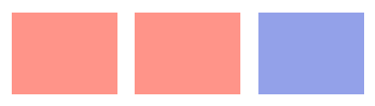

## **소개**

PowerPoint에서 도형의 외곽선, 채우기 및 효과를 조정하여 형식을 지정합니다. Aspose.Slides for .NET을 사용하면 투명도, 회전 및 3D 서식을 포함한 이러한 설정을 프로그래밍 방식으로 제어할 수 있습니다.


Aspose.Slides for .NET은 PowerPoint에서 사용할 수 있는 동일한 옵션을 사용하여 도형을 서식 지정할 수 있는 인터페이스와 속성을 제공합니다.

## **선 서식**

도형의 외곽선을 제어하려면 [IShape.LineFormat](https://reference.aspose.com/slides/net/aspose.slides/ishape/lineformat/)을 사용합니다. 이 예제에서는 채우지 않은 사각형에 파란색 점선 외곽선을 만듭니다. [ILineFormat.Style](https://reference.aspose.com/slides/net/aspose.slides/ilineformat/style/)은 굵기-굵기 복합 선을 선택하고, [ILineFormat.Width](https://reference.aspose.com/slides/net/aspose.slides/ilineformat/width/)은 너비를 7포인트로 설정하며, [ILineFormat.DashStyle](https://reference.aspose.com/slides/net/aspose.slides/ilineformat/dashstyle/)은 대시 패턴을 선택합니다.

```csharp
using System.Drawing;
using Aspose.Slides;
using Aspose.Slides.Export;

using var presentation = new Presentation();
var slide = presentation.Slides[0];

var shape = slide.Shapes.AddAutoShape(ShapeType.Rectangle, 50, 50, 150, 75);
shape.FillFormat.FillType = FillType.NoFill;
shape.LineFormat.Style = LineStyle.ThickThin;
shape.LineFormat.Width = 7;
shape.LineFormat.DashStyle = LineDashStyle.Dash;
shape.LineFormat.FillFormat.FillType = FillType.Solid;
shape.LineFormat.FillFormat.SolidFillColor.Color = Color.Blue;

presentation.Save("formatted_lines.pptx", SaveFormat.Pptx);
```

결과:


### **사용자 정의 선 대시 패턴 설정**

미리 정의된 선 스타일이 필요로 하는 대시 길이와 간격을 제공하지 않을 때, 예를 들어 브랜드 외곽선이나 기술 도식에서, [ILineFormat.CustomDashPattern](https://reference.aspose.com/slides/net/aspose.slides/ilineformat/customdashpattern/)을 사용합니다. 패턴을 지정하면 자동으로 [ILineFormat.DashStyle](https://reference.aspose.com/slides/net/aspose.slides/ilineformat/dashstyle/)이 [LineDashStyle.Custom](https://reference.aspose.com/slides/net/aspose.slides/linedashstyle/)으로 설정됩니다.

배열 항목은 대시와 간격 길이를 번갈아가며 시작은 대시입니다. 각 값은 선 너비의 배수입니다: 선 너비가 3포인트일 때 `{ 4, 2 }`는 12포인트 대시와 6포인트 간격을 생성합니다. 완전한 대시-간격 구간을 정의하려면 유한하고 음수가 아닌 값 쌍을 사용합니다. 예제에서는 모든 대시와 간격이 보이도록 양의 값을 사용합니다.

이 예제는 동일한 길이와 플랫 캡을 가진 파란색 선 5개를 생성합니다. 처음 세 개는 3포인트 너비에서 패턴을 비교하고, 네 번째는 첫 번째 패턴을 두 배 너비로 반복하여 대시와 간격 길이를 두 배로 늘립니다. 다섯 번째는 사용자 정의 패턴에서 실선으로 전환합니다.

```csharp
using System.Drawing;
using Aspose.Slides;
using Aspose.Slides.Export;

using var presentation = new Presentation();
presentation.SlideSize.SetSize(600, 300, SlideSizeScaleType.DoNotScale);
var slide = presentation.Slides[0];

var patterns = new[]
{
    new float[] { 4, 2 },
    new float[] { 1, 2 },
    new float[] { 6, 2, 1, 2 },
    new float[] { 4, 2 },
    new float[] { 4, 2 }
};

for (var i = 0; i < patterns.Length; i++)
{
    var line = slide.Shapes.AddAutoShape(ShapeType.Line, 50, 50 + i * 50, 500, 0);
    line.LineFormat.Width = i == 3 ? 6 : 3;
    line.LineFormat.FillFormat.FillType = FillType.Solid;
    line.LineFormat.FillFormat.SolidFillColor.Color = Color.DarkBlue;
    line.LineFormat.CapStyle = LineCapStyle.Flat;
    line.LineFormat.BeginArrowheadStyle = LineArrowheadStyle.None;
    line.LineFormat.EndArrowheadStyle = LineArrowheadStyle.None;
    line.LineFormat.CustomDashPattern = patterns[i];
}

// 마지막 선을 실선 스타일로 반환합니다.
slide.Shapes[4].LineFormat.DashStyle = LineDashStyle.Solid;

presentation.Save("custom_dash_patterns.pptx", SaveFormat.Pptx);
```

대신 미리 정의된 점선 스타일로 돌아가려면 [LineDashStyle.Dash](https://reference.aspose.com/slides/net/aspose.slides/linedashstyle/)을 [ILineFormat.DashStyle](https://reference.aspose.com/slides/net/aspose.slides/ilineformat/dashstyle/)에 할당합니다. 선택된 스타일이 선의 외관을 제어합니다.

PowerPoint에서 위에서 아래 순서대로 결과: **{4, 2}, 3 pt**; **{1, 2}, 3 pt**; **{6, 2, 1, 2}, 3 pt**; **{4, 2}, 6 pt**; 및 **Solid, 3 pt**.


### **선 캡 설정**

열린 선의 끝을 설정하려면 [ILineFormat.CapStyle](https://reference.aspose.com/slides/net/aspose.slides/ilineformat/capstyle/)을 사용합니다. [LineCapStyle](https://reference.aspose.com/slides/net/aspose.slides/linecapstyle/) 열거형은 세 가지 명시적인 캡 스타일을 제공합니다:

- `Flat`: 획이 끝점에서 멈춥니다.
- `Round`: 반원형 캡이 선 너비의 절반만큼 끝점을 넘어 확장됩니다.
- `Square`: 사각형 캡이 선 너비의 절반만큼 끝점을 넘어 확장됩니다.

열거형에는 `NotDefined`도 포함되어 있으며, 이는 캡 스타일이 명시적으로 할당되지 않았음을 의미합니다.

캡은 선 끝에 기호를 추가하는 화살촉과 선 구간 사이의 모서리를 제어하는 조인과는 다릅니다. 이 예제에서는 [ILineFormat.BeginArrowheadStyle](https://reference.aspose.com/slides/net/aspose.slides/ilineformat/beginarrowheadstyle/)와 [ILineFormat.EndArrowheadStyle](https://reference.aspose.com/slides/net/aspose.slides/ilineformat/endarrowheadstyle/)를 통해 화살촉을 비활성화하여 캡 모양만을 비교합니다.

다음 예제는 20포인트 너비의 기본적으로 동일한 가로 선 3개를 생성합니다. 위에서 아래 순서대로 플랫, 라운드, 스퀘어 캡을 사용합니다. 끝점은 동일한 수평 좌표를 가지며, 라운드와 스퀘어 캡은 각 끝점에서 10포인트씩 확장됩니다.

```csharp
using System.Drawing;
using Aspose.Slides;
using Aspose.Slides.Export;

using var presentation = new Presentation();
presentation.SlideSize.SetSize(500, 240, SlideSizeScaleType.DoNotScale);
var slide = presentation.Slides[0];

var capStyles = new[] { LineCapStyle.Flat, LineCapStyle.Round, LineCapStyle.Square };

for (var i = 0; i < capStyles.Length; i++)
{
    var line = slide.Shapes.AddAutoShape(ShapeType.Line, 100, 50 + i * 70, 300, 0);
    line.LineFormat.Width = 20;
    line.LineFormat.FillFormat.FillType = FillType.Solid;
    line.LineFormat.FillFormat.SolidFillColor.Color = Color.DarkBlue;
    line.LineFormat.DashStyle = LineDashStyle.Solid;
    line.LineFormat.CapStyle = capStyles[i];
    line.LineFormat.BeginArrowheadStyle = LineArrowheadStyle.None;
    line.LineFormat.EndArrowheadStyle = LineArrowheadStyle.None;
}

presentation.Save("line_caps.pptx", SaveFormat.Pptx);
```

PowerPoint에서 위에서 아래 순서대로 결과: **Flat**, **Round**, **Square**.


## **도형 선에 스케치 효과 적용**

스케치 효과는 도형 선을 손으로 그린 것처럼 보이게 합니다. [IShape.LineFormat](https://reference.aspose.com/slides/net/aspose.slides/ishape/lineformat/)을 사용하여 선 설정에 접근하고, [ILineFormat.SketchFormat](https://reference.aspose.com/slides/net/aspose.slides/ilineformat/sketchformat/)을 사용하여 스케치 설정에 접근하며, [ISketchFormat.SketchType](https://reference.aspose.com/slides/net/aspose.slides/isketchformat/sketchtype/)을 사용하여 [LineSketchType](https://reference.aspose.com/slides/net/aspose.slides/linesketchtype/) 열거형에서 값을 선택합니다.

다음 C# 코드는 [LineSketchType.Curved](https://reference.aspose.com/slides/net/aspose.slides/linesketchtype/) 효과를 적용하고, 명시적으로 할당된 값을 읽으며, [LineSketchType.None](https://reference.aspose.com/slides/net/aspose.slides/linesketchtype/)으로 효과를 제거하는 방법을 보여줍니다.

```csharp
using System;
using Aspose.Slides;

using var presentation = new Presentation();
var slide = presentation.Slides[0];

var shape = slide.Shapes.AddAutoShape(ShapeType.Rectangle, 50, 50, 200, 100);

var sketchFormat = shape.LineFormat.SketchFormat;
sketchFormat.SketchType = LineSketchType.Curved;
var explicitSketchType = sketchFormat.SketchType;
Console.WriteLine($"Explicit sketch type: {explicitSketchType}");
sketchFormat.SketchType = LineSketchType.None;
```

[ISketchFormat.SketchType](https://reference.aspose.com/slides/net/aspose.slides/isketchformat/sketchtype/)이 반환하는 값은 도형에 직접 할당된 설정을 나타냅니다. 선 서식이 테마, 마스터 슬라이드 또는 레이아웃 슬라이드에서 상속될 수 있는 경우, [ILineFormat.GetEffective](https://reference.aspose.com/slides/net/aspose.slides/ilineformat/geteffective/)을 사용하고, [ILineFormatEffectiveData.SketchFormat](https://reference.aspose.com/slides/net/aspose.slides/ilineformateffectivedata/sketchformat/)에 접근한 뒤, [ISketchFormatEffectiveData.SketchType](https://reference.aspose.com/slides/net/aspose.slides/isketchformateffectivedata/sketchtype/)을 읽습니다. 유효 값은 상속이 해결된 후 실제 적용된 서식을 반영합니다. 이 예제는 첫 번째 슬라이드에 최소 하나의 도형이 있는 기존 프레젠테이션이 필요하며 두 값을 출력합니다.

```csharp
using System;
using Aspose.Slides;

using var presentation = new Presentation("presentation.pptx");
var shape = presentation.Slides[0].Shapes[0];

var lineFormat = shape.LineFormat;
var explicitSketchType = lineFormat.SketchFormat.SketchType;
var effectiveLineFormat = lineFormat.GetEffective();
var effectiveSketchType = effectiveLineFormat.SketchFormat.SketchType;

Console.WriteLine($"Explicit sketch type: {explicitSketchType}");
Console.WriteLine($"Effective sketch type: {effectiveSketchType}");
```

## **조인 스타일 서식 지정**

다음은 세 가지 조인 유형 옵션입니다:

* Round
* Miter
* Bevel

조인 스타일은 두 외곽선 구간이 코너에서 만나는 방식을 제어합니다. 둥근 코너에는 **Round**, 뾰족한 코너에는 **Miter**, 평평한 코너에는 **Bevel**을 사용합니다.


이 예제는 파란색 외곽선(15포인트)으로 된 검은색 사각형 3개를 생성합니다. 각각 [ILineFormat.JoinStyle](https://reference.aspose.com/slides/net/aspose.slides/ilineformat/joinstyle/)을 [LineJoinStyle](https://reference.aspose.com/slides/net/aspose.slides/linejoinstyle/)의 miter, bevel, round 값으로 설정하여 코너가 어떻게 그려지는지 비교합니다.

```csharp
using System.Drawing;
using Aspose.Slides;
using Aspose.Slides.Export;

using var presentation = new Presentation();
var slide = presentation.Slides[0];

var miterShape = slide.Shapes.AddAutoShape(ShapeType.Rectangle, 20, 20, 150, 75);
var bevelShape = slide.Shapes.AddAutoShape(ShapeType.Rectangle, 210, 20, 150, 75);
var roundShape = slide.Shapes.AddAutoShape(ShapeType.Rectangle, 20, 135, 150, 75);

miterShape.FillFormat.FillType = FillType.Solid;
miterShape.FillFormat.SolidFillColor.Color = Color.Black;
bevelShape.FillFormat.FillType = FillType.Solid;
bevelShape.FillFormat.SolidFillColor.Color = Color.Black;
roundShape.FillFormat.FillType = FillType.Solid;
roundShape.FillFormat.SolidFillColor.Color = Color.Black;

miterShape.LineFormat.Width = 15;
bevelShape.LineFormat.Width = 15;
roundShape.LineFormat.Width = 15;

miterShape.LineFormat.FillFormat.FillType = FillType.Solid;
miterShape.LineFormat.FillFormat.SolidFillColor.Color = Color.Blue;
bevelShape.LineFormat.FillFormat.FillType = FillType.Solid;
bevelShape.LineFormat.FillFormat.SolidFillColor.Color = Color.Blue;
roundShape.LineFormat.FillFormat.FillType = FillType.Solid;
roundShape.LineFormat.FillFormat.SolidFillColor.Color = Color.Blue;

miterShape.LineFormat.JoinStyle = LineJoinStyle.Miter;
bevelShape.LineFormat.JoinStyle = LineJoinStyle.Bevel;
roundShape.LineFormat.JoinStyle = LineJoinStyle.Round;

miterShape.TextFrame.Text = "Miter Join Style";
bevelShape.TextFrame.Text = "Bevel Join Style";
roundShape.TextFrame.Text = "Round Join Style";

presentation.Save("join_styles.pptx", SaveFormat.Pptx);
```

### **뾰족한 코너에서 Miter 조인 제한**

[ILineFormat.MiterLimit](https://reference.aspose.com/slides/net/aspose.slides/ilineformat/miterlimit/)을 사용하고 [ILineFormat.JoinStyle](https://reference.aspose.com/slides/net/aspose.slides/ilineformat/joinstyle/)를 [LineJoinStyle.Miter](https://reference.aspose.com/slides/net/aspose.slides/linejoinstyle/)로 설정하여 뾰족한 코너가 얼마나 확장될 수 있는지 제한합니다.

제한은 조인의 내부와 외부 코너 사이 거리와 선 너비의 비율입니다. 예를 들어 `8` 값은 선 너비의 8배까지 miter 길이를 허용하며, 이는 포인트 단위 측정이 아닙니다. 코너가 제한을 초과하면 PowerPoint은 해당 코너에 베벨 조인을 사용합니다. 큰 제한값은 더 뾰족한 포인트를 허용합니다. 이 설정은 miter 조인에만 영향을 미치며, 코너가 두 제한 모두 내에 있을 경우 변경해도 눈에 보이는 효과가 없습니다.

이 예제는 외곽선이 20포인트인 동일한 비채움 삼각형 두 개를 생성합니다. 왼쪽 삼각형은 `2` 제한을 사용하고, 오른쪽은 `8`을 사용합니다. 각 삼각형은 너비 80포인트, 높이 160포인트이며, 상단 코너의 miter 길이와 선 너비 비율은 약 `4.12`입니다. 따라서 PowerPoint은 왼쪽 꼭짓점을 베벨 처리하고 오른쪽 꼭짓점은 유지합니다.

```csharp
using System.Drawing;
using Aspose.Slides;
using Aspose.Slides.Export;

using var presentation = new Presentation();
presentation.SlideSize.SetSize(500, 320, SlideSizeScaleType.DoNotScale);
var slide = presentation.Slides[0];

var miterLimits = new[] { 2f, 8f };

for (var i = 0; i < miterLimits.Length; i++)
{
    var triangle = slide.Shapes.AddAutoShape(ShapeType.Triangle, 90 + i * 240, 110, 80, 160);
    triangle.FillFormat.FillType = FillType.NoFill;
    triangle.LineFormat.Width = 20;
    triangle.LineFormat.FillFormat.FillType = FillType.Solid;
    triangle.LineFormat.FillFormat.SolidFillColor.Color = Color.DarkBlue;
    triangle.LineFormat.JoinStyle = LineJoinStyle.Miter;
    triangle.LineFormat.MiterLimit = miterLimits[i];
}

presentation.Save("miter_limits.pptx", SaveFormat.Pptx);
```

PowerPoint에서 결과: 왼쪽에 **Miter limit 2**, 오른쪽에 **miter limit 8**.


## **그라데이션 채우기**

그라데이션 채우기는 도형 전체에 색상을 혼합합니다. 이 예제에서는 [IFillFormat.GradientFormat](https://reference.aspose.com/slides/net/aspose.slides/ifillformat/gradientformat/)을 사용하여 빨간색에서 보라색으로 45도 각도의 선형 그라데이션으로 타원을 채웁니다. [IGradientStopCollection.Add](https://reference.aspose.com/slides/net/aspose.slides/igradientstopcollection/add/) 메서드는 그라데이션의 시작과 끝인 0과 1에 색상 정지를 배치합니다. 기존 정지를 모두 지우면 두 색상만 사용됩니다.

```csharp
using Aspose.Slides;
using Aspose.Slides.Export;

using var presentation = new Presentation();
var slide = presentation.Slides[0];

var shape = slide.Shapes.AddAutoShape(ShapeType.Ellipse, 50, 50, 150, 75);
shape.FillFormat.FillType = FillType.Gradient;
shape.FillFormat.GradientFormat.GradientShape = GradientShape.Linear;
shape.FillFormat.GradientFormat.LinearGradientAngle = 45;
shape.FillFormat.GradientFormat.GradientStops.Clear();
shape.FillFormat.GradientFormat.GradientStops.Add(1.0f, PresetColor.Purple);
shape.FillFormat.GradientFormat.GradientStops.Add(0.0f, PresetColor.Red);

presentation.Save("gradient_fill.pptx", SaveFormat.Pptx);
```

결과:


그라데이션이 내보낸 이미지에서 PowerPoint와 다르게 보인다면 [Choose a Gradient Rendering Style](/slides/ko/net/convert-powerpoint-to-png/#choose-a-gradient-rendering-style)를 참조하십시오. 프레젠테이션에 저장된 그라데이션 채우기를 변경하지 않고 렌더링 스타일을 선택할 수 있습니다.

### **선형 그라데이션 각도 설정**

[IGradientFormat.LinearGradientAngle](https://reference.aspose.com/slides/net/aspose.slides/igradientformat/lineargradientangle/)을 사용하여 [GradientShape.Linear](https://reference.aspose.com/slides/net/aspose.slides/gradientshape/) 채우기의 방향을 제어합니다. 각도는 도 단위이며 시계 방향으로 증가합니다: `0`은 왼쪽에서 오른쪽, `90`은 위에서 아래, `180`은 오른쪽에서 왼쪽, `270`은 아래에서 위로 진행합니다. 소수 각도도 지원됩니다. `[0, 360)` 범위 밖의 유한 각도는 한 바퀴로 정규화됩니다; 예를 들어 `-45`는 `315`가 되고 `360`은 `0`이 됩니다.

이 예제는 위치 `0`, `0.5`, `1`에 동일한 빨강, 초록, 파랑 정지를 갖는 직사각형 6개를 생성합니다. 스케일링을 비활성화하여 각도를 직사각형의 비율과 무관하게 비교할 수 있습니다. 각도는 왼쪽에서 오른쪽 순서대로 첫 번째 행에 `0`, `45`, `90`, 두 번째 행에 `135`, `180`, `270`입니다.

```csharp
using System.Drawing;
using Aspose.Slides;
using Aspose.Slides.Export;

using var presentation = new Presentation();
presentation.SlideSize.SetSize(720, 400, SlideSizeScaleType.DoNotScale);
var slide = presentation.Slides[0];

var angles = new float[] { 0, 45, 90, 135, 180, 270 };

for (var i = 0; i < angles.Length; i++)
{
    var x = 30 + (i % 3) * 230;
    var y = 30 + (i / 3) * 190;

    var shape = slide.Shapes.AddAutoShape(ShapeType.Rectangle, x, y, 200, 150);
    shape.LineFormat.FillFormat.FillType = FillType.NoFill;
    shape.FillFormat.FillType = FillType.Gradient;

    var gradient = shape.FillFormat.GradientFormat;
    gradient.GradientShape = GradientShape.Linear;
    gradient.GradientStops.Clear();
    gradient.GradientStops.Add(0f, Color.Red);
    gradient.GradientStops.Add(0.5f, Color.Lime);
    gradient.GradientStops.Add(1f, Color.Blue);
    gradient.LinearGradientScaled = NullableBool.False;
    gradient.LinearGradientAngle = angles[i];
}

presentation.Save("linear_gradient_angles.pptx", SaveFormat.Pptx);
```

PowerPoint에서 결과:


### **도형에 따라 선형 그라데이션 스케일링**

[IGradientFormat.LinearGradientScaled](https://reference.aspose.com/slides/net/aspose.slides/igradientformat/lineargradientscaled/)은 [NullableBool](https://reference.aspose.com/slides/net/aspose.slides/nullablebool/) 값을 받습니다. `False`로 명시적으로 설정하면 도형 비율이 변해도 기하학적 그라데이션 각도가 유지되고, `True`로 설정하면 도형의 너비와 높이에 맞춰 그라데이션이 스케일됩니다. 스케일링이 활성화된 경우, 비정사각형 도형에서는 보이는 각도가 할당된 각도와 다를 수 있습니다.

다음 예제는 `45`도 각도와 앞서 각도 비교에 사용한 동일한 색상 정지를 사용합니다. 왼쪽 열은 `False`, 오른쪽 열은 `True`를 사용합니다. 각 열은 넓은 직사각형 위에 높은 직사각형을 포함합니다. 두 열 모두 동일한 넓은 차원으로 시작하며, 두 번째 직사각형의 너비와 높이를 변경하여 그라데이션 설정을 바꾸지 않고도 채우기가 어떻게 반응하는지 보여줍니다.

```csharp
using System.Drawing;
using Aspose.Slides;
using Aspose.Slides.Export;

using var presentation = new Presentation();
presentation.SlideSize.SetSize(720, 460, SlideSizeScaleType.DoNotScale);
var slide = presentation.Slides[0];

var scalingOptions = new[] { NullableBool.False, NullableBool.True };

for (var column = 0; column < scalingOptions.Length; column++)
{
    for (var row = 0; row < 2; row++)
    {
        var x = 30 + column * 360;
        var y = row == 0 ? 30 : 150;
        
        var shape = slide.Shapes.AddAutoShape(ShapeType.Rectangle, x, y, 300, 90);
        shape.LineFormat.FillFormat.FillType = FillType.NoFill;
        shape.FillFormat.FillType = FillType.Gradient;

        var gradient = shape.FillFormat.GradientFormat;
        gradient.GradientShape = GradientShape.Linear;
        gradient.GradientStops.Clear();
        gradient.GradientStops.Add(0f, Color.Red);
        gradient.GradientStops.Add(0.5f, Color.Lime);
        gradient.GradientStops.Add(1f, Color.Blue);
        gradient.LinearGradientAngle = 45;
        gradient.LinearGradientScaled = scalingOptions[column];

        if (row == 1)
        {
            shape.Width = 90;
            shape.Height = 280;
        }
    }
}

presentation.Save("linear_gradient_scaling.pptx", SaveFormat.Pptx);
```

PowerPoint에서 결과, 왼쪽은 스케일링이 비활성화되고 오른쪽은 활성화됨:


스케일링이 비활성화되면 대각 색상 밴드가 두 직사각형 모두에서 동일한 방향을 유지합니다. 스케일링이 활성화되면 밴드가 도형의 비율에 맞게 늘어납니다. 이는 도형을 다른 크기로 적용할 때 템플릿의 그라데이션을 재현하는 데 도움이 됩니다. 정사각형에서는 스케일링을 활성화해도 이 `45`도 그라데이션의 모양이 변하지 않습니다.

각도와 스케일링 설정은 모두 선형 그라데이션에 적용됩니다. 이는 [GradientShape.Radial 또는 GradientShape.Rectangle](https://reference.aspose.com/slides/net/aspose.slides/gradientshape/) 채우기를 제어하지 않습니다.

### **각도와 그라데이션 방향 결합**

[IGradientFormat.GradientDirection](https://reference.aspose.com/slides/net/aspose.slides/igradientformat/gradientdirection/)은 [GradientDirection](https://reference.aspose.com/slides/net/aspose.slides/gradientdirection/) 열거형에서 그라데이션 스타일을 선택합니다; 이는 숫자 각도의 대체가 아닙니다. 선형 그라데이션의 경우, 코너 스타일은 [LinearGradientAngle](https://reference.aspose.com/slides/net/aspose.slides/igradientformat/lineargradientangle/)을 변경하지 않고 색상이 분배되는 영역을 바꿀 수 있습니다. 각도나 스케일링을 비교할 때 방향을 동일하게 유지하십시오.

다음 예제는 같은 설정을 반대 순서로 적용합니다. 두 직사각형은 동일한 외관을 가지며, 방향을 각도 전에 할당하든 뒤에 할당하든 결과가 달라지지 않습니다.

```csharp
using System.Drawing;
using Aspose.Slides;
using Aspose.Slides.Export;

using var presentation = new Presentation();
var slide = presentation.Slides[0];

for (var i = 0; i < 2; i++)
{
    var shape = slide.Shapes.AddAutoShape(ShapeType.Rectangle, 30, 30 + i * 140, 320, 100);
    shape.LineFormat.FillFormat.FillType = FillType.NoFill;
    shape.FillFormat.FillType = FillType.Gradient;

    var gradient = shape.FillFormat.GradientFormat;
    gradient.GradientShape = GradientShape.Linear;
    gradient.GradientStops.Clear();
    gradient.GradientStops.Add(0f, Color.Red);
    gradient.GradientStops.Add(0.5f, Color.Lime);
    gradient.GradientStops.Add(1f, Color.Blue);
    gradient.LinearGradientScaled = NullableBool.True;

    if (i == 0)
    {
        gradient.GradientDirection = GradientDirection.FromCorner1;
        gradient.LinearGradientAngle = 30;
    }
    else
    {
        gradient.LinearGradientAngle = 30;
        gradient.GradientDirection = GradientDirection.FromCorner1;
    }
}

presentation.Save("linear_gradient_direction.pptx", SaveFormat.Pptx);
```

## **패턴 채우기**

패턴 채우기는 점, 줄무늬 또는 격자와 같은 두 가지 색상의 디자인을 적용합니다. 이 예제는 [IPatternFormat.PatternStyle](https://reference.aspose.com/slides/net/aspose.slides/ipatternformat/patternstyle/)을 사용하여 격자 패턴을 선택합니다. [IPatternFormat.BackColor](https://reference.aspose.com/slides/net/aspose.slides/ipatternformat/backcolor/)은 연회색 배경을 제공하고, [IPatternFormat.ForeColor](https://reference.aspose.com/slides/net/aspose.slides/ipatternformat/forecolor/)은 노란색 패턴 색을 제공합니다.

```csharp
using System.Drawing;
using Aspose.Slides;
using Aspose.Slides.Export;

using var presentation = new Presentation();
var slide = presentation.Slides[0];

var shape = slide.Shapes.AddAutoShape(ShapeType.Rectangle, 50, 50, 150, 75);
shape.FillFormat.FillType = FillType.Pattern;
shape.FillFormat.PatternFormat.PatternStyle = PatternStyle.Trellis;
shape.FillFormat.PatternFormat.BackColor.Color = Color.LightGray;
shape.FillFormat.PatternFormat.ForeColor.Color = Color.Yellow;

presentation.Save("pattern_fill.pptx", SaveFormat.Pptx);
```


## **그림 채우기**

그림 채우기는 도형 내부에 이미지를 사용합니다. 이 예제는 로컬 이미지를 필요로 하며, [Images.FromFile](https://reference.aspose.com/slides/net/aspose.slides/images/fromfile/)을 사용하여 프레젠테이션의 이미지 컬렉션에 로드합니다. [IPictureFillFormat.PictureFillMode](https://reference.aspose.com/slides/net/aspose.slides/ipicturefillformat/picturefillmode/)을 타일 모드로 설정하면 사각형 안에 이미지가 반복됩니다. 여기 사용된 원본 이미지는 아래에 표시됩니다:


```csharp
using Aspose.Slides;
using Aspose.Slides.Export;

using var presentation = new Presentation();
var slide = presentation.Slides[0];

var shape = slide.Shapes.AddAutoShape(ShapeType.Rectangle, 50, 50, 255, 130);
shape.FillFormat.FillType = FillType.Picture;
shape.FillFormat.PictureFillFormat.PictureFillMode = PictureFillMode.Tile;

using var image = Images.FromFile("lotus.png");
var presentationImage = presentation.Images.AddImage(image);
shape.FillFormat.PictureFillFormat.Picture.Image = presentationImage;

presentation.Save("picture_fill.pptx", SaveFormat.Pptx);
```


### **텍스처로 그림 타일링**

타일링된 그림을 텍스처로 설정하고 타일링 동작을 사용자 정의하려면, 다음 [IPictureFillFormat](https://reference.aspose.com/slides/net/aspose.slides/ipicturefillformat/) 인터페이스와 [PictureFillFormat](https://reference.aspose.com/slides/net/aspose.slides/picturefillformat/) 클래스의 속성을 사용할 수 있습니다:

- [PictureFillMode](https://reference.aspose.com/slides/net/aspose.slides/ipicturefillformat/picturefillmode/): 그림 채우기 모드를 `Tile` 또는 `Stretch`로 설정합니다.
- [TileAlignment](https://reference.aspose.com/slides/net/aspose.slides/ipicturefillformat/tilealignment/): 도형 내 타일의 정렬을 지정합니다.
- [TileFlip](https://reference.aspose.com/slides/net/aspose.slides/ipicturefillformat/tileflip/): 타일을 가로, 세로 또는 모두 뒤집을지 제어합니다.
- [TileOffsetX](https://reference.aspose.com/slides/net/aspose.slides/ipicturefillformat/tileoffsetx/): 도형 원점으로부터 타일의 수평 오프셋(포인트)을 설정합니다.
- [TileOffsetY](https://reference.aspose.com/slides/net/aspose.slides/ipicturefillformat/tileoffsety/): 도형 원점으로부터 타일의 수직 오프셋(포인트)을 설정합니다.
- [TileScaleX](https://reference.aspose.com/slides/net/aspose.slides/ipicturefillformat/tilescalex/): 타일의 수평 스케일을 백분율로 정의합니다.
- [TileScaleY](https://reference.aspose.com/slides/net/aspose.slides/ipicturefillformat/tilescaley/): 타일의 수직 스케일을 백분율로 정의합니다.

이 예제는 로컬 이미지를 필요로 하며 [IPictureFillFormat](https://reference.aspose.com/slides/net/aspose.slides/ipicturefillformat/)을 원본 크기의 50%로 반복하도록 구성합니다. −32포인트의 오프셋은 타일을 수평 및 수직으로 이동시키며, 오른쪽 아래 정렬 및 양방향 뒤집기는 반복 텍스처가 어떻게 배치되는지를 결정합니다.

```csharp
using Aspose.Slides;
using Aspose.Slides.Export;

using var presentation = new Presentation();
var firstSlide = presentation.Slides[0];

var shape = firstSlide.Shapes.AddAutoShape(ShapeType.Rectangle, 50, 50, 190, 95);
shape.FillFormat.FillType = FillType.Picture;

using var sourceImage = Images.FromFile("lotus.png");
var presentationImage = presentation.Images.AddImage(sourceImage);

var pictureFillFormat = shape.FillFormat.PictureFillFormat;
pictureFillFormat.Picture.Image = presentationImage;
pictureFillFormat.PictureFillMode = PictureFillMode.Tile;
pictureFillFormat.TileOffsetX = -32;
pictureFillFormat.TileOffsetY = -32;
pictureFillFormat.TileScaleX = 50;
pictureFillFormat.TileScaleY = 50;
pictureFillFormat.TileAlignment = RectangleAlignment.BottomRight;
pictureFillFormat.TileFlip = TileFlip.FlipBoth;

presentation.Save("tile.pptx", SaveFormat.Pptx);
```


## **단색 채우기**

단색 채우기는 도형에 단일, 균일한 색상을 제공합니다. 이 예제는 [IFillFormat.FillType](https://reference.aspose.com/slides/net/aspose.slides/ifillformat/filltype/)을 단색 채우기 모드로 설정하고 [IFillFormat.SolidFillColor](https://reference.aspose.com/slides/net/aspose.slides/ifillformat/solidfillcolor/)을 통해 노란색을 지정한 뒤, 사각형을 프레젠테이션에 저장합니다.

```csharp
using System.Drawing;
using Aspose.Slides;
using Aspose.Slides.Export;

using var presentation = new Presentation();
var slide = presentation.Slides[0];

var shape = slide.Shapes.AddAutoShape(ShapeType.Rectangle, 50, 50, 150, 75);
shape.FillFormat.FillType = FillType.Solid;
shape.FillFormat.SolidFillColor.Color = Color.Yellow;

presentation.Save("solid_color_fill.pptx", SaveFormat.Pptx);
```


### **테마 참조를 유지하면서 색상 복사**

[IColorFormat.CopyFrom](https://reference.aspose.com/slides/net/aspose.slides/icolorformat/copyfrom/)을 사용하여 색상 유형, 테마 참조 및 변환을 포함한 색상 정의를 복사합니다. 이는 프레젠테이션 테마를 계속 따르는 도형 간에 채우기 색상을 전송할 때 유용합니다. 이 메서드는 색상만 복사하고 채우기 유형, 외곽선 또는 기타 도형 서식은 복사하지 않습니다. 대상의 [IFillFormat.FillType](https://reference.aspose.com/slides/net/aspose.slides/ifillformat/filltype/)을 명시적으로 설정하십시오.

이 예제는 왼쪽에서 오른쪽 순서대로 원본, 테마 인식 복사본, 고정 RGB 복사본인 세 개의 사각형을 생성합니다. 원본은 [IColorFormat.SchemeColor](https://reference.aspose.com/slides/net/aspose.slides/icolorformat/schemecolor/)을 사용해 첫 번째 강조 색을 참조하고 [IColorOperationCollection.Add](https://reference.aspose.com/slides/net/aspose.slides/icoloroperationcollection/add/)을 통해 색조를 추가합니다. RGB 복사본은 원본의 유효 채우기 색을 사용하므로 처음에 세 개 모두 동일하게 보입니다. [IColorFormat.Color](https://reference.aspose.com/slides/net/aspose.slides/icolorformat/color/)을 할당하면 고정 RGB 값이 설정되고 기존 색상 변환이 제거됩니다.

```csharp
using System.Drawing;
using Aspose.Slides;
using Aspose.Slides.Export;

using var presentation = new Presentation();
presentation.SlideSize.SetSize(660, 220, SlideSizeScaleType.DoNotScale);
var slide = presentation.Slides[0];

presentation.MasterTheme.ColorScheme.Accent1.Color = Color.RoyalBlue;

var source = slide.Shapes.AddAutoShape(ShapeType.Rectangle, 30, 40, 180, 140);
var themeCopy = slide.Shapes.AddAutoShape(ShapeType.Rectangle, 240, 40, 180, 140);
var rgbCopy = slide.Shapes.AddAutoShape(ShapeType.Rectangle, 450, 40, 180, 140);

foreach (var shape in new[] { source, themeCopy, rgbCopy })
{
    shape.FillFormat.FillType = FillType.Solid;
    shape.LineFormat.FillFormat.FillType = FillType.NoFill;
}

var sourceColor = source.FillFormat.SolidFillColor;
sourceColor.SchemeColor = SchemeColor.Accent1;
sourceColor.ColorTransform.Add(ColorTransformOperation.Tint, 0.75f);

themeCopy.FillFormat.SolidFillColor.CopyFrom(sourceColor);
rgbCopy.FillFormat.SolidFillColor.Color = source.FillFormat.GetEffective().SolidFillColor;

using var before = slide.GetImage(1f, 1f);
before.Save("color-copy-before.png", ImageFormat.Png);

// Theme references follow the new accent color; the fixed RGB value does not.
presentation.MasterTheme.ColorScheme.Accent1.Color = Color.OrangeRed;

using var after = slide.GetImage(1f, 1f);
after.Save("color-copy-after.png", ImageFormat.Png);
presentation.Save("copied_colors.pptx", SaveFormat.Pptx);
```

테마 변경 전, 세 채우기가 모두 일치합니다:


테마 변경 후, 원본과 테마 인식 복사본은 새로운 강조 색을 따르고 색조를 유지합니다. 고정 RGB 복사본은 파란색 그대로 유지됩니다:



복사된 정의는 원본과 독립적입니다. 이후 원본의 테마 참조를 변경하거나 다른 색을 할당하거나 변환을 추가/제거해도 대상은 변경되지 않습니다. 테마 변경은 두 도형 모두에 영향을 주는데, 이는 각각이 동일한 테마 색을 독립적으로 참조하기 때문입니다.

PPTX를 저장하고 다시 열어도 복사된 색상의 [IColorFormat.ColorType](https://reference.aspose.com/slides/net/aspose.slides/icolorformat/colortype/), 테마 참조 및 [IColorFormat.ColorTransform](https://reference.aspose.com/slides/net/aspose.slides/icolorformat/colortransform/) 컬렉션이 유지됩니다; 정의가 RGB로 평탄화되지 않습니다.

다른 강조 색 팔레트를 가진 프레젠테이션 등 서로 다른 테마 컨텍스트 간에 복사할 때, 복사된 참조는 대상의 테마에 맞게 해석됩니다. 동일한 참조와 변환이 다른 보이는 색을 만들 수 있습니다. 테마 색 구성에 대한 자세한 내용은 [Presentation Theme](/slides/ko/net/presentation-theme/)를 참조하십시오.

## **슬라이드 배경을 도형 채우기로 사용**

슬라이드 배경과 일치하도록 도형을 설정하려면, 예를 들어 프레젠테이션 템플릿에서, [IAutoShape.UseBackgroundFill](https://reference.aspose.com/slides/net/aspose.slides/iautoshape/usebackgroundfill/)을 사용합니다. 먼저 [IFillFormat.FillType](https://reference.aspose.com/slides/net/aspose.slides/ifillformat/filltype/)을 [FillType.NotDefined](https://reference.aspose.com/slides/net/aspose.slides/filltype/)으로 설정하여 명시적 채우기를 제거합니다. 이 조합으로 도형은 스타일 채우기 대신 슬라이드 배경을 사용합니다. 플래그만 활성화해도 기존 명시적 채우기가 제거되지 않습니다.

이는 [FillType.NoFill](https://reference.aspose.com/slides/net/aspose.slides/filltype/)와 다릅니다: 배경 채우기는 도형 뒤에 있는 객체들을 슬라이드 배경 영역으로 가리며, No Fill은 해당 객체들을 그대로 보이게 합니다. 그라데이션은 각 도형 내부에서 다시 시작하지 않고 슬라이드와 정렬된 상태를 유지합니다.

다음 예제는 슬라이드가 상속받는 마스터 배경을 만들고 세 개의 사각형 뒤에 마젠타 밴드를 배치합니다. 왼쪽 사각형은 배경을 사용하고, 가운데 사각형은 No Fill이며, 오른쪽 사각형은 배경 채우기에서 명시적 주황색 채우기로 전환합니다.

```csharp
using System.Drawing;
using Aspose.Slides;
using Aspose.Slides.Export;

using var presentation = new Presentation();
presentation.SlideSize.SetSize(720, 400, SlideSizeScaleType.DoNotScale);
var slide = presentation.Slides[0];

// 마스터에서 그라데이션을 상속합니다.
slide.Background.Type = BackgroundType.NotDefined;
slide.LayoutSlide.Background.Type = BackgroundType.NotDefined;
var background = slide.LayoutSlide.MasterSlide.Background;
background.Type = BackgroundType.OwnBackground;
background.FillFormat.FillType = FillType.Gradient;
var gradient = background.FillFormat.GradientFormat;
gradient.GradientShape = GradientShape.Linear;
gradient.LinearGradientAngle = 0;
gradient.GradientStops.Clear();
gradient.GradientStops.Add(0, Color.DarkBlue);
gradient.GradientStops.Add(1, Color.LightSkyBlue);

// 이 객체를 먼저 추가하여 사각형 뒤에 나타나도록 합니다.
var band = slide.Shapes.AddAutoShape(ShapeType.Rectangle, 25, 150, 670, 100);
band.FillFormat.FillType = FillType.Solid;
band.FillFormat.SolidFillColor.Color = Color.Magenta;
band.LineFormat.FillFormat.FillType = FillType.NoFill;

var backgroundShape = slide.Shapes.AddAutoShape(ShapeType.Rectangle, 50, 100, 160, 200);
backgroundShape.FillFormat.FillType = FillType.NotDefined;
backgroundShape.UseBackgroundFill = true;

var noFillShape = slide.Shapes.AddAutoShape(ShapeType.Rectangle, 280, 100, 160, 200);
noFillShape.FillFormat.FillType = FillType.NoFill;

var explicitShape = slide.Shapes.AddAutoShape(ShapeType.Rectangle, 510, 100, 160, 200);
explicitShape.FillFormat.FillType = FillType.NotDefined;
explicitShape.UseBackgroundFill = true;

// 명시적 채우기를 적용하기 전에 배경 채우기를 비활성화합니다.
explicitShape.UseBackgroundFill = false;
explicitShape.FillFormat.FillType = FillType.Solid;
explicitShape.FillFormat.SolidFillColor.Color = Color.Orange;

presentation.Save("background_fill.pptx", SaveFormat.Pptx);
```

결과, 왼쪽에서 오른쪽 순서: **background fill**, **no fill**, **explicit fill**. 마젠타 밴드는 왼쪽과 오른쪽 사각형에 가려지지만 가운데 사각형을 통해 보입니다.


같은 동작은 슬라이드에 직접 정의된 배경이나 레이아웃에 상속된 배경에도 적용됩니다. 도형은 슬라이드의 해석된 배경을 사용합니다; 예제에서는 슬라이드와 레이아웃 배경을 모두 정의하지 않아 마스터가 제공하도록 합니다.

## **투명도 설정**

단색 채우기에서는 색상의 알파 구성 요소가 불투명도를 제어합니다: 0은 완전 투명, 255는 완전 불투명합니다. 이 예제는 노란색 사각형에 알파 값 128을 사용하여 약 50% 투명하게 만들어 아래 사각형이 보이도록 합니다. 색상은 [IFillFormat.SolidFillColor](https://reference.aspose.com/slides/net/aspose.slides/ifillformat/solidfillcolor/)을 통해 지정됩니다.

```csharp
using System.Drawing;
using Aspose.Slides;
using Aspose.Slides.Export;

const int alpha = 128;

using var presentation = new Presentation();
var slide = presentation.Slides[0];

var solidShape = slide.Shapes.AddAutoShape(ShapeType.Rectangle, 50, 50, 150, 75);

var transparentShape = slide.Shapes.AddAutoShape(ShapeType.Rectangle, 80, 80, 150, 75);
transparentShape.FillFormat.FillType = FillType.Solid;
transparentShape.FillFormat.SolidFillColor.Color = Color.FromArgb(alpha, Color.Yellow);

presentation.Save("shape_transparency.pptx", SaveFormat.Pptx);
```


## **도형 회전**

[IShape.Rotation](https://reference.aspose.com/slides/net/aspose.slides/ishape/rotation/)을 사용하여 슬라이드 평면에서 도형을 회전합니다. 각도는 도 단위이며, 이 예제는 사각형을 시계 방향으로 5도 회전하고 프레젠테이션을 저장합니다.

```csharp
using Aspose.Slides;
using Aspose.Slides.Export;

using var presentation = new Presentation();
var slide = presentation.Slides[0];

var shape = slide.Shapes.AddAutoShape(ShapeType.Rectangle, 50, 50, 150, 75);
shape.Rotation = 5;

presentation.Save("shape_rotation.pptx", SaveFormat.Pptx);
```


## **3D 베벨 효과 추가**

[IShape.ThreeDFormat](https://reference.aspose.com/slides/net/aspose.slides/ishape/threedformat/)을 사용하여 도형에 깊이와 베벨 가장자리를 부여합니다. 이 예제는 초록색 타원과 주황색 외곽선을 만들고, [IThreeDFormat.Depth](https://reference.aspose.com/slides/net/aspose.slides/ithreedformat/depth/)을 4포인트로 설정하며, [IThreeDFormat.BevelTop](https://reference.aspose.com/slides/net/aspose.slides/ithreedformat/beveltop/)을 통해 너비와 높이 6포인트의 원형 상단 베벨을 적용합니다. 정면 직교 카메라와 3점 조명이 베벨을 보이게 합니다.

```csharp
using System.Drawing;
using Aspose.Slides;
using Aspose.Slides.Export;

using var presentation = new Presentation();
var slide = presentation.Slides[0];

var shape = slide.Shapes.AddAutoShape(ShapeType.Ellipse, 50, 50, 100, 100);
shape.FillFormat.FillType = FillType.Solid;
shape.FillFormat.SolidFillColor.Color = Color.Green;
shape.LineFormat.FillFormat.FillType = FillType.Solid;
shape.LineFormat.FillFormat.SolidFillColor.Color = Color.Orange;
shape.LineFormat.Width = 2.0;
shape.ThreeDFormat.Depth = 4;
shape.ThreeDFormat.BevelTop.BevelType = BevelPresetType.Circle;
shape.ThreeDFormat.BevelTop.Height = 6;
shape.ThreeDFormat.BevelTop.Width = 6;
shape.ThreeDFormat.Camera.CameraType = CameraPresetType.OrthographicFront;
shape.ThreeDFormat.LightRig.LightType = LightRigPresetType.ThreePt;
shape.ThreeDFormat.LightRig.Direction = LightingDirection.Top;

presentation.Save("3D_bevel_effect.pptx", SaveFormat.Pptx);
```


## **3D 회전 효과 추가**

도형의 3D 뷰는 카메라 설정으로 제어됩니다. 이 예제는 [ICamera.SetRotation](https://reference.aspose.com/slides/net/aspose.slides/icamera/setrotation/)을 사용하여 위도, 경도, 회전 각을 각각 40°, 35°, 20°로 설정합니다. [ICamera.CameraType](https://reference.aspose.com/slides/net/aspose.slides/icamera/cameratype/)을 통해 등축 카메라를 선택하고, [ILightRig.LightType](https://reference.aspose.com/slides/net/aspose.slides/ilightrig/lighttype/)으로 균형 조명을 선택한 뒤, 서식이 적용된 사각형을 저장합니다.

```csharp
using Aspose.Slides;
using Aspose.Slides.Export;

using var presentation = new Presentation();
var slide = presentation.Slides[0];

var autoShape = slide.Shapes.AddAutoShape(ShapeType.Rectangle, 50, 50, 150, 75);
autoShape.TextFrame.Text = "Hello, Aspose!";
autoShape.ThreeDFormat.Camera.CameraType = CameraPresetType.IsometricLeftUp;
autoShape.ThreeDFormat.Camera.SetRotation(40, 35, 20);
autoShape.ThreeDFormat.LightRig.LightType = LightRigPresetType.Balanced;

presentation.Save("3D_rotation_effect.pptx", SaveFormat.Pptx);
```


## **도형의 흑백 렌더링 제어**

[IShape.BlackWhiteMode](https://reference.aspose.com/slides/net/aspose.slides/ishape/blackwhitemode/) 속성은 프레젠테이션이 흑백 모드에서 보이거나 처리될 때 개별 도형이 어떻게 렌더링되는지를 지정합니다. 이것만으로 흑백 표시가 활성화되는 것이 아니며, 일반 색상 모드에서 도형의 채우기, 선 또는 기타 서식을 변경하지도 않습니다.

원하는 동작을 선택하려면 [BlackWhiteMode](https://reference.aspose.com/slides/net/aspose.slides/blackwhitemode/) 열거형의 값을 사용합니다. 예를 들어 `Automatic`은 렌더링 애플리케이션이 변환을 선택하도록 하고, `Gray`와 `LightGray`는 회색 색상을 사용하며, `BlackWhite`는 검은색과 흰색만 사용하고, `Black`과 `White`는 단일 색을 강제하고, `Color`는 정상 색상을 유지하며, `Hidden`은 흑백 모드에서 도형을 생략합니다. `NotDefined`는 도형 수준 모드가 할당되지 않았음을 의미합니다.

이 예제는 주황색 사각형을 만들고 [IShape.BlackWhiteMode](https://reference.aspose.com/slides/net/aspose.slides/ishape/blackwhitemode/)을 gray로 설정합니다. 저장된 도형은 일반 색상 표시에서는 주황색 채우기를 유지하고, 흑백 표시 설정을 따르는 애플리케이션에서는 회색 색상을 요청합니다:

```csharp
using System.Drawing;
using Aspose.Slides;
using Aspose.Slides.Export;

using var presentation = new Presentation();
var slide = presentation.Slides[0];

var shape = slide.Shapes.AddAutoShape(ShapeType.Rectangle, 50, 50, 200, 100);
shape.FillFormat.FillType = FillType.Solid;
shape.FillFormat.SolidFillColor.Color = Color.Orange;
shape.BlackWhiteMode = BlackWhiteMode.Gray;

presentation.Save("shape_black_white_mode.pptx", SaveFormat.Pptx);
```

일반 색상 모드에서는 사각형이 주황색 채우기를 유지합니다. 흑백 표시 워크플로에서는 모드가 `Gray`로 설정되어 있기 때문에 회색 색상을 사용합니다. 이를 통해 전체 색상 슬라이드를 유지하면서 인쇄, 미리보기 또는 프레젠테이션의 흑백 표시 설정을 따르는 다른 워크플로에 대한 별도 외관을 정의할 수 있습니다.

## **서식 재설정**

[ISlide.Reset](https://reference.aspose.com/slides/net/aspose.slides/islide/reset/)을 사용하여 슬라이드 플레이스홀더의 위치, 크기 및 서식을 해당 레이아웃 플레이스홀더에서 복원합니다. 이 예제는 레이아웃에 연결된 플레이스홀더가 있는 기존 프레젠테이션이 필요하며 저장하기 전에 모든 슬라이드를 재설정합니다. 해당 레이아웃 플레이스홀더가 없는 도형은 재설정되지 않습니다.

```csharp
using Aspose.Slides;
using Aspose.Slides.Export;

using var presentation = new Presentation("sample.pptx");
foreach (var slide in presentation.Slides)
{
    slide.Reset();
}

presentation.Save("reset_formatting.pptx", SaveFormat.Pptx);
```

## **FAQ**

**도형 서식이 최종 프레젠테이션 파일 크기에 영향을 줍니까?**  
색상, 선 스타일 및 효과 설정은 일반적으로 삽입된 이미지와 미디어에 비해 데이터가 거의 추가되지 않습니다. 그림 채우기는 이미지가 프레젠테이션에 저장되므로 파일 크기가 증가할 수 있습니다.

**슬라이드에서 동일한 서식을 공유하는 도형을 감지하여 그룹화하려면 어떻게 해야 하나요?**  
각 도형의 핵심 서식 속성(채우기, 선, 효과 설정)을 비교합니다. 모든 해당 값이 일치하면 스타일이 동일하다고 간주하고 논리적으로 도형을 그룹화합니다. 이렇게 하면 이후 스타일 관리가 간소화됩니다.

**맞춤 도형 스타일 세트를 별도 파일에 저장하여 다른 프레젠테이션에서 재사용할 수 있나요?**  
예. 원하는 스타일이 적용된 샘플 도형을 템플릿 슬라이드 덱이나 .POTX 템플릿 파일에 저장합니다. 새 프레젠테이션을 만들 때 템플릿을 열고 필요한 스타일이 적용된 도형을 복제한 뒤, 필요한 곳에 서식을 다시 적용합니다.