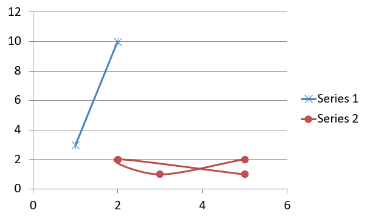

## **개요**

이 문서는 Aspose.Slides for Node.js via Java를 사용하여 차트를 만들고 사용자 지정하는 방법에 대한 포괄적인 가이드를 제공합니다. 슬라이드에 차트를 프로그래밍 방식으로 추가하고 데이터를 채우며 특정 디자인 요구사항에 맞게 다양한 서식 옵션을 적용하는 방법을 배우게 됩니다. 문서 전체에 걸쳐 초기 프레젠테이션 및 차트 개체 설정부터 시리즈, 축, 범례 구성에 이르는 각 단계마다 자세한 코드 예제가 포함되어 있습니다. 이 가이드를 따르면 동적 차트 생성을 Node.js 애플리케이션에 통합하는 방법을 확실히 이해하게 되어 데이터 기반 프레젠테이션을 효율적으로 만들 수 있습니다.

## **차트 만들기**

차트를 사용하면 데이터를 빠르게 시각화하고 표나 스프레드시트에서 즉시 파악하기 어려운 인사이트를 얻을 수 있습니다.

**차트를 만드는 이유**

차트를 사용하면 다음을 수행할 수 있습니다:

* 프레젠테이션의 단일 슬라이드에 대량의 데이터를 집계, 압축 또는 요약합니다;
* 데이터의 패턴 및 추세를 드러냅니다;
* 시간 경과에 따른 또는 특정 측정 단위에 대한 데이터의 방향 및 모멘텀을 추론합니다;
* 이상값, 편차, 오류 및 비논리적인 데이터를 식별합니다;
* 복잡한 데이터를 전달하거나 프레젠테이션합니다.

PowerPoint에서는 *삽입* 기능을 통해 다양한 차트 템플릿을 사용하여 차트를 만들 수 있습니다. Aspose.Slides를 사용하면 일반 차트(일반적인 차트 유형 기반)와 사용자 정의 차트를 모두 만들 수 있습니다.

{}
Use the [ChartType](https://reference.aspose.com/slides/nodejs-java/aspose.slides/charttype/) enumeration in the [aspose.slides](https://reference.aspose.com/slides/nodejs-java/aspose.slides/) module. The values in this enumeration correspond to different chart types.
{}

### **군집 열 차트 만들기**

This example uses [addChart](https://reference.aspose.com/slides/nodejs-java/aspose.slides/shapecollection/#addChart) to create a clustered column chart that compares two series across three categories. The series use red and green fills, and individual labels demonstrate category names, series names, and values. Worksheet index 0 refers to the first sheet in the embedded chart workbook.

```javascript
const aspose = { slides: require("aspose.slides.via.java") };
const java = require("java");

let presentation = new aspose.slides.Presentation();
try
{
    let slide = presentation.getSlides().get_Item(0);

    let chart = slide.getShapes().addChart(aspose.slides.ChartType.ClusteredColumn, 20, 20, 500, 300);

    chart.getChartTitle().addTextFrameForOverriding("Sample Title");
    chart.getChartTitle().getTextFrameForOverriding().getTextFrameFormat().setCenterText(java.newByte(aspose.slides.NullableBool.True));
    chart.getChartTitle().setHeight(20);
    chart.setTitle(true);

    let workbook = chart.getChartData().getChartDataWorkbook();
    let worksheetIndex = 0;

    chart.getChartData().getSeries().clear();
    chart.getChartData().getCategories().clear();

    let seriesNameCell = workbook.getCell(worksheetIndex, 0, 1, "Series 1");
    chart.getChartData().getSeries().add(seriesNameCell, chart.getType());
    seriesNameCell = workbook.getCell(worksheetIndex, 0, 2, "Series 2");
    chart.getChartData().getSeries().add(seriesNameCell, chart.getType());

    let categoryCell = workbook.getCell(worksheetIndex, 1, 0, "Category 1");
    chart.getChartData().getCategories().add(categoryCell);
    categoryCell = workbook.getCell(worksheetIndex, 2, 0, "Category 2");
    chart.getChartData().getCategories().add(categoryCell);
    categoryCell = workbook.getCell(worksheetIndex, 3, 0, "Category 3");
    chart.getChartData().getCategories().add(categoryCell);

    let series = chart.getChartData().getSeries().get_Item(0);

    let valueCell = workbook.getCell(worksheetIndex, 1, 1, 20);
    series.getDataPoints().addDataPointForBarSeries(valueCell);
    valueCell = workbook.getCell(worksheetIndex, 2, 1, 50);
    series.getDataPoints().addDataPointForBarSeries(valueCell);
    valueCell = workbook.getCell(worksheetIndex, 3, 1, 30);
    series.getDataPoints().addDataPointForBarSeries(valueCell);

    series.getFormat().getFill().setFillType(java.newByte(aspose.slides.FillType.Solid));
    series.getFormat().getFill().getSolidFillColor().setColor(java.getStaticFieldValue("java.awt.Color", "RED"));

    series = chart.getChartData().getSeries().get_Item(1);

    valueCell = workbook.getCell(worksheetIndex, 1, 2, 30);
    series.getDataPoints().addDataPointForBarSeries(valueCell);
    valueCell = workbook.getCell(worksheetIndex, 2, 2, 10);
    series.getDataPoints().addDataPointForBarSeries(valueCell);
    valueCell = workbook.getCell(worksheetIndex, 3, 2, 60);
    series.getDataPoints().addDataPointForBarSeries(valueCell);

    series.getFormat().getFill().setFillType(java.newByte(aspose.slides.FillType.Solid));
    series.getFormat().getFill().getSolidFillColor().setColor(java.newInstanceSync("java.awt.Color", 0, 128, 0));

    let label = series.getDataPoints().get_Item(0).getLabel();
    label.getDataLabelFormat().setShowCategoryName(true);

    label = series.getDataPoints().get_Item(1).getLabel();
    label.getDataLabelFormat().setShowSeriesName(true);

    label = series.getDataPoints().get_Item(2).getLabel();
    label.getDataLabelFormat().setShowValue(true);
    label.getDataLabelFormat().setShowSeriesName(true);
    label.getDataLabelFormat().setSeparator("/");

    presentation.save("AsposeChart.pptx", aspose.slides.SaveFormat.Pptx);
}
finally
{
    presentation.dispose();
}
```

결과:


### **산점도 차트 만들기**

산점도 차트(산점도 플롯 또는 x‑y 그래프라고도 함)는 두 변수 간의 패턴을 확인하거나 상관 관계를 보여줄 때 자주 사용됩니다.

산점도 차트를 사용할 때:

* 쌍을 이루는 숫자 데이터가 있습니다.
* 두 변수가 함께 잘 어울립니다.
* 두 변수가 관련이 있는지 확인하고 싶습니다.
* 종속 변수에 대해 여러 값이 있는 독립 변수가 있습니다.

This example plots two sets of x‑y values. The first series uses straight lines with star markers, while the second uses smooth lines with circle markers; both use a marker size of 10, configured with [setSize](https://reference.aspose.com/slides/nodejs-java/aspose.slides/marker/#setSize). The [setSymbol](https://reference.aspose.com/slides/nodejs-java/aspose.slides/marker/#setSymbol) method controls the marker shape.

```javascript
const aspose = { slides: require("aspose.slides.via.java") };

let presentation = new aspose.slides.Presentation();
try
{
    let slide = presentation.getSlides().get_Item(0);

    let chart = slide.getShapes().addChart(aspose.slides.ChartType.ScatterWithSmoothLines, 20, 20, 500, 300);

    let workbook = chart.getChartData().getChartDataWorkbook();
    let worksheetIndex = 0;

    chart.getChartData().getSeries().clear();

    let seriesNameCell = workbook.getCell(worksheetIndex, 1, 1, "Series 1");
    chart.getChartData().getSeries().add(seriesNameCell, chart.getType());
    seriesNameCell = workbook.getCell(worksheetIndex, 1, 3, "Series 2");
    chart.getChartData().getSeries().add(seriesNameCell, chart.getType());

    let series = chart.getChartData().getSeries().get_Item(0);

    let xValueCell = workbook.getCell(worksheetIndex, 2, 1, 1);
    let yValueCell = workbook.getCell(worksheetIndex, 2, 2, 3);
    series.getDataPoints().addDataPointForScatterSeries(xValueCell, yValueCell);

    xValueCell = workbook.getCell(worksheetIndex, 3, 1, 2);
    yValueCell = workbook.getCell(worksheetIndex, 3, 2, 10);
    series.getDataPoints().addDataPointForScatterSeries(xValueCell, yValueCell);

    series.setType(aspose.slides.ChartType.ScatterWithStraightLinesAndMarkers);

    series.getMarker().setSize(10);
    series.getMarker().setSymbol(aspose.slides.MarkerStyleType.Star);

    series = chart.getChartData().getSeries().get_Item(1);

    xValueCell = workbook.getCell(worksheetIndex, 2, 3, 5);
    yValueCell = workbook.getCell(worksheetIndex, 2, 4, 2);
    series.getDataPoints().addDataPointForScatterSeries(xValueCell, yValueCell);

    xValueCell = workbook.getCell(worksheetIndex, 3, 3, 3);
    yValueCell = workbook.getCell(worksheetIndex, 3, 4, 1);
    series.getDataPoints().addDataPointForScatterSeries(xValueCell, yValueCell);

    xValueCell = workbook.getCell(worksheetIndex, 4, 3, 2);
    yValueCell = workbook.getCell(worksheetIndex, 4, 4, 2);
    series.getDataPoints().addDataPointForScatterSeries(xValueCell, yValueCell);

    xValueCell = workbook.getCell(worksheetIndex, 5, 3, 5);
    yValueCell = workbook.getCell(worksheetIndex, 5, 4, 1);
    series.getDataPoints().addDataPointForScatterSeries(xValueCell, yValueCell);

    series.getMarker().setSize(10);
    series.getMarker().setSymbol(aspose.slides.MarkerStyleType.Circle);

    presentation.save("AsposeChart.pptx", aspose.slides.SaveFormat.Pptx);
}
finally
{
    presentation.dispose();
}
```

결과:



### **원형 차트 만들기**

원형 차트는 특히 데이터가 범주형 레이블과 숫자 값을 포함할 때 전체 대비 부분 관계를 보여주는 데 가장 적합합니다. 그러나 데이터에 많은 부분이나 레이블이 포함된 경우 막대 차트를 고려하는 것이 좋습니다.

This example creates a pie chart with three quarterly values. Each slice has a custom fill and border, and the labels display different combinations of values, percentages, and series information. The [setFirstSliceAngle](https://reference.aspose.com/slides/nodejs-java/aspose.slides/chartseriesgroup/#setFirstSliceAngle) method sets the first slice to start at 180 degrees.

```javascript
const aspose = { slides: require("aspose.slides.via.java") };
const java = require("java");

let presentation = new aspose.slides.Presentation();
try
{
    let slide = presentation.getSlides().get_Item(0);

    let chart = slide.getShapes().addChart(aspose.slides.ChartType.Pie, 20, 20, 500, 300);

    chart.getChartTitle().addTextFrameForOverriding("Sample Title");
    chart.getChartTitle().getTextFrameForOverriding().getTextFrameFormat().setCenterText(java.newByte(aspose.slides.NullableBool.True));
    chart.getChartTitle().setHeight(20);
    chart.setTitle(true);

    chart.getChartData().getSeries().get_Item(0).getLabels().getDefaultDataLabelFormat().setShowValue(true);

    let workbook = chart.getChartData().getChartDataWorkbook();
    let worksheetIndex = 0;

    chart.getChartData().getSeries().clear();
    chart.getChartData().getCategories().clear();

    let categoryCell = workbook.getCell(0, 1, 0, "1st Qtr");
    chart.getChartData().getCategories().add(categoryCell);
    categoryCell = workbook.getCell(0, 2, 0, "2nd Qtr");
    chart.getChartData().getCategories().add(categoryCell);
    categoryCell = workbook.getCell(0, 3, 0, "3rd Qtr");
    chart.getChartData().getCategories().add(categoryCell);

    let seriesNameCell = workbook.getCell(0, 0, 1, "Series 1");
    let series = chart.getChartData().getSeries().add(seriesNameCell, chart.getType());

    let valueCell = workbook.getCell(worksheetIndex, 1, 1, 20);
    series.getDataPoints().addDataPointForPieSeries(valueCell);
    valueCell = workbook.getCell(worksheetIndex, 2, 1, 50);
    series.getDataPoints().addDataPointForPieSeries(valueCell);
    valueCell = workbook.getCell(worksheetIndex, 3, 1, 30);
    series.getDataPoints().addDataPointForPieSeries(valueCell);

    chart.getChartData().getSeriesGroups().get_Item(0).setColorVaried(true);

    let firstSlice = series.getDataPoints().get_Item(0);
    firstSlice.getFormat().getFill().setFillType(java.newByte(aspose.slides.FillType.Solid));
    firstSlice.getFormat().getFill().getSolidFillColor().setColor(java.getStaticFieldValue("java.awt.Color", "CYAN"));

    firstSlice.getFormat().getLine().getFillFormat().setFillType(java.newByte(aspose.slides.FillType.Solid));
    firstSlice.getFormat().getLine().getFillFormat().getSolidFillColor().setColor(java.getStaticFieldValue("java.awt.Color", "GRAY"));
    firstSlice.getFormat().getLine().setWidth(3.0);
    firstSlice.getFormat().getLine().setStyle(java.newByte(aspose.slides.LineStyle.ThinThick));
    firstSlice.getFormat().getLine().setDashStyle(java.newByte(aspose.slides.LineDashStyle.LargeDash));

    let secondSlice = series.getDataPoints().get_Item(1);
    secondSlice.getFormat().getFill().setFillType(java.newByte(aspose.slides.FillType.Solid));
    secondSlice.getFormat().getFill().getSolidFillColor().setColor(java.newInstanceSync("java.awt.Color", 165, 42, 42));

    secondSlice.getFormat().getLine().getFillFormat().setFillType(java.newByte(aspose.slides.FillType.Solid));
    secondSlice.getFormat().getLine().getFillFormat().getSolidFillColor().setColor(java.getStaticFieldValue("java.awt.Color", "BLUE"));
    secondSlice.getFormat().getLine().setWidth(3.0);
    secondSlice.getFormat().getLine().setStyle(java.newByte(aspose.slides.LineStyle.Single));
    secondSlice.getFormat().getLine().setDashStyle(java.newByte(aspose.slides.LineDashStyle.LargeDashDot));

    let thirdSlice = series.getDataPoints().get_Item(2);
    thirdSlice.getFormat().getFill().setFillType(java.newByte(aspose.slides.FillType.Solid));
    thirdSlice.getFormat().getFill().getSolidFillColor().setColor(java.newInstanceSync("java.awt.Color", 255, 127, 80));

    thirdSlice.getFormat().getLine().getFillFormat().setFillType(java.newByte(aspose.slides.FillType.Solid));
    thirdSlice.getFormat().getLine().getFillFormat().getSolidFillColor().setColor(java.getStaticFieldValue("java.awt.Color", "RED"));
    thirdSlice.getFormat().getLine().setWidth(2.0);
    thirdSlice.getFormat().getLine().setStyle(java.newByte(aspose.slides.LineStyle.ThinThin));
    thirdSlice.getFormat().getLine().setDashStyle(java.newByte(aspose.slides.LineDashStyle.LargeDashDotDot));

    let firstLabel = series.getDataPoints().get_Item(0).getLabel();
    firstLabel.getDataLabelFormat().setShowValue(true);

    let secondLabel = series.getDataPoints().get_Item(1).getLabel();
    secondLabel.getDataLabelFormat().setShowValue(true);
    secondLabel.getDataLabelFormat().setShowLegendKey(true);
    secondLabel.getDataLabelFormat().setShowPercentage(true);

    let thirdLabel = series.getDataPoints().get_Item(2).getLabel();
    thirdLabel.getDataLabelFormat().setShowSeriesName(true);
    thirdLabel.getDataLabelFormat().setShowPercentage(true);

    series.getLabels().getDefaultDataLabelFormat().setShowLeaderLines(true);

    chart.getChartData().getSeriesGroups().get_Item(0).setFirstSliceAngle(180);

    presentation.save("PieChart.pptx", aspose.slides.SaveFormat.Pptx);
}
finally
{
    presentation.dispose();
}
```

결과:


### **꺾은선 차트 만들기**

꺾은선 차트(선 그래프라고도 함)는 시간에 따른 값 변화 를 보여주고 싶을 때 가장 적합합니다. 꺾은선 차트를 사용하면 한 번에 많은 데이터를 비교하고, 시간에 따른 변화와 추세를 추적하며, 데이터 시리즈의 이상 현상을 강조할 수 있습니다.

This example uses [addChart](https://reference.aspose.com/slides/nodejs-java/aspose.slides/shapecollection/#addChart) to create a line chart with the default series and categories, then saves the presentation as PPTX.

```javascript
const aspose = { slides: require("aspose.slides.via.java") };

let presentation = new aspose.slides.Presentation();
try
{
    let slide = presentation.getSlides().get_Item(0);

    let lineChart = slide.getShapes().addChart(aspose.slides.ChartType.Line, 20, 20, 500, 300);

    presentation.save("lineChart.pptx", aspose.slides.SaveFormat.Pptx);
}
finally
{
    presentation.dispose();
}
```

By default, points on a line chart are joined by straight continuous lines. If you want the points to be joined by dashes instead, call [setDashStyle](https://reference.aspose.com/slides/nodejs-java/aspose.slides/lineformat/#setDashStyle) with a value from [LineDashStyle](https://reference.aspose.com/slides/nodejs-java/aspose.slides/linedashstyle/):

```javascript
const aspose = { slides: require("aspose.slides.via.java") };
const java = require("java");

let presentation = new aspose.slides.Presentation();
try
{
    let slide = presentation.getSlides().get_Item(0);

    let lineChart = slide.getShapes().addChart(aspose.slides.ChartType.Line, 20, 20, 500, 300);

    for (let i = 0; i < lineChart.getChartData().getSeries().size(); i++)
    {
        let series = lineChart.getChartData().getSeries().get_Item(i);
        series.getFormat().getLine().setDashStyle(java.newByte(aspose.slides.LineDashStyle.Dash));
    }
}
finally
{
    presentation.dispose();
}
```

결과:


### **트리맵 차트 만들기**

트리맵 차트는 각 카테고리 내에서 큰 기여자를 빠르게 강조하고 싶을 때 판매 데이터에 가장 적합합니다.

This example creates a tree map with eight leaves grouped into four stems and two branches. The [setGroupingItem](https://reference.aspose.com/slides/nodejs-java/aspose.slides/chartcategorylevelsmanager/#setGroupingItem) method assigns stems at grouping level 1 and branches at level 2. Values determine the relative rectangle sizes, while category labels and overlapping parent labels identify the hierarchy.

```javascript
const aspose = { slides: require("aspose.slides.via.java") };

let presentation = new aspose.slides.Presentation();
try
{
    let slide = presentation.getSlides().get_Item(0);

    let chart = slide.getShapes().addChart(aspose.slides.ChartType.Treemap, 20, 20, 500, 300);

    chart.getChartData().getCategories().clear();
    chart.getChartData().getSeries().clear();

    let workbook = chart.getChartData().getChartDataWorkbook();
    workbook.clear(0);

    // 브랜치 1
    let categoryCell = workbook.getCell(0, "C1", "Leaf1");
    let leaf = chart.getChartData().getCategories().add(categoryCell);
    leaf.getGroupingLevels().setGroupingItem(1, "Stem1");
    leaf.getGroupingLevels().setGroupingItem(2, "Branch1");

    categoryCell = workbook.getCell(0, "C2", "Leaf2");
    chart.getChartData().getCategories().add(categoryCell);

    categoryCell = workbook.getCell(0, "C3", "Leaf3");
    leaf = chart.getChartData().getCategories().add(categoryCell);
    leaf.getGroupingLevels().setGroupingItem(1, "Stem2");

    categoryCell = workbook.getCell(0, "C4", "Leaf4");
    chart.getChartData().getCategories().add(categoryCell);

    // 브랜치 2
    categoryCell = workbook.getCell(0, "C5", "Leaf5");
    leaf = chart.getChartData().getCategories().add(categoryCell);
    leaf.getGroupingLevels().setGroupingItem(1, "Stem3");
    leaf.getGroupingLevels().setGroupingItem(2, "Branch2");

    categoryCell = workbook.getCell(0, "C6", "Leaf6");
    chart.getChartData().getCategories().add(categoryCell);

    categoryCell = workbook.getCell(0, "C7", "Leaf7");
    leaf = chart.getChartData().getCategories().add(categoryCell);
    leaf.getGroupingLevels().setGroupingItem(1, "Stem4");

    categoryCell = workbook.getCell(0, "C8", "Leaf8");
    chart.getChartData().getCategories().add(categoryCell);

    let series = chart.getChartData().getSeries().add(aspose.slides.ChartType.Treemap);
    series.getLabels().getDefaultDataLabelFormat().setShowCategoryName(true);
    let valueCell = workbook.getCell(0, "D1", 4);
    series.getDataPoints().addDataPointForTreemapSeries(valueCell);
    valueCell = workbook.getCell(0, "D2", 5);
    series.getDataPoints().addDataPointForTreemapSeries(valueCell);
    valueCell = workbook.getCell(0, "D3", 3);
    series.getDataPoints().addDataPointForTreemapSeries(valueCell);
    valueCell = workbook.getCell(0, "D4", 6);
    series.getDataPoints().addDataPointForTreemapSeries(valueCell);
    valueCell = workbook.getCell(0, "D5", 9);
    series.getDataPoints().addDataPointForTreemapSeries(valueCell);
    valueCell = workbook.getCell(0, "D6", 9);
    series.getDataPoints().addDataPointForTreemapSeries(valueCell);
    valueCell = workbook.getCell(0, "D7", 4);
    series.getDataPoints().addDataPointForTreemapSeries(valueCell);
    valueCell = workbook.getCell(0, "D8", 3);
    series.getDataPoints().addDataPointForTreemapSeries(valueCell);

    series.setParentLabelLayout(aspose.slides.ParentLabelLayoutType.Overlapping);

    presentation.save("Treemap.pptx", aspose.slides.SaveFormat.Pptx);
}
finally
{
    presentation.dispose();
}
```

결과:


### **워터폴 차트 만들기**

워터폴 차트는 양의 변화와 음의 변화가 최종 값에 어떻게 기여하는지를 보여줍니다. 예를 들어, 이익 분석은 수익에서 시작하여 비용을 차감하고 기타 수입을 추가하여 최종 값을 산출합니다. 변화 열은 이전 값과 새로운 누적 값 사이에 떠 있으며, 합계 열은 0에서 누적 값까지 확장됩니다.

다음 예제는 미국 달러 천 단위 금액을 사용합니다:

| 카테고리 | 통합 문서 값 | 열 유형 |
| --- | ---: | --- |
| 수익 | 1000 | 증가 |
| 매출원가 | -400 | 감소 |
| 총이익 | 600 | 중간 합계 |
| 영업비용 | -200 | 감소 |
| 기타 수익 | 50 | 증가 |
| 순이익 | 450 | 최종 합계 |

To mark a point as an intermediate or final total, call its [setSetAsTotal](https://reference.aspose.com/slides/nodejs-java/aspose.slides/chartdatapoint/#setSetAsTotal) method with `true`. Supply the actual accumulated amount in that point's workbook cell: `600` for gross profit (`1000 - 400`) and `450` for net profit (`600 - 200 + 50`). The method marks the column as a total; it does not calculate or populate the cell value. Do not use zero as a placeholder or supply another change for a total point. A total column displays the accumulated value without adding it again to the running value.

This complete JavaScript example creates a chart using the `Waterfall` member of [ChartType](https://reference.aspose.com/slides/nodejs-java/aspose.slides/charttype/), clears the default data, and fills the embedded workbook. Worksheet index `0` selects the first worksheet; column A contains category names and column B contains values. Each value cell is added with [addDataPointForWaterfallSeries](https://reference.aspose.com/slides/nodejs-java/aspose.slides/chartdatapointcollection/#addDataPointForWaterfallSeries). The zero‑based point indices `2` and `5` identify the intermediate and final totals. Calling [setShowValue](https://reference.aspose.com/slides/nodejs-java/aspose.slides/datalabelformat/#setShowValue) with `true` displays the amounts on the columns. No input presentation or workbook is required.

```javascript
const aspose = { slides: require("aspose.slides.via.java") };

let presentation = new aspose.slides.Presentation();
try
{
    let slide = presentation.getSlides().get_Item(0);

    let chart = slide.getShapes().addChart(aspose.slides.ChartType.Waterfall, 20, 20, 680, 200);

    chart.setTitle(true);
    chart.getChartTitle().addTextFrameForOverriding("Profit breakdown (USD thousands)");
    chart.getChartTitle().setOverlay(false);
    chart.setLegend(false);

    chart.getChartData().getSeries().clear();
    chart.getChartData().getCategories().clear();

    let workbook = chart.getChartData().getChartDataWorkbook();
    let worksheetIndex = 0;

    workbook.clear(worksheetIndex);

    let seriesNameCell = workbook.getCell(worksheetIndex, 0, 1, "Profit");
    let series = chart.getChartData().getSeries().add(seriesNameCell, aspose.slides.ChartType.Waterfall);
    let categories = [ "Revenue", "Cost of sales", "Gross profit", "Operating expenses", "Other income", "Net profit" ];
    let values = [ 1000, -400, 600, -200, 50, 450 ];

    for (let i = 0; i < categories.length; i++)
    {
        let categoryCell = workbook.getCell(worksheetIndex, i + 1, 0, categories[i]);
        chart.getChartData().getCategories().add(categoryCell);
        let valueCell = workbook.getCell(worksheetIndex, i + 1, 1, values[i]);
        series.getDataPoints().addDataPointForWaterfallSeries(valueCell);
    }

    // 세 번째와 여섯 번째 포인트는 추가 변화가 아닌 합계입니다.
    series.getDataPoints().get_Item(2).setSetAsTotal(true);
    series.getDataPoints().get_Item(5).setSetAsTotal(true);
    series.setShowConnectorLines(true);
    series.getLabels().getDefaultDataLabelFormat().setShowValue(true);

    presentation.save("WaterfallChart.pptx", aspose.slides.SaveFormat.Pptx);
}
finally
{
    presentation.dispose();
}
```

Call the series‑level [setShowConnectorLines](https://reference.aspose.com/slides/nodejs-java/aspose.slides/chartseries/#setShowConnectorLines) method with `true` to show lines linking consecutive columns and make the running value easier to follow. To hide these lines, replace the method call in the example with `series.setShowConnectorLines(false);` before saving. This changes only the line visibility, not the data or totals.

The saved presentation shows gross profit of 600 and net profit of 450, with both totals drawn from zero:


### **주식 차트 만들기**

주식 차트는 시가, 고가, 저가, 종가와 같은 금융 데이터를 표시하여 시장 추세와 변동성을 분석하는 데 도움을 줍니다. 투자자와 분석가가 정보에 기반한 결정을 내릴 수 있도록 핵심 인사이트를 제공합니다.

This example creates an open‑high‑low‑close chart with four series in that order and three categories. The [setUpDownBars](https://reference.aspose.com/slides/nodejs-java/aspose.slides/updownbarsmanager/#setUpDownBars) method enables up/down bars, and [getHiLowLinesFormat](https://reference.aspose.com/slides/nodejs-java/aspose.slides/chartseriesgroup/#getHiLowLinesFormat) controls the high‑low lines that show the price ranges, while the individual series lines and minor horizontal gridlines are hidden.

```javascript
const aspose = { slides: require("aspose.slides.via.java") };
const java = require("java");

let presentation = new aspose.slides.Presentation();
try
{
    let slide = presentation.getSlides().get_Item(0);

    let chart = slide.getShapes().addChart(aspose.slides.ChartType.OpenHighLowClose, 20, 20, 500, 300, false);

    let workbook = chart.getChartData().getChartDataWorkbook();

    let categoryCell = workbook.getCell(0, 1, 0, "A");
    chart.getChartData().getCategories().add(categoryCell);
    categoryCell = workbook.getCell(0, 2, 0, "B");
    chart.getChartData().getCategories().add(categoryCell);
    categoryCell = workbook.getCell(0, 3, 0, "C");
    chart.getChartData().getCategories().add(categoryCell);

    let seriesNameCell = workbook.getCell(0, 0, 1, "Open");
    chart.getChartData().getSeries().add(seriesNameCell, aspose.slides.ChartType.OpenHighLowClose);
    seriesNameCell = workbook.getCell(0, 0, 2, "High");
    chart.getChartData().getSeries().add(seriesNameCell, aspose.slides.ChartType.OpenHighLowClose);
    seriesNameCell = workbook.getCell(0, 0, 3, "Low");
    chart.getChartData().getSeries().add(seriesNameCell, aspose.slides.ChartType.OpenHighLowClose);
    seriesNameCell = workbook.getCell(0, 0, 4, "Close");
    chart.getChartData().getSeries().add(seriesNameCell, aspose.slides.ChartType.OpenHighLowClose);

    let series = chart.getChartData().getSeries().get_Item(0);
    let valueCell = workbook.getCell(0, 1, 1, 72);
    series.getDataPoints().addDataPointForStockSeries(valueCell);
    valueCell = workbook.getCell(0, 2, 1, 25);
    series.getDataPoints().addDataPointForStockSeries(valueCell);
    valueCell = workbook.getCell(0, 3, 1, 38);
    series.getDataPoints().addDataPointForStockSeries(valueCell);

    series = chart.getChartData().getSeries().get_Item(1);
    valueCell = workbook.getCell(0, 1, 2, 172);
    series.getDataPoints().addDataPointForStockSeries(valueCell);
    valueCell = workbook.getCell(0, 2, 2, 57);
    series.getDataPoints().addDataPointForStockSeries(valueCell);
    valueCell = workbook.getCell(0, 3, 2, 57);
    series.getDataPoints().addDataPointForStockSeries(valueCell);

    series = chart.getChartData().getSeries().get_Item(2);
    valueCell = workbook.getCell(0, 1, 3, 12);
    series.getDataPoints().addDataPointForStockSeries(valueCell);
    valueCell = workbook.getCell(0, 2, 3, 12);
    series.getDataPoints().addDataPointForStockSeries(valueCell);
    valueCell = workbook.getCell(0, 3, 3, 13);
    series.getDataPoints().addDataPointForStockSeries(valueCell);

    series = chart.getChartData().getSeries().get_Item(3);
    valueCell = workbook.getCell(0, 1, 4, 25);
    series.getDataPoints().addDataPointForStockSeries(valueCell);
    valueCell = workbook.getCell(0, 2, 4, 38);
    series.getDataPoints().addDataPointForStockSeries(valueCell);
    valueCell = workbook.getCell(0, 3, 4, 50);
    series.getDataPoints().addDataPointForStockSeries(valueCell);

    chart.getChartData().getSeriesGroups().get_Item(0).getUpDownBars().setUpDownBars(true);
    chart.getChartData().getSeriesGroups().get_Item(0).getHiLowLinesFormat().getLine().getFillFormat().setFillType(java.newByte(aspose.slides.FillType.Solid));

    for (let i = 0; i < chart.getChartData().getSeries().size(); i++)
    {
        let stockSeries = chart.getChartData().getSeries().get_Item(i);
        stockSeries.getFormat().getLine().getFillFormat().setFillType(java.newByte(aspose.slides.FillType.NoFill));
    }

    chart.getAxes().getVerticalAxis().getMinorGridLinesFormat().getLine().getFillFormat().setFillType(java.newByte(aspose.slides.FillType.NoFill));

    presentation.save("Stock-chart.pptx", aspose.slides.SaveFormat.Pptx);
}
finally
{
    presentation.dispose();
}
```

결과:


### **상자 수염 차트 만들기**

상자 수염 차트는 중앙값, 사분위수 및 잠재적인 이상값과 같은 주요 통계 측정값을 요약하여 데이터 분포를 표시합니다. 탐색적 데이터 분석 및 통계 연구에서 데이터 변동성을 빠르게 파악하고 이상치를 식별하는 데 특히 유용합니다.

This example creates a box and whisker chart from six values. The [setQuartileMethod](https://reference.aspose.com/slides/nodejs-java/aspose.slides/chartseries/#setQuartileMethod) method selects the exclusive quartile calculation. The example also enables mean lines, mean markers, inner points, and outlier points.

```javascript
const aspose = { slides: require("aspose.slides.via.java") };

let presentation = new aspose.slides.Presentation();
try
{
    let slide = presentation.getSlides().get_Item(0);

    let chart = slide.getShapes().addChart(aspose.slides.ChartType.BoxAndWhisker, 20, 20, 500, 300);

    chart.getChartData().getCategories().clear();
    chart.getChartData().getSeries().clear();

    let workbook = chart.getChartData().getChartDataWorkbook();
    workbook.clear(0);

    let categoryCell = workbook.getCell(0, "A1", "Category 1");
    chart.getChartData().getCategories().add(categoryCell);
    categoryCell = workbook.getCell(0, "A2", "Category 2");
    chart.getChartData().getCategories().add(categoryCell);
    categoryCell = workbook.getCell(0, "A3", "Category 3");
    chart.getChartData().getCategories().add(categoryCell);
    categoryCell = workbook.getCell(0, "A4", "Category 4");
    chart.getChartData().getCategories().add(categoryCell);
    categoryCell = workbook.getCell(0, "A5", "Category 5");
    chart.getChartData().getCategories().add(categoryCell);
    categoryCell = workbook.getCell(0, "A6", "Category 6");
    chart.getChartData().getCategories().add(categoryCell);

    let series = chart.getChartData().getSeries().add(aspose.slides.ChartType.BoxAndWhisker);

    series.setQuartileMethod(aspose.slides.QuartileMethodType.Exclusive);
    series.setShowMeanLine(true);
    series.setShowMeanMarkers(true);
    series.setShowInnerPoints(true);
    series.setShowOutlierPoints(true);

    let valueCell = workbook.getCell(0, "B1", 15);
    series.getDataPoints().addDataPointForBoxAndWhiskerSeries(valueCell);
    valueCell = workbook.getCell(0, "B2", 41);
    series.getDataPoints().addDataPointForBoxAndWhiskerSeries(valueCell);
    valueCell = workbook.getCell(0, "B3", 16);
    series.getDataPoints().addDataPointForBoxAndWhiskerSeries(valueCell);
    valueCell = workbook.getCell(0, "B4", 10);
    series.getDataPoints().addDataPointForBoxAndWhiskerSeries(valueCell);
    valueCell = workbook.getCell(0, "B5", 23);
    series.getDataPoints().addDataPointForBoxAndWhiskerSeries(valueCell);
    valueCell = workbook.getCell(0, "B6", 16);
    series.getDataPoints().addDataPointForBoxAndWhiskerSeries(valueCell);

    presentation.save("BoxAndWhisker.pptx", aspose.slides.SaveFormat.Pptx);
}
finally
{
    presentation.dispose();
}
```

### **퍼널 차트 만들기**

퍼널 차트는 단계별로 진행될수록 데이터 양이 감소하는 프로세스를 시각화하는 데 사용됩니다. 전환율 분석, 병목 현상 파악 및 영업·마케팅 프로세스 효율성 추적에 특히 유용합니다.

This example uses [addChart](https://reference.aspose.com/slides/nodejs-java/aspose.slides/shapecollection/#addChart) to add a funnel chart to the first slide of an existing presentation. It replaces the default data with six categories and values ranging from 50 to 500, then saves the updated presentation. The input presentation must contain at least one slide.

```javascript
const aspose = { slides: require("aspose.slides.via.java") };

let presentation = new aspose.slides.Presentation("test.pptx");
try
{
    let slide = presentation.getSlides().get_Item(0);

    let chart = slide.getShapes().addChart(aspose.slides.ChartType.Funnel, 50, 50, 500, 400);

    chart.getChartData().getCategories().clear();
    chart.getChartData().getSeries().clear();

    let workbook = chart.getChartData().getChartDataWorkbook();
    workbook.clear(0);

    let categoryCell = workbook.getCell(0, "A1", "Category 1");
    chart.getChartData().getCategories().add(categoryCell);
    categoryCell = workbook.getCell(0, "A2", "Category 2");
    chart.getChartData().getCategories().add(categoryCell);
    categoryCell = workbook.getCell(0, "A3", "Category 3");
    chart.getChartData().getCategories().add(categoryCell);
    categoryCell = workbook.getCell(0, "A4", "Category 4");
    chart.getChartData().getCategories().add(categoryCell);
    categoryCell = workbook.getCell(0, "A5", "Category 5");
    chart.getChartData().getCategories().add(categoryCell);
    categoryCell = workbook.getCell(0, "A6", "Category 6");
    chart.getChartData().getCategories().add(categoryCell);

    let series = chart.getChartData().getSeries().add(aspose.slides.ChartType.Funnel);

    let valueCell = workbook.getCell(0, "B1", 50);
    series.getDataPoints().addDataPointForFunnelSeries(valueCell);
    valueCell = workbook.getCell(0, "B2", 100);
    series.getDataPoints().addDataPointForFunnelSeries(valueCell);
    valueCell = workbook.getCell(0, "B3", 200);
    series.getDataPoints().addDataPointForFunnelSeries(valueCell);
    valueCell = workbook.getCell(0, "B4", 300);
    series.getDataPoints().addDataPointForFunnelSeries(valueCell);
    valueCell = workbook.getCell(0, "B5", 400);
    series.getDataPoints().addDataPointForFunnelSeries(valueCell);
    valueCell = workbook.getCell(0, "B6", 500);
    series.getDataPoints().addDataPointForFunnelSeries(valueCell);

    presentation.save("Funnel.pptx", aspose.slides.SaveFormat.Pptx);
}
finally
{
    presentation.dispose();
}
```

결과:


### **선버스트 차트 만들기**

선버스트 차트는 계층적 데이터를 시각화하여 레벨을 동심원 형태의 링으로 표시합니다. 전체 대비 부분 관계를 보여주며 중첩된 카테고리와 하위 카테고리를 명확하고 간결하게 표현하는 데 이상적입니다.

This example creates a sunburst chart with eight leaves grouped into four stems and two branches. The [setGroupingItem](https://reference.aspose.com/slides/nodejs-java/aspose.slides/chartcategorylevelsmanager/#setGroupingItem) method assigns stems at grouping level 1 and branches at level 2. Category labels identify the segments, and the values determine their relative sizes.

```javascript
const aspose = { slides: require("aspose.slides.via.java") };

let presentation = new aspose.slides.Presentation();
try
{
    let slide = presentation.getSlides().get_Item(0);

    let chart = slide.getShapes().addChart(aspose.slides.ChartType.Sunburst, 20, 20, 500, 300);

    chart.getChartData().getCategories().clear();
    chart.getChartData().getSeries().clear();

    let workbook = chart.getChartData().getChartDataWorkbook();
    workbook.clear(0);

    // 브랜치 1
    let categoryCell = workbook.getCell(0, "C1", "Leaf1");
    let leaf = chart.getChartData().getCategories().add(categoryCell);
    leaf.getGroupingLevels().setGroupingItem(1, "Stem1");
    leaf.getGroupingLevels().setGroupingItem(2, "Branch1");

    categoryCell = workbook.getCell(0, "C2", "Leaf2");
    chart.getChartData().getCategories().add(categoryCell);

    categoryCell = workbook.getCell(0, "C3", "Leaf3");
    leaf = chart.getChartData().getCategories().add(categoryCell);
    leaf.getGroupingLevels().setGroupingItem(1, "Stem2");

    categoryCell = workbook.getCell(0, "C4", "Leaf4");
    chart.getChartData().getCategories().add(categoryCell);

    // 브랜치 2
    categoryCell = workbook.getCell(0, "C5", "Leaf5");
    leaf = chart.getChartData().getCategories().add(categoryCell);
    leaf.getGroupingLevels().setGroupingItem(1, "Stem3");
    leaf.getGroupingLevels().setGroupingItem(2, "Branch2");

    categoryCell = workbook.getCell(0, "C6", "Leaf6");
    chart.getChartData().getCategories().add(categoryCell);

    categoryCell = workbook.getCell(0, "C7", "Leaf7");
    leaf = chart.getChartData().getCategories().add(categoryCell);
    leaf.getGroupingLevels().setGroupingItem(1, "Stem4");

    categoryCell = workbook.getCell(0, "C8", "Leaf8");
    chart.getChartData().getCategories().add(categoryCell);

    let series = chart.getChartData().getSeries().add(aspose.slides.ChartType.Sunburst);
    series.getLabels().getDefaultDataLabelFormat().setShowCategoryName(true);
    let valueCell = workbook.getCell(0, "D1", 4);
    series.getDataPoints().addDataPointForSunburstSeries(valueCell);
    valueCell = workbook.getCell(0, "D2", 5);
    series.getDataPoints().addDataPointForSunburstSeries(valueCell);
    valueCell = workbook.getCell(0, "D3", 3);
    series.getDataPoints().addDataPointForSunburstSeries(valueCell);
    valueCell = workbook.getCell(0, "D4", 6);
    series.getDataPoints().addDataPointForSunburstSeries(valueCell);
    valueCell = workbook.getCell(0, "D5", 9);
    series.getDataPoints().addDataPointForSunburstSeries(valueCell);
    valueCell = workbook.getCell(0, "D6", 9);
    series.getDataPoints().addDataPointForSunburstSeries(valueCell);
    valueCell = workbook.getCell(0, "D7", 4);
    series.getDataPoints().addDataPointForSunburstSeries(valueCell);
    valueCell = workbook.getCell(0, "D8", 3);
    series.getDataPoints().addDataPointForSunburstSeries(valueCell);

    presentation.save("Sunburst.pptx", aspose.slides.SaveFormat.Pptx);
}
finally
{
    presentation.dispose();
}
```

결과:


### **히스토그램 차트 만들기**

히스토그램 차트는 값을 구간 또는 빈(bin)으로 그룹화하여 수치 데이터의 분포를 나타냅니다. 빈도, 왜도 및 분산과 같은 패턴을 식별하고 데이터 집합에서 이상치를 감지하는 데 특히 유용합니다.

This example creates a histogram from six numerical values, including negative values. Calling [setAggregationType](https://reference.aspose.com/slides/nodejs-java/aspose.slides/axis/#setAggregationType) with the automatic aggregation type lets the chart determine the bins used to display the distribution.

```javascript
const aspose = { slides: require("aspose.slides.via.java") };

let presentation = new aspose.slides.Presentation();
try
{
    let slide = presentation.getSlides().get_Item(0);

    let chart = slide.getShapes().addChart(aspose.slides.ChartType.Histogram, 20, 20, 500, 300);

    chart.getChartData().getCategories().clear();
    chart.getChartData().getSeries().clear();

    let workbook = chart.getChartData().getChartDataWorkbook();
    workbook.clear(0);

    let series = chart.getChartData().getSeries().add(aspose.slides.ChartType.Histogram);
    let valueCell = workbook.getCell(0, "A1", 15);
    series.getDataPoints().addDataPointForHistogramSeries(valueCell);
    valueCell = workbook.getCell(0, "A2", -41);
    series.getDataPoints().addDataPointForHistogramSeries(valueCell);
    valueCell = workbook.getCell(0, "A3", 16);
    series.getDataPoints().addDataPointForHistogramSeries(valueCell);
    valueCell = workbook.getCell(0, "A4", 10);
    series.getDataPoints().addDataPointForHistogramSeries(valueCell);
    valueCell = workbook.getCell(0, "A5", -23);
    series.getDataPoints().addDataPointForHistogramSeries(valueCell);
    valueCell = workbook.getCell(0, "A6", 16);
    series.getDataPoints().addDataPointForHistogramSeries(valueCell);

    chart.getAxes().getHorizontalAxis().setAggregationType(aspose.slides.AxisAggregationType.Automatic);

    presentation.save("Histogram.pptx", aspose.slides.SaveFormat.Pptx);
}
finally
{
    presentation.dispose();
}
```

결과:


### **레이더 차트 만들기**

레이더 차트는 다변량 데이터를 2차원 형식으로 표시하여 여러 변수를 동시에 쉽게 비교할 수 있게 합니다. 여러 성능 지표나 속성 전반에 걸친 패턴, 강점 및 약점을 식별하는 데 특히 유용합니다.

This example uses [addChart](https://reference.aspose.com/slides/nodejs-java/aspose.slides/shapecollection/#addChart) to create a radar chart with the default series and categories, then saves the presentation as PPTX.

```javascript
const aspose = { slides: require("aspose.slides.via.java") };

let presentation = new aspose.slides.Presentation();
try
{
    let slide = presentation.getSlides().get_Item(0);

    slide.getShapes().addChart(aspose.slides.ChartType.Radar, 20, 20, 500, 300);

    presentation.save("Radar-chart.pptx", aspose.slides.SaveFormat.Pptx);
}
finally
{
    presentation.dispose();
}
```

결과:


### **다중 카테고리 차트 만들기**

다중 카테고리 차트는 하나 이상의 범주 그룹이 포함된 데이터를 표시하여 여러 차원에서 값을 동시에 비교할 수 있게 합니다. 복잡하고 다층적인 데이터 집합 내에서 추세와 관계를 분석해야 할 때 특히 유용합니다.

This example creates a clustered column chart with eight categories arranged in four pairs. The [setGroupingItem](https://reference.aspose.com/slides/nodejs-java/aspose.slides/chartcategorylevelsmanager/#setGroupingItem) method gives each pair a shared label at grouping level 1, producing a category axis with both individual and group labels.

```javascript
const aspose = { slides: require("aspose.slides.via.java") };

let presentation = new aspose.slides.Presentation();
try
{
    let slide = presentation.getSlides().get_Item(0);

    let chart = slide.getShapes().addChart(aspose.slides.ChartType.ClusteredColumn, 20, 20, 500, 300);

    chart.getChartData().getSeries().clear();
    chart.getChartData().getCategories().clear();

    let workbook = chart.getChartData().getChartDataWorkbook();
    workbook.clear(0);

    let worksheetIndex = 0;

    let categoryCell = workbook.getCell(0, "c2", "A");
    let category = chart.getChartData().getCategories().add(categoryCell);
    category.getGroupingLevels().setGroupingItem(1, "Group1");
    categoryCell = workbook.getCell(0, "c3", "B");
    category = chart.getChartData().getCategories().add(categoryCell);

    categoryCell = workbook.getCell(0, "c4", "C");
    category = chart.getChartData().getCategories().add(categoryCell);
    category.getGroupingLevels().setGroupingItem(1, "Group2");
    categoryCell = workbook.getCell(0, "c5", "D");
    category = chart.getChartData().getCategories().add(categoryCell);

    categoryCell = workbook.getCell(0, "c6", "E");
    category = chart.getChartData().getCategories().add(categoryCell);
    category.getGroupingLevels().setGroupingItem(1, "Group3");
    categoryCell = workbook.getCell(0, "c7", "F");
    category = chart.getChartData().getCategories().add(categoryCell);

    categoryCell = workbook.getCell(0, "c8", "G");
    category = chart.getChartData().getCategories().add(categoryCell);
    category.getGroupingLevels().setGroupingItem(1, "Group4");
    categoryCell = workbook.getCell(0, "c9", "H");
    category = chart.getChartData().getCategories().add(categoryCell);

    let seriesNameCell = workbook.getCell(0, "D1", "Series 1");
    let series = chart.getChartData().getSeries().add(seriesNameCell, aspose.slides.ChartType.ClusteredColumn);

    let valueCell = workbook.getCell(worksheetIndex, "D2", 10);
    series.getDataPoints().addDataPointForBarSeries(valueCell);
    valueCell = workbook.getCell(worksheetIndex, "D3", 20);
    series.getDataPoints().addDataPointForBarSeries(valueCell);
    valueCell = workbook.getCell(worksheetIndex, "D4", 30);
    series.getDataPoints().addDataPointForBarSeries(valueCell);
    valueCell = workbook.getCell(worksheetIndex, "D5", 40);
    series.getDataPoints().addDataPointForBarSeries(valueCell);
    valueCell = workbook.getCell(worksheetIndex, "D6", 50);
    series.getDataPoints().addDataPointForBarSeries(valueCell);
    valueCell = workbook.getCell(worksheetIndex, "D7", 60);
    series.getDataPoints().addDataPointForBarSeries(valueCell);
    valueCell = workbook.getCell(worksheetIndex, "D8", 70);
    series.getDataPoints().addDataPointForBarSeries(valueCell);
    valueCell = workbook.getCell(worksheetIndex, "D9", 80);
    series.getDataPoints().addDataPointForBarSeries(valueCell);

    presentation.save("AsposeChart.pptx", aspose.slides.SaveFormat.Pptx);
}
finally
{
    presentation.dispose();
}
```

결과:


### **지도 차트 만들기**

지도 차트는 국가, 주, 도시와 같은 특정 위치에 정보를 매핑하여 지리 데이터를 시각화합니다. 지역별 추세, 인구 통계 및 공간 분포를 명확하고 시각적으로 매력적인 방식으로 분석하는 데 특히 유용합니다.

This example uses [addChart](https://reference.aspose.com/slides/nodejs-java/aspose.slides/shapecollection/#addChart) to create a map chart with the default geographical data and saves it for viewing in PowerPoint.

```javascript
const aspose = { slides: require("aspose.slides.via.java") };

let presentation = new aspose.slides.Presentation();
try
{
    let slide = presentation.getSlides().get_Item(0);

    let chart = slide.getShapes().addChart(aspose.slides.ChartType.Map, 20, 20, 500, 300);

    presentation.save("mapChart.pptx", aspose.slides.SaveFormat.Pptx);
}
finally
{
    presentation.dispose();
}
```

결과:


{}
The picture above shows the saved presentation opened in PowerPoint. Aspose.Slides writes the map chart and its data correctly, but it does not draw map charts itself: when a slide holding one is rendered to an image or converted to PDF or SVG, the chart area comes out blank. Other shapes on the same slide are unaffected.
{}

### **복합 차트 만들기**

복합 차트(또는 콤보 차트)는 하나의 그래프에 두 가지 이상의 차트 유형을 결합합니다. 이 차트를 사용하면 여러 데이터 세트 간의 차이점을 강조, 비교 또는 조사하여 관계를 식별할 수 있습니다.


This example combines two clustered column series with a line series across four categories. The columns use the primary vertical axis, while [setPlotOnSecondAxis](https://reference.aspose.com/slides/nodejs-java/aspose.slides/chartseries/#setPlotOnSecondAxis) places the line on a secondary vertical axis on the right. The helper functions configure the title, legend, axis labels, and gridlines.

```javascript
const aspose = { slides: require("aspose.slides.via.java") };
const java = require("java");

function createComboChart()
{
    let presentation = new aspose.slides.Presentation();
    try
    {
        let chart = createChartWithFirstSeries(presentation.getSlides().get_Item(0));

        addSecondSeriesToChart(chart);
        addThirdSeriesToChart(chart);

        setPrimaryAxesFormat(chart);
        setSecondaryAxesFormat(chart);

        presentation.save("combo-chart.pptx", aspose.slides.SaveFormat.Pptx);
    }
    finally
    {
        presentation.dispose();
    }
}

function createChartWithFirstSeries(slide)
{
    let chart = slide.getShapes().addChart(aspose.slides.ChartType.ClusteredColumn, 50, 50, 600, 400);

    chart.setTitle(true);
    chart.getChartTitle().addTextFrameForOverriding("Chart Title");
    chart.getChartTitle().setOverlay(false);
    let portionFormat = chart.getChartTitle().getTextFrameForOverriding().getParagraphs().get_Item(0).getParagraphFormat().getDefaultPortionFormat();
    portionFormat.setFontBold(java.newByte(aspose.slides.NullableBool.False));
    portionFormat.setFontHeight(18);

    chart.getLegend().setPosition(aspose.slides.LegendPositionType.Bottom);
    chart.getLegend().getTextFormat().getPortionFormat().setFontHeight(12);

    chart.getChartData().getSeries().clear();
    chart.getChartData().getCategories().clear();

    let workbook = chart.getChartData().getChartDataWorkbook();
    let worksheetIndex = 0;

    let categoryCell = workbook.getCell(worksheetIndex, 1, 0, "Category 1");
    chart.getChartData().getCategories().add(categoryCell);
    categoryCell = workbook.getCell(worksheetIndex, 2, 0, "Category 2");
    chart.getChartData().getCategories().add(categoryCell);
    categoryCell = workbook.getCell(worksheetIndex, 3, 0, "Category 3");
    chart.getChartData().getCategories().add(categoryCell);
    categoryCell = workbook.getCell(worksheetIndex, 4, 0, "Category 4");
    chart.getChartData().getCategories().add(categoryCell);

    let seriesNameCell = workbook.getCell(worksheetIndex, 0, 1, "Series 1");
    let series = chart.getChartData().getSeries().add(seriesNameCell, chart.getType());

    series.getParentSeriesGroup().setOverlap(java.newByte(-25));
    series.getParentSeriesGroup().setGapWidth(220);

    let valueCell = workbook.getCell(worksheetIndex, 1, 1, 4.3);
    series.getDataPoints().addDataPointForBarSeries(valueCell);
    valueCell = workbook.getCell(worksheetIndex, 2, 1, 2.5);
    series.getDataPoints().addDataPointForBarSeries(valueCell);
    valueCell = workbook.getCell(worksheetIndex, 3, 1, 3.5);
    series.getDataPoints().addDataPointForBarSeries(valueCell);
    valueCell = workbook.getCell(worksheetIndex, 4, 1, 4.5);
    series.getDataPoints().addDataPointForBarSeries(valueCell);

    return chart;
}

function addSecondSeriesToChart(chart)
{
    let workbook = chart.getChartData().getChartDataWorkbook();
    let worksheetIndex = 0;

    let seriesNameCell = workbook.getCell(worksheetIndex, 0, 2, "Series 2");
    let series = chart.getChartData().getSeries().add(seriesNameCell, aspose.slides.ChartType.ClusteredColumn);

    series.getParentSeriesGroup().setOverlap(java.newByte(-25));
    series.getParentSeriesGroup().setGapWidth(220);

    let valueCell = workbook.getCell(worksheetIndex, 1, 2, 2.4);
    series.getDataPoints().addDataPointForBarSeries(valueCell);
    valueCell = workbook.getCell(worksheetIndex, 2, 2, 4.4);
    series.getDataPoints().addDataPointForBarSeries(valueCell);
    valueCell = workbook.getCell(worksheetIndex, 3, 2, 1.8);
    series.getDataPoints().addDataPointForBarSeries(valueCell);
    valueCell = workbook.getCell(worksheetIndex, 4, 2, 2.8);
    series.getDataPoints().addDataPointForBarSeries(valueCell);
}

function addThirdSeriesToChart(chart)
{
    let workbook = chart.getChartData().getChartDataWorkbook();
    let worksheetIndex = 0;

    let seriesNameCell = workbook.getCell(worksheetIndex, 0, 3, "Series 3");
    let series = chart.getChartData().getSeries().add(seriesNameCell, aspose.slides.ChartType.Line);

    let valueCell = workbook.getCell(worksheetIndex, 1, 3, 2.0);
    series.getDataPoints().addDataPointForLineSeries(valueCell);
    valueCell = workbook.getCell(worksheetIndex, 2, 3, 2.0);
    series.getDataPoints().addDataPointForLineSeries(valueCell);
    valueCell = workbook.getCell(worksheetIndex, 3, 3, 3.0);
    series.getDataPoints().addDataPointForLineSeries(valueCell);
    valueCell = workbook.getCell(worksheetIndex, 4, 3, 5.0);
    series.getDataPoints().addDataPointForLineSeries(valueCell);

    series.setPlotOnSecondAxis(true);
}

function setPrimaryAxesFormat(chart)
{
    let horizontalAxis = chart.getAxes().getHorizontalAxis();
    horizontalAxis.getTextFormat().getPortionFormat().setFontHeight(12);
    horizontalAxis.getFormat().getLine().getFillFormat().setFillType(java.newByte(aspose.slides.FillType.NoFill));

    setAxisTitle(horizontalAxis, "X Axis");

    let verticalAxis = chart.getAxes().getVerticalAxis();
    verticalAxis.getTextFormat().getPortionFormat().setFontHeight(12);
    verticalAxis.getFormat().getLine().getFillFormat().setFillType(java.newByte(aspose.slides.FillType.NoFill));

    setAxisTitle(verticalAxis, "Y Axis 1");

    let majorGridLinesFormat = verticalAxis.getMajorGridLinesFormat().getLine().getFillFormat();
    majorGridLinesFormat.setFillType(java.newByte(aspose.slides.FillType.Solid));
    majorGridLinesFormat.getSolidFillColor().setColor(java.newInstanceSync("java.awt.Color", 217, 217, 217));
}

function setSecondaryAxesFormat(chart)
{
    let secondaryHorizontalAxis = chart.getAxes().getSecondaryHorizontalAxis();
    secondaryHorizontalAxis.setPosition(aspose.slides.AxisPositionType.Bottom);
    secondaryHorizontalAxis.setCrossType(aspose.slides.CrossesType.Maximum);
    secondaryHorizontalAxis.setVisible(false);
    secondaryHorizontalAxis.getMajorGridLinesFormat().getLine().getFillFormat().setFillType(java.newByte(aspose.slides.FillType.NoFill));
    secondaryHorizontalAxis.getMinorGridLinesFormat().getLine().getFillFormat().setFillType(java.newByte(aspose.slides.FillType.NoFill));

    let secondaryVerticalAxis = chart.getAxes().getSecondaryVerticalAxis();
    secondaryVerticalAxis.setPosition(aspose.slides.AxisPositionType.Right);
    secondaryVerticalAxis.getTextFormat().getPortionFormat().setFontHeight(12);
    secondaryVerticalAxis.getFormat().getLine().getFillFormat().setFillType(java.newByte(aspose.slides.FillType.NoFill));
    secondaryVerticalAxis.getMajorGridLinesFormat().getLine().getFillFormat().setFillType(java.newByte(aspose.slides.FillType.NoFill));
    secondaryVerticalAxis.getMinorGridLinesFormat().getLine().getFillFormat().setFillType(java.newByte(aspose.slides.FillType.NoFill));

    setAxisTitle(secondaryVerticalAxis, "Y Axis 2");
}

function setAxisTitle(axis, axisTitle)
{
    axis.setTitle(true);
    axis.getTitle().setOverlay(false);
    let titlePortionFormat = axis.getTitle().addTextFrameForOverriding(axisTitle).getParagraphs().get_Item(0).getParagraphFormat().getDefaultPortionFormat();
    titlePortionFormat.setFontBold(java.newByte(aspose.slides.NullableBool.False));
    titlePortionFormat.setFontHeight(12);
}

createComboChart();
```

## **차트 업데이트**

Aspose.Slides for Node.js via Java를 사용하면 차트 데이터를 수정하고 서식 및 스타일을 변경하여 PowerPoint 차트를 업데이트할 수 있습니다. 이 기능은 프레젠테이션을 동적 콘텐츠와 동기화하고 차트가 현재 데이터와 시각적 표준을 정확히 반영하도록 하는 작업을 간소화합니다.

This example updates the chart named "My chart" on the first slide of an existing presentation. It requires two column series with three data points each, with category labels in column A and series names in the first row of the first worksheet. The example uses [getCell](https://reference.aspose.com/slides/nodejs-java/aspose.slides/chartdataworkbook/#getCell) to change workbook cells, updates series values, adds a third series, and changes the chart to clustered cylinders through [setType](https://reference.aspose.com/slides/nodejs-java/aspose.slides/chart/#setType).

```javascript
const aspose = { slides: require("aspose.slides.via.java") };
const java = require("java");

let chartName = "My chart";

let presentation = new aspose.slides.Presentation("ExistingChart.pptx");
try
{
    let slide = presentation.getSlides().get_Item(0);

    for (let i = 0; i < slide.getShapes().size(); i++)
    {
        let shape = slide.getShapes().get_Item(i);
        if (java.instanceOf(shape, "com.aspose.slides.IChart") && chartName === shape.getName())
        {
            let chart = shape;
            let worksheetIndex = 0;

            let workbook = chart.getChartData().getChartDataWorkbook();

            workbook.getCell(worksheetIndex, 1, 0, "Modified Category 1");
            workbook.getCell(worksheetIndex, 2, 0, "Modified Category 2");

            let series = chart.getChartData().getSeries().get_Item(0);

            workbook.getCell(worksheetIndex, 0, 1, "New_Series 1");
            series.getDataPoints().get_Item(0).getValue().setData(90);
            series.getDataPoints().get_Item(1).getValue().setData(123);
            series.getDataPoints().get_Item(2).getValue().setData(44);

            series = chart.getChartData().getSeries().get_Item(1);

            workbook.getCell(worksheetIndex, 0, 2, "New_Series 2");
            series.getDataPoints().get_Item(0).getValue().setData(23);
            series.getDataPoints().get_Item(1).getValue().setData(67);
            series.getDataPoints().get_Item(2).getValue().setData(99);

            let seriesNameCell = workbook.getCell(worksheetIndex, 0, 3, "Series 3");
            series = chart.getChartData().getSeries().add(seriesNameCell, chart.getType());

            let valueCell = workbook.getCell(worksheetIndex, 1, 3, 20);
            series.getDataPoints().addDataPointForBarSeries(valueCell);
            valueCell = workbook.getCell(worksheetIndex, 2, 3, 50);
            series.getDataPoints().addDataPointForBarSeries(valueCell);
            valueCell = workbook.getCell(worksheetIndex, 3, 3, 30);
            series.getDataPoints().addDataPointForBarSeries(valueCell);

            chart.setType(aspose.slides.ChartType.ClusteredCylinder);
        }
    }

    presentation.save("AsposeChartModified.pptx", aspose.slides.SaveFormat.Pptx);
}
finally
{
    presentation.dispose();
}
```

## **차트 데이터 범위 설정**

기존 차트가 이미 사용하고 있는 범위를 확인하려면 [Retrieve a Chart's Data Range](/slides/ko/nodejs-java/chart-workbook/#retrieve-a-charts-data-range)를 참조하십시오.

Aspose.Slides for Node.js via Java는 워크시트의 특정 데이터 범위를 차트 데이터 소스로 정의할 수 있는 유연성을 제공합니다. 이를 통해 워크시트의 일부 영역을 차트에 직접 매핑하여 시리즈와 범주의 셀을 제어할 수 있습니다. 결과적으로 워크시트의 최신 데이터 변경 사항에 따라 차트를 쉽게 업데이트하고 동기화하여 PowerPoint 프레젠테이션이 현재 정확한 정보를 반영하도록 할 수 있습니다.

This example uses [setRange](https://reference.aspose.com/slides/nodejs-java/aspose.slides/chartdata/#setRange) to set the data source of the chart named "My chart" on the first slide of an existing presentation to `Sheet1!A1:B4`. The chart workbook must contain that worksheet and a populated range with a series heading in the first row, category labels in column A, and three values in column B.

```javascript
const aspose = { slides: require("aspose.slides.via.java") };
const java = require("java");

let chartName = "My chart";

let presentation = new aspose.slides.Presentation("ExistingChart.pptx");
try
{
    let slide = presentation.getSlides().get_Item(0);

    for (let i = 0; i < slide.getShapes().size(); i++)
    {
        let shape = slide.getShapes().get_Item(i);
        if (java.instanceOf(shape, "com.aspose.slides.IChart") && chartName === shape.getName())
        {
            let chart = shape;
            chart.getChartData().setRange("Sheet1!A1:B4");
        }
    }

    presentation.save("SetDataRange.pptx", aspose.slides.SaveFormat.Pptx);
}
finally
{
    presentation.dispose();
}
```

## **차트에서 기본 마커 사용**

차트에서 기본 마커를 사용하면 각 차트 시리즈에 자동으로 다른 기본 마커 기호가 할당됩니다.

This example uses [addChart](https://reference.aspose.com/slides/nodejs-java/aspose.slides/shapecollection/#addChart) to create a chart with two line series and a legend. The marker settings accessed through [getMarker](https://reference.aspose.com/slides/nodejs-java/aspose.slides/chartseries/#getMarker) retain the automatically assigned marker symbols. The first series includes a negative value and a missing value, represented by `null`, while the second has a value for every category.

```javascript
const aspose = { slides: require("aspose.slides.via.java") };

let presentation = new aspose.slides.Presentation();
try
{
    let slide = presentation.getSlides().get_Item(0);

    let chart = slide.getShapes().addChart(aspose.slides.ChartType.LineWithMarkers, 10, 10, 400, 400);

    chart.getChartData().getSeries().clear();
    chart.getChartData().getCategories().clear();

    let workbook = chart.getChartData().getChartDataWorkbook();

    let seriesNameCell = workbook.getCell(0, 0, 1, "Series 1");
    let series = chart.getChartData().getSeries().add(seriesNameCell, chart.getType());

    let categoryCell = workbook.getCell(0, 1, 0, "C1");
    chart.getChartData().getCategories().add(categoryCell);
    let valueCell = workbook.getCell(0, 1, 1, 24);
    series.getDataPoints().addDataPointForLineSeries(valueCell);

    categoryCell = workbook.getCell(0, 2, 0, "C2");
    chart.getChartData().getCategories().add(categoryCell);
    valueCell = workbook.getCell(0, 2, 1, 23);
    series.getDataPoints().addDataPointForLineSeries(valueCell);

    categoryCell = workbook.getCell(0, 3, 0, "C3");
    chart.getChartData().getCategories().add(categoryCell);
    valueCell = workbook.getCell(0, 3, 1, -10);
    series.getDataPoints().addDataPointForLineSeries(valueCell);

    categoryCell = workbook.getCell(0, 4, 0, "C4");
    chart.getChartData().getCategories().add(categoryCell);
    valueCell = workbook.getCell(0, 4, 1, null);
    series.getDataPoints().addDataPointForLineSeries(valueCell);

    seriesNameCell = workbook.getCell(0, 0, 2, "Series 2");
    let secondSeries = chart.getChartData().getSeries().add(seriesNameCell, chart.getType());

    valueCell = workbook.getCell(0, 1, 2, 30);
    secondSeries.getDataPoints().addDataPointForLineSeries(valueCell);
    valueCell = workbook.getCell(0, 2, 2, 10);
    secondSeries.getDataPoints().addDataPointForLineSeries(valueCell);
    valueCell = workbook.getCell(0, 3, 2, 60);
    secondSeries.getDataPoints().addDataPointForLineSeries(valueCell);
    valueCell = workbook.getCell(0, 4, 2, 40);
    secondSeries.getDataPoints().addDataPointForLineSeries(valueCell);

    chart.setLegend(true);
    chart.getLegend().setOverlay(false);

    presentation.save("DefaultMarkersInChart.pptx", aspose.slides.SaveFormat.Pptx);
}
finally
{
    presentation.dispose();
}
```

## **FAQ**

**Aspose.Slides for Node.js via Java에서 지원되는 차트 유형은 무엇입니까?**

Aspose.Slides for Node.js via Java는 막대, 꺾은선, 원형, 영역, 산점도, 히스토그램, 레이더 등 다양한 차트 유형을 지원합니다. 이 유연성을 통해 데이터 시각화 요구에 가장 적합한 차트 유형을 선택할 수 있습니다.

**슬라이드에 새 차트를 추가하려면 어떻게 해야 합니까?**

차트를 추가하려면 먼저 [Presentation](https://reference.aspose.com/slides/nodejs-java/aspose.slides/presentation/) 클래스의 인스턴스를 만든 다음 인덱스로 원하는 슬라이드를 가져오고 차트 유형 및 초기 데이터를 지정하여 차트를 추가하는 메서드를 호출합니다. 이 과정으로 차트가 프레젠테이션에 직접 삽입됩니다.

**차트에 표시되는 데이터를 어떻게 업데이트합니까?**

차트의 데이터는 [ChartDataWorkbook](https://reference.aspose.com/slides/nodejs-java/aspose.slides/chartdataworkbook/)에 접근하여 기본 시리즈와 범주를 지운 뒤 사용자 정의 데이터를 추가함으로써 업데이트할 수 있습니다. 이를 통해 차트를 프로그래밍 방식으로 최신 데이터에 맞게 새로 고칠 수 있습니다.

**차트의 모양을 사용자 지정할 수 있습니까?**

예, Aspose.Slides for Node.js via Java는 풍부한 사용자 지정 옵션을 제공합니다. 색상, 글꼴, 레이블, 범례 및 기타 서식 요소를 수정하여 차트를 특정 디자인 요구사항에 맞게 조정할 수 있습니다.