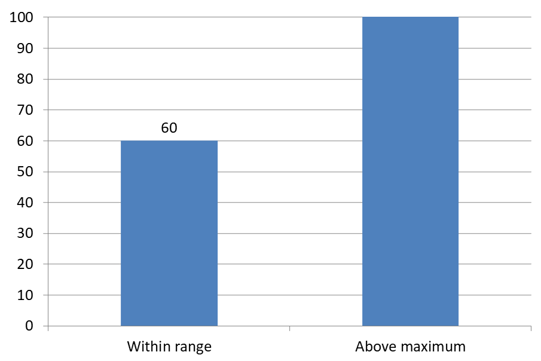

## **소개**

데이터 레이블은 차트 시리즈 및 개별 데이터 포인트에 대한 정보를 표시하여 독자가 값을 식별하고 차트를 이해하도록 돕습니다. 이 기사에서는 값 형식 지정, 백분율 표시, 레이블 텍스트 읽기, 축 최대값을 초과하는 레이블 제어, 카테고리 축 레이블 간격 조정 및 파이 차트 레이블 위치 지정 방법을 설명합니다.

## **차트 데이터 레이블에서 데이터 정밀도 설정**

시리즈 값을 형식 지정하려면 [setNumberFormatOfValues](https://reference.aspose.com/slides/php-java/aspose.slides/chartseries/setnumberformatofvalues/)를 사용합니다. 이 예제는 기본 데이터로 라인 차트를 만들고, 데이터 테이블을 표시하며, 첫 번째 시리즈에 대한 값 레이블을 활성화합니다. `#,##0.00` 형식은 천 단위 구분 기호와 두 자리 소수점을 표시하지만 기본 값은 변경하지 않습니다.

```php
use aspose\slides\Presentation;
use aspose\slides\ChartType;
use aspose\slides\SaveFormat;

$presentation = new Presentation();
try {
    $slide = $presentation->getSlides()->get_Item(0);

    $chart = $slide->getShapes()->addChart(ChartType::Line, 50, 50, 450, 300);
    $chart->setDataTable(true);

    $series = $chart->getChartData()->getSeries()->get_Item(0);
    $series->setNumberFormatOfValues("#,##0.00");
    $series->getLabels()->getDefaultDataLabelFormat()->setShowValue(true);

    $presentation->save("PrecisionOfDatalabels_out.pptx", SaveFormat::Pptx);
} finally {
    $presentation->dispose();
}
```

차트에 포함된 워크북의 숫자 셀을 형식 지정하려면 [Set Custom Number Formats for Workbook Cells](/slides/ko/php-java/chart-workbook/#set-custom-number-formats-for-workbook-cells)를 참조하십시오. 해당 예제는 저장된 숫자 값을 유지하면서 원본 셀 형식을 따르는 값 레이블도 보여줍니다.

## **백분율을 레이블로 표시**

스택형 세로 막대 차트의 경우, 각 값을 해당 카테고리 총합에 대한 백분율로 계산하고 [getTextFrameForOverriding](https://reference.aspose.com/slides/php-java/aspose.slides/datalabel/gettextframeforoverriding/)에서 반환된 텍스트 프레임에 텍스트를 지정합니다. 이 예제는 기본 차트 데이터를 사용하고, 8포인트 글꼴로 소수점 두 자리까지 백분율을 표시합니다. 총합이 0인 카테고리는 나눗셈 오류를 방지하기 위해 건너뜁니다. 차트 데이터가 변경되면 사용자 정의 레이블 텍스트를 다시 계산하십시오.

```php
use aspose\slides\Presentation;
use aspose\slides\ChartType;
use aspose\slides\Portion;
use aspose\slides\SaveFormat;

$presentation = new Presentation();
try {
    $slide = $presentation->getSlides()->get_Item(0);

    $chart = $slide->getShapes()->addChart(ChartType::StackedColumn, 20, 20, 400, 400);

    $categoryCount = java_values($chart->getChartData()->getCategories()->size());
    $categoryTotals = array_fill(0, $categoryCount, 0.0);
    for ($k = 0; $k < $categoryCount; $k++) {
        for ($i = 0; $i < java_values($chart->getChartData()->getSeries()->size()); $i++) {
            $series = $chart->getChartData()->getSeries()->get_Item($i);
            $pointValue = java_values($series->getDataPoints()->get_Item($k)->getValue()->getData());
            $categoryTotals[$k] += $pointValue;
        }
    }

    for ($x = 0; $x < java_values($chart->getChartData()->getSeries()->size()); $x++) {
        $series = $chart->getChartData()->getSeries()->get_Item($x);
        $series->getLabels()->getDefaultDataLabelFormat()->setShowLegendKey(false);

        for ($j = 0; $j < java_values($series->getDataPoints()->size()); $j++) {
            $label = $series->getDataPoints()->get_Item($j)->getLabel();
            if ($categoryTotals[$j] == 0) {
                continue;
            }

            $pointValue = java_values($series->getDataPoints()->get_Item($j)->getValue()->getData());
            $dataPointPercent = ($pointValue / $categoryTotals[$j]) * 100;

            $portion = new Portion();
            $portion->setText(sprintf("%.2F %%", $dataPointPercent));
            $portion->getPortionFormat()->setFontHeight(8);

            $label->getTextFrameForOverriding()->setText("");
            $paragraph = $label->getTextFrameForOverriding()->getParagraphs()->get_Item(0);
            $paragraph->getPortions()->add($portion);

            $label->getDataLabelFormat()->setShowValue(true);
            $label->getDataLabelFormat()->setShowSeriesName(false);
            $label->getDataLabelFormat()->setShowPercentage(false);
            $label->getDataLabelFormat()->setShowLegendKey(false);
            $label->getDataLabelFormat()->setShowCategoryName(false);
            $label->getDataLabelFormat()->setShowBubbleSize(false);
        }
    }

    $presentation->save("DisplayPercentageAsLabels_out.pptx", SaveFormat::Pptx);
} finally {
    $presentation->dispose();
}
```

## **차트 데이터 레이블에 백분율 기호 설정**

값이 분수로 저장된 경우, 백분율을 표시하려면 [setNumberFormat](https://reference.aspose.com/slides/php-java/aspose.slides/datalabelformat/setnumberformat/)를 사용합니다. 레이블 형식을 원본 셀과 독립적으로 적용하려면 [setNumberFormatLinkedToSource](https://reference.aspose.com/slides/php-java/aspose.slides/datalabelformat/setnumberformatlinkedtosource/)에 `false`를 전달합니다.

이 예제는 네 개 카테고리에 걸쳐 빨강 및 파랑 시리즈가 있는 100% 스택형 세로 막대 차트를 생성합니다. 각 값 쌍의 합은 1입니다. 레이블 형식 `0.0%`는 0.30을 30.0%로 표시하며, 수직 축은 소수점 두 자리로 표시됩니다. 두 시리즈 모두 흰색 10포인트 레이블 텍스트를 사용합니다.

```php
use aspose\slides\Presentation;
use aspose\slides\ChartType;
use aspose\slides\FillType;
use aspose\slides\SaveFormat;

$presentation = new Presentation();
try {
    $slide = $presentation->getSlides()->get_Item(0);

    $chart = $slide->getShapes()->addChart(ChartType::PercentsStackedColumn, 20, 20, 500, 400);

    $chart->getAxes()->getVerticalAxis()->setNumberFormatLinkedToSource(false);
    $chart->getAxes()->getVerticalAxis()->setNumberFormat("0.00%");

    $chart->getChartData()->getSeries()->clear();
    $chart->getChartData()->getCategories()->clear();

    $workbook = $chart->getChartData()->getChartDataWorkbook();
    $worksheetIndex = 0;
    for ($i = 0; $i < 4; $i++) {
        $categoryCell = $workbook->getCell($worksheetIndex, $i + 1, 0, "Category " . ($i + 1));
        $chart->getChartData()->getCategories()->add($categoryCell);
    }

    $colors = java("java.awt.Color");
    $seriesNames = [ "Reds", "Blues" ];
    $seriesColors = [ $colors->RED, $colors->BLUE ];
    $values = [ [ 0.30, 0.50, 0.80, 0.65 ], [ 0.70, 0.50, 0.20, 0.35 ] ];

    for ($i = 0; $i < count($seriesNames); $i++) {
        $seriesCell = $workbook->getCell($worksheetIndex, 0, $i + 1, $seriesNames[$i]);
        $series = $chart->getChartData()->getSeries()->add($seriesCell, $chart->getType());
        for ($j = 0; $j < 4; $j++) {
            $valueCell = $workbook->getCell($worksheetIndex, $j + 1, $i + 1, $values[$i][$j]);
            $series->getDataPoints()->addDataPointForBarSeries($valueCell);
        }

        $series->getFormat()->getFill()->setFillType(FillType::Solid);
        $series->getFormat()->getFill()->getSolidFillColor()->setColor($seriesColors[$i]);

        $labelFormat = $series->getLabels()->getDefaultDataLabelFormat();
        $labelFormat->setShowValue(true);
        $labelFormat->setNumberFormatLinkedToSource(false);
        $labelFormat->setNumberFormat("0.0%");
        $labelFormat->getTextFormat()->getPortionFormat()->setFontHeight(10);
        $labelFormat->getTextFormat()->getPortionFormat()->getFillFormat()->setFillType(FillType::Solid);
        $labelFormat->getTextFormat()->getPortionFormat()->getFillFormat()->getSolidFillColor()->setColor($colors->WHITE);
    }

    $presentation->save("SetDataLabelsPercentageSign_out.pptx", SaveFormat::Pptx);
} finally {
    $presentation->dispose();
}
```

## **데이터 레이블의 실제 텍스트 읽기**

데이터 레이블 설정으로 생성된 텍스트를 가져오려면 [getActualLabelText](https://reference.aspose.com/slides/php-java/aspose.slides/datalabel/getactuallabeltext/)를 사용합니다. 이는 보고서를 위한 레이블 추출, 프레젠테이션 내용 검색, 또는 생성된 차트 검증에 유용합니다. 아래 예제에서는 기본 [data label format](https://reference.aspose.com/slides/php-java/aspose.slides/datalabelformat/)이 각 카테고리 이름, 시리즈 이름 및 값을 결합합니다. 하나의 포인트는 값을 백분율로 형식화하고, 다른 포인트는 [getTextFrameForOverriding](https://reference.aspose.com/slides/php-java/aspose.slides/datalabel/gettextframeforoverriding/)에서 가져온 사용자 정의 텍스트를 사용합니다.

```php
use aspose\slides\Presentation;
use aspose\slides\ChartType;

$presentation = new Presentation();
try {
    $slide = $presentation->getSlides()->get_Item(0);

    $chart = $slide->getShapes()->addChart(ChartType::ClusteredColumn, 20, 20, 500, 300);

    $chart->getChartData()->getSeries()->clear();
    $chart->getChartData()->getCategories()->clear();

    $workbook = $chart->getChartData()->getChartDataWorkbook();
    $firstCategoryCell = $workbook->getCell(0, 1, 0, "Q1");
    $chart->getChartData()->getCategories()->add($firstCategoryCell);
    $secondCategoryCell = $workbook->getCell(0, 2, 0, "Q2");
    $chart->getChartData()->getCategories()->add($secondCategoryCell);

    $northSeriesCell = $workbook->getCell(0, 0, 1, "North");
    $north = $chart->getChartData()->getSeries()->add($northSeriesCell, $chart->getType());
    $northFirstValueCell = $workbook->getCell(0, 1, 1, 0.25);
    $north->getDataPoints()->addDataPointForBarSeries($northFirstValueCell);
    $northSecondValueCell = $workbook->getCell(0, 2, 1, 0.75);
    $north->getDataPoints()->addDataPointForBarSeries($northSecondValueCell);

    $southSeriesCell = $workbook->getCell(0, 0, 2, "South");
    $south = $chart->getChartData()->getSeries()->add($southSeriesCell, $chart->getType());
    $southFirstValueCell = $workbook->getCell(0, 1, 2, 0.40);
    $south->getDataPoints()->addDataPointForBarSeries($southFirstValueCell);
    $southSecondValueCell = $workbook->getCell(0, 2, 2, 0.60);
    $south->getDataPoints()->addDataPointForBarSeries($southSecondValueCell);

    for ($i = 0; $i < java_values($chart->getChartData()->getSeries()->size()); $i++) {
        $series = $chart->getChartData()->getSeries()->get_Item($i);
        $format = $series->getLabels()->getDefaultDataLabelFormat();
        $format->setShowCategoryName(true);
        $format->setShowSeriesName(true);
        $format->setShowValue(true);
    }

    $north->getLabels()->get_Item(1)->getDataLabelFormat()->setNumberFormatLinkedToSource(false);
    $north->getLabels()->get_Item(1)->getDataLabelFormat()->setNumberFormat("0%");
    $south->getLabels()->get_Item(0)->getTextFrameForOverriding()->setText("Reviewed");

    for ($i = 0; $i < java_values($chart->getChartData()->getSeries()->size()); $i++) {
        $series = $chart->getChartData()->getSeries()->get_Item($i);
        for ($j = 0; $j < java_values($series->getDataPoints()->size()); $j++) {
            $point = $series->getDataPoints()->get_Item($j);
            $label = $point->getLabel();
            if (!java_values($label->isVisible())) {
                continue;
            }

            echo "Value: " . java_values($point->getValue()->getData()) . "; label: " . java_values($label->getActualLabelText()) . PHP_EOL;
        }
    }
} finally {
    $presentation->dispose();
}
```

데이터 포인트에 저장된 숫자는 `0.75` 그대로이며, 레이블에 카테고리와 시리즈 이름과 함께 `75%`가 표시될 수 있습니다. 사용자 정의 텍스트는 생성된 레이블 텍스트를 대체합니다. [getActualLabelText](https://reference.aspose.com/slides/php-java/aspose.slides/datalabel/getactuallabeltext/)는 두 경우 모두 결과 레이블 문자열을 반환합니다. 표시된 레이블만 추출하려면 위와 같이 [isVisible](https://reference.aspose.com/slides/php-java/aspose.slides/datalabel/isvisible/)를 별도로 확인하십시오.

## **축 최대값을 초과하는 데이터 레이블 제어**

축 범위를 수동으로 제한하면 일부 데이터 포인트가 최대값을 초과할 수 있습니다. [setShowDataLabelsOverMaximum](https://reference.aspose.com/slides/php-java/aspose.slides/chart/setshowdatalabelsovermaximum/)를 사용하여 해당 데이터 레이블을 표시할지 여부를 제어합니다. 이 설정은 레이블 가시성을 변경하지만 축 범위나 기본 데이터 값은 변경하지 않습니다.

아래 예제는 값이 60 및 120인 2D 클러스터형 세로 막대 차트를 생성합니다. 수직 축에 대해 [setAutomaticMaxValue](https://reference.aspose.com/slides/php-java/aspose.slides/axis/setautomaticmaxvalue/)에 `false`를 전달하고 [setMaxValue](https://reference.aspose.com/slides/php-java/aspose.slides/axis/setmaxvalue/)로 최대값을 100으로 설정합니다. 첫 번째 슬라이드는 최대값을 초과하는 레이블을 허용하고, 해당 슬라이드 복사본에서는 이를 비활성화합니다. 두 슬라이드 모두 `DataLabelsOverMaximum.pptx`에 저장됩니다.

[setShowValue](https://reference.aspose.com/slides/php-java/aspose.slides/datalabelformat/setshowvalue/)를 사용하여 값 레이블을 활성화합니다. 차트 수준 설정만으로 값 표시가 활성화되지는 않으며 개별 레이블의 비활성값 표시를 재정의하지도 않습니다. 이 예제는 전체 시리즈에 값을 활성화하고 [setPosition](https://reference.aspose.com/slides/php-java/aspose.slides/datalabelformat/setposition/)를 사용하여 각 열의 외부 끝에 레이블을 배치합니다.

```php
use aspose\slides\Presentation;
use aspose\slides\ChartType;
use aspose\slides\LegendDataLabelPosition;
use aspose\slides\SaveFormat;

$presentation = new Presentation();
try {
    $slide = $presentation->getSlides()->get_Item(0);

    $chart = $slide->getShapes()->addChart(ChartType::ClusteredColumn, 50, 50, 600, 400);
    $chart->setLegend(false);

    $chart->getChartData()->getSeries()->clear();
    $chart->getChartData()->getCategories()->clear();

    $workbook = $chart->getChartData()->getChartDataWorkbook();

    $firstCategory = $workbook->getCell(0, 1, 0, "Within range");
    $secondCategory = $workbook->getCell(0, 2, 0, "Above maximum");

    $chart->getChartData()->getCategories()->add($firstCategory);
    $chart->getChartData()->getCategories()->add($secondCategory);

    $seriesName = $workbook->getCell(0, 0, 1, "Values");
    $series = $chart->getChartData()->getSeries()->add($seriesName, $chart->getType());

    $firstValue = $workbook->getCell(0, 1, 1, 60);
    $secondValue = $workbook->getCell(0, 2, 1, 120);

    $series->getDataPoints()->addDataPointForBarSeries($firstValue);
    $series->getDataPoints()->addDataPointForBarSeries($secondValue);

    $series->getLabels()->getDefaultDataLabelFormat()->setShowValue(true);
    $series->getLabels()->getDefaultDataLabelFormat()->setPosition(LegendDataLabelPosition::OutsideEnd);

    $chart->getAxes()->getVerticalAxis()->setAutomaticMaxValue(false);
    $chart->getAxes()->getVerticalAxis()->setMaxValue(100);
    $chart->setShowDataLabelsOverMaximum(true);

    $secondSlide = $presentation->getSlides()->addClone($slide);
    $secondChart = $secondSlide->getShapes()->get_Item(0);
    $secondChart->setShowDataLabelsOverMaximum(false);

    $presentation->save("DataLabelsOverMaximum.pptx", SaveFormat::Pptx);
} finally {
    $presentation->dispose();
}
```

다음 이미지는 Microsoft PowerPoint에서 렌더링된 저장된 슬라이드를 보여줍니다. `true`인 경우 레이블 **120**이 상한선에 표시되고, `false`인 경우 숨겨집니다. 레이블 **60**은 계속 표시되며, 축 최대값은 **100**으로 유지되고 두 번째 데이터 포인트는 두 경우 모두 **120**으로 유지됩니다.

| setShowDataLabelsOverMaximum(true) | setShowDataLabelsOverMaximum(false) |
| --- | --- |
|  |  |

{}
이 예제는 값 축이 있는 2D 세로 막대 차트를 사용합니다. 파이 차트 및 도넛 차트와 같이 값 축이 없는 차트는 이렇게 축 최대값을 제한할 수 없습니다.
{}

## **축으로부터 레이블 거리 설정**

카테고리 축 레이블과 축 사이의 거리를 제어하려면 [setLabelOffset](https://reference.aspose.com/slides/php-java/aspose.slides/axis/setlabeloffset/)을 사용합니다. 값은 축 레이블 최대 글꼴 크기의 백분율입니다. 이 예제는 클러스터형 세로 막대 차트를 만들고 수평 축 레이블 오프셋을 500으로 설정합니다. 이 설정은 개별 데이터 포인트에 부착된 레이블이 아니라 카테고리 축 레이블에 영향을 줍니다.

```php
use aspose\slides\Presentation;
use aspose\slides\ChartType;
use aspose\slides\SaveFormat;

$presentation = new Presentation();
try {
    $slide = $presentation->getSlides()->get_Item(0);

    $chart = $slide->getShapes()->addChart(ChartType::ClusteredColumn, 20, 20, 500, 300);
    $chart->getAxes()->getHorizontalAxis()->setLabelOffset(500);

    $presentation->save("SetCategoryAxisLabelDistance_out.pptx", SaveFormat::Pptx);
} finally {
    $presentation->dispose();
}
```

## **레이블 위치 조정**

파이 차트에서 데이터 레이블 위치를 조정하여 간격을 개선하고 연결선(리더 라인)을 위한 공간을 확보합니다.

이 예제는 첫 번째 데이터 포인트의 값을 표시하고 레이블을 조각 외부에 배치하며, [setX](https://reference.aspose.com/slides/php-java/aspose.slides/datalabel/setx/)와 [setY](https://reference.aspose.com/slides/php-java/aspose.slides/datalabel/sety/)를 사용하여 수평 및 수직 오프셋을 조정합니다. 이러한 오프셋은 각각 차트 너비와 높이에 대한 비율입니다.

```php
use aspose\slides\Presentation;
use aspose\slides\ChartType;
use aspose\slides\LegendDataLabelPosition;
use aspose\slides\SaveFormat;

$presentation = new Presentation();
try {
    $slide = $presentation->getSlides()->get_Item(0);
    
    $chart = $slide->getShapes()->addChart(ChartType::Pie, 50, 50, 200, 200);
    $series = $chart->getChartData()->getSeries();

    $label = $series->get_Item(0)->getLabels()->get_Item(0);
    $label->getDataLabelFormat()->setShowValue(true);
    $label->getDataLabelFormat()->setPosition(LegendDataLabelPosition::OutsideEnd);
    $label->setX(0.71);
    $label->setY(0.04);

    $presentation->save("presentation.pptx", SaveFormat::Pptx);
} finally {
    $presentation->dispose();
}
```


## **리더 라인 서식 지정**

파이 차트 레이블이 조각 외부에 있을 때, 리더 라인은 각 값을 올바른 조각과 연결하는 데 도움을 줍니다. 대비되는 색상과 약간 두꺼운 선은 연결을 더 쉽게 따라가게 하고, 투명도와 점선 스타일은 선을 시각적으로 방해되지 않게 합니다.

[getLeaderLinesFormat](https://reference.aspose.com/slides/php-java/aspose.slides/datalabelcollection/getleaderlinesformat/)를 사용하여 시리즈 데이터 레이블 컬렉션 수준에서 리더 라인을 서식 지정합니다. `$series->getLabels()->getLeaderLinesFormat()->getLine()`에 있는 설정은 개별 레이블이 아니라 컬렉션에 적용됩니다.

이 예제는 기본 데이터가 있는 파이 차트를 만들고, 조각 외부에 값을 표시하며, [setShowLeaderLines](https://reference.aspose.com/slides/php-java/aspose.slides/datalabelformat/setshowleaderlines/)를 활성화합니다. [setX](https://reference.aspose.com/slides/php-java/aspose.slides/datalabel/setx/)와 [setY](https://reference.aspose.com/slides/php-java/aspose.slides/datalabel/sety/) 오프셋을 사용하여 두 레이블을 조각으로부터 더 멀리 이동시키며, 이는 차트 너비와 높이의 비율로 표현됩니다. 입력 프레젠테이션은 필요하지 않습니다.

라인의 [getFillFormat](https://reference.aspose.com/slides/php-java/aspose.slides/lineformat/getfillformat/)은 알파 값 191(255 중)인 단색 파란색을 설정하여 약 25% 투명도를 제공합니다. [setWidth](https://reference.aspose.com/slides/php-java/aspose.slides/lineformat/setwidth/)는 두께를 2포인트로 설정하고, [setDashStyle](https://reference.aspose.com/slides/php-java/aspose.slides/lineformat/setdashstyle/)는 선을 점선으로 만듭니다.

```php
use aspose\slides\Presentation;
use aspose\slides\ChartType;
use aspose\slides\LegendDataLabelPosition;
use aspose\slides\FillType;
use aspose\slides\LineDashStyle;
use aspose\slides\SaveFormat;

$presentation = new Presentation();
try {
    $slide = $presentation->getSlides()->get_Item(0);

    $chart = $slide->getShapes()->addChart(ChartType::Pie, 80, 50, 560, 400);
    $chart->setLegend(false);

    $series = $chart->getChartData()->getSeries()->get_Item(0);

    $labelFormat = $series->getLabels()->getDefaultDataLabelFormat();
    $labelFormat->setShowValue(true);
    $labelFormat->setPosition(LegendDataLabelPosition::OutsideEnd);
    $labelFormat->setShowLeaderLines(true);

    // 두 레이블을 슬라이스에서 더 멀리 이동합니다.
    $series->getLabels()->get_Item(0)->setX(0.10);
    $series->getLabels()->get_Item(0)->setY(-0.05);
    $series->getLabels()->get_Item(1)->setX(-0.10);
    $series->getLabels()->get_Item(1)->setY(0.05);

    $line = $series->getLabels()->getLeaderLinesFormat()->getLine();
    $line->getFillFormat()->setFillType(FillType::Solid);
    $lineColor = new Java("java.awt.Color", 30, 90, 160, 191);
    $line->getFillFormat()->getSolidFillColor()->setColor($lineColor);
    $line->setWidth(2);
    $line->setDashStyle(LineDashStyle::Dash);

    $presentation->save("FormattedLeaderLines.pptx", SaveFormat::Pptx);
} finally {
    $presentation->dispose();
}
```

리더 라인을 활성화하더라도 모든 레이블에 선이 표시된다는 보장은 없습니다. 가시성은 레이블 배치와 차트 레이아웃 동작에 따라 달라집니다. 이 예제에서는 두 개의 이동된 레이블에 보이는 리더 라인이 있으며, 조각에 가깝게 남은 레이블은 필요하지 않습니다.

다음 이미지는 Aspose.Slides로 렌더링된 저장된 `FormattedLeaderLines.pptx`를 보여줍니다.


## **세로 막대 차트 위에 여러 행의 데이터 레이블 추가**

이 예제는 플롯 영역 위에 두 행의 데이터 레이블이 있는 세로 막대 차트를 생성합니다. Series A는 보이는 열을 표시하고, Series B와 Series C는 추가 레이블을 제공합니다. 그들의 열은 채우기와 테두리를 제거해 숨깁니다. [ChartSeriesGroup::setOverlap](https://reference.aspose.com/slides/php-java/aspose.slides/chartseriesgroup/setoverlap/) 메서드는 세 시리즈를 동일한 카테고리 중심에 맞춥니다.

[ChartPlotArea](https://reference.aspose.com/slides/php-java/aspose.slides/chartplotarea/) 설정은 레이블 행을 위한 공간을 예약합니다. [Chart::validateChartLayout](https://reference.aspose.com/slides/php-java/aspose.slides/chart/validatechartlayout/)이 기본 위치를 계산한 후, [DataLabel::setX](https://reference.aspose.com/slides/php-java/aspose.slides/datalabel/setx/)와 [DataLabel::setY](https://reference.aspose.com/slides/php-java/aspose.slides/datalabel/sety/)는 수평 정렬을 유지하고 수직 오프셋을 적용해 레이블을 두 행으로 배치합니다. 숫자는 시리즈 값에 연결된 데이터 레이블이며, 행 헤딩만 별도의 텍스트 도형입니다.

```php
use aspose\slides\Presentation;
use aspose\slides\ChartType;
use aspose\slides\FillType;
use aspose\slides\LegendDataLabelPosition;
use aspose\slides\LayoutTargetType;
use aspose\slides\ShapeType;
use aspose\slides\SaveFormat;

$colors = java("java.awt.Color");

$presentation = new Presentation();
try {
    $slide = $presentation->getSlides()->get_Item(0);

    $chart = $slide->getShapes()->addChart(ChartType::ClusteredColumn, 40, 40, 640, 200);
    $chart->setTitle(false);
    $chart->setLegend(false);
    $chart->getTextFormat()->getPortionFormat()->setFontHeight(12);

    $chart->getChartData()->getSeries()->clear();
    $chart->getChartData()->getCategories()->clear();

    $workbook = $chart->getChartData()->getChartDataWorkbook();
    $workbook->clear(0);

    $categories = [ "North", "South", "East", "West" ];
    $seriesNames = [ "Series A", "Series B", "Series C" ];
    $seriesValues = [
        [ 35, 42, 28, 47 ],
        [ 22, 31, 19, 26 ],
        [ 12, 16, 14, 18 ]
    ];
    
    for ($categoryIndex = 0; $categoryIndex < count($categories); $categoryIndex++) {
        $categoryCell = $workbook->getCell(0, $categoryIndex + 1, 0, $categories[$categoryIndex]);
        $chart->getChartData()->getCategories()->add($categoryCell);
    }

    for ($seriesIndex = 0; $seriesIndex < count($seriesNames); $seriesIndex++) {
        $seriesCell = $workbook->getCell(0, 0, $seriesIndex + 1, $seriesNames[$seriesIndex]);
        $series = $chart->getChartData()->getSeries()->add($seriesCell, ChartType::ClusteredColumn);

        for ($categoryIndex = 0; $categoryIndex < count($categories); $categoryIndex++) {
            $valueCell = $workbook->getCell(0, $categoryIndex + 1, $seriesIndex + 1, $seriesValues[$seriesIndex][$categoryIndex]);
            $series->getDataPoints()->addDataPointForBarSeries($valueCell);
        }

        if ($seriesIndex > 0) {
            // B와 C의 열을 숨기지만 데이터 레이블은 유지합니다.
            $series->getFormat()->getFill()->setFillType(FillType::NoFill);
            $series->getFormat()->getLine()->getFillFormat()->setFillType(FillType::NoFill);
            $labelFormat = $series->getLabels()->getDefaultDataLabelFormat();
            $labelFormat->setShowValue(true);
            $labelFormat->getTextFormat()->getPortionFormat()->setFontHeight(12);
            $labelFill = $labelFormat->getTextFormat()->getPortionFormat()->getFillFormat();
            $labelFill->setFillType(FillType::Solid);
            $labelFill->getSolidFillColor()->setColor($colors->BLACK);
            $labelFormat->setPosition(LegendDataLabelPosition::InsideBase);
        }
    }

    // 세 시리즈를 같은 카테고리 중심에 맞춥니다.
    $chart->getChartData()->getSeries()->get_Item(0)->getParentSeriesGroup()->setOverlap(100);

    // 이 간결한 예제에서는 눈금선을 적게 사용합니다.
    $chart->getAxes()->getVerticalAxis()->setAutomaticMajorUnit(false);
    $chart->getAxes()->getVerticalAxis()->setMajorUnit(10);

    // 플롯 위에 두 행의 데이터 레이블을 위한 공간을 예약합니다.
    $chart->getPlotArea()->setLayoutTargetType(LayoutTargetType::Inner);
    $chart->getPlotArea()->setX(0.15);
    $chart->getPlotArea()->setY(0.32);
    $chart->getPlotArea()->setWidth(0.80);
    $chart->getPlotArea()->setHeight(0.48);
    $chart->validateChartLayout();

    $chartX = java_values($chart->getX());
    $chartY = java_values($chart->getY());
    $chartHeight = java_values($chart->getHeight());
    for ($seriesIndex = 1; $seriesIndex < count($seriesNames); $seriesIndex++) {
        $series = $chart->getChartData()->getSeries()->get_Item($seriesIndex);
        $rowTop = $seriesIndex == 1 ? 0.15 : 0.03;

        for ($categoryIndex = 0; $categoryIndex < count($categories); $categoryIndex++) {
            $dataLabel = $series->getDataPoints()->get_Item($categoryIndex)->getLabel();
            // 기본 수평 위치를 유지합니다. Y는 다음으로부터의 오프셋입니다.
            // 기본 레이블 위치이며, 차트 높이 비율로 표현됩니다.
            $actualY = java_values($dataLabel->getActualY());
            $dataLabel->setX(0);
            $dataLabel->setY($rowTop - $actualY / $chartHeight);
        }

        // 행 헤딩만 별도의 텍스트 도형입니다.
        $rowHeading = $slide->getShapes()->addAutoShape(ShapeType::Rectangle, $chartX, $chartY + $rowTop * $chartHeight, 85, 18);
        $rowHeading->getFillFormat()->setFillType(FillType::NoFill);
        $rowHeading->getLineFormat()->getFillFormat()->setFillType(FillType::NoFill);
        $rowHeading->addTextFrame($seriesNames[$seriesIndex]);
        $rowHeading->getTextFrame()->getTextFrameFormat()->setMarginTop(0);
        $rowHeading->getTextFrame()->getTextFrameFormat()->setMarginBottom(0);
        $headingFormat = $rowHeading->getTextFrame()->getParagraphs()->get_Item(0)->getPortions()->get_Item(0)->getPortionFormat();
        $headingFormat->setFontHeight(12);
        $headingFormat->getFillFormat()->setFillType(FillType::Solid);
        $headingFormat->getFillFormat()->getSolidFillColor()->setColor($colors->BLACK);
    }

    $presentation->save("multiple-rows-of-labels.pptx", SaveFormat::Pptx);
} finally {
    $presentation->dispose();
}
```


## **FAQ**

**밀집된 차트에서 데이터 레이블이 겹치는 것을 어떻게 방지할 수 있나요?**  
자동 레이블 배치, 리더 라인, 폰트 크기 감소를 결합하십시오; 필요한 경우 일부 필드(예: 카테고리)를 숨기거나 극값 또는 핵심 포인트에만 레이블을 표시하십시오.

**0, 음수 또는 비어 있는 값에 대해서만 레이블을 비활성화 하려면 어떻게 해야 하나요?**  
레이블을 활성화하기 전에 데이터 포인트를 필터링하고 0, 음수값 또는 누락된 값에 대한 표시를 정의된 규칙에 따라 끄십시오.

**PDF/이미지로 내보낼 때 레이블 스타일을 일관되게 유지하려면 어떻게 해야 하나요?**  
글꼴 패밀리와 크기를 명시적으로 설정하고, 렌더링 환경에 해당 글꼴이 있는지 확인하여 대체가 발생하지 않도록 하십시오.