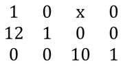

## **개요**

PowerPoint는 방정식을 Office Math Markup Language (OMML) 형식으로 저장합니다. Aspose.Slides for PHP via Java를 사용하면 분수, 근호, 함수, 극한, N-ary 연산자, 행렬, 배열 및 서식이 지정된 수학 블록과 같은 동일한 종류의 수학 콘텐츠를 프로그래밍 방식으로 만들 수 있습니다.

PowerPoint에서 사용자는 일반적으로 **Insert > Equation**에서 방정식을 추가합니다:


그 결과 슬라이드에 편집 가능한 수학 텍스트가 표시됩니다:


Aspose.Slides는 다음 세 가지 주요 객체를 통해 해당 수학 텍스트를 구성합니다:

- 수학 도형은 [addMathShape](https://reference.aspose.com/slides/php-java/aspose.slides/shapecollection/#addMathShape)으로 생성되며, 방정식을 포함하는 도형입니다.
- [MathPortion](https://reference.aspose.com/slides/php-java/aspose.slides/mathportion/)은 도형 텍스트 프레임 내부에 수학 콘텐츠를 저장합니다.
- [MathParagraph](https://reference.aspose.com/slides/php-java/aspose.slides/mathparagraph/)은 하나 이상의 [MathBlock](https://reference.aspose.com/slides/php-java/aspose.slides/mathblock/) 객체를 포함합니다.

아래 대부분의 예제는 [MathematicalText](https://reference.aspose.com/slides/php-java/aspose.slides/mathematicaltext/)와 [MathElementBase](https://reference.aspose.com/slides/php-java/aspose.slides/mathelementbase/)의 유창한 메서드를 사용하여 코드를 간결하고 읽기 쉽게 유지합니다.

MathML 내보내기 시나리오에 대해서는 [Export Math Equations from Presentations in PHP via Java](/slides/ko/php-java/exporting-math-equations/)를 참고하십시오.

## **방정식 만들기**

이 예제는 [addMathShape](https://reference.aspose.com/slides/php-java/aspose.slides/shapecollection/#addMathShape)를 사용하여 수학 도형을 만들고 피타고라스 정리를 추가합니다:


```php
$presentation = new Presentation();
try {
    $slide = $presentation->getSlides()->get_Item(0);

    $mathShape = $slide->getShapes()->addMathShape(20, 20, 700, 120);
    $mathParagraph = $mathShape->getTextFrame()->getParagraphs()
        - >get_Item(0)->getPortions()->get_Item(0)->getMathParagraph();

    $equation = (new MathematicalText("c"))
        - >setSuperscript("2")
        - >join("=")
        - >join((new MathematicalText("a"))->setSuperscript("2"))
        - >join("+")
        - >join((new MathematicalText("b"))->setSuperscript("2"));

    $mathParagraph->add($equation);

    $presentation->save("pythagorean-theorem.pptx", SaveFormat::Pptx);
} finally {
    if (!java_is_null($presentation)) {
        $presentation->dispose();
    }
}
```

{}
[addMathShape](https://reference.aspose.com/slides/php-java/aspose.slides/shapecollection/#addMathShape)은 이미 수학 단락을 포함한 도형을 생성합니다. 첫 번째 [MathPortion](https://reference.aspose.com/slides/php-java/aspose.slides/mathportion/)에 접근한 뒤 [getMathParagraph](https://reference.aspose.com/slides/php-java/aspose.slides/mathportion/#getMathParagraph)를 호출하고, 해당 단락에 수학 블록이나 수학 요소를 추가합니다.
{}

### **수학 블록 결합**

방정식의 일부가 독립적으로 [MathBlock](https://reference.aspose.com/slides/php-java/aspose.slides/mathblock/) 객체로 구축된 경우 [joinBlock](https://reference.aspose.com/slides/php-java/aspose.slides/mathblock/#joinBlock)을 사용하여 결합합니다. 예제에서는 왼쪽 블록에 `c² =`를, 오른쪽 블록에 `a² + b²`를 구축합니다. [setSuperscript](https://reference.aspose.com/slides/php-java/aspose.slides/mathelementbase/#setSuperscript)으로 세 개의 거듭제곱 모두에 편집 가능한 수학 위첨자를 생성합니다.

```php
use aspose\slides\MathBlock;
use aspose\slides\MathematicalText;
use aspose\slides\Presentation;
use aspose\slides\SaveFormat;

$presentation = new Presentation();
try {
    $slide = $presentation->getSlides()->get_Item(0);

    $shape = $slide->getShapes()->addMathShape(20, 20, 600, 100);
    $mathPortion = $shape->getTextFrame()->getParagraphs()->get_Item(0)->getPortions()->get_Item(0);
    $mathParagraph = $mathPortion->getMathParagraph();

    $leftBlock = new MathBlock();
    $leftBlock->add((new MathematicalText("c"))->setSuperscript("2"));
    $leftBlock->add(new MathematicalText("="));

    $rightBlock = new MathBlock();
    $rightBlock->add((new MathematicalText("a"))->setSuperscript("2"));
    $rightBlock->add(new MathematicalText("+"));
    $rightBlock->add((new MathematicalText("b"))->setSuperscript("2"));

    $combinedBlock = $leftBlock->joinBlock($rightBlock);
    $mathParagraph->add($combinedBlock);

    $presentation->save("equation.pptx", SaveFormat::Pptx);
} finally {
    $presentation->dispose();
}
```

[joinBlock](https://reference.aspose.com/slides/php-java/aspose.slides/mathblock/#joinBlock) 은 `$leftBlock` 자체를 반환하며 이제 두 부분이 순서대로 포함되고 `$rightBlock` 은 비어 있게 됩니다. 결합된 블록은 [MathParagraph](https://reference.aspose.com/slides/php-java/aspose.slides/mathparagraph/)에 한 번만 추가합니다. `equation.pptx`를 다시 열면 단락에 `c² = a² + b²`를 나타내는 하나의 블록이 포함되며, 세 개의 거듭제곱은 모두 수학 위첨자로 보존됩니다.

`$leftBlock->add($rightBlock)`와 같이 [add](https://reference.aspose.com/slides/php-java/aspose.slides/mathblock/#add)을 호출하면 한 블록을 다른 블록 안에 직접 중첩하려고 시도하게 되며 `InvalidOperationException`이 발생합니다.

## **분수 추가**

[divide](https://reference.aspose.com/slides/php-java/aspose.slides/mathelementbase/#divide)를 사용하여 분수를 생성합니다. [MathFractionTypes](https://reference.aspose.com/slides/php-java/aspose.slides/mathfractiontypes/)를 이용해 분수 스타일을 선택할 수 있습니다.


```php
$presentation = new Presentation();
try {
    $slide = $presentation->getSlides()->get_Item(0);

    $mathShape = $slide->getShapes()->addMathShape(20, 20, 700, 100);
    $mathParagraph = $mathShape->getTextFrame()->getParagraphs()
        - >get_Item(0)->getPortions()->get_Item(0)->getMathParagraph();

    $fraction = (new MathematicalText("1"))
        - >divide("x", MathFractionTypes::Skewed);

    $mathParagraph->add(new MathBlock($fraction));

    $presentation->save("fraction.pptx", SaveFormat::Pptx);
} finally {
    if (!java_is_null($presentation)) {
        $presentation->dispose();
    }
}
```

쌓인 형태의 분수는 [MathFractionTypes::Bar](https://reference.aspose.com/slides/php-java/aspose.slides/mathfractiontypes/#Bar)를 사용합니다:

```php
$stackedFraction = (new MathematicalText("x + 1"))->divide("y - 1", MathFractionTypes::Bar);
```

## **근호 추가**

[radical](https://reference.aspose.com/slides/php-java/aspose.slides/mathelementbase/#radical)를 사용하여 제곱근, 세제곱근 또는 기타 근호를 생성합니다. 현재 요소가 밑(base)이 되고 인수가 차수(degree)가 됩니다.


```php
$presentation = new Presentation();
try {
    $slide = $presentation->getSlides()->get_Item(0);

    $mathShape = $slide->getShapes()->addMathShape(20, 20, 700, 100);
    $mathParagraph = $mathShape->getTextFrame()->getParagraphs()
        - >get_Item(0)->getPortions()->get_Item(0)->getMathParagraph();

    $radical = (new MathematicalText("x"))
        - >radical("n");

    $mathParagraph->add(new MathBlock($radical));

    $presentation->save("radical.pptx", SaveFormat::Pptx);
} finally {
    if (!java_is_null($presentation)) {
        $presentation->dispose();
    }
}
```

### **제곱근 차수 표시 또는 숨기기**

제곱근은 명시적인 2를 표시하거나 전통적인 √x 표기법을 사용할 수 있습니다. [MathRadical](https://reference.aspose.com/slides/php-java/aspose.slides/mathradical/)의 [setHideDegree](https://reference.aspose.com/slides/php-java/aspose.slides/mathradical/#setHideDegree) 메서드가 어느 형태가 나타날지를 제어합니다. 두 형태 모두 차수 2와 피제곱근 x를 편집 가능한 방정식에 유지합니다.


예제에서는 동일한 제곱근을 두 번 저장합니다. `visible-degree.pptx`에서는 2가 보이고, `hidden-degree.pptx`에서는 숨겨집니다.

```php
use aspose\slides\MathBlock;
use aspose\slides\MathematicalText;
use aspose\slides\Presentation;
use aspose\slides\SaveFormat;

$presentation = new Presentation();
try {
    $slide = $presentation->getSlides()->get_Item(0);
    
    $radical = (new MathematicalText("x"))->radical("2");

    $shape = $slide->getShapes()->addMathShape(20, 20, 200, 100);
    $portion = $shape->getTextFrame()->getParagraphs()->get_Item(0)->getPortions()->get_Item(0);
    $portion->getMathParagraph()->add(new MathBlock($radical));

    $radical->setHideDegree(false);
    $presentation->save("visible-degree.pptx", SaveFormat::Pptx);

    $radical->setHideDegree(true);
    $presentation->save("hidden-degree.pptx", SaveFormat::Pptx);
} finally {
    $presentation->dispose();
}
```

## **함수 및 극한 추가**

[asArgumentOfFunction](https://reference.aspose.com/slides/php-java/aspose.slides/mathelementbase/#asArgumentOfFunction) 또는 [function](https://reference.aspose.com/slides/php-java/aspose.slides/mathelementbase/#function)을 사용하여 `sin(x)`, `log(x)` 또는 사용자 정의 함수 이름과 같은 함수를 만들 수 있습니다. 극한의 경우 [MathLimit](https://reference.aspose.com/slides/php-java/aspose.slides/mathlimit/)에 `lim`을 넣거나 [setLowerLimit](https://reference.aspose.com/slides/php-java/aspose.slides/mathelementbase/#setLowerLimit)을 사용합니다.


```php
$presentation = new Presentation();
try {
    $slide = $presentation->getSlides()->get_Item(0);

    $mathShape = $slide->getShapes()->addMathShape(20, 20, 700, 100);
    $mathParagraph = $mathShape->getTextFrame()->getParagraphs()
        - >get_Item(0)->getPortions()->get_Item(0)->getMathParagraph();

    $limit = (new MathematicalText("lim"))
        - >setLowerLimit("x\u{2192}\u{221E}")
        - >function("x");

    $mathParagraph->add(new MathBlock($limit));

    $presentation->save("functions-and-limits.pptx", SaveFormat::Pptx);
} finally {
    if (!java_is_null($presentation)) {
        $presentation->dispose();
    }
}
```

사용자 정의 함수 이름의 경우 현재 요소를 함수 이름으로 만들고 해당 인수와 함께 [function](https://reference.aspose.com/slides/php-java/aspose.slides/mathelementbase/#function)을 호출합니다:

```php
$customFunction = (new MathematicalText("f"))->function("x + 1");
```

## **다항 연산자 및 적분 추가**

[nary](https://reference.aspose.com/slides/php-java/aspose.slides/mathelementbase/#nary)를 사용하여 합계, 합집합, 교집합 및 기타 대형 연산자를 만들 수 있습니다. [integral](https://reference.aspose.com/slides/php-java/aspose.slides/mathelementbase/#integral)를 사용하여 적분을 만들 수 있습니다. 두 메서드 모두 하한 및 상한을 설정할 수 있습니다.


```php
$presentation = new Presentation();
try {
    $slide = $presentation->getSlides()->get_Item(0);

    $mathShape = $slide->getShapes()->addMathShape(20, 20, 700, 120);
    $mathParagraph = $mathShape->getTextFrame()->getParagraphs()
        - >get_Item(0)->getPortions()->get_Item(0)->getMathParagraph();

    $summationBase = (new MathematicalText("x"))
        - >setSuperscript("k")
        - >join((new MathematicalText("a"))->setSuperscript("n-k"));

    $summation = $summationBase->nary(MathNaryOperatorTypes::Summation, "k=0", "n");

    $mathParagraph->add(new MathBlock($summation));

    $presentation->save("nary-operators.pptx", SaveFormat::Pptx);
} finally {
    if (!java_is_null($presentation)) {
        $presentation->dispose();
    }
}
```

다항 연산자는 선택적 제한이 있는 대형 연산자를 의미합니다. `+`, `-`, `=`와 같은 단순 연산자는 보통 [MathematicalText](https://reference.aspose.com/slides/php-java/aspose.slides/mathematicaltext/)로 추가하고 표현식에 결합합니다.

적분의 경우 [integral](https://reference.aspose.com/slides/php-java/aspose.slides/mathelementbase/#integral)을 사용합니다:

```php
$integralBase = (new MathematicalText("x"))->join((new MathematicalText("dx"))->toBox());
$integral = $integralBase->integral(MathIntegralTypes::Simple, "0", "1");
```

## **행렬 추가**

[MathMatrix](https://reference.aspose.com/slides/php-java/aspose.slides/mathmatrix/)를 사용하여 행과 열을 정의합니다. 행렬은 기본적으로 괄호를 포함하지 않으므로 필요에 따라 괄호, 대괄호 또는 중괄호로 감싸야 합니다.


```php
$presentation = new Presentation();
try {
    $slide = $presentation->getSlides()->get_Item(0);

    $mathShape = $slide->getShapes()->addMathShape(20, 20, 700, 120);
    $mathParagraph = $mathShape->getTextFrame()->getParagraphs()
        - >get_Item(0)->getPortions()->get_Item(0)->getMathParagraph();

    $matrix = new MathMatrix(2, 3);
    $matrix->set_Item(0, 0, new MathematicalText("1"));
    $matrix->set_Item(0, 1, new MathematicalText("x"));
    $matrix->set_Item(1, 0, new MathematicalText("x"));
    $matrix->set_Item(1, 1, new MathematicalText("2"));
    $matrix->set_Item(1, 2, new MathematicalText("y"));

    $mathParagraph->add(new MathBlock($matrix));

    $presentation->save("matrix.pptx", SaveFormat::Pptx);
} finally {
    if (!java_is_null($presentation)) {
        $presentation->dispose();
    }
}
```

### **기존 행렬 편집**

예를 들어 `matrix.pptx`에 계수 행렬이 저장되어 있다고 가정합니다. 다음 연습에서는 첫 번째 방정식을 유지하고 두 번째 방정식을 두 개의 새 방정식으로 교체하며 변수 집합을 수정합니다. 기존 행렬을 [MathMatrix](https://reference.aspose.com/slides/php-java/aspose.slides/mathmatrix/)를 통해 열어 아직 적용되는 계수를 그대로 유지합니다.


행 및 열 인덱스는 0부터 시작하며 각 호출 시점의 행렬 상태를 나타냅니다. 인덱스 1 앞에 행을 삽입하면 원래 두 번째 행이 인덱스 2로 이동합니다. 인덱스 2 뒤에 삽입하면 행이 추가됩니다. 행 2를 삭제하면 원래 두 번째 방정식이 제거되고 추가된 행이 한 위치 위로 이동합니다. 열도 동일하게 이동합니다.

```php
use aspose\slides\MathematicalText;
use aspose\slides\MathHorizontalAlignment;
use aspose\slides\Presentation;
use aspose\slides\SaveFormat;

$presentation = new Presentation("matrix.pptx");
try {
    $shape = $presentation->getSlides()->get_Item(0)->getShapes()->get_Item(0);
    $portion = $shape->getTextFrame()->getParagraphs()->get_Item(0)->getPortions()->get_Item(0);
    $block = $portion->getMathParagraph()->get_Item(0);
    $matrix = $block->get_Item(0);

    $matrix->insertRowBefore(1);
    $matrix->insertRowAfter(2);
    $matrix->deleteRow(2);

    $matrix->insertColumnBefore(1);
    $matrix->insertColumnAfter(3);
    $matrix->deleteColumn(3);

    // 새 셀은 처음에 null입니다. 먼저 0이 아닌 계수를 설정합니다.
    $matrix->set_Item(1, 0, new MathematicalText("12"));
    $matrix->set_Item(1, 1, new MathematicalText("1"));
    $matrix->set_Item(2, 2, new MathematicalText("10"));
    $matrix->set_Item(2, 3, new MathematicalText("1"));
    $rowCount = java_values($matrix->getRowCount());
    $columnCount = java_values($matrix->getColumnCount());
    for ($row = 0; $row < $rowCount; $row++) {
        for ($column = 0; $column < $columnCount; $column++) {
            $coefficient = $matrix->get_Item($row, $column);
            if (java_is_null($coefficient)) {
                $matrix->set_Item($row, $column, new MathematicalText("0"));
            }
        }
    }

    $matrix->setColumnAlignment(0, MathHorizontalAlignment::Left);
    $matrix->setColumnsAlignment(1, 3, MathHorizontalAlignment::Right);

    $presentation->save("updated-matrix.pptx", SaveFormat::Pptx);
} finally {
    $presentation->dispose();
}
```

[setColumnAlignment](https://reference.aspose.com/slides/php-java/aspose.slides/mathmatrix/#setColumnAlignment)는 첫 번째 열을 왼쪽 정렬합니다. [setColumnsAlignment](https://reference.aspose.com/slides/php-java/aspose.slides/mathmatrix/#setColumnsAlignment)는 인덱스 1부터 시작하는 세 개의 연속 열을 오른쪽 정렬합니다. `updated-matrix.pptx`에서는 행이 세 개이고 변수가 네 개이며, 원래 첫 행의 계수 `1`과 `x`가 이제 첫 번째와 세 번째 열에 나타납니다.



## **방정식 배열 추가**

정렬된 방정식이나 수식의 수직 스택이 필요할 때 [toMathArray](https://reference.aspose.com/slides/php-java/aspose.slides/mathelementbase/#toMathArray)를 사용합니다.


```php
$presentation = new Presentation();
try {
    $slide = $presentation->getSlides()->get_Item(0);

    $mathShape = $slide->getShapes()->addMathShape(20, 20, 700, 140);
    $mathParagraph = $mathShape->getTextFrame()->getParagraphs()
        - >get_Item(0)->getPortions()->get_Item(0)->getMathParagraph();

    $equationArray = (new MathematicalText("x"))
        - >join("y")
        - >toMathArray();

    $mathParagraph->add(new MathBlock($equationArray));

    $presentation->save("equation-array.pptx", SaveFormat::Pptx);
} finally {
    if (!java_is_null($presentation)) {
        $presentation->dispose();
    }
}
```

### **주변 요소와 배열 정렬**

[setBaseJustification](https://reference.aspose.com/slides/php-java/aspose.slides/matharray/#setBaseJustification) 은 배열이 옆에 있는 수학 요소와 수직 정렬되는 방식을 제어합니다. 아래 예제에서는 첫 번째 행, 배열 중앙, 마지막 행과 정렬을 비교합니다.

다음 예제는 세 개의 동일한 배열을 만들며, 각각 세 행이고 인접 요소는 `A=`와 `=B`입니다. 모든 수학 텍스트는 Cambria Math 24포인트이며, 배열 정렬만이 다릅니다.

```php
use aspose\slides\FillType;
use aspose\slides\FontData;
use aspose\slides\MathArray;
use aspose\slides\MathBlock;
use aspose\slides\MathJustification;
use aspose\slides\MathVerticalAlignment;
use aspose\slides\MathematicalText;
use aspose\slides\Presentation;
use aspose\slides\SaveFormat;
use aspose\slides\ShapeType;
use aspose\slides\SlideSizeScaleType;
use aspose\slides\TextAnchorType;

$createText = static function (string $value) {
    $text = new MathematicalText($value);
    $text->getFormat()->setFontHeight(24);
    $text->getFormat()->setLatinFont(new FontData("Cambria Math"));
    return $text;
};

$alignments = ["Top" => MathVerticalAlignment::Top, "Center" => MathVerticalAlignment::Center, "Bottom" => MathVerticalAlignment::Bottom];
$presentation = new Presentation();
try {
    $presentation->getSlideSize()->setSize(780, 200, SlideSizeScaleType::DoNotScale);
    $slide = $presentation->getSlides()->get_Item(0);
    $x = 20;
    foreach ($alignments as $name => $alignment) {
        $label = $slide->getShapes()->addAutoShape(ShapeType::Rectangle, $x, 10, 240, 30);
        $label->getFillFormat()->setFillType(FillType::NoFill);
        $label->getLineFormat()->getFillFormat()->setFillType(FillType::NoFill);
        $label->getTextFrame()->setText($name);
        $labelFormat = $label->getTextFrame()->getParagraphs()->get_Item(0)->getPortions()->get_Item(0)->getPortionFormat();
        $labelFormat->setFontHeight(16);
        $labelFormat->getFillFormat()->setFillType(FillType::Solid);
        $labelFormat->getFillFormat()->getSolidFillColor()->setColor(java("java.awt.Color")->BLACK);

        $mathShape = $slide->getShapes()->addMathShape($x, 60, 240, 130);
        $mathShape->getTextFrame()->getTextFrameFormat()->setAnchoringType(TextAnchorType::Top);
        $paragraph = $mathShape->getTextFrame()->getParagraphs()->get_Item(0);
        $mathParagraph = $paragraph->getPortions()->get_Item(0)->getMathParagraph();
        $mathParagraph->setJustification(MathJustification::LeftJustified);

        $firstRow = $createText("x+y=3");
        $equationArray = new MathArray($firstRow);
        foreach (["x-y=1", "x=2"] as $value) {
            $row = $createText($value);
            $equationArray->getArguments()->add($row);
        }
        $equationArray->setBaseJustification($alignment);
        $leftText = $createText("A=");
        $rightText = $createText("=B");
        $equation = (new MathBlock($leftText))->join($equationArray)->join($rightText);
        $mathParagraph->add($equation);
        $x += 260;
    }
    $presentation->save("equation-array-alignment.pptx", SaveFormat::Pptx);
} finally {
    $presentation->dispose();
}
```

다음 비교는 PowerPoint에서 저장된 프레젠테이션을 보여줍니다. 각 배열 옆에 있는 `A=`와 `=B`의 위치를 확인하십시오.


### **행 간격 구성**

[setRowSpacingRule](https://reference.aspose.com/slides/php-java/aspose.slides/matharray/#setRowSpacingRule) 은 배열 내부 행 간의 간격 규칙을 선택합니다. [setRowSpacing](https://reference.aspose.com/slides/php-java/aspose.slides/matharray/#setRowSpacing) 은 명시적 간격 규칙에 대한 숫자 값을 제공하며, 프리셋 규칙에는 무시됩니다.

정확한 간격은 포인트 단위로 측정됩니다. 비례 간격은 반줄 단위로 측정되며, 예제의 값 `3`은 1.5줄을 의미합니다. 명시적 값을 지정할 때는 두 속성을 모두 설정해야 하며, 숫자 값만 변경해도 간격 규칙이 선택되지 않습니다.

아래 예제는 동일한 방정식, 정렬 및 글꼴 설정을 사용하여 다섯 개의 프레젠테이션을 저장합니다. 처음 세 개는 프리셋을 사용하고, 마지막 두 개는 명시적 값을 보여줍니다.

```php
use aspose\slides\FontData;
use aspose\slides\MathArray;
use aspose\slides\MathBlock;
use aspose\slides\MathJustification;
use aspose\slides\MathRowSpacingRule;
use aspose\slides\MathVerticalAlignment;
use aspose\slides\MathematicalText;
use aspose\slides\Presentation;
use aspose\slides\SaveFormat;

$createText = static function (string $value) {
    $text = new MathematicalText($value);
    $text->getFormat()->setFontHeight(24);
    $text->getFormat()->setLatinFont(new FontData("Cambria Math"));
    return $text;
};

$settings = [
    "SingleLineGap" => [MathRowSpacingRule::SingleLineGap, 0],
    "OneAndAHalfLineGap" => [MathRowSpacingRule::OneAndAHalfLineGap, 0],
    "TwoLineGap" => [MathRowSpacingRule::TwoLineGap, 0],
    "Exactly" => [MathRowSpacingRule::Exactly, 20],
    "Multiple" => [MathRowSpacingRule::Multiple, 3],
];

foreach ($settings as $name => [$rule, $spacing]) {
    $presentation = new Presentation();
    try {
        $mathShape = $presentation->getSlides()->get_Item(0)->getShapes()->addMathShape(20, 20, 600, 300);
        $paragraph = $mathShape->getTextFrame()->getParagraphs()->get_Item(0);
        $paragraph->getParagraphFormat()->setSpaceBefore(0);
        $paragraph->getParagraphFormat()->setSpaceAfter(0);
        $mathParagraph = $paragraph->getPortions()->get_Item(0)->getMathParagraph();
        $mathParagraph->setJustification(MathJustification::LeftJustified);

        $firstRow = $createText("x+y=3");
        $equationArray = new MathArray($firstRow);
        foreach (["x-y=1", "x=2"] as $value) {
            $row = $createText($value);
            $equationArray->getArguments()->add($row);
        }
        $equationArray->setBaseJustification(MathVerticalAlignment::Center);
        $equationArray->setRowSpacingRule($rule);
        $equationArray->setRowSpacing($spacing);
        $leftText = $createText("A=");
        $rightText = $createText("=B");
        $equation = (new MathBlock($leftText))->join($equationArray)->join($rightText);
        $mathParagraph->add($equation);
        $presentation->save("equation-array-$name.pptx", SaveFormat::Pptx);
    } finally {
        $presentation->dispose();
    }
}
```

배열 행 간격은 단락 간격과 별개입니다. [setSpaceBefore](https://reference.aspose.com/slides/php-java/aspose.slides/paragraphformat/#setSpaceBefore)와 [setSpaceAfter](https://reference.aspose.com/slides/php-java/aspose.slides/paragraphformat/#setSpaceAfter)는 배열 행 사이가 아니라 포함하는 단락 주위에 공간을 추가합니다. 마찬가지로 [MathParagraph::setJustification](https://reference.aspose.com/slides/php-java/aspose.slides/mathparagraph/#setJustification)은 전체 수학 단락을 수평으로 배치하며, 배열의 수직 정렬 설정을 대체하지 않습니다.

## **삼각 함수 추가**

인수 요소가 현재이고 함수 이름이 알려진 경우 [asArgumentOfFunction](https://reference.aspose.com/slides/php-java/aspose.slides/mathelementbase/#asArgumentOfFunction)을 사용합니다.


```php
$presentation = new Presentation();
try {
    $slide = $presentation->getSlides()->get_Item(0);

    $mathShape = $slide->getShapes()->addMathShape(20, 20, 700, 100);
    $mathParagraph = $mathShape->getTextFrame()->getParagraphs()
        - >get_Item(0)->getPortions()->get_Item(0)->getMathParagraph();

    $cosine = (new MathematicalText("2x"))
        - >asArgumentOfFunction(MathFunctionsOfOneArgument::Cos);

    $mathParagraph->add(new MathBlock($cosine));

    $presentation->save("trigonometric-function.pptx", SaveFormat::Pptx);
} finally {
    if (!java_is_null($presentation)) {
        $presentation->dispose();
    }
}
```

## **첨자 및 위첨자 추가**

인덱스와 거듭제곱을 위해 첨자와 위첨자 도우미를 사용합니다. 인덱스가 기본 요소의 왼쪽에 나타나야 하는 경우 [setSubSuperscriptOnTheLeft](https://reference.aspose.com/slides/php-java/aspose.slides/mathelementbase/#setSubSuperscriptOnTheLeft)를 사용합니다.


```php
$presentation = new Presentation();
try {
    $slide = $presentation->getSlides()->get_Item(0);

    $mathShape = $slide->getShapes()->addMathShape(20, 20, 700, 100);
    $mathParagraph = $mathShape->getTextFrame()->getParagraphs()
        - >get_Item(0)->getPortions()->get_Item(0)->getMathParagraph();

    $scripts = (new MathematicalText("Y"))
        - >setSubSuperscriptOnTheLeft("1", "n");

    $mathParagraph->add(new MathBlock($scripts));

    $presentation->save("subscript-superscript.pptx", SaveFormat::Pptx);
} finally {
    if (!java_is_null($presentation)) {
        $presentation->dispose();
    }
}
```

### **오른쪽 첨자와 위첨자 정렬**

두 스크립트가 동일한 기본 요소에 속하는 경우 [MathRightSubSuperscriptElement](https://reference.aspose.com/slides/php-java/aspose.slides/mathrightsubsuperscriptelement/)을 사용합니다. 이 요소의 [setAlignScripts](https://reference.aspose.com/slides/php-java/aspose.slides/mathrightsubsuperscriptelement/#setAlignScripts) 메서드는 수평 위치를 제어합니다. `false`(기본값)는 기본 요소의 윤곽을 따라 배치하고, `true`는 스크립트를 서로 수평으로 정렬합니다.

이 예제는 동일한 편집 가능한 식 두 개를 나란히 배치합니다. 두 경우 모두 수학 이탤릭 f (U+1D453), 아래 첨자 1, 위 첨자 2, Cambria Math 72포인트를 사용합니다. 기울어진 기본 요소가 PowerPoint에서 차이를 명확히 보여줍니다. 예제를 실행하기 전에 Cambria Math를 설치하십시오.

```php
use aspose\slides\FontData;
use aspose\slides\MathBlock;
use aspose\slides\MathematicalText;
use aspose\slides\MathRightSubSuperscriptElement;
use aspose\slides\PortionFormat;
use aspose\slides\Presentation;
use aspose\slides\SaveFormat;
use aspose\slides\SlideSizeScaleType;

$presentation = new Presentation();
try {
    $presentation->getSlideSize()->setSize(900, 250, SlideSizeScaleType::DoNotScale);
    $slide = $presentation->getSlides()->get_Item(0);

    $format = new PortionFormat();
    $format->setFontHeight(72);
    $font = new FontData("Cambria Math");
    $format->setLatinFont($font);

    for ($i = 0; $i < 2; $i++) {
        $left = 40 + $i * 440;
        $shape = $slide->getShapes()->addMathShape($left, 75, 380, 150);

        $baseText = new MathematicalText("\u{1D453}", $format);
        $subscript = new MathematicalText("1", $format);
        $superscript = new MathematicalText("2", $format);
        $scripts = new MathRightSubSuperscriptElement($baseText, $subscript, $superscript);
        $scripts->setAlignScripts($i === 1);

        $portion = $shape->getTextFrame()->getParagraphs()->get_Item(0)->getPortions()->get_Item(0);
        $portion->getPortionFormat()->setFontHeight($format->getFontHeight());
        $portion->getPortionFormat()->setLatinFont($format->getLatinFont());
        $mathBlock = new MathBlock($scripts);
        $portion->getMathParagraph()->add($mathBlock);
    }

    $presentation->save("aligned-scripts.pptx", SaveFormat::Pptx);
} finally {
    $presentation->dispose();
}
```


## **구분 기호 추가**

[enclose](https://reference.aspose.com/slides/php-java/aspose.slides/mathelementbase/#enclose)를 사용하여 식을 구분 기호 안에 넣습니다. 여러 요소를 포함하는 구분 기호 식의 경우 구분 문자도 설정할 수 있습니다.


```php
$presentation = new Presentation();
try {
    $slide = $presentation->getSlides()->get_Item(0);

    $mathShape = $slide->getShapes()->addMathShape(20, 20, 700, 100);
    $mathParagraph = $mathShape->getTextFrame()->getParagraphs()
        - >get_Item(0)->getPortions()->get_Item(0)->getMathParagraph();

    $delimiter = (new MathematicalText("x"))
        - >join("y")
        - >join("z")
        - >enclose(new Java("java.lang.Character", "<"), new Java("java.lang.Character", ">"));
    $delimiter->setSeparatorCharacter(new Java("java.lang.Character", "|"));

    $mathParagraph->add(new MathBlock($delimiter));

    $presentation->save("delimiters.pptx", SaveFormat::Pptx);
} finally {
    if (!java_is_null($presentation)) {
        $presentation->dispose();
    }
}
```

### **구분 기호 크기 및 정렬**

[setGrowToMatchOperandHeight](https://reference.aspose.com/slides/php-java/aspose.slides/mathdelimiter/#setGrowToMatchOperandHeight)에 `true`를 전달하면 큰 피연산자 주변에 괄호가 커집니다. `false`를 전달하면 기본 크기를 유지합니다. [setDelimiterShape](https://reference.aspose.com/slides/php-java/aspose.slides/mathdelimiter/#setDelimiterShape)와 함께 [MathDelimiterShape](https://reference.aspose.com/slides/php-java/aspose.slides/mathdelimitershape/) 중 하나를 사용합니다. `Centered`는 괄호를 등호 기호의 중앙을 기준으로 가운데 맞추고, `Match`는 포함된 내용에 맞게 정렬합니다. 두 설정 모두 구분 기호에만 영향을 미치며, 내부 식은 변하지 않습니다.

예제는 `x`의 지수에 분수를 배치하여 식이 기준선 위로 더 많이 늘어나도록 합니다. 네 개의 방정식 모두 동일한 괄호와 글꼴 설정을 사용합니다.

```php
use aspose\slides\MathDelimiterShape;
use aspose\slides\MathematicalText;
use aspose\slides\Presentation;
use aspose\slides\SaveFormat;

$presentation = new Presentation();
try {
    $slide = $presentation->getSlides()->get_Item(0);
    $opening = new Java("java.lang.Character", "(");
    $closing = new Java("java.lang.Character", ")");
    for ($row = 0; $row < 2; $row++) {
        for ($column = 0; $column < 2; $column++) {
            $fraction = (new MathematicalText("a + b"))->divide("c + d");
            $power = (new MathematicalText("x"))->setSuperscript($fraction);
            $delimiter = $power->enclose($opening, $closing);
            $delimiter->setGrowToMatchOperandHeight($row === 0);
            $delimiter->setDelimiterShape($column === 0 ? MathDelimiterShape::Centered : MathDelimiterShape::Match);

            $mathShape = $slide->getShapes()->addMathShape(20 + 330 * $column, 20 + 120 * $row, 300, 100);
            $portion = $mathShape->getTextFrame()->getParagraphs()->get_Item(0)->getPortions()->get_Item(0);
            $portion->getPortionFormat()->setFontHeight(32);
            $equation = (new MathematicalText("y = "))->join($delimiter);
            $portion->getMathParagraph()->add($equation);
        }
    }
    $presentation->save("delimiter-sizing.pptx", SaveFormat::Pptx);
} finally {
    $presentation->dispose();
}
```

PowerPoint에서 행을 비교하면 성장 효과를 확인할 수 있습니다. 상단 행에서는 괄호가 지수를 둘러싸며 두 형태 모두 비슷하게 보입니다. 하단 행에서는 성장이 꺼져 있습니다. 왼쪽의 작은 괄호(`Centered`)는 등호와 정렬되고, 오른쪽의 괄호(`Match`)는 식 위쪽에 더 높게 위치합니다.


## **테두리 박스 추가**

분수에 [toBorderBox](https://reference.aspose.com/slides/php-java/aspose.slides/mathelementbase/#toBorderBox)를 호출하면 전체 식을 프레임으로 둘러싼 테두리 박스를 만들 수 있습니다. 반환된 [MathBorderBox](https://reference.aspose.com/slides/php-java/aspose.slides/mathborderbox/)는 기본적으로 네 면을 모두 표시합니다. 개별 면을 제거하려면 [setHideTop](https://reference.aspose.com/slides/php-java/aspose.slides/mathborderbox/#setHideTop), [setHideBottom](https://reference.aspose.com/slides/php-java/aspose.slides/mathborderbox/#setHideBottom), [setHideLeft](https://reference.aspose.com/slides/php-java/aspose.slides/mathborderbox/#setHideLeft), [setHideRight](https://reference.aspose.com/slides/php-java/aspose.slides/mathborderbox/#setHideRight)를 사용합니다.

예제는 하나의 슬라이드에 동일한 분수를 여섯 개 복사합니다. 취소 표시를 위해 네 면을 모두 숨기고 [setStrikethroughBottomLeftToTopRight](https://reference.aspose.com/slides/php-java/aspose.slides/mathborderbox/#setStrikethroughBottomLeftToTopRight)를 `true`로 설정하여 오른쪽 위 대각선(↗)을, 또는 [setStrikethroughTopLeftToBottomRight](https://reference.aspose.com/slides/php-java/aspose.slides/mathborderbox/#setStrikethroughTopLeftToBottomRight)를 `true`로 설정하여 왼쪽 아래 대각선(↘)을 적용할 수 있습니다. 또한 [setStrikethroughHorizontal](https://reference.aspose.com/slides/php-java/aspose.slides/mathborderbox/#setStrikethroughHorizontal)이나 [setStrikethroughVertical](https://reference.aspose.com/slides/php-java/aspose.slides/mathborderbox/#setStrikethroughVertical)를 사용하고, 보이는 면을 조합할 수 있습니다.

```php
use aspose\slides\MathBlock;
use aspose\slides\MathematicalText;
use aspose\slides\Presentation;
use aspose\slides\SaveFormat;
use aspose\slides\SlideSizeScaleType;

$presentation = new Presentation();
try {
    $presentation->getSlideSize()->setSize(540, 220, SlideSizeScaleType::DoNotScale);
    $slide = $presentation->getSlides()->get_Item(0);

    $addFraction = function ($x, $y, $hideBorder) use ($slide) {
        $fraction = (new MathematicalText("x+1"))->divide("y+2");
        $box = $fraction->toBorderBox();
        $box->setHideTop($hideBorder);
        $box->setHideBottom($hideBorder);
        $box->setHideLeft($hideBorder);
        $box->setHideRight($hideBorder);

        $shape = $slide->getShapes()->addMathShape($x, $y, 160, 90);
        $portion = $shape->getTextFrame()->getParagraphs()->get_Item(0)->getPortions()->get_Item(0);
        $portion->getPortionFormat()->setFontHeight(28);
        $mathBlock = new MathBlock($box);
        $portion->getMathParagraph()->add($mathBlock);
        return $box;
    };

    $addFraction(10, 10, false);

    $partial = $addFraction(190, 10, false);
    $partial->setHideTop(true);
    $partial->setHideRight(true);

    $addFraction(370, 10, true)->setStrikethroughBottomLeftToTopRight(true);
    $addFraction(10, 120, true)->setStrikethroughTopLeftToBottomRight(true);
    $addFraction(190, 120, true)->setStrikethroughHorizontal(true);
    $addFraction(370, 120, false)->setStrikethroughVertical(true);

    $presentation->save("border-box.pptx", SaveFormat::Pptx);
} finally {
    $presentation->dispose();
}
```


이 분수에서 수평 취소선이 분수선 위에 겹칩니다. 수직 취소선은 분자와 분모를 모두 가로지르면서 주변 테두리는 그대로 남아 있습니다. 이러한 선은 전체 식을 장식합니다. 일반 텍스트 취소선은 텍스트 실행 내 문자에만 적용됩니다. PowerPoint에서 프레젠테이션을 다시 열어도 분자와 분모를 독립적으로 편집할 수 있습니다.

## **Phantom 요소로 가시성 및 레이아웃 제어**

[MathPhantom](https://reference.aspose.com/slides/php-java/aspose.slides/mathphantom/)으로 식을 감싸면 식의 가시성과 방정식에 기여하는 공간을 독립적으로 제어할 수 있습니다. [MathPhantom](https://reference.aspose.com/slides/php-java/aspose.slides/mathphantom/) 메서드는 다음을 제어합니다:

| 메서드 | 효과 |
| --- | --- |
| [setShow](https://reference.aspose.com/slides/php-java/aspose.slides/mathphantom/#setShow) | `false`를 전달하면 식을 숨깁니다. 차원은 레이아웃에 계속 기여합니다(아래 메서드가 `true`로 설정되지 않은 경우). |
| [setZeroWidth](https://reference.aspose.com/slides/php-java/aspose.slides/mathphantom/#setZeroWidth) | 식의 가로 너비를 0으로 처리하여 인접 요소가 더 가깝게 이동하도록 합니다. |
| [setZeroAsc](https://reference.aspose.com/slides/php-java/aspose.slides/mathphantom/#setZeroAsc) | 기준선 위의 높이(asc)를 0으로 처리합니다. 이렇게 하면 인접 요소 위에 예약된 공간을 줄일 수 있습니다. |
| [setZeroDesc](https://reference.aspose.com/slides/php-java/aspose.slides/mathphantom/#setZeroDesc) | 기준선 아래의 깊이(desc)를 0으로 처리합니다. 이렇게 하면 분수선이나 기타 콘텐츠가 식 아래에서 인접 요소에 더 가까워집니다. |

기준선은 일반 수학 문자들이 놓이는 기준선입니다. 콘텐츠를 숨겨도 차원은 제거되지 않으며, 차원을 0으로 처리해도 식 자체가 삭제되는 것은 아닙니다. 기본 식은 [getBase](https://reference.aspose.com/slides/php-java/aspose.slides/mathphantom/#getBase)를 통해 계속 접근할 수 있습니다. [setShow](https://reference.aspose.com/slides/php-java/aspose.slides/mathphantom/#setShow)에 `true`를 전달하면 다시 표시되며, 차원 설정은 그대로 유지됩니다.

아래 예제는 다섯 가지 변형을 나란히 생성합니다: 보이는 분수, 공간을 차지하지만 숨겨진 분수, 그리고 각각 하나의 차원을 0으로 처리한 세 개의 숨겨진 분수. 모든 변형은 동일한 주변 식과 Cambria Math 24포인트를 사용합니다. 모든 방정식 도형은 회색 가이드로 표시된 동일한 상단 위치를 가집니다. 외부 분수의 분자에 Phantom을 배치하면 수직 레이아웃 변화를 보기 쉽게 할 수 있습니다.

```php
use aspose\slides\FillType;
use aspose\slides\FontData;
use aspose\slides\MathBlock;
use aspose\slides\MathFraction;
use aspose\slides\MathPhantom;
use aspose\slides\MathematicalText;
use aspose\slides\Presentation;
use aspose\slides\SaveFormat;
use aspose\slides\ShapeType;
use aspose\slides\SlideSizeScaleType;
use aspose\slides\TextAnchorType;

$createText = static function (string $value) {
    $text = new MathematicalText($value);
    $text->getFormat()->setFontHeight(24);
    $text->getFormat()->setLatinFont(new FontData("Cambria Math"));
    return $text;
};

$presentation = new Presentation();
try {
    $presentation->getSlideSize()->setSize(1000, 180, SlideSizeScaleType::DoNotScale);
    $slide = $presentation->getSlides()->get_Item(0);

    $labels = ["Visible", "Hidden: reserves space", "Hidden: ZeroWidth", "Hidden: ZeroAsc", "Hidden: ZeroDesc"];

    $guide = $slide->getShapes()->addAutoShape(ShapeType::Line, 10, 60, 980, 0);
    $guide->getLineFormat()->getFillFormat()->setFillType(FillType::Solid);
    $guide->getLineFormat()->getFillFormat()->getSolidFillColor()->setColor(java("java.awt.Color")->LIGHT_GRAY);

    foreach ($labels as $i => $labelText) {
        $left = 10 + $i * 200;

        $label = $slide->getShapes()->addAutoShape(ShapeType::Rectangle, $left, 10, 190, 30);
        $label->getFillFormat()->setFillType(FillType::NoFill);
        $label->getLineFormat()->getFillFormat()->setFillType(FillType::NoFill);
        $label->getTextFrame()->setText($labelText);

        $labelFormat = $label->getTextFrame()->getParagraphs()->get_Item(0)->getPortions()->get_Item(0)->getPortionFormat();
        $labelFormat->setFontHeight(14);
        $labelFormat->getFillFormat()->setFillType(FillType::Solid);
        $labelFormat->getFillFormat()->getSolidFillColor()->setColor(java("java.awt.Color")->BLACK);

        $fractionNumerator = $createText("a+b");
        $fractionDenominator = $createText("c+d");
        $fraction = new MathFraction($fractionNumerator, $fractionDenominator);
        $phantom = new MathPhantom($fraction);
        $phantom->setShow($i === 0);
        $phantom->setZeroWidth($i === 2);
        $phantom->setZeroAsc($i === 3);
        $phantom->setZeroDesc($i === 4);

        $leftText = $createText("x+");
        $rightText = $createText("+y");
        $numerator = (new MathBlock($leftText))->join($phantom)->join($rightText);
        $denominator = $createText("z");
        $equation = new MathFraction($numerator, $denominator);

        $shape = $slide->getShapes()->addMathShape($left, 60, 190, 100);
        $shape->getTextFrame()->getTextFrameFormat()->setAnchoringType(TextAnchorType::Top);

        $mathPortion = $shape->getTextFrame()->getParagraphs()->get_Item(0)->getPortions()->get_Item(0);
        $mathParagraph = $mathPortion->getMathParagraph();
        $mathBlock = new MathBlock($equation);
        $mathParagraph->add($mathBlock);
    }

    $presentation->save("math-phantom.pptx", SaveFormat::Pptx);
} finally {
    $presentation->dispose();
}
```


## **용어 그룹화**

[group](https://reference.aspose.com/slides/php-java/aspose.slides/mathelementbase/#group)를 사용하여 표현식 위 또는 아래에 그룹화 문자를 배치합니다. 그룹화된 항목에 레이블을 붙이려면 제한을 추가합니다.


```php
$presentation = new Presentation();
try {
    $slide = $presentation->getSlides()->get_Item(0);

    $mathShape = $slide->getShapes()->addMathShape(20, 20, 700, 120);
    $mathParagraph = $mathShape->getTextFrame()->getParagraphs()
        - >get_Item(0)->getPortions()->get_Item(0)->getMathParagraph();

    $grouped = (new MathematicalText("x + y"))
        - >group(new Java("java.lang.Character", "\u{23DF}"), MathTopBotPositions::Bottom, MathTopBotPositions::Top)
        - >setLowerLimit("any text");

    $mathParagraph->add(new MathBlock($grouped));

    $presentation->save("grouped-terms.pptx", SaveFormat::Pptx);
} finally {
    if (!java_is_null($presentation)) {
        $presentation->dispose();
    }
}
```

## **수학 요소 서식 지정**

필요한 경우에만 서식 도우미를 사용하여 수식을 명확히 합니다. 예를 들어 [overbar](https://reference.aspose.com/slides/php-java/aspose.slides/mathelementbase/#overbar)는 수학 요소 위에 막대를 배치합니다.


```php
$presentation = new Presentation();
try {
    $slide = $presentation->getSlides()->get_Item(0);

    $mathShape = $slide->getShapes()->addMathShape(20, 20, 700, 100);
    $mathParagraph = $mathShape->getTextFrame()->getParagraphs()
        - >get_Item(0)->getPortions()->get_Item(0)->getMathParagraph();

    $overbar = (new MathematicalText("ABC"))->overbar();

    $mathParagraph->add(new MathBlock($overbar));

    $presentation->save("overbar.pptx", SaveFormat::Pptx);
} finally {
    if (!java_is_null($presentation)) {
        $presentation->dispose();
    }
}
```

### **기존 방정식의 텍스트 서식 지정**

기존 방정식 전체의 텍스트를 서식 지정하려면 각 수학 블록의 요소 트리를 순회하십시오. [MathElementBase::getChildren](https://reference.aspose.com/slides/php-java/aspose.slides/mathelementbase/#getChildren)은 즉시 자식만 반환하므로, 분수, 첨자, 근호 및 기타 중첩 구조 내부의 텍스트에 도달하려면 재귀적으로 호출해야 합니다. 시작 요소가 [MathematicalText](https://reference.aspose.com/slides/php-java/aspose.slides/mathematicaltext/)인 경우도 포함하려면 현재 요소와 그 자식을 모두 확인하십시오.

이 예제는 `input.pptx`에 `z = xᵢ / ∛y`와 같은 방정식이 포함되어 있다고 가정합니다. 여기서 분수는 분자에 첨자를, 분모에 근호를 포함합니다. 블록의 최상위 요소만 처리하면 분수 내부의 텍스트를 놓칠 수 있습니다. 예제는 슬라이드 텍스트 프레임의 수학 부분을 찾고, [MathPortion::getMathParagraph](https://reference.aspose.com/slides/php-java/aspose.slides/mathportion/#getMathParagraph)를 통해 블록에 접근한 뒤, 각 텍스트 요소의 [getFormat](https://reference.aspose.com/slides/php-java/aspose.slides/mathematicaltext/#getFormat) 메서드에 [setFontHeight](https://reference.aspose.com/slides/php-java/aspose.slides/baseportionformat/#setFontHeight)를 사용하여 글꼴 크기를 28포인트로 설정합니다.

```php
use aspose\slides\Presentation;
use aspose\slides\SaveFormat;

function formatMathText($element, $mathematicalTextClass) {
    if (java_instanceof($element, $mathematicalTextClass)) {
        $element->getFormat()->setFontHeight(28);
    }

    foreach ($element->getChildren() as $child) {
        formatMathText($child, $mathematicalTextClass);
    }
}

$mathematicalTextClass = new JavaClass("com.aspose.slides.MathematicalText");
$autoShapeClass = new JavaClass("com.aspose.slides.IAutoShape");
$mathPortionClass = new JavaClass("com.aspose.slides.IMathPortion");

$presentation = new Presentation("input.pptx");
try {
    for ($slideIndex = 0; $slideIndex < java_values($presentation->getSlides()->size()); $slideIndex++) {
        $slide = $presentation->getSlides()->get_Item($slideIndex);
        for ($shapeIndex = 0; $shapeIndex < java_values($slide->getShapes()->size()); $shapeIndex++) {
            $shape = $slide->getShapes()->get_Item($shapeIndex);
            if (!java_instanceof($shape, $autoShapeClass)) {
                continue;
            }

            $textFrame = $shape->getTextFrame();
            if (java_is_null($textFrame)) {
                continue;
            }

            for ($paragraphIndex = 0; $paragraphIndex < java_values($textFrame->getParagraphs()->getCount()); $paragraphIndex++) {
                $paragraph = $textFrame->getParagraphs()->get_Item($paragraphIndex);
                for ($portionIndex = 0; $portionIndex < java_values($paragraph->getPortions()->getCount()); $portionIndex++) {
                    $portion = $paragraph->getPortions()->get_Item($portionIndex);
                    if (java_instanceof($portion, $mathPortionClass)) {
                        for ($blockIndex = 0; $blockIndex < java_values($portion->getMathParagraph()->getCount()); $blockIndex++) {
                            $block = $portion->getMathParagraph()->get_Item($blockIndex);
                            formatMathText($block, $mathematicalTextClass);
                        }
                    }
                }
            }
        }
    }

    $presentation->save("formatted-equations.pptx", SaveFormat::Pptx);
} finally {
    $presentation->dispose();
}
```

저장된 프레젠테이션에는 처리된 각 방정식의 모든 수준에서 텍스트 서식이 업데이트된 상태로 포함되며, 텍스트 내용과 수학 구조는 그대로 유지됩니다.

## **빠른 참조**

| 작업 | 주요 API |
| --- | --- |
| 수학 텍스트 만들기 | [MathematicalText](https://reference.aspose.com/slides/php-java/aspose.slides/mathematicaltext/) |
| 요소 결합 | [join](https://reference.aspose.com/slides/php-java/aspose.slides/mathelementbase/) |
| 분수 만들기 | [divide](https://reference.aspose.com/slides/php-java/aspose.slides/mathelementbase/) |
| 위첨자 또는 아래첨자 추가 | [setSuperscript](https://reference.aspose.com/slides/php-java/aspose.slides/mathelementbase/), [setSubscript](https://reference.aspose.com/slides/php-java/aspose.slides/mathelementbase/) |
| 함수 추가 | [function](https://reference.aspose.com/slides/php-java/aspose.slides/mathelementbase/), [asArgumentOfFunction](https://reference.aspose.com/slides/php-java/aspose.slides/mathelementbase/) |
| 근호 추가 | [radical](https://reference.aspose.com/slides/php-java/aspose.slides/mathelementbase/) |
| 극한 추가 | [setLowerLimit](https://reference.aspose.com/slides/php-java/aspose.slides/mathelementbase/), [setUpperLimit](https://reference.aspose.com/slides/php-java/aspose.slides/mathelementbase/) |
| 왼쪽 스크립트 추가 | [setSubSuperscriptOnTheLeft](https://reference.aspose.com/slides/php-java/aspose.slides/mathelementbase/) |
| 합계 및 적분 추가 | [nary](https://reference.aspose.com/slides/php-java/aspose.slides/mathelementbase/), [integral](https://reference.aspose.com/slides/php-java/aspose.slides/mathelementbase/) |
| 행렬 추가 | [MathMatrix](https://reference.aspose.com/slides/php-java/aspose.slides/mathmatrix/) |
| 방정식 배열 추가 | [toMathArray](https://reference.aspose.com/slides/php-java/aspose.slides/mathelementbase/) |
| 구분 기호 추가 | [enclose](https://reference.aspose.com/slides/php-java/aspose.slides/mathelementbase/) |
| 막대 및 테두리 추가 | [overbar](https://reference.aspose.com/slides/php-java/aspose.slides/mathelementbase/), [toBorderBox](https://reference.aspose.com/slides/php-java/aspose.slides/mathelementbase/) |
| 용어 그룹화 | [group](https://reference.aspose.com/slides/php-java/aspose.slides/mathelementbase/) |

## **FAQ**

**기존 PowerPoint 방정식을 편집할 수 있나요?**

예. 프레젠테이션을 연 후 [MathPortion](https://reference.aspose.com/slides/php-java/aspose.slides/mathportion/)을 포함하는 도형을 찾고, [getMathParagraph](https://reference.aspose.com/slides/php-java/aspose.slides/mathportion/#getMathParagraph)를 호출한 뒤 해당 단락의 수학 블록을 업데이트합니다.

**방정식이 편집 가능한 PowerPoint 수학으로 저장되나요?**

예. PPTX로 저장하면 Aspose.Slides는 방정식을 편집 가능한 Office 수학 콘텐츠로 기록합니다.

**방정식을 LaTeX로 내보낼 수 있나요?**

예. 방정식의 [MathParagraph](https://reference.aspose.com/slides/php-java/aspose.slides/mathparagraph/)을 해당 [MathPortion](https://reference.aspose.com/slides/php-java/aspose.slides/mathportion/)에서 가져와 [MathParagraph::toLatex](https://reference.aspose.com/slides/php-java/aspose.slides/mathparagraph/#toLatex)를 호출하면 직접 내보낼 수 있습니다. 전체 예제는 [Export Math Equations from Presentations in PHP via Java](/slides/ko/php-java/exporting-math-equations/#export-math-equations-to-latex)을 참고하십시오.