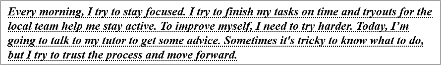

## **개요**

이 문서는 Aspose.Slides for Python via Java를 사용하여 PowerPoint 및 OpenDocument 프레젠테이션에서 텍스트 형식을 지정하는 방법을 보여줍니다. 배경색, 투명도, 문자 간격, 글꼴 속성, 회전, 단락 간격, 자동 맞춤 동작, 텍스트 앵커링, 탭 정지 및 언어 설정을 다룹니다.

특별히 언급되지 않는 한, 예제는 [sample.pptx](sample.pptx)를 사용합니다. 첫 번째 슬라이드의 첫 번째 도형은 텍스트 상자이며, 그 첫 번째 단락에 아래에 표시된 텍스트가 들어 있습니다. 슬라이드와 도형 인덱스는 0부터 시작합니다. 굵게 표시된 부분을 선택하는 예제는 상속된 굵게 서식을 포함한 유효 서식을 사용합니다:


리터럴 텍스트 또는 정규식 일치를 찾고 강조 표시하려면 [텍스트 검색 및 교체](/slides/ko/python-java/search-and-replace-text/)를 참조하십시오.

## **텍스트 배경 색 설정**

단락의 기본 강조 색을 설정하려면 [ParagraphFormat.getDefaultPortionFormat](https://reference.aspose.com/slides/python-java/aspose.slides/paragraphformat/#getDefaultPortionFormat)을 사용하고, 개별 텍스트 부분에 대해서는 [BasePortionFormat.getHighlightColor](https://reference.aspose.com/slides/python-java/aspose.slides/baseportionformat/#getHighlightColor)을 사용하십시오.

다음 예제는 첫 번째 단락의 기본값으로 밝은 회색 강조 색을 설정합니다. 개별 부분에 대한 명시적 강조 색은 이 기본값보다 우선합니다:

```python
import jpype
import asposeslides

if not jpype.isJVMStarted():
    jpype.startJVM()

from asposeslides.api import Presentation, SaveFormat
from java.awt import Color

presentation = Presentation("sample.pptx")
try:
    slide = presentation.getSlides().get_Item(0)

    auto_shape = slide.getShapes().get_Item(0)
    paragraph = auto_shape.getTextFrame().getParagraphs().get_Item(0)

    # 전체 단락에 대한 강조 색을 설정합니다.
    paragraph.getParagraphFormat().getDefaultPortionFormat().getHighlightColor().setColor(Color.LIGHT_GRAY)

    presentation.save("gray_paragraph.pptx", SaveFormat.Pptx)
finally:
    presentation.dispose()
```

결과:


다음 코드 예제는 **굵은 글꼴**이 적용된 **텍스트 부분**에 대한 배경 색을 설정하는 방법을 보여줍니다:

```python
import jpype
import asposeslides

if not jpype.isJVMStarted():
    jpype.startJVM()

from asposeslides.api import Presentation, SaveFormat
from java.awt import Color

presentation = Presentation("sample.pptx")
try:
    slide = presentation.getSlides().get_Item(0)

    auto_shape = slide.getShapes().get_Item(0)
    paragraph = auto_shape.getTextFrame().getParagraphs().get_Item(0)

    for portion in paragraph.getPortions():
        if portion.getPortionFormat().getEffective().getFontBold():
            # 텍스트 부분에 대한 강조 색을 설정합니다.
            portion.getPortionFormat().getHighlightColor().setColor(Color.LIGHT_GRAY)

    presentation.save("gray_text_portions.pptx", SaveFormat.Pptx)
finally:
    presentation.dispose()
```

결과:


## **텍스트 단락 정렬**

텍스트 프레임 내에서 단락 정렬을 설정하려면 [ParagraphFormat.setAlignment](https://reference.aspose.com/slides/python-java/aspose.slides/paragraphformat/#setAlignment)을 사용하십시오. 값은 가운데, 왼쪽 정렬, 오른쪽 정렬, 양쪽 맞춤 등일 수 있습니다.

다음 코드 예제는 단락을 **가운데**에 정렬하는 방법을 보여줍니다:

```python
import jpype
import asposeslides

if not jpype.isJVMStarted():
    jpype.startJVM()

from asposeslides.api import Presentation, SaveFormat, TextAlignment

presentation = Presentation("sample.pptx")
try:
    slide = presentation.getSlides().get_Item(0)

    auto_shape = slide.getShapes().get_Item(0)
    paragraph = auto_shape.getTextFrame().getParagraphs().get_Item(0)

    # 단락의 정렬을 가운데로 설정합니다.
    paragraph.getParagraphFormat().setAlignment(TextAlignment.Center)

    presentation.save("aligned_paragraph.pptx", SaveFormat.Pptx)
finally:
    presentation.dispose()
```

결과:


## **줄 내에서 글꼴 정렬**

다른 글꼴 크기의 텍스트 부분을 수직으로 정렬하려면 [ParagraphFormat.setFontAlignment](https://reference.aspose.com/slides/python-java/aspose.slides/paragraphformat/#setFontAlignment)을 사용하십시오. 이 설정은 전체 단락에 적용되며 각 줄 내에서의 정렬을 제어합니다.

다음 자체 포함 예제는 하나의 슬라이드에 네 개의 라벨이 있는 텍스트 상자를 생성합니다. 각 단락은 18, 36, 54포인트 크기의 동일한 텍스트를 포함하며, 서로 다른 글꼴 정렬을 사용합니다. Arial을 사용하고 자동 맞춤 및 자동 줄 바꿈을 비활성화하며, 텍스트 프레임을 한 줄에 충분히 크게 유지합니다.

```python
import jpype
import asposeslides

if not jpype.isJVMStarted():
    jpype.startJVM()

from asposeslides.api import FillType, FontAlignment, FontData, NullableBool, Paragraph, Portion, Presentation, SaveFormat, ShapeType, TextAlignment, TextAnchorType, TextAutofitType
from java.awt import Color

presentation = Presentation()
try:
    slide = presentation.getSlides().get_Item(0)

    alignments = [FontAlignment.Baseline, FontAlignment.Top, FontAlignment.Center, FontAlignment.Bottom]
    alignment_names = ["Baseline", "Top", "Center", "Bottom"]
    font_sizes = [18.0, 36.0, 54.0]
    font = FontData("Arial")

    for i, alignment in enumerate(alignments):
        shape = slide.getShapes().addAutoShape(ShapeType.Rectangle, 30, 20 + i * 130, 660, 120)
        shape.getFillFormat().setFillType(FillType.NoFill)
        shape.getLineFormat().getFillFormat().setFillType(FillType.NoFill)

        text_frame = shape.getTextFrame()
        text_frame.getTextFrameFormat().setAnchoringType(TextAnchorType.Top)
        text_frame.getTextFrameFormat().setAutofitType(TextAutofitType.None_)
        text_frame.getTextFrameFormat().setWrapText(NullableBool.False_)

        label = text_frame.getParagraphs().get_Item(0)
        label.setText(alignment_names[i])
        label.getParagraphFormat().setAlignment(TextAlignment.Left)
        label.getParagraphFormat().getDefaultPortionFormat().setFontHeight(14)
        label.getParagraphFormat().getDefaultPortionFormat().setLatinFont(font)
        label.getParagraphFormat().getDefaultPortionFormat().getFillFormat().setFillType(FillType.Solid)
        label.getParagraphFormat().getDefaultPortionFormat().getFillFormat().getSolidFillColor().setColor(Color.GRAY)

        paragraph = Paragraph()
        paragraph.getParagraphFormat().setFontAlignment(alignment)
        paragraph.getParagraphFormat().setAlignment(TextAlignment.Left)
        paragraph.getParagraphFormat().getDefaultPortionFormat().setLatinFont(font)
        paragraph.getParagraphFormat().getDefaultPortionFormat().getFillFormat().setFillType(FillType.Solid)
        paragraph.getParagraphFormat().getDefaultPortionFormat().getFillFormat().getSolidFillColor().setColor(Color.BLACK)

        for font_size in font_sizes:
            portion = Portion("Ag ")
            portion.getPortionFormat().setFontHeight(font_size)
            paragraph.getPortions().add(portion)

        text_frame.getParagraphs().add(paragraph)

    presentation.save("font_alignment.pptx", SaveFormat.Pptx)
finally:
    presentation.dispose()
```

결과:


글꼴 정렬은 글꼴 메트릭을 사용하므로 개별 문자 가장자리가 정확히 맞지 않을 수 있습니다. 예제에는 대문자와 내려가는 글자가 포함되어 기준선과 아래 정렬 차이를 보여줍니다. 글꼴 가용성 및 대체, 사용된 문자, 글꼴 크기 차이가 결과에 영향을 줍니다. 프레임 크기, 여백, 줄 간격, 줄 바꿈 및 자동 맞춤도 레이아웃에 영향을 미칩니다; 모드를 비교할 때는 동일한 글꼴 및 레이아웃 설정을 사용하십시오.

이 설정은 가로 단락 정렬을 제어하는 [ParagraphFormat.setAlignment](https://reference.aspose.com/slides/python-java/aspose.slides/paragraphformat/#setAlignment) 및 텍스트 블록을 도형 내에서 수직으로 배치하는 [TextFrameFormat.setAnchoringType](https://reference.aspose.com/slides/python-java/aspose.slides/textframeformat/#setAnchoringType)와 다릅니다. [BasePortionFormat.setEscapement](https://reference.aspose.com/slides/python-java/aspose.slides/baseportionformat/#setEscapement)을 통한 위첨자 및 아래첨자 서식은 개별 부분을 기준선에 대해 이동시키며, 단락 줄에 대한 글꼴 정렬을 설정하지 않습니다.

## **텍스트 투명도 설정**

텍스트 투명도는 [BasePortionFormat.getFillFormat](https://reference.aspose.com/slides/python-java/aspose.slides/baseportionformat/#getFillFormat)에 할당된 색상의 알파 구성 요소를 통해 제어됩니다. 아래 예제에서 `alpha = 50`은 0–255 범위의 ARGB 알파 값이며, 투명도 백분율이 아닙니다.

다음 코드 예제는 **전체 단락**에 투명도를 적용하는 방법을 보여줍니다:

```python
import jpype
import asposeslides

if not jpype.isJVMStarted():
    jpype.startJVM()

from asposeslides.api import FillType, Presentation, SaveFormat
from java.awt import Color

alpha = 50
text_color = Color(0, 0, 0, alpha)

presentation = Presentation("sample.pptx")
try:
    slide = presentation.getSlides().get_Item(0)

    auto_shape = slide.getShapes().get_Item(0)
    paragraph = auto_shape.getTextFrame().getParagraphs().get_Item(0)

    # 텍스트의 채우기 색을 투명 색으로 설정합니다.
    paragraph.getParagraphFormat().getDefaultPortionFormat().getFillFormat().setFillType(FillType.Solid)
    paragraph.getParagraphFormat().getDefaultPortionFormat().getFillFormat().getSolidFillColor().setColor(text_color)

    presentation.save("transparent_paragraph.pptx", SaveFormat.Pptx)
finally:
    presentation.dispose()
```

결과:


다음 코드 예제는 **굵은 글꼴**이 적용된 **텍스트 부분**에 투명도를 적용하는 방법을 보여줍니다:

```python
import jpype
import asposeslides

if not jpype.isJVMStarted():
    jpype.startJVM()

from asposeslides.api import FillType, Presentation, SaveFormat
from java.awt import Color

alpha = 50
text_color = Color(0, 0, 0, alpha)

presentation = Presentation("sample.pptx")
try:
    slide = presentation.getSlides().get_Item(0)

    auto_shape = slide.getShapes().get_Item(0)
    paragraph = auto_shape.getTextFrame().getParagraphs().get_Item(0)

    for portion in paragraph.getPortions():
        if portion.getPortionFormat().getEffective().getFontBold():
            # 텍스트 부분의 투명도를 설정합니다.
            portion.getPortionFormat().getFillFormat().setFillType(FillType.Solid)
            portion.getPortionFormat().getFillFormat().getSolidFillColor().setColor(text_color)

    presentation.save("transparent_text_portions.pptx", SaveFormat.Pptx)
finally:
    presentation.dispose()
```

결과:


## **텍스트 문자 간격 설정**

텍스트 상자 내에서 문자 간격을 확대하거나 축소하려면 [BasePortionFormat.setSpacing](https://reference.aspose.com/slides/python-java/aspose.slides/baseportionformat/#setSpacing)을 사용하십시오. 예제에서는 3포인트 간격을 추가합니다; 음수 값은 텍스트를 압축합니다.

다음 Python 코드에서는 **전체 단락**의 문자 간격을 확대하는 방법을 보여줍니다:

```python
import jpype
import asposeslides

if not jpype.isJVMStarted():
    jpype.startJVM()

from asposeslides.api import Presentation, SaveFormat

presentation = Presentation("sample.pptx")
try:
    slide = presentation.getSlides().get_Item(0)

    auto_shape = slide.getShapes().get_Item(0)
    paragraph = auto_shape.getTextFrame().getParagraphs().get_Item(0)

    # 참고: 문자 간격을 압축하려면 음수 값을 사용하십시오.
    paragraph.getParagraphFormat().getDefaultPortionFormat().setSpacing(3) # 문자 간격을 확장합니다.

    presentation.save("character_spacing_in_paragraph.pptx", SaveFormat.Pptx)
finally:
    presentation.dispose()
```

결과:


다음 코드 예제는 **굵은 글꼴**이 적용된 **텍스트 부분**의 문자 간격을 확대하는 방법을 보여줍니다:

```python
import jpype
import asposeslides

if not jpype.isJVMStarted():
    jpype.startJVM()

from asposeslides.api import Presentation, SaveFormat

presentation = Presentation("sample.pptx")
try:
    slide = presentation.getSlides().get_Item(0)

    auto_shape = slide.getShapes().get_Item(0)
    paragraph = auto_shape.getTextFrame().getParagraphs().get_Item(0)

    for portion in paragraph.getPortions():
        if portion.getPortionFormat().getEffective().getFontBold():
            # 참고: 문자 간격을 압축하려면 음수 값을 사용하십시오.
            portion.getPortionFormat().setSpacing(3) # 문자 간격을 확장합니다.

    presentation.save("character_spacing_in_text_portions.pptx", SaveFormat.Pptx)
finally:
    presentation.dispose()
```

결과:


### **특정 글꼴에 대한 커닝 비활성화**

일부 경우 Aspose.Slides가 렌더링한 텍스트가 PowerPoint에서 표시되는 텍스트보다 약간 더 조밀해 보일 수 있습니다. 이는 PowerPoint가 특정 글꼴에 대해 커닝 데이터를 무시하기 때문일 수 있습니다.

이러한 경우 영향을 받는 글꼴을 사용하는 텍스트 부분에 대해 커닝을 비활성화할 수 있습니다. [BasePortionFormat.setKerningMinimalSize](https://reference.aspose.com/slides/python-java/aspose.slides/baseportionformat/#setKerningMinimalSize)을 실제 글꼴 크기보다 큰 값으로 설정하십시오. 이 예제는 첫 번째 슬라이드 첫 번째 도형이 텍스트 상자인 “presentation.pptx”가 필요합니다. 상속된 글꼴을 포함한 유효 글꼴 이름을 확인하고, Roboto를 사용하는 부분에 대해 100포인트 임계값을 설정합니다. 이는 100포인트 이하의 글꼴 크기를 가진 해당 부분에 대해 커닝을 비활성화합니다:

```python
import jpype
import asposeslides

if not jpype.isJVMStarted():
    jpype.startJVM()

from asposeslides.api import Presentation, SaveFormat

presentation = Presentation("presentation.pptx")
try:
    slide = presentation.getSlides().get_Item(0)

    auto_shape = slide.getShapes().get_Item(0)
    target_font = "Roboto"

    for paragraph in auto_shape.getTextFrame().getParagraphs():
        for portion in paragraph.getPortions():
            portion_format = portion.getPortionFormat().getEffective()
            fonts = (portion_format.getLatinFont(), portion_format.getEastAsianFont(), portion_format.getComplexScriptFont())
            if any(font is not None and font.getFontName() == target_font for font in fonts):
                portion.getPortionFormat().setKerningMinimalSize(100)

    presentation.save("output.pptx", SaveFormat.Pptx)
finally:
    presentation.dispose()
```

임계값 이하의 일치 텍스트에 대해 이 설정은 커닝을 방지하고, PowerPoint 고유 동작으로 인해 영향을 받는 글꼴에 대해 Aspose.Slides 렌더링을 PowerPoint 시각 출력과 일치시키는 데 도움이 될 수 있습니다.

## **텍스트 글꼴 속성 관리**

글꼴 속성은 [ParagraphFormat.getDefaultPortionFormat](https://reference.aspose.com/slides/python-java/aspose.slides/paragraphformat/#getDefaultPortionFormat)을 통해 단락 수준에서 설정하거나, 개별 부분에 대해서는 [PortionFormat](https://reference.aspose.com/slides/python-java/aspose.slides/portionformat/)을 통해 설정할 수 있습니다.

다음 예제는 첫 번째 단락의 기본 글꼴을 12포인트 Times New Roman, 굵게, 기울임꼴, 점선 밑줄로 설정합니다. 개별 부분에 대한 명시적 서식은 이러한 기본값보다 우선합니다.

```python
import jpype
import asposeslides

if not jpype.isJVMStarted():
    jpype.startJVM()

from asposeslides.api import FontData, NullableBool, Presentation, SaveFormat, TextUnderlineType

presentation = Presentation("sample.pptx")
try:
    slide = presentation.getSlides().get_Item(0)

    auto_shape = slide.getShapes().get_Item(0)
    paragraph = auto_shape.getTextFrame().getParagraphs().get_Item(0)

    # 단락에 대한 글꼴 속성을 설정합니다.
    paragraph.getParagraphFormat().getDefaultPortionFormat().setFontHeight(12)
    paragraph.getParagraphFormat().getDefaultPortionFormat().setFontBold(NullableBool.True_)
    paragraph.getParagraphFormat().getDefaultPortionFormat().setFontItalic(NullableBool.True_)
    paragraph.getParagraphFormat().getDefaultPortionFormat().setFontUnderline(TextUnderlineType.Dotted)
    font = FontData("Times New Roman")
    paragraph.getParagraphFormat().getDefaultPortionFormat().setLatinFont(font)

    presentation.save("font_properties_for_paragraph.pptx", SaveFormat.Pptx)
finally:
    presentation.dispose()
```

결과:



다음 예제는 굵게 서식이 적용된 부분에 13포인트 Times New Roman, 기울임꼴 및 점선 밑줄을 적용합니다:

```python
import jpype
import asposeslides

if not jpype.isJVMStarted():
    jpjp.startJVM()

from asposeslides.api import FontData, NullableBool, Presentation, SaveFormat, TextUnderlineType

presentation = Presentation("sample.pptx")
try:
    slide = presentation.getSlides().get_Item(0)

    auto_shape = slide.getShapes().get_Item(0)
    paragraph = auto_shape.getTextFrame().getParagraphs().get_Item(0)

    for portion in paragraph.getPortions():
        if portion.getPortionFormat().getEffective().getFontBold():
            # 텍스트 부분에 대한 글꼴 속성을 설정합니다.
            portion.getPortionFormat().setFontHeight(13)
            portion.getPortionFormat().setFontItalic(NullableBool.True_)
            portion.getPortionFormat().setFontUnderline(TextUnderlineType.Dotted)
            font = FontData("Times New Roman")
            portion.getPortionFormat().setLatinFont(font)

    presentation.save("font_properties_for_text_portions.pptx", SaveFormat.Pptx)
finally:
    presentation.dispose()
```

결과:


## **텍스트 높이 정규화 제어**

템플릿 타이포그래피 재현 또는 문자 높이 차이 조사 시 [BasePortionFormat.setNormaliseHeight](https://reference.aspose.com/slides/python-java/aspose.slides/baseportionformat/#setNormaliseHeight)를 사용하십시오. PowerPoint에서 정규화를 활성화하면 개별 문자를 수직으로 늘리거나 압축하여 텍스트 부분 내에서 균일한 시각적 높이를 부여합니다. 이는 서로 다른 글꼴 간에 텍스트 높이가 동일함을 보장하지 않습니다.

[NullableBool.True_ or False_](https://reference.aspose.com/slides/python-java/aspose.slides/nullablebool/)로 속성을 설정하여 정규화를 명시적으로 활성화하거나 비활성화합니다. `NullableBool.NotDefined`는 로컬 설정을 지정하지 않아 단락의 [getDefaultPortionFormat](https://reference.aspose.com/slides/python-java/aspose.slides/paragraphformat/#getDefaultPortionFormat) 등에서 값을 상속받게 합니다. 이는 `False`와 같은 의미가 아닙니다. 반환된 유효 서식에서 `getNormaliseHeight`를 읽어 실제 Boolean 값을 얻으려면 [PortionFormat.getEffective](https://reference.aspose.com/slides/python-java/aspose.slides/portionformat/#getEffective)를 사용하십시오.

다음 자체 포함 예제는 **Arial**이 설치되어 있어야 합니다. 54포인트 크기의 동일한 대문자, 소문자, 내려가는 문자 및 악센트 문자를 포함하는 두 텍스트 블록을 생성합니다. 두 단락 모두 기본적으로 정규화를 활성화합니다. 상단 부분은 명시적으로 비활성화하고, 하단 부분은 상속받습니다. 프레임 크기, 여백 및 단락 간격은 동일하고, 줄 바꿈 및 자동 맞춤은 비활성화하여 비교를 일관되게 유지합니다. 예제는 `False: False`와 `NotDefined: True`를 출력한 뒤 “text_height_normalization.pptx”로 저장합니다.

```python
import jpype
import asposeslides

if not jpype.isJVMStarted():
    jpype.startJVM()

from asposeslides.api import FillType, FontData, NullableBool, Presentation, SaveFormat, ShapeType, TextAlignment, TextAnchorType, TextAutofitType
from java.awt import Color

presentation = Presentation()
try:
    slide = presentation.getSlides().get_Item(0)

    settings = [NullableBool.False_, NullableBool.NotDefined]
    setting_names = ["False", "NotDefined"]

    for i, setting in enumerate(settings):
        shape = slide.getShapes().addAutoShape(ShapeType.Rectangle, 30, 60 + i * 200, 660, 150)
        shape.getFillFormat().setFillType(FillType.NoFill)
        shape.getLineFormat().getFillFormat().setFillType(FillType.NoFill)

        text_frame = shape.getTextFrame()
        text_frame.setText("Hxgjpq ÅÉ 0123")
        text_frame.getTextFrameFormat().setAutofitType(TextAutofitType.None_)
        text_frame.getTextFrameFormat().setWrapText(NullableBool.False_)
        text_frame.getTextFrameFormat().setAnchoringType(TextAnchorType.Top)
        text_frame.getTextFrameFormat().setMarginTop(0)
        text_frame.getTextFrameFormat().setMarginLeft(0)

        paragraph = text_frame.getParagraphs().get_Item(0)
        paragraph.getParagraphFormat().setAlignment(TextAlignment.Left)
        paragraph.getParagraphFormat().setSpaceBefore(0)
        paragraph.getParagraphFormat().setSpaceAfter(0)
        paragraph.getParagraphFormat().setSpaceWithin(100)
        paragraph.getParagraphFormat().getDefaultPortionFormat().setNormaliseHeight(NullableBool.True_)

        portion = paragraph.getPortions().get_Item(0)
        font = FontData("Arial")
        portion.getPortionFormat().setLatinFont(font)
        portion.getPortionFormat().setFontHeight(54)
        portion.getPortionFormat().getFillFormat().setFillType(FillType.Solid)
        portion.getPortionFormat().getFillFormat().getSolidFillColor().setColor(Color.BLACK)
        portion.getPortionFormat().setNormaliseHeight(setting)

        print(f"{setting_names[i]}: {bool(portion.getPortionFormat().getEffective().getNormaliseHeight())}")

    presentation.save("text_height_normalization.pptx", SaveFormat.Pptx)
finally:
    presentation.dispose()
```

아래 비교 이미지는 저장된 프레젠테이션에서 내보낸 것입니다. 상단 행은 정규화가 비활성화(`False`)되어 있고, 하단 행은 활성화 설정을 상속받아(`NotDefined` → `True`) 적용됩니다. 이 모양을 재현하려면 Arial이 설치되어 있어야 합니다.


정규화는 할당된 [getFontHeight](https://reference.aspose.com/slides/python-java/aspose.slides/baseportionformat/#getFontHeight) 값을 변경하지 않고 문자 높이만 변경합니다. 단락 [setSpaceWithin](https://reference.aspose.com/slides/python-java/aspose.slides/paragraphformat/#setSpaceWithin)은 줄 간격을 제어하고, 텍스트 프레임 [setAutofitType](https://reference.aspose.com/slides/python-java/aspose.slides/textframeformat/#setAutofitType)은 텍스트 또는 컨테이너가 맞추도록 조정합니다. 이러한 설정은 서로 다른 목적을 가지며 레이아웃에 독립적으로 영향을 미칩니다. 단락 서식 및 상속에 대해 더 알아보려면 [단락 관리](/slides/ko/python-java/manage-paragraph/)를 참조하십시오.

## **취소선 적용 및 제거**

텍스트 부분에 취소선을 적용하려면 [BasePortionFormat.setStrikethroughType](https://reference.aspose.com/slides/python-java/aspose.slides/baseportionformat/#setStrikethroughType)를 사용하십시오. 이는 원본 텍스트를 삭제하지 않고 수정, 취소된 용어 또는 이전 가격을 표시하는 데 사용됩니다. 한 줄 또는 두 줄 취소선은 각각 [TextStrikethroughType.Single or Double](https://reference.aspose.com/slides/python-java/aspose.slides/textstrikethroughtype/)으로 설정합니다.

취소선을 제거하려면 [TextStrikethroughType.None_](https://reference.aspose.com/slides/python-java/aspose.slides/textstrikethroughtype/#None)를 지정하십시오. 이는 주변 서식에 취소선이 지정되어 있더라도 효과를 명시적으로 비활성화합니다. 반면 [TextStrikethroughType.NotDefined](https://reference.aspose.com/slides/python-java/aspose.slides/textstrikethroughtype/#NotDefined)는 로컬 설정을 정의하지 않아 단락 등에서 서식을 상속받게 합니다. 이는 취소선이 반드시 제거된다는 보장은 아닙니다. 최종 서식을 읽으려면 [PortionFormat.getEffective](https://reference.aspose.com/slides/python-java/aspose.slides/portionformat/#getEffective)를 사용하십시오.

다음 자체 포함 예제는 세 개의 가격 비교를 생성합니다. 각 단락은 라벨, 이전 가격, 현재 가격에 대한 별도 부분을 가지고 있어 이전 가격에만 취소선이 적용됩니다. 첫 번째 행은 취소선을 적용한 뒤 제거하고, 다른 행은 각각 단일 및 이중 취소선을 유지합니다. 이 설정을 변경하면 텍스트와 기타 서식(예: 굵은 이전 가격)이 보존됩니다.

```python
import jpype
import asposeslides

if not jpype.isJVMStarted():
    jpype.startJVM()

from asposeslides.api import FillType, FontData, NullableBool, Paragraph, Portion, Presentation, SaveFormat, ShapeType, TextAlignment, TextStrikethroughType
from java.awt import Color

presentation = Presentation()
try:
    slide = presentation.getSlides().get_Item(0)

    shape = slide.getShapes().addAutoShape(ShapeType.Rectangle, 50, 50, 620, 220)
    shape.getFillFormat().setFillType(FillType.NoFill)
    shape.getLineFormat().getFillFormat().setFillType(FillType.NoFill)
    shape.getTextFrame().getParagraphs().clear()

    labels = ["None: ", "Single: ", "Double: "]

    for label in labels:
        paragraph = Paragraph()
        paragraph.getParagraphFormat().setAlignment(TextAlignment.Left)
        paragraph.getParagraphFormat().setSpaceAfter(20)

        portion_format = paragraph.getParagraphFormat().getDefaultPortionFormat()
        portion_format.setFontHeight(28)
        font = FontData("Arial")
        portion_format.setLatinFont(font)
        portion_format.getFillFormat().setFillType(FillType.Solid)
        portion_format.getFillFormat().getSolidFillColor().setColor(Color.BLACK)

        label_portion = Portion(label)
        paragraph.getPortions().add(label_portion)

        previous_price = Portion("$100")
        previous_price.getPortionFormat().setFontBold(NullableBool.True_)
        paragraph.getPortions().add(previous_price)
        current_price = Portion(" → $80")
        paragraph.getPortions().add(current_price)

        shape.getTextFrame().getParagraphs().add(paragraph)

    paragraphs = shape.getTextFrame().getParagraphs()

    # 취소선을 적용하고 첫 번째 이전 가격에서 명시적으로 제거합니다.
    paragraphs.get_Item(0).getPortions().get_Item(1).getPortionFormat().setStrikethroughType(TextStrikethroughType.Single)
    paragraphs.get_Item(0).getPortions().get_Item(1).getPortionFormat().setStrikethroughType(TextStrikethroughType.None_)

    paragraphs.get_Item(1).getPortions().get_Item(1).getPortionFormat().setStrikethroughType(TextStrikethroughType.Single)
    paragraphs.get_Item(2).getPortions().get_Item(1).getPortionFormat().setStrikethroughType(TextStrikethroughType.Double)

    presentation.save("strikethrough.pptx", SaveFormat.Pptx)
finally:
    presentation.dispose()
```

결과(위에서 아래 순서): 취소선 없음, 단일 취소선, 이중 취소선.


## **텍스트 회전 설정**

[TextFrameFormat.setTextVerticalType](https://reference.aspose.com/slides/python-java/aspose.slides/textframeformat/#setTextVerticalType)를 사용하여 도형 내에서 미리 정의된 텍스트 방향을 설정할 수 있습니다.

다음 코드 예제는 텍스트 방향을 [TextVerticalType.Vertical270](https://reference.aspose.com/slides/python-java/aspose.slides/textverticaltype/)으로 설정하여 텍스트를 **시계 반대 방향으로 90도** 회전시킵니다:

```python
import jpype
import asposeslides

if not jpype.isJVMStarted():
    jpype.startJVM()

from asposeslides.api import Presentation, SaveFormat, TextVerticalType

presentation = Presentation("sample.pptx")
try:
    slide = presentation.getSlides().get_Item(0)

    auto_shape = slide.getShapes().get_Item(0)
    auto_shape.getTextFrame().getTextFrameFormat().setTextVerticalType(TextVerticalType.Vertical270)

    presentation.save("text_rotation.pptx", SaveFormat.Pptx)
finally:
    presentation.dispose()
```

결과:


## **텍스트 프레임 사용자 정의 회전 설정**

[TextFrameFormat.setRotationAngle](https://reference.aspose.com/slides/python-java/aspose.slides/textframeformat/#setRotationAngle)를 사용하여 [TextFrame](https://reference.aspose.com/slides/python-java/aspose.slides/textframe/)의 사용자 정의 회전 각도를 설정하십시오.

다음 코드 예제는 도형 내에서 텍스트 프레임을 시계 방향으로 3도 회전시킵니다:

```python
import jpype
import asposeslides

if not jpype.isJVMStarted():
    jpype.startJVM()

from asposeslides.api import Presentation, SaveFormat

presentation = Presentation("sample.pptx")
try:
    slide = presentation.getSlides().get_Item(0)

    auto_shape = slide.getShapes().get_Item(0)
    auto_shape.getTextFrame().getTextFrameFormat().setRotationAngle(3)

    presentation.save("custom_text_rotation.pptx", SaveFormat.Pptx)
finally:
    presentation.dispose()
```

결과:


## **단락 줄 간격 설정**

Aspose.Slides는 [ParagraphFormat.setSpaceAfter](https://reference.aspose.com/slides/python-java/aspose.slides/paragraphformat/#setSpaceAfter), [ParagraphFormat.setSpaceBefore](https://reference.aspose.com/slides/python-java/aspose.slides/paragraphformat/#setSpaceBefore), 및 [ParagraphFormat.setSpaceWithin](https://reference.aspose.com/slides/python-java/aspose.slides/paragraphformat/#setSpaceWithin)를 제공하여 단락 간격을 제어합니다. 사용 방법은 다음과 같습니다:

* 양수 값을 사용하면 줄 높이의 백분율로 줄 간격을 지정합니다.
* 음수 값을 사용하면 포인트 단위로 줄 간격을 지정합니다.

다음 예제는 첫 번째 단락의 내부 간격을 줄 높이의 200% (두 배 간격)로 설정합니다:

```python
import jpype
import asposeslides

if not jpype.isJVMStarted():
    jpype.startJVM()

from asposeslides.api import Presentation, SaveFormat

presentation = Presentation("sample.pptx")
try:
    slide = presentation.getSlides().get_Item(0)

    auto_shape = slide.getShapes().get_Item(0)

    paragraph = auto_shape.getTextFrame().getParagraphs().get_Item(0)
    paragraph.getParagraphFormat().setSpaceWithin(200)

    presentation.save("line_spacing.pptx", SaveFormat.Pptx)
finally:
    presentation.dispose()
```

결과:


## **줄 바꿈 제어**

단락 줄 바꿈 규칙은 좁은 텍스트 블록 및 라틴어와 동아시아 문자가 혼합된 프레젠테이션에 유용합니다. 다음 메서드는 [ParagraphFormat](https://reference.aspose.com/slides/python-java/aspose.slides/paragraphformat/)에 속하므로 전체 단락에 적용됩니다:

- [setLatinLineBreak](https://reference.aspose.com/slides/python-java/aspose.slides/paragraphformat/#setLatinLineBreak) 은 라틴어 줄 바꿈 규칙을 제어합니다. 혼합 텍스트에서는 인접한 동아시아 텍스트와 구두점의 줄 바꿈 위치에도 영향을 줄 수 있습니다.
- [setEastAsianLineBreak](https://reference.aspose.com/slides/python-java/aspose.slides/paragraphformat/#setEastAsianLineBreak) 은 동아시아 줄 바꿈 규칙을 제어하며, 줄 시작 및 끝에 허용되지 않는 문자 제한을 포함합니다.

이 규칙들은 [TextFrameFormat.setWrapText](https://reference.aspose.com/slides/python-java/aspose.slides/textframeformat/#setWrapText) 를 대체하지 않으며, 자동 줄 바꿈을 활성화합니다. 줄 바꿈이 발생할 때 레이아웃에 영향을 주지만, 줄 바꿈 문자를 삽입하지는 않습니다. 명시적 줄 바꿈은 사용 가능한 너비와 무관하게 단락 내 새 줄을 강제합니다.

다음 자체 포함 예제는 중국어와 라틴어 텍스트가 포함된 좁은 텍스트 블록을 생성합니다. 두 줄 바꿈 옵션을 모두 명시적으로 설정하고 “line_breaking.pptx”로 저장합니다. 각 규칙을 실험하려면 다른 설정은 그대로 두고 해당 값을 변경하십시오. 예제는 24포인트 Arial 및 SimSun을 사용하고 프레임 너비 160포인트, 수평 텍스트 프레임 여백 0을 적용합니다. [TextFrameFormat.setAutofitType](https://reference.aspose.com/slides/python-java/aspose.slides/textframeformat/#setAutofitType) 은 [TextAutofitType.None_](https://reference.aspose.com/slides/python-java/aspose.slides/textautofittype/) 로 호출되어 텍스트 크기와 프레임 크기가 고정됩니다.

```python
import jpype
import asposeslides

if not jpype.isJVMStarted():
    jpype.startJVM()

from asposeslides.api import FillType, FontData, NullableBool, Presentation, SaveFormat, ShapeType, TextAlignment, TextAutofitType
from java.awt import Color

presentation = Presentation()
try:
    slide = presentation.getSlides().get_Item(0)

    shape = slide.getShapes().addAutoShape(ShapeType.Rectangle, 50, 50, 160, 300)
    shape.getFillFormat().setFillType(FillType.NoFill)

    text_frame = shape.getTextFrame()
    text_frame.getTextFrameFormat().setWrapText(NullableBool.True_)
    text_frame.getTextFrameFormat().setAutofitType(TextAutofitType.None_)
    text_frame.getTextFrameFormat().setMarginLeft(0)
    text_frame.getTextFrameFormat().setMarginRight(0)

    paragraph = text_frame.getParagraphs().get_Item(0)
    paragraph.setText("中文排版测试，PowerPoint 中文演示。")

    paragraph_format = paragraph.getParagraphFormat()
    paragraph_format.setAlignment(TextAlignment.Left)
    paragraph_format.getDefaultPortionFormat().setFontHeight(24)
    latin_font = FontData("Arial")
    paragraph_format.getDefaultPortionFormat().setLatinFont(latin_font)
    east_asian_font = FontData("SimSun")
    paragraph_format.getDefaultPortionFormat().setEastAsianFont(east_asian_font)
    paragraph_format.getDefaultPortionFormat().getFillFormat().setFillType(FillType.Solid)
    paragraph_format.getDefaultPortionFormat().getFillFormat().getSolidFillColor().setColor(Color.BLACK)
    paragraph_format.setLatinLineBreak(NullableBool.False_)
    paragraph_format.setEastAsianLineBreak(NullableBool.True_)

    presentation.save("line_breaking.pptx", SaveFormat.Pptx)
finally:
    presentation.dispose()
```

## **매달린 구두점 제어**

[ParagraphFormat.setHangingPunctuation](https://reference.aspose.com/slides/python-java/aspose.slides/paragraphformat/#setHangingPunctuation)은 해당 구두점이 텍스트 줄 오른쪽 가장자리를 넘어 확장될 수 있게 하며, 다음 줄을 차지하지 않게 합니다. 이는 전체 단락에 적용되며 매달린 들여쓰기와는 다릅니다.

다음 자체 포함 예제는 100포인트 너비 텍스트 프레임에서 매달린 구두점을 활성화하고 “hanging_punctuation.pptx”로 저장합니다. 24포인트 Arial 및 수평 텍스트 프레임 여백 0을 사용하면 마지막 마침표가 “sentence” 뒤에 남아 오른쪽 텍스트 가장자를 넘어갑니다. 속성을 [NullableBool.False_](https://reference.aspose.com/slides/python-java/aspose.slides/nullablebool/) 로 설정하면 마침표가 별도 줄에 배치됩니다. 줄 바꿈은 활성화되고 자동 맞춤은 비활성화되어 가용 너비가 고정됩니다.

```python
import jpype
import asposeslides

if not jpype.isJVMStarted():
    jpype.startJVM()

from asposeslides.api import FillType, FontData, NullableBool, Presentation, SaveFormat, ShapeType, TextAlignment, TextAutofitType
from java.awt import Color

presentation = Presentation()
try:
    slide = presentation.getSlides().get_Item(0)

    shape = slide.getShapes().addAutoShape(ShapeType.Rectangle, 50, 50, 100, 200)
    shape.getFillFormat().setFillType(FillType.NoFill)

    text_frame = shape.getTextFrame()
    text_frame.getTextFrameFormat().setWrapText(NullableBool.True_)
    text_frame.getTextFrameFormat().setAutofitType(TextAutofitType.None_)
    text_frame.getTextFrameFormat().setMarginLeft(0)
    text_frame.getTextFrameFormat().setMarginRight(0)

    paragraph = text_frame.getParagraphs().get_Item(0)
    paragraph.setText("Simple text, next sentence.")

    paragraph_format = paragraph.getParagraphFormat()
    paragraph_format.setAlignment(TextAlignment.Left)
    paragraph_format.getDefaultPortionFormat().setFontHeight(24)
    latin_font = FontData("Arial")
    paragraph_format.getDefaultPortionFormat().setLatinFont(latin_font)
    paragraph_format.getDefaultPortionFormat().getFillFormat().setFillType(FillType.Solid)
    paragraph_format.getDefaultPortionFormat().getFillFormat().getSolidFillColor().setColor(Color.BLACK)
    paragraph_format.setHangingPunctuation(NullableBool.True_)

    presentation.save("hanging_punctuation.pptx", SaveFormat.Pptx)
finally:
    presentation.dispose()
```

모든 구두점이 매달릴 수 있는 것은 아닙니다. 위의 [줄 바꿈](#control-line-breaking) 에서 설명한 글꼴 및 레이아웃 조건도 이 비교에 적용됩니다: 글꼴, 가용 너비, 여백 또는 자동 맞춤 설정을 변경하면 눈에 보이는 차이가 사라질 수 있습니다.

## **텍스트 프레임 자동 맞춤 유형 설정**

[TextFrameFormat.setAutofitType](https://reference.aspose.com/slides/python-java/aspose.slides/textframeformat/#setAutofitType)는 텍스트가 컨테이너 경계를 초과할 때 텍스트가 어떻게 동작할지를 결정합니다. 텍스트가 축소, 넘침, 또는 도형이 자동으로 크기 조정되는지를 제어합니다. 다음 예제는 도형이 텍스트에 맞게 크기를 조정하도록 구성하고 결과를 “autofit_type.pptx”에 저장합니다.

```python
import jpype
import asposeslides

if not jpype.isJVMStarted():
    jpype.startJVM()

from asposeslides.api import Presentation, SaveFormat, TextAutofitType

presentation = Presentation("sample.pptx")
try:
    slide = presentation.getSlides().get_Item(0)

    auto_shape = slide.getShapes().get_Item(0)
    auto_shape.getTextFrame().getTextFrameFormat().setAutofitType(TextAutofitType.Shape)

    presentation.save("autofit_type.pptx", SaveFormat.Pptx)
finally:
    presentation.dispose()
```

자동 줄 바꿈 후 라인 수를 확인하고 텍스트 또는 도형 너비가 결과에 어떻게 영향을 미치는지 보려면 [렌더링된 라인 수 세기](/slides/ko/python-java/manage-paragraph/)를 참조하십시오. 라인 수만으로 텍스트가 컨테이너를 넘는지 여부를 판단할 수 없습니다.

## **텍스트 프레임 앵커 설정**

[TextFrameFormat.setAnchoringType](https://reference.aspose.com/slides/python-java/aspose.slides/textframeformat/#setAnchoringType) 은 텍스트가 도형 내부에서 수직으로 어떻게 배치되는지를 정의합니다(예: 위, 중간, 아래). 다음 예제는 첫 번째 도형의 텍스트를 아래쪽에 고정하고 결과를 “text_anchor.pptx”에 저장합니다.

```python
import jpype
import asposeslides

if not jpype.isJVMStarted():
    jpype.startJVM()

from asposeslides.api import Presentation, SaveFormat, TextAnchorType

presentation = Presentation("sample.pptx")
try:
    slide = presentation.getSlides().get_Item(0)

    auto_shape = slide.getShapes().get_Item(0)
    auto_shape.getTextFrame().getTextFrameFormat().setAnchoringType(TextAnchorType.Bottom)

    presentation.save("text_anchor.pptx", SaveFormat.Pptx)
finally:
    presentation.dispose()
```

## **텍스트 탭 설정**

[ParagraphFormat.setDefaultTabSize](https://reference.aspose.com/slides/python-java/aspose.slides/paragraphformat/#setDefaultTabSize)와 [ParagraphFormat.getTabs](https://reference.aspose.com/slides/python-java/aspose.slides/paragraphformat/#getTabs)를 사용하여 단락의 탭 정지를 구성합니다. 다음 예제는 기본 탭 간격을 100포인트로 설정하고 30포인트에 왼쪽 정렬 탭 정지를 추가합니다. 이러한 설정은 탭 문자 포함 텍스트에 영향을 줍니다.

```python
import jpype
import asposeslides

if not jpype.isJVMStarted():
    jpype.startJVM()

from asposeslides.api import Presentation, SaveFormat, TabAlignment

presentation = Presentation("sample.pptx")
try:
    slide = presentation.getSlides().get_Item(0)

    auto_shape = slide.getShapes().get_Item(0)

    paragraph = auto_shape.getTextFrame().getParagraphs().get_Item(0)
    paragraph.getParagraphFormat().setDefaultTabSize(100)
    paragraph.getParagraphFormat().getTabs().add(30, TabAlignment.Left)

    presentation.save("paragraph_tabs.pptx", SaveFormat.Pptx)
finally:
    presentation.dispose()
```

결과:


## **교정 언어 설정**

Aspose.Slides는 [BasePortionFormat.setLanguageId](https://reference.aspose.com/slides/python-java/aspose.slides/baseportionformat/#setLanguageId)를 제공하여 텍스트 부분의 교정 언어를 설정할 수 있습니다. 교정 언어는 PowerPoint에서 맞춤법 및 문법 검사에 사용되는 언어를 결정합니다.

다음 예제는 첫 번째 슬라이드 첫 번째 도형이 텍스트 상자인 “presentation.pptx”와 최소 하나의 단락이 필요합니다. 첫 번째 단락의 내용을 “1。”으로 교체하고 폰트를 SimSun으로 설정한 뒤, Simplified Chinese 교정 언어(`zh-CN`)를 할당합니다. 결과를 “proofing_language.pptx”에 저장합니다:

```python
import jpype
import asposeslides

if not jpype.isJVMStarted():
    jpype.startJVM()

from asposeslides.api import FontData, Portion, Presentation, SaveFormat

presentation = Presentation("presentation.pptx")
try:
    slide = presentation.getSlides().get_Item(0)

    auto_shape = slide.getShapes().get_Item(0)

    paragraph = auto_shape.getTextFrame().getParagraphs().get_Item(0)
    paragraph.getPortions().clear()

    font = FontData("SimSun")

    text_portion = Portion()
    text_portion.getPortionFormat().setComplexScriptFont(font)
    text_portion.getPortionFormat().setEastAsianFont(font)
    text_portion.getPortionFormat().setLatinFont(font)

    # 교정 언어의 Id를 설정합니다.
    text_portion.getPortionFormat().setLanguageId("zh-CN")

    text_portion.setText("1。")
    paragraph.getPortions().add(text_portion)

    presentation.save("proofing_language.pptx", SaveFormat.Pptx)
finally:
    presentation.dispose()
```

## **기본 언어 설정**

[LoadOptions.setDefaultTextLanguage](https://reference.aspose.com/slides/python-java/aspose.slides/loadoptions/#setDefaultTextLanguage)를 사용하여 프레젠테이션을 로드하거나 생성할 때 생성되는 텍스트의 기본 언어를 정의할 수 있습니다. 다음 예제는 기본 텍스트 언어를 미국 영어로 설정한 프레젠테이션을 만들고, 텍스트 상자를 추가한 뒤 첫 번째 텍스트 부분에 대해 `en-US`를 출력합니다.

```python
import jpype
import asposeslides

if not jpype.isJVMStarted():
    jpype.startJVM()

from asposeslides.api import LoadOptions, Presentation, ShapeType

load_options = LoadOptions()
load_options.setDefaultTextLanguage("en-US")

presentation = Presentation(load_options)
try:
    slide = presentation.getSlides().get_Item(0)

    # 텍스트가 있는 사각형 도형을 추가합니다.
    shape = slide.getShapes().addAutoShape(ShapeType.Rectangle, 20, 20, 150, 50)
    shape.getTextFrame().setText("Sample text")

    # 첫 번째 부분의 언어를 확인합니다.
    portion = shape.getTextFrame().getParagraphs().get_Item(0).getPortions().get_Item(0)
    print(portion.getPortionFormat().getLanguageId())
finally:
    presentation.dispose()
```

## **기본 텍스트 스타일 설정**

프레젠테이션 수준에서 기본 텍스트 서식을 적용하려면 [Presentation.getDefaultTextStyle](https://reference.aspose.com/slides/python-java/aspose.slides/presentation/#getDefaultTextStyle)를 사용하십시오.

다음 예제는 새 프레젠테이션의 최상위 단락에 대해 14포인트 굵은 글꼴을 기본값으로 설정하고 “default_text_style.pptx”에 저장합니다. 텍스트는 더 구체적인 서식이 없으면 이러한 기본값을 상속할 수 있습니다.

```python
import jpype
import asposeslides

if not jpype.isJVMStarted():
    jpype.startJVM()

from asposeslides.api import NullableBool, Presentation, SaveFormat

presentation = Presentation()
try:
    # 최상위 단락 형식을 가져옵니다.
    paragraph_format = presentation.getDefaultTextStyle().getLevel(0)

    if paragraph_format is not None:
        paragraph_format.getDefaultPortionFormat().setFontHeight(14)
        paragraph_format.getDefaultPortionFormat().setFontBold(NullableBool.True_)

    presentation.save("default_text_style.pptx", SaveFormat.Pptx)
finally:
    presentation.dispose()
```

## **전체 대문자 효과가 적용된 텍스트 추출**

PowerPoint에서 **전체 대문자** 글꼴 효과를 적용하면 원래 소문자로 입력했더라도 슬라이드에 대문자로 표시됩니다. Aspose.Slides를 사용해 해당 텍스트 부분을 검색하면 라이브러리는 입력된 그대로의 텍스트를 반환합니다. 표시된 텍스트와 일치시키려면 [TextCapType](https://reference.aspose.com/slides/python-java/aspose.slides/textcaptype/)을 확인하고 값이 `All`인 경우 반환 문자열을 대문자로 변환하십시오.

이 예제는 첫 번째 슬라이드 첫 번째 도형이 텍스트 상자인 “sample2.pptx”가 필요합니다. 첫 번째 단락의 첫 번째 부분에 전체 대문자 효과가 적용된 “Hello, Aspose!”가 포함됩니다.


다음 코드 예제는 **전체 대문자** 효과가 적용된 텍스트를 추출하는 방법을 보여줍니다:

```python
import jpype
import asposeslides

if not jpype.isJVMStarted():
    jpype.startJVM()

from asposeslides.api import Presentation, TextCapType

presentation = Presentation("sample2.pptx")
try:
    slide = presentation.getSlides().get_Item(0)
    
    auto_shape = slide.getShapes().get_Item(0)
    text_portion = auto_shape.getTextFrame().getParagraphs().get_Item(0).getPortions().get_Item(0)

    print("Original text: " + str(text_portion.getText()))

    text_format = text_portion.getPortionFormat().getEffective()
    if text_format.getTextCapType() == TextCapType.All:
        text = str(text_portion.getText()).upper()
        print("All-Caps effect: " + text)
finally:
    presentation.dispose()
```

출력:

```text
Original text: Hello, Aspose!
All-Caps effect: HELLO, ASPOSE!
```

## **FAQ**

**슬라이드의 표에서 텍스트를 어떻게 수정합니까?**

표의 텍스트를 수정하려면 [Table](https://reference.aspose.com/slides/python-java/aspose.slides/table/)을 사용하십시오. 셀을 반복하면서 각 셀을 [Cell.getTextFrame](https://reference.aspose.com/slides/python-java/aspose.slides/cell/#getTextFrame)으로 업데이트하고, 단락 서식은 [Paragraph.getParagraphFormat](https://reference.aspose.com/slides/python-java/aspose.slides/paragraph/#getParagraphFormat)으로 조정하십시오.

**PowerPoint 슬라이드의 텍스트에 그라디언트 색을 적용하려면 어떻게 합니까?**

그라디언트 색을 적용하려면 [BasePortionFormat.getFillFormat](https://reference.aspose.com/slides/python-java/aspose.slides/baseportionformat/#getFillFormat)를 사용하십시오. [FillFormat.setFillType](https://reference.aspose.com/slides/python-java/aspose.slides/fillformat/#setFillType)을 [FillType.Gradient](https://reference.aspose.com/slides/python-java/aspose.slides/filltype/)으로 설정하고, 그라디언트 정지점, 방향 및 투명도를 구성하십시오.