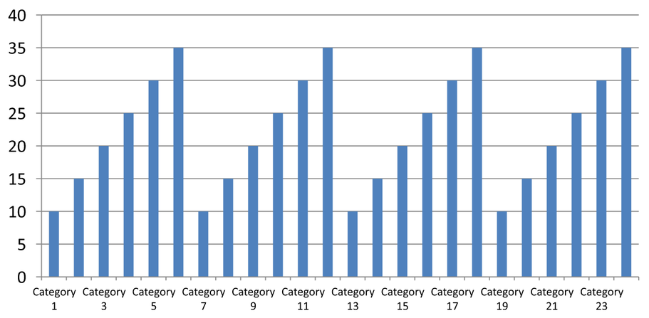

## **개요**

이 문서에서는 Aspose.Slides for Python via Java를 사용하여 차트 축을 사용자 정의하는 방법을 설명합니다. 계산된 축 값, 차트 행 및 열 전환, 축 표시 여부, 범주 레이블 및 눈금 간격, 날짜 범주 및 서식 지정, 제목 회전, 축 위치 지정, 표시 단위 및 로그 스케일링을 다룹니다.

## **차트의 수직 축에서 최대값 가져오기**

기본 데이터가 있는 영역 차트를 추가하기 위해 [Presentation](https://reference.aspose.com/slides/python-java/aspose.slides/presentation/) 을(를) 생성합니다. 계산된 축 값을 읽기 전에 차트 레이아웃이 최신 상태가 되도록 [validateChartLayout](https://reference.aspose.com/slides/python-java/aspose.slides/chart/#validateChartLayout) 을(를) 호출합니다.

축 한계를 얻기 위해 [getActualMaxValue](https://reference.aspose.com/slides/python-java/aspose.slides/axis/#getActualMaxValue) 과 [getActualMinValue](https://reference.aspose.com/slides/python-java/aspose.slides/axis/#getActualMinValue) 를 읽고, 눈금 간격을 위해 [getActualMajorUnit](https://reference.aspose.com/slides/python-java/aspose.slides/axis/#getActualMajorUnit) 과 [getActualMinorUnit](https://reference.aspose.com/slides/python-java/aspose.slides/axis/#getActualMinorUnit) 를 사용합니다. 날짜 축과 관련된 시간 단위 스케일을 제공하는 [getActualMajorUnitScale](https://reference.aspose.com/slides/python-java/aspose.slides/axis/#getActualMajorUnitScale) 과 [getActualMinorUnitScale](https://reference.aspose.com/slides/python-java/aspose.slides/axis/#getActualMinorUnitScale) 도 있습니다. 예제에서는 이러한 값을 로컬 변수에 저장하고 차트를 저장합니다.

```python
import jpype
import asposeslides

if not jpype.isJVMStarted():
    jpype.startJVM()

from asposeslides.api import Presentation, ChartType, SaveFormat

presentation = Presentation()
try:
    slide = presentation.getSlides().get_Item(0)

    chart = slide.getShapes().addChart(ChartType.Area, 100, 100, 500, 350)
    chart.validateChartLayout()

    max_value = chart.getAxes().getVerticalAxis().getActualMaxValue()
    min_value = chart.getAxes().getVerticalAxis().getActualMinValue()

    major_unit = chart.getAxes().getVerticalAxis().getActualMajorUnit()
    minor_unit = chart.getAxes().getVerticalAxis().getActualMinorUnit()

    major_unit_scale = chart.getAxes().getVerticalAxis().getActualMajorUnitScale()
    minor_unit_scale = chart.getAxes().getVerticalAxis().getActualMinorUnitScale()

    presentation.save("AxisValues_out.pptx", SaveFormat.Pptx)
finally:
    presentation.dispose()
```

## **축 간 데이터 교환**

차트 데이터에서 시리즈와 범주의 역할을 교환하려면 [switchRowColumn](https://reference.aspose.com/slides/python-java/aspose.slides/chartdata/#switchRowColumn) 을(를) 사용합니다. 이전 범주는 시리즈가 되고, 이전 시리즈는 범주가 됩니다. 이는 데이터 그룹화 방식을 변경하지만 수평 및 수직 축을 교환하지는 않습니다. 예제에서는 행과 열을 전환하기 전에 기본 데이터를 `Sheet1!A1:D5`(헤더 행 및 범주 열 포함) 에 바인드하기 위해 [setRange](https://reference.aspose.com/slides/python-java/aspose.slides/chartdata/#setRange) 을(를) 사용합니다. 네 개의 시리즈와 세 개의 범주를 가진 차트를 저장합니다.

```python
import jpype
import asposeslides

if not jpype.isJVMStarted():
    jpype.startJVM()

from asposeslides.api import Presentation, ChartType, SaveFormat

presentation = Presentation()
try:
    slide = presentation.getSlides().get_Item(0)

    chart = slide.getShapes().addChart(ChartType.ClusteredColumn, 100, 100, 400, 300)
    chart.getChartData().setRange("Sheet1!A1:D5")
    chart.getChartData().switchRowColumn()

    presentation.save("SwitchChartRowColumns_out.pptx", SaveFormat.Pptx)
finally:
    presentation.dispose()
```

## **축의 플로팅 순서 반전**

카테고리 축 또는 값 축을 반전하려면 [setPlotOrderReversed](https://reference.aspose.com/slides/python-java/aspose.slides/axis/#setPlotOrderReversed) 을(를) 사용합니다. 예를 들어 수평 막대 차트는 워크시트와 동일한 순서(계획, 개발, 테스트)로 프로젝트 단계를 위에서 아래로 표시할 수 있습니다. 축을 반전하면 플로팅 방향이 바뀌며, 워크북 데이터가 정렬되거나 재배열되지는 않습니다. 비교를 위해 [switchRowColumn](https://reference.aspose.com/slides/python-java/aspose.slides/chartdata/#switchRowColumn) 은 시리즈와 범주의 역할을 교환합니다.

다음 예제는 세 단계와 하나의 시리즈를 가진 수평 막대 차트를 만들고, 정상 순서, 범주 반전, 값 반전의 세 슬라이드를 포함하는 프레젠테이션을 저장합니다. 각 복사본은 동일한 데이터 세트를 사용하며, 각 복사본에서 하나의 축만 반전됩니다.

```python
import jpype
import asposeslides

if not jpype.isJVMStarted():
    jpype.startJVM()

from asposeslides.api import Presentation, ChartType, CrossesType, SaveFormat

presentation = Presentation()
try:
    slide = presentation.getSlides().get_Item(0)

    chart = slide.getShapes().addChart(ChartType.ClusteredBar, 50, 40, 620, 320)
    chart.setLegend(False)

    chart.getChartData().getCategories().clear()
    chart.getChartData().getSeries().clear()

    workbook = chart.getChartData().getChartDataWorkbook()
    workbook.clear(0)

    series = chart.getChartData().getSeries().add(ChartType.ClusteredBar)
    stages = ["Planning", "Development", "Testing"]
    values = [10, 30, 20]
    for i, stage in enumerate(stages):
        category_cell = workbook.getCell(0, i + 1, 0, stage)
        chart.getChartData().getCategories().add(category_cell)
        value_cell = workbook.getCell(0, i + 1, 1, float(values[i]))
        series.getDataPoints().addDataPointForBarSeries(value_cell)

    # 슬라이드 2: 첫 번째 범주를 위에 표시합니다.
    category_slide = presentation.getSlides().addClone(slide)
    category_chart = category_slide.getShapes().get_Item(0)
    category_chart.getAxes().getVerticalAxis().setPlotOrderReversed(True)
    # 수평 값 축을 아래에 유지합니다.
    category_chart.getAxes().getVerticalAxis().setCrossType(CrossesType.Maximum)

    # 슬라이드 3: 수평 숫자 스케일만 반전합니다.
    value_slide = presentation.getSlides().addClone(slide)
    value_chart = value_slide.getShapes().get_Item(0)
    value_chart.getAxes().getHorizontalAxis().setPlotOrderReversed(True)

    presentation.save("ReversedAxes.pptx", SaveFormat.Pptx)
finally:
    presentation.dispose()
```

축을 반전하면 수직 축을 플롯의 반대쪽으로 이동시킬 수도 있습니다. [setCrossType](https://reference.aspose.com/slides/python-java/aspose.slides/axis/#setCrossType) 은 다른 축이 구성 중인 축과 교차하는 위치를 제어합니다. 슬라이드 2에서는 반전된 범주 축에 대해 [CrossesType.Maximum](https://reference.aspose.com/slides/python-java/aspose.slides/crossestype/#Maximum) 로 호출하면 수평 값 축이 아래쪽에 유지됩니다. 특정 교차 지점을 지정하려면 [setCrossAt](https://reference.aspose.com/slides/python-java/aspose.slides/axis/#setCrossAt) 을(를) 사용하십시오. 방향을 변경할 때는 특히 차트에 사용자 지정 교차 지점이 있는 경우 교차 설정을 확인하세요. 정상 플로팅 방향을 복원하려면 `False` 와 함께 [setPlotOrderReversed](https://reference.aspose.com/slides/python-java/aspose.slides/axis/#setPlotOrderReversed) 을(를) 호출하면 됩니다; 교차 설정은 별도로 유지됩니다.

| 정상 순서 (슬라이드 1) | 반전된 범주 (슬라이드 2) | 반전된 값 (슬라이드 3) |
| --- | --- | --- |
|  |  |  |
| 범주는 아래에서 위로 진행하고, 값은 왼쪽에서 오른쪽으로 증가합니다. | 계획, 개발, 테스트가 위에서 아래로 진행합니다. 값과 워크북 행 순서는 변경되지 않습니다. | 범주는 정상 순서를 유지하고, 값은 오른쪽에서 왼쪽으로 증가합니다. 범주 축은 오른쪽 0에서 교차합니다. |

## **선 차트의 수직 축 비활성화**

수직 축에 대해 `False` 와 함께 [setVisible](https://reference.aspose.com/slides/python-java/aspose.slides/axis/#setVisible) 를 호출하면 축이 숨겨집니다. 예제에서는 기본 데이터를 가진 선 차트를 만든 다음 수직 축을 숨긴 상태로 저장합니다.

```python
import jpype
import asposeslides

if not jpype.isJVMStarted():
    jpype.startJVM()

from asposeslides.api import Presentation, ChartType, SaveFormat

presentation = Presentation()
try:
    slide = presentation.getSlides().get_Item(0)

    chart = slide.getShapes().addChart(ChartType.Line, 100, 100, 400, 300)
    chart.getAxes().getVerticalAxis().setVisible(False)

    presentation.save("HiddenVerticalAxis.pptx", SaveFormat.Pptx)
finally:
    presentation.dispose()
```

## **선 차트의 수평 축 비활성화**

수평 축에 대해 `False` 와 함께 [setVisible](https://reference.aspose.com/slides/python-java/aspose.slides/axis/#setVisible) 를 호출하면 축이 숨겨집니다. 예제에서는 기본 데이터를 가진 선 차트를 만든 다음 수평 축을 숨긴 상태로 저장합니다.

```python
import jpype
import asposeslides

if not jpype.isJVMStarted():
    jpype.startJVM()

from asposeslides.api import Presentation, ChartType, SaveFormat

presentation = Presentation()
try:
    slide = presentation.getSlides().get_Item(0)

    chart = slide.getShapes().addChart(ChartType.Line, 100, 100, 400, 300)
    chart.getAxes().getHorizontalAxis().setVisible(False)

    presentation.save("HiddenHorizontalAxis.pptx", SaveFormat.Pptx)
finally:
    presentation.dispose()
```

## **차트 격자선 표시 또는 숨기기**

축이 표시하는 격자선을 확인하려면 [getShowMajorGridLines](https://reference.aspose.com/slides/python-java/aspose.slides/axis/#getShowMajorGridLines) 와 [getShowMinorGridLines](https://reference.aspose.com/slides/python-java/aspose.slides/axis/#getShowMinorGridLines) 을(를) 호출합니다. 소형 격자선을 표시하려면 [getMinorGridLinesFormat](https://reference.aspose.com/slides/python-java/aspose.slides/axis/#getMinorGridLinesFormat) 를 사용하고 선 채우기를 실선의 눈에 보이는 색으로 설정합니다. 숨기려면 채우기를 [FillType.NoFill](https://reference.aspose.com/slides/python-java/aspose.slides/filltype/#NoFill) 로 설정합니다. 주요 격자선에 대해서도 동일하게 [getMajorGridLinesFormat](https://reference.aspose.com/slides/python-java/aspose.slides/axis/#getMajorGridLinesFormat) 을(를) 사용하여 선 채우기를 변경합니다. 채우기를 변경해도 축 표시 및 눈금은 유지됩니다.

이 클러스터형 열 차트의 수직 축은 처음에 주요 격자선만 표시됩니다. 예제에서는 소형 격자선을 어두운 주황색으로 표시한 다음 저장하기 전에 다시 숨깁니다. 각 단계에서 격자선 표시 상태를 출력합니다.

```python
import jpype
import asposeslides

if not jpype.isJVMStarted():
    jpype.startJVM()

from asposeslides.api import ChartType, FillType, Presentation, SaveFormat

Color = jpype.JClass("java.awt.Color")

presentation = Presentation()
try:
    slide = presentation.getSlides().get_Item(0)

    chart = slide.getShapes().addChart(ChartType.ClusteredColumn, 30, 30, 660, 230)
    axis = chart.getAxes().getVerticalAxis()
    print(f"Initial: major={axis.getShowMajorGridLines()}, minor={axis.getShowMinorGridLines()}")

    minor_fill = axis.getMinorGridLinesFormat().getLine().getFillFormat()
    minor_fill.setFillType(FillType.Solid)
    minor_fill.getSolidFillColor().setColor(Color(255, 140, 0))
    print(f"Enabled: minor={axis.getShowMinorGridLines()}")

    minor_fill.setFillType(FillType.NoFill)
    print(f"Hidden: major={axis.getShowMajorGridLines()}, minor={axis.getShowMinorGridLines()}")

    presentation.save("ChartGridlines.pptx", SaveFormat.Pptx)
finally:
    presentation.dispose()
```

| 소형 격자선 표시 | 소형 격자선 숨김 |
| --- | --- |
|  |  |

## **범주 축 변경**

[setCategoryAxisType](https://reference.aspose.com/slides/python-java/aspose.slides/axis/#setCategoryAxisType) 을(를) 사용하여 날짜 또는 텍스트 범주 축을 선택합니다. 이 예제는 첫 번째 슬라이드의 첫 번째 도형으로 차트가 포함된 `ExistingChart.pptx` 를 필요로 하며, 범주 셀에 숫자형 Excel 날짜 값이 들어 있습니다. 수평 축을 날짜 축으로 변경합니다. [setAutomaticMajorUnit](https://reference.aspose.com/slides/python-java/aspose.slides/axis/#setAutomaticMajorUnit) 은 `False`, [setMajorUnit](https://reference.aspose.com/slides/python-java/aspose.slides/axis/#setMajorUnit) 은 `1`, [setMajorUnitScale](https://reference.aspose.com/slides/python-java/aspose.slides/axis/#setMajorUnitScale) 은 [TimeUnitType.Months](https://reference.aspose.com/slides/python-java/aspose.slides/timeunittype/#Months) 로 설정하면 주요 눈금이 1개월 간격으로 배치됩니다.

```python
import jpype
import asposeslides

if not jpype.isJVMStarted():
    jpype.startJVM()

from asposeslides.api import Presentation, SaveFormat, CategoryAxisType, TimeUnitType

presentation = Presentation("ExistingChart.pptx")
try:
    slide = presentation.getSlides().get_Item(0)

    chart = slide.getShapes().get_Item(0)
    chart.getAxes().getHorizontalAxis().setCategoryAxisType(CategoryAxisType.Date)
    chart.getAxes().getHorizontalAxis().setAutomaticMajorUnit(False)
    chart.getAxes().getHorizontalAxis().setMajorUnit(1)
    chart.getAxes().getHorizontalAxis().setMajorUnitScale(TimeUnitType.Months)

    presentation.save("ChangeChartCategoryAxis_out.pptx", SaveFormat.Pptx)
finally:
    presentation.dispose()
```

### **데이터에서 범주 축 유형 결정**

범주 데이터를 채운 후 [setCategoryAxisTypeAutomatically](https://reference.aspose.com/slides/python-java/aspose.slides/axis/#setCategoryAxisTypeAutomatically) 를 호출하고, 선택된 유형을 확인하려면 [getCategoryAxisType](https://reference.aspose.com/slides/python-java/aspose.slides/axis/#getCategoryAxisType) 를 읽습니다. 동일한 차트에 텍스트 레이블이나 숫자형 날짜 값이 들어올 수 있는 경우에 유용합니다. 이 메서드는 호출 시 유형을 결정하며, 이후 데이터 변경을 재평가하는 지속 모드를 활성화하지는 않습니다. 범주를 교체한 후 다시 호출합니다.

다음 예제는 텍스트 범주를 가진 차트를 만든 뒤 선택된 유형이 [CategoryAxisType.Text](https://reference.aspose.com/slides/python-java/aspose.slides/categoryaxistype/#Text) 인 경우 `True` 를 출력합니다. 그런 다음 범주 셀 값을 날짜로 교체하고 다시 호출하여 선택된 유형이 [CategoryAxisType.Date](https://reference.aspose.com/slides/python-java/aspose.slides/categoryaxistype/#Date) 인 경우 `True` 를 출력합니다. 날짜는 숫자형 OLE Automation 값으로 저장되며, 1899년 12월 30일 이후 경과 일수로 계산됩니다(문자열이 아님). 이러한 값이 표시되는 방식은 [setCustomNumberFormat](https://reference.aspose.com/slides/python-java/aspose.slides/chartdatacell/#setCustomNumberFormat) 로 제어되며, 텍스트를 숫자형 날짜로 변환하지는 않습니다. 범주 셀에 대한 자세한 내용은 [Chart Workbook](/slides/ko/python-java/chart-workbook/) 를 참조하십시오.

입력에 텍스트 범주 또는 숫자형 날짜가 포함된 것이 확실할 경우 자동 결정을 사용하십시오. 일반적인 숫자 레이블, 혼합 범주 또는 빈 데이터의 경우 의도된 의미에 맞게 [setCategoryAxisType](https://reference.aspose.com/slides/python-java/aspose.slides/axis/#setCategoryAxisType) 을(를) 명시적으로 호출하십시오. 숫자값만으로는 해당 범주가 날짜임을 판단할 수 없습니다.

```python
from datetime import date

import jpype
import asposeslides

if not jpype.isJVMStarted():
    jpype.startJVM()

from asposeslides.api import Presentation, ChartType, CategoryAxisType, SaveFormat

presentation = Presentation()
try:
    slide = presentation.getSlides().get_Item(0)

    chart = slide.getShapes().addChart(ChartType.ClusteredColumn, 30, 40, 660, 320)

    chart.getChartData().getCategories().clear()
    chart.getChartData().getSeries().clear()

    workbook = chart.getChartData().getChartDataWorkbook()
    workbook.clear(0)

    series_name = workbook.getCell(0, 0, 1, "Sales")
    series = chart.getChartData().getSeries().add(series_name, chart.getType())
    labels = ["First", "Second", "Third"]

    for i, label in enumerate(labels):
        category_cell = workbook.getCell(0, i + 1, 0, label)
        chart.getChartData().getCategories().add(category_cell)

        value_cell = workbook.getCell(0, i + 1, 1, float((i + 1) * 10))
        series.getDataPoints().addDataPointForBarSeries(value_cell)

    axis = chart.getAxes().getHorizontalAxis()
    axis.setCategoryAxisTypeAutomatically()
    print(axis.getCategoryAxisType() == CategoryAxisType.Text)  # True

    base_date = date(1899, 12, 30)
    dates = [date(2026, 1, 1), date(2026, 1, 2), date(2026, 2, 1)]

    for i, category_date in enumerate(dates):
        category_cell = workbook.getCell(0, i + 1, 0)
        category_cell.setValue(float((category_date - base_date).days))
        category_cell.setCustomNumberFormat("yyyy-mm-dd")

    axis.setCategoryAxisTypeAutomatically()
    print(axis.getCategoryAxisType() == CategoryAxisType.Date)  # True

    presentation.save("AutomaticCategoryAxis.pptx", SaveFormat.Pptx)
finally:
    presentation.dispose()
```

## **범주 축 레이블 간격 제어**

차트에 범주가 많을 때 범주나 데이터 포인트를 제거하지 않고 표시되는 축 레이블 수를 줄일 수 있습니다. [setAutomaticTickLabelSpacing](https://reference.aspose.com/slides/python-java/aspose.slides/axis/#setAutomaticTickLabelSpacing) 을 `False` 로 설정한 다음 원하는 범주 간격을 [setTickLabelSpacing](https://reference.aspose.com/slides/python-java/aspose.slides/axis/#setTickLabelSpacing) 에 전달합니다. 정상 순서의 텍스트 범주에서는 첫 번째 범주부터 번호가 매겨집니다.

| 간격 | 예제에 표시된 레이블 |
| --- | --- |
| `1` | 범주 1, 범주 2, 범주 3, ... 범주 24 |
| `2` | 범주 1, 범주 3, 범주 5, ... 범주 23 |
| `3` | 범주 1, 범주 4, 범주 7, ... 범주 22 |

`3` 간격은 세 번째 레이블마다 하나씩 표시하며, 표시된 레이블 사이에 두 개의 레이블이 숨겨집니다. 해당 열은 제거되지 않습니다. 자동 간격은 사용 가능한 공간을 기준으로 간격을 선택하며, 반드시 모든 레이블을 표시하지는 않습니다.

눈금 표시에는 별도의 제어가 있습니다. [setAutomaticTickMarksSpacing](https://reference.aspose.com/slides/python-java/aspose.slides/axis/#setAutomaticTickMarksSpacing) 을 `False` 로 설정하고 [setTickMarksSpacing](https://reference.aspose.com/slides/python-java/aspose.slides/axis/#setTickMarksSpacing) 로 간격을 지정합니다. 예를 들어 `1` 은 레이블이 3번째 범주마다 표시되더라도 모든 범주 간격에 눈금 표시가 유지되도록 합니다. 눈에 보이도록 [setMajorTickMark](https://reference.aspose.com/slides/python-java/aspose.slides/axis/#setMajorTickMark) 를 사용하십시오. 자동 간격 설정자를 `True` 로 다시 호출하면 차트가 다시 간격을 선택합니다.

다음 자체 포함 예제는 24개의 범주와 하나의 시리즈를 만든 다음 `CategoryAxisIntervals.pptx` 에 세 슬라이드를 저장합니다: 자동 간격, 레이블 간격을 수동으로 지정하고 눈금 표시를 독립적으로 유지하는 경우, 자동 간격 복원. 두 복사본은 원본 차트 데이터를 유지합니다. 입력 프레젠테이션은 필요하지 않으며, 수평 레이블 텍스트가 밀도를 쉽게 확인할 수 있게 합니다.

```python
import jpype
import asposeslides

if not jpype.isJVMStarted():
    jpype.startJVM()

from asposeslides.api import Presentation, ChartType, SaveFormat, CategoryAxisType, TickMarkType

presentation = Presentation()
try:
    slide = presentation.getSlides().get_Item(0)

    chart = slide.getShapes().addChart(ChartType.ClusteredColumn, 30, 40, 660, 320)

    chart.setLegend(False)
    chart.getChartData().getCategories().clear()
    chart.getChartData().getSeries().clear()

    workbook = chart.getChartData().getChartDataWorkbook()
    workbook.clear(0)

    series = chart.getChartData().getSeries().add(ChartType.ClusteredColumn)
    for i in range(24):
        category_cell = workbook.getCell(0, i + 1, 0, f"Category {i + 1}")
        chart.getChartData().getCategories().add(category_cell)
        value_cell = workbook.getCell(0, i + 1, 1, float(10 + i % 6 * 5))
        series.getDataPoints().addDataPointForBarSeries(value_cell)

    axis = chart.getAxes().getHorizontalAxis()
    axis.setCategoryAxisType(CategoryAxisType.Text)
    axis.getTextFormat().getTextBlockFormat().setRotationAngle(0)
    axis.getTextFormat().getPortionFormat().setFontHeight(12)
    axis.setMajorTickMark(TickMarkType.Outside)
    axis.setAutomaticTickLabelSpacing(True)
    axis.setAutomaticTickMarksSpacing(True)

    # 슬라이드 2: 매 세 번째 레이블을 표시하되, 각 범주마다 눈금 표시를 유지합니다.
    manual_slide = presentation.getSlides().addClone(slide)
    manual_chart = manual_slide.getShapes().get_Item(0)
    manual_axis = manual_chart.getAxes().getHorizontalAxis()
    manual_axis.setAutomaticTickLabelSpacing(False)
    manual_axis.setTickLabelSpacing(3)
    manual_axis.setAutomaticTickMarksSpacing(False)
    manual_axis.setTickMarksSpacing(1)

    # 슬라이드 3: 차트가 두 간격을 다시 선택하도록 합니다.
    restored_slide = presentation.getSlides().addClone(manual_slide)
    restored_chart = restored_slide.getShapes().get_Item(0)
    restored_chart.getAxes().getHorizontalAxis().setAutomaticTickLabelSpacing(True)
    restored_chart.getAxes().getHorizontalAxis().setAutomaticTickMarksSpacing(True)

    presentation.save("CategoryAxisIntervals.pptx", SaveFormat.Pptx)
finally:
    presentation.dispose()
```

**자동 간격 (슬라이드 1):** 이 렌더링에서는 두 번째 범주 레이블마다 표시되며 두 줄로 감싸집니다. 자동 결과는 차트 크기, 글꼴 및 렌더러에 따라 달라질 수 있습니다.



**수동 간격 (슬라이드 2):** 세 번째 레이블마다 한 줄에 표시되고, 눈금 표시는 모든 범주 간격에 유지됩니다. 레이블이 없는 24개 열 모두가 동일한 값으로 표시됩니다. 슬라이드 3은 위의 자동 모양을 복원합니다.


### **올바른 축 및 간격 선택**

텍스트 범주 축(예: 컬럼, 라인, 영역 또는 막대 차트의 범주 축)에서 이 범주 수 간격을 사용합니다. 컬럼 차트에서는 수평 축이며, 수평 막대 차트에서는 범주 축이 수직이므로 [getVerticalAxis](https://reference.aspose.com/slides/python-java/aspose.slides/axesmanager/#getVerticalAxis) 로 반환된 축에 이 설정을 적용합니다. 눈금 간격은 시리즈 축이 있는 차트에서도 적용됩니다.

값 축의 숫자 스케일을 설정하려면 범주 레이블 간격을 사용하지 마십시오. 값 축에서 [setMajorUnit](https://reference.aspose.com/slides/python-java/aspose.slides/axis/#setMajorUnit) 은 값 차이를 지정합니다(예: `10` 은 축이 0에서 시작할 경우 0, 10, 20… 으로 눈금을 생성). `3` 간격의 범주 레이블은 데이터 값과 무관하게 범주 위치를 셉니다. 산점도와 버블 차트는 텍스트 범주 축이 아닌 값 축을 사용합니다. 날짜 축의 경우 [Change a Category Axis](#change-a-category-axis) 에서 설명한 시간 기반 주요 단위와 스케일을 사용하십시오.

## **범주 축 값의 날짜 형식 설정**

예제에서는 기본 차트 데이터를 연간 값 네 개로 교체합니다. 날짜는 첫 번째 워크시트(인덱스 `0`)에 OLE Automation 일련 번호로 저장되며, 해당 날짜는 1899년 12월 30일 이후 경과 일수로 계산됩니다. [setCategoryAxisType](https://reference.aspose.com/slides/python-java/aspose.slides/axis/#setCategoryAxisType) 에 [CategoryAxisType.Date](https://reference.aspose.com/slides/python-java/aspose.slides/categoryaxistype/#Date) 를 지정하고, [setNumberFormatLinkedToSource](https://reference.aspose.com/slides/python-java/aspose.slides/axis/#setNumberFormatLinkedToSource) 를 `False` 로 설정한 뒤 `yyyy` 를 [setNumberFormat](https://reference.aspose.com/slides/python-java/aspose.slides/axis/#setNumberFormat) 에 전달하면 셀 서식과 무관하게 범주 레이블이 4자리 연도로 표시됩니다.

```python
from datetime import date

import jpype
import asposeslides

if not jpype.isJVMStarted():
    jpype.startJVM()

from asposeslides.api import Presentation, ChartType, SaveFormat, CategoryAxisType

presentation = Presentation()
try:
    slide = presentation.getSlides().get_Item(0)

    chart = slide.getShapes().addChart(ChartType.Line, 50, 50, 450, 300)

    chart.getChartData().getCategories().clear()
    chart.getChartData().getSeries().clear()

    workbook = chart.getChartData().getChartDataWorkbook()
    workbook.clear(0)

    base_date = date(1899, 12, 30)

    series = chart.getChartData().getSeries().add(ChartType.Line)
    for i in range(4):
        category_date = date(2015 + i, 1, 1)
        category_value = float((category_date - base_date).days)
        category_cell = workbook.getCell(0, i + 1, 0, category_value)
        chart.getChartData().getCategories().add(category_cell)

        value_cell = workbook.getCell(0, i + 1, 1, float(i + 1))
        series.getDataPoints().addDataPointForLineSeries(value_cell)

    chart.getAxes().getHorizontalAxis().setCategoryAxisType(CategoryAxisType.Date)
    chart.getAxes().getHorizontalAxis().setNumberFormatLinkedToSource(False)
    chart.getAxes().getHorizontalAxis().setNumberFormat("yyyy")

    presentation.save("DateAxisFormat.pptx", SaveFormat.Pptx)
finally:
    presentation.dispose()
```

## **차트 축 제목 회전 각도 설정**

수직 축에 대해 `True` 로 [setTitle](https://reference.aspose.com/slides/python-java/aspose.slides/axis/#setTitle) 를 호출하고 제목 텍스트를 제공한 뒤, 제목 텍스트 블록 서식에서 회전 각도를 설정합니다. 각도는 도 단위이며, 이 예제에서는 값 축 제목을 90도 회전한 컬럼 차트를 저장합니다.

```python
import jpype
import asposeslides

if not jpype.isJVMStarted():
    jpype.startJVM()

from asposeslides.api import Presentation, ChartType, SaveFormat

presentation = Presentation()
try:
    slide = presentation.getSlides().get_Item(0)

    chart = slide.getShapes().addChart(ChartType.ClusteredColumn, 50, 50, 450, 300)
    chart.getAxes().getVerticalAxis().setTitle(True)
    chart.getAxes().getVerticalAxis().getTitle().addTextFrameForOverriding("Value")
    chart.getAxes().getVerticalAxis().getTitle().getTextFormat().getTextBlockFormat().setRotationAngle(90)

    presentation.save("RotatedAxisTitle.pptx", SaveFormat.Pptx)
finally:
    presentation.dispose()
```

## **범주 또는 값 축에서 축 위치 설정**

[setAxisBetweenCategories](https://reference.aspose.com/slides/python-java/aspose.slides/axis/#setAxisBetweenCategories) 을 사용하여 값 축이 범주 축 사이(범주 사이) 또는 범주 눈금에 교차하도록 제어합니다. 이 설정은 범주 축에만 적용됩니다. 예제에서는 컬럼 차트의 수평 범주 축에 `True` 로 설정하고 결과를 저장합니다.

```python
import jpype
import asposeslides

if not jpype.isJVMStarted():
    jpype.startJVM()

from asposeslides.api import Presentation, ChartType, SaveFormat

presentation = Presentation()
try:
    slide = presentation.getSlides().get_Item(0)

    chart = slide.getShapes().addChart(ChartType.ClusteredColumn, 50, 50, 450, 300)
    chart.getAxes().getHorizontalAxis().setAxisBetweenCategories(True)

    presentation.save("AxisBetweenCategories.pptx", SaveFormat.Pptx)
finally:
    presentation.dispose()
```

## **차트 값 축에 표시 단위 설정**

[setDisplayUnit](https://reference.aspose.com/slides/python-java/aspose.slides/axis/#setDisplayUnit) 을 사용하면 기본 데이터를 변경하지 않고 값 축 라벨을 스케일링할 수 있습니다. [DisplayUnitType](https://reference.aspose.com/slides/python-java/aspose.slides/displayunittype/) 을 `Millions` 로 설정하면 60,000,000 값이 60 으로 표시됩니다. 예제에서는 컬럼 차트를 만든 뒤 수직 축에 백만 단위 표시를 적용합니다.

```python
import jpype
import asposeslides

if not jpype.isJVMStarted():
    jpype.startJVM()

from asposeslides.api import Presentation, ChartType, SaveFormat, DisplayUnitType

presentation = Presentation()
try:
    slide = presentation.getSlides().get_Item(0)

    chart = slide.getShapes().addChart(ChartType.ClusteredColumn, 50, 50, 450, 300)
    chart.getAxes().getVerticalAxis().setDisplayUnit(DisplayUnitType.Millions)

    presentation.save("Result.pptx", SaveFormat.Pptx)
finally:
    presentation.dispose()
```

## **로그값 축 구성**

양의 값이 여러 자릿수에 걸쳐 있는 경우 로그값 축이 유용합니다. 예를 들어 서비스가 5개 기간에 걸쳐 10, 100, 1,000, 10,000, 100,000 요청을 받는 경우, 선형 스케일에서는 작은 값이 0에 가까이 몰려 보입니다. 로그 스케일은 동일한 거리마다 동일한 비율을 나타내어 상대적 성장 비교를 쉽게 합니다.

값 축에 `True` 로 [setLogarithmic](https://reference.aspose.com/slides/python-java/aspose.slides/axis/#setLogarithmic) 를 호출하고, 기준을 선택하려면 [setLogBase](https://reference.aspose.com/slides/python-java/aspose.slides/axis/#setLogBase) 를 사용합니다. 이는 기존 값이 표시되는 방식을 변경하지만 데이터 자체를 바꾸거나 로그 추세선을 추가하지는 않습니다. 추세선은 데이터에 맞춘 별도 기능입니다.

### **값 축 및 기준 선택**

라인 또는 컬럼 차트에서는 값 축이 [getVerticalAxis](https://reference.aspose.com/slides/python-java/aspose.slides/axesmanager/#getVerticalAxis) 로 반환됩니다. 수평 막대 차트에서는 [getHorizontalAxis](https://reference.aspose.com/slides/python-java/aspose.slides/axesmanager/#getHorizontalAxis) 로 반환됩니다. 산점도와 버블 차트는 두 개의 값 축을 가지므로 X 값은 수평 축, Y 값은 수직 축 또는 모두 선택합니다. 범주 축에는 로그 스케일을 적용하지 마십시오.

기본 로그 기준은 `10` 입니다. PPTX 차트에서는 `2`~`1000` 사이의 정수를 사용할 수 있으며, `2.5` 와 같은 소수 기준도 지원됩니다. 기준이 `10` 일 때 10, 100, 1,000, 10,000 등 연속적인 거듭제곱이 동일한 간격으로 표시됩니다.

### **선형 및 로그 스케일 비교**

다음 자체 포함 예제는 첫 번째 슬라이드에 5개 요청 수를 가진 라인 차트를 만든 뒤, 해당 슬라이드를 복제하고 두 번째 슬라이드에서 기준 10 로그값 축을 활성화합니다. 두 슬라이드 모두 동일한 데이터를 유지합니다.

```python
import jpype
import asposeslides

if not jpype.isJVMStarted():
    jpype.startJVM()

from asposeslides.api import Presentation, ChartType, SaveFormat

presentation = Presentation()
try:
    slide = presentation.getSlides().get_Item(0)

    chart = slide.getShapes().addChart(ChartType.Line, 30, 40, 660, 200)

    chart.setLegend(False)

    chart.getChartData().getCategories().clear()
    chart.getChartData().getSeries().clear()

    workbook = chart.getChartData().getChartDataWorkbook()
    workbook.clear(0)

    series = chart.getChartData().getSeries().add(ChartType.Line)
    values = [10, 100, 1000, 10000, 100000]

    for i, value in enumerate(values):
        category_cell = workbook.getCell(0, i + 1, 0, f"Period {i + 1}")
        chart.getChartData().getCategories().add(category_cell)

        value_cell = workbook.getCell(0, i + 1, 1, float(value))
        series.getDataPoints().addDataPointForLineSeries(value_cell)

    # 첫 번째 슬라이드는 선형으로 유지하고 복사본의 값 축 스케일만 변경합니다.
    logarithmic_slide = presentation.getSlides().addClone(slide)
    logarithmic_chart = logarithmic_slide.getShapes().get_Item(0)
    value_axis = logarithmic_chart.getAxes().getVerticalAxis()
    value_axis.setLogarithmic(True)
    value_axis.setLogBase(10)

    presentation.save("LogarithmicAxis.pptx", SaveFormat.Pptx)
finally:
    presentation.dispose()
```

**선형 스케일 (슬라이드 1):** 동일한 수직 거리는 동일한 요청 수 차이를 나타냅니다. 가장 큰 값이 차트를 지배해 작은 값이 구별되기 어렵습니다.


**로그 스케일 (슬라이드 2):** 동일한 수직 거리는 동일한 비율을 나타냅니다. 각 기간의 요청 수가 이전보다 10배씩 증가하므로, 기준 10 스케일에서 점이 직선으로 상승합니다. 축 레이블은 여전히 원래 요청 수를 표시합니다.


### **제로 및 음수 값 처리**

로그 스케일은 엄격히 양수 값만 표시할 수 있습니다. 사용하기 전에 데이터를 확인하십시오. 제로 또는 음수 값이 의미가 있다면 선형 스케일을 유지하거나 별도로 표시하십시오. 분석에 해당 값을 제외하는 것이 적절하다면 그 이유를 설명해야 합니다. 작은 양수로 조용히 대체하면 데이터 의미가 바뀝니다. 로그 축에 대해 수동으로 설정한 최소값 또는 최대값도 양수여야 합니다.

## **FAQ**

**축이 다른 축과 교차하는 값을 어떻게 설정합니까?**

[setCrossType](https://reference.aspose.com/slides/python-java/aspose.slides/axis/#setCrossType) 을 사용하여 교차 동작을 선택합니다. 숫자 교차 값을 지정하려면 [setCrossAt](https://reference.aspose.com/slides/python-java/aspose.slides/axis/#setCrossAt) 을 사용합니다. 이러한 설정을 통해 축 교차점을 적절한 기준선으로 이동할 수 있습니다.

**눈금 레이블을 축에 상대적으로 어떻게 배치합니까?**

[TickLabelPositionType](https://reference.aspose.com/slides/python-java/aspose.slides/ticklabelpositiontype/) 의 `Low`, `High`, `NextTo`, `None` 중 하나를 사용하여 [setTickLabelPosition](https://reference.aspose.com/slides/python-java/aspose.slides/axis/#setTickLabelPosition) 을 호출합니다. 눈금 자체를 제어하려면 [setMajorTickMark](https://reference.aspose.com/slides/python-java/aspose.slides/axis/#setMajorTickMark) 또는 [setMinorTickMark](https://reference.aspose.com/slides/python-java/aspose.slides/axis/#setMinorTickMark) 을 사용합니다; 이는 레이블 위치 지정과 별개입니다.