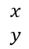

## **개요**

PowerPoint는 수식을 Office Math Markup Language(OMML) 형태로 저장합니다. Aspose.Slides for Python via Java를 사용하면 동일한 종류의 수학 콘텐츠를 프로그래밍 방식으로 만들 수 있습니다: 분수, 근호, 함수, 극한, N-ary 연산자, 행렬, 배열 및 서식이 지정된 수학 블록.

PowerPoint에서 사용자는 일반적으로 **삽입 > 수식**에서 수식을 추가합니다:


결과는 슬라이드에 편집 가능한 수학 텍스트가 됩니다:


Aspose.Slides는 세 가지 주요 객체를 통해 해당 수학 텍스트를 구성합니다:

- 수학 도형은 [addMathShape](https://reference.aspose.com/slides/python-java/aspose.slides/shapecollection/#addMathShape)로 생성되며, 수식을 포함하는 도형입니다.
- [MathPortion](https://reference.aspose.com/slides/python-java/aspose.slides/mathportion/)은 도형 텍스트 프레임 내부에 수학 콘텐츠를 저장합니다.
- [MathParagraph](https://reference.aspose.com/slides/python-java/aspose.slides/mathparagraph/)은 하나 이상의 [MathBlock](https://reference.aspose.com/slides/python-java/aspose.slides/mathblock/) 객체를 포함합니다.

아래 대부분의 예제는 [MathematicalText](https://reference.aspose.com/slides/python-java/aspose.slides/mathematicaltext/)와 [MathElementBase](https://reference.aspose.com/slides/python-java/aspose.slides/mathelementbase/)의 유창한 메서드를 사용하여 코드를 간결하고 읽기 쉽게 유지합니다.

MathML 내보내기 시나리오에 대해서는 [Export Math Equations from Presentations in Python](/slides/ko/python-java/exporting-math-equations/)를 참조하십시오.

## **수식 만들기**

이 예제는 [addMathShape](https://reference.aspose.com/slides/python-java/aspose.slides/shapecollection/#addMathShape)를 사용하여 수학 도형을 만들고 피타고라스 정리를 추가합니다:


```python
import jpype
import asposeslides

if not jpype.isJVMStarted():
    jpype.startJVM()

from asposeslides.api import MathematicalText, Presentation, SaveFormat

presentation = Presentation()
try:
    slide = presentation.getSlides().get_Item(0)

    math_shape = slide.getShapes().addMathShape(20, 20, 700, 120)
    math_paragraph = math_shape.getTextFrame().getParagraphs().get_Item(0).getPortions().get_Item(0).getMathParagraph()

    a_squared = MathematicalText("a").setSuperscript("2")
    b_squared = MathematicalText("b").setSuperscript("2")
    equation = MathematicalText("c").setSuperscript("2").join("=").join(a_squared).join("+").join(b_squared)

    math_paragraph.add(equation)

    presentation.save("pythagorean-theorem.pptx", SaveFormat.Pptx)
finally:
    presentation.dispose()
```

{}
[addMathShape](https://reference.aspose.com/slides/python-java/aspose.slides/shapecollection/#addMathShape)는 이미 수학 단락을 포함하는 도형을 생성합니다. 첫 번째 [MathPortion](https://reference.aspose.com/slides/python-java/aspose.slides/mathportion/)에 접근하고, [getMathParagraph](https://reference.aspose.com/slides/python-java/aspose.slides/mathportion/#getMathParagraph)를 호출한 다음, 수학 블록이나 수학 요소를 추가합니다.
{}

### **수학 블록 결합**

수식의 일부가 [MathBlock](https://reference.aspose.com/slides/python-java/aspose.slides/mathblock/) 객체로 독립적으로 구축된 경우, [joinBlock](https://reference.aspose.com/slides/python-java/aspose.slides/mathblock/#joinBlock)을 사용해 결합합니다. 예제는 왼쪽 블록에 `c² =`를, 오른쪽 블록에 `a² + b²`를 구성합니다. [setSuperscript](https://reference.aspose.com/slides/python-java/aspose.slides/mathelementbase/#setSuperscript)은 세 개의 거듭제곱 모두에 편집 가능한 수학 상위 첨자를 생성합니다.

```python
import jpype
import asposeslides

if not jpype.isJVMStarted():
    jpype.startJVM()

from asposeslides.api import MathBlock, MathematicalText, Presentation, SaveFormat

presentation = Presentation()
try:
    slide = presentation.getSlides().get_Item(0)

    shape = slide.getShapes().addMathShape(20, 20, 600, 100)
    math_portion = shape.getTextFrame().getParagraphs().get_Item(0).getPortions().get_Item(0)
    math_paragraph = math_portion.getMathParagraph()

    left_block = MathBlock()
    left_block.add(MathematicalText("c").setSuperscript("2"))
    left_block.add(MathematicalText("="))

    right_block = MathBlock()
    right_block.add(MathematicalText("a").setSuperscript("2"))
    right_block.add(MathematicalText("+"))
    right_block.add(MathematicalText("b").setSuperscript("2"))

    combined_block = left_block.joinBlock(right_block)
    math_paragraph.add(combined_block)

    presentation.save("equation.pptx", SaveFormat.Pptx)
finally:
    presentation.dispose()
```

[joinBlock](https://reference.aspose.com/slides/python-java/aspose.slides/mathblock/#joinBlock)은 `left_block` 자체를 반환하며, 이제 순서대로 두 부분을 모두 포함하고 `right_block`은 비게 됩니다. 결합된 블록을 [MathParagraph](https://reference.aspose.com/slides/python-java/aspose.slides/mathparagraph/)에 한 번만 추가합니다. `equation.pptx`를 다시 열면 단락에 `c² = a² + b²`를 나타내는 하나의 블록이 포함되며, 세 개의 거듭제곱이 수학 상위 첨자로 보존됩니다.

[add](https://reference.aspose.com/slides/python-java/aspose.slides/mathblock/#add)을 `left_block.add(right_block)`와 같이 호출하면 하나의 블록을 다른 블록 안에 직접 중첩시키려 하게 되며 `InvalidOperationException`이 발생합니다.

## **분수 추가**

[divide](https://reference.aspose.com/slides/python-java/aspose.slides/mathelementbase/#divide)를 사용하여 분수를 생성합니다. [MathFractionTypes](https://reference.aspose.com/slides/python-java/aspose.slides/mathfractiontypes/)를 사용해 분수 스타일을 선택할 수 있습니다.


```python
import jpype
import asposeslides

if not jpype.isJVMStarted():
    jpype.startJVM()

from asposeslides.api import MathBlock, MathFractionTypes, MathematicalText, Presentation, SaveFormat

presentation = Presentation()
try:
    slide = presentation.getSlides().get_Item(0)

    math_shape = slide.getShapes().addMathShape(20, 20, 700, 100)
    math_paragraph = math_shape.getTextFrame().getParagraphs().get_Item(0).getPortions().get_Item(0).getMathParagraph()

    fraction = MathematicalText("1").divide("x", MathFractionTypes.Skewed)

    math_block = MathBlock(fraction)
    math_paragraph.add(math_block)

    presentation.save("fraction.pptx", SaveFormat.Pptx)
finally:
    presentation.dispose()
```

쌓인 형태의 분수를 위해서는 [MathFractionTypes.Bar](https://reference.aspose.com/slides/python-java/aspose.slides/mathfractiontypes/#Bar)를 사용합니다:

```python
import jpype
import asposeslides

if not jpype.isJVMStarted():
    jpype.startJVM()

from asposeslides.api import MathFractionTypes, MathematicalText

stacked_fraction = MathematicalText("x + 1").divide("y - 1", MathFractionTypes.Bar)
```

## **근호 추가**

[radical](https://reference.aspose.com/slides/python-java/aspose.slides/mathelementbase/#radical)를 사용하여 제곱근, 세제곱근 또는 기타 근호를 생성합니다. 현재 요소는 기반이 되고, 인자는 차수가 됩니다.


```python
import jpype
import asposeslides

if not jpype.isJVMStarted():
    jpype.startJVM()

from asposeslides.api import MathBlock, MathematicalText, Presentation, SaveFormat

presentation = Presentation()
try:
    slide = presentation.getSlides().get_Item(0)

    math_shape = slide.getShapes().addMathShape(20, 20, 700, 100)
    math_paragraph = math_shape.getTextFrame().getParagraphs().get_Item(0).getPortions().get_Item(0).getMathParagraph()

    radical = MathematicalText("x").radical("n")

    math_block = MathBlock(radical)
    math_paragraph.add(math_block)

    presentation.save("radical.pptx", SaveFormat.Pptx)
finally:
    presentation.dispose()
```

### **제곱근 차수 표시 또는 숨기기**

제곱근은 명시적인 2를 표시하거나 일반적인 √x 표기법을 사용할 수 있습니다. [MathRadical](https://reference.aspose.com/slides/python-java/aspose.slides/mathradical/)의 [setHideDegree](https://reference.aspose.com/slides/python-java/aspose.slides/mathradical/#setHideDegree) 메서드는 어떤 형태가 표시될지 제어합니다. 두 형태 모두 편집 가능한 수식에서 차수 2와 근호 안의 x를 유지합니다.


예제는 동일한 제곱근을 두 번 저장합니다. `visible-degree.pptx`에서는 2가 표시되고, `hidden-degree.pptx`에서는 숨겨집니다.

```python
import jpype
import asposeslides

if not jpype.isJVMStarted():
    jpype.startJVM()

from asposeslides.api import MathBlock, MathematicalText, Presentation, SaveFormat

presentation = Presentation()
try:
    slide = presentation.getSlides().get_Item(0)

    radical = MathematicalText("x").radical("2")
    math_block = MathBlock(radical)

    math_shape = slide.getShapes().addMathShape(20, 20, 200, 100)
    math_paragraph = math_shape.getTextFrame().getParagraphs().get_Item(0).getPortions().get_Item(0).getMathParagraph()
    math_paragraph.add(math_block)

    radical.setHideDegree(False)
    presentation.save("visible-degree.pptx", SaveFormat.Pptx)

    radical.setHideDegree(True)
    presentation.save("hidden-degree.pptx", SaveFormat.Pptx)
finally:
    presentation.dispose()
```

## **함수 및 극한 추가**

[asArgumentOfFunction](https://reference.aspose.com/slides/python-java/aspose.slides/mathelementbase/#asArgumentOfFunction) 또는 [function](https://reference.aspose.com/slides/python-java/aspose.slides/mathelementbase/#function)을 사용하여 `sin(x)`, `log(x)`와 같은 함수 또는 사용자 정의 함수 이름을 지정합니다. 극한의 경우, `lim`을 [MathLimit](https://reference.aspose.com/slides/python-java/aspose.slides/mathlimit/)에 넣거나 [setLowerLimit](https://reference.aspose.com/slides/python-java/aspose.slides/mathelementbase/#setLowerLimit)를 사용합니다.


```python
import jpype
import asposeslides

if not jpype.isJVMStarted():
    jpype.startJVM()

from asposeslides.api import MathBlock, MathematicalText, Presentation, SaveFormat

presentation = Presentation()
try:
    slide = presentation.getSlides().get_Item(0)

    math_shape = slide.getShapes().addMathShape(20, 20, 700, 100)
    math_paragraph = math_shape.getTextFrame().getParagraphs().get_Item(0).getPortions().get_Item(0).getMathParagraph()

    limit = MathematicalText("lim").setLowerLimit("x\u2192\u221E").function("x")

    math_block = MathBlock(limit)
    math_paragraph.add(math_block)

    presentation.save("functions-and-limits.pptx", SaveFormat.Pptx)
finally:
    presentation.dispose()
```

사용자 정의 함수 이름의 경우, 함수명을 현재 요소로 만든 뒤 그 인수와 함께 [function](https://reference.aspose.com/slides/python-java/aspose.slides/mathelementbase/#function)을 호출합니다:

```python
import jpype
import asposeslides

if not jpype.isJVMStarted():
    jpype.startJVM()

from asposeslides.api import MathematicalText

custom_function = MathematicalText("f").function("x + 1")
```

## **N-ary 연산자 및 적분 추가**

[nary](https://reference.aspose.com/slides/python-java/aspose.slides/mathelementbase/#nary)를 사용하여 합계, 합집합, 교집합 및 기타 대형 연산자를 처리합니다. [integral](https://reference.aspose.com/slides/python-java/aspose.slides/mathelementbase/#integral)를 사용하여 적분을 처리합니다. 두 메서드 모두 하한 및 상한을 설정할 수 있습니다.


```python
import jpype
import asposeslides

if not jpype.isJVMStarted():
    jpype.startJVM()

from asposeslides.api import MathBlock, MathNaryOperatorTypes, MathematicalText, Presentation, SaveFormat

presentation = Presentation()
try:
    slide = presentation.getSlides().get_Item(0)

    math_shape = slide.getShapes().addMathShape(20, 20, 700, 120)
    math_paragraph = math_shape.getTextFrame().getParagraphs().get_Item(0).getPortions().get_Item(0).getMathParagraph()

    a_power = MathematicalText("a").setSuperscript("n-k")
    summation_base = MathematicalText("x").setSuperscript("k").join(a_power)

    summation = summation_base.nary(MathNaryOperatorTypes.Summation, "k=0", "n")

    math_block = MathBlock(summation)
    math_paragraph.add(math_block)

    presentation.save("nary-operators.pptx", SaveFormat.Pptx)
finally:
    presentation.dispose()
```

N-ary 연산자는 선택적 한계가 있는 대형 연산자를 위한 것입니다. `+`, `-`, `=`와 같은 단순 연산자는 일반적으로 [MathematicalText](https://reference.aspose.com/slides/python-java/aspose.slides/mathematicaltext/)로 추가된 후 표현식에 결합됩니다.

적분의 경우, [integral](https://reference.aspose.com/slides/python-java/aspose.slides/mathelementbase/#integral)을 사용합니다:

```python
import jpype
import asposeslides

if not jpype.isJVMStarted():
    jpype.startJVM()

from asposeslides.api import MathIntegralTypes, MathematicalText

differential = MathematicalText("dx").toBox()
integral_base = MathematicalText("x").join(differential)
integral = integral_base.integral(MathIntegralTypes.Simple, "0", "1")
```

## **행렬 추가**

[MathMatrix](https://reference.aspose.com/slides/python-java/aspose.slides/mathmatrix/)를 사용하여 행과 열을 지정합니다. 행렬은 기본적으로 괄호를 포함하지 않으므로, 괄호, 대괄호 또는 중괄호가 필요할 경우 행렬을 감싸야 합니다.


```python
import jpype
import asposeslides

if not jpype.isJVMStarted():
    jpype.startJVM()

from asposeslides.api import MathBlock, MathMatrix, MathematicalText, Presentation, SaveFormat

presentation = Presentation()
try:
    slide = presentation.getSlides().get_Item(0)

    math_shape = slide.getShapes().addMathShape(20, 20, 700, 120)
    math_paragraph = math_shape.getTextFrame().getParagraphs().get_Item(0).getPortions().get_Item(0).getMathParagraph()

    matrix = MathMatrix(2, 3)
    cell_0_0 = MathematicalText("1")
    matrix.set_Item(0, 0, cell_0_0)
    cell_0_1 = MathematicalText("x")
    matrix.set_Item(0, 1, cell_0_1)
    cell_1_0 = MathematicalText("x")
    matrix.set_Item(1, 0, cell_1_0)
    cell_1_1 = MathematicalText("2")
    matrix.set_Item(1, 1, cell_1_1)
    cell_1_2 = MathematicalText("y")
    matrix.set_Item(1, 2, cell_1_2)

    math_block = MathBlock(matrix)
    math_paragraph.add(math_block)

    presentation.save("matrix.pptx", SaveFormat.Pptx)
finally:
    presentation.dispose()
```

### **기존 행렬 편집**

`matrix.pptx`에 저장된 계수 행렬로 시작하는 선형대수 수업을 가정해 보겠습니다(이전 예제로 저장됨). 다음 연습에서는 첫 번째 수식을 유지하고 두 번째를 두 개의 새로운 수식으로 교체하며 변수 집합을 수정합니다. 적용 가능한 계수를 유지하려면 [MathMatrix](https://reference.aspose.com/slides/python-java/aspose.slides/mathmatrix/)를 통해 기존 행렬을 엽니다.


행 및 열 인덱스는 0부터 시작하며 각 호출 시점의 행렬을 가리킵니다. 인덱스 1 앞에 행을 삽입하면 원래 두 번째 행이 인덱스 2로 이동합니다. 인덱스 2 뒤에 삽입하면 행이 추가됩니다. 행 2를 삭제하면 원래 두 번째 수식이 제거되고 추가된 행이 한 위치 위로 이동합니다. 열도 동일하게 이동합니다.

```python
import jpype
import asposeslides

if not jpype.isJVMStarted():
    jpype.startJVM()

from asposeslides.api import MathHorizontalAlignment, MathematicalText, Presentation, SaveFormat

presentation = Presentation("matrix.pptx")
try:
    shape = presentation.getSlides().get_Item(0).getShapes().get_Item(0)
    portion = shape.getTextFrame().getParagraphs().get_Item(0).getPortions().get_Item(0)
    matrix = portion.getMathParagraph().get_Item(0).get_Item(0)

    matrix.insertRowBefore(1)
    matrix.insertRowAfter(2)
    matrix.deleteRow(2)

    matrix.insertColumnBefore(1)
    matrix.insertColumnAfter(3)
    matrix.deleteColumn(3)

    # 새 셀은 처음에 비어 있습니다. 비영(0이 아닌) 계수를 먼저 설정합니다.
    matrix.set_Item(1, 0, MathematicalText("12"))
    matrix.set_Item(1, 1, MathematicalText("1"))
    matrix.set_Item(2, 2, MathematicalText("10"))
    matrix.set_Item(2, 3, MathematicalText("1"))
    for row in range(matrix.getRowCount()):
        for column in range(matrix.getColumnCount()):
            if matrix.get_Item(row, column) is None:
                matrix.set_Item(row, column, MathematicalText("0"))

    matrix.setColumnAlignment(0, MathHorizontalAlignment.Left)
    matrix.setColumnsAlignment(1, 3, MathHorizontalAlignment.Right)
    
    presentation.save("updated-matrix.pptx", SaveFormat.Pptx)
finally:
    presentation.dispose()
```

[setColumnAlignment](https://reference.aspose.com/slides/python-java/aspose.slides/mathmatrix/#setColumnAlignment)은 첫 번째 열을 왼쪽으로 정렬합니다. [setColumnsAlignment](https://reference.aspose.com/slides/python-java/aspose.slides/mathmatrix/#setColumnsAlignment)은 인덱스 1부터 시작하는 나머지 세 열을 오른쪽으로 정렬합니다. `updated-matrix.pptx`에서는 행렬에 세 개의 수식과 네 개의 변수가 있습니다. 원래 첫 행의 계수 `1`과 `x`가 이제 첫 번째와 세 번째 열에 표시됩니다.


## **수식 배열 추가**

정렬된 수식이나 수식의 수직 스택이 필요할 때는 [toMathArray](https://reference.aspose.com/slides/python-java/aspose.slides/mathelementbase/#toMathArray)를 사용합니다.



```python
import jpype
import asposeslides

if not jpype.isJVMStarted():
    jpype.startJVM()

from asposeslides.api import MathBlock, MathematicalText, Presentation, SaveFormat

presentation = Presentation()
try:
    slide = presentation.getSlides().get_Item(0)

    math_shape = slide.getShapes().addMathShape(20, 20, 700, 140)
    math_paragraph = math_shape.getTextFrame().getParagraphs().get_Item(0).getPortions().get_Item(0).getMathParagraph()

    equation_array = MathematicalText("x").join("y").toMathArray()

    math_block = MathBlock(equation_array)
    math_paragraph.add(math_block)

    presentation.save("equation-array.pptx", SaveFormat.Pptx)
finally:
    presentation.dispose()
```

### **배열을 주변 요소와 정렬**

[setBaseJustification](https://reference.aspose.com/slides/python-java/aspose.slides/matharray/#setBaseJustification)은 배열의 수직 정렬을 옆에 있는 수학 요소와 상대적으로 제어합니다. 아래 예제는 첫 번째 행, 배열 중앙, 마지막 행과의 정렬을 비교합니다.

다음 예제는 세 개의 동일한 배열을 생성합니다. 각각은 세 행을 가지고 주변 요소 `A=`와 `=B`가 있습니다. 모든 수학 텍스트는 24포인트 Cambria Math를 사용합니다. 배열 정렬만 변경됩니다.

```python
import jpype
import asposeslides

if not jpype.isJVMStarted():
    jpype.startJVM()

from asposeslides.api import FillType, FontData, MathArray, MathBlock, MathJustification, MathematicalText, MathVerticalAlignment, Presentation, SaveFormat, ShapeType, SlideSizeScaleType, TextAnchorType
from java.awt import Color

def create_text(value):
    text = MathematicalText(value)
    text.getFormat().setFontHeight(24)
    text.getFormat().setLatinFont(FontData("Cambria Math"))
    return text


presentation = Presentation()
try:
    presentation.getSlideSize().setSize(780, 200, SlideSizeScaleType.DoNotScale)
    slide = presentation.getSlides().get_Item(0)
    
    alignments = (("Top", MathVerticalAlignment.Top), ("Center", MathVerticalAlignment.Center), ("Bottom", MathVerticalAlignment.Bottom))
    for index, (name, alignment) in enumerate(alignments):
        x = 20 + index * 260
        label = slide.getShapes().addAutoShape(ShapeType.Rectangle, x, 10, 240, 30)
        label.getFillFormat().setFillType(FillType.NoFill)
        label.getLineFormat().getFillFormat().setFillType(FillType.NoFill)
        label.getTextFrame().setText(name)
        label_format = label.getTextFrame().getParagraphs().get_Item(0).getPortions().get_Item(0).getPortionFormat()
        label_format.setFontHeight(16)
        label_format.getFillFormat().setFillType(FillType.Solid)
        label_format.getFillFormat().getSolidFillColor().setColor(Color.BLACK)

        math_shape = slide.getShapes().addMathShape(x, 60, 240, 130)
        math_shape.getTextFrame().getTextFrameFormat().setAnchoringType(TextAnchorType.Top)
        paragraph = math_shape.getTextFrame().getParagraphs().get_Item(0)
        math_paragraph = paragraph.getPortions().get_Item(0).getMathParagraph()
        math_paragraph.setJustification(MathJustification.LeftJustified)

        equation_array = MathArray(create_text("x+y=3"))
        equation_array.getArguments().add(create_text("x-y=1"))
        equation_array.getArguments().add(create_text("x=2"))
        equation_array.setBaseJustification(alignment)
        equation = MathBlock(create_text("A=")).join(equation_array).join(create_text("=B"))
        math_paragraph.add(equation)

    presentation.save("equation-array-alignment.pptx", SaveFormat.Pptx)
finally:
    presentation.dispose()
```

다음 비교는 PowerPoint에서 저장된 프레젠테이션을 보여줍니다. 각 배열 옆에 있는 `A=`와 `=B`의 위치를 확인하십시오.


### **행 간격 구성**

[setRowSpacingRule](https://reference.aspose.com/slides/python-java/aspose.slides/matharray/#setRowSpacingRule)은 배열 내 행에 대한 간격 규칙을 선택합니다. [setRowSpacing](https://reference.aspose.com/slides/python-java/aspose.slides/matharray/#setRowSpacing)은 명시적 간격 규칙을 위한 숫자 값을 제공하며 사전 설정 규칙에서는 무시됩니다.

정확한 간격은 포인트 단위로 측정됩니다. 비례 간격은 반줄 단위로 측정됩니다: 예제의 값 `3`은 1.5줄을 의미합니다. 명시적 값을 지정할 때는 두 속성을 모두 설정해야 하며, 숫자 값만 변경해도 간격 규칙이 선택되지 않습니다.

아래 예제는 동일한 수식, 정렬 및 글꼴 설정으로 다섯 개의 프레젠테이션을 저장합니다. 처음 세 개는 사전 설정을 사용하고, 마지막 두 개는 명시적 값을 보여줍니다.

```python
import jpype
import asposeslides

if not jpype.isJVMStarted():
    jpype.startJVM()

from asposeslides.api import FontData, MathArray, MathBlock, MathJustification, MathematicalText, MathRowSpacingRule, MathVerticalAlignment, Presentation, SaveFormat

def create_text(value):
    text = MathematicalText(value)
    text.getFormat().setFontHeight(24)
    text.getFormat().setLatinFont(FontData("Cambria Math"))
    return text


settings = (("SingleLineGap", MathRowSpacingRule.SingleLineGap, 0), ("OneAndAHalfLineGap", MathRowSpacingRule.OneAndAHalfLineGap, 0), ("TwoLineGap", MathRowSpacingRule.TwoLineGap, 0), ("Exactly", MathRowSpacingRule.Exactly, 20), ("Multiple", MathRowSpacingRule.Multiple, 3))
for name, rule, spacing in settings:
    presentation = Presentation()
    try:
        slide = presentation.getSlides().get_Item(0)
        math_shape = slide.getShapes().addMathShape(20, 20, 600, 300)
        paragraph = math_shape.getTextFrame().getParagraphs().get_Item(0)
        paragraph.getParagraphFormat().setSpaceBefore(0)
        paragraph.getParagraphFormat().setSpaceAfter(0)
        math_paragraph = paragraph.getPortions().get_Item(0).getMathParagraph()
        math_paragraph.setJustification(MathJustification.LeftJustified)

        equation_array = MathArray(create_text("x+y=3"))
        equation_array.getArguments().add(create_text("x-y=1"))
        equation_array.getArguments().add(create_text("x=2"))
        equation_array.setBaseJustification(MathVerticalAlignment.Center)
        equation_array.setRowSpacingRule(rule)
        equation_array.setRowSpacing(spacing)
        equation = MathBlock(create_text("A=")).join(equation_array).join(create_text("=B"))
        math_paragraph.add(equation)

        presentation.save(f"equation-array-{name}.pptx", SaveFormat.Pptx)
    finally:
        presentation.dispose()
```

배열 행 간격은 단락 간격과 별개입니다. [setSpaceBefore](https://reference.aspose.com/slides/python-java/aspose.slides/paragraphformat/#setSpaceBefore)와 [setSpaceAfter](https://reference.aspose.com/slides/python-java/aspose.slides/paragraphformat/#setSpaceAfter)는 포함된 단락 주변에 공간을 추가하며, 배열 행 사이에는 적용되지 않습니다. 마찬가지로, [MathParagraph.setJustification](https://reference.aspose.com/slides/python-java/aspose.slides/mathparagraph/#setJustification)은 전체 수학 단락을 수평으로 배치하며, 배열의 수직 정렬 설정을 대체하지 않습니다.

## **삼각 함수 추가**

인수가 현재 요소이고 함수 이름이 알려진 경우 [asArgumentOfFunction](https://reference.aspose.com/slides/python-java/aspose.slides/mathelementbase/#asArgumentOfFunction)을 사용합니다.


```python
import jpype
import asposeslides

if not jpype.isJVMStarted():
    jpype.startJVM()

from asposeslides.api import MathBlock, MathFunctionsOfOneArgument, MathematicalText, Presentation, SaveFormat

presentation = Presentation()
try:
    slide = presentation.getSlides().get_Item(0)

    math_shape = slide.getShapes().addMathShape(20, 20, 700, 100)
    math_paragraph = math_shape.getTextFrame().getParagraphs().get_Item(0).getPortions().get_Item(0).getMathParagraph()

    cosine = MathematicalText("2x").asArgumentOfFunction(MathFunctionsOfOneArgument.Cos)

    math_block = MathBlock(cosine)
    math_paragraph.add(math_block)

    presentation.save("trigonometric-function.pptx", SaveFormat.Pptx)
finally:
    presentation.dispose()
```

## **아래첨자와 위첨자 추가**

인덱스와 거듭제곱을 위해 아래첨자와 위첨자 도우미를 사용합니다. 인덱스가 기반의 왼쪽에 나타나야 할 경우 [setSubSuperscriptOnTheLeft](https://reference.aspose.com/slides/python-java/aspose.slides/mathelementbase/#setSubSuperscriptOnTheLeft)를 사용합니다.


```python
import jpype
import asposeslides

if not jpype.isJVMStarted():
    jpype.startJVM()

from asposeslides.api import MathBlock, MathematicalText, Presentation, SaveFormat

presentation = Presentation()
try:
    slide = presentation.getSlides().get_Item(0)

    math_shape = slide.getShapes().addMathShape(20, 20, 700, 100)
    math_paragraph = math_shape.getTextFrame().getParagraphs().get_Item(0).getPortions().get_Item(0).getMathParagraph()

    scripts = MathematicalText("Y").setSubSuperscriptOnTheLeft("1", "n")

    math_block = MathBlock(scripts)
    math_paragraph.add(math_block)

    presentation.save("subscript-superscript.pptx", SaveFormat.Pptx)
finally:
    presentation.dispose()
```

### **오른쪽 아래첨자와 위첨자 정렬**

아래첨자와 위첨자가 같은 기반을 공유할 때는 [MathRightSubSuperscriptElement](https://reference.aspose.com/slides/python-java/aspose.slides/mathrightsubsuperscriptelement/)을 사용합니다. 해당 요소의 [setAlignScripts](https://reference.aspose.com/slides/python-java/aspose.slides/mathrightsubsuperscriptelement/#setAlignScripts) 메서드는 수평 위치를 제어합니다. 기본값 `False`이면 각 스크립트가 기반의 윤곽을 따르고, `True`이면 스크립트가 동일한 수평 위치에서 시작합니다.

이 예제는 동일한 편집 가능한 표현식을 두 개 나란히 배치합니다. 두 표현식 모두 72포인트 Cambria Math의 수학 이탤릭 f(U+1D453)에 아래첨자 1과 위첨자 2를 사용합니다. f의 기울기로 인해 차이가 PowerPoint에서 보입니다. 예제를 실행하기 전에 Cambria Math를 설치하십시오.

```python
import jpype
import asposeslides

if not jpype.isJVMStarted():
    jpype.startJVM()

from asposeslides.api import FontData, MathBlock, MathematicalText, MathRightSubSuperscriptElement
from asposeslides.api import PortionFormat, Presentation, SaveFormat, SlideSizeScaleType

presentation = Presentation()
try:
    presentation.getSlideSize().setSize(900, 250, SlideSizeScaleType.DoNotScale)
    slide = presentation.getSlides().get_Item(0)

    text_format = PortionFormat()
    font = FontData("Cambria Math")
    text_format.setFontHeight(72)
    text_format.setLatinFont(font)

    for left, align_scripts in [(40, False), (480, True)]:
        shape = slide.getShapes().addMathShape(left, 75, 380, 150)
        base = MathematicalText("\U0001D453", text_format)
        subscript = MathematicalText("1", text_format)
        superscript = MathematicalText("2", text_format)
        scripts = MathRightSubSuperscriptElement(base, subscript, superscript)
        scripts.setAlignScripts(align_scripts)

        portion = shape.getTextFrame().getParagraphs().get_Item(0).getPortions().get_Item(0)
        portion.getPortionFormat().setFontHeight(text_format.getFontHeight())
        portion.getPortionFormat().setLatinFont(font)
        block = MathBlock(scripts)
        portion.getMathParagraph().add(block)

    presentation.save("aligned-scripts.pptx", SaveFormat.Pptx)
finally:
    presentation.dispose()
```


왼쪽에서는 아래첨자가 위첨자보다 더 왼쪽에서 시작하여 f의 윤곽을 따릅니다. 오른쪽에서는 두 스크립트의 왼쪽 가장자리가 정렬됩니다.

## **구분자 추가**

[enclose](https://reference.aspose.com/slides/python-java/aspose.slides/mathelementbase/#enclose)를 사용하여 표현식을 구분자 안에 넣습니다. 여러 요소를 포함하는 구분자 표현식에 구분 문자도 설정할 수 있습니다.


```python
import jpype
import asposeslides

if not jpype.isJVMStarted():
    jpype.startJVM()

from asposeslides.api import MathBlock, MathematicalText, Presentation, SaveFormat

presentation = Presentation()
try:
    slide = presentation.getSlides().get_Item(0)

    math_shape = slide.getShapes().addMathShape(20, 20, 700, 100)
    math_paragraph = math_shape.getTextFrame().getParagraphs().get_Item(0).getPortions().get_Item(0).getMathParagraph()

    delimiter = MathematicalText("x").join("y").join("z").enclose('<', '>')
    delimiter.setSeparatorCharacter('|')

    math_block = MathBlock(delimiter)
    math_paragraph.add(math_block)

    presentation.save("delimiters.pptx", SaveFormat.Pptx)
finally:
    presentation.dispose()
```

### **구분자 크기 및 정렬**

`True`를 [setGrowToMatchOperandHeight](https://reference.aspose.com/slides/python-java/aspose.slides/mathdelimiter/#setGrowToMatchOperandHeight)에게 전달하면 큰 피연산자 주변에 괄호가 확장됩니다. `False`를 전달하면 정상 크기를 유지합니다. 두 가지 [MathDelimiterShape](https://reference.aspose.com/slides/python-java/aspose.slides/mathdelimitershape/) 값 중 하나와 함께 [setDelimiterShape](https://reference.aspose.com/slides/python-java/aspose.slides/mathdelimiter/#setDelimiterShape)를 사용합니다. `Centered`는 등호 기호 중간을 지나는 수학 축에 괄호를 가운데 맞춥니다. `Match`는 괄호를 포함된 내용에 맞춥니다. 두 설정은 구분자에만 영향을 미치며 내부 표현식은 변경되지 않습니다.

예제는 `x`의 지수에 분수를 배치하여 표현식이 기준선 위쪽으로 더 많이 확장됩니다. 네 개의 수식 모두 동일한 괄호와 글꼴 설정을 사용합니다.

```python
import jpype
import asposeslides

if not jpype.isJVMStarted():
    jpype.startJVM()

from asposeslides.api import MathDelimiterShape, MathematicalText, Presentation, SaveFormat

presentation = Presentation()
try:
    slide = presentation.getSlides().get_Item(0)
    for row, grow in enumerate((True, False)):
        for column, shape in enumerate((MathDelimiterShape.Centered, MathDelimiterShape.Match)):
            fraction = MathematicalText("a + b").divide("c + d")
            power = MathematicalText("x").setSuperscript(fraction)
            delimiter = power.enclose("(", ")")
            delimiter.setGrowToMatchOperandHeight(grow)
            delimiter.setDelimiterShape(shape)

            math_shape = slide.getShapes().addMathShape(20 + 330 * column, 20 + 120 * row, 300, 100)
            portion = math_shape.getTextFrame().getParagraphs().get_Item(0).getPortions().get_Item(0)
            portion.getPortionFormat().setFontHeight(32)
            equation = MathematicalText("y = ").join(delimiter)
            portion.getMathParagraph().add(equation)

    presentation.save("delimiter-sizing.pptx", SaveFormat.Pptx)
finally:
    presentation.dispose()
```

PowerPoint에서 행을 비교하여 성장 효과를 확인하십시오. 상단 행에서는 괄호가 지수를 둘러싸도록 확장되어 두 형태가 동일하게 보입니다. 하단 행에서는 확장이 꺼져 있습니다. 왼쪽의 작은 괄호(`Centered`)는 등호와 정렬되고, 오른쪽(`Match`)은 표현식 주위에 더 높게 배치됩니다.


## **테두리 상자 추가**

분수에 [toBorderBox](https://reference.aspose.com/slides/python-java/aspose.slides/mathelementbase/#toBorderBox)를 호출하면 전체 표현식을 프레임합니다. 반환된 [MathBorderBox](https://reference.aspose.com/slides/python-java/aspose.slides/mathborderbox/)는 기본적으로 네 면을 모두 표시합니다. 개별 면을 제거하려면 [setHideTop](https://reference.aspose.com/slides/python-java/aspose.slides/mathborderbox/#setHideTop), [setHideBottom](https://reference.aspose.com/slides/python-java/aspose.slides/mathborderbox/#setHideBottom), [setHideLeft](https://reference.aspose.com/slides/python-java/aspose.slides/mathborderbox/#setHideLeft), [setHideRight](https://reference.aspose.com/slides/python-java/aspose.slides/mathborderbox/#setHideRight)를 사용합니다.

예제는 하나의 슬라이드에 동일한 분수를 여섯 번 배치합니다. 취소를 보여주기 위해 네 면을 모두 숨기고 [setStrikethroughBottomLeftToTopRight](https://reference.aspose.com/slides/python-java/aspose.slides/mathborderbox/#setStrikethroughBottomLeftToTopRight)에 `True`를 전달하면 오른쪽 위 대각선(↗)이, [setStrikethroughTopLeftToBottomRight](https://reference.aspose.com/slides/python-java/aspose.slides/mathborderbox/#setStrikethroughTopLeftToBottomRight)에 `True`를 전달하면 오른쪽 아래 대각선(↘)이 표시됩니다. 또한 [setStrikethroughHorizontal](https://reference.aspose.com/slides/python-java/aspose.slides/mathborderbox/#setStrikethroughHorizontal)이나 [setStrikethroughVertical](https://reference.aspose.com/slides/python-java/aspose.slides/mathborderbox/#setStrikethroughVertical)를 사용하여 보이는 면의 조합을 지정할 수 있습니다.

```python
import jpype
import asposeslides

if not jpype.isJVMStarted():
    jpype.startJVM()

from asposeslides.api import MathBlock, MathematicalText, Presentation, SaveFormat, SlideSizeScaleType

presentation = Presentation()
try:
    presentation.getSlideSize().setSize(540, 220, SlideSizeScaleType.DoNotScale)
    slide = presentation.getSlides().get_Item(0)

    def add_fraction(x, y, hide_border):
        fraction = MathematicalText("x+1").divide("y+2")
        box = fraction.toBorderBox()
        box.setHideTop(hide_border)
        box.setHideBottom(hide_border)
        box.setHideLeft(hide_border)
        box.setHideRight(hide_border)

        shape = slide.getShapes().addMathShape(x, y, 160, 90)
        portion = shape.getTextFrame().getParagraphs().get_Item(0).getPortions().get_Item(0)
        portion.getPortionFormat().setFontHeight(28)
        math_block = MathBlock(box)
        portion.getMathParagraph().add(math_block)
        return box

    add_fraction(10, 10, False)

    partial = add_fraction(190, 10, False)
    partial.setHideTop(True)
    partial.setHideRight(True)

    add_fraction(370, 10, True).setStrikethroughBottomLeftToTopRight(True)
    add_fraction(10, 120, True).setStrikethroughTopLeftToBottomRight(True)
    add_fraction(190, 120, True).setStrikethroughHorizontal(True)
    add_fraction(370, 120, False).setStrikethroughVertical(True)

    presentation.save("border-box.pptx", SaveFormat.Pptx)
finally:
    presentation.dispose()
```


이 분수에서 가로 획은 분수선과 겹칩니다. 세로 획은 분자와 분모를 모두 가로지르며 주변 테두리는 보입니다. 이러한 선은 전체 표현식을 장식합니다. 일반 텍스트 취소선은 텍스트 실행의 문자에 적용됩니다. PowerPoint에서 프레젠테이션을 다시 열어도 분자와 분모를 독립적으로 편집할 수 있습니다.

## **Phantom 요소로 가시성 및 레이아웃 제어**

[MathPhantom](https://reference.aspose.com/slides/python-java/aspose.slides/mathphantom/)으로 표현식을 감싸면 가시성과 수식에 기여하는 공간을 독립적으로 제어할 수 있습니다. [MathPhantom](https://reference.aspose.com/slides/python-java/aspose.slides/mathphantom/) 메서드는 다음을 제어합니다:

| 메서드 | 효과 |
| --- | --- |
| [setShow](https://reference.aspose.com/slides/python-java/aspose.slides/mathphantom/#setShow) | `False`를 전달하면 표현식을 숨깁니다. 해당 차원은 여전히 레이아웃에 기여하지만 아래 메서드가 `True`를 받으면 제거됩니다. |
| [setZeroWidth](https://reference.aspose.com/slides/python-java/aspose.slides/mathphantom/#setZeroWidth) | 표현식의 가로 너비를 0으로 처리하여 인접 요소가 더 가깝게 이동하도록 합니다. |
| [setZeroAsc](https://reference.aspose.com/slides/python-java/aspose.slides/mathphantom/#setZeroAsc) | 기준선 위의 높이인 상승을 0으로 처리합니다. 이는 인접 요소 위에 예약된 공간을 줄일 수 있습니다. |
| [setZeroDesc](https://reference.aspose.com/slides/python-java/aspose.slides/mathphantom/#setZeroDesc) | 기준선 아래의 깊이인 하강을 0으로 처리합니다. 이렇게 하면 분수선이나 다른 아래쪽 콘텐츠가 인접 요소에 더 가깝게 이동합니다. |

기준선은 일반 수학 문자들이 놓이는 기준선입니다. 콘텐츠를 숨겨도 차원은 제거되지 않으며, 차원을 0으로 처리해도 표현식이 삭제되지 않습니다. 기본 표현식은 [getBase](https://reference.aspose.com/slides/python-java/aspose.slides/mathphantom/#getBase)을 통해 여전히 사용할 수 있습니다. [setShow](https://reference.aspose.com/slides/python-java/aspose.slides/mathphantom/#setShow)에 `True`를 전달하면 다시 표시되며, 차원 설정은 그대로 유지됩니다.

아래 예제는 다섯 개의 나란히 배치된 변형을 생성합니다: 보이는 분수, 공간을 유지하는 숨긴 분수, 그리고 각 차원을 0으로 처리한 세 개의 숨긴 분수. 각 변형은 동일한 주변 표현식과 24포인트 Cambria Math를 사용합니다. 모든 수식 도형은 회색 가이드로 표시된 동일한 상단 위치를 가집니다. 외부 분수의 분자에 phantom을 배치하면 수직 레이아웃 변화를 확인하기 쉽습니다.

```python
import jpype
import asposeslides

if not jpype.isJVMStarted():
    jpype.startJVM()

from asposeslides.api import FillType, FontData, MathBlock, MathFraction, MathematicalText, MathPhantom, Presentation, SaveFormat, ShapeType, SlideSizeScaleType, TextAnchorType
from java.awt import Color


def create_text(value):
    text = MathematicalText(value)
    text.getFormat().setFontHeight(24)
    text.getFormat().setLatinFont(FontData("Cambria Math"))
    return text


presentation = Presentation()
try:
    presentation.getSlideSize().setSize(1000, 180, SlideSizeScaleType.DoNotScale)
    slide = presentation.getSlides().get_Item(0)

    labels = ("Visible", "Hidden: reserves space", "Hidden: ZeroWidth", "Hidden: ZeroAsc", "Hidden: ZeroDesc")

    guide = slide.getShapes().addAutoShape(ShapeType.Line, 10, 60, 980, 0)
    guide.getLineFormat().getFillFormat().setFillType(FillType.Solid)
    guide.getLineFormat().getFillFormat().getSolidFillColor().setColor(Color.LIGHT_GRAY)

    for index, name in enumerate(labels):
        left = 10 + index * 200
        
        label = slide.getShapes().addAutoShape(ShapeType.Rectangle, left, 10, 190, 30)
        label.getFillFormat().setFillType(FillType.NoFill)
        label.getLineFormat().getFillFormat().setFillType(FillType.NoFill)
        label.getTextFrame().setText(name)
        label_format = label.getTextFrame().getParagraphs().get_Item(0).getPortions().get_Item(0).getPortionFormat()
        label_format.setFontHeight(14)
        label_format.getFillFormat().setFillType(FillType.Solid)
        label_format.getFillFormat().getSolidFillColor().setColor(Color.BLACK)

        fraction_numerator = create_text("a+b")
        fraction_denominator = create_text("c+d")
        fraction = MathFraction(fraction_numerator, fraction_denominator)
        phantom = MathPhantom(fraction)
        phantom.setShow(index == 0)
        phantom.setZeroWidth(index == 2)
        phantom.setZeroAsc(index == 3)
        phantom.setZeroDesc(index == 4)

        left_text = create_text("x+")
        right_text = create_text("+y")
        numerator = MathBlock(left_text).join(phantom).join(right_text)
        denominator = create_text("z")
        equation = MathFraction(numerator, denominator)

        shape = slide.getShapes().addMathShape(left, 60, 190, 100)
        shape.getTextFrame().getTextFrameFormat().setAnchoringType(TextAnchorType.Top)
        math_portion = shape.getTextFrame().getParagraphs().get_Item(0).getPortions().get_Item(0)
        math_paragraph = math_portion.getMathParagraph()
        math_block = MathBlock(equation)
        math_paragraph.add(math_block)

    presentation.save("math-phantom.pptx", SaveFormat.Pptx)
finally:
    presentation.dispose()
```


## **항 그룹화**

[group](https://reference.aspose.com/slides/python-java/aspose.slides/mathelementbase/#group)을 사용하여 표현식 위나 아래에 그룹화 문자를 배치합니다. 제한을 추가하여 그룹화된 항에 레이블을 붙일 수 있습니다.


```python
import jpype
import asposeslides

if not jpype.isJVMStarted():
    jpype.startJVM()

from asposeslides.api import MathBlock, MathTopBotPositions, MathematicalText, Presentation, SaveFormat

presentation = Presentation()
try:
    slide = presentation.getSlides().get_Item(0)

    math_shape = slide.getShapes().addMathShape(20, 20, 700, 120)
    math_paragraph = math_shape.getTextFrame().getParagraphs().get_Item(0).getPortions().get_Item(0).getMathParagraph()

    grouped = MathematicalText("x + y").group('\u23DF', MathTopBotPositions.Bottom, MathTopBotPositions.Top).setLowerLimit("any text")

    math_block = MathBlock(grouped)
    math_paragraph.add(math_block)

    presentation.save("grouped-terms.pptx", SaveFormat.Pptx)
finally:
    presentation.dispose()
```

## **수학 요소 서식 지정**

수식의 명확성을 위해 필요한 경우에만 서식 도우미를 사용합니다. 예를 들어, [overbar](https://reference.aspose.com/slides/python-java/aspose.slides/mathelementbase/#overbar)는 수학 요소 위에 선을 둡니다.


```python
import jpype
import asposeslides

if not jpype.isJVMStarted():
    jpype.startJVM()

from asposeslides.api import MathBlock, MathematicalText, Presentation, SaveFormat

presentation = Presentation()
try:
    slide = presentation.getSlides().get_Item(0)

    math_shape = slide.getShapes().addMathShape(20, 20, 700, 100)
    math_paragraph = math_shape.getTextFrame().getParagraphs().get_Item(0).getPortions().get_Item(0).getMathParagraph()

    overbar = MathematicalText("ABC").overbar()

    math_block = MathBlock(overbar)
    math_paragraph.add(math_block)

    presentation.save("overbar.pptx", SaveFormat.Pptx)
finally:
    presentation.dispose()
```

### **기존 수식의 텍스트 서식 지정**

기존 수식 전체의 텍스트를 서식 지정하려면 각 수학 블록의 요소 트리를 순회합니다. [MathElementBase.getChildren](https://reference.aspose.com/slides/python-java/aspose.slides/mathelementbase/#getChildren)은 바로 아래 자식만 반환하므로, 분수, 첨자, 근호 및 기타 중첩 구조 안의 텍스트에 도달하려면 재귀적으로 호출합니다. 현재 요소와 그 자식들을 확인하여 요소가 [MathematicalText](https://reference.aspose.com/slides/python-java/aspose.slides/mathematicaltext/)인 경우 시작 요소도 포함합니다.

이 예제는 `input.pptx`에 `z = xᵢ / ∛y`와 같은 수식이 포함되어 있다고 가정합니다. 여기서 분자는 아래첨자를, 분모는 근호를 포함합니다. 블록의 최상위 요소만 처리하면 분수 내부 텍스트가 누락됩니다. 예제는 슬라이드 텍스트 프레임에서 수학 부분을 찾아 [MathPortion.getMathParagraph](https://reference.aspose.com/slides/python-java/aspose.slides/mathportion/#getMathParagraph)을 통해 블록에 접근하고, 각 텍스트 요소의 [getFormat](https://reference.aspose.com/slides/python-java/aspose.slides/mathematicaltext/#getFormat) 메서드를 사용해 [setFontHeight](https://reference.aspose.com/slides/python-java/aspose.slides/baseportionformat/#setFontHeight)으로 글꼴 크기를 28포인트로 설정합니다.

```python
import jpype
import asposeslides

if not jpype.isJVMStarted():
    jpype.startJVM()

from asposeslides.api import AutoShape, MathematicalText, MathPortion, Presentation, SaveFormat


def format_math_text(element):
    if isinstance(element, MathematicalText):
        element.getFormat().setFontHeight(28)

    for child in element.getChildren():
        format_math_text(child)


presentation = Presentation("input.pptx")
try:
    for slide in presentation.getSlides():
        for shape in slide.getShapes():
            if not isinstance(shape, AutoShape):
                continue

            if shape.getTextFrame() is None:
                continue

            for paragraph in shape.getTextFrame().getParagraphs():
                for portion in paragraph.getPortions():
                    if isinstance(portion, MathPortion):
                        for block in portion.getMathParagraph():
                            format_math_text(block)

    presentation.save("formatted-equations.pptx", SaveFormat.Pptx)
finally:
    presentation.dispose()
```

저장된 프레젠테이션은 처리된 각 수식의 모든 단계에서 업데이트된 텍스트 서식을 포함하며, 텍스트 내용과 수학 구조는 그대로 유지됩니다.

## **빠른 참조**

| 작업 | 주요 API |
| --- | --- |
| 수학 텍스트 만들기 | [MathematicalText](https://reference.aspose.com/slides/python-java/aspose.slides/mathematicaltext/) |
| 요소 결합 | [MathElementBase.join](https://reference.aspose.com/slides/python-java/aspose.slides/mathelementbase/#join) |
| 분수 만들기 | [MathElementBase.divide](https://reference.aspose.com/slides/python-java/aspose.slides/mathelementbase/#divide) |
| 위첨자 또는 아래첨자 추가 | [setSuperscript](https://reference.aspose.com/slides/python-java/aspose.slides/mathelementbase/#setSuperscript), [setSubscript](https://reference.aspose.com/slides/python-java/aspose.slides/mathelementbase/#setSubscript) |
| 함수 추가 | [function](https://reference.aspose.com/slides/python-java/aspose.slides/mathelementbase/#function), [asArgumentOfFunction](https://reference.aspose.com/slides/python-java/aspose.slides/mathelementbase/#asArgumentOfFunction) |
| 근호 추가 | [MathElementBase.radical](https://reference.aspose.com/slides/python-java/aspose.slides/mathelementbase/#radical) |
| 극한 추가 | [setLowerLimit](https://reference.aspose.com/slides/python-java/aspose.slides/mathelementbase/#setLowerLimit), [setUpperLimit](https://reference.aspose.com/slides/python-java/aspose.slides/mathelementbase/#setUpperLimit) |
| 왼쪽 스크립트 추가 | [setSubSuperscriptOnTheLeft](https://reference.aspose.com/slides/python-java/aspose.slides/mathelementbase/#setSubSuperscriptOnTheLeft) |
| 합계 및 적분 추가 | [nary](https://reference.aspose.com/slides/python-java/aspose.slides/mathelementbase/#nary), [integral](https://reference.aspose.com/slides/python-java/aspose.slides/mathelementbase/#integral) |
| 행렬 추가 | [MathMatrix](https://reference.aspose.com/slides/python-java/aspose.slides/mathmatrix/) |
| 수식 배열 추가 | [toMathArray](https://reference.aspose.com/slides/python-java/aspose.slides/mathelementbase/#toMathArray) |
| 구분자 추가 | [enclose](https://reference.aspose.com/slides/python-java/aspose.slides/mathelementbase/#enclose) |
| 바 및 테두리 추가 | [overbar](https://reference.aspose.com/slides/python-java/aspose.slides/mathelementbase/#overbar), [toBorderBox](https://reference.aspose.com/slides/python-java/aspose.slides/mathelementbase/#toBorderBox) |
| 항 그룹화 | [group](https://reference.aspose.com/slides/python-java/aspose.slides/mathelementbase/#group) |

## **FAQ**

**기존 PowerPoint 수식을 편집할 수 있나요?**

예. 프레젠테이션을 열고 [MathPortion](https://reference.aspose.com/slides/python-java/aspose.slides/mathportion/)을 포함하는 도형을 찾은 다음 [getMathParagraph](https://reference.aspose.com/slides/python-java/aspose.slides/mathportion/#getMathParagraph)을 호출하고 해당 단락의 수학 블록을 업데이트합니다.

**수식이 편집 가능한 PowerPoint 수학으로 저장되나요?**

예. PPTX로 저장하면 Aspose.Slides가 수식을 편집 가능한 Office 수학 콘텐츠로 기록합니다.

**수식을 LaTeX로 내보낼 수 있나요?**

예. 해당 수식의 [MathPortion](https://reference.aspose.com/slides/python-java/aspose.slides/mathportion/)에서 [MathParagraph](https://reference.aspose.com/slides/python-java/aspose.slides/mathparagraph/)을 가져온 뒤 [MathParagraph.toLatex](https://reference.aspose.com/slides/python-java/aspose.slides/mathparagraph/#toLatex)을 호출하면 직접 내보낼 수 있습니다. 전체 예제는 [Export Math Equations from Presentations in Python](/slides/ko/python-java/exporting-math-equations/#export-math-equations-to-latex)를 참조하십시오.