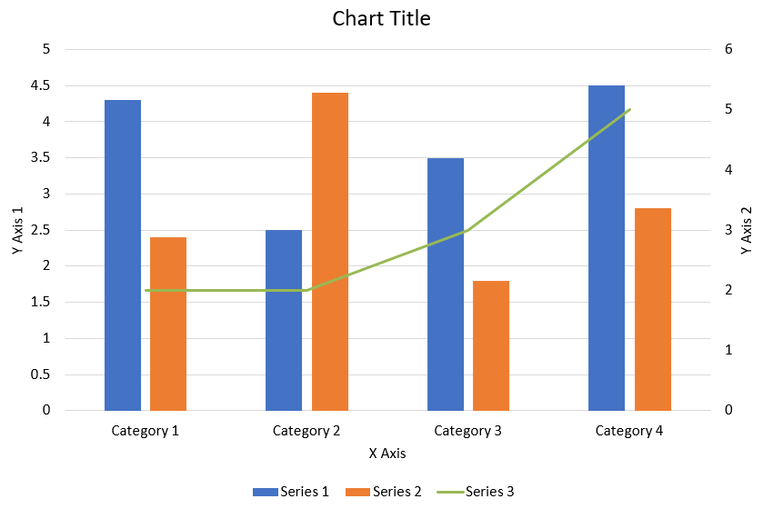

## **개요**

이 문서에서는 Aspose.Slides for Python via .NET을 사용하여 차트를 만들고 사용자 지정하는 포괄적인 가이드를 제공합니다. 슬라이드에 차트를 프로그래밍 방식으로 추가하고, 데이터를 채우며, 특정 디자인 요구에 맞게 다양한 서식 옵션을 적용하는 방법을 배웁니다. 문서 전반에 걸쳐, 프레젠테이션 및 차트 객체 초기화부터 시리즈, 축, 범례 구성까지 각 단계를 보여주는 자세한 코드 예제가 포함되어 있습니다. 이 가이드를 따르면 Python 애플리케이션에 동적 차트 생성을 통합하여 데이터 기반 프레젠테이션을 손쉽게 만들 수 있는 확실한 이해를 얻을 수 있습니다.

## **차트 만들기**

차트는 데이터를 빠르게 시각화하고 테이블이나 스프레드시트에서 즉시 파악하기 어려운 인사이트를 얻는 데 도움이 됩니다.

**차트를 만들어야 하는 이유**

차트를 사용하면 다음을 할 수 있습니다.

* 프레젠테이션의 단일 슬라이드에 대량의 데이터를 집계, 압축 또는 요약합니다.
* 데이터의 패턴과 추세를 드러냅니다.
* 시간 경과 또는 특정 측정 단위에 대한 데이터의 방향과 모멘텀을 추론합니다.
* 이상값, 변칙, 편차, 오류 및 비논리적인 데이터를 식별합니다.
* 복잡한 데이터를 전달하거나 프레젠테이션합니다.

PowerPoint에서는 *Insert* 기능을 통해 다양한 차트 템플릿을 사용해 차트를 만들 수 있습니다. Aspose.Slides를 사용하면 일반 차트(인기 차트 유형 기반)와 사용자 정의 차트를 모두 만들 수 있습니다.

{}
[ChartType](https://reference.aspose.com/slides/python-net/aspose.slides.charts/charttype/) 열거형은 [aspose.slides.charts](https://reference.aspose.com/slides/python-net/aspose.slides.charts/) 모듈에 포함됩니다. 이 열거형의 값은 서로 다른 차트 유형에 해당합니다.
{}

### **클러스터형 세로 막대 차트 만들기**

이 예제는 [add_chart](https://reference.aspose.com/slides/python-net/aspose.slides/shapecollection/add_chart/)을 사용하여 세 개 카테고리에서 두 시리즈를 비교하는 클러스터형 세로 막대 차트를 생성합니다. 시리즈는 빨간색 및 초록색 채우기를 사용하며, 개별 레이블은 카테고리 이름, 시리즈 이름 및 값을 보여줍니다. 워크시트 인덱스 0은 포함된 차트 워크북의 첫 번째 시트를 나타냅니다.

```python
import aspose.pydrawing as draw
import aspose.slides as slides
import aspose.slides.charts as charts

with slides.Presentation() as presentation:
    slide = presentation.slides[0]

    chart = slide.shapes.add_chart(charts.ChartType.CLUSTERED_COLUMN, 20, 20, 500, 300)

    chart.chart_title.add_text_frame_for_overriding("Sample Title")
    chart.chart_title.text_frame_for_overriding.text_frame_format.center_text = slides.NullableBool.TRUE
    chart.chart_title.height = 20
    chart.has_title = True

    workbook = chart.chart_data.chart_data_workbook
    worksheet_index = 0

    chart.chart_data.series.clear()
    chart.chart_data.categories.clear()

    series_name_cell = workbook.get_cell(worksheet_index, 0, 1, "Series 1")
    chart.chart_data.series.add(series_name_cell, chart.type)
    series_name_cell = workbook.get_cell(worksheet_index, 0, 2, "Series 2")
    chart.chart_data.series.add(series_name_cell, chart.type)

    category_cell = workbook.get_cell(worksheet_index, 1, 0, "Category 1")
    chart.chart_data.categories.add(category_cell)
    category_cell = workbook.get_cell(worksheet_index, 2, 0, "Category 2")
    chart.chart_data.categories.add(category_cell)
    category_cell = workbook.get_cell(worksheet_index, 3, 0, "Category 3")
    chart.chart_data.categories.add(category_cell)

    series = chart.chart_data.series[0]

    value_cell = workbook.get_cell(worksheet_index, 1, 1, 20)
    series.data_points.add_data_point_for_bar_series(value_cell)
    value_cell = workbook.get_cell(worksheet_index, 2, 1, 50)
    series.data_points.add_data_point_for_bar_series(value_cell)
    value_cell = workbook.get_cell(worksheet_index, 3, 1, 30)
    series.data_points.add_data_point_for_bar_series(value_cell)

    series.format.fill.fill_type = slides.FillType.SOLID
    series.format.fill.solid_fill_color.color = draw.Color.red

    series = chart.chart_data.series[1]

    value_cell = workbook.get_cell(worksheet_index, 1, 2, 30)
    series.data_points.add_data_point_for_bar_series(value_cell)
    value_cell = workbook.get_cell(worksheet_index, 2, 2, 10)
    series.data_points.add_data_point_for_bar_series(value_cell)
    value_cell = workbook.get_cell(worksheet_index, 3, 2, 60)
    series.data_points.add_data_point_for_bar_series(value_cell)

    series.format.fill.fill_type = slides.FillType.SOLID
    series.format.fill.solid_fill_color.color = draw.Color.green

    label = series.data_points[0].label
    label.data_label_format.show_category_name = True

    label = series.data_points[1].label
    label.data_label_format.show_series_name = True

    label = series.data_points[2].label
    label.data_label_format.show_value = True
    label.data_label_format.show_series_name = True
    label.data_label_format.separator = "/"

    presentation.save("AsposeChart.pptx", slides.export.SaveFormat.PPTX)
```

결과:


### **산점도 차트 만들기**

산점도 차트(산점도 플롯 또는 x‑y 그래프라고도 함)는 두 변수 사이의 패턴을 확인하거나 상관관계를 보여주는 데 자주 사용됩니다.

산점도 차트를 사용할 때:

* 쌍으로 된 숫자 데이터가 있는 경우
* 서로 잘 짝을 이루는 두 변수가 있는 경우
* 두 변수 간의 연관성을 판단하려는 경우
* 종속 변수에 대해 여러 값을 갖는 독립 변수가 있는 경우

이 예제는 두 세트의 x‑y 값을 플롯합니다. 첫 번째 시리즈는 별 마커가 있는 직선, 두 번째 시리즈는 원 마커가 있는 부드러운 곡선을 사용하며, 두 시리즈 모두 크기([size](https://reference.aspose.com/slides/python-net/aspose.slides.charts/marker/size/))가 10입니다. 마커 모양은 [symbol](https://reference.aspose.com/slides/python-net/aspose.slides.charts/marker/symbol/) 속성으로 제어합니다.

```python
import aspose.slides as slides
import aspose.slides.charts as charts

with slides.Presentation() as presentation:
    slide = presentation.slides[0]

    chart = slide.shapes.add_chart(charts.ChartType.SCATTER_WITH_SMOOTH_LINES, 20, 20, 500, 300)

    workbook = chart.chart_data.chart_data_workbook
    worksheet_index = 0

    chart.chart_data.series.clear()

    series_name_cell = workbook.get_cell(worksheet_index, 1, 1, "Series 1")
    chart.chart_data.series.add(series_name_cell, chart.type)
    series_name_cell = workbook.get_cell(worksheet_index, 1, 3, "Series 2")
    chart.chart_data.series.add(series_name_cell, chart.type)

    series = chart.chart_data.series[0]

    x_value_cell = workbook.get_cell(worksheet_index, 2, 1, 1)
    y_value_cell = workbook.get_cell(worksheet_index, 2, 2, 3)
    series.data_points.add_data_point_for_scatter_series(x_value_cell, y_value_cell)

    x_value_cell = workbook.get_cell(worksheet_index, 3, 1, 2)
    y_value_cell = workbook.get_cell(worksheet_index, 3, 2, 10)
    series.data_points.add_data_point_for_scatter_series(x_value_cell, y_value_cell)

    series.type = charts.ChartType.SCATTER_WITH_STRAIGHT_LINES_AND_MARKERS

    series.marker.size = 10
    series.marker.symbol = charts.MarkerStyleType.STAR

    series = chart.chart_data.series[1]

    x_value_cell = workbook.get_cell(worksheet_index, 2, 3, 5)
    y_value_cell = workbook.get_cell(worksheet_index, 2, 4, 2)
    series.data_points.add_data_point_for_scatter_series(x_value_cell, y_value_cell)

    x_value_cell = workbook.get_cell(worksheet_index, 3, 3, 3)
    y_value_cell = workbook.get_cell(worksheet_index, 3, 4, 1)
    series.data_points.add_data_point_for_scatter_series(x_value_cell, y_value_cell)

    x_value_cell = workbook.get_cell(worksheet_index, 4, 3, 2)
    y_value_cell = workbook.get_cell(worksheet_index, 4, 4, 2)
    series.data_points.add_data_point_for_scatter_series(x_value_cell, y_value_cell)

    x_value_cell = workbook.get_cell(worksheet_index, 5, 3, 5)
    y_value_cell = workbook.get_cell(worksheet_index, 5, 4, 1)
    series.data_points.add_data_point_for_scatter_series(x_value_cell, y_value_cell)

    series.marker.size = 10
    series.marker.symbol = charts.MarkerStyleType.CIRCLE

    presentation.save("AsposeChart.pptx", slides.export.SaveFormat.PPTX)
```

결과:


### **원형 차트 만들기**

원형 차트는 특히 범주형 레이블에 숫자 값이 있는 경우 데이터의 전체 대비 부분 비율을 보여줄 때 가장 적합합니다. 그러나 데이터에 많은 부분이나 레이블이 포함된 경우 막대 차트를 고려하는 것이 좋습니다.

이 예제는 3개의 분기 값을 가진 원형 차트를 생성합니다. 각 슬라이스는 사용자 지정 채우기와 테두리를 가지며, 레이블은 값, 백분율 및 시리즈 정보를 조합해 표시합니다. [first_slice_angle](https://reference.aspose.com/slides/python-net/aspose.slides.charts/chartseriesgroup/first_slice_angle/) 속성은 첫 번째 슬라이스가 180도에서 시작하도록 설정합니다.

```python
import aspose.pydrawing as draw
import aspose.slides as slides
import aspose.slides.charts as charts

with slides.Presentation() as presentation:
    slide = presentation.slides[0]

    chart = slide.shapes.add_chart(charts.ChartType.PIE, 20, 20, 500, 300)

    chart.chart_title.add_text_frame_for_overriding("Sample Title")
    chart.chart_title.text_frame_for_overriding.text_frame_format.center_text = slides.NullableBool.TRUE
    chart.chart_title.height = 20
    chart.has_title = True

    chart.chart_data.series[0].labels.default_data_label_format.show_value = True

    workbook = chart.chart_data.chart_data_workbook
    worksheet_index = 0

    chart.chart_data.series.clear()
    chart.chart_data.categories.clear()

    category_cell = workbook.get_cell(0, 1, 0, "1st Qtr")
    chart.chart_data.categories.add(category_cell)
    category_cell = workbook.get_cell(0, 2, 0, "2nd Qtr")
    chart.chart_data.categories.add(category_cell)
    category_cell = workbook.get_cell(0, 3, 0, "3rd Qtr")
    chart.chart_data.categories.add(category_cell)

    series_name_cell = workbook.get_cell(0, 0, 1, "Series 1")
    series = chart.chart_data.series.add(series_name_cell, chart.type)

    value_cell = workbook.get_cell(worksheet_index, 1, 1, 20)
    series.data_points.add_data_point_for_pie_series(value_cell)
    value_cell = workbook.get_cell(worksheet_index, 2, 1, 50)
    series.data_points.add_data_point_for_pie_series(value_cell)
    value_cell = workbook.get_cell(worksheet_index, 3, 1, 30)
    series.data_points.add_data_point_for_pie_series(value_cell)

    chart.chart_data.series_groups[0].is_color_varied = True

    first_slice = series.data_points[0]
    first_slice.format.fill.fill_type = slides.FillType.SOLID
    first_slice.format.fill.solid_fill_color.color = draw.Color.cyan

    first_slice.format.line.fill_format.fill_type = slides.FillType.SOLID
    first_slice.format.line.fill_format.solid_fill_color.color = draw.Color.gray
    first_slice.format.line.width = 3.0
    first_slice.format.line.style = slides.LineStyle.THIN_THICK
    first_slice.format.line.dash_style = slides.LineDashStyle.LARGE_DASH

    second_slice = series.data_points[1]
    second_slice.format.fill.fill_type = slides.FillType.SOLID
    second_slice.format.fill.solid_fill_color.color = draw.Color.brown

    second_slice.format.line.fill_format.fill_type = slides.FillType.SOLID
    second_slice.format.line.fill_format.solid_fill_color.color = draw.Color.blue
    second_slice.format.line.width = 3.0
    second_slice.format.line.style = slides.LineStyle.SINGLE
    second_slice.format.line.dash_style = slides.LineDashStyle.LARGE_DASH_DOT

    third_slice = series.data_points[2]
    third_slice.format.fill.fill_type = slides.FillType.SOLID
    third_slice.format.fill.solid_fill_color.color = draw.Color.coral

    third_slice.format.line.fill_format.fill_type = slides.FillType.SOLID
    third_slice.format.line.fill_format.solid_fill_color.color = draw.Color.red
    third_slice.format.line.width = 2.0
    third_slice.format.line.style = slides.LineStyle.THIN_THIN
    third_slice.format.line.dash_style = slides.LineDashStyle.LARGE_DASH_DOT_DOT

    first_label = series.data_points[0].label
    first_label.data_label_format.show_value = True

    second_label = series.data_points[1].label
    second_label.data_label_format.show_value = True
    second_label.data_label_format.show_legend_key = True
    second_label.data_label_format.show_percentage = True

    third_label = series.data_points[2].label
    third_label.data_label_format.show_series_name = True
    third_label.data_label_format.show_percentage = True

    series.labels.default_data_label_format.show_leader_lines = True

    chart.chart_data.series_groups[0].first_slice_angle = 180

    presentation.save("PieChart.pptx", slides.export.SaveFormat.PPTX)
```

결과:


레이블을 파이 외부에 배치하고 선 색상, 두께, 투명도 및 대시 스타일을 사용자 지정하는 방법은 [Format Leader Lines](/slides/ko/python-net/chart-data-label/#format-leader-lines) 예제를 참조하십시오.

### **꺾은선 차트 만들기**

꺾은선 차트(라인 그래프라고도 함)는 시간에 따른 값 변화를 보여줄 때 가장 적합합니다. 꺾은선 차트를 사용하면 대량의 데이터를 한 번에 비교하고, 시간에 따른 변화와 추세를 추적하며, 데이터 시리즈의 이상 현상을 강조할 수 있습니다.

이 예제는 [add_chart](https://reference.aspose.com/slides/python-net/aspose.slides/shapecollection/add_chart/)을 사용하여 기본 시리즈와 카테고리를 가진 꺾은선 차트를 만든 뒤 PPTX로 저장합니다.

```python
import aspose.slides as slides
import aspose.slides.charts as charts

with slides.Presentation() as presentation:
    slide = presentation.slides[0]

    line_chart = slide.shapes.add_chart(charts.ChartType.LINE, 20, 20, 500, 300)

    presentation.save("lineChart.pptx", slides.export.SaveFormat.PPTX)
```

기본적으로 꺾은선 차트의 점은 직선으로 연결됩니다. 점을 대시선으로 연결하려면 [dash_style](https://reference.aspose.com/slides/python-net/aspose.slides/lineformat/dash_style/)을 [LineDashStyle](https://reference.aspose.com/slides/python-net/aspose.slides/linedashstyle/)의 값으로 설정합니다:

```python
import aspose.slides as slides
import aspose.slides.charts as charts

with slides.Presentation() as presentation:
    slide = presentation.slides[0]

    line_chart = slide.shapes.add_chart(charts.ChartType.LINE, 20, 20, 500, 300)

    for series in line_chart.chart_data.series:
        series.format.line.dash_style = slides.LineDashStyle.DASH
```

결과:


### **트리맵 차트 만들기**

트리맵 차트는 각 카테고리 내에서 큰 기여자를 빠르게 강조하고 싶을 때 매출 데이터를 시각화하는 데 가장 적합합니다.

이 예제는 8개의 잎을 4개의 줄기와 2개의 가지로 그룹화한 트리맵을 생성합니다. [set_grouping_item](https://reference.aspose.com/slides/python-net/aspose.slides.charts/chartcategorylevelsmanager/set_grouping_item/) 메서드는 1단계 그룹화 수준에 줄기를, 2단계에 가지를 할당합니다. 값은 사각형의 상대 크기를 결정하고, 카테고리 레이블과 겹치는 상위 레이블이 계층 구조를 나타냅니다.

```python
import aspose.slides as slides
import aspose.slides.charts as charts

with slides.Presentation() as presentation:
    slide = presentation.slides[0]

    chart = slide.shapes.add_chart(charts.ChartType.TREEMAP, 20, 20, 500, 300)

    chart.chart_data.categories.clear()
    chart.chart_data.series.clear()

    workbook = chart.chart_data.chart_data_workbook
    workbook.clear(0)

    # 브랜치 1
    category_cell = workbook.get_cell(0, "C1", "Leaf1")
    leaf = chart.chart_data.categories.add(category_cell)
    leaf.grouping_levels.set_grouping_item(1, "Stem1")
    leaf.grouping_levels.set_grouping_item(2, "Branch1")

    category_cell = workbook.get_cell(0, "C2", "Leaf2")
    chart.chart_data.categories.add(category_cell)

    category_cell = workbook.get_cell(0, "C3", "Leaf3")
    leaf = chart.chart_data.categories.add(category_cell)
    leaf.grouping_levels.set_grouping_item(1, "Stem2")

    category_cell = workbook.get_cell(0, "C4", "Leaf4")
    chart.chart_data.categories.add(category_cell)

    # 브랜치 2
    category_cell = workbook.get_cell(0, "C5", "Leaf5")
    leaf = chart.chart_data.categories.add(category_cell)
    leaf.grouping_levels.set_grouping_item(1, "Stem3")
    leaf.grouping_levels.set_grouping_item(2, "Branch2")

    category_cell = workbook.get_cell(0, "C6", "Leaf6")
    chart.chart_data.categories.add(category_cell)

    category_cell = workbook.get_cell(0, "C7", "Leaf7")
    leaf = chart.chart_data.categories.add(category_cell)
    leaf.grouping_levels.set_grouping_item(1, "Stem4")

    category_cell = workbook.get_cell(0, "C8", "Leaf8")
    chart.chart_data.categories.add(category_cell)

    series = chart.chart_data.series.add(charts.ChartType.TREEMAP)
    series.labels.default_data_label_format.show_category_name = True
    value_cell = workbook.get_cell(0, "D1", 4)
    series.data_points.add_data_point_for_treemap_series(value_cell)
    value_cell = workbook.get_cell(0, "D2", 5)
    series.data_points.add_data_point_for_treemap_series(value_cell)
    value_cell = workbook.get_cell(0, "D3", 3)
    series.data_points.add_data_point_for_treemap_series(value_cell)
    value_cell = workbook.get_cell(0, "D4", 6)
    series.data_points.add_data_point_for_treemap_series(value_cell)
    value_cell = workbook.get_cell(0, "D5", 9)
    series.data_points.add_data_point_for_treemap_series(value_cell)
    value_cell = workbook.get_cell(0, "D6", 9)
    series.data_points.add_data_point_for_treemap_series(value_cell)
    value_cell = workbook.get_cell(0, "D7", 4)
    series.data_points.add_data_point_for_treemap_series(value_cell)
    value_cell = workbook.get_cell(0, "D8", 3)
    series.data_points.add_data_point_for_treemap_series(value_cell)

    series.parent_label_layout = charts.ParentLabelLayoutType.OVERLAPPING

    presentation.save("Treemap.pptx", slides.export.SaveFormat.PPTX)
```

결과:


### **워터폴 차트 만들기**

워터폴 차트는 양의 변동과 음의 변동이 최종 값에 어떻게 기여하는지를 보여줍니다. 예를 들어, 이익 내역은 매출에서 시작해 비용을 차감하고 기타 수입을 더합니다. 변동 열은 이전 값과 새로운 누적 값 사이에 떠 있으며, 총합 열은 0에서 누적 값까지 확장됩니다.

다음 예제는 천 달러 단위의 금액을 사용합니다:

| 카테고리 | 워크북 값 | 열 유형 |
| --- | ---: | --- |
| Revenue | 1000 | Increase |
| Cost of sales | -400 | Decrease |
| Gross profit | 600 | Intermediate total |
| Operating expenses | -200 | Decrease |
| Other income | 50 | Increase |
| Net profit | 450 | Final total |

중간 합계 또는 최종 합계로 표시하려면 해당 점의 [set_as_total](https://reference.aspose.com/slides/python-net/aspose.slides.charts/chartdatapoint/set_as_total/) 속성을 `True`로 설정하고, 워크북 셀에 실제 누적 값을 입력합니다(`600`은 총이익(1000 - 400), `450`은 순이익(600 - 200 + 50)). 이 속성은 열을 합계로 표시하지만 셀 값을 계산하거나 채우지는 않습니다. 자리 표시로 0을 사용하거나 다른 변동을 합계 점에 제공하지 마십시오. 합계 열은 누적 값을 다시 더하지 않고 표시합니다.

이 완전한 C# 예제는 [ChartType](https://reference.aspose.com/slides/python-net/aspose.slides.charts/charttype/)의 `Waterfall` 멤버를 사용해 차트를 만들고, 기본 데이터를 지운 뒤 포함된 워크북을 채웁니다. 워크시트 인덱스 `0`은 첫 번째 워크시트를 선택하며, A열은 카테고리 이름, B열은 값을 포함합니다. 각 값 셀은 [add_data_point_for_waterfall_series](https://reference.aspose.com/slides/python-net/aspose.slides.charts/chartdatapointcollection/add_data_point_for_waterfall_series/)로 추가됩니다. 0 기반 점 인덱스 `2`와 `5`는 각각 중간 및 최종 합계를 식별합니다. [show_value](https://reference.aspose.com/slides/python-net/aspose.slides.charts/datalabelformat/show_value/)를 활성화하면 열에 금액이 표시됩니다. 입력 프레젠테이션이나 워크북은 필요하지 않습니다.

```python
import aspose.slides as slides
import aspose.slides.charts as charts

with slides.Presentation() as presentation:
    slide = presentation.slides[0]

    chart = slide.shapes.add_chart(charts.ChartType.WATERFALL, 20, 20, 680, 200)

    chart.has_title = True
    chart.chart_title.add_text_frame_for_overriding("Profit breakdown (USD thousands)")
    chart.chart_title.overlay = False
    chart.has_legend = False

    chart.chart_data.series.clear()
    chart.chart_data.categories.clear()

    workbook = chart.chart_data.chart_data_workbook
    worksheet_index = 0

    workbook.clear(worksheet_index)

    series_name_cell = workbook.get_cell(worksheet_index, 0, 1, "Profit")
    series = chart.chart_data.series.add(series_name_cell, charts.ChartType.WATERFALL)
    categories = ["Revenue", "Cost of sales", "Gross profit", "Operating expenses", "Other income", "Net profit"]
    values = [1000, -400, 600, -200, 50, 450]

    for i in range(len(categories)):
        category_cell = workbook.get_cell(worksheet_index, i + 1, 0, categories[i])
        chart.chart_data.categories.add(category_cell)
        value_cell = workbook.get_cell(worksheet_index, i + 1, 1, values[i])
        series.data_points.add_data_point_for_waterfall_series(value_cell)

    # 세 번째와 여섯 번째 포인트는 추가 변동이 아닌 총계(합계)를 나타냅니다.
    series.data_points[2].set_as_total = True
    series.data_points[5].set_as_total = True
    series.show_connector_lines = True
    series.labels.default_data_label_format.show_value = True

    presentation.save("WaterfallChart.pptx", slides.export.SaveFormat.PPTX)
```

시리즈 수준의 [show_connector_lines](https://reference.aspose.com/slides/python-net/aspose.slides.charts/chartseries/show_connector_lines/) 속성을 `True`로 설정하면 연속 열을 연결하는 선이 표시되어 누적 값을 따라가기 쉽습니다. 이 선을 숨기려면 예제에서 `series.show_connector_lines = False` 로 바꾸고 저장하십시오. 이는 선 가시성만 변경하며 데이터나 합계에는 영향을 주지 않습니다.

저장된 프레젠테이션은 600의 총이익과 450의 순이익을 0에서 시작하는 두 합계로 표시합니다:


### **주식 차트 만들기**

주식 차트는 시가, 고가, 저가, 종가와 같은 금융 데이터를 표시하여 시장 동향과 변동성을 분석하는 데 사용됩니다. 이는 투자자와 분석가가 정보에 입각한 결정을 내리는 데 필수적인 통찰을 제공합니다.

이 예제는 순서대로 네 개 시리즈와 세 개 카테고리를 가진 OHLC(시가‑고가‑저가‑종가) 차트를 생성합니다. [has_up_down_bars](https://reference.aspose.com/slides/python-net/aspose.slides.charts/updownbarsmanager/has_up_down_bars/) 속성은 상승·하락 바를 활성화하고, [hi_low_lines_format](https://reference.aspose.com/slides/python-net/aspose.slides.charts/chartseriesgroup/hi_low_lines_format/)는 가격 범위를 나타내는 고저선을 제어합니다. 개별 시리즈 라인과 작은 수평 그리드라인은 숨겨집니다.

[up_down_bars](https://reference.aspose.com/slides/python-net/aspose.slides.charts/chartseriesgroup/up_down_bars/) 관리자는 별도의 [up_bars_format](https://reference.aspose.com/slides/python-net/aspose.slides.charts/updownbarsmanager/up_bars_format/) 및 [down_bars_format](https://reference.aspose.com/slides/python-net/aspose.slides.charts/updownbarsmanager/down_bars_format/) 객체를 노출합니다. 각 객체의 [fill](https://reference.aspose.com/slides/python-net/aspose.slides.charts/format/fill/)과 [line](https://reference.aspose.com/slides/python-net/aspose.slides.charts/format/line/) 속성을 사용해 채우기와 외곽선을 독립적으로 설정합니다. 이 예제는 상승 구간에 녹색 바와 진한 녹색 외곽선을, 하락 구간에 주황‑빨강 바와 진한 빨강 외곽선을 사용합니다.

각 카테고리마다 네 개 시리즈에 대한 수치를 제공하며, 고가와 저가가 시가와 종가를 둘러싸게 합니다. 바는 **같은 카테고리 내**에서 종가와 시가를 비교하며, 이전 카테고리와는 비교하지 않습니다: A는 72에서 25로 하락하고, B는 25에서 38로 상승, C는 38에서 50으로 상승합니다. 시가와 종가가 동일하면 표시되는 구간이 없습니다. 상승·하락 바는 시가‑종가를 연결하고, 고저선은 저가‑고가를 연결합니다. 이러한 바는 시리즈 그룹에 속하며 일반적인 막대 차트 시리즈와는 다릅니다.

이 서식은 최소 두 개 시리즈와 각 카테고리마다 해당 수치를 가진 [LINE 및 LINE_WITH_MARKERS](https://reference.aspose.com/slides/python-net/aspose.slides.charts/charttype/) 차트에서도 작동합니다. 이러한 비스택 라인 차트에서는 첫 번째와 마지막 시리즈를 비교해 상승 바 또는 하락 바를 결정합니다. 시리즈 순서를 반대로 하면 분류도 반대로 됩니다. 아래 예제는 [OPEN_HIGH_LOW_CLOSE](https://reference.aspose.com/slides/python-net/aspose.slides.charts/charttype/)를 사용합니다; 다른 주식, 스택 라인, 3D 변형이 동일한 데이터 배열이나 구간 해석을 사용한다는 가정은 하지 마십시오.

```python
import aspose.pydrawing as draw
import aspose.slides as slides
import aspose.slides.charts as charts

with slides.Presentation() as presentation:
    slide = presentation.slides[0]

    chart = slide.shapes.add_chart(charts.ChartType.OPEN_HIGH_LOW_CLOSE, 20, 20, 500, 150, False)

    workbook = chart.chart_data.chart_data_workbook

    category_cell = workbook.get_cell(0, 1, 0, "A")
    chart.chart_data.categories.add(category_cell)
    category_cell = workbook.get_cell(0, 2, 0, "B")
    chart.chart_data.categories.add(category_cell)
    category_cell = workbook.get_cell(0, 3, 0, "C")
    chart.chart_data.categories.add(category_cell)

    series_name_cell = workbook.get_cell(0, 0, 1, "Open")
    chart.chart_data.series.add(series_name_cell, charts.ChartType.OPEN_HIGH_LOW_CLOSE)
    series_name_cell = workbook.get_cell(0, 0, 2, "High")
    chart.chart_data.series.add(series_name_cell, charts.ChartType.OPEN_HIGH_LOW_CLOSE)
    series_name_cell = workbook.get_cell(0, 0, 3, "Low")
    chart.chart_data.series.add(series_name_cell, charts.ChartType.OPEN_HIGH_LOW_CLOSE)
    series_name_cell = workbook.get_cell(0, 0, 4, "Close")
    chart.chart_data.series.add(series_name_cell, charts.ChartType.OPEN_HIGH_LOW_CLOSE)

    series = chart.chart_data.series[0]
    value_cell = workbook.get_cell(0, 1, 1, 72)
    series.data_points.add_data_point_for_stock_series(value_cell)
    value_cell = workbook.get_cell(0, 2, 1, 25)
    series.data_points.add_data_point_for_stock_series(value_cell)
    value_cell = workbook.get_cell(0, 3, 1, 38)
    series.data_points.add_data_point_for_stock_series(value_cell)

    series = chart.chart_data.series[1]
    value_cell = workbook.get_cell(0, 1, 2, 172)
    series.data_points.add_data_point_for_stock_series(value_cell)
    value_cell = workbook.get_cell(0, 2, 2, 57)
    series.data_points.add_data_point_for_stock_series(value_cell)
    value_cell = workbook.get_cell(0, 3, 2, 57)
    series.data_points.add_data_point_for_stock_series(value_cell)

    series = chart.chart_data.series[2]
    value_cell = workbook.get_cell(0, 1, 3, 12)
    series.data_points.add_data_point_for_stock_series(value_cell)
    value_cell = workbook.get_cell(0, 2, 3, 12)
    series.data_points.add_data_point_for_stock_series(value_cell)
    value_cell = workbook.get_cell(0, 3, 3, 13)
    series.data_points.add_data_point_for_stock_series(value_cell)

    series = chart.chart_data.series[3]
    value_cell = workbook.get_cell(0, 1, 4, 25)
    series.data_points.add_data_point_for_stock_series(value_cell)
    value_cell = workbook.get_cell(0, 2, 4, 38)
    series.data_points.add_data_point_for_stock_series(value_cell)
    value_cell = workbook.get_cell(0, 3, 4, 50)
    series.data_points.add_data_point_for_stock_series(value_cell)

    up_down_bars = chart.chart_data.series_groups[0].up_down_bars
    up_down_bars.has_up_down_bars = True

    up_down_bars.up_bars_format.fill.fill_type = slides.FillType.SOLID
    up_down_bars.up_bars_format.fill.solid_fill_color.color = draw.Color.lime_green
    up_down_bars.up_bars_format.line.fill_format.fill_type = slides.FillType.SOLID
    up_down_bars.up_bars_format.line.fill_format.solid_fill_color.color = draw.Color.dark_green
    up_down_bars.up_bars_format.line.width = 2

    up_down_bars.down_bars_format.fill.fill_type = slides.FillType.SOLID
    up_down_bars.down_bars_format.fill.solid_fill_color.color = draw.Color.orange_red
    up_down_bars.down_bars_format.line.fill_format.fill_type = slides.FillType.SOLID
    up_down_bars.down_bars_format.line.fill_format.solid_fill_color.color = draw.Color.dark_red
    up_down_bars.down_bars_format.line.width = 2
    chart.chart_data.series_groups[0].hi_low_lines_format.line.fill_format.fill_type = slides.FillType.SOLID

    for stock_series in chart.chart_data.series:
        stock_series.format.line.fill_format.fill_type = slides.FillType.NO_FILL

    chart.axes.vertical_axis.minor_grid_lines_format.line.fill_format.fill_type = slides.FillType.NO_FILL

    presentation.save("Stock-chart.pptx", slides.export.SaveFormat.PPTX)
```

PowerPoint에서 내보낸 결과:


### **박스‑위스커 차트 만들기**

박스‑위스커 차트는 중앙값, 사분위수 및 잠재적 이상값과 같은 주요 통계 측정값을 요약하여 데이터 분포를 표시합니다. 탐색적 데이터 분석 및 통계 연구에서 데이터 변동성을 빠르게 파악하고 이상치를 식별하는 데 특히 유용합니다.

이 예제는 여섯 개 값을 사용해 박스‑위스커 차트를 생성합니다. [quartile_method](https://reference.aspose.com/slides/python-net/aspose.slides.charts/chartseries/quartile_method/) 속성은 배타적 사분위수 계산을 선택합니다. 또한 평균선, 평균 마커, 내부 포인트 및 이상값 포인트를 활성화합니다.

```python
import aspose.slides as slides
import aspose.slides.charts as charts

with slides.Presentation() as presentation:
    slide = presentation.slides[0]

    chart = slide.shapes.add_chart(charts.ChartType.BOX_AND_WHISKER, 20, 20, 500, 300)

    chart.chart_data.categories.clear()
    chart.chart_data.series.clear()

    workbook = chart.chart_data.chart_data_workbook
    workbook.clear(0)

    category_cell = workbook.get_cell(0, "A1", "Category 1")
    chart.chart_data.categories.add(category_cell)
    category_cell = workbook.get_cell(0, "A2", "Category 2")
    chart.chart_data.categories.add(category_cell)
    category_cell = workbook.get_cell(0, "A3", "Category 3")
    chart.chart_data.categories.add(category_cell)
    category_cell = workbook.get_cell(0, "A4", "Category 4")
    chart.chart_data.categories.add(category_cell)
    category_cell = workbook.get_cell(0, "A5", "Category 5")
    chart.chart_data.categories.add(category_cell)
    category_cell = workbook.get_cell(0, "A6", "Category 6")
    chart.chart_data.categories.add(category_cell)

    series = chart.chart_data.series.add(charts.ChartType.BOX_AND_WHISKER)

    series.quartile_method = charts.QuartileMethodType.EXCLUSIVE
    series.show_mean_line = True
    series.show_mean_markers = True
    series.show_inner_points = True
    series.show_outlier_points = True

    value_cell = workbook.get_cell(0, "B1", 15)
    series.data_points.add_data_point_for_box_and_whisker_series(value_cell)
    value_cell = workbook.get_cell(0, "B2", 41)
    series.data_points.add_data_point_for_box_and_whisker_series(value_cell)
    value_cell = workbook.get_cell(0, "B3", 16)
    series.data_points.add_data_point_for_box_and_whisker_series(value_cell)
    value_cell = workbook.get_cell(0, "B4", 10)
    series.data_points.add_data_point_for_box_and_whisker_series(value_cell)
    value_cell = workbook.get_cell(0, "B5", 23)
    series.data_points.add_data_point_for_box_and_whisker_series(value_cell)
    value_cell = workbook.get_cell(0, "B6", 16)
    series.data_points.add_data_point_for_box_and_whisker_series(value_cell)

    presentation.save("BoxAndWhisker.pptx", slides.export.SaveFormat.PPTX)
```

### **퍼널 차트 만들기**

퍼널 차트는 단계별로 진행될수록 데이터 양이 감소하는 프로세스를 시각화하는 데 사용됩니다. 전환율 분석, 병목 현상 파악 및 영업·마케팅 프로세스 효율성 추적에 특히 도움이 됩니다.

이 예제는 [add_chart](https://reference.aspose.com/slides/python-net/aspose.slides/shapecollection/add_chart/)을 사용해 기존 프레젠테이션의 첫 번째 슬라이드에 퍼널 차트를 추가합니다. 기본 데이터를 6개의 카테고리와 50~500 사이의 값으로 교체한 뒤 업데이트된 프레젠테이션을 저장합니다. 입력 프레젠테이션에는 최소 하나의 슬라이드가 있어야 합니다.

```python
import aspose.slides as slides
import aspose.slides.charts as charts

with slides.Presentation("test.pptx") as presentation:
    slide = presentation.slides[0]

    chart = slide.shapes.add_chart(charts.ChartType.FUNNEL, 50, 50, 500, 400)

    chart.chart_data.categories.clear()
    chart.chart_data.series.clear()

    workbook = chart.chart_data.chart_data_workbook
    workbook.clear(0)

    category_cell = workbook.get_cell(0, "A1", "Category 1")
    chart.chart_data.categories.add(category_cell)
    category_cell = workbook.get_cell(0, "A2", "Category 2")
    chart.chart_data.categories.add(category_cell)
    category_cell = workbook.get_cell(0, "A3", "Category 3")
    chart.chart_data.categories.add(category_cell)
    category_cell = workbook.get_cell(0, "A4", "Category 4")
    chart.chart_data.categories.add(category_cell)
    category_cell = workbook.get_cell(0, "A5", "Category 5")
    chart.chart_data.categories.add(category_cell)
    category_cell = workbook.get_cell(0, "A6", "Category 6")
    chart.chart_data.categories.add(category_cell)

    series = chart.chart_data.series.add(charts.ChartType.FUNNEL)

    value_cell = workbook.get_cell(0, "B1", 50)
    series.data_points.add_data_point_for_funnel_series(value_cell)
    value_cell = workbook.get_cell(0, "B2", 100)
    series.data_points.add_data_point_for_funnel_series(value_cell)
    value_cell = workbook.get_cell(0, "B3", 200)
    series.data_points.add_data_point_for_funnel_series(value_cell)
    value_cell = workbook.get_cell(0, "B4", 300)
    series.data_points.add_data_point_for_funnel_series(value_cell)
    value_cell = workbook.get_cell(0, "B5", 400)
    series.data_points.add_data_point_for_funnel_series(value_cell)
    value_cell = workbook.get_cell(0, "B6", 500)
    series.data_points.add_data_point_for_funnel_series(value_cell)

    presentation.save("Funnel.pptx", slides.export.SaveFormat.PPTX)
```

결과:


### **선버스트 차트 만들기**

선버스트 차트는 계층형 데이터를 시각화하며, 레벨을 동심원 형태의 링으로 표시합니다. 부분‑전체 관계를 설명하고 중첩된 카테고리와 하위 카테고리를 명확하고 컴팩트하게 나타내는 데 이상적입니다.

이 예제는 8개의 잎을 4개의 줄기와 2개의 가지로 그룹화한 선버스트 차트를 생성합니다. [set_grouping_item](https://reference.aspose.com/slides/python-net/aspose.slides.charts/chartcategorylevelsmanager/set_grouping_item/) 메서드는 1단계에 줄기, 2단계에 가지를 할당합니다. 카테고리 레이블이 구간을 식별하고, 값이 상대 크기를 결정합니다.

```python
import aspose.slides as slides
import aspose.slides.charts as charts

with slides.Presentation() as presentation:
    slide = presentation.slides[0]

    chart = slide.shapes.add_chart(charts.ChartType.SUNBURST, 20, 20, 500, 300)

    chart.chart_data.categories.clear()
    chart.chart_data.series.clear()

    workbook = chart.chart_data.chart_data_workbook
    workbook.clear(0)

    # 브랜치 1
    category_cell = workbook.get_cell(0, "C1", "Leaf1")
    leaf = chart.chart_data.categories.add(category_cell)
    leaf.grouping_levels.set_grouping_item(1, "Stem1")
    leaf.grouping_levels.set_grouping_item(2, "Branch1")

    category_cell = workbook.get_cell(0, "C2", "Leaf2")
    chart.chart_data.categories.add(category_cell)

    category_cell = workbook.get_cell(0, "C3", "Leaf3")
    leaf = chart.chart_data.categories.add(category_cell)
    leaf.grouping_levels.set_grouping_item(1, "Stem2")

    category_cell = workbook.get_cell(0, "C4", "Leaf4")
    chart.chart_data.categories.add(category_cell)

    # 브랜치 2
    category_cell = workbook.get_cell(0, "C5", "Leaf5")
    leaf = chart.chart_data.categories.add(category_cell)
    leaf.grouping_levels.set_grouping_item(1, "Stem3")
    leaf.grouping_levels.set_grouping_item(2, "Branch2")

    category_cell = workbook.get_cell(0, "C6", "Leaf6")
    chart.chart_data.categories.add(category_cell)

    category_cell = workbook.get_cell(0, "C7", "Leaf7")
    leaf = chart.chart_data.categories.add(category_cell)
    leaf.grouping_levels.set_grouping_item(1, "Stem4")

    category_cell = workbook.get_cell(0, "C8", "Leaf8")
    chart.chart_data.categories.add(category_cell)

    series = chart.chart_data.series.add(charts.ChartType.SUNBURST)
    series.labels.default_data_label_format.show_category_name = True
    value_cell = workbook.get_cell(0, "D1", 4)
    series.data_points.add_data_point_for_sunburst_series(value_cell)
    value_cell = workbook.get_cell(0, "D2", 5)
    series.data_points.add_data_point_for_sunburst_series(value_cell)
    value_cell = workbook.get_cell(0, "D3", 3)
    series.data_points.add_data_point_for_sunburst_series(value_cell)
    value_cell = workbook.get_cell(0, "D4", 6)
    series.data_points.add_data_point_for_sunburst_series(value_cell)
    value_cell = workbook.get_cell(0, "D5", 9)
    series.data_points.add_data_point_for_sunburst_series(value_cell)
    value_cell = workbook.get_cell(0, "D6", 9)
    series.data_points.add_data_point_for_sunburst_series(value_cell)
    value_cell = workbook.get_cell(0, "D7", 4)
    series.data_points.add_data_point_for_sunburst_series(value_cell)
    value_cell = workbook.get_cell(0, "D8", 3)
    series.data_points.add_data_point_for_sunburst_series(value_cell)

    presentation.save("Sunburst.pptx", slides.export.SaveFormat.PPTX)
```

결과:


### **히스토그램 차트 만들기**

히스토그램 차트는 숫자 값이 구간(빈)별로 어떻게 분포되는지를 보여줍니다. 주문 처리 시간과 같은 월간 보고서에서는 동일한 구간 폭과 임계값을 사용해 구간을 일관되게 유지하고 분포를 쉽게 비교할 수 있습니다.

수평축 [aggregation_type](https://reference.aspose.com/slides/python-net/aspose.slides.charts/axis/aggregation_type/)을 [AxisAggregationType](https://reference.aspose.com/slides/python-net/aspose.slides.charts/axisaggregationtype/)의 모드 중 하나로 설정합니다. `BY_BIN_WIDTH`에서는 [bin_width](https://reference.aspose.com/slides/python-net/aspose.slides.charts/axis/bin_width/)가 적용되고, `BY_NUMBER_OF_BINS`에서는 [number_of_bins](https://reference.aspose.com/slides/python-net/aspose.slides.charts/axis/number_of_bins/)이 적용됩니다. `AUTOMATIC`을 사용하면 차트가 자동으로 빈을 선택합니다.

#### **고정 구간 폭 사용**

이 예제는 10분 간격으로 처리 시간을 그룹화하고, 10분 이하와 40분 초과 구간을 별도로 지정합니다. [is_underflow_bin](https://reference.aspose.com/slides/python-net/aspose.slides.charts/axis/is_underflow_bin/)와 [is_overflow_bin](https://reference.aspose.com/slides/python-net/aspose.slides.charts/axis/is_overflow_bin/)을 사용해 해당 빈을 활성화합니다. 명시적인 [underflow_bin](https://reference.aspose.com/slides/python-net/aspose.slides.charts/axis/underflow_bin/) 및 [overflow_bin](https://reference.aspose.com/slides/python-net/aspose.slides.charts/axis/overflow_bin/) 임계값을 제공하는 경우, [is_automatic_underflow_bin](https://reference.aspose.com/slides/python-net/aspose.slides.charts/axis/is_automatic_underflow_bin/)와 [is_automatic_overflow_bin](https://reference.aspose.com/slides/python-net/aspose.slides.charts/axis/is_automatic_overflow_bin/)을 `False`로 설정합니다.

```python
import aspose.slides as slides
import aspose.slides.charts as charts

with slides.Presentation() as presentation:
    slide = presentation.slides[0]

    chart = slide.shapes.add_chart(charts.ChartType.HISTOGRAM, 20, 20, 680, 200)

    chart.has_legend = False
    chart.has_title = False

    chart.chart_data.categories.clear()
    chart.chart_data.series.clear()

    workbook = chart.chart_data.chart_data_workbook
    workbook.clear(0)

    series = chart.chart_data.series.add(charts.ChartType.HISTOGRAM)
    values = [5, 10, 10, 11, 15, 20, 20, 21, 25, 30, 30, 31, 35, 40, 40, 41, 50]
    for i, value in enumerate(values):
        value_cell = workbook.get_cell(0, i, 0, value)
        series.data_points.add_data_point_for_histogram_series(value_cell)

    axis = chart.axes.horizontal_axis
    axis.aggregation_type = charts.AxisAggregationType.BY_BIN_WIDTH
    axis.bin_width = 10
    axis.is_underflow_bin = True
    axis.is_automatic_underflow_bin = False
    axis.underflow_bin = 10
    axis.is_overflow_bin = True
    axis.is_automatic_overflow_bin = False
    axis.overflow_bin = 40

    presentation.save("Histogram-bin-width.pptx", slides.export.SaveFormat.PPTX)
```

PowerPoint에서 표시된 프레젠테이션은 **3, 4, 4, 4, 2**개의 빈 카운트를 보여줍니다. 언더플로우 빈은 `5, 10, 10`을 포함하므로 임계값은 포함형이며, 오버플로우 빈은 `41, 50`만 포함하므로 임계값은 제외형입니다; `40`과 같은 값은 앞선 구간에 남습니다. 내부 빈은 하한보다 크고 상한보다 작거나 같은 값을 포함합니다.


#### **빈 개수 지정**

고정 구간 대신 일정한 세부 수준을 원할 경우, 동일한 데이터에 대해 5개의 빈을 요청합니다. 이 예제는 언더플로우·오버플로우 빈을 비활성화합니다. 차트는 데이터 범위에서 폭을 계산하므로 보고서마다 경계가 변할 수 있습니다.

```python
import aspose.slides as slides
import aspose.slides.charts as charts

with slides.Presentation() as presentation:
    slide = presentation.slides[0]

    chart = slide.shapes.add_chart(charts.ChartType.HISTOGRAM, 20, 20, 680, 200)

    chart.has_legend = False
    chart.has_title = False

    chart.chart_data.categories.clear()
    chart.chart_data.series.clear()

    workbook = chart.chart_data.chart_data_workbook
    workbook.clear(0)

    series = chart.chart_data.series.add(charts.ChartType.HISTOGRAM)
    values = [5, 10, 10, 11, 15, 20, 20, 21, 25, 30, 30, 31, 35, 40, 40, 41, 50]
    for i, value in enumerate(values):
        value_cell = workbook.get_cell(0, i, 0, value)
        series.data_points.add_data_point_for_histogram_series(value_cell)

    axis = chart.axes.horizontal_axis
    axis.aggregation_type = charts.AxisAggregationType.BY_NUMBER_OF_BINS
    axis.number_of_bins = 5

    presentation.save("Histogram-bin-count.pptx", slides.export.SaveFormat.PPTX)
```

다섯 개 빈의 카운트는 **4, 4, 4, 4, 1**입니다. 위의 고정 폭 결과와 분포를 비교해 보십시오: 입력값은 동일하지만 경계가 다릅니다.


### **레이다 차트 만들기**

레이다 차트는 다변량 데이터를 2차원 형식으로 표시해 여러 변수를 동시에 비교할 수 있게 합니다. 여러 성능 지표나 속성 간의 패턴, 강점 및 약점을 식별하는 데 특히 유용합니다.

이 예제는 [add_chart](https://reference.aspose.com/slides/python-net/aspose.slides/shapecollection/add_chart/)을 사용해 기본 시리즈와 카테고리를 가진 레이다 차트를 만든 뒤 PPTX로 저장합니다.

```python
import aspose.slides as slides
import aspose.slides.charts as charts

with slides.Presentation() as presentation:
    slide = presentation.slides[0]

    slide.shapes.add_chart(charts.ChartType.RADAR, 20, 20, 500, 300)

    presentation.save("Radar-chart.pptx", slides.export.SaveFormat.PPTX)
```

결과:


### **다중 카테고리 차트 만들기**

다중 카테고리 차트는 하나 이상의 카테고리 그룹을 포함하는 데이터를 표시해 여러 차원에서 값을 동시에 비교할 수 있게 합니다. 복합적이고 다층적인 데이터 세트를 분석할 때 특히 도움이 됩니다.

이 예제는 4쌍으로 배열된 8개의 카테고리를 가진 클러스터형 세로 막대 차트를 생성합니다. [set_grouping_item](https://reference.aspose.com/slides/python-net/aspose.slides.charts/chartcategorylevelsmanager/set_grouping_item/) 메서드는 각 쌍에 1단계 그룹 레이블을 부여해 개별 레이블과 그룹 레이블이 모두 표시되는 축을 만들습니다.

```python
import aspose.slides as slides
import aspose.slides.charts as charts

with slides.Presentation() as presentation:
    slide = presentation.slides[0]

    chart = slide.shapes.add_chart(charts.ChartType.CLUSTERED_COLUMN, 20, 20, 500, 300)

    chart.chart_data.series.clear()
    chart.chart_data.categories.clear()

    workbook = chart.chart_data.chart_data_workbook
    workbook.clear(0)

    worksheet_index = 0

    category_cell = workbook.get_cell(0, "c2", "A")
    category = chart.chart_data.categories.add(category_cell)
    category.grouping_levels.set_grouping_item(1, "Group1")
    category_cell = workbook.get_cell(0, "c3", "B")
    category = chart.chart_data.categories.add(category_cell)

    category_cell = workbook.get_cell(0, "c4", "C")
    category = chart.chart_data.categories.add(category_cell)
    category.grouping_levels.set_grouping_item(1, "Group2")
    category_cell = workbook.get_cell(0, "c5", "D")
    category = chart.chart_data.categories.add(category_cell)

    category_cell = workbook.get_cell(0, "c6", "E")
    category = chart.chart_data.categories.add(category_cell)
    category.grouping_levels.set_grouping_item(1, "Group3")
    category_cell = workbook.get_cell(0, "c7", "F")
    category = chart.chart_data.categories.add(category_cell)

    category_cell = workbook.get_cell(0, "c8", "G")
    category = chart.chart_data.categories.add(category_cell)
    category.grouping_levels.set_grouping_item(1, "Group4")
    category_cell = workbook.get_cell(0, "c9", "H")
    category = chart.chart_data.categories.add(category_cell)

    series_name_cell = workbook.get_cell(0, "D1", "Series 1")
    series = chart.chart_data.series.add(series_name_cell, charts.ChartType.CLUSTERED_COLUMN)

    value_cell = workbook.get_cell(worksheet_index, "D2", 10)
    series.data_points.add_data_point_for_bar_series(value_cell)
    value_cell = workbook.get_cell(worksheet_index, "D3", 20)
    series.data_points.add_data_point_for_bar_series(value_cell)
    value_cell = workbook.get_cell(worksheet_index, "D4", 30)
    series.data_points.add_data_point_for_bar_series(value_cell)
    value_cell = workbook.get_cell(worksheet_index, "D5", 40)
    series.data_points.add_data_point_for_bar_series(value_cell)
    value_cell = workbook.get_cell(worksheet_index, "D6", 50)
    series.data_points.add_data_point_for_bar_series(value_cell)
    value_cell = workbook.get_cell(worksheet_index, "D7", 60)
    series.data_points.add_data_point_for_bar_series(value_cell)
    value_cell = workbook.get_cell(worksheet_index, "D8", 70)
    series.data_points.add_data_point_for_bar_series(value_cell)
    value_cell = workbook.get_cell(worksheet_index, "D9", 80)
    series.data_points.add_data_point_for_bar_series(value_cell)

    presentation.save("AsposeChart.pptx", slides.export.SaveFormat.PPTX)
```

결과:


#### **분기 레이블 삭제**

[quarters.pptx](quarters.pptx)를 다운로드해 작업 디렉터리에 넣으십시오. 해당 차트는 9개월과 10~18 값의 단일 판매 시리즈를 보여줍니다. 카테고리 축에는 Q1(1월‑3월), Q2(4월‑6월), Q3(7월‑9월) 세 개의 분기 레이블이 있습니다.

4번째 카테고리인 4월은 Q2가 명시적으로 설정된 위치입니다. 4월의 [grouping_levels](https://reference.aspose.com/slides/python-net/aspose.slides.charts/chartcategory/grouping_levels/) 컬렉션에서 [delete_grouping_item](https://reference.aspose.com/slides/python-net/aspose.slides.charts/chartcategorylevelsmanager/delete_grouping_item/)을 호출하십시오. 레벨은 4월을 기준으로 하며, 레벨 1은 해당 분기, 레벨 0은 월 자체입니다. 메서드는 레벨 0인 잎 카테고리를 제거할 수 없습니다.

```python
import aspose.slides as slides

with slides.Presentation("quarters.pptx") as presentation:
    chart = presentation.slides[0].shapes[0]
    april = chart.chart_data.categories[3]
    april.grouping_levels.delete_grouping_item(1)
    
    presentation.save("quarters-updated.pptx", slides.export.SaveFormat.PPTX)

with slides.Presentation("quarters-updated.pptx") as reopened:
    data = reopened.slides[0].shapes[0].chart_data
    print(", ".join(str(month.as_cell.value) for month in data.categories))
    print(", ".join(str(point.value.data) for point in data.series[0].data_points))
```

다시 연 차트는 원래 월(`Jan, Feb, Mar, Apr, May, Jun, Jul, Aug, Sep`)과 판매 값(`10, 11, 12, 13, 14, 15, 16, 17, 18`)을 동일한 순서로 출력합니다. `quarters-updated.pptx`를 PowerPoint에서 열어 축 레이블을 비교하십시오. Q2 레이블과 4월 앞의 그룹 경계가 사라져 Q1이 1월부터 6월까지 확장됩니다. Q3는 여전히 7월에 시작합니다.


### **지도 차트 만들기**

지도 차트는 국가, 주, 도시와 같은 특정 위치에 정보를 매핑해 지리 데이터를 시각화합니다. 지역 트렌드, 인구통계 데이터 및 공간 분포를 명확하고 시각적으로 매력적으로 분석하는 데 특히 유용합니다.

이 예제는 [add_chart](https://reference.aspose.com/slides/python-net/aspose.slides/shapecollection/add_chart/)을 사용해 기본 지리 데이터를 가진 지도 차트를 만든 뒤 PowerPoint에서 볼 수 있도록 저장합니다.

```python
import aspose.slides as slides
import aspose.slides.charts as charts

with slides.Presentation() as presentation:
    slide = presentation.slides[0]

    chart = slide.shapes.add_chart(charts.ChartType.MAP, 20, 20, 500, 300)

    presentation.save("mapChart.pptx", slides.export.SaveFormat.PPTX)
```

결과:


{}
위 그림은 PowerPoint에서 연 프레젠테이션을 연 모습을 보여줍니다. Aspose.Slides는 지도 차트와 데이터를 올바르게 기록하지만, 자체적으로 지도 차트를 그리지는 않습니다. 슬라이드에 포함된 차트를 이미지로 렌더링하거나 PDF·SVG로 변환할 경우 차트 영역이 비어 있게 됩니다. 같은 슬라이드의 다른 도형에는 영향을 주지 않습니다.
{}

### **복합 차트 만들기**

복합 차트(또는 콤보 차트)는 하나의 그래프에 두 개 이상의 차트 유형을 결합합니다. 이 차트를 통해 두 개 이상의 데이터 세트 간 차이를 강조·비교·검토해 관계를 식별할 수 있습니다.



이 예제는 네 개 카테고리의 두 개 클러스터형 세로 막대 시리즈와 한 개 꺾은선 시리즈를 결합합니다. 막대는 기본 세로 축을 사용하고, [plot_on_second_axis](https://reference.aspose.com/slides/python-net/aspose.slides.charts/chartseries/plot_on_second_axis/)을 통해 꺾은선은 오른쪽 보조 세로 축에 배치합니다. 보조 함수들이 제목, 범례, 축 레이블 및 격자선을 구성합니다.

```python
import aspose.pydrawing as draw
import aspose.slides as slides
import aspose.slides.charts as charts

def create_combo_chart():
    with slides.Presentation() as presentation:
        chart = create_chart_with_first_series(presentation.slides[0])

        add_second_series_to_chart(chart)
        add_third_series_to_chart(chart)

        set_primary_axes_format(chart)
        set_secondary_axes_format(chart)

        presentation.save("combo-chart.pptx", slides.export.SaveFormat.PPTX)

def create_chart_with_first_series(slide):
    chart = slide.shapes.add_chart(charts.ChartType.CLUSTERED_COLUMN, 50, 50, 600, 400)

    chart.has_title = True
    chart.chart_title.add_text_frame_for_overriding("Chart Title")
    chart.chart_title.overlay = False
    portion_format = chart.chart_title.text_frame_for_overriding.paragraphs[0].paragraph_format.default_portion_format
    portion_format.font_bold = slides.NullableBool.FALSE
    portion_format.font_height = 18

    chart.legend.position = charts.LegendPositionType.BOTTOM
    chart.legend.text_format.portion_format.font_height = 12

    chart.chart_data.series.clear()
    chart.chart_data.categories.clear()

    workbook = chart.chart_data.chart_data_workbook
    worksheet_index = 0

    category_cell = workbook.get_cell(worksheet_index, 1, 0, "Category 1")
    chart.chart_data.categories.add(category_cell)
    category_cell = workbook.get_cell(worksheet_index, 2, 0, "Category 2")
    chart.chart_data.categories.add(category_cell)
    category_cell = workbook.get_cell(worksheet_index, 3, 0, "Category 3")
    chart.chart_data.categories.add(category_cell)
    category_cell = workbook.get_cell(worksheet_index, 4, 0, "Category 4")
    chart.chart_data.categories.add(category_cell)

    series_name_cell = workbook.get_cell(worksheet_index, 0, 1, "Series 1")
    series = chart.chart_data.series.add(series_name_cell, chart.type)

    series.parent_series_group.overlap = -25
    series.parent_series_group.gap_width = 220

    value_cell = workbook.get_cell(worksheet_index, 1, 1, 4.3)
    series.data_points.add_data_point_for_bar_series(value_cell)
    value_cell = workbook.get_cell(worksheet_index, 2, 1, 2.5)
    series.data_points.add_data_point_for_bar_series(value_cell)
    value_cell = workbook.get_cell(worksheet_index, 3, 1, 3.5)
    series.data_points.add_data_point_for_bar_series(value_cell)
    value_cell = workbook.get_cell(worksheet_index, 4, 1, 4.5)
    series.data_points.add_data_point_for_bar_series(value_cell)

    return chart

def add_second_series_to_chart(chart):
    workbook = chart.chart_data.chart_data_workbook
    worksheet_index = 0

    series_name_cell = workbook.get_cell(worksheet_index, 0, 2, "Series 2")
    series = chart.chart_data.series.add(series_name_cell, charts.ChartType.CLUSTERED_COLUMN)

    series.parent_series_group.overlap = -25
    series.parent_series_group.gap_width = 220

    value_cell = workbook.get_cell(worksheet_index, 1, 2, 2.4)
    series.data_points.add_data_point_for_bar_series(value_cell)
    value_cell = workbook.get_cell(worksheet_index, 2, 2, 4.4)
    series.data_points.add_data_point_for_bar_series(value_cell)
    value_cell = workbook.get_cell(worksheet_index, 3, 2, 1.8)
    series.data_points.add_data_point_for_bar_series(value_cell)
    value_cell = workbook.get_cell(worksheet_index, 4, 2, 2.8)
    series.data_points.add_data_point_for_bar_series(value_cell)

def add_third_series_to_chart(chart):
    workbook = chart.chart_data.chart_data_workbook
    worksheet_index = 0

    series_name_cell = workbook.get_cell(worksheet_index, 0, 3, "Series 3")
    series = chart.chart_data.series.add(series_name_cell, charts.ChartType.LINE)

    value_cell = workbook.get_cell(worksheet_index, 1, 3, 2.0)
    series.data_points.add_data_point_for_line_series(value_cell)
    value_cell = workbook.get_cell(worksheet_index, 2, 3, 2.0)
    series.data_points.add_data_point_for_line_series(value_cell)
    value_cell = workbook.get_cell(worksheet_index, 3, 3, 3.0)
    series.data_points.add_data_point_for_line_series(value_cell)
    value_cell = workbook.get_cell(worksheet_index, 4, 3, 5.0)
    series.data_points.add_data_point_for_line_series(value_cell)

    series.plot_on_second_axis = True

def set_primary_axes_format(chart):
    horizontal_axis = chart.axes.horizontal_axis
    horizontal_axis.text_format.portion_format.font_height = 12
    horizontal_axis.format.line.fill_format.fill_type = slides.FillType.NO_FILL

    set_axis_title(horizontal_axis, "X Axis")

    vertical_axis = chart.axes.vertical_axis
    vertical_axis.text_format.portion_format.font_height = 12
    vertical_axis.format.line.fill_format.fill_type = slides.FillType.NO_FILL

    set_axis_title(vertical_axis, "Y Axis 1")

    major_grid_lines_format = vertical_axis.major_grid_lines_format.line.fill_format
    major_grid_lines_format.fill_type = slides.FillType.SOLID
    major_grid_lines_format.solid_fill_color.color = draw.Color.from_argb(217, 217, 217)

def set_secondary_axes_format(chart):
    secondary_horizontal_axis = chart.axes.secondary_horizontal_axis
    secondary_horizontal_axis.position = charts.AxisPositionType.BOTTOM
    secondary_horizontal_axis.cross_type = charts.CrossesType.MAXIMUM
    secondary_horizontal_axis.is_visible = False
    secondary_horizontal_axis.major_grid_lines_format.line.fill_format.fill_type = slides.FillType.NO_FILL
    secondary_horizontal_axis.minor_grid_lines_format.line.fill_format.fill_type = slides.FillType.NO_FILL

    secondary_vertical_axis = chart.axes.secondary_vertical_axis
    secondary_vertical_axis.position = charts.AxisPositionType.RIGHT
    secondary_vertical_axis.text_format.portion_format.font_height = 12
    secondary_vertical_axis.format.line.fill_format.fill_type = slides.FillType.NO_FILL
    secondary_vertical_axis.major_grid_lines_format.line.fill_format.fill_type = slides.FillType.NO_FILL
    secondary_vertical_axis.minor_grid_lines_format.line.fill_format.fill_type = slides.FillType.NO_FILL

    set_axis_title(secondary_vertical_axis, "Y Axis 2")

def set_axis_title(axis, axis_title):
    axis.has_title = True
    axis.title.overlay = False
    title_portion_format = axis.title.add_text_frame_for_overriding(axis_title).paragraphs[0].paragraph_format.default_portion_format
    title_portion_format.font_bold = slides.NullableBool.FALSE
    title_portion_format.font_height = 12


create_combo_chart()
```

## **차트 업데이트**

Aspose.Slides for Python via .NET을 사용하면 차트 데이터를 수정하고 서식 및 스타일을 변경해 PowerPoint 차트를 업데이트할 수 있습니다. 이 기능을 통해 프레젠테이션을 동적 콘텐츠와 동기화하고 차트가 최신 데이터와 시각적 표준을 정확히 반영하도록 할 수 있습니다.

이 예제는 기존 프레젠테이션 첫 번째 슬라이드에 있는 "My chart" 차트를 업데이트합니다. 각 시리즈에 세 개의 데이터 포인트가 있는 두 개의 열 시리즈가 필요하며, 카테고리 레이블은 A열에, 시리즈 이름은 첫 번째 워크시트의 첫 행에 있습니다. 예제는 [get_cell](https://reference.aspose.com/slides/python-net/aspose.slides.charts/chartdataworkbook/get_cell/)을 사용해 워크북 셀을 변경하고, 시리즈 값을 업데이트하며, 세 번째 시리즈를 추가하고, [type](https://reference.aspose.com/slides/python-net/aspose.slides.charts/chart/type/)을 통해 차트를 클러스터형 실린더로 바꿉니다.

```python
import aspose.slides as slides
import aspose.slides.charts as charts

chart_name = "My chart"

with slides.Presentation("ExistingChart.pptx") as presentation:
    slide = presentation.slides[0]

    for shape in slide.shapes:
        if isinstance(shape, charts.Chart) and shape.name == chart_name:
            chart = shape
            worksheet_index = 0

            workbook = chart.chart_data.chart_data_workbook

            workbook.get_cell(worksheet_index, 1, 0, "Modified Category 1")
            workbook.get_cell(worksheet_index, 2, 0, "Modified Category 2")

            series = chart.chart_data.series[0]

            workbook.get_cell(worksheet_index, 0, 1, "New_Series 1")
            series.data_points[0].value.data = 90
            series.data_points[1].value.data = 123
            series.data_points[2].value.data = 44

            series = chart.chart_data.series[1]

            workbook.get_cell(worksheet_index, 0, 2, "New_Series 2")
            series.data_points[0].value.data = 23
            series.data_points[1].value.data = 67
            series.data_points[2].value.data = 99

            series_name_cell = workbook.get_cell(worksheet_index, 0, 3, "Series 3")
            series = chart.chart_data.series.add(series_name_cell, chart.type)

            value_cell = workbook.get_cell(worksheet_index, 1, 3, 20)
            series.data_points.add_data_point_for_bar_series(value_cell)
            value_cell = workbook.get_cell(worksheet_index, 2, 3, 50)
            series.data_points.add_data_point_for_bar_series(value_cell)
            value_cell = workbook.get_cell(worksheet_index, 3, 3, 30)
            series.data_points.add_data_point_for_bar_series(value_cell)

            chart.type = charts.ChartType.CLUSTERED_CYLINDER

    presentation.save("AsposeChartModified.pptx", slides.export.SaveFormat.PPTX)
```

## **차트 데이터 범위 설정**

기존 차트가 사용 중인 범위를 확인하려면 [Retrieve a Chart's Data Range](/slides/ko/python-net/chart-workbook/#retrieve-a-charts-data-range)를 참조하십시오.

Aspose.Slides for Python via .NET은 워크시트의 특정 데이터 범위를 차트 데이터의 소스로 정의할 수 있는 유연성을 제공합니다. 이를 통해 워크시트의 일부 영역을 차트에 직접 매핑해 어떤 셀이 차트의 시리즈와 카테고리에 기여하는지 제어할 수 있습니다. 결과적으로 워크시트의 최신 데이터 변경을 차트에 쉽게 반영·동기화해 PowerPoint 프레젠테이션이 현재 정확한 정보를 나타내도록 할 수 있습니다.

이 예제는 [set_range](https://reference.aspose.com/slides/python-net/aspose.slides.charts/chartdata/set_range/)을 사용해 기존 프레젠테이션 첫 번째 슬라이드에 있는 "My chart" 차트의 데이터 소스를 `Sheet1!A1:B4`로 설정합니다. 차트 워크북에 해당 워크시트와 첫 행에 시리즈 헤딩, A열에 카테고리 레이블, B열에 세 개 값이 있는 범위가 있어야 합니다.

```python
import aspose.slides as slides
import aspose.slides.charts as charts

chart_name = "My chart"

with slides.Presentation("ExistingChart.pptx") as presentation:
    slide = presentation.slides[0]

    for shape in slide.shapes:
        if isinstance(shape, charts.Chart) and shape.name == chart_name:
            chart = shape
            chart.chart_data.set_range("Sheet1!A1:B4")

    presentation.save("SetDataRange.pptx", slides.export.SaveFormat.PPTX)
```

## **차트에 기본 마커 사용**

차트에 기본 마커를 사용하면 각 차트 시리즈에 자동으로 서로 다른 기본 마커 기호가 할당됩니다.

이 예제는 [add_chart](https://reference.aspose.com/slides/python-net/aspose.slides/shapecollection/add_chart/)을 사용해 두 개 라인 시리즈와 범례가 있는 차트를 만든 뒤, [marker](https://reference.aspose.com/slides/python-net/aspose.slides.charts/chartseries/marker/) 설정이 자동 할당된 마커 기호를 유지하도록 합니다. 첫 번째 시리즈에는 음수 값과 `None`으로 표시된 누락 값이 포함되고, 두 번째 시리즈는 모든 카테고리에 값을 가집니다.

```python
import aspose.slides as slides
import aspose.slides.charts as charts

with slides.Presentation() as presentation:
    slide = presentation.slides[0]

    chart = slide.shapes.add_chart(charts.ChartType.LINE_WITH_MARKERS, 10, 10, 400, 400)

    chart.chart_data.series.clear()
    chart.chart_data.categories.clear()

    workbook = chart.chart_data.chart_data_workbook

    series_name_cell = workbook.get_cell(0, 0, 1, "Series 1")
    series = chart.chart_data.series.add(series_name_cell, chart.type)

    category_cell = workbook.get_cell(0, 1, 0, "C1")
    chart.chart_data.categories.add(category_cell)
    value_cell = workbook.get_cell(0, 1, 1, 24)
    series.data_points.add_data_point_for_line_series(value_cell)

    category_cell = workbook.get_cell(0, 2, 0, "C2")
    chart.chart_data.categories.add(category_cell)
    value_cell = workbook.get_cell(0, 2, 1, 23)
    series.data_points.add_data_point_for_line_series(value_cell)

    category_cell = workbook.get_cell(0, 3, 0, "C3")
    chart.chart_data.categories.add(category_cell)
    value_cell = workbook.get_cell(0, 3, 1, -10)
    series.data_points.add_data_point_for_line_series(value_cell)

    category_cell = workbook.get_cell(0, 4, 0, "C4")
    chart.chart_data.categories.add(category_cell)
    value_cell = workbook.get_cell(0, 4, 1, None)
    series.data_points.add_data_point_for_line_series(value_cell)

    series_name_cell = workbook.get_cell(0, 0, 2, "Series 2")
    second_series = chart.chart_data.series.add(series_name_cell, chart.type)

    value_cell = workbook.get_cell(0, 1, 2, 30)
    second_series.data_points.add_data_point_for_line_series(value_cell)
    value_cell = workbook.get_cell(0, 2, 2, 10)
    second_series.data_points.add_data_point_for_line_series(value_cell)
    value_cell = workbook.get_cell(0, 3, 2, 60)
    second_series.data_points.add_data_point_for_line_series(value_cell)
    value_cell = workbook.get_cell(0, 4, 2, 40)
    second_series.data_points.add_data_point_for_line_series(value_cell)

    chart.has_legend = True
    chart.legend.overlay = False

    presentation.save("DefaultMarkersInChart.pptx", slides.export.SaveFormat.PPTX)
```

## **FAQ**

**Aspose.Slides for Python via .NET에서 지원하는 차트 유형은 무엇입니까?**

Aspose.Slides for Python via .NET은 막대, 선, 원형, 영역, 산점도, 히스토그램, 레이다 등 다양한 차트 유형을 지원합니다. 이를 통해 데이터 시각화 요구에 가장 적합한 차트 유형을 선택할 수 있습니다.

**슬라이드에 새 차트를 어떻게 추가합니까?**

차트를 추가하려면 먼저 [Presentation](https://reference.aspose.com/slides/python-net/aspose.slides/presentation/) 클래스를 인스턴스화하고, 인덱스로 원하는 슬라이드를 가져온 뒤, 차트 유형 및 초기 데이터를 지정해 차트를 추가하는 메서드를 호출합니다. 이렇게 하면 차트가 프레젠테이션에 직접 통합됩니다.

**차트에 표시되는 데이터를 어떻게 업데이트합니까?**

차트의 데이터 워크북([ChartDataWorkbook](https://reference.aspose.com/slides/python-net/aspose.slides.charts/chartdataworkbook/))에 접근해 기본 시리즈와 카테고리를 삭제하고 사용자 지정 데이터를 추가하면 차트 데이터를 업데이트할 수 있습니다. 이를 통해 차트를 최신 데이터로 프로그래밍 방식으로 새로 고칠 수 있습니다.

**차트 외관을 커스터마이즈할 수 있습니까?**

네, Aspose.Slides for Python via .NET은 광범위한 커스터마이징 옵션을 제공합니다. 색상, 글꼴, 레이블, 범례 및 기타 서식 요소를 수정해 차트 외관을 특정 디자인 요구에 맞게 조정할 수 있습니다.

관련 기능: [Create editable charts](/slides/ko/features/create-charts/).