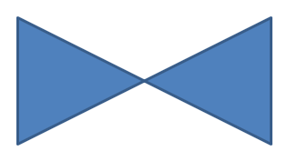

## **개요**

이 문서는 Aspose.Slides에서 편집 포인트와 기하 경로를 통해 도형 기하를 수정하여 프레젠테이션 도형을 사용자 정의하는 방법을 설명합니다. 기존 도형을 수정하고, 기본 경로 편집 작업을 수행하고, 포인트를 추가 또는 제거하며, 업데이트된 기하를 도형에 다시 적용하기 위해 [GeometryPath](https://reference.aspose.com/slides/python-net/aspose.slides/geometrypath/)을 사용하는 방법을 보여줍니다.

또한 사용자 정의 및 복합 도형을 만들고, 곡선 모서리가 있는 도형을 구축하고, 도형 기하가 닫혀 있는지 판단하며, 윤곽선 분석을 위해 도형 요소를 추출하는 방법을 시연합니다.

## **편집 포인트를 사용하여 도형 변경**

PowerPoint에서 **Edit Points**를 사용하여 사각형을 수정할 수 있습니다:

* 모서리를 안쪽이나 밖쪽으로 이동합니다.
* 점에서 곡률을 조정합니다.
* 새 포인트를 추가합니다.

편집 포인트를 사용하면 도형의 외곽선을 수정하거나 기존 도형을 새 도형의 기반으로 사용할 수 있습니다.

## **도형 편집 팁**


PowerPoint 도형을 편집할 때 다음 개념을 기억하십시오:

* 도형(또는 그 경로)은 닫혀 있거나 열려 있을 수 있습니다.
* 도형의 경로는 세그먼트로 연결된 앵커 포인트로 구성됩니다.
* 세그먼트는 직선이거나 곡선일 수 있습니다. 앵커 포인트와 제어 핸들이 모양을 결정합니다.
* 앵커 포인트는 코너 포인트, 직선 포인트, 매끄러운 포인트로 존재합니다:
  * 코너 포인트에서는 인접 세그먼트가 각도로 만날 수 있습니다.
  * 매끄러운 포인트에서는 두 제어 핸들이 정렬되고 앵커 포인트로부터 동일한 거리입니다.
  * 직선 포인트에서는 두 제어 핸들이 정렬되지만 앵커 포인트와의 거리는 다를 수 있습니다.
* 앵커 포인트를 이동하거나 핸들을 조정하면 도형의 외곽선이 바뀝니다.

편집 포인트를 통해 PowerPoint 도형을 편집하려면 **Aspose.Slides**가 제공하는 [GeometryPath](https://reference.aspose.com/slides/python-net/aspose.slides/geometrypath/) 클래스를 사용합니다.

* [GeometryPath](https://reference.aspose.com/slides/python-net/aspose.slides/geometrypath/) 인스턴스는 [GeometryShape](https://reference.aspose.com/slides/python-net/aspose.slides/geometryshape/) 객체의 기하 경로를 나타냅니다.
* [GeometryShape](https://reference.aspose.com/slides/python-net/aspose.slides/geometryshape/) 인스턴스에서 [GeometryPath](https://reference.aspose.com/slides/python-net/aspose.slides/geometrypath/)를 가져오려면 [GeometryShape.get_geometry_paths](https://reference.aspose.com/slides/python-net/aspose.slides/geometryshape/get_geometry_paths/) 메서드를 사용할 수 있습니다.
* 도형에 대한 [GeometryPath](https://reference.aspose.com/slides/python-net/aspose.slides/geometrypath/)를 설정하려면 단일 경로 도형의 경우 [GeometryShape.set_geometry_path](https://reference.aspose.com/slides/python-net/aspose.slides/geometryshape/set_geometry_path/) 메서드를, 다중 경로 도형의 경우 [GeometryShape.set_geometry_paths](https://reference.aspose.com/slides/python-net/aspose.slides/geometryshape/set_geometry_paths/) 메서드를 사용할 수 있습니다.
* 세그먼트를 추가하려면 [GeometryPath](https://reference.aspose.com/slides/python-net/aspose.slides/geometrypath/) 아래의 메서드를 사용할 수 있습니다.
* [GeometryPath.stroke](https://reference.aspose.com/slides/python-net/aspose.slides/geometrypath/stroke/) 및 [GeometryPath.fill_mode](https://reference.aspose.com/slides/python-net/aspose.slides/geometrypath/fill_mode/) 속성을 사용하여 기하 경로의 모양을 설정할 수 있습니다.
* [GeometryPath.path_data](https://reference.aspose.com/slides/python-net/aspose.slides/geometrypath/path_data/) 속성을 사용하여 [GeometryShape](https://reference.aspose.com/slides/python-net/aspose.slides/geometryshape/)의 기하 경로를 세그먼트 배열로 가져올 수 있습니다.

## **간단한 편집 작업**

다음 메서드를 사용하여 기하 경로를 편집합니다. 인덱스를 허용하는 오버로드는 경로 세그먼트 배열의 해당 0 기반 위치에 세그먼트를 삽입합니다.

| 작업 | 메서드 |
| --- | --- |
| 직선을 추가하거나 삽입합니다. | [GeometryPath.line_to](https://reference.aspose.com/slides/python-net/aspose.slides/geometrypath/line_to/) |
| 두 개의 제어점과 끝점이 있는 삼차 베지어 곡선을 추가하거나 삽입합니다. | [GeometryPath.cubic_bezier_to](https://reference.aspose.com/slides/python-net/aspose.slides/geometrypath/cubic_bezier_to/) |
| 한 개의 제어점과 끝점이 있는 2차 베지어 곡선을 추가하거나 삽입합니다. | [GeometryPath.quadratic_bezier_to](https://reference.aspose.com/slides/python-net/aspose.slides/geometrypath/quadratic_bezier_to/) |
| 지정된 치수와 각도(도)로 타원 호를 추가합니다. | [GeometryPath.arc_to](https://reference.aspose.com/slides/python-net/aspose.slides/geometrypath/arc_to/) |
| 끝점을 시작점에 연결하여 현재 도형을 닫습니다. | [GeometryPath.close_figure](https://reference.aspose.com/slides/python-net/aspose.slides/geometrypath/close_figure/) |
| 도형의 시작점을 설정합니다. | [GeometryPath.move_to](https://reference.aspose.com/slides/python-net/aspose.slides/geometrypath/move_to/) |
| 0 기반 인덱스에서 세그먼트를 제거합니다. | [GeometryPath.remove_at](https://reference.aspose.com/slides/python-net/aspose.slides/geometrypath/remove_at/) |

## **도형에 사용자 정의 포인트 추가**

이 예제는 [GeometryPath.line_to](https://reference.aspose.com/slides/python-net/aspose.slides/geometrypath/line_to/)을 사용하여 직사각형 도형에 두 개의 포인트를 삽입하고, 편집된 경로를 [GeometryShape.set_geometry_path](https://reference.aspose.com/slides/python-net/aspose.slides/geometryshape/set_geometry_path/)으로 적용합니다. 좌표는 도형에 상대적이며, 두 새 포인트는 도형 중심에 위치하고 왼쪽에서 100포인트, 위쪽에서 50포인트 떨어져 있습니다. 세그먼트 인덱스 1과 4는 각각 상단 및 하단 가장자리에 배치되어 해당 가장자를 안쪽으로 끌어당깁니다.

```python
import aspose.slides as slides

with slides.Presentation() as presentation:
    slide = presentation.slides[0]

    shape = slide.shapes.add_auto_shape(slides.ShapeType.RECTANGLE, 100, 100, 200, 100)

    geometry_path = shape.get_geometry_paths()[0]
    geometry_path.line_to(100, 50, 1)
    geometry_path.line_to(100, 50, 4)

    shape.set_geometry_path(geometry_path)
```



## **도형에서 포인트 제거**

이 예제는 [GeometryPath.remove_at](https://reference.aspose.com/slides/python-net/aspose.slides/geometrypath/remove_at/)을 사용하여 0 기반 인덱스 2에 있는 세그먼트를 제거함으로써 하트 모양 외곽선을 변경합니다. 수정된 경로를 [GeometryShape.set_geometry_path](https://reference.aspose.com/slides/python-net/aspose.slides/geometryshape/set_geometry_path/)으로 적용하면 도형의 윤곽이 업데이트됩니다.

```python
import aspose.slides as slides

with slides.Presentation() as presentation:
    slide = presentation.slides[0]

    shape = slide.shapes.add_auto_shape(slides.ShapeType.HEART, 100, 100, 300, 300)

    path = shape.get_geometry_paths()[0]
    path.remove_at(2)

    shape.set_geometry_path(path)
```


## **사용자 정의 도형 만들기**

이 예제는 [GeometryPath](https://reference.aspose.com/slides/python-net/aspose.slides/geometrypath/)를 사용하여 오각별을 구축합니다. 100포인트와 50포인트의 교차 반경을 번갈아 적용해 팁과 움푹 들어간 부분을 정의하고, 72도 간격으로 다섯 팁을 균등히 배치합니다. 경로는 [GeometryPath.close_figure](https://reference.aspose.com/slides/python-net/aspose.slides/geometrypath/close_figure/)으로 닫히고, [GeometryShape.set_geometry_path](https://reference.aspose.com/slides/python-net/aspose.slides/geometryshape/set_geometry_path/)을 사용해 직사각형 도형에 적용되어 기존 외곽선을 대체합니다.

```python
import aspose.slides as slides
import aspose.pydrawing as draw
import math

points = []

outer_radius = 100
inner_radius = 50
angle_step = 72

for angle in range(-90, 270, angle_step):
    radians = angle * (math.pi / 180)
    x = outer_radius * math.cos(radians)
    y = outer_radius * math.sin(radians)
    points.append(slides.PointF(x + outer_radius, y + outer_radius))

    radians = math.pi * (angle + angle_step / 2) / 180.0
    x = inner_radius * math.cos(radians)
    y = inner_radius * math.sin(radians)
    points.append(slides.PointF(x + outer_radius, y + outer_radius))

star_path = slides.GeometryPath()
star_path.move_to(points[0])

for i in range(1, len(points)):
    star_path.line_to(points[i])

star_path.close_figure()

with slides.Presentation() as presentation:
    slide = presentation.slides[0]

    shape = slide.shapes.add_auto_shape(slides.ShapeType.RECTANGLE, 100, 100, outer_radius * 2, outer_radius * 2)
    shape.set_geometry_path(star_path)
```


## **복합 사용자 정의 도형 만들기**

이 예제는 도형의 상단 및 하단 1/3을 위한 두 개의 닫힌 [GeometryPath](https://reference.aspose.com/slides/python-net/aspose.slides/geometrypath/) 객체를 정의합니다. 두 경로를 [GeometryShape.set_geometry_paths](https://reference.aspose.com/slides/python-net/aspose.slides/geometryshape/set_geometry_paths/)으로 적용하면 중간 1/3에 틈이 있는 단일 복합 도형이 생성됩니다.

```python
import aspose.slides as slides

with slides.Presentation() as presentation:
    slide = presentation.slides[0]

    shape = slide.shapes.add_auto_shape(slides.ShapeType.RECTANGLE, 100, 100, 200, 100)

    top_path = slides.GeometryPath()
    top_path.move_to(0, 0)
    top_path.line_to(shape.width, 0)
    top_path.line_to(shape.width, shape.height / 3)
    top_path.line_to(0, shape.height / 3)
    top_path.close_figure()

    bottom_path = slides.GeometryPath()
    bottom_path.move_to(0, shape.height / 3 * 2)
    bottom_path.line_to(shape.width, shape.height / 3 * 2)
    bottom_path.line_to(shape.width, shape.height)
    bottom_path.line_to(0, shape.height)
    bottom_path.close_figure()

    shape.set_geometry_paths([top_path, bottom_path])
```


## **곡선 모서리가 있는 사용자 정의 도형 만들기**

이 예제는 직선 세그먼트와 [GeometryPath.arc_to](https://reference.aspose.com/slides/python-net/aspose.slides/geometrypath/arc_to/)을 결합해 안쪽으로 굽은 모서리를 가진 도형을 만듭니다. 각 모서리 크기는 호의 너비와 높이를 포인트 단위로 설정하고, -90도 스윕은 반시계 방향 1/4 타원을 그립니다. 완성된 경로는 [GeometryShape.set_geometry_path](https://reference.aspose.com/slides/python-net/aspose.slides/geometryshape/set_geometry_path/)으로 적용되며, 프레젠테이션은 PPTX 형식으로 저장됩니다.

```python
import aspose.slides as slides
import aspose.pydrawing as draw

shape_x = 20
shape_y = 20
shape_width = 300
shape_height = 200

left_top_size = 50
right_top_size = 20
right_bottom_size = 40
left_bottom_size = 10

with slides.Presentation() as presentation:
    slide = presentation.slides[0]

    shape = slide.shapes.add_auto_shape(slides.ShapeType.CUSTOM, shape_x, shape_y, shape_width, shape_height)

    top_left = slides.PointF(left_top_size, 0)
    top_right = slides.PointF(shape_width - right_top_size, 0)
    right_bottom = slides.PointF(shape_width, shape_height - right_bottom_size)
    bottom_left = slides.PointF(left_bottom_size, shape_height)
    left_top = slides.PointF(0, left_top_size)

    geometry_path = slides.GeometryPath()
    geometry_path.move_to(top_left)
    geometry_path.line_to(top_right)
    geometry_path.arc_to(right_top_size, right_top_size, 180, -90)
    geometry_path.line_to(right_bottom)
    geometry_path.arc_to(right_bottom_size, right_bottom_size, -90, -90)
    geometry_path.line_to(bottom_left)
    geometry_path.arc_to(left_bottom_size, left_bottom_size, 0, -90)
    geometry_path.line_to(left_top)
    geometry_path.arc_to(left_top_size, left_top_size, 90, -90)
    geometry_path.close_figure()

    shape.set_geometry_path(geometry_path)

    presentation.save("output.pptx", slides.export.SaveFormat.PPTX)
```

## **도형 기하가 닫혀 있는지 확인**

다음 도우미는 모든 비어 있지 않은 기하 경로가 닫는 세그먼트로 끝나는지 확인합니다. [GeometryPath.path_data](https://reference.aspose.com/slides/python-net/aspose.slides/geometrypath/path_data/)를 읽고 마지막 세그먼트의 [PathSegment.path_command](https://reference.aspose.com/slides/python-net/aspose.slides/pathsegment/path_command/)을 [PathCommandType.CLOSE](https://reference.aspose.com/slides/python-net/aspose.slides/pathcommandtype/)과 비교합니다. 비어 있지 않은 경로가 없을 경우 false를 반환합니다. 이 검사는 각 경로의 최종 명령만 확인하며, 경로 내부의 모든 하위 도형을 검사하지는 않습니다. 예제는 사각형에 대해 `True`를 출력합니다.

```python
import aspose.slides as slides


def is_geometry_closed(geometry_shape):
    has_nonempty_path = False

    for geometry_path in geometry_shape.get_geometry_paths():
        segments = geometry_path.path_data
        if len(segments) == 0:
            continue

        has_nonempty_path = True
        last_segment = segments[len(segments) - 1]
        if last_segment.path_command != slides.PathCommandType.CLOSE:
            return False

    return has_nonempty_path


with slides.Presentation() as presentation:
    slide = presentation.slides[0]
    shape = slide.shapes.add_auto_shape(slides.ShapeType.RECTANGLE, 100, 100, 200, 100)
    print(is_geometry_closed(shape))
```

## **기하 경로 명령 검사**

[contour.pptx](contour.pptx)를 다운로드하고 작업 디렉터리에 두십시오. 첫 슬라이드의 첫 번째 도형은 직선 상단 가장자리, 삼차 베지어 곡선, 직선 닫는 가장자를 가집니다. [GeometryShape.get_geometry_paths](https://reference.aspose.com/slides/python-net/aspose.slides/geometryshape/get_geometry_paths/)을 사용해 해당 경로를 읽습니다. 각 경로에 대해 [GeometryPath.path_data](https://reference.aspose.com/slides/python-net/aspose.slides/geometrypath/path_data/)는 그리기 순서대로 세그먼트를 나열합니다. 각 세그먼트의 [PathSegment.path_command](https://reference.aspose.com/slides/python-net/aspose.slides/pathsegment/path_command/)은 해당 [PathSegment.segment_data](https://reference.aspose.com/slides/python-net/aspose.slides/pathsegment/segment_data/)를 해석하는 방식을 결정합니다.

```python
import aspose.slides as slides

with slides.Presentation("contour.pptx") as presentation:
    shape = presentation.slides[0].shapes[0]
    for i, path in enumerate(shape.get_geometry_paths()):
        for j, segment in enumerate(path.path_data):
            command = segment.path_command
            data = segment.segment_data
            if command in (slides.PathCommandType.MOVE_TO, slides.PathCommandType.LINE_TO):
                detail = f"destination={tuple(data)}"
            elif command == slides.PathCommandType.CUBIC_BEZIER_TO:
                detail = f"control1={tuple(data[:2])} control2={tuple(data[2:4])} end={tuple(data[4:])}"
            elif command == slides.PathCommandType.CLOSE:
                detail = "no coordinates"
            else:
                detail = f"raw={data}"
            print(f"Path {i}, segment {j}: {command.name} {detail}")
```

도형은 슬라이드에서 (200, 100) 포인트에 위치합니다. 보고된 좌표는 도형에 상대적이며, 왼쪽 위 모서리는 (0, 0)이고 x는 오른쪽으로, y는 아래쪽으로 증가합니다. 닫는 세그먼트는 추가 좌표 없이 시작점으로 돌아갑니다.

```text
Path 0, segment 0: MOVE_TO destination=(0, 0)
Path 0, segment 1: LINE_TO destination=(80, 0)
Path 0, segment 2: CUBIC_BEZIER_TO control1=(70, 15) control2=(30, 45) end=(0, 60)
Path 0, segment 3: CLOSE no coordinates
```


## **도형 요소 추출 및 검사**

[GeometryShape.create_shape_elements](https://reference.aspose.com/slides/python-net/aspose.slides/geometryshape/create_shape_elements/)을 사용해 기존 도형을 경로 포인트와 포인트 유형을 포함하는 요소로 검사할 수 있습니다. 반환된 각 [ShapeElement](https://reference.aspose.com/slides/python-net/aspose.slides/shapeelement/)은 [path_points](https://reference.aspose.com/slides/python-net/aspose.slides/shapeelement/path_points/)와 [path_types](https://reference.aspose.com/slides/python-net/aspose.slides/shapeelement/path_types/) 배열을 노출합니다. 이 표현은 윤곽선 분석이나 사용자 정의 그리기 도구에 기하를 전달할 때 유용합니다.

예제는 프레젠테이션을 열어 첫 슬라이드에 직접 있는 첫 번째 기하 도형을 찾아 경로 세그먼트를 출력합니다. 직선 및 곡선 세그먼트를 가진 도형이 포함된 프레젠테이션을 사용하면 두 종류의 출력 모두 확인할 수 있습니다. 그룹 내부는 검색되지 않습니다.

```python
import aspose.slides as slides

with slides.Presentation("input.pptx") as presentation:
    slide = presentation.slides[0]
    shape = next((item for item in slide.shapes if isinstance(item, slides.GeometryShape)), None)

    if shape is None:
        print("No geometry shape found on the first slide.")
    else:
        for element in shape.create_shape_elements():
            points = element.path_points
            types = element.path_types
            print("Shape element:")

            i = 0
            while i < len(points):
                point_type = types[i] & 0x07  # Keep the segment type, excluding flags.
                if point_type == 0:
                    print(f"Start figure at {points[i]}")
                elif point_type == 1:
                    print(f"Line to {points[i]}")
                elif point_type == 3:
                    print(f"Cubic Bezier: controls {points[i]}, {points[i + 1]}; end {points[i + 2]}")
                    i += 2  # Consume both control points and the endpoint.

                if (types[i] & 0x80) != 0:
                    print("Close subpath back to its starting point.")
                i += 1
```

배열은 인덱스로 대응됩니다: `points[i]`는 포인트이며 `types[i]`는 그 역할을 설명합니다. 유형 `0`은 도형을 시작하고, 유형 `1`은 이전 포인트에서 현재 포인트까지 선을 그립니다. 삼차 베지어 세그먼트는 이전 끝점에서 시작하고 연속된 유형 `3` 항목 세 개(두 제어점과 새 끝점)를 사용합니다. 루프는 이 세 항목을 함께 처리하고 끝점의 닫힘 여부를 확인합니다.

포인트 유형에는 플래그도 포함됩니다. `0x07`로 마스크하면 세그먼트 유형을 식별하고, `0x80`을 별도로 테스트하면 닫힌 하위 경로를 감지합니다. 예를 들어 `129`(`0x81`)은 닫힌 하위 경로를 만드는 선 끝점이며, `131`(`0x83`)은 닫힌 베지어 끝점입니다. 단순히 `1`이나 `3`만 비교하면 이러한 경우를 놓치게 됩니다. 대시(`0x10`)와 마커(`0x20`) 같은 다른 플래그는 기본 세그먼트 유형을 변경하지 않습니다.

**좌표 및 변환.** 포인트는 포인트(1/72 인치) 단위이며 X는 오른쪽으로, Y는 아래쪽으로 증가합니다. 그룹에 속하지 않은 도형의 경우 추출된 좌표는 이미 [x](https://reference.aspose.com/slides/python-net/aspose.slides/shape/x/)와 [y](https://reference.aspose.com/slides/python-net/aspose.slides/shape/y/) 위치를 포함하고 현재 너비와 높이를 반영합니다. 예를 들어 `(100, 200)` 위치에 크기 `120 × 80`인 회전되지 않은 사각형은 윤곽 경계가 `(100, 200)`–`(220, 280)`입니다. 도형 위치를 다시 추가하지 마십시오. X와 Y를 빼서 회전되지 않은 프레임에 대한 좌표를 얻으십시오.

추출된 포인트는 도형의 [rotation](https://reference.aspose.com/slides/python-net/aspose.slides/shape/rotation/)이나 수평/수직 플립을 적용하지 않습니다. 표시된 윤곽을 재현하려면 이러한 변환을 도형 중심을 기준으로 적용하십시오. 그룹화된 도형의 경우 그룹 좌표 매핑 및 변환도 고려해야 하며, 추출된 포인트가 최종 슬라이드 좌표가 아니거나 자식 프레임에 이미 반영된 변환을 두 번 적용하지 않도록 주의하십시오.

**검사와 편집의 차이.** 추출된 배열은 윤곽을 설명하며, 이를 변경해도 원본 도형은 업데이트되지 않습니다. 포인트/유형 배열이 분석 또는 그리기 코드에 필요할 때 이 접근 방식을 선택하십시오. 도형의 로컬 좌표계에서 기하 명령이 필요하거나 기하를 편집하려면 [get_geometry_paths](https://reference.aspose.com/slides/python-net/aspose.slides/geometryshape/get_geometry_paths/)를 사용하고, 편집된 경로는 [set_geometry_path](https://reference.aspose.com/slides/python-net/aspose.slides/geometryshape/set_geometry_path/) 또는 [set_geometry_paths](https://reference.aspose.com/slides/python-net/aspose.slides/geometryshape/set_geometry_paths/)를 통해 적용하십시오.

## **FAQ**

**기하를 교체한 후 채우기 및 외곽선은 어떻게 됩니까?**

스타일은 도형에 그대로 유지되며, 윤곽선만 변경됩니다. 채우기와 외곽선은 새 기하에 자동으로 적용됩니다.

**사용자 정의 도형을 기하와 함께 올바르게 회전하려면 어떻게 해야 합니까?**

도형의 [rotation](https://reference.aspose.com/slides/python-net/aspose.slides/shape/rotation/) 속성을 사용하십시오. 기하가 도형에 바인딩되어 있기 때문에 도형과 함께 회전됩니다.

**사용자 정의 도형을 이미지로 변환하여 결과를 “고정”할 수 있습니까?**

예. 필요한 [슬라이드](/slides/ko/python-net/convert-powerpoint-to-png/) 영역이나 [도형](/slides/ko/python-net/create-shape-thumbnails/) 자체를 래스터 형식으로 내보내면 복잡한 기하 작업을 더 쉽게 수행할 수 있습니다.