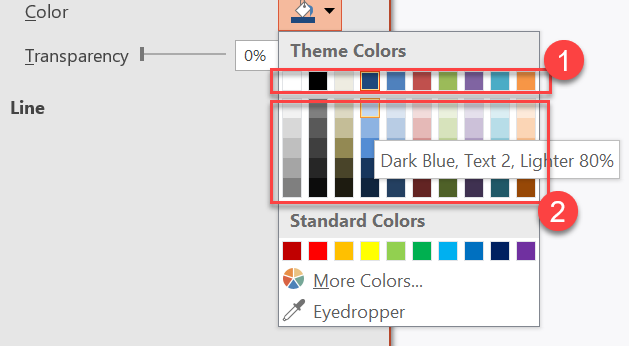

## **소개**

프레젠테이션 테마는 색상, 글꼴, 배경 스타일, 채우기, 선 및 효과의 조정된 집합을 정의합니다. 테마 인식 객체는 각 시각 속성을 고정값으로 저장하는 대신 이러한 공유 정의를 참조하므로 테마를 변경하면 여러 객체를 한 번에 업데이트할 수 있습니다.

Aspose.Slides에서 프레젠테이션 수준의 테마는 [Presentation.master_theme](https://reference.aspose.com/slides/python-net/aspose.slides/presentation/master_theme/) 속성을 통해 사용할 수 있습니다. 프레젠테이션은 하위 수준에서도 테마 재정의를 포함할 수 있습니다. 마스터는 [MasterThemeManager.override_theme](https://reference.aspose.com/slides/python-net/aspose.slides.theme/masterthememanager/override_theme/)을 통해 프레젠테이션 테마를 재정의할 수 있고, 레이아웃은 [BaseOverrideThemeManager.override_theme](https://reference.aspose.com/slides/python-net/aspose.slides.theme/baseoverridethememanager/override_theme/)을 통해 상속된 테마를 재정의할 수 있으며, 개별 슬라이드도 동일하게 할 수 있습니다. 실제로 슬라이드에 적용되는 테마는 다음 상속 체인을 통해 해결됩니다: 프레젠테이션 테마 → 마스터 재정의 → 레이아웃 재정의 → 슬라이드 재정의.


아래 섹션에서는 가장 일반적인 테마 작업 흐름을 보여줍니다: 테마 검사, 색상 및 글꼴 변경, 테마 복사 또는 적용, 배경 및 효과 스타일 업데이트, 상속 및 재정의가 해결된 후 실제 값을 읽기.

## **테마 검사**

[MasterTheme](https://reference.aspose.com/slides/python-net/aspose.slides.theme/mastertheme/) 객체는 테마의 [color_scheme](https://reference.aspose.com/slides/python-net/aspose.slides.theme/mastertheme/color_scheme/), [font_scheme](https://reference.aspose.com/slides/python-net/aspose.slides.theme/mastertheme/font_scheme/), 및 [format_scheme](https://reference.aspose.com/slides/python-net/aspose.slides.theme/mastertheme/format_scheme/) 속성을 노출합니다. 이러한 컬렉션을 변경하기 전에 검사하는 것이 특히 외부 소스에서 가져온 프레젠테이션일 때 유용합니다. 스타일 항목의 개수와 내용이 다양할 수 있기 때문입니다.

다음 예제는 주요 테마 속성을 읽고 테마에 저장된 배경, 채우기, 선 및 효과 스타일의 개수를 보고합니다:

```python
import aspose.slides as slides

with slides.Presentation("input.pptx") as presentation:
    theme = presentation.master_theme

    print(f"Theme name: {theme.name}")
    print(f"Accent 1: {theme.color_scheme.accent1.color}")
    print(f"Major Latin font: {theme.font_scheme.major.latin_font.font_name}")
    print(f"Minor Latin font: {theme.font_scheme.minor.latin_font.font_name}")
    print(f"Background fill styles: {len(theme.format_scheme.background_fill_styles)}")
    print(f"Fill styles: {len(theme.format_scheme.fill_styles)}")
    print(f"Line styles: {len(theme.format_scheme.line_styles)}")
    print(f"Effect styles: {len(theme.format_scheme.effect_styles)}")
```

파일에 여러 마스터가 사용된 경우 모든 슬라이드가 동일한 실제 테마를 갖는다고 가정하지 마세요. 슬라이드와 연결된 마스터를 검사하고, 레이아웃이나 슬라이드 재정의가 있을 수 있는 경우 아래에 표시된 실제 테마 작업 흐름을 사용하세요.

## **테마 색상 변경**

테마 인식 채우기, 선 및 텍스트는 [SchemeColor](https://reference.aspose.com/slides/python-net/aspose.slides/schemecolor/) 열거형의 논리 색상을 참조할 수 있습니다. 테마의 [ColorScheme](https://reference.aspose.com/slides/python-net/aspose.slides.theme/colorscheme/)에서 해당 항목을 변경하면 해당 테마 색상을 계속 참조하는 모든 객체가 새로운 값으로 해석됩니다. 직접 RGB 색상을 사용하는 객체는 테마 색상 업데이트의 영향을 받지 않습니다.

다음 엔드‑투‑엔드 예제는 `ACCENT4`를 사용하는 도형을 만든 뒤, 테마의 `accent4` 색상을 빨간색으로 변경하고, 프레젠테이션을 저장한 뒤 다시 열어 실제 채우기 색상을 출력합니다:

```python
import aspose.pydrawing as draw
import aspose.slides as slides

with slides.Presentation() as presentation:
    slide = presentation.slides[0]

    shape = slide.shapes.add_auto_shape(slides.ShapeType.RECTANGLE, 10, 10, 100, 100)
    shape.fill_format.fill_type = slides.FillType.SOLID
    shape.fill_format.solid_fill_color.scheme_color = slides.SchemeColor.ACCENT4

    presentation.master_theme.color_scheme.accent4.color = draw.Color.red

    presentation.save("theme-color.pptx", slides.export.SaveFormat.PPTX)

with slides.Presentation("theme-color.pptx") as saved_presentation:
    saved_slide = saved_presentation.slides[0]
    saved_shape = saved_slide.shapes[0]
    effective_fill = saved_shape.fill_format.get_effective()
    print(f"Effective fill color: {effective_fill.solid_fill_color}")
```

사각형이 `ACCENT4`에 계속 연결되어 있기 때문에 테마가 변경된 후 눈에 보이는 색상이 빨간색으로 바뀝니다. 도형에서 스키마 색상을 직접 색상으로 교체하면 이후 `accent4` 변경이 해당 채우기에 영향을 주지 않습니다.

### **추가 팔레트 색상 사용**

PowerPoint는 테마 색상에 색상 변환을 적용하여 밝고 어두운 변형을 생성합니다. Aspose.Slides는 이러한 변환을 [ColorTransformOperation](https://reference.aspose.com/slides/python-net/aspose.slides/colortransformoperation/) 열거형을 통해 노출합니다.



**1** – 주 테마 색상.

**2** – 주 테마 색상에서 파생된 밝고 어두운 변형.

다음 예제는 `ACCENT4`를 기반으로 한 여섯 개 사각형을 만든 뒤, 그 중 다섯 개에 밝기 변환을 적용하고 결과를 저장합니다:

```python
import aspose.slides as slides

with slides.Presentation() as presentation:
    slide = presentation.slides[0]

    shape1 = slide.shapes.add_auto_shape(slides.ShapeType.RECTANGLE, 10, 10, 50, 50)
    shape1.fill_format.fill_type = slides.FillType.SOLID
    shape1.fill_format.solid_fill_color.scheme_color = slides.SchemeColor.ACCENT4

    shape2 = slide.shapes.add_auto_shape(slides.ShapeType.RECTANGLE, 10, 70, 50, 50)
    shape2.fill_format.fill_type = slides.FillType.SOLID
    shape2.fill_format.solid_fill_color.scheme_color = slides.SchemeColor.ACCENT4
    shape2.fill_format.solid_fill_color.color_transform.add(slides.ColorTransformOperation.MULTIPLY_LUMINANCE, 0.2)
    shape2.fill_format.solid_fill_color.color_transform.add(slides.ColorTransformOperation.ADD_LUMINANCE, 0.8)

    shape3 = slide.shapes.add_auto_shape(slides.ShapeType.RECTANGLE, 10, 130, 50, 50)
    shape3.fill_format.fill_type = slides.FillType.SOLID
    shape3.fill_format.solid_fill_color.scheme_color = slides.SchemeColor.ACCENT4
    shape3.fill_format.solid_fill_color.color_transform.add(slides.ColorTransformOperation.MULTIPLY_LUMINANCE, 0.4)
    shape3.fill_format.solid_fill_color.color_transform.add(slides.ColorTransformOperation.ADD_LUMINANCE, 0.6)

    shape4 = slide.shapes.add_auto_shape(slides.ShapeType.RECTANGLE, 10, 190, 50, 50)
    shape4.fill_format.fill_type = slides.FillType.SOLID
    shape4.fill_format.solid_fill_color.scheme_color = slides.SchemeColor.ACCENT4
    shape4.fill_format.solid_fill_color.color_transform.add(slides.ColorTransformOperation.MULTIPLY_LUMINANCE, 0.6)
    shape4.fill_format.solid_fill_color.color_transform.add(slides.ColorTransformOperation.ADD_LUMINANCE, 0.4)

    shape5 = slide.shapes.add_auto_shape(slides.ShapeType.RECTANGLE, 10, 250, 50, 50)
    shape5.fill_format.fill_type = slides.FillType.SOLID
    shape5.fill_format.solid_fill_color.scheme_color = slides.SchemeColor.ACCENT4
    shape5.fill_format.solid_fill_color.color_transform.add(slides.ColorTransformOperation.MULTIPLY_LUMINANCE, 0.75)

    shape6 = slide.shapes.add_auto_shape(slides.ShapeType.RECTANGLE, 10, 310, 50, 50)
    shape6.fill_format.fill_type = slides.FillType.SOLID
    shape6.fill_format.solid_fill_color.scheme_color = slides.SchemeColor.ACCENT4
    shape6.fill_format.solid_fill_color.color_transform.add(slides.ColorTransformOperation.MULTIPLY_LUMINANCE, 0.5)

    presentation.save("theme-color-palette.pptx", slides.export.SaveFormat.PPTX)
```

이 변형은 여전히 테마 색상을 기반으로 합니다. `accent4`가 나중에 변경되면 변환된 색상이 새 `accent4` 값에서 다시 계산됩니다.

### **`SchemeColor` 값을 `ColorScheme` 슬롯에 매핑**

[SchemeColor](https://reference.aspose.com/slides/python-net/aspose.slides/schemecolor/) 열거형은 `TEXT1`, `BACKGROUND1`, `TEXT2`, `BACKGROUND2`를 사용하고, [ColorScheme](https://reference.aspose.com/slides/python-net/aspose.slides.theme/colorscheme/)은 동일한 테마 슬롯을 `dark1`, `light1`, `dark2`, `light2`로 노출합니다. 매핑은 고정됩니다:

* `TEXT1` = `dark1`
* `BACKGROUND1` = `light1`
* `TEXT2` = `dark2`
* `BACKGROUND2` = `light2`

이는 같은 테마 슬롯에 대한 대체 이름일 뿐이며, 한 형태에서 다른 형태로 동적으로 변환되는 값이 아닙니다.

## **테마 글꼴 변경**

테마 글꼴 스키마는 제목용 주요 글꼴 세트와 본문용 보조 글꼴 세트를 포함합니다. [FontScheme.major](https://reference.aspose.com/slides/python-net/aspose.slides.theme/fontscheme/major/) 및 [FontScheme.minor](https://reference.aspose.com/slides/python-net/aspose.slides.theme/fontscheme/minor/) 속성이 해당 세트를 노출합니다.

PowerPoint 호환 테마 글꼴 식별자는 텍스트 형식 지정에 사용할 수 있습니다:

* `+mn-lt` – 본문 라틴 글꼴 (Minor Latin Font)
* `+mj-lt` – 제목 라틴 글꼴 (Major Latin Font)
* `+mn-ea` – 본문 동아시아 글꼴 (Minor East Asian Font)
* `+mj-ea` – 제목 동아시아 글꼴 (Major East Asian Font)
* `+mn-cs` – 본문 복합 스크립트 글꼴 (Minor Complex Script Font)
* `+mj-cs` – 제목 복합 스크립트 글꼴 (Major Complex Script Font)

다음 예제는 주요 라틴 테마 글꼴을 사용하는 제목 하나와 보조 라틴 테마 글꼴을 사용하는 본문 라인 하나를 만든 뒤, 테마 글꼴을 변경하고 결과를 저장합니다:

```python
import aspose.slides as slides

with slides.Presentation() as presentation:
    slide = presentation.slides[0]

    heading = slide.shapes.add_auto_shape(slides.ShapeType.RECTANGLE, 40, 40, 500, 60)
    heading.text_frame.text = "Theme heading"
    heading.text_frame.paragraphs[0].portions[0].portion_format.latin_font = slides.FontData("+mj-lt")

    body = slide.shapes.add_auto_shape(slides.ShapeType.RECTANGLE, 40, 120, 500, 60)
    body.text_frame.text = "Theme body text"
    body.text_frame.paragraphs[0].portions[0].portion_format.latin_font = slides.FontData("+mn-lt")

    presentation.master_theme.font_scheme.major.latin_font = slides.FontData("Aptos Display")
    presentation.master_theme.font_scheme.minor.latin_font = slides.FontData("Arial")

    presentation.save("theme-fonts.pptx", slides.export.SaveFormat.PPTX)
```

제목은 주요 글꼴을 따르고 본문 텍스트는 보조 글꼴을 따릅니다. 테마 식별자가 아닌 명시적인 글꼴 이름을 가진 텍스트는 테마 글꼴 스키마가 변경되어도 자동으로 전환되지 않습니다.

주 및 보조 글꼴 컬렉션에는 키릴 문자, 아랍어, 일본어, 그루지아어, 타아나와 같은 개별 쓰기 시스템에 대한 글꼴 매핑도 포함될 수 있습니다. 이러한 매핑을 검사, 추가, 교체 또는 제거하려면 [Script‑Specific Theme Fonts](/slides/ko/python-net/script-specific-font-mappings/)를 참조하세요.

{}
프레젠테이션 글꼴에 대한 자세한 내용은 [PowerPoint Fonts](/slides/ko/python-net/powerpoint-fonts/)를 참조하세요.
{}

### **테마 글꼴 참조 해결**

텍스트를 검사할 때 [FontData.font_name](https://reference.aspose.com/slides/python-net/aspose.slides/fontdata/font_name/)은 `+mn-lt`와 같은 테마 참조를 포함할 수 있습니다. 해당 참조를 해결하려면 적절한 [IThemeEffectiveData](https://reference.aspose.com/slides/python-net/aspose.slides.theme/ithemeeffectivedata/)와 함께 [FontData.get_font_name](https://reference.aspose.com/slides/python-net/aspose.slides/fontdata/get_font_name/)를 호출하세요. `+mj`와 `+mn` 접두사는 각각 주요와 보조 글꼴 세트를 선택하고, `-lt`, `-ea`, `-cs` 접미사는 라틴, 동아시아, 복합 스크립트 글꼴을 선택합니다.

테마가 적용되는 객체에 대해 [Slide.create_theme_effective](https://reference.aspose.com/slides/python-net/aspose.slides/slide/create_theme_effective/)를 호출하여 실제 테마를 얻으세요. 일반 슬라이드 텍스트의 경우 `slide.create_theme_effective`를 사용하면 해당 슬라이드의 상속된 테마와 로컬 재정의가 포함된 컨텍스트가 제공됩니다. 레이아웃이나 마스터 자체를 검사할 때는 해당 객체의 실제 테마를 사용하세요. 첫 번째 마스터의 테마가 모든 슬라이드에 적용된다고 가정하지 마세요.

다음 예제는 보조 라틴 글꼴을 명시적으로 참조하는 텍스트 구간을 만들고, [OverrideTheme.init_font_scheme_from_inherited](https://reference.aspose.com/slides/python-net/aspose.slides.theme/overridetheme/init_font_scheme_from_inherited/)를 통해 슬라이드 글꼴 스키마를 초기화한 뒤 주요와 보조 라틴 글꼴을 각각 `Arial`과 `Calibri`로 설정합니다. 이를 통해 입력 파일 없이도 결과를 재현할 수 있습니다:

```python
import aspose.slides as slides

with slides.Presentation() as presentation:
    slide = presentation.slides[0]

    theme = slide.theme_manager.override_theme
    theme.init_font_scheme_from_inherited()
    theme.font_scheme.major.latin_font = slides.FontData("Arial")
    theme.font_scheme.minor.latin_font = slides.FontData("Calibri")

    shape = slide.shapes.add_auto_shape(slides.ShapeType.RECTANGLE, 20, 20, 400, 60)
    shape.text_frame.text = "Text using the minor theme font"

    portion = shape.text_frame.paragraphs[0].portions[0]
    portion.portion_format.latin_font = slides.FontData("+mn-lt")

    font = portion.portion_format.latin_font
    effective_theme = slide.create_theme_effective()
    print(f"{font.font_name} -> {font.get_font_name(effective_theme)}")

    explicit_font = slides.FontData("Verdana")
    print(f"{explicit_font.font_name} -> {explicit_font.get_font_name(effective_theme)}")
```

출력은 `+mn-lt -> Calibri` 뒤에 `Verdana -> Verdana`가 표시됩니다. 저장된 참조는 변하지 않으며, 명시적인 글꼴 이름은 그대로 반환됩니다. 구간이 `+mj-lt`를 사용했다면 이 테마에서 `Arial`로 해석됩니다.

테마 참조를 해결하면 테마가 지정한 글꼴 패밀리를 식별합니다. 이는 글꼴 가용성을 확인하거나 렌더링 중 대체·글리프 폴백 이후 실제 사용되는 글꼴 파일을 결정하지 않습니다. 해당 별도 단계에 대해서는 [Font Selection Sequence](/slides/ko/python-net/font-selection-sequence/)와 [Font Substitution](/slides/ko/python-net/font-substitution/)를 참고하세요.

## **테마 복사 또는 적용**

아래 작업 흐름은 다양한 테마 관련 문제를 해결합니다.

### **외부 테마를 마스터에 의존하는 슬라이드에 적용**

PowerPoint 테마 파일(`.thmx`)이 있고 특정 마스터에 의존하는 모든 슬라이드의 스타일을 바꾸고 싶을 때는 [MasterSlide.apply_external_theme_to_depending_slides](https://reference.aspose.com/slides/python-net/aspose.slides/masterslide/apply_external_theme_to_depending_slides/)를 사용하세요. [Presentation.masters](https://reference.aspose.com/slides/python-net/aspose.slides/presentation/masters/) 컬렉션([MasterSlideCollection](https://reference.aspose.com/slides/python-net/aspose.slides/masterslidecollection/))에서 마스터를 선택하고, 메서드에 테마 파일 경로를 전달합니다.

메서드는 다음 작업을 수행합니다:

1. 선택한 마스터를 기반으로 새 마스터 슬라이드를 생성합니다.
1. 외부 테마를 새 마스터에 적용합니다.
1. 이전에 선택한 마스터에 의존하던 모든 슬라이드에 새 마스터를 할당합니다.
1. 새로 생성된 [MasterSlide](https://reference.aspose.com/slides/python-net/aspose.slides/masterslide/)을 반환합니다.

다음 예제는 첫 번째 마스터에 의존하는 슬라이드에 외부 테마를 적용하고 프레젠테이션을 저장합니다:

```python
import aspose.slides as slides

with slides.Presentation("presentation.pptx") as presentation:
    selected_master = presentation.masters[0]

    themed_master = selected_master.apply_external_theme_to_depending_slides("corporate-theme.thmx")
    print(f"Created master: {themed_master.name}")

    presentation.save("presentation-with-external-theme.pptx", slides.export.SaveFormat.PPTX)
```

잘못되었거나 손상되었거나 지원되지 않는 테마는 [PptxException](https://reference.aspose.com/slides/python-net/aspose.slides/pptxexception/) 또는 해당 형식 관련 하위 클래스 중 하나를 발생시킬 수 있습니다. 사용자가 제공한 경로를 검증하고 파일 시스템 접근 실패를 처리한 뒤 테마 적용이 성공적으로 완료된 경우에만 프레젠테이션을 저장하세요.

선택한 마스터에 의존했던 슬라이드만 재할당됩니다. 다른 마스터와 연결된 슬라이드는 기존 마스터와 테마를 유지합니다. 테마 인식 색상, 글꼴, 채우기, 선, 배경 및 효과는 외부 테마에 따라 해결됩니다. 직접 지정된 색상·글꼴·채우기 등 명시적 서식은 변경되지 않을 수 있습니다. 레이아웃 수준·슬라이드 수준 재정의도 새 마스터에서 상속된 값보다 우선할 수 있습니다.

테마는 런타임 환경에 없는 글꼴을 참조할 수 있습니다. 일관된 렌더링 및 내보내기를 위해서는 필요한 글꼴을 설치하거나 [custom font sources](/slides/ko/python-net/custom-font/)를 통해 제공하거나 [font substitution](/slides/ko/python-net/font-substitution/)을 구성하세요.

이는 직접적인 마스터 수준 작업 흐름입니다. 메서드는 `.thmx` 파일 경로를 받아들이며 슬라이드 수준·레이아웃 수준 테마 재정의를 수동으로 만들 필요가 없습니다.

### **다중 마스터 프레젠테이션에서 서로 다른 외부 테마 적용**

관련 마스터를 미리 알 수 없는 경우, [Slide.layout_slide](https://reference.aspose.com/slides/python-net/aspose.slides/slide/layout_slide/)와 [LayoutSlide.master_slide](https://reference.aspose.com/slides/python-net/aspose.slides/layoutslide/master_slide/)를 통해 대표 슬라이드에서 마스터를 가져옵니다. 테마를 적용하기 전에 원본 마스터 참조를 저장하세요. 각 호출은 프레젠테이션에 새 마스터를 추가하기 때문입니다.

다음 예제는 두 섹션의 슬라이드를 사용하여 마스터를 찾고, 각 그룹에 서로 다른 외부 테마를 적용합니다:

```python
import aspose.slides as slides

with slides.Presentation("multi-master-presentation.pptx") as presentation:
    if len(presentation.slides) < 5:
        print("The presentation does not contain the expected representative slides.")
    else:
        first_group_master = presentation.slides[0].layout_slide.master_slide
        second_group_master = presentation.slides[4].layout_slide.master_slide

        if first_group_master.slide_id == second_group_master.slide_id:
            print("The representative slides use the same master.")
        else:
            first_themed_master = first_group_master.apply_external_theme_to_depending_slides("blue-theme.thmx")
            second_themed_master = second_group_master.apply_external_theme_to_depending_slides("green-theme.thmx")

            print(f"First themed master: {first_themed_master.name}")
            print(f"Second themed master: {second_themed_master.name}")

            presentation.save("multi-master-with-external-themes.pptx", slides.export.SaveFormat.PPTX)
```

첫 번째 호출은 `first_group_master`에 의존하는 슬라이드에만 영향을 주고, 두 번째 호출은 `second_group_master`에 의존하는 슬라이드에만 영향을 줍니다. 다른 마스터에 속한 슬라이드는 재스타일링되지 않습니다.

### **슬라이드 이동 시 원본 테마 보존**

슬라이드를 다른 프레젠테이션으로 이동하면서 원본 디자인을 유지하려면 [MasterSlideCollection.add_clone](https://reference.aspose.com/slides/python-net/aspose.slides/masterslidecollection/add_clone/)로 원본 마스터를 대상 프레젠테이션에 복제한 뒤, [SlideCollection.add_clone](https://reference.aspose.com/slides/python-net/aspose.slides/slidecollection/add_clone/)와 복제된 마스터를 사용해 슬라이드를 복제하세요. 이렇게 하면 마스터와 레이아웃, 연결된 테마가 함께 복사됩니다.

```python
import aspose.slides as slides

with slides.Presentation("source-theme.pptx") as source:
    with slides.Presentation("target.pptx") as target:
        source_slide = source.slides[0]

        source_master = source_slide.layout_slide.master_slide
        cloned_master = target.masters.add_clone(source_master)
        target.slides.add_clone(source_slide, cloned_master, True)

        target.save("theme-preserved.pptx", slides.export.SaveFormat.PPTX)
```

대상 슬라이드가 현재 마스터와 레이아웃을 유지하면서도 원본 슬라이드와 동일한 모습을 보여야 할 때 권장되는 작업 흐름입니다. 관련 없는 대상 마스터에 내용만 복제하면 테마 기반 색상·글꼴·배경·효과가 변경될 수 있습니다.

### **기존 슬라이드에 테마 값 적용**

대상 슬라이드가 현재 마스터와 레이아웃에 머무를 필요가 있다면, 원본 테마에서 슬라이드 수준 재정의를 초기화합니다. [OverrideTheme.init_color_scheme_from](https://reference.aspose.com/slides/python-net/aspose.slides.theme/overridetheme/init_color_scheme_from/), [OverrideTheme.init_font_scheme_from](https://reference.aspose.com/slides/python-net/aspose.slides.theme/overridetheme/init_font_scheme_from/), 및 [OverrideTheme.init_format_scheme_from](https://reference.aspose.com/slides/python-net/aspose.slides.theme/overridetheme/init_format_scheme_from/) 메서드는 세 주요 테마 구성 요소를 재정의에 복사합니다.

```python
import aspose.slides as slides

with slides.Presentation("source-theme.pptx") as source:
    with slides.Presentation("target.pptx") as target:
        target_slide = target.slides[0]

        override_theme = target_slide.theme_manager.override_theme
        override_theme.init_color_scheme_from(source.master_theme.color_scheme)
        override_theme.init_font_scheme_from(source.master_theme.font_scheme)
        override_theme.init_format_scheme_from(source.master_theme.format_scheme)

        target.save("theme-applied-to-slide.pptx", slides.export.SaveFormat.PPTX)
```

이렇게 하면 해당 슬라이드에만 테마가 변경되고 다른 슬라이드가 상속받는 테마는 그대로 유지됩니다. 로컬 재정의를 제거하고 상속값으로 되돌리려면 [OverrideTheme.clear](https://reference.aspose.com/slides/python-net/aspose.slides.theme/overridetheme/clear/)를 호출하세요.

### **레이아웃에 테마 재정의 적용**

레이아웃 수준 재정의는 해당 레이아웃을 사용하는 슬라이드에 적용되며, 개별 슬라이드에 자체 재정의가 있지 않은 경우에만 적용됩니다. 동일한 초기화 메서드를 레이아웃의 [LayoutSlideThemeManager](https://reference.aspose.com/slides/python-net/aspose.slides.theme/layoutslidethememanager/)를 통해 사용할 수 있습니다.

```python
import aspose.slides as slides

with slides.Presentation("source-theme.pptx") as source:
    with slides.Presentation("target.pptx") as target:
        target_slide = target.slides[0]
        
        override_theme = target_slide.layout_slide.theme_manager.override_theme
        override_theme.init_color_scheme_from(source.master_theme.color_scheme)
        override_theme.init_font_scheme_from(source.master_theme.font_scheme)
        override_theme.init_format_scheme_from(source.master_theme.format_scheme)

        target.save("theme-applied-to-layout.pptx", slides.export.SaveFormat.PPTX)
```

많은 레이아웃·슬라이드가 동일한 기본 디자인을 공유해야 할 때는 마스터·프레젠테이션 수준 테마를 사용하고, 특정 레이아웃 패밀리에 다른 스타일이 필요하면 레이아웃 재정의를, 진짜 예외에만 슬라이드 재정의를 사용하세요. 과도한 슬라이드 수준 재정의는 이후 전역 테마 변경을 예측하기 어렵게 만듭니다.

## **테마 배경 스타일 업데이트**

테마의 배경 채우기는 [FormatScheme.background_fill_styles](https://reference.aspose.com/slides/python-net/aspose.slides.theme/formatscheme/background_fill_styles/)에 저장됩니다. PowerPoint는 UI에서 실제 저장된 컬렉션보다 더 많은 배경 옵션을 제공할 수 있습니다. UI는 테마 채우기와 테마 색상·기타 스타일 참조를 결합할 수 있기 때문입니다.


배경 스타일을 사용하기 전에 저장된 컬렉션과 현재 [Background.style_index](https://reference.aspose.com/slides/python-net/aspose.slides/background/style_index/)를 검사하세요. `style_index`가 `0`이면 테마 채우기가 없으며, 양수 값은 테마 배경‑스타일 참조를 의미합니다. 이는 파이썬 컬렉션을 직접 인덱싱할 때 `[0]`이 첫 번째 항목을 의미하는 것과 다릅니다. 모든 프레젠테이션이 동일한 배경 채우기 스타일 수를 가진다고 가정하지 마세요.

다음 예제는 사용 가능한 배경 채우기 개수를 보고하고, 첫 번째 마스터에 테마 배경 참조를 할당한 뒤 프레젠테이션을 저장합니다:

```python
import aspose.slides as slides

with slides.Presentation("input.pptx") as presentation:

    background_styles = presentation.master_theme.format_scheme.background_fill_styles
    print(f"Background fill styles: {len(background_styles)}")

    if len(background_styles) == 0:
        raise RuntimeError("The presentation theme does not contain background fill styles.")

    master_slide = presentation.masters[0]
    master_slide.background.type = slides.BackgroundType.THEMED
    master_slide.background.style_index = 1

    presentation.save("theme-background.pptx", slides.export.SaveFormat.PPTX)
```

보이는 결과는 마스터가 참조하는 테마 항목과 레이아웃·슬라이드 수준에서의 배경 재정의 여부에 따라 달라집니다. 슬라이드가 자체 배경을 사용하고 있다면 마스터 배경만 변경해도 해당 슬라이드에는 영향을 주지 않을 수 있습니다. 상속이 적용된 최종 배경을 알아야 할 때는 [Background.get_effective](https://reference.aspose.com/slides/python-net/aspose.slides/background/get_effective/)를 사용하세요.

{}
`style_index`를 0 기반 컬렉션 인덱스로 취급하지 마세요. 또한 하나의 파일에서 스타일 번호를 하드코딩하고 다른 파일에서도 동일한 외관을 기대하지 마세요. 테마 스타일 정의는 프레젠테이션마다 다릅니다.
{}

{}
직접적인 배경 서식 지정 및 배경 상속에 대해서는 [Presentation Background](/slides/ko/python-net/presentation-background/)를 참고하세요.
{}

## **테마 효과 업데이트**

테마 포맷 스키마는 별도 [FormatScheme.fill_styles](https://reference.aspose.com/slides/python-net/aspose.slides.theme/formatscheme/fill_styles/), [FormatScheme.line_styles](https://reference.aspose.com/slides/python-net/aspose.slides.theme/formatscheme/line_styles/), 및 [FormatScheme.effect_styles](https://reference.aspose.com/slides/python-net/aspose.slides.theme/formatscheme/effect_styles/) 컬렉션을 포함합니다. 일반적인 Office 테마는 시각적으로 미묘함, 보통, 강렬함에 해당하는 세 가지 주요 스타일 항목을 포함하지만, 코드는 고정된 개수를 가정하지 말고 각 컬렉션을 검사해야 합니다.


파이썬에서 이러한 컬렉션에 접근할 때 컬렉션 인덱스는 0 기반입니다: `[0]`은 첫 번째 저장된 스타일, `[2]`는 세 번째 스타일을 의미합니다. 도형의 스타일‑참조 인덱스는 별개의 개념으로, [ShapeStyle](https://reference.aspose.com/slides/python-net/aspose.slides/shapestyle/)을 통해 노출됩니다. 테마 스타일을 수정하면 해당 테마 스타일을 참조하는 도형에 영향을 주며, 직접 서식이 지정된 도형은 변경되지 않을 수 있습니다.

다음 예제는 필요한 스타일 항목이 존재하는지 확인하고, 첫 번째 선 스타일을 변경하고, 세 번째 채우기 스타일을 변경하고, 세 번째 효과 스타일에 외부 그림자를 활성화한 뒤 결과를 저장합니다:

```python
import aspose.pydrawing as draw
import aspose.slides as slides

with slides.Presentation("Subtle_Moderate_Intense.pptx") as presentation:
    format_scheme = presentation.master_theme.format_scheme
    if len(format_scheme.line_styles) < 1 or len(format_scheme.fill_styles) < 3 or len(format_scheme.effect_styles) < 3:
        raise RuntimeError("The theme does not contain the style entries required by this example.")

    format_scheme.line_styles[0].fill_format.fill_type = slides.FillType.SOLID
    format_scheme.line_styles[0].fill_format.solid_fill_color.color = draw.Color.red
    format_scheme.fill_styles[2].fill_type = slides.FillType.SOLID
    format_scheme.fill_styles[2].solid_fill_color.color = draw.Color.forest_green
    format_scheme.effect_styles[2].effect_format.enable_outer_shadow_effect()
    format_scheme.effect_styles[2].effect_format.outer_shadow_effect.distance = 10

    presentation.save("theme-effects.pptx", slides.export.SaveFormat.PPTX)
```

해당 슬롯을 참조하는 도형에서는 첫 번째 테마 선 스타일이 빨간색이 되고, 세 번째 테마 채우기 스타일이 짙은 숲색(실선)으로 바뀌며, 세 번째 효과 스타일에 거리 10포인트의 외부 그림자가 추가됩니다. 정확한 시각적 결과는 각 도형이 어떤 슬롯을 참조하고 직접 서식이 테마를 재정의했는지에 따라 달라집니다.


## **도형에 대한 테마 채우기·선 스타일 선택**

도형은 [ShapeStyle.fill_style_index](https://reference.aspose.com/slides/python-net/aspose.slides/shapestyle/fill_style_index/)와 [ShapeStyle.line_style_index](https://reference.aspose.com/slides/python-net/aspose.slides/shapestyle/line_style_index/)를 통해 채우기와 외곽선을 독립적으로 선택할 수 있습니다. 두 속성 모두 인덱스 `1`은 해당 테마 컬렉션의 첫 번째 항목(`fill_styles[0]` 또는 `line_styles[0]`)을 선택하고, 인덱스 `2`는 두 번째 항목을 선택합니다.

다음 예제는 새 프레젠테이션의 기본 테마에서 두 개의 채우기(금색 및 하늘색)와 두 개의 외곽선(두께 6pt의 짙은 파란색 및 두께 12pt의 짙은 빨간색)를 정의하고, 세 단계에 걸쳐 슬라이드를 저장하여 PowerPoint에서 결과를 비교할 수 있게 합니다:

```python
import aspose.slides as slides

with slides.Presentation() as presentation:
    styles = presentation.master_theme.format_scheme

    gold_fill = styles.fill_styles[0]
    gold_fill.fill_type = slides.FillType.SOLID
    gold_fill.solid_fill_color.preset_color = slides.PresetColor.GOLD
    blue_fill = styles.fill_styles[1]
    blue_fill.fill_type = slides.FillType.SOLID
    blue_fill.solid_fill_color.preset_color = slides.PresetColor.SKY_BLUE

    thin_line = styles.line_styles[0]
    thin_line.fill_format.fill_type = slides.FillType.SOLID
    thin_line.fill_format.solid_fill_color.preset_color = slides.PresetColor.DARK_BLUE
    thin_line.width = 6
    thick_line = styles.line_styles[1]
    thick_line.fill_format.fill_type = slides.FillType.SOLID
    thick_line.fill_format.solid_fill_color.preset_color = slides.PresetColor.DARK_RED
    thick_line.width = 12

    shapes = presentation.slides[0].shapes
    left = shapes.add_auto_shape(slides.ShapeType.RECTANGLE, 100, 205, 200, 130)
    right = shapes.add_auto_shape(slides.ShapeType.RECTANGLE, 420, 205, 200, 130)
    left.shape_style.fill_style_index = 1
    right.shape_style.fill_style_index = 2
    left.shape_style.line_style_index = 1
    right.shape_style.line_style_index = 1
    presentation.save("01-initial.pptx", slides.export.SaveFormat.PPTX)

    right.shape_style.line_style_index = 2
    presentation.save("02-line-changed.pptx", slides.export.SaveFormat.PPTX)

    gold_fill.solid_fill_color.preset_color = slides.PresetColor.SEA_GREEN
    presentation.save("03-theme-changed.pptx", slides.export.SaveFormat.PPTX)
```

| 초기 스타일 | 오른쪽 외곽선 변경 | 첫 번째 테마 채우기 편집 |
|:---:|:---:|:---:|
|  |  |  |

다른 선 스타일을 선택하면 오른쪽 사각형의 외곽선만 변경됩니다. 첫 번째 테마 채우기를 편집하면 이를 사용하는 모든 도형이 업데이트됩니다. 여기서는 왼쪽 사각형만 녹색으로 바뀝니다.

기존 도형에 로컬 채우기 색상, 선 색상 또는 선 두께가 설정되어 있으면 해당 테마 스타일의 해당 부분을 재정의할 수 있습니다. 스타일 인덱스를 변경해도 눈에 보이는 효과가 없으면 도형의 [direct formatting](/slides/ko/python-net/shape-formatting/)을 확인하세요.

## **실제 단색 채우기가 테마 색상을 사용하는지 판단**

채우기는 객체에 직접 저장되거나 단락·레이아웃·마스터·테마 스타일·다른 서식 레벨 중 하나에서 상속될 수 있습니다. [FillFormat.get_effective](https://reference.aspose.com/slides/python-net/aspose.slides/fillformat/get_effective/)를 호출해 해당 계층을 불변의 [IFillFormatEffectiveData](https://reference.aspose.com/slides/python-net/aspose.slides/ifillformateffectivedata/)로 해결하세요. 먼저 [IFillFormatEffectiveData.fill_type](https://reference.aspose.com/slides/python-net/aspose.slides/ifillformateffectivedata/fill_type/)을 확인합니다. `FillType.SOLID`인 경우에만 단색 채우기 속성을 읽으세요.

단색 채우기의 경우 [IFillFormatEffectiveData.solid_fill_color](https://reference.aspose.com/slides/python-net/aspose.slides/ifillformateffectivedata/solid_fill_color/)은 상속·테마 조회·색상 변환이 적용된 후 최종 렌더링된 RGB 값을 반환합니다. [IFillFormatEffectiveData.solid_fill_scheme_color](https://reference.aspose.com/slides/python-net/aspose.slides/ifillformateffectivedata/solid_fill_scheme_color/)는 해당 논리 [SchemeColor](https://reference.aspose.com/slides/python-net/aspose.slides/schemecolor/) 슬롯(`TEXT1`, `ACCENT6` 등)을 반환합니다. `SchemeColor.NOT_DEFINED` 값은 실제 단색 채우기가 스키마 색상을 기반으로 하지 않음을 의미합니다. 테마 색상 또는 직접 RGB 색상 중 하나만 사용하는 워크플로에서 이 값은 직접 RGB 채우기를 식별합니다.

로컬 [ColorFormat.scheme_color](https://reference.aspose.com/slides/python-net/aspose.slides/colorformat/scheme_color/)값만 사용해 채우기를 분류하지 마세요. 예를 들어 텍스트 구간에 로컬 스키마 색상이 정의되어 있지 않아 `NOT_DEFINED`일 수 있지만, 실제 채우기는 테마 색상을 상속받아 `TEXT1`이나 `ACCENT6`으로 해결될 수 있습니다. 반대로 `solid_fill_scheme_color`는 어떤 논리 테마 슬롯이 실제 색상을 만든 것인지를 알려주지만, 그 슬롯이 객체·단락·레이아웃·마스터·다른 레벨 중 어디에서 왔는지는 알려주지 않습니다.

다음 예제는 프레젠테이션을 로드하고, 모든 도형 채우기와 텍스트 구간 채우기를 감사하며, 각 최종 RGB 값과 관련 스키마 색상을 출력하고, 테마 색상 변경에 따라 추적되지 않을 단색 채우기를 표시합니다:

```python
import aspose.slides as slides


def audit_fill(object_name, local_fill):
    effective_fill = local_fill.get_effective()

    if effective_fill.fill_type != slides.FillType.SOLID:
        print(f"{object_name}: fill type = {effective_fill.fill_type}; not a solid fill.")
        return

    rgb = effective_fill.solid_fill_color
    effective_scheme_color = effective_fill.solid_fill_scheme_color
    local_scheme_color = local_fill.solid_fill_color.scheme_color

    print(f"{object_name}: RGB = #{rgb.r:02X}{rgb.g:02X}{rgb.b:02X}")
    print(f"{object_name}: local scheme = {local_scheme_color}, effective scheme = {effective_scheme_color}")

    if effective_scheme_color == slides.SchemeColor.NOT_DEFINED:
        print(f"{object_name}: direct RGB or another non-scheme fill; audit as theme-independent.")
    else:
        print(f"{object_name}: theme-dependent through {effective_scheme_color}.")


with slides.Presentation("input.pptx") as presentation:
    for slide_index, slide in enumerate(presentation.slides):
        for shape_index, shape in enumerate(slide.shapes):
            shape_name = f"Slide {slide_index + 1}, shape {shape_index + 1}"
            audit_fill(shape_name, shape.fill_format)

            if isinstance(shape, slides.AutoShape):
                for paragraph_index, paragraph in enumerate(shape.text_frame.paragraphs):
                    for portion_index, portion in enumerate(paragraph.portions):
                        portion_name = f"{shape_name}, paragraph {paragraph_index + 1}, portion {portion_index + 1}"
                        audit_fill(portion_name, portion.portion_format.fill_format)
```

`NOT_DEFINED` 분기는 테마 색상 슬롯 변경에 반응하지 않을 단색 채우기 목록을 제공합니다. 새로운 브랜드 팔레트를 적용해야 할 때 해당 객체를 검토하세요. 보고된 RGB 값은 현재 외관을 보여주며, 스키마 값은 해당 외관이 테마와 연결되어 있는지를 설명합니다.

실제 포맷 객체는 스냅샷입니다. 프레젠테이션 테마, 테마 재정의 또는 상속된 서식을 변경한 후에는 `get_effective`를 다시 호출하고 새로운 `IFillFormatEffectiveData` 객체를 읽은 후에 색상을 비교하거나 보고하세요.

## **실제 테마 값 읽기**

원시 테마 객체는 특정 수준에 정의된 내용을 알려줍니다. 실제 값은 상속 및 로컬 재정의가 해결된 후 슬라이드·도형이 실제로 사용하는 내용을 알려줍니다. 슬라이드의 경우 [BaseOverrideThemeManager.create_theme_effective](https://reference.aspose.com/slides/python-net/aspose.slides.theme/baseoverridethememanager/create_theme_effective/)를 호출합니다. 배경의 경우 [Background.get_effective](https://reference.aspose.com/slides/python-net/aspose.slides/background/get_effective/)를, 채우기의 경우 [FillFormat.get_effective](https://reference.aspose.com/slides/python-net/aspose.slides/fillformat/get_effective/)를 사용하세요.

다음 예제는 슬라이드에서 실제 테마, 배경 및 첫 번째 도형 채우기를 읽습니다:

```python
import aspose.slides as slides

with slides.Presentation("input.pptx") as presentation:
    slide = presentation.slides[0]

    effective_theme = slide.theme_manager.create_theme_effective()
    effective_background = slide.background.get_effective()

    print(f"Effective major Latin font: {effective_theme.font_scheme.major.latin_font.font_name}")
    print(f"Effective minor Latin font: {effective_theme.font_scheme.minor.latin_font.font_name}")
    print(f"Effective background fill type: {effective_background.fill_format.fill_type}")

    if len(slide.shapes) > 0:
        effective_fill = slide.shapes[0].fill_format.get_effective()
        print(f"First shape effective fill type: {effective_fill.fill_type}")
        if effective_fill.fill_type == slides.FillType.SOLID:
            print(f"First shape effective fill color: {effective_fill.solid_fill_color}")
```

렌더링 진단, 검증 및 비교를 위해 실제 데이터를 사용하세요. [Presentation.master_theme](https://reference.aspose.com/slides/python-net/aspose.slides/presentation/master_theme/)만 검사하면 마스터·레이아웃·슬라이드·도형 재정의로 인해 최종 외관이 변경된 경우를 놓칠 수 있습니다.

## **FAQ**

**외부 테마를 적용하면 프레젠테이션의 모든 슬라이드가 변경되나요?**

아니요. [MasterSlide.apply_external_theme_to_depending_slides](https://reference.aspose.com/slides/python-net/aspose.slides/masterslide/apply_external_theme_to_depending_slides/)는 선택한 마스터에 의존하는 슬라이드만 재할당합니다. 다른 마스터를 사용하는 슬라이드는 기존 테마를 유지합니다.

**마스터를 변경하지 않고 단일 슬라이드에만 테마를 적용할 수 있나요?**

예. 슬라이드의 [SlideThemeManager](https://reference.aspose.com/slides/python-net/aspose.slides.theme/slidethememanager/)를 사용하고 재정의 테마를 초기화하면 됩니다. 변경은 해당 슬라이드에만 적용되며, 다른 슬라이드는 기존 테마를 계속 상속합니다.

**한 프레젠테이션에서 다른 프레젠테이션으로 테마를 옮기는 가장 안전한 방법은?**

슬라이드를 이동하면서 원본 외형을 보존하려면 [MasterSlideCollection.add_clone](https://reference.aspose.com/slides/python-net/aspose.slides/masterslidecollection/add_clone/)로 소스 마스터를 대상에 복제하고, [SlideCollection.add_clone](https://reference.aspose.com/slides/python-net/aspose.slides/slidecollection/add_clone/)를 사용해 해당 마스터와 함께 슬라이드를 복제하세요. 이렇게 하면 마스터·레이아웃·테마가 함께 유지됩니다.

**상속 및 재정의 후 실제 값을 어떻게 확인할 수 있나요?**

슬라이드·레이아웃 테마의 경우 [BaseOverrideThemeManager.create_theme_effective](https://reference.aspose.com/slides/python-net/aspose.slides.theme/baseoverridethememanager/create_theme_effective/)를 사용하고, [Background.get_effective](https://reference.aspose.com/slides/python-net/aspose.slides/background/get_effective/)·[FillFormat.get_effective](https://reference.aspose.com/slides/python-net/aspose.slides/fillformat/get_effective/)와 같은 해당 실제‑데이터 메서드를 사용하세요. 이러한 API는 상속 및 재정의가 적용된 후 해결된 값을 반환합니다.