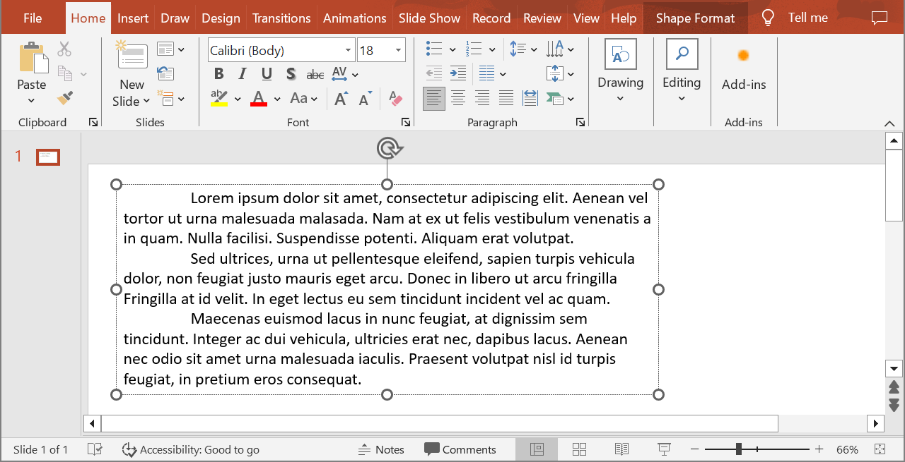

## **Overzicht**

Aspose.Slides for Android via Java vertegenwoordigt tekst als een hiërarchie van tekstframes, alinea’s en delen:

* [ITextFrame](https://reference.aspose.com/slides/androidjava/com.aspose.slides/itextframe/) vertegenwoordigt de tekstcontainer in een vorm en biedt toegang tot de alinea‑collectie.
* [IParagraph](https://reference.aspose.com/slides/androidjava/com.aspose.slides/iparagraph/) vertegenwoordigt één alinea in een tekstframe en biedt toegang tot de delen en de opmaak op alinea‑niveau.
* [IPortion](https://reference.aspose.com/slides/androidjava/com.aspose.slides/iportion/) vertegenwoordigt een tekstreeks binnen een alinea. Elk deel kan zijn eigen tekst en teken‑opmaak hebben.

Een alinea kan dus tekst met verschillende lettertypen, kleuren, groottes en andere opmaak bevatten door meerdere delen te gebruiken.

## **Alinea’s maken en opmaken**

Maak alinea’s in het tekstframe van een vorm en gebruik delen om individuele tekstreeksen op te maken. Deze sectie laat zien hoe je meerdere delen binnen elk alinea combineert en verschillende kleuren, lettergrootten en stijlen toepast.

### **Alinea’s maken met meerdere delen**

Het volgende Android‑via‑Java‑voorbeeld maakt drie alinea’s, elk met drie tekstreeksen in de collectie die wordt geretourneerd door [IParagraph.getPortions](https://reference.aspose.com/slides/androidjava/com.aspose.slides/iparagraph/#getPortions--). Het hergebruikt de standaardalinea en het lege deel, waarna de resterende alinea’s en delen worden toegevoegd. Opmaak wordt toegepast via [IPortion.getPortionFormat](https://reference.aspose.com/slides/androidjava/com.aspose.slides/iportion/#getPortionFormat--): het eerste deel in elke alinea is rood, vet en 15 punten; het tweede is blauw, cursief en 18 punten. Het derde deel behoudt de standaardopmaak:

```java
import com.aspose.slides.*;
import android.graphics.Color;

Presentation presentation = new Presentation();
try {
    ISlide slide = presentation.getSlides().get_Item(0);

    IAutoShape shape = slide.getShapes().addAutoShape(ShapeType.Rectangle, 50, 150, 300, 150);
    ITextFrame textFrame = shape.getTextFrame();

    IParagraph firstParagraph = textFrame.getParagraphs().get_Item(0);
    firstParagraph.getPortions().add(new Portion());
    firstParagraph.getPortions().add(new Portion());

    IParagraph secondParagraph = new Paragraph();
    secondParagraph.getPortions().add(new Portion());
    secondParagraph.getPortions().add(new Portion());
    secondParagraph.getPortions().add(new Portion());
    textFrame.getParagraphs().add(secondParagraph);

    IParagraph thirdParagraph = new Paragraph();
    thirdParagraph.getPortions().add(new Portion());
    thirdParagraph.getPortions().add(new Portion());
    thirdParagraph.getPortions().add(new Portion());
    textFrame.getParagraphs().add(thirdParagraph);

    int paragraphCount = textFrame.getParagraphs().getCount();
    for (int paragraphIndex = 0; paragraphIndex < paragraphCount; paragraphIndex++) {
        IParagraph paragraph = textFrame.getParagraphs().get_Item(paragraphIndex);
        int portionCount = paragraph.getPortions().getCount();
        for (int portionIndex = 0; portionIndex < portionCount; portionIndex++) {
            IPortion portion = paragraph.getPortions().get_Item(portionIndex);
            portion.setText("Portion " + (paragraphIndex + 1) + "." + (portionIndex + 1));

            if (portionIndex == 0) {
                portion.getPortionFormat().getFillFormat().setFillType(FillType.Solid);
                portion.getPortionFormat().getFillFormat().getSolidFillColor().setColor(Color.RED);
                portion.getPortionFormat().setFontBold(NullableBool.True);
                portion.getPortionFormat().setFontHeight(15);
            } else if (portionIndex == 1) {
                portion.getPortionFormat().getFillFormat().setFillType(FillType.Solid);
                portion.getPortionFormat().getFillFormat().getSolidFillColor().setColor(Color.BLUE);
                portion.getPortionFormat().setFontItalic(NullableBool.True);
                portion.getPortionFormat().setFontHeight(18);
            }
        }
    }

    presentation.save("paragraphs_with_portions.pptx", SaveFormat.Pptx);
} finally {
    presentation.dispose();
}
```

## **Opsommingstekens en genummerde lijsten maken**

Organiseer alinea‑tekst in lijsten met symbolen, cijfers of aangepaste afbeeldingen. De voorbeelden in deze sectie behandelen opsommingsteken‑opmaak, meerlagige lijsten en aangepaste startnummers.

### **Een opsomming of genummerde lijst maken**

Opsommingstekens en nummering maken gerelateerde items makkelijker scanbaar. In Aspose.Slides worden lijstinstellingen gedefinieerd via [IBulletFormat](https://reference.aspose.com/slides/androidjava/com.aspose.slides/ibulletformat/).

Dit Android‑via‑Java‑voorbeeld voegt een symbool‑opsommingsteken en een genummerd item toe aan hetzelfde tekstframe. [IBulletFormat.setType](https://reference.aspose.com/slides/androidjava/com.aspose.slides/ibulletformat/#setType-byte-) selecteert het type opsommingsteken, terwijl [IBulletFormat.setChar](https://reference.aspose.com/slides/androidjava/com.aspose.slides/ibulletformat/#setChar-char-) het symbool levert en [IBulletFormat.setNumberedBulletStyle](https://reference.aspose.com/slides/androidjava/com.aspose.slides/ibulletformat/#setNumberedBulletStyle-byte-) de nummeringsstijl kiest. Beide items gebruiken zwarte opsommingstekens met een hoogte van 100 % en een alinea‑inspringing van 25 punten:

```java
import com.aspose.slides.*;
import android.graphics.Color;

Presentation presentation = new Presentation();
try {
    ISlide slide = presentation.getSlides().get_Item(0);

    IAutoShape shape = slide.getShapes().addAutoShape(ShapeType.Rectangle, 200, 200, 400, 200);
    ITextFrame textFrame = shape.getTextFrame();
    textFrame.getParagraphs().clear();

    Paragraph symbolParagraph = new Paragraph();
    symbolParagraph.setText("Welcome to Aspose.Slides");
    symbolParagraph.getParagraphFormat().getBullet().setType(BulletType.Symbol);
    symbolParagraph.getParagraphFormat().getBullet().setChar((char) 0x2022);
    symbolParagraph.getParagraphFormat().setIndent(25);
    symbolParagraph.getParagraphFormat().getBullet().getColor().setColorType(ColorType.RGB);
    symbolParagraph.getParagraphFormat().getBullet().getColor().setColor(Color.BLACK);
    symbolParagraph.getParagraphFormat().getBullet().setBulletHardColor(NullableBool.True);
    symbolParagraph.getParagraphFormat().getBullet().setHeight(100);
    textFrame.getParagraphs().add(symbolParagraph);

    Paragraph numberedParagraph = new Paragraph();
    numberedParagraph.setText("This is a numbered item");
    numberedParagraph.getParagraphFormat().getBullet().setType(BulletType.Numbered);
    numberedParagraph.getParagraphFormat().getBullet().setNumberedBulletStyle(NumberedBulletStyle.BulletCircleNumWDBlackPlain);
    numberedParagraph.getParagraphFormat().setIndent(25);
    numberedParagraph.getParagraphFormat().getBullet().getColor().setColorType(ColorType.RGB);
    numberedParagraph.getParagraphFormat().getBullet().getColor().setColor(Color.BLACK);
    numberedParagraph.getParagraphFormat().getBullet().setBulletHardColor(NullableBool.True);
    numberedParagraph.getParagraphFormat().getBullet().setHeight(100);
    textFrame.getParagraphs().add(numberedParagraph);

    presentation.save("bulleted_and_numbered_list.pptx", SaveFormat.Pptx);
} finally {
    presentation.dispose();
}
```

### **Afbeeldings‑opsommingstekens gebruiken**

Afbeeldings‑opsommingstekens laten je een aangepaste afbeelding gebruiken in plaats van een symbool of cijfer.

Dit Android‑via‑Java‑voorbeeld voegt een afbeelding toe aan de afbeeldingscollectie van de presentatie als een [IPPImage](https://reference.aspose.com/slides/androidjava/com.aspose.slides/ippimage/) en gebruikt deze als alinea‑opsommingsteken. Het roept [IBulletFormat.setType](https://reference.aspose.com/slides/androidjava/com.aspose.slides/ibulletformat/#setType-byte-) aan om een afbeelding‑opsommingsteken te gebruiken en wijst de afbeelding toe via [IBulletFormat.getPicture](https://reference.aspose.com/slides/androidjava/com.aspose.slides/ibulletformat/#getPicture--). [IBulletFormat.setHeight](https://reference.aspose.com/slides/androidjava/com.aspose.slides/ibulletformat/#setHeight-float-) wordt op 100 % gezet om het opsommingsteken relatief tot de alinea‑tekst te dimensioneren:

```java
import com.aspose.slides.*;

Presentation presentation = new Presentation();
try {
    ISlide slide = presentation.getSlides().get_Item(0);

    IImage bulletImage = Images.fromFile("bullets.png");
    IPPImage presentationImage;
    try {
        presentationImage = presentation.getImages().addImage(bulletImage);
    } finally {
        bulletImage.dispose();
    }

    IAutoShape shape = slide.getShapes().addAutoShape(ShapeType.Rectangle, 200, 200, 400, 200);
    ITextFrame textFrame = shape.getTextFrame();
    textFrame.getParagraphs().clear();

    Paragraph paragraph = new Paragraph();
    paragraph.setText("Welcome to Aspose.Slides");
    paragraph.getParagraphFormat().getBullet().setType(BulletType.Picture);
    paragraph.getParagraphFormat().getBullet().getPicture().setImage(presentationImage);
    paragraph.getParagraphFormat().getBullet().setHeight(100);
    textFrame.getParagraphs().add(paragraph);

    presentation.save("picture_bullet.pptx", SaveFormat.Pptx);
    presentation.save("picture_bullet.ppt", SaveFormat.Ppt);
} finally {
    presentation.dispose();
}
```

### **Een meerlagige lijst maken**

Stel [IParagraphFormat.setDepth](https://reference.aspose.com/slides/androidjava/com.aspose.slides/iparagraphformat/#setDepth-short-) in om alinea’s op verschillende niveaus van een lijst te plaatsen. Het bovenste niveau heeft een diepte van `0`.

Dit Android‑via‑Java‑voorbeeld kent [IParagraphFormat.setDepth](https://reference.aspose.com/slides/androidjava/com.aspose.slides/iparagraphformat/#setDepth-short-) waarden toe van 0 tot 3 voor vier alinea’s, waardoor er een hiërarchie binnen één tekstframe ontstaat. Elke alinea gebruikt een symbool‑opsommingsteken, waarbij [IBulletFormat.setChar](https://reference.aspose.com/slides/androidjava/com.aspose.slides/ibulletformat/#setChar-char-) afwisselt tussen een ronde stip en een koppelteken om aangrenzende niveaus te onderscheiden:

```java
import com.aspose.slides.*;
import android.graphics.Color;

Presentation presentation = new Presentation();
try {
    ISlide slide = presentation.getSlides().get_Item(0);

    IAutoShape shape = slide.getShapes().addAutoShape(ShapeType.Rectangle, 200, 200, 400, 200);
    ITextFrame textFrame = shape.getTextFrame();
    textFrame.getParagraphs().clear();

    IParagraph firstParagraph = new Paragraph();
    firstParagraph.setText("Content");
    firstParagraph.getParagraphFormat().getBullet().setType(BulletType.Symbol);
    firstParagraph.getParagraphFormat().getBullet().setChar((char) 0x2022);
    firstParagraph.getParagraphFormat().getDefaultPortionFormat().getFillFormat().setFillType(FillType.Solid);
    firstParagraph.getParagraphFormat().getDefaultPortionFormat().getFillFormat().getSolidFillColor().setColor(Color.BLACK);
    firstParagraph.getParagraphFormat().setDepth((short) 0);

    IParagraph secondParagraph = new Paragraph();
    secondParagraph.setText("Second level");
    secondParagraph.getParagraphFormat().getBullet().setType(BulletType.Symbol);
    secondParagraph.getParagraphFormat().getBullet().setChar('-');
    secondParagraph.getParagraphFormat().getDefaultPortionFormat().getFillFormat().setFillType(FillType.Solid);
    secondParagraph.getParagraphFormat().getDefaultPortionFormat().getFillFormat().getSolidFillColor().setColor(Color.BLACK);
    secondParagraph.getParagraphFormat().setDepth((short) 1);

    IParagraph thirdParagraph = new Paragraph();
    thirdParagraph.setText("Third level");
    thirdParagraph.getParagraphFormat().getBullet().setType(BulletType.Symbol);
    thirdParagraph.getParagraphFormat().getBullet().setChar((char) 0x2022);
    thirdParagraph.getParagraphFormat().getDefaultPortionFormat().getFillFormat().setFillType(FillType.Solid);
    thirdParagraph.getParagraphFormat().getDefaultPortionFormat().getFillFormat().getSolidFillColor().setColor(Color.BLACK);
    thirdParagraph.getParagraphFormat().setDepth((short) 2);

    IParagraph fourthParagraph = new Paragraph();
    fourthParagraph.setText("Fourth level");
    fourthParagraph.getParagraphFormat().getBullet().setType(BulletType.Symbol);
    fourthParagraph.getParagraphFormat().getBullet().setChar('-');
    fourthParagraph.getParagraphFormat().getDefaultPortionFormat().getFillFormat().setFillType(FillType.Solid);
    fourthParagraph.getParagraphFormat().getDefaultPortionFormat().getFillFormat().getSolidFillColor().setColor(Color.BLACK);
    fourthParagraph.getParagraphFormat().setDepth((short) 3);

    textFrame.getParagraphs().add(firstParagraph);
    textFrame.getParagraphs().add(secondParagraph);
    textFrame.getParagraphs().add(thirdParagraph);
    textFrame.getParagraphs().add(fourthParagraph);

    presentation.save("multilevel_list.pptx", SaveFormat.Pptx);
} finally {
    presentation.dispose();
}
```

### **Genummerde lijstitems starten met aangepaste waarden**

Gebruik [IBulletFormat.setNumberedBulletStartWith](https://reference.aspose.com/slides/androidjava/com.aspose.slides/ibulletformat/#setNumberedBulletStartWith-short-) om het initiële nummer in te stellen dat wordt weergegeven voor een genummerde alinea.

Dit Android‑via‑Java‑voorbeeld zet [IBulletFormat.setType](https://reference.aspose.com/slides/androidjava/com.aspose.slides/ibulletformat/#setType-byte-) op nummering voor drie alinea’s en kent [IBulletFormat.setNumberedBulletStartWith](https://reference.aspose.com/slides/androidjava/com.aspose.slides/ibulletformat/#setNumberedBulletStartWith-short-) de waarden 2, 3 en 7 toe. De startwaarde wordt afzonderlijk voor elke alinea geconfigureerd, waardoor de weergegeven nummers kunnen overslaan:

```java
import com.aspose.slides.*;

Presentation presentation = new Presentation();
try {
    ISlide slide = presentation.getSlides().get_Item(0);

    IAutoShape shape = slide.getShapes().addAutoShape(ShapeType.Rectangle, 200, 200, 400, 200);
    ITextFrame textFrame = shape.getTextFrame();
    textFrame.getParagraphs().clear();

    Paragraph firstParagraph = new Paragraph();
    firstParagraph.setText("Start at 2");
    firstParagraph.getParagraphFormat().getBullet().setType(BulletType.Numbered);
    firstParagraph.getParagraphFormat().getBullet().setNumberedBulletStartWith((short) 2);
    textFrame.getParagraphs().add(firstParagraph);

    Paragraph secondParagraph = new Paragraph();
    secondParagraph.setText("Start at 3");
    secondParagraph.getParagraphFormat().getBullet().setType(BulletType.Numbered);
    secondParagraph.getParagraphFormat().getBullet().setNumberedBulletStartWith((short) 3);
    textFrame.getParagraphs().add(secondParagraph);

    Paragraph thirdParagraph = new Paragraph();
    thirdParagraph.setText("Start at 7");
    thirdParagraph.getParagraphFormat().getBullet().setType(BulletType.Numbered);
    thirdParagraph.getParagraphFormat().getBullet().setNumberedBulletStartWith((short) 7);
    textFrame.getParagraphs().add(thirdParagraph);

    presentation.save("custom_numbered_list.pptx", SaveFormat.Pptx);
} finally {
    presentation.dispose();
}
```

## **Alinea‑lay‑out en eind‑eigenschappen beheren**

Pas marges en inspringingen van alinea’s aan om de positie van de eerste regel en ingesprongen regels te regelen. Je kunt ook het einde‑teken van de alinea apart opmaken van de zichtbare tekstdelen.

### **Eerste‑regel‑inspringing instellen**

Gebruik de [IParagraphFormat.setIndent](https://reference.aspose.com/slides/androidjava/com.aspose.slides/iparagraphformat/#setIndent-float-)‑methode om de eerste‑regel‑inspringing van een alinea te controleren. Deze instelling verplaatst alleen de eerste regel ten opzichte van de linkermarge van de alinea. Een positieve waarde verschuift de eerste regel naar rechts, terwijl de resterende regels uitgelijnd blijven met de alinea‑inhoud.

Gebruik [IParagraphFormat.setMarginLeft](https://reference.aspose.com/slides/androidjava/com.aspose.slides/iparagraphformat/#setMarginLeft-float-) wanneer je de hele alinea wilt verplaatsen. Gebruik [IParagraphFormat.setIndent](https://reference.aspose.com/slides/androidjava/com.aspose.slides/iparagraphformat/#setIndent-float-) wanneer je alleen de eerste regel wilt verplaatsen.

Het volgende voorbeeld geeft drie alinea’s dezelfde [IParagraphFormat.setMarginLeft](https://reference.aspose.com/slides/androidjava/com.aspose.slides/iparagraphformat/#setMarginLeft-float-) van 20 punten en [IParagraphFormat.setIndent](https://reference.aspose.com/slides/androidjava/com.aspose.slides/iparagraphformat/#setIndent-float-) waarden van 0, 20 en 40 punten. De eerste regels starten steeds verder naar rechts, terwijl ingesprongen regels dezelfde linkermarge behouden:

```java
import com.aspose.slides.*;
import android.graphics.Color;

Presentation presentation = new Presentation();
try {
    ISlide slide = presentation.getSlides().get_Item(0);

    IAutoShape shape = slide.getShapes().addAutoShape(ShapeType.Rectangle, 50, 50, 420, 220);
    shape.getFillFormat().setFillType(FillType.NoFill);
    shape.getLineFormat().getFillFormat().setFillType(FillType.Solid);
    shape.getLineFormat().getFillFormat().getSolidFillColor().setColor(Color.GRAY);

    ITextFrame textFrame = shape.getTextFrame();
    textFrame.getTextFrameFormat().setAutofitType(TextAutofitType.Shape);
    textFrame.getParagraphs().clear();

    Paragraph firstParagraph = new Paragraph();
    firstParagraph.setText("No first-line indent. Wrapped lines start at the same position as the first line.");
    firstParagraph.getParagraphFormat().getDefaultPortionFormat().getFillFormat().setFillType(FillType.Solid);
    firstParagraph.getParagraphFormat().getDefaultPortionFormat().getFillFormat().getSolidFillColor().setColor(Color.BLACK);
    firstParagraph.getParagraphFormat().setMarginLeft(20f);
    firstParagraph.getParagraphFormat().setIndent(0f);

    Paragraph secondParagraph = new Paragraph();
    secondParagraph.setText("First-line indent of 20 points. The first line moves to the right, while wrapped lines remain aligned to the paragraph body.");
    secondParagraph.getParagraphFormat().getDefaultPortionFormat().getFillFormat().setFillType(FillType.Solid);
    secondParagraph.getParagraphFormat().getDefaultPortionFormat().getFillFormat().getSolidFillColor().setColor(Color.BLACK);
    secondParagraph.getParagraphFormat().setMarginLeft(20f);
    secondParagraph.getParagraphFormat().setIndent(20f);

    Paragraph thirdParagraph = new Paragraph();
    thirdParagraph.setText("First-line indent of 40 points. This paragraph shows a larger first-line offset to make the effect easier to see.");
    thirdParagraph.getParagraphFormat().getDefaultPortionFormat().getFillFormat().setFillType(FillType.Solid);
    thirdParagraph.getParagraphFormat().getDefaultPortionFormat().getFillFormat().getSolidFillColor().setColor(Color.BLACK);
    thirdParagraph.getParagraphFormat().setMarginLeft(20f);
    thirdParagraph.getParagraphFormat().setIndent(40f);

    textFrame.getParagraphs().add(firstParagraph);
    textFrame.getParagraphs().add(secondParagraph);
    textFrame.getParagraphs().add(thirdParagraph);

    presentation.save("paragraph_indent.pptx", SaveFormat.Pptx);
} finally {
    presentation.dispose();
}
```

Resultaat:


### **Hangende inspringing instellen**

Een hangende inspringing is een alinea‑lay‑out waarbij de eerste regel links van de resterende regels start. In Aspose.Slides creëer je dit effect met de eigenschap [IParagraphFormat.setIndent](https://reference.aspose.com/slides/androidjava/com.aspose.slides/iparagraphformat/#setIndent-float-). Stel `Indent` in op een negatieve waarde om de eerste regel naar links te verplaatsen ten opzichte van de alinea‑inhoud.

In de praktijk definieert [IParagraphFormat.setMarginLeft](https://reference.aspose.com/slides/androidjava/com.aspose.slides/iparagraphformat/#setMarginLeft-float-) de linkse positie van de alinea‑inhoud, en [IParagraphFormat.setIndent](https://reference.aspose.com/slides/androidjava/com.aspose.slides/iparagraphformat/#setIndent-float-) de positie van de eerste regel ten opzichte van die marge. Om een hangende inspringing te maken, stel je een positieve `MarginLeft`‑waarde en een negatieve `Indent`‑waarde in.

Deze opmaak is bruikbaar voor bibliografieën, verwijzingen, glossarium‑items en andere alinea’s waarbij ingesprongen regels onder de alinea‑inhoud moeten uitlijnen en niet onder het eerste teken van de eerste regel.

Het volgende Android‑via‑Java‑voorbeeld koppelt [IParagraphFormat.setMarginLeft](https://reference.aspose.com/slides/androidjava/com.aspose.slides/iparagraphformat/#setMarginLeft-float-) waarden van 40 en 60 punten aan [IParagraphFormat.setIndent](https://reference.aspose.com/slides/androidjava/com.aspose.slides/iparagraphformat/#setIndent-float-) waarden van -20 en -30 punten. In elke alinea start de eerste regel links van de ingesprongen regels; de tweede alinea heeft een diepere hangende inspringing:

```java
import com.aspose.slides.*;
import android.graphics.Color;

Presentation presentation = new Presentation();
try {
    ISlide slide = presentation.getSlides().get_Item(0);

    IAutoShape shape = slide.getShapes().addAutoShape(ShapeType.Rectangle, 50, 50, 420, 220);
    shape.getFillFormat().setFillType(FillType.NoFill);
    shape.getLineFormat().getFillFormat().setFillType(FillType.Solid);
    shape.getLineFormat().getFillFormat().getSolidFillColor().setColor(Color.GRAY);

    ITextFrame textFrame = shape.getTextFrame();
    textFrame.getTextFrameFormat().setAutofitType(TextAutofitType.Shape);
    textFrame.getParagraphs().clear();

    Paragraph firstParagraph = new Paragraph();
    firstParagraph.setText("A hanging indent is created by combining a positive left margin with a negative indent. The first line starts to the left, while wrapped lines align with the paragraph body.");
    firstParagraph.getParagraphFormat().getDefaultPortionFormat().getFillFormat().setFillType(FillType.Solid);
    firstParagraph.getParagraphFormat().getDefaultPortionFormat().getFillFormat().getSolidFillColor().setColor(Color.BLACK);
    firstParagraph.getParagraphFormat().setMarginLeft(40f);
    firstParagraph.getParagraphFormat().setIndent(-20f);

    Paragraph secondParagraph = new Paragraph();
    secondParagraph.setText("This second example uses a deeper hanging indent so the difference between the first line and the wrapped lines is easier to compare.");
    secondParagraph.getParagraphFormat().getDefaultPortionFormat().getFillFormat().setFillType(FillType.Solid);
    secondParagraph.getParagraphFormat().getDefaultPortionFormat().getFillFormat().getSolidFillColor().setColor(Color.BLACK);
    secondParagraph.getParagraphFormat().setMarginLeft(60f);
    secondParagraph.getParagraphFormat().setIndent(-30f);

    textFrame.getParagraphs().add(firstParagraph);
    textFrame.getParagraphs().add(secondParagraph);

    presentation.save("hanging_indent.pptx", SaveFormat.Pptx);
} finally {
    presentation.dispose();
}
```

Resultaat:


### **Einde‑alinea‑run‑eigenschappen instellen**

De methode [IParagraph.setEndParagraphPortionFormat](https://reference.aspose.com/slides/androidjava/com.aspose.slides/iparagraph/#setEndParagraphPortionFormat-com.aspose.slides.IPortionFormat-) regelt de opmaak van het alinea‑einde‑teken. Het volgende voorbeeld maakt een [PortionFormat](https://reference.aspose.com/slides/androidjava/com.aspose.slides/portionformat/) met [IBasePortionFormat.setFontHeight](https://reference.aspose.com/slides/androidjava/com.aspose.slides/ibaseportionformat/#setFontHeight-float-) ingesteld op 48 punten en [IBasePortionFormat.setLatinFont](https://reference.aspose.com/slides/androidjava/com.aspose.slides/ibaseportionformat/#setLatinFont-com.aspose.slides.IFontData-) ingesteld op Times New Roman. Het wijst dit format toe aan het einde‑teken van de tweede alinea, terwijl de zichtbare tekstdelen ongewijzigd blijven:

```java
import com.aspose.slides.*;

Presentation presentation = new Presentation("Test.pptx");
try {
    ISlide slide = presentation.getSlides().get_Item(0);

    IAutoShape shape = slide.getShapes().addAutoShape(ShapeType.Rectangle, 10, 10, 200, 250);
    ITextFrame textFrame = shape.getTextFrame();
    textFrame.getParagraphs().clear();

    Paragraph firstParagraph = new Paragraph();
    firstParagraph.getPortions().add(new Portion("Sample text"));

    Paragraph secondParagraph = new Paragraph();
    secondParagraph.getPortions().add(new Portion("Sample text 2"));

    PortionFormat endParagraphFormat = new PortionFormat();
    endParagraphFormat.setFontHeight(48);
    endParagraphFormat.setLatinFont(new FontData("Times New Roman"));
    secondParagraph.setEndParagraphPortionFormat(endParagraphFormat);

    textFrame.getParagraphs().add(firstParagraph);
    textFrame.getParagraphs().add(secondParagraph);

    presentation.save("end_paragraph_format.pptx", SaveFormat.Pptx);
} finally {
    presentation.dispose();
}
```

## **Aantal gerenderde regels tellen**

Voor alinea‑regels die automatisch afbreken en interpunctie aan regeleinden beïnvloeden, zie [Control Line Breaking](/slides/nl/androidjava/text-formatting/#control-line-breaking) en [Control Hanging Punctuation](/slides/nl/androidjava/text-formatting/#control-hanging-punctuation).

Gebruik [IParagraph.getLinesCount](https://reference.aspose.com/slides/androidjava/com.aspose.slides/iparagraph/#getLinesCount--) om het aantal regels te tellen dat een alinea inneemt na tekstlay‑out, inclusief automatische afbreking. Dit is handig bij het controleren van tekstlengte en lay‑out in presentatiesjablonen.

Een alinea is één item in [ITextFrame.getParagraphs](https://reference.aspose.com/slides/androidjava/com.aspose.slides/itextframe/#getParagraphs--), en kan meerdere gerenderde regels beslaan. Een expliciete regeleinde‑invoer in een alinea dwingt een nieuwe regel af zonder een extra alinea te maken. Automatische afbreking genereert regels op basis van de beschikbare breedte zonder expliciete regeleinden in de tekst in te voegen. Het tellen van alinea’s of regeleinde‑tekens geeft derhalve niet het gerenderde regel­aantal.

Het volgende voorbeeld maakt een tekstvorm, telt de regels, vernauwt de vorm en vervangt daarna de tekst door een kortere string. Het voorbeeld schakelt afbreken in via [ITextFrameFormat.setWrapText](https://reference.aspose.com/slides/androidjava/com.aspose.slides/itextframeformat/#setWrapText-byte-) en schakelt autofit uit via [ITextFrameFormat.setAutofitType](https://reference.aspose.com/slides/androidjava/com.aspose.slides/itextframeformat/#setAutofitType-byte-), zodat de vormbreedte de afbreking bepaalt zonder de tekst automatisch te verkleinen of de vorm te herschalen. Elke meting maakt gebruik van [IParagraph.getLinesCount](https://reference.aspose.com/slides/androidjava/com.aspose.slides/iparagraph/#getLinesCount--). Vormafmetingen zijn in punten. Ten slotte voegt het voorbeeld een extra alinea toe en somt de regel­aantallen op over het tekstframe.

```java
import com.aspose.slides.*;

Presentation presentation = new Presentation();
try {
    ISlide slide = presentation.getSlides().get_Item(0);

    IAutoShape shape = slide.getShapes().addAutoShape(ShapeType.Rectangle, 50, 50, 400, 200);
    ITextFrame textFrame = shape.getTextFrame();
    textFrame.getTextFrameFormat().setWrapText(NullableBool.True);
    textFrame.getTextFrameFormat().setAutofitType(TextAutofitType.None);

    IParagraph paragraph = textFrame.getParagraphs().get_Item(0);
    paragraph.getParagraphFormat().getDefaultPortionFormat().setFontHeight(20);
    paragraph.setText("This text demonstrates how automatic wrapping changes the number of rendered lines.");
    System.out.println("Original width: " + paragraph.getLinesCount());

    shape.setWidth(150);
    System.out.println("Narrower shape: " + paragraph.getLinesCount());

    paragraph.setText("Short text.");
    System.out.println("Shorter text: " + paragraph.getLinesCount());

    Paragraph secondParagraph = new Paragraph();
    secondParagraph.setText("Another paragraph.");
    secondParagraph.getParagraphFormat().getDefaultPortionFormat().setFontHeight(20);
    textFrame.getParagraphs().add(secondParagraph);

    int totalLineCount = 0;
    for (IParagraph currentParagraph : textFrame.getParagraphs()) {
        totalLineCount += currentParagraph.getLinesCount();
    }
    System.out.println("Total lines in the text frame: " + totalLineCount);
} finally {
    presentation.dispose();
}
```

Met deze tekst en afmetingen verhoogt het vernauwen van de vorm het aantal regels, terwijl het vervangen van de tekst door de korte string het aantal verlaagt. Exacte aantallen kunnen variëren afhankelijk van de beschikbare lettertypen en vervanging, lettergrootte, marges, inspringing, afbreking en autofit‑instellingen. Gebruik de lettertypen en lay‑outinstellingen die bedoeld zijn voor de doelsituatie bij het controleren van een sjabloon.

Het aantal regels alleen bepaalt niet of tekst buiten de container stroomt. De beschikbare hoogte, regel‑hoogtes, alinea‑ en regel‑afstand, en autofit‑gedrag zijn eveneens van belang; zelfs één regel kan de beschikbare breedte overschrijden als afbreken is uitgeschakeld.

## **Alinea‑inhoud importeren en exporteren**

Gebruik HTML om tekst in een presentatie te brengen of bestaande alinea’s te exporteren voor gebruik buiten de presentatie. Deze sectie toont ook hoe je individuele alinea’s als afbeeldingen rendert, inclusief alinea’s in tabelcellen.

### **HTML‑tekst importeren in alinea’s**

Gebruik [ParagraphCollection.addFromHtml](https://reference.aspose.com/slides/androidjava/com.aspose.slides/paragraphcollection/#addFromHtml-java.lang.String-) om HTML‑markup om te zetten in alinea’s en delen in een tekstframe.

Dit Android‑via‑Java‑voorbeeld leest HTML uit een bestand en geeft de markup door aan [ParagraphCollection.addFromHtml](https://reference.aspose.com/slides/androidjava/com.aspose.slides/paragraphcollection/#addFromHtml-java.lang.String-). Het maakt het standaard‑alinea‑object van het tekstframe leeg zodat het frame alleen de geïmporteerde inhoud bevat. De rechthoekige vorm laat een marge van 10 punten aan elke kant van de dia achter:

```java
import com.aspose.slides.*;
import java.io.IOException;
import java.nio.charset.StandardCharsets;
import java.nio.file.Files;
import java.nio.file.Paths;

Presentation presentation = new Presentation();
try {
    ISlide slide = presentation.getSlides().get_Item(0);

    float shapeWidth = (float) presentation.getSlideSize().getSize().getWidth() - 20;
    float shapeHeight = (float) presentation.getSlideSize().getSize().getHeight() - 20;
    IAutoShape shape = slide.getShapes().addAutoShape(ShapeType.Rectangle, 10, 10, shapeWidth, shapeHeight);
    shape.getFillFormat().setFillType(FillType.NoFill);
    shape.getTextFrame().getParagraphs().clear();

    try {
        byte[] htmlBytes = Files.readAllBytes(Paths.get("file.html"));
        String html = new String(htmlBytes, StandardCharsets.UTF_8);
        shape.getTextFrame().getParagraphs().addFromHtml(html);
        presentation.save("html_text.pptx", SaveFormat.Pptx);
    } catch (IOException exception) {
        System.out.println("The HTML file could not be read: " + exception.getMessage());
    }
} finally {
    presentation.dispose();
}
```

### **Alinea‑tekst exporteren naar HTML**

Gebruik [ParagraphCollection.exportToHtml](https://reference.aspose.com/slides/androidjava/com.aspose.slides/paragraphcollection/#exportToHtml-int-int-com.aspose.slides.ITextToHtmlConversionOptions-) om een geselecteerd bereik van alinea’s als HTML te exporteren. Wanneer je presentatietekst hergebruikt op een website, wil je mogelijk de lokale nadruk behouden zonder de lettertype‑, grootte‑ of tekstvak‑stijlen van de presentatie over te nemen. Stel [TextToHtmlConversionOptions.setTextInheritanceLimit](https://reference.aspose.com/slides/androidjava/com.aspose.slides/texttohtmlconversionoptions/#setTextInheritanceLimit-int-) in om te bepalen hoe ver de exporter de opmaak‑erfenis volgt.

Download [de voorbeeldpresentatie](text-inheritance.pptx) en plaats deze in de werkmap van de applicatie. De eerste dia bevat één tekstvorm met de tekst “Inherited text; explicit red 18pt”. De invoer gebruikt bewust verschillende opmaakniveaus:

- De standaard‑tekststijl van de presentatie levert Calibri en een grootte van 28 pt.
- De eerste‑niveau‑tekststijl van het tekstframe levert blauwe tekst en cursief.
- De alinea stelt expliciet vetgedrukte tekst in.
- Het tweede deel, “explicit red 18pt”, stelt expliciet rode tekst en een grootte van 18 pt in.

Het volgende volledige voorbeeld exporteert dezelfde alinea’s drie keer. Het geeft [TextToHtmlConversionOptions](https://reference.aspose.com/slides/androidjava/com.aspose.slides/texttohtmlconversionoptions/) door aan de export‑methode en schrijft elk resultaat naar een apart UTF‑8 HTML‑bestand:

```java
import com.aspose.slides.*;
import java.io.IOException;
import java.nio.charset.StandardCharsets;
import java.nio.file.Files;
import java.nio.file.Paths;

Presentation presentation = new Presentation("text-inheritance.pptx");
try {
    IShape shape = presentation.getSlides().get_Item(0).getShapes().get_Item(0);

    if (shape instanceof IAutoShape) {
        IAutoShape textShape = (IAutoShape) shape;
        ITextFrame textFrame = textShape.getTextFrame();
        if (textFrame != null) {
            IParagraphCollection paragraphs = textFrame.getParagraphs();
            
            int[] modes = { TextInheritanceLimit.All, TextInheritanceLimit.TextBox, TextInheritanceLimit.ParagraphOnly };
            String[] fileNames = { "All.html", "TextBox.html", "ParagraphOnly.html" };

            for (int i = 0; i < modes.length; i++) {
                TextToHtmlConversionOptions options = new TextToHtmlConversionOptions();
                options.setTextInheritanceLimit(modes[i]);

                String html = paragraphs.exportToHtml(0, paragraphs.getCount(), options);
                byte[] htmlBytes = html.getBytes(StandardCharsets.UTF_8);
                try {
                    Files.write(Paths.get(fileNames[i]), htmlBytes);
                } catch (IOException exception) {
                    System.out.println("The HTML file could not be written: " + exception.getMessage());
                }
            }
        } else {
            System.out.println("The first shape does not contain a text frame.");
        }
    } else {
        System.out.println("The first shape is not a text shape.");
    }
} finally {
    presentation.dispose();
}
```

De gegenereerde HTML bevat de volgende CSS voor het eerste deel, “Inherited text;”. De tabel toont de relevante declaraties; andere gegenereerde eigenschappen zijn weggelaten voor de duidelijkheid.

| Output | Relevante CSS voor het eerste deel | Uiterlijk |
| --- | --- | --- |
| `All.html` | `font-family:'Calibri'; font-size:28pt; color:#0000ff; font-style:italic; font-weight:bold` | Blauwe, vetgedrukte, cursieve tekst van 28 pt in Calibri, indien dat lettertype beschikbaar is. |
| `TextBox.html` | `color:#0000ff; font-style:italic; font-weight:bold` | Blauwe, vetgedrukte, cursieve tekst; de omringende pagina of browser levert het lettertype en de grootte. |
| `ParagraphOnly.html` | `font-weight:bold` | Vetgedrukte tekst; de omringende pagina of browser levert lettertype, grootte, kleur en cursief. |

Het tweede deel behoudt `color:#ff0000`, `font-size:18pt` en `font-weight:bold` in alle drie de uitvoerbestanden. Het behoudt ook cursief in `All` en `TextBox`, maar niet in `ParagraphOnly`. Het beperken van de erfenis verwijdert dus niet de expliciet toegewezen opmaak van een alinea of deel.

Open de bestanden in dezelfde browser om ze te vergelijken. In de twee beperkte modi worden weggelaten CSS‑eigenschappen ingevuld door de stijlen van de bestemmingspagina of de browser‑standaarden, waardoor het uiteindelijke uiterlijk afhankelijk is van waar de HTML wordt gebruikt.

### **Een HTML‑klembord‑fragment genereren**

Gebruik [TextToHtmlConversionOptions.setAddClipboardFragmentHeader](https://reference.aspose.com/slides/androidjava/com.aspose.slides/texttohtmlconversionoptions/#setAddClipboardFragmentHeader-boolean-) om de output van [IParagraphCollection.exportToHtml](https://reference.aspose.com/slides/androidjava/com.aspose.slides/iparagraphcollection/#exportToHtml-int-int-com.aspose.slides.ITextToHtmlConversionOptions-) te kiezen. Met `false` retourneert de methode gewone HTML. Met `true` begint de geretourneerde string met een Windows‑klembord‑header. De velden `StartHTML` en `EndHTML` geven de UTF‑8‑byte‑offsets van de HTML, terwijl `StartFragment` en `EndFragment` de te plakken inhoud identificeren.

Dit voorbeeld exporteert twee opgemaakte alinea’s als gewone HTML (`html`) en als een HTML‑klembord‑fragment (`clipboardHtml`). Toepassingen die het Windows‑HTML‑klembordformaat accepteren, kunnen het fragment direct gebruiken. Als de klembord‑API ruwe bytes verwacht, codeer je het fragment als UTF‑8 zonder een byte‑order‑mark (BOM).

```java
import com.aspose.slides.*;

Presentation presentation = new Presentation();
try {
    ISlide slide = presentation.getSlides().get_Item(0);

    IAutoShape shape = slide.getShapes().addAutoShape(ShapeType.Rectangle, 0, 0, 400, 100);
    IParagraphCollection paragraphs = shape.getTextFrame().getParagraphs();
    paragraphs.clear();
    paragraphs.addFromHtml("<p>Status: <b>Ready</b></p><p><i>Next steps</i></p>");

    TextToHtmlConversionOptions options = new TextToHtmlConversionOptions();
    options.setAddClipboardFragmentHeader(false);
    String html = paragraphs.exportToHtml(0, paragraphs.getCount(), options);

    options.setAddClipboardFragmentHeader(true);
    String clipboardHtml = paragraphs.exportToHtml(0, paragraphs.getCount(), options);
} finally {
    presentation.dispose();
}
```

### **Een alinea als afbeelding renderen**

[IParagraph.getImage](https://reference.aspose.com/slides/androidjava/com.aspose.slides/iparagraph/#getImage--) rendert een individuele alinea direct en retourneert een [IImage](https://reference.aspose.com/slides/androidjava/com.aspose.slides/iimage/). Sla het resultaat op in een bestand of stream met [IImage.save](https://reference.aspose.com/slides/androidjava/com.aspose.slides/iimage/#save-java.lang.String-int-). Je hoeft de omringende vorm niet te renderen of handmatig een bitmap bij te snijden.

[IParagraph.getImage](https://reference.aspose.com/slides/androidjava/com.aspose.slides/iparagraph/#getImage--) kan `null` retourneren als de alinea niet gevonden wordt in de bovenliggende collectie, geen geldige render‑grenzen heeft, of niet gerenderd kan worden. Controleer het resultaat vóór het opslaan en vernietig de geretourneerde afbeelding na gebruik.

#### **Een alinea op de standaardschaal renderen**

Het voorbeeld gebruikt een presentatie met één dia waarvan de eerste vorm een tekstvak is met drie alinea’s.



Het volgende voorbeeld selecteert de tweede alinea op index 1 en roept [IParagraph.getImage](https://reference.aspose.com/slides/androidjava/com.aspose.slides/iparagraph/#getImage--) aan zonder schaal‑parameters. Het controleert dat de vorm de vereiste alinea bevat en dat de render een afbeelding oplevert voordat [IImage.save](https://reference.aspose.com/slides/androidjava/com.aspose.slides/iimage/#save-java.lang.String-int-) wordt aangeroepen om deze in PNG‑formaat op te slaan. Het `finally`‑blok vernietigt de afbeelding na gebruik.

```java
import com.aspose.slides.*;

Presentation presentation = new Presentation("sample.pptx");
try {
    IShape shape = presentation.getSlides().get_Item(0).getShapes().get_Item(0);

    if (shape instanceof IAutoShape) {
        IAutoShape textShape = (IAutoShape) shape;
        ITextFrame textFrame = textShape.getTextFrame();
        if (textFrame != null && textFrame.getParagraphs().getCount() > 1) {
            IParagraph paragraph = textFrame.getParagraphs().get_Item(1);
            IImage paragraphImage = paragraph.getImage();

            if (paragraphImage != null) {
                try {
                    paragraphImage.save("paragraph.png", ImageFormat.Png);
                } finally {
                    paragraphImage.dispose();
                }
            } else {
                System.out.println("The paragraph could not be rendered.");
            }
        } else {
            System.out.println("The expected paragraph was not found.");
        }
    } else {
        System.out.println("The first shape is not a text shape.");
    }
} finally {
    presentation.dispose();
}
```

Resultaat:


#### **Een alinea in een tabelcel renderen met schaalvergroting**

Gebruik de overload van [IParagraph.getImage](https://reference.aspose.com/slides/androidjava/com.aspose.slides/iparagraph/#getImage-float-float-) die `float scaleX` en `float scaleY` accepteert om de horizontale en verticale schaalfactoren in te stellen. Het volgende voorbeeld maakt een tabel, rendert de alinea in de eerste cel op het dubbele van de standaardbreedte en -hoogte, en slaat het resultaat op als een PNG‑afbeelding.

```java
import com.aspose.slides.*;

float scaleX = 2f;
float scaleY = 2f;

Presentation presentation = new Presentation();
try {
    ISlide slide = presentation.getSlides().get_Item(0);

    ITable table = slide.getShapes().addTable(50, 50, new double[] { 300 }, new double[] { 80 });
    IParagraph paragraph = table.get_Item(0, 0).getTextFrame().getParagraphs().get_Item(0);
    paragraph.setText("Text in a table cell");

    IImage paragraphImage = paragraph.getImage(scaleX, scaleY);
    if (paragraphImage != null) {
        try {
            paragraphImage.save("table_paragraph.png", ImageFormat.Png);
        } finally {
            paragraphImage.dispose();
        }
    } else {
        System.out.println("The paragraph could not be rendered.");
    }
} finally {
    presentation.dispose();
}
```

Een schaalfactor van `1` houdt die as op de standaardpixelgrootte. Bijvoorbeeld `2` voor beide factoren produceert een afbeelding waarvan breedte en hoogte ongeveer het dubbele zijn van de standaardafmetingen, wat vier keer zoveel pixels oplevert. Grotere factoren geven doorgaans scherpere tekst voor inzoomen of hoge‑resolutie‑output, maar verhogen ook het geheugenverbruik en de bestandsgrootte. Factoren onder `1` leveren kleinere afbeeldingen met minder details. Gebruik gelijke factoren om de beeldverhouding van de alinea te behouden; verschillende horizontale en verticale factoren rekken de output onafhankelijk uit.

Het renderen van een gehele vorm met [IShape.getImage](https://reference.aspose.com/slides/androidjava/com.aspose.slides/ishape/#getImage--) blijft nuttig wanneer de output ook de vul‑, rand‑ of andere visuele context van de vorm moet bevatten. Voor een afbeelding die alleen de alinea weergeeft, gebruik je [IParagraph.getImage](https://reference.aspose.com/slides/androidjava/com.aspose.slides/iparagraph/#getImage--).

## **FAQ**

**Kan ik het afbreken van tekst in een tekstframe volledig uitschakelen?**

Ja. Stel [ITextFrameFormat.setWrapText](https://reference.aspose.com/slides/androidjava/com.aspose.slides/itextframeformat/#setWrapText-byte-) in om afbreken uit te schakelen zodat regels niet worden afgebroken aan de randen van het tekstframe.

**Hoe krijg ik de exacte on‑dia‑grenzen van een specifieke alinea?**

Gebruik [IParagraph.getRect](https://reference.aspose.com/slides/androidjava/com.aspose.slides/iparagraph/#getRect--) om de begrenzende rechthoek van de alinea op te halen. [IPortion.getRect](https://reference.aspose.com/slides/androidjava/com.aspose.slides/iportion/#getRect--) geeft de grenzen van een individueel deel.

**Waar wordt de alinea‑uitlijning (links, rechts, gecentreerd of uitgevuld) geregeld?**

[IParagraphFormat.setAlignment](https://reference.aspose.com/slides/androidjava/com.aspose.slides/iparagraphformat/#setAlignment-int-) is een instelling op alinea‑niveau en wordt toegepast op de hele alinea, ongeacht de opmaak van individuele delen.

Om delen met verschillende lettergroottes binnen elke regel verticaal uit te lijnen, zie [Align Fonts Within a Line](/slides/nl/androidjava/text-formatting/#align-fonts-within-a-line).

**Kan ik de proeflees‑taal instellen voor een deel van een alinea?**

Ja. Stel [IBasePortionFormat.setLanguageId](https://reference.aspose.com/slides/androidjava/com.aspose.slides/ibaseportionformat/#setLanguageId-java.lang.String-) in voor individuele delen, zodat één alinea tekst in meerdere talen kan bevatten.