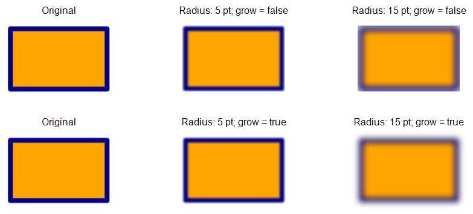

## **Introductie**

Hoewel effecten in PowerPoint kunnen worden gebruikt om een vorm te laten opvallen, verschillen ze van [vullingen](/slides/nl/androidjava/shape-formatting/#gradient-fill) of contouren. Met PowerPoint‑effecten kun je overtuigende reflecties op een vorm creëren, de gloed van een vorm verspreiden, enzovoort.


PowerPoint biedt zes effecten die op vormen kunnen worden toegepast. Je kunt één of meerdere effecten op een vorm toepassen.

Sommige combinaties van effecten zien er beter uit dan andere. Om die reden biedt PowerPoint opties onder **Preset**. De Preset‑opties zijn combinaties van twee of meer effecten die naar verwachting goed uitzien. Op deze manier hoef je bij het selecteren van een preset geen tijd te verspillen aan het testen of combineren van verschillende effecten om een mooie combinatie te vinden.

Aspose.Slides biedt eigenschappen en methoden onder de [EffectFormat](https://reference.aspose.com/slides/androidjava/com.aspose.slides/effectformat/)‑klasse waarmee je dezelfde effecten op vormen in PowerPoint‑presentaties kunt toepassen.

## **Toepassen van een schaduweffect**

Aspose.Slides voor Android via Java ondersteunt buiten- en binnenschaduwen voor vormen. Je kunt hun kleur, richting, afstand en vervagingsradius aanpassen om overeen te komen met het ontwerp van je presentatie.

### **Een buitenste schaduw toepassen**

Gebruik een buitenste schaduw om een kaart of paneel te laten opvallen tegen de dia‑achtergrond. De schaduw strekt zich uit buiten de randen van de vorm, waardoor de indruk ontstaat dat de vorm boven de dia zweeft. Pas de kleur, richting, afstand en vervagingsradius aan om overeen te komen met de verlichting en stijl van je sjabloon.

Deze Java‑code laat zien hoe je het [buitenste schaduweffect](https://reference.aspose.com/slides/androidjava/com.aspose.slides/effectformat/#getOuterShadowEffect--) op een rechthoek toepast:
```java
import com.aspose.slides.*;
import android.graphics.Color;

Presentation presentation = new Presentation();
try {
    ISlide slide = presentation.getSlides().get_Item(0);

    IShape shape = slide.getShapes().addAutoShape(ShapeType.RoundCornerRectangle, 20, 20, 200, 100);
    shape.getEffectFormat().enableOuterShadowEffect();
    shape.getEffectFormat().getOuterShadowEffect().getShadowColor().setColor(Color.rgb(169, 169, 169));
    shape.getEffectFormat().getOuterShadowEffect().setDistance(10);
    shape.getEffectFormat().getOuterShadowEffect().setDirection(45);

    presentation.save("shadow_effect.pptx", SaveFormat.Pptx);
} finally {
    presentation.dispose();
}
```


### **Een binnenschaduw toepassen**

Wanneer je de visuele stijl van een sjabloon reproduceert, gebruik je een binnenschaduw om een kaart of paneel een verzonken uiterlijk te geven. Een buitenste schaduw strekt zich uit buiten de vorm en laat deze verhoogd lijken, terwijl een binnenschaduw de binnenkant van de randen verduistert.

Roep [enableInnerShadowEffect](https://reference.aspose.com/slides/androidjava/com.aspose.slides/effectformat/#enableInnerShadowEffect--) aan, configureer vervolgens de schaduw die wordt geretourneerd door [getInnerShadowEffect](https://reference.aspose.com/slides/androidjava/com.aspose.slides/effectformat/#getInnerShadowEffect--). Grotere vervagingsradiuswaarden geven zachtere randen.

Dit Java‑voorbeeld maakt een lichtblauwe kaart met een donkergrijze binnenschaduw en slaat deze op als een PPTX‑bestand. De schaduwrichting is 225 graden, de afstand is 7 punten, en de vervagingsradius is 6 punten:
```java
import com.aspose.slides.*;
import android.graphics.Color;

Presentation presentation = new Presentation();
try {
    ISlide slide = presentation.getSlides().get_Item(0);

    IAutoShape shape = slide.getShapes().addAutoShape(ShapeType.Rectangle, 20, 20, 200, 100);
    shape.getFillFormat().setFillType(FillType.Solid);
    shape.getFillFormat().getSolidFillColor().setColor(Color.rgb(173, 216, 230));
    shape.getLineFormat().getFillFormat().setFillType(FillType.NoFill);

    shape.getEffectFormat().enableInnerShadowEffect();
    IInnerShadow shadow = shape.getEffectFormat().getInnerShadowEffect();
    shadow.getShadowColor().setColor(Color.rgb(105, 105, 105));
    shadow.setDirection(225);
    shadow.setDistance(7);
    shadow.setBlurRadius(6);

    presentation.save("inner_shadow_effect.pptx", SaveFormat.Pptx);
} finally {
    presentation.dispose();
}
```


Om de binnenschaduw te verwijderen, roep je [disableInnerShadowEffect](https://reference.aspose.com/slides/androidjava/com.aspose.slides/effectformat/#disableInnerShadowEffect--) aan op het effectformaat van de vorm.

### **Een preset‑schaduw toepassen, wijzigen en verwijderen**

Roep [enablePresetShadowEffect](https://reference.aspose.com/slides/androidjava/com.aspose.slides/ieffectformat/#enablePresetShadowEffect--) aan en gebruik [setPreset](https://reference.aspose.com/slides/androidjava/com.aspose.slides/ipresetshadow/#setPreset-int-) om een [PresetShadowType](https://reference.aspose.com/slides/androidjava/com.aspose.slides/presetshadowtype/) te selecteren. Om stijlen te wisselen, wijzig je de preset op dezelfde vorm. Roep [disablePresetShadowEffect](https://reference.aspose.com/slides/androidjava/com.aspose.slides/ieffectformat/#disablePresetShadowEffect--) aan om de schaduw te verwijderen terwijl de vulling en omtrek behouden blijven.

Dit voorbeeld toont vier fasen naast elkaar op één dia. Beide schaduwen zijn 10 punten verschoven. Een richting van 225° plaatst de eerste schaduw boven en links van de rechthoek, en 45° plaatst de tweede onder en rechts.
```java
import com.aspose.slides.*;
import android.graphics.Color;

Presentation presentation = new Presentation();
try {
    presentation.getSlideSize().setSize(800, 120, SlideSizeScaleType.DoNotScale);
    IShapeCollection shapes = presentation.getSlides().get_Item(0).getShapes();

    IAutoShape shape = shapes.addAutoShape(ShapeType.Rectangle, 15, 30, 170, 60);
    shape.getFillFormat().setFillType(FillType.Solid);
    shape.getFillFormat().getSolidFillColor().setColor(Color.rgb(70, 130, 180));
    shape.getLineFormat().getFillFormat().setFillType(FillType.Solid);
    shape.getLineFormat().getFillFormat().getSolidFillColor().setColor(Color.rgb(0, 0, 139));
    shape.getTextFrame().setText("No shadow");
    shape.getTextFrame().getParagraphs().get_Item(0).getParagraphFormat().getDefaultPortionFormat().setFontHeight(14);
    shapes.addClone(shape);

    shape.setX(shape.getX() + 200);
    shape.getEffectFormat().enablePresetShadowEffect();
    IPresetShadow shadow = shape.getEffectFormat().getPresetShadowEffect();
    shadow.setPreset(PresetShadowType.TopLeftDropShadow);
    shadow.setDistance(10);
    shadow.setDirection(225);
    shape.getTextFrame().setText("TopLeftDropShadow");
    shapes.addClone(shape);

    shape.setX(shape.getX() + 200);
    shadow.setPreset(PresetShadowType.BottomRightDropShadow);
    shadow.setDirection(45);
    shape.getTextFrame().setText("BottomRightDropShadow");
    shapes.addClone(shape);

    shape.setX(shape.getX() + 200);
    shape.getEffectFormat().disablePresetShadowEffect();
    shape.getTextFrame().setText("No shadow");

    presentation.save("preset_shadows.pptx", SaveFormat.Pptx);
} finally {
    presentation.dispose();
}
```

| Origineel | Eerste preset | Tweede preset | Na verwijdering |
| :---: | :---: | :---: | :---: |
|  |  |  |  |

## **Een reflectie‑effect toepassen**

Om een reflectie‑effect toe te passen in Aspose.Slides voor Android via Java, kun je een spiegelachtige reflectie aan vormen toevoegen, waarbij je parameters zoals afstand, transparantie en grootte aanpast. Dit effect verbetert de esthetiek van je presentaties door vormen een meer gepolijste en verfijnde uitstraling te geven. Het is eenvoudig te implementeren met eenvoudige code, waardoor je het effect snel kunt toepassen op meerdere elementen voor een consistent ontwerp.

Deze Java‑code laat zien hoe je het [reflectie‑effect](https://reference.aspose.com/slides/androidjava/com.aspose.slides/effectformat/#getReflectionEffect--) op een vorm toepast:
```java
import com.aspose.slides.*;

Presentation presentation = new Presentation();
try {
    ISlide slide = presentation.getSlides().get_Item(0);

    IShape shape = slide.getShapes().addAutoShape(ShapeType.RoundCornerRectangle, 20, 20, 200, 100);
    shape.getEffectFormat().enableReflectionEffect();
    shape.getEffectFormat().getReflectionEffect().setRectangleAlign(RectangleAlignment.Bottom);
    shape.getEffectFormat().getReflectionEffect().setDirection(90);
    shape.getEffectFormat().getReflectionEffect().setDistance(40);
    shape.getEffectFormat().getReflectionEffect().setBlurRadius(2);

    presentation.save("reflection_effect.pptx", SaveFormat.Pptx);
} finally {
    presentation.dispose();
}
```


## **Een gloed‑effect toepassen**

Om een gloed‑effect toe te passen op een vorm in Aspose.Slides voor Android via Java, kun je een zachte, lichtgevende aura rond vormen toevoegen, waarbij je eigenschappen zoals kleur en grootte aanpast. Dit effect helpt vormen op te laten vallen en voegt een aantrekkelijk, opvallend visueel element toe aan je presentatie. Het is eenvoudig te implementeren met minimale code, waardoor het algehele uiterlijk van je dia's verbetert.

Deze Java‑code laat zien hoe je het [gloed‑effect](https://reference.aspose.com/slides/androidjava/com.aspose.slides/effectformat/#getGlowEffect--) op een vorm toepast:
```java
import com.aspose.slides.*;
import android.graphics.Color;

Presentation presentation = new Presentation();
try {
    ISlide slide = presentation.getSlides().get_Item(0);

    IShape shape = slide.getShapes().addAutoShape(ShapeType.RoundCornerRectangle, 20, 20, 200, 100);
    shape.getEffectFormat().enableGlowEffect();
    shape.getEffectFormat().getGlowEffect().getColor().setColor(Color.MAGENTA);
    shape.getEffectFormat().getGlowEffect().setRadius(15);

    presentation.save("glow_effect.pptx", SaveFormat.Pptx);
} finally {
    presentation.dispose();
}
```


## **Een zacht‑rand‑effect toepassen**

Om een zacht‑rand‑effect toe te passen in Aspose.Slides voor Android via Java, kun je een vloeiende, vervaagde overgang rond de randen van een vorm creëren. Dit effect geeft een subtieler en verfijnder uiterlijk, perfect voor ontwerpen die een zachte, zachtere uitstraling nodig hebben. Je kunt eenvoudig parameters zoals radius aanpassen om het gewenste effect te bereiken op verschillende vormen in je presentatie.

Deze Java‑code laat zien hoe je het [zacht‑rand‑effect](https://reference.aspose.com/slides/androidjava/com.aspose.slides/effectformat/#getSoftEdgeEffect--) op een vorm toepast:
```java
import com.aspose.slides.*;

Presentation presentation = new Presentation();
try {
    ISlide slide = presentation.getSlides().get_Item(0);

    IShape shape = slide.getShapes().addAutoShape(ShapeType.RoundCornerRectangle, 20, 20, 200, 150);
    shape.getEffectFormat().enableSoftEdgeEffect();
    shape.getEffectFormat().getSoftEdgeEffect().setRadius(8);

    presentation.save("soft_edges_effect.pptx", SaveFormat.Pptx);
} finally {
    presentation.dispose();
}
```


## **Een vervagings‑effect toepassen**

Gebruik vormvervaging om de vulling en omtrek van een vorm te verzachten terwijl de vorm bewerkbaar blijft. Roep [setBlurEffect](https://reference.aspose.com/slides/androidjava/com.aspose.slides/ieffectformat/#setBlurEffect-double-boolean-) aan op het effectformaat van de vorm. De radius wordt gemeten in punten (1/72 inch): gebruik een niet‑negatieve waarde, waarbij grotere waarden een sterkere vervaging veroorzaken. Een radius van nul laat het uiterlijk ongewijzigd.

De [getGrow](https://reference.aspose.com/slides/androidjava/com.aspose.slides/iblur/#getGrow--)‑instelling bepaalt de zichtbare grenzen van het effect. Met `false` wordt de vervaging bijgesneden tot de oorspronkelijk getekende grenzen, inclusief de omtrek. Met `true` kan de vervaging zich buiten die grenzen uitstrekken. Geen van beide instellingen verandert de positie of afmetingen van de vorm.

De vergelijking hieronder gebruikt dezelfde vulling, omtrek en vormafmetingen door het hele voorbeeld heen. De bovenste rij gebruikt `grow = false`; de onderste rij gebruikt `grow = true`.



Dit Java‑voorbeeld maakt een oranje rechthoek met een donkerblauwe omtrek, past een vervaging van 5 punten toe, en werkt vervolgens bij naar een vervaging van 15 punten door opnieuw [setBlurEffect](https://reference.aspose.com/slides/androidjava/com.aspose.slides/ieffectformat/#setBlurEffect-double-boolean-) aan te roepen. Het slaat beide vervaagde toestanden op, roept daarna [disableBlurEffect](https://reference.aspose.com/slides/androidjava/com.aspose.slides/ieffectformat/#disableBlurEffect--) aan en slaat de vorm zonder vervaging op.
```java
import com.aspose.slides.*;
import android.graphics.Color;

Presentation presentation = new Presentation();
try {
    ISlide slide = presentation.getSlides().get_Item(0);

    IAutoShape shape = slide.getShapes().addAutoShape(ShapeType.Rectangle, 100, 80, 160, 100);
    shape.getFillFormat().setFillType(FillType.Solid);
    shape.getFillFormat().getSolidFillColor().setColor(Color.rgb(255, 165, 0));
    shape.getLineFormat().getFillFormat().setFillType(FillType.Solid);
    shape.getLineFormat().getFillFormat().getSolidFillColor().setColor(Color.rgb(0, 0, 139));
    shape.getLineFormat().setWidth(8);

    shape.getEffectFormat().setBlurEffect(5, false);
    presentation.save("shape_blur_5.pptx", SaveFormat.Pptx);

    shape.getEffectFormat().setBlurEffect(15, true);
    presentation.save("shape_blur_15.pptx", SaveFormat.Pptx);

    shape.getEffectFormat().disableBlurEffect();
    presentation.save("shape_blur_removed.pptx", SaveFormat.Pptx);
} finally {
    presentation.dispose();
}
```

Vormvervaging beïnvloedt zowel vulling als omtrek. Een zacht‑rand‑effect vervaagt de randen van de vorm, terwijl schaduwvervaging alleen de schaduw verzacht. Beeldtransformatie‑effecten werken op de beeldinhoud; dit voorbeeld past vervaging direct toe op het effectformaat van de vorm zonder de vorm naar een afbeelding te converteren.

## **FAQ**

**Kan ik meerdere effecten op dezelfde vorm toepassen?**

Ja, je kunt verschillende effecten, zoals schaduw, reflectie en gloed, combineren op één enkele vorm om een dynamischer uiterlijk te creëren.

**Op welke vormen kan ik effecten toepassen?**

Je kunt effecten toepassen op verschillende vormen, waaronder autosvormen, grafieken, tabellen, afbeeldingen, SmartArt‑objecten, OLE‑objecten en meer.

**Kan ik effecten toepassen op gegroepeerde vormen?**

Ja, je kunt effecten toepassen op gegroepeerde vormen. Het effect wordt toegepast op de volledige groep.