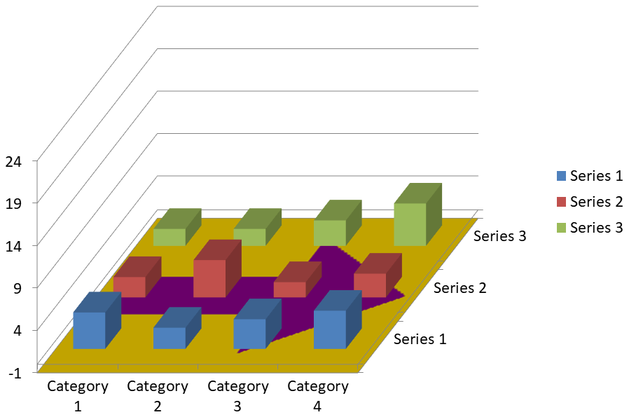

## **Overzicht**

Aspose.Slides voor C++ stelt u in staat de weergave van een 3D‑diagram aan te passen via [IChart::get_Rotation3D](https://reference.aspose.com/slides/cpp/aspose.slides.charts/ichart/get_rotation3d/). Dit artikel laat zien hoe u rotatie, hoogteverhoudingen, diepte, rechthoekige assen en tussenruimte tussen reeksen kunt aanpassen en vervolgens de presentatie opslaat in PPTX‑formaat.

## **Stel de rotatie en diepte van een 3D‑diagram in**

Het onderstaande voorbeeld maakt een [Presentation](https://reference.aspose.com/slides/cpp/aspose.slides/presentation/) en gebruikt [IShapeCollection::AddChart](https://reference.aspose.com/slides/cpp/aspose.slides/ishapecollection/addchart/) om een gestapelde 3D‑kolommendiagram toe te voegen aan de eerste dia. Het vervangt de standaardreeksen en -categorieën door twee reeksen met elk drie waarden. Werkblad‑index `0` identificeert het eerste gegevenswerkblad van het diagram; rij `0` bevat de reeksnamen en kolom `0` de categorielabels.

De methoden [set_RotationX](https://reference.aspose.com/slides/cpp/aspose.slides.charts/irotation3d/set_rotationx/) en [set_RotationY](https://reference.aspose.com/slides/cpp/aspose.slides.charts/irotation3d/set_rotationy/) stellen de rotatie van het diagram in op respectievelijk 40 en 270 graden. [set_DepthPercents](https://reference.aspose.com/slides/cpp/aspose.slides.charts/irotation3d/set_depthpercents/) zet de diepte op 150 % van de breedte, terwijl [set_RightAngleAxes](https://reference.aspose.com/slides/cpp/aspose.slides.charts/irotation3d/set_rightangleaxes/) rechthoekige assen inschakelt in plaats van perspectief. De resulterende presentatie bevat het gevulde diagram met deze 3D‑weergave‑instellingen.

```cpp
#include <DOM/Chart/ChartType.h>
#include <DOM/Chart/IChartData.h>
#include <DOM/Chart/IChartSeries.h>
#include <DOM/Chart/IChartSeriesCollection.h>
#include <DOM/Chart/IRotation3D.h>
#include <DOM/IChart.h>
#include <DOM/IShapeCollection.h>
#include <DOM/ISlide.h>
#include <DOM/Presentation.h>
#include <Export/SaveFormat.h>
#include <system/shared_ptr.h>
#include <system/string.h>
#include <DOM/Chart/IChartCategoryCollection.h>
#include <DOM/Chart/IChartDataWorkbook.h>
#include <DOM/Chart/IChartDataPointCollection.h>
#include <system/object_ext.h>

using namespace Aspose::Slides;
using namespace Aspose::Slides::Charts;
using namespace Aspose::Slides::Export;
using namespace System;

auto presentation = MakeObject<Presentation>();
auto slide = presentation->get_Slide(0);

auto chart = slide->get_Shapes()->AddChart(ChartType::StackedColumn3D, 0, 0, 500, 500);

chart->get_ChartData()->get_Series()->Clear();
chart->get_ChartData()->get_Categories()->Clear();

auto workbook = chart->get_ChartData()->get_ChartDataWorkbook();
auto worksheetIndex = 0;

double values[2][3] = { { 20, 50, 30 }, { 30, 10, 60 } };

for (auto categoryIndex = 0; categoryIndex < 3; categoryIndex++)
{
    auto categoryName = String::Format(u"Category {0}", categoryIndex + 1);
    auto categoryCell = workbook->GetCell(worksheetIndex, categoryIndex + 1, 0, ObjectExt::Box(categoryName));
    chart->get_ChartData()->get_Categories()->Add(categoryCell);
}

for (auto seriesIndex = 0; seriesIndex < 2; seriesIndex++)
{
    auto seriesName = String::Format(u"Series {0}", seriesIndex + 1);
    auto seriesCell = workbook->GetCell(worksheetIndex, 0, seriesIndex + 1, ObjectExt::Box(seriesName));
    auto series = chart->get_ChartData()->get_Series()->Add(seriesCell, chart->get_Type());

    for (auto categoryIndex = 0; categoryIndex < 3; categoryIndex++)
    {
        auto valueCell = workbook->GetCell(worksheetIndex, categoryIndex + 1, seriesIndex + 1, ObjectExt::Box(values[seriesIndex][categoryIndex]));
        series->get_DataPoints()->AddDataPointForBarSeries(valueCell);
    }
}

chart->get_Rotation3D()->set_RightAngleAxes(true);
chart->get_Rotation3D()->set_RotationX(40);
chart->get_Rotation3D()->set_RotationY(270);
chart->get_Rotation3D()->set_DepthPercents(150);

presentation->Save(u"Rotation3D_out.pptx", SaveFormat::Pptx);
presentation->Dispose();
```

## **Pas een afbeeldingvulling toe op het oppervlak van een 3D‑diagram**

U kunt de [side wall](https://reference.aspose.com/slides/cpp/aspose.slides.charts/ichart/get_sidewall/), [back wall](https://reference.aspose.com/slides/cpp/aspose.slides.charts/ichart/get_backwall/), en [floor](https://reference.aspose.com/slides/cpp/aspose.slides.charts/ichart/get_floor/) van een 3D‑diagram onafhankelijk van elkaar vullen. Stel het [vullingstype](https://reference.aspose.com/slides/cpp/aspose.slides/ifillformat/set_filltype/) in op `Picture` en ken een afbeelding toe. Om één exemplaar van de afbeelding over het oppervlak te rekken, stelt u zowel de [picture fill mode](https://reference.aspose.com/slides/cpp/aspose.slides/ipicturefillformat/set_picturefillmode/) als het [picture type](https://reference.aspose.com/slides/cpp/aspose.slides.charts/ichartwall/set_picturetype/) van het oppervlak in op `Stretch`.

Sla [arrow.png](arrow.png) op in de werkmap. Het voorbeeld roteert het diagram en verhoogt de maximale waarde op de verticale as zodat de vloer zichtbaar is tussen de kolommen. Vervolgens wordt de dia twee keer gekloond en wordt de pijl op een ander oppervlak op elke dia toegepast. Alle drie de diagrammen behouden dezelfde gegevens, kijkhoek en achtergrond.

```cpp
#include <DOM/Chart/ChartType.h>
#include <DOM/Chart/IAxesManager.h>
#include <DOM/Chart/IAxis.h>
#include <DOM/Chart/IChartWall.h>
#include <DOM/Chart/IFormat.h>
#include <DOM/Chart/IRotation3D.h>
#include <DOM/Chart/PictureType.h>
#include <DOM/FillType.h>
#include <DOM/IChart.h>
#include <DOM/IFillFormat.h>
#include <DOM/IImageCollection.h>
#include <DOM/IPPImage.h>
#include <DOM/IPictureFillFormat.h>
#include <DOM/IShapeCollection.h>
#include <DOM/ISlide.h>
#include <DOM/ISlideCollection.h>
#include <DOM/ISlidesPicture.h>
#include <DOM/PictureFillMode.h>
#include <DOM/Presentation.h>
#include <Export/SaveFormat.h>
#include <system/io/file.h>
#include <system/shared_ptr.h>
#include <initializer_list>

using namespace Aspose::Slides;
using namespace Aspose::Slides::Charts;
using namespace Aspose::Slides::Export;
using namespace System;

auto presentation = MakeObject<Presentation>();
auto slide = presentation->get_Slide(0);

auto chart = slide->get_Shapes()->AddChart(ChartType::Column3D, 20, 30, 680, 480);
chart->get_Rotation3D()->set_RightAngleAxes(true);
chart->get_Rotation3D()->set_RotationX(40);
chart->get_Rotation3D()->set_RotationY(30);

auto verticalAxis = chart->get_Axes()->get_VerticalAxis();
verticalAxis->set_IsAutomaticMaxValue(false);
verticalAxis->set_MaxValue(24);

auto backSlide = presentation->get_Slides()->AddClone(slide);
auto floorSlide = presentation->get_Slides()->AddClone(slide);
auto backChart = ExplicitCast<IChart>(backSlide->get_Shape(0));
auto floorChart = ExplicitCast<IChart>(floorSlide->get_Shape(0));

auto imageBytes = IO::File::ReadAllBytes(u"arrow.png");
auto arrow = presentation->get_Images()->AddImage(imageBytes);

for (const auto& surface : { chart->get_SideWall(), backChart->get_BackWall(), floorChart->get_Floor() })
{
    auto fill = surface->get_Format()->get_Fill();
    fill->set_FillType(FillType::Picture);
    auto pictureFill = fill->get_PictureFillFormat();
    pictureFill->get_Picture()->set_Image(arrow);
    pictureFill->set_PictureFillMode(PictureFillMode::Stretch);
    surface->set_PictureType(PictureType::Stretch);
}

presentation->Save(u"chart-surfaces.pptx", SaveFormat::Pptx);
presentation->Dispose();
```

Microsoft PowerPoint toont de drie dia's als volgt.

| Zijwand | Achterwand | Vloer |
| --- | --- | --- |
|  |  |  |

## **Pas de hoogteverhoudingen van een 3D‑diagram aan**

Gebruik [IRotation3D::set_HeightPercents](https://reference.aspose.com/slides/cpp/aspose.slides.charts/irotation3d/set_heightpercents/) om de hoogte van een 3D‑diagram in te stellen als een percentage van de breedte. Hiermee verandert u de verhoudingen van de 3D‑scene zonder de diagramobjectgrootte op de dia aan te passen.

Het volgende voorbeeld maakt een [Column3D](https://reference.aspose.com/slides/cpp/aspose.slides.charts/charttype/) diagram met de standaardgegevens: drie reeksen en vier categorieën. Het slaat drie presentaties op met hoogteverhoudingen van 50 %, 100 % en 200 %. De positie, breedte en hoogte van het diagram blijven gelijk. De gegevens, rotatie, diepte, reeks‑tussenruimte en opmaak zijn identiek in alle drie de bestanden; alleen het hoogte‑percentage wijzigt.

```cpp
#include <DOM/Chart/ChartType.h>
#include <DOM/Chart/IChartData.h>
#include <DOM/Chart/IChartSeries.h>
#include <DOM/Chart/IChartSeriesCollection.h>
#include <DOM/Chart/IChartSeriesGroup.h>
#include <DOM/Chart/IRotation3D.h>
#include <DOM/IChart.h>
#include <DOM/IShapeCollection.h>
#include <DOM/ISlide.h>
#include <DOM/Presentation.h>
#include <Export/SaveFormat.h>
#include <system/shared_ptr.h>
#include <system/string.h>
#include <cstdint>
#include <initializer_list>

using namespace Aspose::Slides;
using namespace Aspose::Slides::Charts;
using namespace Aspose::Slides::Export;
using namespace System;

auto presentation = MakeObject<Presentation>();
auto slide = presentation->get_Slide(0);

auto chart = slide->get_Shapes()->AddChart(ChartType::Column3D, 40, 30, 620, 460);
chart->get_Rotation3D()->set_RotationX(20);
chart->get_Rotation3D()->set_RotationY(30);
chart->get_Rotation3D()->set_RightAngleAxes(true);
chart->get_Rotation3D()->set_DepthPercents(100);
chart->get_ChartData()->get_Series()->idx_get(0)->get_ParentSeriesGroup()->set_GapDepth(150);

for (uint16_t heightPercent : { 50, 100, 200 })
{
    chart->get_Rotation3D()->set_HeightPercents(heightPercent);
    auto fileName = String::Format(u"chart_height_{0}.pptx", heightPercent);
    presentation->Save(fileName, SaveFormat::Pptx);
}
presentation->Dispose();
```

De onderstaande afbeeldingen uit het equivalente .NET‑voorbeeld zijn geëxporteerd met Microsoft PowerPoint en illustreren dezelfde hoogte‑instellingen. Een kleiner percentage resulteert in een plattere scène, terwijl een groter percentage een hogere scène oplevert binnen hetzelfde diagramobject. PowerPoint kan ook de interval‑instellingen van as‑tikken en de plaatsing van labels aanpassen om de scène te laten passen.

| Hoogte: 50 % | Hoogte: 100 % | Hoogte: 200 % |
| --- | --- | --- |
|  |  |  |

Deze methoden regelen verschillende aspecten van het diagram:

| Methode | Effect |
| --- | --- |
| [IRotation3D::set_HeightPercents](https://reference.aspose.com/slides/cpp/aspose.slides.charts/irotation3d/set_heightpercents/) | Hoogte van de 3D‑scene als percentage van de breedte. |
| [IShape::set_Height](https://reference.aspose.com/slides/cpp/aspose.slides/ishape/set_height/) | Hoogte van het diagramobject op de dia, in punten. |
| [IRotation3D::set_DepthPercents](https://reference.aspose.com/slides/cpp/aspose.slides.charts/irotation3d/set_depthpercents/) | Diepte van de 3D‑scene als percentage van de breedte. |
| [IChartSeriesGroup::set_GapDepth](https://reference.aspose.com/slides/cpp/aspose.slides.charts/ichartseriesgroup/set_gapdepth/) | Tussenruimte tussen reeksen langs de diepte‑as, als percentage van de markerbreedte. |

De hoogte‑instelling heeft invloed op 3D‑kolom‑ en staafdiagrammen, inclusief cilindrische, kegel‑ en piramide‑varianten, evenals 3D‑lijndiagrammen, gebieds‑, taart‑ en oppervlak‑diagrammen. De vergelijking hierboven gebruikt het geverifieerde type `Column3D`. De instelling wijzigt de weergave niet van een 2D‑`ClusteredColumn`‑diagram of een `BubbleWith3D`‑diagram; deze namen zijn leden van de [ChartType](https://reference.aspose.com/slides/cpp/aspose.slides.charts/charttype/)‑enumeratie. Voor andere diagram‑opmaak‑instellingen zie [Diagramopmaak](/slides/nl/cpp/chart-formatting/).

## **Pas de ruimte tussen reeksen aan**

Gebruik [IChartSeriesGroup::set_GapDepth](https://reference.aspose.com/slides/cpp/aspose.slides.charts/ichartseriesgroup/set_gapdepth/) om de afstand tussen gegevensreeksen langs de diepte‑as van een 3D‑diagram te regelen, uitgedrukt als percentage van de markerbreedte. Gebruik waarden van **0 tot 500**, inclusief: `0` verwijdert de tussenruimte, terwijl grotere waarden de speling vergroten. Bij een vaste diagramdiepte maakt een grotere tussenruimte de markers dunner langs de diepte‑as.

Toegang tot de groep gebeurt via [IChartSeries::get_ParentSeriesGroup](https://reference.aspose.com/slides/cpp/aspose.slides.charts/ichartseries/get_parentseriesgroup/). De instelling geldt voor iedere reeks in die groep, niet alleen voor de reeks die gebruikt wordt om toegang te krijgen. [IChartSeries::get_GapDepth](https://reference.aspose.com/slides/cpp/aspose.slides.charts/ichartseries/get_gapdepth/) geeft de instelling van de bovenliggende groep terug.

Deze instelling heeft invloed op 3D‑kolom‑ en staafdiagrammen, inclusief hun cilindrische, kegel‑ en piramide‑varianten, evenals 3D‑lijn‑ en gebiedsdiagrammen. Het uiterlijk hangt af van of de reeksen in diepte, gegroepeerd of gestapeld zijn. Voor een duidelijke vergelijking van tussenruimtes tussen afzonderlijke reeksen, gebruik `ChartType::Column3D` uit de [ChartType](https://reference.aspose.com/slides/cpp/aspose.slides.charts/charttype/)‑enumeratie.

Deze methoden regelen verschillende aspecten van het diagram:

| Methode | Effect |
| --- | --- |
| [IChartSeriesGroup::set_GapDepth](https://reference.aspose.com/slides/cpp/aspose.slides.charts/ichartseriesgroup/set_gapdepth/) | Tussenruimte tussen reeksen langs de diepte‑as, als percentage van de markerbreedte. |
| [IChartSeriesGroup::set_GapWidth](https://reference.aspose.com/slides/cpp/aspose.slides.charts/ichartseriesgroup/set_gapwidth/) | Tussenruimte tussen aangrenzende staaf‑ of kolomclusters, als percentage van de staaf‑ of kolombreedte. |
| [IRotation3D::set_DepthPercents](https://reference.aspose.com/slides/cpp/aspose.slides.charts/irotation3d/set_depthpercents/) | Totale diagramdiepte, als percentage van de diagrambreedte. |

Het volgende zelfstandige voorbeeld gebruikt de standaarddiagramgegevens, die drie reeksen en vier categorieën bevatten. Het slaat twee presentaties op met identieke gegevens, rotatie, tussenbreedte en diagramdiepte; alleen de tussenruimte‑diepte wijzigt.

```cpp
#include <DOM/Chart/ChartType.h>
#include <DOM/Chart/IChartData.h>
#include <DOM/Chart/IChartSeries.h>
#include <DOM/Chart/IChartSeriesCollection.h>
#include <DOM/Chart/IRotation3D.h>
#include <DOM/IChart.h>
#include <DOM/IShapeCollection.h>
#include <DOM/ISlide.h>
#include <DOM/Presentation.h>
#include <Export/SaveFormat.h>
#include <system/shared_ptr.h>
#include <system/string.h>
#include <DOM/Chart/IChartSeriesGroup.h>
#include <cstdint>
#include <initializer_list>

using namespace Aspose::Slides;
using namespace Aspose::Slides::Charts;
using namespace Aspose::Slides::Export;
using namespace System;

auto presentation = MakeObject<Presentation>();
auto slide = presentation->get_Slide(0);

auto chart = slide->get_Shapes()->AddChart(ChartType::Column3D, 40, 30, 620, 230);

chart->get_Rotation3D()->set_RotationX(20);
chart->get_Rotation3D()->set_RotationY(30);
chart->get_Rotation3D()->set_DepthPercents(100);

auto series = chart->get_ChartData()->get_Series()->idx_get(0);
auto group = series->get_ParentSeriesGroup();
group->set_GapWidth(150);

for (uint16_t gapDepth : { 0, 500 })
{
    group->set_GapDepth(gapDepth);

    auto fileName = String::Format(u"series_gap_depth_{0}.pptx", gapDepth);
    presentation->Save(fileName, SaveFormat::Pptx);
}
presentation->Dispose();
```

De onderstaande afbeeldingen uit het equivalente .NET‑voorbeeld zijn geëxporteerd met Microsoft PowerPoint en illustreren dezelfde tussenruimte‑diepte‑instellingen.

| Gatdiepte: 0 % | Gatdiepte: 500 % |
| --- | --- |
|  |  |

## **Wijzig het 3D‑reeks type en de staafvorm**

In een gegroepeerd cilindrisch diagram begint de eerste reeks met cilindrische balken. Het voorbeeld leest [IChartSeries::get_Type](https://reference.aspose.com/slides/cpp/aspose.slides.charts/ichartseries/get_type/) en [IChartSeries::get_Bar3DShape](https://reference.aspose.com/slides/cpp/aspose.slides.charts/ichartseries/get_bar3dshape/) vóór en na elke wijziging.

```cpp
#include <DOM/Chart/ChartShapeType.h>
#include <DOM/Chart/ChartType.h>
#include <DOM/Chart/IChartData.h>
#include <DOM/Chart/IChartSeries.h>
#include <DOM/Chart/IChartSeriesCollection.h>
#include <DOM/IChart.h>
#include <DOM/IShapeCollection.h>
#include <DOM/ISlide.h>
#include <DOM/Presentation.h>
#include <Export/SaveFormat.h>
#include <system/console.h>
#include <system/enum.h>
#include <system/shared_ptr.h>

using namespace Aspose::Slides;
using namespace Aspose::Slides::Charts;
using namespace Aspose::Slides::Export;
using namespace System;

auto presentation = MakeObject<Presentation>();
auto slide = presentation->get_Slide(0);

auto chart = slide->get_Shapes()->AddChart(ChartType::ClusteredCylinder, 20, 20, 500, 300);
auto series = chart->get_ChartData()->get_Series()->idx_get(0);

auto printSeries = [&series]()
{
    auto type = Enum<ChartType>::GetName(series->get_Type());
    auto shape = Enum<ChartShapeType>::GetName(series->get_Bar3DShape());
    Console::WriteLine(u"{0} | {1}", type, shape);
};

printSeries();

series->set_Type(ChartType::ClusteredCone);
printSeries();

series->set_Bar3DShape(ChartShapeType::Box);
printSeries();

presentation->Save(u"series_shape.pptx", SaveFormat::Pptx);
presentation->Dispose();
```

| Wijziging voor de eerste reeks | `get_Type` | `get_Bar3DShape` |
| --- | --- | --- |
| Maak het diagram | `ClusteredCylinder` | `Cylinder` |
| Roep [set_Type](https://reference.aspose.com/slides/cpp/aspose.slides.charts/ichartseries/set_type/) aan met `ClusteredCone` | `ClusteredCone` | `Cone` |
| Roep [set_Bar3DShape](https://reference.aspose.com/slides/cpp/aspose.slides.charts/ichartseries/set_bar3dshape/) aan met `Box` | `ClusteredColumn3D` | `Box` |

Het instellen van de vorm op `Box` wijzigt ook het reekstype naar `ClusteredColumn3D`. Als uw code afzweigt op het reekstype, roep dan `series->get_Type()` aan na het wijzigen van de vorm. Een vóór de wijziging gecachte waarde zou nog steeds de `ClusteredCone`‑tak selecteren.


## **FAQ**

**Welke diagramtypen ondersteunen 3D‑modus in Aspose.Slides?**

Aspose.Slides ondersteunt 3D‑varianten van kolomdiagrammen, inclusief Column 3D, Clustered Column 3D, Stacked Column 3D en 100 % Stacked Column 3D, samen met gerelateerde 3D‑typen die beschikbaar zijn via de [ChartType](https://reference.aspose.com/slides/cpp/aspose.slides.charts/charttype/)‑enumeratie. Voor een exacte, up‑to‑date lijst, bekijk de leden van [ChartType](https://reference.aspose.com/slides/cpp/aspose.slides.charts/charttype/) in de API‑referentie van uw geïnstalleerde versie.

**Kan ik een rasterafbeelding van een 3D‑diagram krijgen voor een rapport of het web?**

Ja. U kunt een diagram exporteren naar een afbeelding met [Shape::GetImage](https://reference.aspose.com/slides/cpp/aspose.slides/shape/getimage/) of [render de hele dia](/slides/nl/cpp/convert-powerpoint-to-png/) naar formaten zoals PNG of JPEG. Dit is handig wanneer u een raster‑preview nodig hebt of het diagram wilt insluiten in documenten, dashboards of webpagina’s zonder PowerPoint.

**Hoe presteert het bouwen en renderen van grote 3D‑diagrammen?**

De prestaties hangen af van het volume aan gegevens en de visuele complexiteit. Voor optimale resultaten houdt u 3D‑effecten tot een minimum, vermijdt zware texturen op wanden en plotgebieden, beperkt het aantal datapunten per reeks waar mogelijk, en rendert naar een passend formaat (resolutie en afmetingen) dat aansluit bij de beoogde weergave‑ of afdrukbehoeften.