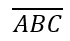

## **Overzicht**

PowerPoint slaat vergelijkingen op als Office Math Markup Language (OMML). Met Aspose.Slides voor C++ kun je dezelfde soort wiskundige inhoud programmatic matig maken: breuken, wortels, functies, limieten, N-aire operatoren, matrices, arrays en opgemaakte wiskundige blokken.

In PowerPoint voegen gebruikers normaal gesproken vergelijkingen toe via **Invoegen > Vergelijking**:


Het resultaat is bewerkbare wiskundige tekst op de dia:


Aspose.Slides bouwt die wiskundige tekst met drie hoofdobjecten:

- Een wiskundige vorm, gemaakt met [AddMathShape](https://reference.aspose.com/slides/cpp/aspose.slides/shapecollection/), is de vorm die de vergelijking bevat.
- [MathPortion](https://reference.aspose.com/slides/cpp/aspose.slides.mathtext/mathportion/) slaat wiskundige inhoud op in het tekstvak van de vorm.
- [MathParagraph](https://reference.aspose.com/slides/cpp/aspose.slides.mathtext/mathparagraph/) bevat één of meer [MathBlock](https://reference.aspose.com/slides/cpp/aspose.slides.mathtext/mathblock/)-objecten.

De meeste voorbeelden hieronder gebruiken [MathematicalText](https://reference.aspose.com/slides/cpp/aspose.slides.mathtext/mathematicaltext/) en de vloeiende methoden van [IMathElement](https://reference.aspose.com/slides/cpp/aspose.slides.mathtext/imathelement/) om de code kort en leesbaar te houden.

Voor MathML‑exportscenario's, zie [Export Math Equations from Presentations in C++](/slides/nl/cpp/exporting-math-equations/).

## **Een Vergelijking Maken**

Dit voorbeeld gebruikt [AddMathShape](https://reference.aspose.com/slides/cpp/aspose.slides/ishapecollection/addmathshape/) om een wiskundige vorm te maken en voegt de stelling van Pythagoras toe:


```cpp
#include <DOM/IAutoShape.h>
#include <DOM/IParagraph.h>
#include <DOM/IShapeCollection.h>
#include <DOM/ISlide.h>
#include <DOM/ITextFrame.h>
#include <DOM/MathText/IMathBlock.h>
#include <DOM/MathText/IMathParagraph.h>
#include <DOM/MathText/IMathSuperscriptElement.h>
#include <DOM/MathText/MathPortion.h>
#include <DOM/MathText/MathematicalText.h>
#include <DOM/Presentation.h>
#include <Export/SaveFormat.h>

using namespace Aspose::Slides;
using namespace Aspose::Slides::Export;
using namespace Aspose::Slides::MathText;

auto presentation = System::MakeObject<Presentation>();
auto slide = presentation->get_Slide(0);

auto mathShape = slide->get_Shapes()->AddMathShape(20.0f, 20.0f, 700.0f, 120.0f);
auto mathPortion = System::ExplicitCast<MathPortion>(mathShape->get_TextFrame()->get_Paragraph(0)->get_Portion(0));
auto mathParagraph = mathPortion->get_MathParagraph();

auto equation = System::MakeObject<MathematicalText>(u"c")
        - >SetSuperscript(u"2")
        - >Join(u"=")
        - >Join(System::MakeObject<MathematicalText>(u"a")->SetSuperscript(u"2"))
        - >Join(u"+")
        - >Join(System::MakeObject<MathematicalText>(u"b")->SetSuperscript(u"2"));

mathParagraph->Add(equation);

presentation->Save(u"pythagorean-theorem.pptx", SaveFormat::Pptx);
presentation->Dispose();
```

{}
[AddMathShape](https://reference.aspose.com/slides/cpp/aspose.slides/ishapecollection/addmathshape/) maakt een vorm die al een wiskundig alinea‑object bevat. Open de eerste [MathPortion](https://reference.aspose.com/slides/cpp/aspose.slides.mathtext/mathportion/), roep [get_MathParagraph](https://reference.aspose.com/slides/cpp/aspose.slides.mathtext/mathportion/get_mathparagraph/) aan en voeg wiskundige blokken of elementen toe.
{}

### **Wiskundige Blokken Samenvoegen**

Wanneer delen van een vergelijking onafhankelijk worden opgebouwd als [IMathBlock](https://reference.aspose.com/slides/cpp/aspose.slides.mathtext/imathblock/)-objecten, gebruik je [JoinBlock](https://reference.aspose.com/slides/cpp/aspose.slides.mathtext/imathblock/joinblock/) om ze samen te voegen. Het voorbeeld bouwt `c² =` in het linkerdeel en `a² + b²` in het rechterdeel. [SetSuperscript](https://reference.aspose.com/slides/cpp/aspose.slides.mathtext/imathelement/setsuperscript/) maakt bewerkbare wiskundige superscripten voor alle drie de machten.

```cpp
#include <DOM/IAutoShape.h>
#include <DOM/IParagraph.h>
#include <DOM/IShapeCollection.h>
#include <DOM/ISlide.h>
#include <DOM/ITextFrame.h>
#include <DOM/MathText/IMathParagraph.h>
#include <DOM/MathText/IMathSuperscriptElement.h>
#include <DOM/MathText/MathBlock.h>
#include <DOM/MathText/MathPortion.h>
#include <DOM/MathText/MathematicalText.h>
#include <DOM/Presentation.h>
#include <Export/SaveFormat.h>

using namespace Aspose::Slides;
using namespace Aspose::Slides::Export;
using namespace Aspose::Slides::MathText;

auto presentation = System::MakeObject<Presentation>();
auto slide = presentation->get_Slide(0);

auto shape = slide->get_Shapes()->AddMathShape(20, 20, 600, 100);
auto mathPortion = System::ExplicitCast<MathPortion>(shape->get_TextFrame()->get_Paragraph(0)->get_Portion(0));
auto mathParagraph = mathPortion->get_MathParagraph();

auto leftBlock = System::MakeObject<MathBlock>();
auto cSquared = System::MakeObject<MathematicalText>(u"c")->SetSuperscript(u"2");
leftBlock->Add(cSquared);
auto equalsSign = System::MakeObject<MathematicalText>(u"=");
leftBlock->Add(equalsSign);

auto rightBlock = System::MakeObject<MathBlock>();
auto aSquared = System::MakeObject<MathematicalText>(u"a")->SetSuperscript(u"2");
rightBlock->Add(aSquared);
auto plusSign = System::MakeObject<MathematicalText>(u"+");
rightBlock->Add(plusSign);
auto bSquared = System::MakeObject<MathematicalText>(u"b")->SetSuperscript(u"2");
rightBlock->Add(bSquared);

auto combinedBlock = leftBlock->JoinBlock(rightBlock);
mathParagraph->Add(combinedBlock);

presentation->Save(u"equation.pptx", SaveFormat::Pptx);
presentation->Dispose();
```

[JoinBlock](https://reference.aspose.com/slides/cpp/aspose.slides.mathtext/imathblock/joinblock/) retourneert `leftBlock` zelf, nu met beide delen in de juiste volgorde, en laat `rightBlock` leeg. Voeg het gecombineerde blok één keer toe aan de [IMathParagraph](https://reference.aspose.com/slides/cpp/aspose.slides.mathtext/imathparagraph/). Na het heropenen van `equation.pptx` bevat de alinea één blok dat `c² = a² + b²` weergeeft, waarbij alle drie de machten behouden blijven als wiskundige superscripten.

Het aanroepen van [Add](https://reference.aspose.com/slides/cpp/aspose.slides.mathtext/imathelementcollection/add/) als `leftBlock->Add(rightBlock)` probeert één blok direct in een ander te nesten en veroorzaakt een `System::InvalidOperationException`.

## **Breuken Toevoegen**

Gebruik [Divide](https://reference.aspose.com/slides/cpp/aspose.slides.mathtext/imathelement/divide/) om een breuk te maken. Je kunt een breukstijl kiezen met [MathFractionTypes](https://reference.aspose.com/slides/cpp/aspose.slides.mathtext/mathfractiontypes/).


```cpp
#include <DOM/IAutoShape.h>
#include <DOM/IParagraph.h>
#include <DOM/IShapeCollection.h>
#include <DOM/ISlide.h>
#include <DOM/ITextFrame.h>
#include <DOM/MathText/IMathParagraph.h>
#include <DOM/MathText/MathBlock.h>
#include <DOM/MathText/MathFractionTypes.h>
#include <DOM/MathText/MathPortion.h>
#include <DOM/MathText/MathematicalText.h>
#include <DOM/Presentation.h>
#include <Export/SaveFormat.h>

using namespace Aspose::Slides;
using namespace Aspose::Slides::Export;
using namespace Aspose::Slides::MathText;

auto presentation = System::MakeObject<Presentation>();
auto slide = presentation->get_Slide(0);

auto mathShape = slide->get_Shapes()->AddMathShape(20.0f, 20.0f, 700.0f, 100.0f);
auto mathPortion = System::ExplicitCast<MathPortion>(mathShape->get_TextFrame()->get_Paragraph(0)->get_Portion(0));
auto mathParagraph = mathPortion->get_MathParagraph();

auto fraction = System::MakeObject<MathematicalText>(u"1")
        - >Divide(u"x", MathFractionTypes::Skewed);

mathParagraph->Add(System::MakeObject<MathBlock>(fraction));

presentation->Save(u"fraction.pptx", SaveFormat::Pptx);
presentation->Dispose();
```

Voor een gestapelde breuk, gebruik [MathFractionTypes::Bar](https://reference.aspose.com/slides/cpp/aspose.slides.mathtext/mathfractiontypes/):

```cpp
#include <DOM/MathText/MathFractionTypes.h>
#include <DOM/MathText/MathematicalText.h>
using namespace Aspose::Slides::MathText;

auto stackedFraction = System::MakeObject<MathematicalText>(u"x + 1")->Divide(u"y - 1", MathFractionTypes::Bar);
```

## **Wortels Toevoegen**

Gebruik [Radical](https://reference.aspose.com/slides/cpp/aspose.slides.mathtext/imathelement/radical/) om een vierkantswortel, kubuswortel of andere wortel te maken. Het huidige element wordt de basis, en het argument wordt de graad.


```cpp
#include <DOM/IAutoShape.h>
#include <DOM/IParagraph.h>
#include <DOM/IShapeCollection.h>
#include <DOM/ISlide.h>
#include <DOM/ITextFrame.h>
#include <DOM/MathText/IMathParagraph.h>
#include <DOM/MathText/MathBlock.h>
#include <DOM/MathText/MathPortion.h>
#include <DOM/MathText/MathematicalText.h>
#include <DOM/Presentation.h>
#include <Export/SaveFormat.h>

using namespace Aspose::Slides;
using namespace Aspose::Slides::Export;
using namespace Aspose::Slides::MathText;

auto presentation = System::MakeObject<Presentation>();
auto slide = presentation->get_Slide(0);

auto mathShape = slide->get_Shapes()->AddMathShape(20.0f, 20.0f, 700.0f, 100.0f);
auto mathPortion = System::ExplicitCast<MathPortion>(mathShape->get_TextFrame()->get_Paragraph(0)->get_Portion(0));
auto mathParagraph = mathPortion->get_MathParagraph();

auto radical = System::MakeObject<MathematicalText>(u"x")
        - >Radical(u"n");

mathParagraph->Add(System::MakeObject<MathBlock>(radical));

presentation->Save(u"radical.pptx", SaveFormat::Pptx);
presentation->Dispose();
```

### **De Graad van een Vierkantswortel Tonen of Verbergen**

Een vierkantswortel kan een expliciete 2 tonen of de conventionele √x‑notatie gebruiken. Gebruik [IMathRadical::set_HideDegree](https://reference.aspose.com/slides/cpp/aspose.slides.mathtext/imathradical/set_hidedegree/) om tussen de twee vormen te schakelen. Beide behouden de graad 2 en de radicand x in de bewerkbare vergelijking.


Het voorbeeld slaat dezelfde vierkantswortel twee keer op. In `visible-degree.pptx` is de 2 zichtbaar. In `hidden-degree.pptx` is deze verborgen.

```cpp
#include <DOM/IAutoShape.h>
#include <DOM/IParagraph.h>
#include <DOM/IShapeCollection.h>
#include <DOM/ISlide.h>
#include <DOM/ITextFrame.h>
#include <DOM/MathText/IMathRadical.h>
#include <DOM/MathText/IMathParagraph.h>
#include <DOM/MathText/MathBlock.h>
#include <DOM/MathText/MathPortion.h>
#include <DOM/MathText/MathematicalText.h>
#include <DOM/Presentation.h>
#include <Export/SaveFormat.h>

using namespace Aspose::Slides;
using namespace Aspose::Slides::Export;
using namespace Aspose::Slides::MathText;

auto presentation = System::MakeObject<Presentation>();
auto slide = presentation->get_Slide(0);

auto radicand = System::MakeObject<MathematicalText>(u"x");
auto radical = radicand->Radical(u"2");
auto block = System::MakeObject<MathBlock>(radical);

auto mathShape = slide->get_Shapes()->AddMathShape(20.0f, 20.0f, 200.0f, 100.0f);
auto mathPortion = System::ExplicitCast<MathPortion>(mathShape->get_TextFrame()->get_Paragraph(0)->get_Portion(0));
auto mathParagraph = mathPortion->get_MathParagraph();
mathParagraph->Add(block);

radical->set_HideDegree(false);
presentation->Save(u"visible-degree.pptx", SaveFormat::Pptx);

radical->set_HideDegree(true);
presentation->Save(u"hidden-degree.pptx", SaveFormat::Pptx);
presentation->Dispose();
```

## **Functies en Limieten Toevoegen**

Gebruik [AsArgumentOfFunction](https://reference.aspose.com/slides/cpp/aspose.slides.mathtext/imathelement/asargumentoffunction/) of [Function](https://reference.aspose.com/slides/cpp/aspose.slides.mathtext/imathelement/function/) voor functies zoals `sin(x)`, `log(x)` of aangepaste functienamen. Voor limieten, plaats `lim` in een [MathLimit](https://reference.aspose.com/slides/cpp/aspose.slides.mathtext/mathlimit/) of gebruik [SetLowerLimit](https://reference.aspose.com/slides/cpp/aspose.slides.mathtext/imathelement/setlowerlimit/).


```cpp
#include <DOM/IAutoShape.h>
#include <DOM/IParagraph.h>
#include <DOM/IShapeCollection.h>
#include <DOM/ISlide.h>
#include <DOM/ITextFrame.h>
#include <DOM/MathText/IMathLimit.h>
#include <DOM/MathText/IMathParagraph.h>
#include <DOM/MathText/MathBlock.h>
#include <DOM/MathText/MathPortion.h>
#include <DOM/MathText/MathematicalText.h>
#include <DOM/Presentation.h>
#include <Export/SaveFormat.h>

using namespace Aspose::Slides;
using namespace Aspose::Slides::Export;
using namespace Aspose::Slides::MathText;

auto presentation = System::MakeObject<Presentation>();
auto slide = presentation->get_Slide(0);

auto mathShape = slide->get_Shapes()->AddMathShape(20.0f, 20.0f, 700.0f, 100.0f);
auto mathPortion = System::ExplicitCast<MathPortion>(mathShape->get_TextFrame()->get_Paragraph(0)->get_Portion(0));
auto mathParagraph = mathPortion->get_MathParagraph();

auto limit = System::MakeObject<MathematicalText>(u"lim")
        - >SetLowerLimit(u"x→∞")
        - >Function(u"x");

mathParagraph->Add(System::MakeObject<MathBlock>(limit));

presentation->Save(u"functions-and-limits.pptx", SaveFormat::Pptx);
presentation->Dispose();
```

Voor een aangepaste functienaam, maak van de functienaam het huidige element en roep [Function](https://reference.aspose.com/slides/cpp/aspose.slides.mathtext/imathelement/function/) met het argument aan:

```cpp
#include <DOM/MathText/MathematicalText.h>
using namespace Aspose::Slides::MathText;

auto customFunction = System::MakeObject<MathematicalText>(u"f")->Function(u"x + 1");
```

## **N‑aire Operatoren en Integralen Toevoegen**

Gebruik [Nary](https://reference.aspose.com/slides/cpp/aspose.slides.mathtext/imathelement/nary/) voor sommatie‑, unie‑, intersectie‑ en andere grote operatoren. Gebruik [Integral](https://reference.aspose.com/slides/cpp/aspose.slides.mathtext/imathelement/integral/) voor integralen. Beide methoden laten je onder‑ en bovengrenzen instellen.


```cpp
#include <DOM/IAutoShape.h>
#include <DOM/IParagraph.h>
#include <DOM/IShapeCollection.h>
#include <DOM/ISlide.h>
#include <DOM/ITextFrame.h>
#include <DOM/MathText/IMathParagraph.h>
#include <DOM/MathText/IMathSuperscriptElement.h>
#include <DOM/MathText/MathBlock.h>
#include <DOM/MathText/MathNaryOperatorTypes.h>
#include <DOM/MathText/MathPortion.h>
#include <DOM/MathText/MathematicalText.h>
#include <DOM/Presentation.h>
#include <Export/SaveFormat.h>

using namespace Aspose::Slides;
using namespace Aspose::Slides::Export;
using namespace Aspose::Slides::MathText;

auto presentation = System::MakeObject<Presentation>();
auto slide = presentation->get_Slide(0);

auto mathShape = slide->get_Shapes()->AddMathShape(20.0f, 20.0f, 700.0f, 120.0f);
auto mathPortion = System::ExplicitCast<MathPortion>(mathShape->get_TextFrame()->get_Paragraph(0)->get_Portion(0));
auto mathParagraph = mathPortion->get_MathParagraph();

auto summationBase = System::MakeObject<MathematicalText>(u"x")
        - >SetSuperscript(u"k")
        - >Join(System::MakeObject<MathematicalText>(u"a")->SetSuperscript(u"n-k"));

auto summation = summationBase->Nary(MathNaryOperatorTypes::Summation, u"k=0", u"n");

mathParagraph->Add(System::MakeObject<MathBlock>(summation));

presentation->Save(u"nary-operators.pptx", SaveFormat::Pptx);
presentation->Dispose();
```

N‑aire operatoren zijn bedoeld voor grote operatoren met optionele grenzen. Simpele operatoren zoals `+`, `-` en `=` worden meestal toegevoegd als [MathematicalText](https://reference.aspose.com/slides/cpp/aspose.slides.mathtext/mathematicaltext/) en samengevoegd tot de uitdrukking.

Voor een integraal, gebruik [Integral](https://reference.aspose.com/slides/cpp/aspose.slides.mathtext/imathelement/integral/):

```cpp
#include <DOM/MathText/IMathBlock.h>
#include <DOM/MathText/IMathBox.h>
#include <DOM/MathText/IMathElement.h>
#include <DOM/MathText/MathIntegralTypes.h>
#include <DOM/MathText/MathematicalText.h>

using namespace Aspose::Slides::MathText;

auto integralBase = System::MakeObject<MathematicalText>(u"x")->Join(System::MakeObject<MathematicalText>(u"dx")->ToBox());
auto integral = integralBase->Integral(MathIntegralTypes::Simple, u"0", u"1");
```

## **Matrices Toevoegen**

Gebruik [MathMatrix](https://reference.aspose.com/slides/cpp/aspose.slides.mathtext/mathmatrix/) voor rijen en kolommen. Standaard bevatten matrices geen haakjes; omsluit de matrix wanneer je haakjes, vierkante haken of accolades nodig hebt.


```cpp
#include <DOM/IAutoShape.h>
#include <DOM/IParagraph.h>
#include <DOM/IShapeCollection.h>
#include <DOM/ISlide.h>
#include <DOM/ITextFrame.h>
#include <DOM/MathText/IMathBlock.h>
#include <DOM/MathText/IMathElement.h>
#include <DOM/MathText/IMathParagraph.h>
#include <DOM/MathText/MathBlock.h>
#include <DOM/MathText/MathMatrix.h>
#include <DOM/MathText/MathPortion.h>
#include <DOM/MathText/MathematicalText.h>
#include <DOM/Presentation.h>
#include <Export/SaveFormat.h>

using namespace Aspose::Slides;
using namespace Aspose::Slides::Export;
using namespace Aspose::Slides::MathText;

auto presentation = System::MakeObject<Presentation>();
auto slide = presentation->get_Slide(0);

auto mathShape = slide->get_Shapes()->AddMathShape(20.0f, 20.0f, 700.0f, 120.0f);
auto mathPortion = System::ExplicitCast<MathPortion>(mathShape->get_TextFrame()->get_Paragraph(0)->get_Portion(0));
auto mathParagraph = mathPortion->get_MathParagraph();

auto matrix = System::MakeObject<MathMatrix>(2, 3);
matrix->idx_set(0, 0, System::MakeObject<MathematicalText>(u"1"));
matrix->idx_set(0, 1, System::MakeObject<MathematicalText>(u"x"));
matrix->idx_set(1, 0, System::MakeObject<MathematicalText>(u"x"));
matrix->idx_set(1, 1, System::MakeObject<MathematicalText>(u"2"));
matrix->idx_set(1, 2, System::MakeObject<MathematicalText>(u"y"));

mathParagraph->Add(System::MakeObject<MathBlock>(matrix));

presentation->Save(u"matrix.pptx", SaveFormat::Pptx);
presentation->Dispose();
```

### **Een Bestaande Matrix Bewerken**

Stel dat een les lineaire algebra begint met de coefficientmatrix in `matrix.pptx`, opgeslagen door het vorige voorbeeld. Voor de volgende oefening, behoud de eerste vergelijking, vervang de tweede door twee nieuwe vergelijkingen en pas de set variabelen aan. Open de bestaande matrix via [IMathMatrix](https://reference.aspose.com/slides/cpp/aspose.slides.mathtext/imathmatrix/) om de nog geldende coëfficiënten te behouden.


Rij‑ en kolomindexen beginnen bij nul en verwijzen naar de matrix zoals die op het moment van de oproep bestaat. Een rij vóór index 1 invoegen verplaatst de oorspronkelijke tweede rij naar index 2. Een rij na index 2 invoegen voegt vervolgens een rij toe. Het verwijderen van rij 2 verwijdert de oorspronkelijke tweede vergelijking en schuift de toegevoegde rij één positie omhoog. Kolommen verschuiven op dezelfde manier.

```cpp
#include <DOM/IAutoShape.h>
#include <DOM/IParagraph.h>
#include <DOM/IPortion.h>
#include <DOM/ISlide.h>
#include <DOM/ITextFrame.h>
#include <DOM/MathText/IMathBlock.h>
#include <DOM/MathText/IMathElement.h>
#include <DOM/MathText/IMathMatrix.h>
#include <DOM/MathText/IMathParagraph.h>
#include <DOM/MathText/IMathPortion.h>
#include <DOM/MathText/MathHorizontalAlignment.h>
#include <DOM/MathText/MathematicalText.h>
#include <DOM/Presentation.h>
#include <Export/SaveFormat.h>

using namespace Aspose::Slides;
using namespace Aspose::Slides::Export;
using namespace Aspose::Slides::MathText;

auto presentation = System::MakeObject<Presentation>(u"matrix.pptx");

auto shape = System::ExplicitCast<IAutoShape>(presentation->get_Slide(0)->get_Shape(0));
auto portion = System::ExplicitCast<IMathPortion>(shape->get_TextFrame()->get_Paragraph(0)->get_Portion(0));
auto block = portion->get_MathParagraph()->idx_get(0);
auto matrix = System::ExplicitCast<IMathMatrix>(block->idx_get(0));

matrix->InsertRowBefore(1);
matrix->InsertRowAfter(2);
matrix->DeleteRow(2);

matrix->InsertColumnBefore(1);
matrix->InsertColumnAfter(3);
matrix->DeleteColumn(3);

// Nieuwe cellen zijn aanvankelijk null. Stel eerst de niet‑nulcoëfficiënten in.
matrix->idx_set(1, 0, System::MakeObject<MathematicalText>(u"12"));
matrix->idx_set(1, 1, System::MakeObject<MathematicalText>(u"1"));
matrix->idx_set(2, 2, System::MakeObject<MathematicalText>(u"10"));
matrix->idx_set(2, 3, System::MakeObject<MathematicalText>(u"1"));
for (auto row = 0; row < matrix->get_RowCount(); ++row)
{
    for (auto column = 0; column < matrix->get_ColumnCount(); ++column)
    {
        if (matrix->idx_get(row, column) == nullptr)
            matrix->idx_set(row, column, System::MakeObject<MathematicalText>(u"0"));
    }
}

matrix->SetColumnAlignment(0, MathHorizontalAlignment::Left);
matrix->SetColumnsAlignment(1, 3, MathHorizontalAlignment::Right);

presentation->Save(u"updated-matrix.pptx", SaveFormat::Pptx);
presentation->Dispose();
```

[SetColumnAlignment](https://reference.aspose.com/slides/cpp/aspose.slides.mathtext/imathmatrix/setcolumnalignment/) zet de eerste kolom links uitgelijnd. [SetColumnsAlignment](https://reference.aspose.com/slides/cpp/aspose.slides.mathtext/imathmatrix/setcolumnsalignment/) zet drie opeenvolgende kolommen rechts uitgelijnd, beginnend bij index 1. In `updated-matrix.pptx` heeft de matrix drie vergelijkingen en vier variabelen. De oorspronkelijke eerste‑rij‑coëfficiënten `1` en `x` verschijnen nu in de eerste en derde kolom.


## **Vergelijkings‑Arrays Toevoegen**

Gebruik [ToMathArray](https://reference.aspose.com/slides/cpp/aspose.slides.mathtext/imathelement/tomatharray/) wanneer je uitgelijnde vergelijkingen of een verticale stapel expressies nodig hebt.


```cpp
#include <DOM/IAutoShape.h>
#include <DOM/IParagraph.h>
#include <DOM/IShapeCollection.h>
#include <DOM/ISlide.h>
#include <DOM/ITextFrame.h>
#include <DOM/MathText/IMathParagraph.h>
#include <DOM/MathText/MathBlock.h>
#include <DOM/MathText/MathPortion.h>
#include <DOM/MathText/MathematicalText.h>
#include <DOM/Presentation.h>
#include <Export/SaveFormat.h>

using namespace Aspose::Slides;
using namespace Aspose::Slides::Export;
using namespace Aspose::Slides::MathText;

auto presentation = System::MakeObject<Presentation>();
auto slide = presentation->get_Slide(0);

auto mathShape = slide->get_Shapes()->AddMathShape(20.0f, 20.0f, 700.0f, 140.0f);
auto mathPortion = System::ExplicitCast<MathPortion>(mathShape->get_TextFrame()->get_Paragraph(0)->get_Portion(0));
auto mathParagraph = mathPortion->get_MathParagraph();

auto equationArray = System::MakeObject<MathematicalText>(u"x")
        - >Join(u"y")
        - >ToMathArray();

mathParagraph->Add(System::MakeObject<MathBlock>(equationArray));

presentation->Save(u"equation-array.pptx", SaveFormat::Pptx);
presentation->Dispose();
```

### **Een Array Uitlijnen ten Opschortende van Omringende Elementen**

[IMathArray::set_BaseJustification](https://reference.aspose.com/slides/cpp/aspose.slides.mathtext/imatharray/set_basejustification/) bepaalt de verticale uitlijning van een array ten opzichte van de wiskundige elementen ernaast. Het voorbeeld hieronder vergelijkt uitlijning met de eerste rij, het midden van de array en de laatste rij.

Het volgende voorbeeld maakt drie identieke arrays, elk met drie rijen en de aangrenzende elementen `A=` en `=B`. Alle wiskundige tekst gebruikt Cambria Math op 24 pt. Alleen de array‑uitlijning verschuift.

```cpp
#include <system/array.h>
#include <system/console.h>
#include <drawing/color.h>
#include <DOM/IAutoShape.h>
#include <DOM/IParagraph.h>
#include <DOM/IParagraphFormat.h>
#include <DOM/IPortion.h>
#include <DOM/IPortionFormat.h>
#include <DOM/IShapeCollection.h>
#include <DOM/ISlide.h>
#include <DOM/ITextFrame.h>
#include <DOM/Fonts/FontData.h>
#include <DOM/MathText/IMathParagraph.h>
#include <DOM/MathText/MathArray.h>
#include <DOM/MathText/MathBlock.h>
#include <DOM/MathText/MathJustification.h>
#include <DOM/MathText/MathPortion.h>
#include <DOM/MathText/MathVerticalAlignment.h>
#include <DOM/MathText/MathRowSpacingRule.h>
#include <DOM/MathText/MathematicalText.h>
#include <DOM/Presentation.h>
#include <Export/SaveFormat.h>
#include <DOM/FillType.h>
#include <DOM/IColorFormat.h>
#include <DOM/IFillFormat.h>
#include <DOM/ILineFormat.h>
#include <DOM/ISlideSize.h>
#include <DOM/ITextFrameFormat.h>
#include <DOM/ShapeType.h>
#include <DOM/SlideSizeScaleType.h>
#include <DOM/TextAnchorType.h>

using namespace Aspose::Slides;
using namespace Aspose::Slides::Export;
using namespace Aspose::Slides::MathText;

auto createText = [](System::String value)
{
    auto text = System::MakeObject<MathematicalText>(value);
    text->get_Format()->set_FontHeight(24);
    auto font = System::MakeObject<FontData>(u"Cambria Math");
    text->get_Format()->set_LatinFont(font);
    return text;
};

auto presentation = System::MakeObject<Presentation>();
presentation->get_SlideSize()->SetSize(780, 200, SlideSizeScaleType::DoNotScale);
auto slide = presentation->get_Slide(0);

MathVerticalAlignment alignments[] = {MathVerticalAlignment::Top, MathVerticalAlignment::Center, MathVerticalAlignment::Bottom};
System::String labels[] = {u"Top", u"Center", u"Bottom"};

for (auto i = 0; i < 3; i++)
{
    auto label = slide->get_Shapes()->AddAutoShape(ShapeType::Rectangle, 20 + i * 260, 10, 240, 30);
    label->get_FillFormat()->set_FillType(FillType::NoFill);
    label->get_LineFormat()->get_FillFormat()->set_FillType(FillType::NoFill);
    label->get_TextFrame()->set_Text(labels[i]);
    auto labelFormat = label->get_TextFrame()->get_Paragraph(0)->get_Portion(0)->get_PortionFormat();
    labelFormat->set_FontHeight(16);
    labelFormat->get_FillFormat()->set_FillType(FillType::Solid);
    labelFormat->get_FillFormat()->get_SolidFillColor()->set_Color(System::Drawing::Color::get_Black());

    auto mathShape = slide->get_Shapes()->AddMathShape(20 + i * 260, 60, 240, 130);
    mathShape->get_TextFrame()->get_TextFrameFormat()->set_AnchoringType(TextAnchorType::Top);
    auto mathPortion = System::ExplicitCast<MathPortion>(mathShape->get_TextFrame()->get_Paragraph(0)->get_Portion(0));
    auto mathParagraph = mathPortion->get_MathParagraph();
    mathParagraph->set_Justification(MathJustification::LeftJustified);

    auto rows = System::MakeArray<System::SharedPtr<IMathElement>>({createText(u"x+y=3"), createText(u"x-y=1"), createText(u"x=2")});
    auto equationArray = System::MakeObject<MathArray>(rows);
    equationArray->set_BaseJustification(alignments[i]);
    auto leftText = createText(u"A=");
    auto rightText = createText(u"=B");
    auto equation = System::MakeObject<MathBlock>(leftText)->Join(equationArray)->Join(rightText);
    mathParagraph->Add(equation);
}

presentation->Save(u"equation-array-alignment.pptx", SaveFormat::Pptx);
presentation->Dispose();
```

De volgende vergelijking toont de opgeslagen presentatie in PowerPoint. Let op de positie van `A=` en `=B` naast elke array.


### **Rij‑Spatiëring Configureren**

[set_RowSpacingRule](https://reference.aspose.com/slides/cpp/aspose.slides.mathtext/imatharray/set_rowspacingrule/) selecteert de spatiëringsregel voor rijen binnen de array. [set_RowSpacing](https://reference.aspose.com/slides/cpp/aspose.slides.mathtext/imatharray/set_rowspacing/) levert een numerieke waarde voor een expliciete spatiëringsregel en wordt genegeerd door de voorgedefinieerde regels.

Voor exacte spatiëring wordt de waarde gemeten in punten. Voor proportionele spatiëring wordt gemeten in halve regels: de waarde `3` in het voorbeeld staat voor 1,5 regels. Roep beide setters aan wanneer je een expliciete waarde opgeeft; alleen de numerieke waarde wijzigen selecteert geen spatiëringsregel.

Het voorbeeld hieronder slaat vijf presentaties op met dezelfde vergelijkingen, uitlijning en lettertype‑instellingen. De eerste drie gebruiken presets; de laatste twee tonen expliciete waarden.

```cpp
#include <system/array.h>
#include <system/console.h>
#include <drawing/color.h>
#include <DOM/IAutoShape.h>
#include <DOM/IParagraph.h>
#include <DOM/IParagraphFormat.h>
#include <DOM/IPortion.h>
#include <DOM/IPortionFormat.h>
#include <DOM/IShapeCollection.h>
#include <DOM/ISlide.h>
#include <DOM/ITextFrame.h>
#include <DOM/Fonts/FontData.h>
#include <DOM/MathText/IMathParagraph.h>
#include <DOM/MathText/MathArray.h>
#include <DOM/MathText/MathBlock.h>
#include <DOM/MathText/MathJustification.h>
#include <DOM/MathText/MathPortion.h>
#include <DOM/MathText/MathVerticalAlignment.h>
#include <DOM/MathText/MathRowSpacingRule.h>
#include <DOM/MathText/MathematicalText.h>
#include <DOM/Presentation.h>
#include <Export/SaveFormat.h>

using namespace Aspose::Slides;
using namespace Aspose::Slides::Export;
using namespace Aspose::Slides::MathText;

auto createText = [](System::String value)
{
    auto text = System::MakeObject<MathematicalText>(value);
    text->get_Format()->set_FontHeight(24);
    auto font = System::MakeObject<FontData>(u"Cambria Math");
    text->get_Format()->set_LatinFont(font);
    return text;
};

struct ArraySettings
{
    MathRowSpacingRule rule;
    uint32_t spacing;
    System::String name;
};

ArraySettings settings[] =
{
    {MathRowSpacingRule::SingleLineGap, 0, u"SingleLineGap"},
    {MathRowSpacingRule::OneAndAHalfLineGap, 0, u"OneAndAHalfLineGap"},
    {MathRowSpacingRule::TwoLineGap, 0, u"TwoLineGap"},
    {MathRowSpacingRule::Exactly, 20, u"Exactly"},
    {MathRowSpacingRule::Multiple, 3, u"Multiple"}
};

for (const auto& setting : settings)
{
    auto fileName = u"equation-array-" + setting.name + u".pptx";
    auto presentation = System::MakeObject<Presentation>();
    auto mathShape = presentation->get_Slide(0)->get_Shapes()->AddMathShape(20, 20, 600, 300);
    auto paragraph = mathShape->get_TextFrame()->get_Paragraph(0);
    paragraph->get_ParagraphFormat()->set_SpaceBefore(0);
    paragraph->get_ParagraphFormat()->set_SpaceAfter(0);
    auto mathPortion = System::ExplicitCast<MathPortion>(paragraph->get_Portion(0));
    auto mathParagraph = mathPortion->get_MathParagraph();
    mathParagraph->set_Justification(MathJustification::LeftJustified);

    auto rows = System::MakeArray<System::SharedPtr<IMathElement>>({createText(u"x+y=3"), createText(u"x-y=1"), createText(u"x=2")});
    auto equationArray = System::MakeObject<MathArray>(rows);
    equationArray->set_BaseJustification(MathVerticalAlignment::Center);
    equationArray->set_RowSpacingRule(setting.rule);
    equationArray->set_RowSpacing(setting.spacing);
    auto leftText = createText(u"A=");
    auto rightText = createText(u"=B");
    auto equation = System::MakeObject<MathBlock>(leftText)->Join(equationArray)->Join(rightText);
    mathParagraph->Add(equation);

    presentation->Save(fileName, SaveFormat::Pptx);
    presentation->Dispose();
}
```

Rij‑spatiëring van een array is onafhankelijk van alinea‑spatiëring. [set_SpaceBefore](https://reference.aspose.com/slides/cpp/aspose.slides/iparagraphformat/set_spacebefore/) en [set_SpaceAfter](https://reference.aspose.com/slides/cpp/aspose.slides/iparagraphformat/set_spaceafter/) voegen ruimte toe rond de omsluitende alinea, niet tussen array‑rijen. Evenzo positioneert [IMathParagraph::set_Justification](https://reference.aspose.com/slides/cpp/aspose.slides.mathtext/imathparagraph/set_justification/) de hele wiskundige alinea horizontaal; het vervangt niet de verticale uitlijningsinstelling van de array.

## **Trigonometrische Functies Toevoegen**

Gebruik [AsArgumentOfFunction](https://reference.aspose.com/slides/cpp/aspose.slides.mathtext/imathelement/asargumentoffunction/) wanneer het argument het huidige element is en de functienaam bekend.


```cpp
#include <DOM/IAutoShape.h>
#include <DOM/IParagraph.h>
#include <DOM/IShapeCollection.h>
#include <DOM/ISlide.h>
#include <DOM/ITextFrame.h>
#include <DOM/MathText/IMathParagraph.h>
#include <DOM/MathText/MathBlock.h>
#include <DOM/MathText/MathFunctionsOfOneArgument.h>
#include <DOM/MathText/MathPortion.h>
#include <DOM/MathText/MathematicalText.h>
#include <DOM/Presentation.h>
#include <Export/SaveFormat.h>

using namespace Aspose::Slides;
using namespace Aspose::Slides::Export;
using namespace Aspose::Slides::MathText;

auto presentation = System::MakeObject<Presentation>();
auto slide = presentation->get_Slide(0);

auto mathShape = slide->get_Shapes()->AddMathShape(20.0f, 20.0f, 700.0f, 100.0f);
auto mathPortion = System::ExplicitCast<MathPortion>(mathShape->get_TextFrame()->get_Paragraph(0)->get_Portion(0));
auto mathParagraph = mathPortion->get_MathParagraph();

auto cosine = System::MakeObject<MathematicalText>(u"2x")
        - >AsArgumentOfFunction(MathFunctionsOfOneArgument::Cos);

mathParagraph->Add(System::MakeObject<MathBlock>(cosine));

presentation->Save(u"trigonometric-function.pptx", SaveFormat::Pptx);
presentation->Dispose();
```

## **Subscript‑ en Superscript‑Elementen Toevoegen**

Gebruik de subscript‑ en superscript‑helpers voor indexen en machten. Wanneer de indexen links van de basis moeten verschijnen, gebruik dan [SetSubSuperscriptOnTheLeft](https://reference.aspose.com/slides/cpp/aspose.slides.mathtext/imathelement/setsubsuperscriptontheleft/).


```cpp
#include <DOM/IAutoShape.h>
#include <DOM/IParagraph.h>
#include <DOM/IShapeCollection.h>
#include <DOM/ISlide.h>
#include <DOM/ITextFrame.h>
#include <DOM/MathText/IMathParagraph.h>
#include <DOM/MathText/MathBlock.h>
#include <DOM/MathText/MathPortion.h>
#include <DOM/MathText/MathematicalText.h>
#include <DOM/Presentation.h>
#include <Export/SaveFormat.h>

using namespace Aspose::Slides;
using namespace Aspose::Slides::Export;
using namespace Aspose::Slides::MathText;

auto presentation = System::MakeObject<Presentation>();
auto slide = presentation->get_Slide(0);

auto mathShape = slide->get_Shapes()->AddMathShape(20.0f, 20.0f, 700.0f, 100.0f);
auto mathPortion = System::ExplicitCast<MathPortion>(mathShape->get_TextFrame()->get_Paragraph(0)->get_Portion(0));
auto mathParagraph = mathPortion->get_MathParagraph();

auto scripts = System::MakeObject<MathematicalText>(u"Y")
        - >SetSubSuperscriptOnTheLeft(u"1", u"n");

mathParagraph->Add(System::MakeObject<MathBlock>(scripts));

presentation->Save(u"subscript-superscript.pptx", SaveFormat::Pptx);
presentation->Dispose();
```

### **Rechter‑Subscript‑en‑Superscript‑Uitlijnen**

Wanneer beide scripts bij dezelfde basis horen, gebruik [MathRightSubSuperscriptElement](https://reference.aspose.com/slides/cpp/aspose.slides.mathtext/mathrightsubsuperscriptelement/). De methode [set_AlignScripts](https://reference.aspose.com/slides/cpp/aspose.slides.mathtext/imathrightsubsuperscriptelement/set_alignscripts/) bepaalt hun horizontale positie: `false` (standaard) laat ze de contour van de basis volgen, terwijl `true` de scripts horizontaal op één lijn zet.

Dit voorbeeld plaatst twee kopieën van dezelfde bewerkbare expressie naast elkaar. Beide gebruiken het wiskundige italic‑lettertype f (U+1D453), een lagere script 1, een hogere script 2, en Cambria Math op 72 pt. De schuine basis maakt het verschil zichtbaar in PowerPoint. Installeer Cambria Math vóór het uitvoeren van het voorbeeld.

```cpp
#include <DOM/Fonts/FontData.h>
#include <DOM/IAutoShape.h>
#include <DOM/IParagraph.h>
#include <DOM/IPortionFormat.h>
#include <DOM/IShapeCollection.h>
#include <DOM/ISlide.h>
#include <DOM/ISlideSize.h>
#include <DOM/ITextFrame.h>
#include <DOM/MathText/IMathParagraph.h>
#include <DOM/MathText/MathBlock.h>
#include <DOM/MathText/MathPortion.h>
#include <DOM/MathText/MathRightSubSuperscriptElement.h>
#include <DOM/MathText/MathematicalText.h>
#include <DOM/PortionFormat.h>
#include <DOM/Presentation.h>
#include <DOM/SlideSizeScaleType.h>
#include <Export/SaveFormat.h>

using namespace Aspose::Slides;
using namespace Aspose::Slides::Export;
using namespace Aspose::Slides::MathText;

auto presentation = System::MakeObject<Presentation>();
presentation->get_SlideSize()->SetSize(900, 250, SlideSizeScaleType::DoNotScale);
auto slide = presentation->get_Slide(0);

auto format = System::MakeObject<PortionFormat>();
format->set_FontHeight(72);
auto font = System::MakeObject<FontData>(u"Cambria Math");
format->set_LatinFont(font);

for (auto i = 0; i < 2; i++)
{
    auto left = 40 + i * 440;
    auto shape = slide->get_Shapes()->AddMathShape(left, 75, 380, 150);

    auto baseText = System::MakeObject<MathematicalText>(u"\U0001D453", format);
    auto subscript = System::MakeObject<MathematicalText>(u"1", format);
    auto superscript = System::MakeObject<MathematicalText>(u"2", format);
    auto scripts = System::MakeObject<MathRightSubSuperscriptElement>(baseText, subscript, superscript);
    scripts->set_AlignScripts(i == 1);

    auto portion = System::ExplicitCast<MathPortion>(shape->get_TextFrame()->get_Paragraph(0)->get_Portion(0));
    portion->get_PortionFormat()->set_FontHeight(format->get_FontHeight());
    portion->get_PortionFormat()->set_LatinFont(format->get_LatinFont());
    auto mathBlock = System::MakeObject<MathBlock>(scripts);
    portion->get_MathParagraph()->Add(mathBlock);
}

presentation->Save(u"aligned-scripts.pptx", SaveFormat::Pptx);
presentation->Dispose();
```


Links start de lagere script verder links dan de hogere, volgens de basiscontour. Rechts zijn beide scripts horizontaal op één lijn uitgelijnd.

## **Scheidingstekens Toevoegen**

Gebruik [Enclose](https://reference.aspose.com/slides/cpp/aspose.slides.mathtext/imathelement/enclose/) om een uitdrukking tussen scheidingstekens te plaatsen. Je kunt ook een scheidingsteken‑karakter instellen voor expressies die meerdere elementen bevatten.


```cpp
#include <DOM/IAutoShape.h>
#include <DOM/IParagraph.h>
#include <DOM/IShapeCollection.h>
#include <DOM/ISlide.h>
#include <DOM/ITextFrame.h>
#include <DOM/MathText/IMathParagraph.h>
#include <DOM/MathText/MathBlock.h>
#include <DOM/MathText/MathPortion.h>
#include <DOM/MathText/MathematicalText.h>
#include <DOM/Presentation.h>
#include <Export/SaveFormat.h>

using namespace Aspose::Slides;
using namespace Aspose::Slides::Export;
using namespace Aspose::Slides::MathText;

auto presentation = System::MakeObject<Presentation>();
auto slide = presentation->get_Slide(0);

auto mathShape = slide->get_Shapes()->AddMathShape(20.0f, 20.0f, 700.0f, 100.0f);
auto mathPortion = System::ExplicitCast<MathPortion>(mathShape->get_TextFrame()->get_Paragraph(0)->get_Portion(0));
auto mathParagraph = mathPortion->get_MathParagraph();

auto delimiter = System::MakeObject<MathematicalText>(u"x")
        - >Join(u"y")
        - >Join(u"z")
        - >Enclose(u'<', u'>', u'|');

mathParagraph->Add(System::MakeObject<MathBlock>(delimiter));

presentation->Save(u"delimiters.pptx", SaveFormat::Pptx);
presentation->Dispose();
```

### **Grootte en Uitlijning van Scheidingstekens**

Geef `true` door aan [set_GrowToMatchOperandHeight](https://reference.aspose.com/slides/cpp/aspose.slides.mathtext/imathdelimiter/set_growtomatchoperandheight/) om de haakjes te laten groeien rond een hoge operand, of `false` om ze op normale grootte te houden. [set_DelimiterShape](https://reference.aspose.com/slides/cpp/aspose.slides.mathtext/imathdelimiter/set_delimitershape/) accepteert een van twee waarden van [MathDelimiterShape](https://reference.aspose.com/slides/cpp/aspose.slides.mathtext/mathdelimitershape/). `Centered` centreert de haakjes op de wiskundige as, die door het midden van het =‑teken loopt. `Match` lijnt ze uit op de ingesloten inhoud. Beide instellingen beïnvloeden alleen de scheidingstekens; de uitdrukking zelf blijft ongewijzigd.

Het voorbeeld plaatst een breuk in de exponent van `x`, zodat de uitdrukking hoger reikt dan de basislijn. Alle vier de vergelijkingen gebruiken dezelfde haakjes en lettertype‑instellingen.

```cpp
#include <DOM/IAutoShape.h>
#include <DOM/IParagraph.h>
#include <DOM/IShapeCollection.h>
#include <DOM/ISlide.h>
#include <DOM/ITextFrame.h>
#include <DOM/MathText/IMathParagraph.h>
#include <DOM/IPortionFormat.h>
#include <DOM/MathText/IMathBlock.h>
#include <DOM/MathText/IMathDelimiter.h>
#include <DOM/MathText/IMathFraction.h>
#include <DOM/MathText/IMathSuperscriptElement.h>
#include <DOM/MathText/MathDelimiterShape.h>
#include <DOM/MathText/MathPortion.h>
#include <DOM/MathText/MathematicalText.h>
#include <DOM/Presentation.h>
#include <Export/SaveFormat.h>

using namespace Aspose::Slides;
using namespace Aspose::Slides::Export;
using namespace Aspose::Slides::MathText;

auto presentation = System::MakeObject<Presentation>();
auto slide = presentation->get_Slide(0);

auto addExpression = [slide](float left, float top, bool grow, MathDelimiterShape shape)
{
    auto fraction = System::MakeObject<MathematicalText>(u"a + b")->Divide(u"c + d");
    auto power = System::MakeObject<MathematicalText>(u"x")->SetSuperscript(fraction);
    auto delimiter = power->Enclose(u'(', u')');
    delimiter->set_GrowToMatchOperandHeight(grow);
    delimiter->set_DelimiterShape(shape);

    auto mathShape = slide->get_Shapes()->AddMathShape(left, top, 300, 100);
    auto portion = System::ExplicitCast<MathPortion>(mathShape->get_TextFrame()->get_Paragraph(0)->get_Portion(0));
    portion->get_PortionFormat()->set_FontHeight(32);
    auto equation = System::MakeObject<MathematicalText>(u"y = ")->Join(delimiter);
    portion->get_MathParagraph()->Add(equation);
};

addExpression(20, 20, true, MathDelimiterShape::Centered);
addExpression(350, 20, true, MathDelimiterShape::Match);
addExpression(20, 140, false, MathDelimiterShape::Centered);
addExpression(350, 140, false, MathDelimiterShape::Match);

presentation->Save(u"delimiter-sizing.pptx", SaveFormat::Pptx);
presentation->Dispose();
```

In PowerPoint kun je de rijen vergelijken om het effect van groei te zien. In de bovenste rij groeien de haakjes om de exponent en zien er identiek uit voor beide vormen. In de onderste rij staat groei uit. De kleinere haakjes links (`Centered`) lijnen zich uit op het =‑teken, terwijl die rechts (`Match`) hoger zitten rond de uitdrukking.


## **Een Rand‑Box Toevoegen**

Roep [ToBorderBox](https://reference.aspose.com/slides/cpp/aspose.slides.mathtext/imathelement/toborderbox/) aan op een breuk om de volledige uitdrukking te omlijsten. Het geretourneerde [IMathBorderBox](https://reference.aspose.com/slides/cpp/aspose.slides.mathtext/imathborderbox/) toont standaard alle vier de zijden. Gebruik [set_HideTop](https://reference.aspose.com/slides/cpp/aspose.slides.mathtext/imathborderbox/set_hidetop/), [set_HideBottom](https://reference.aspose.com/slides/cpp/aspose.slides.mathtext/imathborderbox/set_hidebottom/), [set_HideLeft](https://reference.aspose.com/slides/cpp/aspose.slides.mathtext/imathborderbox/set_hideleft/) en [set_HideRight](https://reference.aspose.com/slides/cpp/aspose.slides.mathtext/imathborderbox/set_hideright/) om individuele zijden te verbergen.

Het voorbeeld plaatst zes kopieën van dezelfde breuk op één dia. Om annulering te tonen, verberg je alle vier de zijden en stel je [set_StrikethroughBottomLeftToTopRight](https://reference.aspose.com/slides/cpp/aspose.slides.mathtext/imathborderbox/set_strikethroughbottomlefttotopright/) in voor een stijgende diagonale streep (↗) of [set_StrikethroughTopLeftToBottomRight](https://reference.aspose.com/slides/cpp/aspose.slides.mathtext/imathborderbox/set_strikethroughtoplefttobottomright/) voor een dalende diagonale streep (↘). Je kunt ook [set_StrikethroughHorizontal](https://reference.aspose.com/slides/cpp/aspose.slides.mathtext/imathborderbox/set_strikethroughhorizontal/) of [set_StrikethroughVertical](https://reference.aspose.com/slides/cpp/aspose.slides.mathtext/imathborderbox/set_strikethroughvertical/) gebruiken in combinatie met welke zichtbare zijden dan ook.

```cpp
#include <DOM/IAutoShape.h>
#include <DOM/IParagraph.h>
#include <DOM/IPortionFormat.h>
#include <DOM/IShapeCollection.h>
#include <DOM/ISlide.h>
#include <DOM/ISlideSize.h>
#include <DOM/ITextFrame.h>
#include <DOM/MathText/IMathBorderBox.h>
#include <DOM/MathText/IMathFraction.h>
#include <DOM/MathText/IMathParagraph.h>
#include <DOM/MathText/MathBlock.h>
#include <DOM/MathText/MathPortion.h>
#include <DOM/MathText/MathematicalText.h>
#include <DOM/Presentation.h>
#include <DOM/SlideSizeScaleType.h>
#include <Export/SaveFormat.h>

using namespace Aspose::Slides;
using namespace Aspose::Slides::Export;
using namespace Aspose::Slides::MathText;

auto presentation = System::MakeObject<Presentation>();
presentation->get_SlideSize()->SetSize(540, 220, SlideSizeScaleType::DoNotScale);
auto slide = presentation->get_Slide(0);

auto addFraction = [slide](float x, float y, bool hideBorder = false)
{
    auto fraction = System::MakeObject<MathematicalText>(u"x+1")->Divide(u"y+2");
    auto box = fraction->ToBorderBox();
    box->set_HideTop(hideBorder);
    box->set_HideBottom(hideBorder);
    box->set_HideLeft(hideBorder);
    box->set_HideRight(hideBorder);

    auto shape = slide->get_Shapes()->AddMathShape(x, y, 160, 90);
    auto portion = System::ExplicitCast<MathPortion>(shape->get_TextFrame()->get_Paragraph(0)->get_Portion(0));
    portion->get_PortionFormat()->set_FontHeight(28);
    auto mathBlock = System::MakeObject<MathBlock>(box);
    portion->get_MathParagraph()->Add(mathBlock);
    return box;
};

addFraction(10, 10);

auto partial = addFraction(190, 10);
partial->set_HideTop(true);
partial->set_HideRight(true);

addFraction(370, 10, true)->set_StrikethroughBottomLeftToTopRight(true);
addFraction(10, 120, true)->set_StrikethroughTopLeftToBottomRight(true);
addFraction(190, 120, true)->set_StrikethroughHorizontal(true);
addFraction(370, 120)->set_StrikethroughVertical(true);

presentation->Save(u"border-box.pptx", SaveFormat::Pptx);
presentation->Dispose();
```


Op deze breuk overlapt de horizontale streep de breukstreep. De verticale streep kruist zowel de teller als de noemer terwijl de omringende rand zichtbaar blijft. Deze lijnen versieren de volledige uitdrukking. Door de presentatie opnieuw te openen in PowerPoint kun je de teller en noemer nog steeds onafhankelijk bewerken.

## **Zichtbaarheid en Layout Beheren met Phantom‑Elementen**

Wikkel een uitdrukking in [MathPhantom](https://reference.aspose.com/slides/cpp/aspose.slides.mathtext/mathphantom/) om de zichtbaarheid en de ruimte die hij bijdraagt aan een vergelijking onafhankelijk te regelen. De setter‑methoden van [IMathPhantom](https://reference.aspose.com/slides/cpp/aspose.slides.mathtext/imathphantom/) beïnvloeden het volgende:

| Methode | Effect |
| --- | --- |
| [set_Show](https://reference.aspose.com/slides/cpp/aspose.slides.mathtext/imathphantom/set_show/) | Geef `false` op om de uitdrukking te verbergen. De afmetingen blijven bijdragen aan de layout, tenzij de hieronder genoemde instellingen `true` zijn. |
| [set_ZeroWidth](https://reference.aspose.com/slides/cpp/aspose.slides.mathtext/imathphantom/set_zerowidth/) | Behandel de horizontale breedte van de uitdrukking als nul, waardoor aangrenzende elementen dichter bij elkaar kunnen komen. |
| [set_ZeroAsc](https://reference.aspose.com/slides/cpp/aspose.slides.mathtext/imathphantom/set_zeroasc/) | Behandel de stijging (hoogte boven de basislijn) als nul. Dit kan de ruimte boven aangrenzende elementen verkleinen. |
| [set_ZeroDesc](https://reference.aspose.com/slides/cpp/aspose.slides.mathtext/imathphantom/set_zerodesc/) | Behandel de daling (diepte onder de basislijn) als nul. Dit kan een breukstreep of andere inhoud onder de uitdrukking dichter bij de buren brengen. |

De basislijn is de referentielijn waarop gewone wiskundige letters rusten. Een verbergen van inhoud verwijdert niet de afmetingen, en een afmeting op nul zetten verwijdert de uitdrukking niet. De onderliggende uitdrukking blijft beschikbaar via [get_Base](https://reference.aspose.com/slides/cpp/aspose.slides.mathtext/imathphantom/get_base/). Geef `true` door aan [set_Show](https://reference.aspose.com/slides/cpp/aspose.slides.mathtext/imathphantom/set_show/) om deze weer te tonen; de afmetingsinstellingen blijven ongewijzigd.

Het voorbeeld hieronder maakt vijf naast‑elkaar varianten: een zichtbare breuk, een verborgen breuk die ruimte behoudt, en drie verborgen breuken waarbij één afmeting als nul wordt behandeld. Elke variant gebruikt dezelfde omringende uitdrukking en Cambria Math op 24 pt. Alle vergelijkings‑vormen hebben dezelfde bovenpositie, gemarkeerd door de grijze hulplijn. Het plaatsen van de phantom in de teller van een buitenste breuk maakt de verticale layout‑veranderingen beter zichtbaar.

```cpp
#include <array>
#include <drawing/color.h>
#include <DOM/FillType.h>
#include <DOM/Fonts/FontData.h>
#include <DOM/IAutoShape.h>
#include <DOM/IColorFormat.h>
#include <DOM/IFillFormat.h>
#include <DOM/ILineFormat.h>
#include <DOM/IParagraph.h>
#include <DOM/IPortion.h>
#include <DOM/IPortionFormat.h>
#include <DOM/IShapeCollection.h>
#include <DOM/ISlide.h>
#include <DOM/ISlideSize.h>
#include <DOM/ITextFrame.h>
#include <DOM/ITextFrameFormat.h>
#include <DOM/MathText/IMathParagraph.h>
#include <DOM/MathText/MathBlock.h>
#include <DOM/MathText/MathFraction.h>
#include <DOM/MathText/MathPhantom.h>
#include <DOM/MathText/MathPortion.h>
#include <DOM/MathText/MathematicalText.h>
#include <DOM/Presentation.h>
#include <DOM/ShapeType.h>
#include <DOM/SlideSizeScaleType.h>
#include <DOM/TextAnchorType.h>
#include <Export/SaveFormat.h>

using namespace Aspose::Slides;
using namespace Aspose::Slides::Export;
using namespace Aspose::Slides::MathText;

auto createText = [](System::String value)
{
    auto text = System::MakeObject<MathematicalText>(value);
    text->get_Format()->set_FontHeight(24);
    auto font = System::MakeObject<FontData>(u"Cambria Math");
    text->get_Format()->set_LatinFont(font);
    return text;
};

auto presentation = System::MakeObject<Presentation>();
presentation->get_SlideSize()->SetSize(1000, 180, SlideSizeScaleType::DoNotScale);
auto slide = presentation->get_Slide(0);

std::array<System::String, 5> labels = {u"Visible", u"Hidden: reserves space", u"Hidden: ZeroWidth", u"Hidden: ZeroAsc", u"Hidden: ZeroDesc"};

auto guide = slide->get_Shapes()->AddAutoShape(ShapeType::Line, 10, 60, 980, 0);
guide->get_LineFormat()->get_FillFormat()->set_FillType(FillType::Solid);
guide->get_LineFormat()->get_FillFormat()->get_SolidFillColor()->set_Color(System::Drawing::Color::get_LightGray());

for (auto i = 0; i < labels.size(); i++)
{
    auto left = 10 + i * 200;

    auto label = slide->get_Shapes()->AddAutoShape(ShapeType::Rectangle, left, 10, 190, 30);
    label->get_FillFormat()->set_FillType(FillType::NoFill);
    label->get_LineFormat()->get_FillFormat()->set_FillType(FillType::NoFill);
    label->get_TextFrame()->set_Text(labels[i]);

    auto labelFormat = label->get_TextFrame()->get_Paragraph(0)->get_Portion(0)->get_PortionFormat();
    labelFormat->set_FontHeight(14);
    labelFormat->get_FillFormat()->set_FillType(FillType::Solid);
    labelFormat->get_FillFormat()->get_SolidFillColor()->set_Color(System::Drawing::Color::get_Black());

    auto fractionNumerator = createText(u"a+b");
    auto fractionDenominator = createText(u"c+d");
    auto fraction = System::MakeObject<MathFraction>(fractionNumerator, fractionDenominator);
    auto phantom = System::MakeObject<MathPhantom>(fraction);
    phantom->set_Show(i == 0);
    phantom->set_ZeroWidth(i == 2);
    phantom->set_ZeroAsc(i == 3);
    phantom->set_ZeroDesc(i == 4);

    auto leadingText = createText(u"x+");
    auto trailingText = createText(u"+y");
    auto numeratorBlock = System::MakeObject<MathBlock>(leadingText);
    auto numerator = numeratorBlock->Join(phantom)->Join(trailingText);
    auto denominator = createText(u"z");
    auto equation = System::MakeObject<MathFraction>(numerator, denominator);

    auto shape = slide->get_Shapes()->AddMathShape(left, 60, 190, 100);
    shape->get_TextFrame()->get_TextFrameFormat()->set_AnchoringType(TextAnchorType::Top);

    auto mathPortion = System::ExplicitCast<MathPortion>(shape->get_TextFrame()->get_Paragraph(0)->get_Portion(0));
    auto mathParagraph = mathPortion->get_MathParagraph();
    auto mathBlock = System::MakeObject<MathBlock>(equation);
    mathParagraph->Add(mathBlock);
}

presentation->Save(u"math-phantom.pptx", SaveFormat::Pptx);
presentation->Dispose();

```


## **Termen Groeperen**

Gebruik [Group](https://reference.aspose.com/slides/cpp/aspose.slides.mathtext/imathelement/group/) om een groeperingsteken boven of onder een uitdrukking te plaatsen. Voeg een grens toe om de gegroepeerde termen te labelen.


```cpp
#include <DOM/IAutoShape.h>
#include <DOM/IParagraph.h>
#include <DOM/IShapeCollection.h>
#include <DOM/ISlide.h>
#include <DOM/ITextFrame.h>
#include <DOM/MathText/IMathGroupingCharacter.h>
#include <DOM/MathText/IMathParagraph.h>
#include <DOM/MathText/MathBlock.h>
#include <DOM/MathText/MathPortion.h>
#include <DOM/MathText/MathTopBotPositions.h>
#include <DOM/MathText/MathematicalText.h>
#include <DOM/Presentation.h>
#include <Export/SaveFormat.h>

using namespace Aspose::Slides;
using namespace Aspose::Slides::Export;
using namespace Aspose::Slides::MathText;

auto presentation = System::MakeObject<Presentation>();
auto slide = presentation->get_Slide(0);

auto mathShape = slide->get_Shapes()->AddMathShape(20.0f, 20.0f, 700.0f, 120.0f);
auto mathPortion = System::ExplicitCast<MathPortion>(mathShape->get_TextFrame()->get_Paragraph(0)->get_Portion(0));
auto mathParagraph = mathPortion->get_MathParagraph();

auto grouped = System::MakeObject<MathematicalText>(u"x + y")
        - >Group(u'\u23DF', MathTopBotPositions::Bottom, MathTopBotPositions::Top)
        - >SetLowerLimit(u"any text");

mathParagraph->Add(System::MakeObject<MathBlock>(grouped));

presentation->Save(u"grouped-terms.pptx", SaveFormat::Pptx);
presentation->Dispose();
```

## **Wiskundige Elementen Opmaken**

Gebruik opmaak‑helpers alleen waar ze de formule verduidelijken. Bijvoorbeeld, [Overbar](https://reference.aspose.com/slides/cpp/aspose.slides.mathtext/imathelement/overbar/) plaatst een streep boven een wiskundig element.



```cpp
#include <DOM/IAutoShape.h>
#include <DOM/IParagraph>
#include <DOM/IShapeCollection.h>
#include <DOM/ISlide.h>
#include <DOM/ITextFrame.h>
#include <DOM/MathText/IMathParagraph.h>
#include <DOM/MathText/MathBlock.h>
#include <DOM/MathText/MathPortion.h>
#include <DOM/MathText/MathematicalText.h>
#include <DOM/Presentation.h>
#include <Export/SaveFormat.h>

using namespace Aspose::Slides;
using namespace Aspose::Slides::Export;
using namespace Aspose::Slides::MathText;

auto


```

### **Tekst Formatteren in een Bestaande Vergelijking**

Om tekst door de gehele bestaande vergelijking heen te formatteren, doorloop je de elementboom van elk wiskundig blok. [IMathElement::GetChildren](https://reference.aspose.com/slides/cpp/aspose.slides.mathtext/imathelement/getchildren/) retourneert alleen de directe kinderen, dus roep je deze recursief aan om tekst binnen breuken, scripts, wortels en andere geneste structuren te bereiken. Controleer zowel het huidige element als zijn kinderen om het start‑element op te nemen wanneer het een [MathematicalText](https://reference.aspose.com/slides/cpp/aspose.slides.mathtext/mathematicaltext/) is.

Dit voorbeeld gaat uit van een presentatie met een vergelijking zoals `z = xᵢ / ∛y`, met een breuk die een subscript in de teller bevat en een wortel in de noemer. Alleen de boven‑niveau‑elementen van het blok verwerken zou de tekst binnen de breuk missen. Het voorbeeld vindt wiskundige porties in dia‑tekstvakken, opent hun blokken via [IMathPortion::get_MathParagraph](https://reference.aspose.com/slides/cpp/aspose.slides.mathtext/imathportion/get_mathparagraph/), en stelt de lettergrootte in op 28 pt met [set_FontHeight](https://reference.aspose.com/slides/cpp/aspose.slides/baseportionformat/set_fontheight/), waarbij de opmaak via [get_Format](https://reference.aspose.com/slides/cpp/aspose.slides.mathtext/mathematicaltext/get_format/) van elk tekstelement wordt benaderd.

```cpp
#include <functional>
#include <system/array.h>
#include <DOM/IAutoShape.h>
#include <DOM/IParagraph.h>
#include <DOM/IParagraphCollection.h>
#include <DOM/IPortion.h>
#include <DOM/IPortionCollection.h>
#include <DOM/IPortionFormat.h>
#include <DOM/IShapeCollection.h>
#include <DOM/ISlide.h>
#include <DOM/ISlideCollection.h>
#include <DOM/ITextFrame.h>
#include <DOM/MathText/IMathBlock.h>
#include <DOM/MathText/IMathElement.h>
#include <DOM/MathText/IMathParagraph.h>
#include <DOM/MathText/IMathPortion.h>
#include <DOM/MathText/MathematicalText.h>
#include <DOM/Presentation.h>
#include <Export/SaveFormat.h>

using namespace Aspose::Slides;
using namespace Aspose::Slides::Export;
using namespace Aspose::Slides::MathText;

std::function<void(System::SharedPtr<IMathElement>)> formatMathText;
formatMathText = [&formatMathText](System::SharedPtr<IMathElement> element)
{
    auto text = System::DynamicCast<MathematicalText>(element);
    if (text != nullptr)
        text->get_Format()->set_FontHeight(28.0f);

    for (auto child : element->GetChildren())
        formatMathText(child);
};

auto presentation = System::MakeObject<Presentation>(u"input.pptx");

for (auto slide : presentation->get_Slides())
{
    for (auto shape : slide->get_Shapes())
    {
        auto autoShape = System::DynamicCast<IAutoShape>(shape);
        if (autoShape == nullptr || autoShape->get_TextFrame() == nullptr)
            continue;

        for (auto paragraph : autoShape->get_TextFrame()->get_Paragraphs())
        {
            for (auto portion : paragraph->get_Portions())
            {
                auto mathPortion = System::DynamicCast<IMathPortion>(portion);
                if (mathPortion != nullptr)
                {
                    for (auto block : mathPortion->get_MathParagraph())
                        formatMathText(block);
                }
            }
        }
    }
}

presentation->Save(u"formatted-equations.pptx", SaveFormat::Pptx);
presentation->Dispose();
```

De opgeslagen presentatie bevat de bijgewerkte tekstopmaak op elk niveau van elke verwerkte vergelijking, terwijl de tekstinhoud en wiskundige structuur behouden blijven.

## **Snel‑Referentie**

| Taak | Hoofd‑API |
| --- | --- |
| Wiskundige tekst maken | [MathematicalText](https://reference.aspose.com/slides/cpp/aspose.slides.mathtext/mathematicaltext/) |
| Elementen combineren | [IMathElement.Join](https://reference.aspose.com/slides/cpp/aspose.slides.mathtext/imathelement/join/) |
| Breuken maken | [IMathElement.Divide](https://reference.aspose.com/slides/cpp/aspose.slides.mathtext/imathelement/divide/) |
| Superscript of subscript toevoegen | [SetSuperscript](https://reference.aspose.com/slides/cpp/aspose.slides.mathtext/imathelement/setsuperscript/), [SetSubscript](https://reference.aspose.com/slides/cpp/aspose.slides.mathtext/imathelement/setsubscript/) |
| Functies toevoegen | [Function](https://reference.aspose.com/slides/cpp/aspose.slides.mathtext/imathelement/function/), [AsArgumentOfFunction](https://reference.aspose.com/slides/cpp/aspose.slides.mathtext/imathelement/asargumentoffunction/) |
| Wortels toevoegen | [IMathElement.Radical](https://reference.aspose.com/slides/cpp/aspose.slides.mathtext/imathelement/radical/) |
| Limieten toevoegen | [SetLowerLimit](https://reference.aspose.com/slides/cpp/aspose.slides.mathtext/imathelement/setlowerlimit/), [SetUpperLimit](https://reference.aspose.com/slides/cpp/aspose.slides.mathtext/imathelement/setupperlimit/) |
| Linker‑scripts toevoegen | [SetSubSuperscriptOnTheLeft](https://reference.aspose.com/slides/cpp/aspose.slides.mathtext/imathelement/setsubsuperscriptontheleft/) |
| Sommen en integralen toevoegen | [Nary](https://reference.aspose.com/slides/cpp/aspose.slides.mathtext/imathelement/nary/), [Integral](https://reference.aspose.com/slides/cpp/aspose.slides.mathtext/imathelement/integral/) |
| Matrices toevoegen | [MathMatrix](https://reference.aspose.com/slides/cpp/aspose.slides.mathtext/mathmatrix/) |
| Vergelijkings‑arrays toevoegen | [ToMathArray](https://reference.aspose.com/slides/cpp/aspose.slides.mathtext/imathelement/tomatharray/) |
| Scheidingstekens toevoegen | [Enclose](https://reference.aspose.com/slides/cpp/aspose.slides.mathtext/imathelement/enclose/) |
| Strepen en randen toevoegen | [Overbar](https://reference.aspose.com/slides/cpp/aspose.slides.mathtext/imathelement/overbar/), [ToBorderBox](https://reference.aspose.com/slides/cpp/aspose.slides.mathtext/imathelement/toborderbox/) |
| Termen groeperen | [Group](https://reference.aspose.com/slides/cpp/aspose.slides.mathtext/imathelement/group/) |

## **FAQ**

**Kan ik een bestaande PowerPoint‑vergelijking bewerken?**

Ja. Open de presentatie, vind de vorm die een [MathPortion](https://reference.aspose.com/slides/cpp/aspose.slides.mathtext/mathportion/) bevat, roep [get_MathParagraph](https://reference.aspose.com/slides/cpp/aspose.slides.mathtext/mathportion/get_mathparagraph/) aan en werk de wiskundige blokken in die alinea bij.

**Worden vergelijkingen opgeslagen als bewerkbare PowerPoint‑math?**

Ja. Bij het opslaan als PPTX schrijft Aspose.Slides de vergelijking weg als bewerkbare Office‑math‑inhoud.

**Kan ik vergelijkingen exporteren naar LaTeX?**

Ja. Haal de [IMathParagraph](https://reference.aspose.com/slides/cpp/aspose.slides.mathtext/imathparagraph/) op via de bijbehorende [IMathPortion](https://reference.aspose.com/slides/cpp/aspose.slides.mathtext/imathportion/), en roep [IMathParagraph::ToLatex](https://reference.aspose.com/slides/cpp/aspose.slides.mathtext/imathparagraph/tolatex/) aan om direct te exporteren. Voor een volledig voorbeeld, zie [Export Math Equations from Presentations in C++](/slides/nl/cpp/exporting-math-equations/#export-math-equations-to-latex).