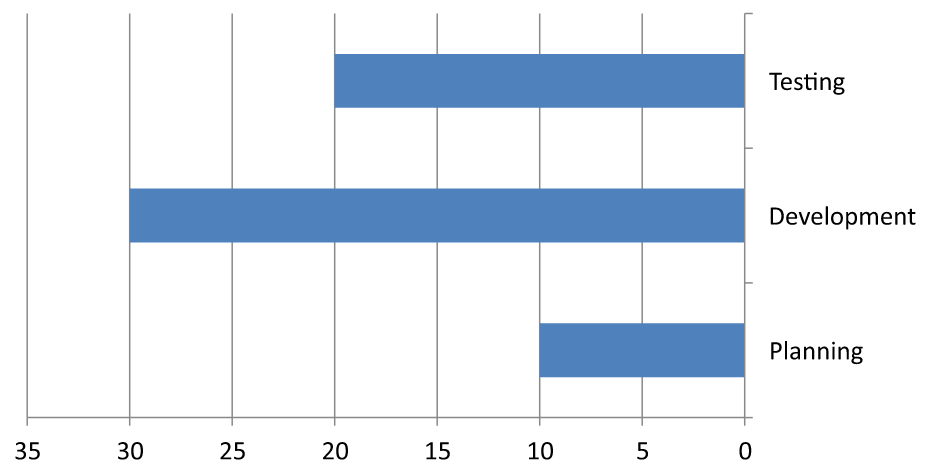

## **Overzicht**

Dit artikel legt uit hoe u de assen van diagrammen kunt aanpassen met Aspose.Slides for Java. Het behandelt berekende aswaarden, het wisselen van rijen en kolommen in diagrammen, aszichtbaarheid, intervalinstellingen voor categorielabels en streepjes, datumcategorieën en opmaak, rotatie van de titel, positie van de as, weergave‑eenheden en logaritmische schaling.

## **De maximale waarden op de verticale as van diagrammen ophalen**

Maak een [Presentation](https://reference.aspose.com/slides/java/com.aspose.slides/presentation/) en voeg een gebiedsdiagram toe met standaardgegevens. Roep [validateChartLayout](https://reference.aspose.com/slides/java/com.aspose.slides/chart/#validateChartLayout--) aan voordat u berekende aswaarden leest, zodat de diagramlay-out up‑to‑date is.

Lees [getActualMaxValue](https://reference.aspose.com/slides/java/com.aspose.slides/axis/#getActualMaxValue--) en [getActualMinValue](https://reference.aspose.com/slides/java/com.aspose.slides/axis/#getActualMinValue--) voor de aslimieten, en [getActualMajorUnit](https://reference.aspose.com/slides/java/com.aspose.slides/axis/#getActualMajorUnit--) en [getActualMinorUnit](https://reference.aspose.com/slides/java/com.aspose.slides/axis/#getActualMinorUnit--) voor de streepjescodes. [getActualMajorUnitScale](https://reference.aspose.com/slides/java/com.aspose.slides/axis/#getActualMajorUnitScale--) en [getActualMinorUnitScale](https://reference.aspose.com/slides/java/com.aspose.slides/axis/#getActualMinorUnitScale--) bieden tijdseenheidsschalen, die relevant zijn voor datumassen. Het voorbeeld slaat deze waarden op in lokale variabelen en slaat het diagram op.

```java
import com.aspose.slides.*;

Presentation presentation = new Presentation();
try {
    ISlide slide = presentation.getSlides().get_Item(0);

    IChart chart = slide.getShapes().addChart(ChartType.Area, 100, 100, 500, 350);
    chart.validateChartLayout();

    double maxValue = chart.getAxes().getVerticalAxis().getActualMaxValue();
    double minValue = chart.getAxes().getVerticalAxis().getActualMinValue();

    double majorUnit = chart.getAxes().getVerticalAxis().getActualMajorUnit();
    double minorUnit = chart.getAxes().getVerticalAxis().getActualMinorUnit();

    int majorUnitScale = chart.getAxes().getVerticalAxis().getActualMajorUnitScale();
    int minorUnitScale = chart.getAxes().getVerticalAxis().getActualMinorUnitScale();

    presentation.save("AxisValues_out.pptx", SaveFormat.Pptx);
} finally {
    presentation.dispose();
}
```

## **Gegevens tussen assen wisselen**

Gebruik [switchRowColumn](https://reference.aspose.com/slides/java/com.aspose.slides/chartdata/#switchRowColumn--) om de rollen van reeksen en categorieën in diagramgegevens uit te wisselen. Elke voormalige categorie wordt een reeks, en elke voormalige reeks wordt een categorie. Dit verandert hoe de gegevens worden gegroepeerd; het wisselt de horizontale en verticale assen niet uit. Het voorbeeld gebruikt [setRange](https://reference.aspose.com/slides/java/com.aspose.slides/chartdata/#setRange-java.lang.String-) om de standaardgegevens te koppelen aan `Sheet1!A1:D5`, inclusief de koprij en categoriekolom, voordat rijen en kolommen worden gewisseld. Het slaat een diagram op met vier reeksen en drie categorieën.

```java
import com.aspose.slides.*;

Presentation presentation = new Presentation();
try {
    ISlide slide = presentation.getSlides().get_Item(0);

    IChart chart = slide.getShapes().addChart(ChartType.ClusteredColumn, 100, 100, 400, 300);
    chart.getChartData().setRange("Sheet1!A1:D5");
    chart.getChartData().switchRowColumn();

    presentation.save("SwitchChartRowColumns_out.pptx", SaveFormat.Pptx);
} finally {
    presentation.dispose();
}
```

## **De plotvolgorde van een as omkeren**

Gebruik [setPlotOrderReversed](https://reference.aspose.com/slides/java/com.aspose.slides/axis/#setPlotOrderReversed-boolean-) om een categorie‑ of waardeas om te keren. Bijvoorbeeld, een horizontale staafgrafiek kan projectfasen van boven naar beneden tonen in dezelfde volgorde als het werkblad: Planning, Development, Testing. Het omkeren van een as verandert de plotrichting; het sorteert of herschikt de werkbladgegevens niet. Ter vergelijking wisselt [switchRowColumn](https://reference.aspose.com/slides/java/com.aspose.slides/chartdata/#switchRowColumn--) de rollen van reeksen en categorieën.

Het volgende voorbeeld maakt een horizontale staafgrafiek met drie fasen en één reeks. Het slaat een presentatie op met drie dia’s: normale volgorde, omgekeerde categorieën en omgekeerde waarden. Elke kopie gebruikt dezelfde dataset, en slechts één as wordt per kopie omgekeerd.

```java
import com.aspose.slides.*;

Presentation presentation = new Presentation();
try {
    ISlide slide = presentation.getSlides().get_Item(0);

    IChart chart = slide.getShapes().addChart(ChartType.ClusteredBar, 50, 40, 620, 320);
    chart.setLegend(false);

    chart.getChartData().getCategories().clear();
    chart.getChartData().getSeries().clear();

    IChartDataWorkbook workbook = chart.getChartData().getChartDataWorkbook();
    workbook.clear(0);

    IChartSeries series = chart.getChartData().getSeries().add(ChartType.ClusteredBar);
    String[] stages = { "Planning", "Development", "Testing" };
    int[] values = { 10, 30, 20 };
    for (int i = 0; i < stages.length; i++) {
        IChartDataCell categoryCell = workbook.getCell(0, i + 1, 0, stages[i]);
        chart.getChartData().getCategories().add(categoryCell);
        IChartDataCell valueCell = workbook.getCell(0, i + 1, 1, values[i]);
        series.getDataPoints().addDataPointForBarSeries(valueCell);
    }

    // Dia 2: toon de eerste categorie bovenaan.
    ISlide categorySlide = presentation.getSlides().addClone(slide);
    IChart categoryChart = (IChart)categorySlide.getShapes().get_Item(0);
    categoryChart.getAxes().getVerticalAxis().setPlotOrderReversed(true);
    // Houd de horizontale waardeas onderaan.
    categoryChart.getAxes().getVerticalAxis().setCrossType(CrossesType.Maximum);

    // Dia 3: keer alleen de horizontale numerieke schaal om.
    ISlide valueSlide = presentation.getSlides().addClone(slide);
    IChart valueChart = (IChart)valueSlide.getShapes().get_Item(0);
    valueChart.getAxes().getHorizontalAxis().setPlotOrderReversed(true);

    presentation.save("ReversedAxes.pptx", SaveFormat.Pptx);
} finally {
    presentation.dispose();
}
```

Het omkeren van een as kan ook de loodrechte as naar de tegenovergestelde kant van het plot verplaatsen. [setCrossType](https://reference.aspose.com/slides/java/com.aspose.slides/axis/#setCrossType-int-) bepaalt waar de andere as de geconfigureerde as kruist. In dia 2, wanneer het wordt aangeroepen met `CrossesType.Maximum` op de omgekeerde categorieas, blijft de horizontale waardeas onderaan. Voor een specifiek kruispunt, gebruik [setCrossAt](https://reference.aspose.com/slides/java/com.aspose.slides/axis/#setCrossAt-float-). Controleer de kruisinstellingen bij het wijzigen van de richting, vooral als het diagram al een aangepast kruispunt heeft. Roep `setPlotOrderReversed` met `false` aan om de normale plotrichting te herstellen; kruisinstellingen zijn afzonderlijk.

| Normale volgorde (slide 1) | Omgekeerde categorieën (slide 2) | Omgekeerde waarden (slide 3) |
| --- | --- | --- |
|  |  |  |
| Categorieën lopen van onder naar boven; waarden nemen toe van links naar rechts. | Planning, Development en Testing lopen van boven naar beneden. Waarden en werkblad‑rijvolgorde blijven ongewijzigd. | Categorieën behouden hun normale volgorde; waarden nemen toe van rechts naar links. De categorieas kruist bij nul aan de rechterkant. |

## **Verticale as uitschakelen voor lijndiagrammen**

Roep [setVisible](https://reference.aspose.com/slides/java/com.aspose.slides/axis/#setVisible-boolean-) met `false` aan op de verticale as om deze te verbergen. Het voorbeeld maakt een lijndiagram met standaardgegevens en slaat het op met de verticale as verborgen.

```java
import com.aspose.slides.*;

Presentation presentation = new Presentation();
try {
    ISlide slide = presentation.getSlides().get_Item(0);

    IChart chart = slide.getShapes().addChart(ChartType.Line, 100, 100, 400, 300);
    chart.getAxes().getVerticalAxis().setVisible(false);

    presentation.save("HiddenVerticalAxis.pptx", SaveFormat.Pptx);
} finally {
    presentation.dispose();
}
```

## **Horizontale as uitschakelen voor lijndiagrammen**

Roep [setVisible](https://reference.aspose.com/slides/java/com.aspose.slides/axis/#setVisible-boolean-) met `false` aan op de horizontale as om deze te verbergen. Het voorbeeld maakt een lijndiagram met standaardgegevens en slaat het op met de horizontale as verborgen.

```java
import com.aspose.slides.*;

Presentation presentation = new Presentation();
try {
    ISlide slide = presentation.getSlides().get_Item(0);

    IChart chart = slide.getShapes().addChart(ChartType.Line, 100, 100, 400, 300);
    chart.getAxes().getHorizontalAxis().setVisible(false);

    presentation.save("HiddenHorizontalAxis.pptx", SaveFormat.Pptx);
} finally {
    presentation.dispose();
}
```

## **Roosterlijnen van diagrammen weergeven of verbergen**

Gebruik [getShowMajorGridLines](https://reference.aspose.com/slides/java/com.aspose.slides/iaxis/#getShowMajorGridLines--) en [getShowMinorGridLines](https://reference.aspose.com/slides/java/com.aspose.slides/iaxis/#getShowMinorGridLines--) om te controleren welke rasterlijnen een as toont. Deze methoden geven de huidige zichtbaarheid terug. Om onderliggende rasterlijnen weer te geven, gebruik [getMinorGridLinesFormat](https://reference.aspose.com/slides/java/com.aspose.slides/iaxis/#getMinorGridLinesFormat--) en stel de lijnvulling in op een effen, zichtbare kleur. Om ze te verbergen, stel de vulling in op [FillType.NoFill](https://reference.aspose.com/slides/java/com.aspose.slides/filltype/#NoFill). Gebruik [getMajorGridLinesFormat](https://reference.aspose.com/slides/java/com.aspose.slides/iaxis/#getMajorGridLinesFormat--) om de lijnvulling voor hoofd‑rasterlijnen op dezelfde manier te wijzigen. Het wijzigen van de vulling behoudt de zichtbaarheid van de as en de streepjes.

De verticale as van dit gegroepeerde kolomdiagram toont aanvankelijk alleen hoofd‑rasterlijnen. Het voorbeeld toont de onderliggende rasterlijnen in donkeroranje, verbergt ze daarna opnieuw en slaat vervolgens de presentatie op. Het drukt de rasterlijn‑zichtbaarheid af na elke stap.

```java
import com.aspose.slides.*;
import java.awt.Color;

Presentation presentation = new Presentation();
try {
    ISlide slide = presentation.getSlides().get_Item(0);

    IChart chart = slide.getShapes().addChart(ChartType.ClusteredColumn, 30, 30, 660, 230);
    IAxis axis = chart.getAxes().getVerticalAxis();
    System.out.printf("Initial: major=%b, minor=%b%n", axis.getShowMajorGridLines(), axis.getShowMinorGridLines());

    ILineFillFormat minorFill = axis.getMinorGridLinesFormat().getLine().getFillFormat();
    minorFill.setFillType(FillType.Solid);
    minorFill.getSolidFillColor().setColor(new Color(255, 140, 0));
    System.out.printf("Enabled: minor=%b%n", axis.getShowMinorGridLines());

    minorFill.setFillType(FillType.NoFill);
    System.out.printf("Hidden: major=%b, minor=%b%n", axis.getShowMajorGridLines(), axis.getShowMinorGridLines());

    presentation.save("ChartGridlines.pptx", SaveFormat.Pptx);
} finally {
    presentation.dispose();
}
```

| Minder rasterlijnen ingeschakeld | Minder rasterlijnen verborgen |
| --- | --- |
|  |  |

## **Een categorieas wijzigen**

Gebruik [setCategoryAxisType](https://reference.aspose.com/slides/java/com.aspose.slides/axis/#setCategoryAxisType-int-) om een datum‑ of tekst‑categorieas te kiezen. Dit voorbeeld vereist `ExistingChart.pptx`, met een diagram als eerste vorm op de eerste dia en categoriecellen die numerieke Excel‑datumnummers bevatten. Het wijzigt de horizontale as naar een datumas. Door [setAutomaticMajorUnit](https://reference.aspose.com/slides/java/com.aspose.slides/axis/#setAutomaticMajorUnit-boolean-) met `false`, [setMajorUnit](https://reference.aspose.com/slides/java/com.aspose.slides/axis/#setMajorUnit-double-) met `1` en [setMajorUnitScale](https://reference.aspose.com/slides/java/com.aspose.slides/axis/#setMajorUnitScale-int-) met `TimeUnitType.Months` te gebruiken, worden hoofd‑streepjes op één‑maandintervallen geplaatst.

```java
import com.aspose.slides.*;

Presentation presentation = new Presentation("ExistingChart.pptx");
try {
    ISlide slide = presentation.getSlides().get_Item(0);

    IChart chart = (IChart) slide.getShapes().get_Item(0);
    chart.getAxes().getHorizontalAxis().setCategoryAxisType(CategoryAxisType.Date);
    chart.getAxes().getHorizontalAxis().setAutomaticMajorUnit(false);
    chart.getAxes().getHorizontalAxis().setMajorUnit(1);
    chart.getAxes().getHorizontalAxis().setMajorUnitScale(TimeUnitType.Months);

    presentation.save("ChangeChartCategoryAxis_out.pptx", SaveFormat.Pptx);
} finally {
    presentation.dispose();
}
```

### **Het type categorieas bepalen op basis van gegevens**

Roep [setCategoryAxisTypeAutomatically](https://reference.aspose.com/slides/java/com.aspose.slides/iaxis/#setCategoryAxisTypeAutomatically--) aan nadat de categorieën zijn gevuld, en lees vervolgens [getCategoryAxisType](https://reference.aspose.com/slides/java/com.aspose.slides/iaxis/#getCategoryAxisType--) om de selectie te inspecteren. Dit is nuttig wanneer hetzelfde diagram ofwel tekstlabels ofwel numerieke datumwaarden ontvangt. De methode bepaalt het type op het moment van aanroep; hij activeert geen permanente modus die later gewijzigde gegevens opnieuw evalueert. Roep hem opnieuw aan na het vervangen van de categorieën.

Het volgende voorbeeld maakt een diagram met tekst‑categorieën en drukt `true` af wanneer het geselecteerde type `CategoryAxisType.Text` is. Vervolgens vervangt het de celwaarden door datums en roept de methode opnieuw aan, waarbij `true` wordt afgedrukt wanneer het geselecteerde type `CategoryAxisType.Date` is. Datums worden opgeslagen als numerieke OLE‑Automation‑waarden, berekend als het aantal dagen sinds 30 december 1899, in plaats van als datum‑strings. [setCustomNumberFormat](https://reference.aspose.com/slides/java/com.aspose.slides/ichartdatacell/#setCustomNumberFormat-java.lang.String-) bepaalt hoe die waarden worden weergegeven; hij zet tekst niet om in numerieke datums. Zie voor meer informatie over categoriecellen [Diagram Werkmap](/slides/nl/java/chart-workbook/).

Gebruik automatische bepaling wanneer de invoer bekend tekst‑categorieën of numerieke datums bevat, zoals in dit voorbeeld. Voor gewone numerieke labels, gemengde categorieën of lege gegevens, roep expliciet [setCategoryAxisType](https://reference.aspose.com/slides/java/com.aspose.slides/iaxis/#setCategoryAxisType-int-) aan om het bedoelde type te matchen. Alleen numerieke waarden vormen niet voldoende bewijs dat de categorieën datums representeren.

```java
import com.aspose.slides.*;
import java.time.LocalDate;

Presentation presentation = new Presentation();
try {
    ISlide slide = presentation.getSlides().get_Item(0);

    IChart chart = slide.getShapes().addChart(ChartType.ClusteredColumn, 30, 40, 660, 320);

    chart.getChartData().getCategories().clear();
    chart.getChartData().getSeries().clear();

    IChartDataWorkbook workbook = chart.getChartData().getChartDataWorkbook();
    workbook.clear(0);

    IChartDataCell seriesName = workbook.getCell(0, 0, 1, "Sales");
    IChartSeries series = chart.getChartData().getSeries().add(seriesName, chart.getType());
    String[] labels = { "First", "Second", "Third" };

    for (int i = 0; i < labels.length; i++) {
        IChartDataCell categoryCell = workbook.getCell(0, i + 1, 0, labels[i]);
        chart.getChartData().getCategories().add(categoryCell);

        IChartDataCell valueCell = workbook.getCell(0, i + 1, 1, (i + 1) * 10);
        series.getDataPoints().addDataPointForBarSeries(valueCell);
    }

    IAxis axis = chart.getAxes().getHorizontalAxis();
    axis.setCategoryAxisTypeAutomatically();
    System.out.println(axis.getCategoryAxisType() == CategoryAxisType.Text); // waar

    LocalDate baseDate = LocalDate.of(1899, 12, 30);
    LocalDate[] dates = { LocalDate.of(2026, 1, 1), LocalDate.of(2026, 1, 2), LocalDate.of(2026, 2, 1) };

    for (int i = 0; i < dates.length; i++) {
        IChartDataCell categoryCell = workbook.getCell(0, i + 1, 0);
        categoryCell.setValue((double)(dates[i].toEpochDay() - baseDate.toEpochDay()));
        categoryCell.setCustomNumberFormat("yyyy-mm-dd");
    }

    axis.setCategoryAxisTypeAutomatically();
    System.out.println(axis.getCategoryAxisType() == CategoryAxisType.Date); // waar

    presentation.save("AutomaticCategoryAxis.pptx", SaveFormat.Pptx);
} finally {
    presentation.dispose();
}
```

## **Intervallen voor categorielabels op de as beheren**

Wanneer een diagram veel categorieën heeft, kunt u het aantal zichtbare as‑labels verminderen zonder categorieën of datapunten te verwijderen. Roep [setAutomaticTickLabelSpacing](https://reference.aspose.com/slides/java/com.aspose.slides/iaxis/#setAutomaticTickLabelSpacing-boolean-) met `false` aan, en geef vervolgens het gewenste categorieverloop aan [setTickLabelSpacing](https://reference.aspose.com/slides/java/com.aspose.slides/iaxis/#setTickLabelSpacing-long-). Voor tekst‑categorieën in hun normale volgorde begint de telling bij de eerste categorie:

| Interval | Labels die in het voorbeeld worden weergegeven |
| --- | --- |
| `1` | Category 1, Category 2, Category 3, ... Category 24 |
| `2` | Category 1, Category 3, Category 5, ... Category 23 |
| `3` | Category 1, Category 4, Category 7, ... Category 22 |

Een interval van `3` geeft elk derde label weer, waarbij twee labels verborgen blijven tussen de weergegeven labels. Het verwijdert de bijbehorende kolommen niet. Automatische spacing kiest een interval op basis van de beschikbare ruimte; het toont niet per se elk label.

Streepjes hebben afzonderlijke instellingen. Roep [setAutomaticTickMarksSpacing](https://reference.aspose.com/slides/java/com.aspose.slides/iaxis/#setAutomaticTickMarksSpacing-boolean-) met `false` aan en gebruik [setTickMarksSpacing](https://reference.aspose.com/slides/java/com.aspose.slides/iaxis/#setTickMarksSpacing-long-) om hun interval in te stellen. Bijvoorbeeld, `1` houdt een streepje bij elk categorie‑interval terwijl labels slechts elk derde categorie verschijnen. Gebruik [setMajorTickMark](https://reference.aspose.com/slides/java/com.aspose.slides/iaxis/#setMajorTickMark-int-) met een zichtbaar stijl zodat u het resultaat kunt zien. Het opnieuw aanroepen van een automatische‑spacing‐setter met `true` laat het diagram het interval opnieuw kiezen.

```java
import com.aspose.slides.*;

Presentation presentation = new Presentation();
try {
    ISlide slide = presentation.getSlides().get_Item(0);

    IChart chart = slide.getShapes().addChart(ChartType.ClusteredColumn, 30, 40, 660, 320);

    chart.setLegend(false);
    chart.getChartData().getCategories().clear();
    chart.getChartData().getSeries().clear();

    IChartDataWorkbook workbook = chart.getChartData().getChartDataWorkbook();
    workbook.clear(0);

    IChartSeries series = chart.getChartData().getSeries().add(ChartType.ClusteredColumn);
    for (int i = 0; i < 24; i++) {
        IChartDataCell categoryCell = workbook.getCell(0, i + 1, 0, "Category " + (i + 1));
        chart.getChartData().getCategories().add(categoryCell);
        IChartDataCell valueCell = workbook.getCell(0, i + 1, 1, 10 + i % 6 * 5);
        series.getDataPoints().addDataPointForBarSeries(valueCell);
    }

    IAxis axis = chart.getAxes().getHorizontalAxis();
    axis.setCategoryAxisType(CategoryAxisType.Text);
    axis.getTextFormat().getTextBlockFormat().setRotationAngle(0);
    axis.getTextFormat().getPortionFormat().setFontHeight(12);
    axis.setMajorTickMark(TickMarkType.Outside);
    axis.setAutomaticTickLabelSpacing(true);
    axis.setAutomaticTickMarksSpacing(true);

    // Dia 2: toon elk derde label, maar behoud een streepje voor elke categorie.
    ISlide manualSlide = presentation.getSlides().addClone(slide);
    IChart manualChart = (IChart)manualSlide.getShapes().get_Item(0);
    IAxis manualAxis = manualChart.getAxes().getHorizontalAxis();
    manualAxis.setAutomaticTickLabelSpacing(false);
    manualAxis.setTickLabelSpacing(3);
    manualAxis.setAutomaticTickMarksSpacing(false);
    manualAxis.setTickMarksSpacing(1);

    // Dia 3: laat het diagram beide intervallen opnieuw kiezen.
    ISlide restoredSlide = presentation.getSlides().addClone(manualSlide);
    IChart restoredChart = (IChart)restoredSlide.getShapes().get_Item(0);
    restoredChart.getAxes().getHorizontalAxis().setAutomaticTickLabelSpacing(true);
    restoredChart.getAxes().getHorizontalAxis().setAutomaticTickMarksSpacing(true);

    presentation.save("CategoryAxisIntervals.pptx", SaveFormat.Pptx);
} finally {
    presentation.dispose();
}
```

**Automatische spreiding (slide 1):** In deze weergave wordt elke tweede categorielabel getoond en wordt deze over twee regels verdeeld. Het automatische resultaat kan variëren afhankelijk van diagramgrootte, lettertypen en de renderer.


**Handmatige spreiding (slide 2):** Elk derde label wordt op één regel getoond, terwijl streepjes behouden blijven bij elk categorie‑interval. Alle 24 kolommen, inclusief die zonder labels, blijven zichtbaar met dezelfde waarden. Dia 3 herstelt het automatische uiterlijk dat hierboven is getoond.


### **Kies de juiste as en interval**

Gebruik dit categorie‑aantal‑interval voor een tekst‑categorieas, zoals de categorieas van een kolom‑, lijn‑, gebieds‑ of staafdiagram. In een kolomdiagram is dit de horizontale as. In een horizontale staafgrafiek is de categorieas verticaal, dus pas deze instellingen toe op de as die wordt geretourneerd door [getVerticalAxis](https://reference.aspose.com/slides/java/com.aspose.slides/iaxesmanager/#getVerticalAxis--). Streepjes‑spacing is ook van toepassing op een reeksen‑as in diagrammen die er een hebben.

Gebruik de label‑spacing niet om de numerieke schaal van een waardeas in te stellen. Op een waardeas specificeert [setMajorUnit](https://reference.aspose.com/slides/java/com.aspose.slides/iaxis/#setMajorUnit-double-) een verschil in waarden: bijvoorbeeld, een hoofd­eenheid van `10` produceert streepjes op 0, 10, 20, enzovoort wanneer de as bij nul begint. Een label‑interval van `3` telt in plaats daarvan de positie van categorieën, ongeacht hun datawaarden. Spreidings‑ en bubbel‑diagrammen gebruiken waardeassen in plaats van een tekst‑categorieas. Voor een datumas gebruikt u tijd‑gebaseerde hoofd‑eenheden en schalen zoals beschreven in [Een categorieas wijzigen](#een-categorieas-wijzigen).

## **Het datumformaat voor categorieaswaarden instellen**

Het voorbeeld vervangt de standaard diagramgegevens door vier jaarlijkse waarden. Datums worden opgeslagen als OLE‑Automation‑serienummers in het eerste werkblad (index `0`), berekend als het aantal dagen sinds 30 december 1899 voor deze datums. Gebruik [setCategoryAxisType](https://reference.aspose.com/slides/java/com.aspose.slides/axis/#setCategoryAxisType-int-) met `CategoryAxisType.Date`, roep [setNumberFormatLinkedToSource](https://reference.aspose.com/slides/java/com.aspose.slides/axis/#setNumberFormatLinkedToSource-boolean-) met `false` aan en geef `yyyy` door aan [setNumberFormat](https://reference.aspose.com/slides/java/com.aspose.slides/axis/#setNumberFormat-java.lang.String-) zodat de categorielabels viercijferige jaartallen tonen, onafhankelijk van de celopmaak.

```java
import com.aspose.slides.*;
import java.time.LocalDate;

Presentation presentation = new Presentation();
try {
    ISlide slide = presentation.getSlides().get_Item(0);

    IChart chart = slide.getShapes().addChart(ChartType.Line, 50, 50, 450, 300);

    chart.getChartData().getCategories().clear();
    chart.getChartData().getSeries().clear();

    IChartDataWorkbook workbook = chart.getChartData().getChartDataWorkbook();
    workbook.clear(0);

    LocalDate baseDate = LocalDate.of(1899, 12, 30);

    IChartSeries series = chart.getChartData().getSeries().add(ChartType.Line);
    for (int i = 0; i < 4; i++) {
        LocalDate date = LocalDate.of(2015 + i, 1, 1);
        IChartDataCell categoryCell = workbook.getCell(0, i + 1, 0, date.toEpochDay() - baseDate.toEpochDay());
        chart.getChartData().getCategories().add(categoryCell);

        IChartDataCell valueCell = workbook.getCell(0, i + 1, 1, i + 1);
        series.getDataPoints().addDataPointForLineSeries(valueCell);
    }

    chart.getAxes().getHorizontalAxis().setCategoryAxisType(CategoryAxisType.Date);
    chart.getAxes().getHorizontalAxis().setNumberFormatLinkedToSource(false);
    chart.getAxes().getHorizontalAxis().setNumberFormat("yyyy");

    presentation.save("DateAxisFormat.pptx", SaveFormat.Pptx);
} finally {
    presentation.dispose();
}
```

## **Een rotatiehoek instellen voor een as‑titel van een diagram**

Roep [setTitle](https://reference.aspose.com/slides/java/com.aspose.slides/axis/#setTitle-boolean-) met `true` aan op de verticale as, geef de titeltekst op, en gebruik [setRotationAngle](https://reference.aspose.com/slides/java/com.aspose.slides/icharttextblockformat/#setRotationAngle-float-) om de titel te draaien. De hoek wordt gemeten in graden; dit voorbeeld slaat een kolomdiagram op met de waarde‑as‑titel gedraaid met 90 graden.

```java
import com.aspose.slides.*;

Presentation presentation = new Presentation();
try {
    ISlide slide = presentation.getSlides().get_Item(0);

    IChart chart = slide.getShapes().addChart(ChartType.ClusteredColumn, 50, 50, 450, 300);
    chart.getAxes().getVerticalAxis().setTitle(true);
    chart.getAxes().getVerticalAxis().getTitle().addTextFrameForOverriding("Value");
    chart.getAxes().getVerticalAxis().getTitle().getTextFormat().getTextBlockFormat().setRotationAngle(90);

    presentation.save("RotatedAxisTitle.pptx", SaveFormat.Pptx);
} finally {
    presentation.dispose();
}
```

## **De aspositie op een categorie‑ of waardeas instellen**

Gebruik [setAxisBetweenCategories](https://reference.aspose.com/slides/java/com.aspose.slides/axis/#setAxisBetweenCategories-boolean-) om te bepalen of de waardeas de categorieas tussen categorieën of op de categorie‑streepjes kruist. Deze instelling is van toepassing op categorieassen. Het voorbeeld stelt dit in op `true` op de horizontale categorieas van een kolomdiagram en slaat het resultaat op.

```java
import com.aspose.slides.*;

Presentation presentation = new Presentation();
try {
    ISlide slide = presentation.getSlides().get_Item(0);

    IChart chart = slide.getShapes().addChart(ChartType.ClusteredColumn, 50, 50, 450, 300);
    chart.getAxes().getHorizontalAxis().setAxisBetweenCategories(true);

    presentation.save("AxisBetweenCategories.pptx", SaveFormat.Pptx);
} finally {
    presentation.dispose();
}
```

## **De weergave‑eenheid op een waardeas van een diagram instellen**

Gebruik [setDisplayUnit](https://reference.aspose.com/slides/java/com.aspose.slides/axis/#setDisplayUnit-int-) om de labels op een waardeas te schalen zonder de onderliggende gegevens te wijzigen. Met [DisplayUnitType](https://reference.aspose.com/slides/java/com.aspose.slides/displayunittype/) ingesteld op `Millions` wordt een waarde van 60 000 000 weergegeven als 60. Het voorbeeld maakt een kolomdiagram en past de miljoenen‑weergave‑eenheid toe op de verticale as.

```java
import com.aspose.slides.*;

Presentation presentation = new Presentation();
try {
    ISlide slide = presentation.getSlides().get_Item(0);

    IChart chart = slide.getShapes().addChart(ChartType.ClusteredColumn, 50, 50, 450, 300);
    chart.getAxes().getVerticalAxis().setDisplayUnit(DisplayUnitType.Millions);

    presentation.save("Result.pptx", SaveFormat.Pptx);
} finally {
    presentation.dispose();
}
```

## **Een logaritmische waardeas configureren**

Een logaritmische waardeas is nuttig wanneer positieve waarden zich over meerdere grootheden uitstrekken. Bijvoorbeeld, een service kan 10, 100, 1 000, 10 000 en 100 000 verzoeken ontvangen over vijf perioden. Op een lineaire schaal liggen de kleinere waarden dicht bij nul. Een logaritmische schaal maakt hun relatieve groei makkelijker te vergelijken: gelijke afstanden vertegenwoordigen gelijke verhoudingen in plaats van gelijke verschillen.

Roep [setLogarithmic](https://reference.aspose.com/slides/java/com.aspose.slides/axis/#setLogarithmic-boolean-) met `true` aan op de waardeas en gebruik [setLogBase](https://reference.aspose.com/slides/java/com.aspose.slides/axis/#setLogBase-double-) om de basis te kiezen. Dit verandert hoe de bestaande waarden worden weergegeven; het wijzigt de gegevens niet en voegt geen logaritmische trendlijn toe. Een trendlijn is een apart kenmerk dat een aangepaste relatie in de gegevens representeert.

### **De waardeas en basis kiezen**

Voor een lijn‑ of kolomdiagram wordt de waardeas geretourneerd door [getVerticalAxis](https://reference.aspose.com/slides/java/com.aspose.slides/iaxesmanager/#getVerticalAxis--). Voor een horizontale staafgrafiek wordt deze geretourneerd door [getHorizontalAxis](https://reference.aspose.com/slides/java/com.aspose.slides/iaxesmanager/#getHorizontalAxis--). Spreidings‑ en bubbel‑diagrammen hebben twee waardeassen; kies de horizontale as voor X‑waarden, de verticale as voor Y‑waarden, of beide. Pas geen logaritmische schaal toe op een categorieas.

De standaard logaritmische basis is `10`. Voor PPTX‑diagrammen mag de basis liggen tussen `2` en `1000`, inclusief; fractionele bases zoals `2.5` worden ook ondersteund. Met basis `10` zijn opeenvolgende machten zoals 10, 100, 1 000 en 10 000 evenredig verdeeld.

### **Lineaire en logaritmische schaal vergelijken**

Het volgende zelf‑containende voorbeeld maakt een lijndiagram met de vijf aanvraag‑aantallen op de eerste dia, cloneert vervolgens die dia en schakelt een logaritmische waardeas met basis 10 in op de tweede. Beide dia’s behouden dezelfde gegevens.

```java
import com.aspose.slides.*;

Presentation presentation = new Presentation();
try {
    ISlide slide = presentation.getSlides().get_Item(0);

    IChart chart = slide.getShapes().addChart(ChartType.Line, 30, 40, 660, 200);

    chart.setLegend(false);

    chart.getChartData().getCategories().clear();
    chart.getChartData().getSeries().clear();

    IChartDataWorkbook workbook = chart.getChartData().getChartDataWorkbook();
    workbook.clear(0);

    IChartSeries series = chart.getChartData().getSeries().add(ChartType.Line);
    double[] values = { 10, 100, 1000, 10000, 100000 };

    for (int i = 0; i < values.length; i++) {
        IChartDataCell categoryCell = workbook.getCell(0, i + 1, 0, "Period " + (i + 1));
        chart.getChartData().getCategories().add(categoryCell);

        IChartDataCell valueCell = workbook.getCell(0, i + 1, 1, values[i]);
        series.getDataPoints().addDataPointForLineSeries(valueCell);
    }

    // Behoud de eerste dia lineair en wijzig alleen de schaal van de waardenas van de kopie.
    ISlide logarithmicSlide = presentation.getSlides().addClone(slide);
    IChart logarithmicChart = (IChart)logarithmicSlide.getShapes().get_Item(0);
    IAxis valueAxis = logarithmicChart.getAxes().getVerticalAxis();
    valueAxis.setLogarithmic(true);
    valueAxis.setLogBase(10);

    presentation.save("LogarithmicAxis.pptx", SaveFormat.Pptx);
} finally {
    presentation.dispose();
}
```

**Lineaire schaal (slide 1):** Gelijke verticale afstanden staan voor gelijke verschillen in aanvraag‑aantallen. De grootste waarde domineert het diagram, waardoor de kleinere waarden moeilijk te onderscheiden zijn.


**Logaritmische schaal (slide 2):** Gelijke verticale afstanden staan voor gelijke verhoudingen. Elke periode heeft tien keer zoveel verzoeken als de vorige, waardoor de punten een rechte stijgende lijn vormen op de schaal met basis 10. De as‑labels blijven de oorspronkelijke aanvraag‑aantallen tonen.


### **Omgaan met nul‑ en negatieve waarden**

Een logaritmische schaal kan alleen strikt positieve waarden weergeven. Controleer de gegevens voordat u deze inschakelt. Als nul‑ of negatieve waarden betekenis hebben, behoud dan een lineaire schaal of toon ze afzonderlijk. Als het weglaten van die waarden passend is voor de analyse, leg dan de reden uit. Vervang ze niet stilzwijgend door kleine positieve getallen, want dat verandert de betekenis van de data. Elke handmatig geconfigureerde minimum‑ of maximumwaarde voor een logaritmische as moet eveneens positief zijn.

## **Veelgestelde vragen**

**Hoe stel ik de waarde in waarop één as de andere kruist (as‑kruising)?**

Gebruik [setCrossType](https://reference.aspose.com/slides/java/com.aspose.slides/axis/#setCrossType-int-) om het kruiskruisgedrag te selecteren. Om een numerieke kruiswaarde op te geven, gebruik [setCrossAt](https://reference.aspose.com/slides/java/com.aspose.slides/axis/#setCrossAt-float-). Deze instellingen laten u de as‑kruising naar een geschikte basislijn verplaatsen.

**Hoe kan ik de positie van tick‑labels ten opzichte van de as bepalen?**

Roep [setTickLabelPosition](https://reference.aspose.com/slides/java/com.aspose.slides/axis/#setTickLabelPosition-int-) aan met een van de waarden van [TickLabelPositionType](https://reference.aspose.com/slides/java/com.aspose.slides/ticklabelpositiontype/): `Low`, `High`, `NextTo` of `None`. Om de streepjes zelf te regelen, gebruik [setMajorTickMark](https://reference.aspose.com/slides/java/com.aspose.slides/axis/#setMajorTickMark-int-) of [setMinorTickMark](https://reference.aspose.com/slides/java/com.aspose.slides/axis/#setMinorTickMark-int-); deze staan los van de label‑positionering.