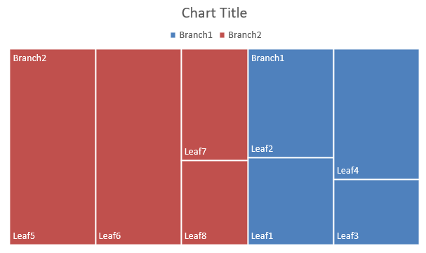

## **Overzicht**

Dit artikel biedt een uitgebreid overzicht over hoe je diagrammen kunt maken en aanpassen met Aspose.Slides voor Java. Je leert hoe je programmatisch een diagram aan een dia toevoegt, het vult met gegevens en verschillende opmaakopties toepast om te voldoen aan je specifieke ontwerpvereisten. Gedurende het artikel illustreren gedetailleerde codevoorbeelden elke stap, van het initialiseren van de presentatie en het diagramobject tot het configureren van reeksen, assen en legenda’s. Door deze gids te volgen, krijg je een solide begrip van hoe je dynamische diagramgeneratie kunt integreren in je Java‑toepassingen, waardoor het maken van datagestuurde presentaties wordt gestroomlijnd.

## **Een diagram maken**

Diagrammen helpen mensen snel data te visualiseren en inzichten te krijgen die niet meteen duidelijk zijn uit een tabel of spreadsheet.

**Waarom diagrammen maken?**

Met diagrammen kun je:

* grote hoeveelheden gegevens samenvatten, aggregeren of condenseren op één dia in een presentatie;
* patronen en trends in gegevens blootleggen;
* de richting en momentum van gegevens in de tijd of ten opzichte van een specifieke meeteenheid afleiden;
* uitschieters, afwijkingen, fouten en onzinnige data opsporen;
* complexe data communiceren of presenteren.

In PowerPoint kun je diagrammen maken via de *Invoegen*-functie, die sjablonen biedt voor het ontwerpen van veel verschillende diagramtypes. Met Aspose.Slides kun je zowel reguliere diagrammen (gebaseerd op populaire diagramtypes) als aangepaste diagrammen maken.

{}

Gebruik de [ChartType](https://reference.aspose.com/slides/java/com.aspose.slides/charttype/) enumeratie in de [com.aspose.slides](https://reference.aspose.com/slides/java/com.aspose.slides/) package. De waarden in deze enumeratie komen overeen met verschillende diagramtypes.

{}

### **Gegroepeerde kolomdiagrammen maken**

Dit voorbeeld gebruikt [addChart](https://reference.aspose.com/slides/java/com.aspose.slides/ishapecollection/#addChart-int-float-float-float-float-) om een gegroepeerde kolomdiagram te maken die twee reeksen over drie categorieën vergelijkt. De reeksen gebruiken rode en groene vullingen, en individuele labels tonen categorienamen, reeksennamen en waarden. Werkblad‑index 0 verwijst naar het eerste blad in de ingebedde diagram‑werkmap.

```java
import com.aspose.slides.*;
import java.awt.Color;

Presentation presentation = new Presentation();
try
{
    ISlide slide = presentation.getSlides().get_Item(0);

    IChart chart = slide.getShapes().addChart(ChartType.ClusteredColumn, 20, 20, 500, 300);

    chart.getChartTitle().addTextFrameForOverriding("Sample Title");
    chart.getChartTitle().getTextFrameForOverriding().getTextFrameFormat().setCenterText(NullableBool.True);
    chart.getChartTitle().setHeight(20);
    chart.setTitle(true);

    IChartDataWorkbook workbook = chart.getChartData().getChartDataWorkbook();
    int worksheetIndex = 0;

    chart.getChartData().getSeries().clear();
    chart.getChartData().getCategories().clear();

    IChartDataCell seriesNameCell = workbook.getCell(worksheetIndex, 0, 1, "Series 1");
    chart.getChartData().getSeries().add(seriesNameCell, chart.getType());
    seriesNameCell = workbook.getCell(worksheetIndex, 0, 2, "Series 2");
    chart.getChartData().getSeries().add(seriesNameCell, chart.getType());

    IChartDataCell categoryCell = workbook.getCell(worksheetIndex, 1, 0, "Category 1");
    chart.getChartData().getCategories().add(categoryCell);
    categoryCell = workbook.getCell(worksheetIndex, 2, 0, "Category 2");
    chart.getChartData().getCategories().add(categoryCell);
    categoryCell = workbook.getCell(worksheetIndex, 3, 0, "Category 3");
    chart.getChartData().getCategories().add(categoryCell);

    IChartSeries series = chart.getChartData().getSeries().get_Item(0);

    IChartDataCell valueCell = workbook.getCell(worksheetIndex, 1, 1, 20);
    series.getDataPoints().addDataPointForBarSeries(valueCell);
    valueCell = workbook.getCell(worksheetIndex, 2, 1, 50);
    series.getDataPoints().addDataPointForBarSeries(valueCell);
    valueCell = workbook.getCell(worksheetIndex, 3, 1, 30);
    series.getDataPoints().addDataPointForBarSeries(valueCell);

    series.getFormat().getFill().setFillType(FillType.Solid);
    series.getFormat().getFill().getSolidFillColor().setColor(Color.RED);

    series = chart.getChartData().getSeries().get_Item(1);

    valueCell = workbook.getCell(worksheetIndex, 1, 2, 30);
    series.getDataPoints().addDataPointForBarSeries(valueCell);
    valueCell = workbook.getCell(worksheetIndex, 2, 2, 10);
    series.getDataPoints().addDataPointForBarSeries(valueCell);
    valueCell = workbook.getCell(worksheetIndex, 3, 2, 60);
    series.getDataPoints().addDataPointForBarSeries(valueCell);

    series.getFormat().getFill().setFillType(FillType.Solid);
    series.getFormat().getFill().getSolidFillColor().setColor(new Color(0, 128, 0));

    IDataLabel label = series.getDataPoints().get_Item(0).getLabel();
    label.getDataLabelFormat().setShowCategoryName(true);

    label = series.getDataPoints().get_Item(1).getLabel();
    label.getDataLabelFormat().setShowSeriesName(true);

    label = series.getDataPoints().get_Item(2).getLabel();
    label.getDataLabelFormat().setShowValue(true);
    label.getDataLabelFormat().setShowSeriesName(true);
    label.getDataLabelFormat().setSeparator("/");

    presentation.save("AsposeChart.pptx", SaveFormat.Pptx);
}
finally
{
    presentation.dispose();
}
```

Het resultaat:


### **Spreidingsdiagrammen maken**

Spreidingsdiagrammen (ook wel scatter plots of xy‑grafieken genoemd) worden vaak gebruikt om patronen te zoeken of correlaties tussen twee variabelen aan te tonen.

Gebruik een spreidingsdiagram wanneer:

* je gepaarde numerieke gegevens hebt;
* je twee variabelen hebt die goed bij elkaar passen;
* je wilt bepalen of de twee variabelen gerelateerd zijn;
* je een onafhankelijke variabele hebt met meerdere waarden voor een afhankelijke variabele.

Dit voorbeeld plot twee sets xy‑waarden. De eerste reeks gebruikt rechte lijnen met ster‑markers, terwijl de tweede vloeiende lijnen met cirkel‑markers gebruikt; beide gebruiken een marker‑grootte van 10, ingesteld met [setSize](https://reference.aspose.com/slides/java/com.aspose.slides/imarker/#setSize-int-). De [setSymbol](https://reference.aspose.com/slides/java/com.aspose.slides/imarker/#setSymbol-int-) methode bepaalt de vorm van de marker.

```java
import com.aspose.slides.*;

Presentation presentation = new Presentation();
try
{
    ISlide slide = presentation.getSlides().get_Item(0);

    IChart chart = slide.getShapes().addChart(ChartType.ScatterWithSmoothLines, 20, 20, 500, 300);

    IChartDataWorkbook workbook = chart.getChartData().getChartDataWorkbook();
    int worksheetIndex = 0;

    chart.getChartData().getSeries().clear();

    IChartDataCell seriesNameCell = workbook.getCell(worksheetIndex, 1, 1, "Series 1");
    chart.getChartData().getSeries().add(seriesNameCell, chart.getType());
    seriesNameCell = workbook.getCell(worksheetIndex, 1, 3, "Series 2");
    chart.getChartData().getSeries().add(seriesNameCell, chart.getType());

    IChartSeries series = chart.getChartData().getSeries().get_Item(0);

    IChartDataCell xValueCell = workbook.getCell(worksheetIndex, 2, 1, 1);
    IChartDataCell yValueCell = workbook.getCell(worksheetIndex, 2, 2, 3);
    series.getDataPoints().addDataPointForScatterSeries(xValueCell, yValueCell);

    xValueCell = workbook.getCell(worksheetIndex, 3, 1, 2);
    yValueCell = workbook.getCell(worksheetIndex, 3, 2, 10);
    series.getDataPoints().addDataPointForScatterSeries(xValueCell, yValueCell);

    series.setType(ChartType.ScatterWithStraightLinesAndMarkers);

    series.getMarker().setSize(10);
    series.getMarker().setSymbol(MarkerStyleType.Star);

    series = chart.getChartData().getSeries().get_Item(1);

    xValueCell = workbook.getCell(worksheetIndex, 2, 3, 5);
    yValueCell = workbook.getCell(worksheetIndex, 2, 4, 2);
    series.getDataPoints().addDataPointForScatterSeries(xValueCell, yValueCell);

    xValueCell = workbook.getCell(worksheetIndex, 3, 3, 3);
    yValueCell = workbook.getCell(worksheetIndex, 3, 4, 1);
    series.getDataPoints().addDataPointForScatterSeries(xValueCell, yValueCell);

    xValueCell = workbook.getCell(worksheetIndex, 4, 3, 2);
    yValueCell = workbook.getCell(worksheetIndex, 4, 4, 2);
    series.getDataPoints().addDataPointForScatterSeries(xValueCell, yValueCell);

    xValueCell = workbook.getCell(worksheetIndex, 5, 3, 5);
    yValueCell = workbook.getCell(worksheetIndex, 5, 4, 1);
    series.getDataPoints().addDataPointForScatterSeries(xValueCell, yValueCell);

    series.getMarker().setSize(10);
    series.getMarker().setSymbol(MarkerStyleType.Circle);

    presentation.save("AsposeChart.pptx", SaveFormat.Pptx);
}
finally
{
    presentation.dispose();
}
```

Het resultaat:


### **Taartdiagrammen maken**

Taartdiagrammen worden het best gebruikt om de deel‑tot‑geheelrelatie in gegevens weer te geven, vooral wanneer de gegevens categorische labels met numerieke waarden bevatten. Als je gegevens echter veel delen of labels bevatten, kun je beter een staafdiagram gebruiken.

Dit voorbeeld maakt een taartdiagram met drie kwartaalwaarden. Elke part heeft een aangepaste vulling en rand, en de labels tonen verschillende combinaties van waarden, percentages en reeks‑informatie. De [setFirstSliceAngle](https://reference.aspose.com/slides/java/com.aspose.slides/ichartseriesgroup/#setFirstSliceAngle-int-) methode stelt de eerste part in op 180 graden.

```java
import com.aspose.slides.*;
import java.awt.Color;

Presentation presentation = new Presentation();
try
{
    ISlide slide = presentation.getSlides().get_Item(0);

    IChart chart = slide.getShapes().addChart(ChartType.Pie, 20, 20, 500, 300);

    chart.getChartTitle().addTextFrameForOverriding("Sample Title");
    chart.getChartTitle().getTextFrameForOverriding().getTextFrameFormat().setCenterText(NullableBool.True);
    chart.getChartTitle().setHeight(20);
    chart.setTitle(true);

    chart.getChartData().getSeries().get_Item(0).getLabels().getDefaultDataLabelFormat().setShowValue(true);

    IChartDataWorkbook workbook = chart.getChartData().getChartDataWorkbook();
    int worksheetIndex = 0;

    chart.getChartData().getSeries().clear();
    chart.getChartData().getCategories().clear();

    IChartDataCell categoryCell = workbook.getCell(0, 1, 0, "1st Qtr");
    chart.getChartData().getCategories().add(categoryCell);
    categoryCell = workbook.getCell(0, 2, 0, "2nd Qtr");
    chart.getChartData().getCategories().add(categoryCell);
    categoryCell = workbook.getCell(0, 3, 0, "3rd Qtr");
    chart.getChartData().getCategories().add(categoryCell);

    IChartDataCell seriesNameCell = workbook.getCell(0, 0, 1, "Series 1");
    IChartSeries series = chart.getChartData().getSeries().add(seriesNameCell, chart.getType());

    IChartDataCell valueCell = workbook.getCell(worksheetIndex, 1, 1, 20);
    series.getDataPoints().addDataPointForPieSeries(valueCell);
    valueCell = workbook.getCell(worksheetIndex, 2, 1, 50);
    series.getDataPoints().addDataPointForPieSeries(valueCell);
    valueCell = workbook.getCell(worksheetIndex, 3, 1, 30);
    series.getDataPoints().addDataPointForPieSeries(valueCell);

    chart.getChartData().getSeriesGroups().get_Item(0).setColorVaried(true);

    IChartDataPoint firstSlice = series.getDataPoints().get_Item(0);
    firstSlice.getFormat().getFill().setFillType(FillType.Solid);
    firstSlice.getFormat().getFill().getSolidFillColor().setColor(Color.CYAN);

    firstSlice.getFormat().getLine().getFillFormat().setFillType(FillType.Solid);
    firstSlice.getFormat().getLine().getFillFormat().getSolidFillColor().setColor(Color.GRAY);
    firstSlice.getFormat().getLine().setWidth(3.0);
    firstSlice.getFormat().getLine().setStyle(LineStyle.ThinThick);
    firstSlice.getFormat().getLine().setDashStyle(LineDashStyle.LargeDash);

    IChartDataPoint secondSlice = series.getDataPoints().get_Item(1);
    secondSlice.getFormat().getFill().setFillType(FillType.Solid);
    secondSlice.getFormat().getFill().getSolidFillColor().setColor(new Color(165, 42, 42));

    secondSlice.getFormat().getLine().getFillFormat().setFillType(FillType.Solid);
    secondSlice.getFormat().getLine().getFillFormat().getSolidFillColor().setColor(Color.BLUE);
    secondSlice.getFormat().getLine().setWidth(3.0);
    secondSlice.getFormat().getLine().setStyle(LineStyle.Single);
    secondSlice.getFormat().getLine().setDashStyle(LineDashStyle.LargeDashDot);

    IChartDataPoint thirdSlice = series.getDataPoints().get_Item(2);
    thirdSlice.getFormat().getFill().setFillType(FillType.Solid);
    thirdSlice.getFormat().getFill().getSolidFillColor().setColor(new Color(255, 127, 80));

    thirdSlice.getFormat().getLine().getFillFormat().setFillType(FillType.Solid);
    thirdSlice.getFormat().getLine().getFillFormat().getSolidFillColor().setColor(Color.RED);
    thirdSlice.getFormat().getLine().setWidth(2.0);
    thirdSlice.getFormat().getLine().setStyle(LineStyle.ThinThin);
    thirdSlice.getFormat().getLine().setDashStyle(LineDashStyle.LargeDashDotDot);

    IDataLabel firstLabel = series.getDataPoints().get_Item(0).getLabel();
    firstLabel.getDataLabelFormat().setShowValue(true);

    IDataLabel secondLabel = series.getDataPoints().get_Item(1).getLabel();
    secondLabel.getDataLabelFormat().setShowValue(true);
    secondLabel.getDataLabelFormat().setShowLegendKey(true);
    secondLabel.getDataLabelFormat().setShowPercentage(true);

    IDataLabel thirdLabel = series.getDataPoints().get_Item(2).getLabel();
    thirdLabel.getDataLabelFormat().setShowSeriesName(true);
    thirdLabel.getDataLabelFormat().setShowPercentage(true);

    series.getLabels().getDefaultDataLabelFormat().setShowLeaderLines(true);

    chart.getChartData().getSeriesGroups().get_Item(0).setFirstSliceAngle(180);

    presentation.save("PieChart.pptx", SaveFormat.Pptx);
}
finally
{
    presentation.dispose();
}
```

Het resultaat:


Voor een betere leesbaarheid van labels buiten de taart, zie [Format Leader Lines](/slides/nl/java/chart-data-label/#format-leader-lines) voor een voorbeeld dat labels positioneert en de kleur, breedte, transparantie en stippellijntype van de lijnen aanpast.

### **Lijndiagrammen maken**

Lijndiagrammen (ook wel lijngrafieken genoemd) worden het best gebruikt in situaties waarin je veranderingen in waarde over tijd wilt aantonen. Met een lijndiagram kun je veel gegevens tegelijk vergelijken, trends in de loop van de tijd volgen, anomalieën in reeksen benadrukken, en meer.

Dit voorbeeld gebruikt [addChart](https://reference.aspose.com/slides/java/com.aspose.slides/ishapecollection/#addChart-int-float-float-float-float-) om een lijndiagram te maken met de standaardreeks en -categorieën, en slaat vervolgens de presentatie op als PPTX.

```java
import com.aspose.slides.*;

Presentation presentation = new Presentation();
try
{
    ISlide slide = presentation.getSlides().get_Item(0);

    IChart lineChart = slide.getShapes().addChart(ChartType.Line, 20, 20, 500, 300);

    presentation.save("lineChart.pptx", SaveFormat.Pptx);
}
finally
{
    presentation.dispose();
}
```

Standaard worden punten in een lijndiagram verbonden door rechte doorlopende lijnen. Als je wilt dat de punten in plaats daarvan met stippellijnen worden verbonden, roep je [setDashStyle](https://reference.aspose.com/slides/java/com.aspose.slides/ilineformat/#setDashStyle-byte-) aan met een waarde uit [LineDashStyle](https://reference.aspose.com/slides/java/com.aspose.slides/linedashstyle/):

```java
import com.aspose.slides.*;

Presentation presentation = new Presentation();
try
{
    ISlide slide = presentation.getSlides().get_Item(0);

    IChart lineChart = slide.getShapes().addChart(ChartType.Line, 20, 20, 500, 300);

    for (IChartSeries series : lineChart.getChartData().getSeries())
    {
        series.getFormat().getLine().setDashStyle(LineDashStyle.Dash);
    }
}
finally
{
    presentation.dispose();
}
```

Het resultaat:


### **Boomkaartdiagrammen maken**

Boomkaartdiagrammen worden het best gebruikt voor verkoopdata wanneer je de relatieve grootte van datacategorieën wilt tonen en snel de aandacht wilt trekken naar items die grote bijdragers zijn binnen elke categorie.

Dit voorbeeld maakt een boomkaart met acht bladeren gegroepeerd in vier stammen en twee takken. De [setGroupingItem](https://reference.aspose.com/slides/java/com.aspose.slides/ichartcategorylevelsmanager/#setGroupingItem-int-java.lang.Object-) methode wijst stammen toe op groepeerniveau 1 en takken op niveau 2. Waarden bepalen de relatieve rechthoekgroottes, terwijl categorielabels en overlappende bovenliggende labels de hiërarchie aangeven.

```java
import com.aspose.slides.*;

Presentation presentation = new Presentation();
try
{
    ISlide slide = presentation.getSlides().get_Item(0);

    IChart chart = slide.getShapes().addChart(ChartType.Treemap, 20, 20, 500, 300);

    chart.getChartData().getCategories().clear();
    chart.getChartData().getSeries().clear();

    IChartDataWorkbook workbook = chart.getChartData().getChartDataWorkbook();
    workbook.clear(0);

    // Tak 1
    IChartDataCell categoryCell = workbook.getCell(0, "C1", "Leaf1");
    IChartCategory leaf = chart.getChartData().getCategories().add(categoryCell);
    leaf.getGroupingLevels().setGroupingItem(1, "Stem1");
    leaf.getGroupingLevels().setGroupingItem(2, "Branch1");

    categoryCell = workbook.getCell(0, "C2", "Leaf2");
    chart.getChartData().getCategories().add(categoryCell);

    categoryCell = workbook.getCell(0, "C3", "Leaf3");
    leaf = chart.getChartData().getCategories().add(categoryCell);
    leaf.getGroupingLevels().setGroupingItem(1, "Stem2");

    categoryCell = workbook.getCell(0, "C4", "Leaf4");
    chart.getChartData().getCategories().add(categoryCell);

    // Tak 2
    categoryCell = workbook.getCell(0, "C5", "Leaf5");
    leaf = chart.getChartData().getCategories().add(categoryCell);
    leaf.getGroupingLevels().setGroupingItem(1, "Stem3");
    leaf.getGroupingLevels().setGroupingItem(2, "Branch2");

    categoryCell = workbook.getCell(0, "C6", "Leaf6");
    chart.getChartData().getCategories().add(categoryCell);

    categoryCell = workbook.getCell(0, "C7", "Leaf7");
    leaf = chart.getChartData().getCategories().add(categoryCell);
    leaf.getGroupingLevels().setGroupingItem(1, "Stem4");

    categoryCell = workbook.getCell(0, "C8", "Leaf8");
    chart.getChartData().getCategories().add(categoryCell);

    IChartSeries series = chart.getChartData().getSeries().add(ChartType.Treemap);
    series.getLabels().getDefaultDataLabelFormat().setShowCategoryName(true);
    IChartDataCell valueCell = workbook.getCell(0, "D1", 4);
    series.getDataPoints().addDataPointForTreemapSeries(valueCell);
    valueCell = workbook.getCell(0, "D2", 5);
    series.getDataPoints().addDataPointForTreemapSeries(valueCell);
    valueCell = workbook.getCell(0, "D3", 3);
    series.getDataPoints().addDataPointForTreemapSeries(valueCell);
    valueCell = workbook.getCell(0, "D4", 6);
    series.getDataPoints().addDataPointForTreemapSeries(valueCell);
    valueCell = workbook.getCell(0, "D5", 9);
    series.getDataPoints().addDataPointForTreemapSeries(valueCell);
    valueCell = workbook.getCell(0, "D6", 9);
    series.getDataPoints().addDataPointForTreemapSeries(valueCell);
    valueCell = workbook.getCell(0, "D7", 4);
    series.getDataPoints().addDataPointForTreemapSeries(valueCell);
    valueCell = workbook.getCell(0, "D8", 3);
    series.getDataPoints().addDataPointForTreemapSeries(valueCell);

    series.setParentLabelLayout(ParentLabelLayoutType.Overlapping);

    presentation.save("Treemap.pptx", SaveFormat.Pptx);
}
finally
{
    presentation.dispose();
}
```

Het resultaat:



### **Waterval‑diagrammen maken**

Een waterval‑diagram toont hoe positieve en negatieve veranderingen bijdragen aan een eindwaarde. Bijvoorbeeld, een winstopbouw kan starten met omzet, kosten aftrekken en andere inkomsten toevoegen. Veranderingskolommen zweven tussen de vorige en nieuwe lopende waarden, terwijl totaalkolommen van nul tot de opgetelde waarde lopen.

Het volgende voorbeeld gebruikt bedragen in duizenden Amerikaanse dollars:

| Categorie | Werkboekwaarde | Kolomtype |
| --- | ---: | --- |
| Omzet | 1000 | Toename |
| Kosten van verkoop | -400 | Afneming |
| Brutowinst | 600 | Tussentotaal |
| Operationele kosten | -200 | Afneming |
| Overige inkomsten | 50 | Toename |
| Nettowinst | 450 | Eindtotaal |

Om een punt als tussentotaal of eindtotaal te markeren, roep je de [setSetAsTotal](https://reference.aspose.com/slides/java/com.aspose.slides/chartdatapoint/#setSetAsTotal-boolean-) methode aan met `true`. Geef het daadwerkelijke opgetelde bedrag op in de werkboekcel van dat punt: `600` voor brutowinst (`1000 - 400`) en `450` voor nettowinst (`600 - 200 + 50`). De methode markeert de kolom als een totaal; hij berekent of vult de celwaarde niet. Gebruik geen nul als tijdelijke aanduiding of voeg geen andere wijziging toe voor een totaalpunt. Een totaal‑kolom toont de opgetelde waarde zonder deze nogmaals bij de lopende waarde op te tellen.

Dit volledige Java‑voorbeeld maakt een diagram met het `Waterfall`‑lid van [ChartType](https://reference.aspose.com/slides/java/com.aspose.slides/charttype/), wist de standaardgegevens en vult de ingebedde werkmap. Werkblad‑index `0` selecteert het eerste werkblad; kolom A bevat categorienamen en kolom B bevat waarden. Elke waardecel wordt toegevoegd met [addDataPointForWaterfallSeries](https://reference.aspose.com/slides/java/com.aspose.slides/ichartdatapointcollection/#addDataPointForWaterfallSeries-com.aspose.slides.IChartDataCell-). De nulgebaseerde puntindices `2` en `5` identificeren respectievelijk de tussentotalen en eindtotalen. Het aanroepen van [setShowValue](https://reference.aspose.com/slides/java/com.aspose.slides/idatalabelformat/#setShowValue-boolean-) met `true` toont de bedragen op de kolommen. Er is geen invoer‑presentatie of werkmap vereist.

```java
import com.aspose.slides.*;

Presentation presentation = new Presentation();
try
{
    ISlide slide = presentation.getSlides().get_Item(0);

    IChart chart = slide.getShapes().addChart(ChartType.Waterfall, 20, 20, 680, 200);

    chart.setTitle(true);
    chart.getChartTitle().addTextFrameForOverriding("Profit breakdown (USD thousands)");
    chart.getChartTitle().setOverlay(false);
    chart.setLegend(false);

    chart.getChartData().getSeries().clear();
    chart.getChartData().getCategories().clear();

    IChartDataWorkbook workbook = chart.getChartData().getChartDataWorkbook();
    int worksheetIndex = 0;

    workbook.clear(worksheetIndex);

    IChartDataCell seriesNameCell = workbook.getCell(worksheetIndex, 0, 1, "Profit");
    IChartSeries series = chart.getChartData().getSeries().add(seriesNameCell, ChartType.Waterfall);
    String[] categories = new String[] { "Revenue", "Cost of sales", "Gross profit", "Operating expenses", "Other income", "Net profit" };
    double[] values = new double[] { 1000, -400, 600, -200, 50, 450 };

    for (int i = 0; i < categories.length; i++)
    {
        IChartDataCell categoryCell = workbook.getCell(worksheetIndex, i + 1, 0, categories[i]);
        chart.getChartData().getCategories().add(categoryCell);
        IChartDataCell valueCell = workbook.getCell(worksheetIndex, i + 1, 1, values[i]);
        series.getDataPoints().addDataPointForWaterfallSeries(valueCell);
    }

    // Het derde en zesde punt vertegenwoordigen totalen, niet extra wijzigingen.
    series.getDataPoints().get_Item(2).setSetAsTotal(true);
    series.getDataPoints().get_Item(5).setSetAsTotal(true);
    series.setShowConnectorLines(true);
    series.getLabels().getDefaultDataLabelFormat().setShowValue(true);

    presentation.save("WaterfallChart.pptx", SaveFormat.Pptx);
}
finally
{
    presentation.dispose();
}
```

Roep op serieniveau de [setShowConnectorLines](https://reference.aspose.com/slides/java/com.aspose.slides/chartseries/#setShowConnectorLines-boolean-) methode aan met `true` om lijnen te tonen die opeenvolgende kolommen met elkaar verbinden en de lopende waarde makkelijker te volgen. Om deze lijnen te verbergen, vervang je de methode‑aanroep in het voorbeeld door `series.setShowConnectorLines(false);` vóór het opslaan. Dit verandert alleen de zichtbaarheid van de lijnen, niet de data of totalen.

De opgeslagen presentatie toont een brutowinst van 600 en een nettowinst van 450, met beide totalen beginnend vanaf nul:


### **Aandelen‑diagrammen maken**

Aandelen‑diagrammen worden gebruikt om financiële gegevens zoals openings‑, hoog‑, laag‑ en slotkoersen weer te geven, en helpen bij het analyseren van markttrends en volatiliteit. Ze bieden essentiële inzichten in de prestaties van aandelen, wat beleggers en analisten helpt bij het nemen van weloverwogen beslissingen.

Dit voorbeeld maakt een open‑high‑low‑close‑diagram met vier reeksen in die volgorde en drie categorieën. De [setUpDownBars](https://reference.aspose.com/slides/java/com.aspose.slides/iupdownbarsmanager/#setUpDownBars-boolean-) methode schakelt op/af‑balken in, en [getHiLowLinesFormat](https://reference.aspose.com/slides/java/com.aspose.slides/ichartseriesgroup/#getHiLowLinesFormat--) bepaalt de hoog‑laag‑lijnen die de prijsintervallen tonen, terwijl de individuele reekslijnen en kleine horizontale rasterlijnen verborgen blijven.

De manager die door [getUpDownBars](https://reference.aspose.com/slides/java/com.aspose.slides/ichartseriesgroup/#getUpDownBars--) wordt geretourneerd, biedt afzonderlijke formatteerobjecten via [getUpBarsFormat](https://reference.aspose.com/slides/java/com.aspose.slides/iupdownbarsmanager/#getUpBarsFormat--) en [getDownBarsFormat](https://reference.aspose.com/slides/java/com.aspose.slides/iupdownbarsmanager/#getDownBarsFormat--). Gebruik de [getFill](https://reference.aspose.com/slides/java/com.aspose.slides/iformat/#getFill--) en [getLine](https://reference.aspose.com/slides/java/com.aspose.slides/iformat/#getLine--) methoden van elk object om respectievelijk vulling en omtrek onafhankelijk in te stellen. Dit voorbeeld gebruikt groene balken met donker‑groene omtrekken voor stijgende intervallen en oranje‑rode balken met donker‑rode omtrekken voor dalende intervallen.

Geef numerieke waarden op voor alle vier reeksen per categorie, waarbij Hoog en Laag de Open‑ en Close‑waarden omsluiten. De balken vergelijken Close met Open **binnen dezelfde categorie**, niet met de vorige categorie: A daalt van 72 naar 25, terwijl B stijgt van 25 naar 38 en C stijgt van 38 naar 50. Gelijke Open‑ en Close‑waarden produceren geen zichtbaar gevulde interval. Op/af‑balken beslaan Open‑Close; hoog‑laag‑lijnen beslaan Laag‑Hoog. Deze balken behoren tot de reeksgroep en zijn geen gewone staafdiagram‑reeksen.

Deze opmaak werkt ook met [Line and LineWithMarkers](https://reference.aspose.com/slides/java/com.aspose.slides/charttype/) diagrammen die minstens twee reeksen in dezelfde groep hebben en bijbehorende numerieke waarden voor elke categorie. Voor deze niet‑gestapelde lijndiagrammen vergelijken op/af‑balken de eerste en laatste reeks: een hogere laatste waarde veroorzaakt een op‑balk, en een lagere laatste waarde een af‑balk. Het omkeren van die reeksen keert de classificatie om. Het onderstaande voorbeeld gebruikt [OpenHighLowClose](https://reference.aspose.com/slides/java/com.aspose.slides/charttype/); ga er niet vanuit dat andere aandelen‑, gestapelde‑lijn‑ of 3D‑varianten dezelfde gegevensindeling of intervalinterpretatie hanteren.

```java
import com.aspose.slides.*;
import java.awt.Color;

Presentation presentation = new Presentation();
try
{
    ISlide slide = presentation.getSlides().get_Item(0);

    IChart chart = slide.getShapes().addChart(ChartType.OpenHighLowClose, 20, 20, 500, 150, false);

    IChartDataWorkbook workbook = chart.getChartData().getChartDataWorkbook();

    IChartDataCell categoryCell = workbook.getCell(0, 1, 0, "A");
    chart.getChartData().getCategories().add(categoryCell);
    categoryCell = workbook.getCell(0, 2, 0, "B");
    chart.getChartData().getCategories().add(categoryCell);
    categoryCell = workbook.getCell(0, 3, 0, "C");
    chart.getChartData().getCategories().add(categoryCell);

    IChartDataCell seriesNameCell = workbook.getCell(0, 0, 1, "Open");
    chart.getChartData().getSeries().add(seriesNameCell, ChartType.OpenHighLowClose);
    seriesNameCell = workbook.getCell(0, 0, 2, "High");
    chart.getChartData().getSeries().add(seriesNameCell, ChartType.OpenHighLowClose);
    seriesNameCell = workbook.getCell(0, 0, 3, "Low");
    chart.getChartData().getSeries().add(seriesNameCell, ChartType.OpenHighLowClose);
    seriesNameCell = workbook.getCell(0, 0, 4, "Close");
    chart.getChartData().getSeries().add(seriesNameCell, ChartType.OpenHighLowClose);

    IChartSeries series = chart.getChartData().getSeries().get_Item(0);
    IChartDataCell valueCell = workbook.getCell(0, 1, 1, 72);
    series.getDataPoints().addDataPointForStockSeries(valueCell);
    valueCell = workbook.getCell(0, 2, 1, 25);
    series.getDataPoints().addDataPointForStockSeries(valueCell);
    valueCell = workbook.getCell(0, 3, 1, 38);
    series.getDataPoints().addDataPointForStockSeries(valueCell);

    series = chart.getChartData().getSeries().get_Item(1);
    valueCell = workbook.getCell(0, 1, 2, 172);
    series.getDataPoints().addDataPointForStockSeries(valueCell);
    valueCell = workbook.getCell(0, 2, 2, 57);
    series.getDataPoints().addDataPointForStockSeries(valueCell);
    valueCell = workbook.getCell(0, 3, 2, 57);
    series.getDataPoints().addDataPointForStockSeries(valueCell);

    series = chart.getChartData().getSeries().get_Item(2);
    valueCell = workbook.getCell(0, 1, 3, 12);
    series.getDataPoints().addDataPointForStockSeries(valueCell);
    valueCell = workbook.getCell(0, 2, 3, 12);
    series.getDataPoints().addDataPointForStockSeries(valueCell);
    valueCell = workbook.getCell(0, 3, 3, 13);
    series.getDataPoints().addDataPointForStockSeries(valueCell);

    series = chart.getChartData().getSeries().get_Item(3);
    valueCell = workbook.getCell(0, 1, 4, 25);
    series.getDataPoints().addDataPointForStockSeries(valueCell);
    valueCell = workbook.getCell(0, 2, 4, 38);
    series.getDataPoints().addDataPointForStockSeries(valueCell);
    valueCell = workbook.getCell(0, 3, 4, 50);
    series.getDataPoints().addDataPointForStockSeries(valueCell);

    IUpDownBarsManager upDownBars = chart.getChartData().getSeriesGroups().get_Item(0).getUpDownBars();
    upDownBars.setUpDownBars(true);

    upDownBars.getUpBarsFormat().getFill().setFillType(FillType.Solid);
    upDownBars.getUpBarsFormat().getFill().getSolidFillColor().setColor(new Color(50, 205, 50));
    upDownBars.getUpBarsFormat().getLine().getFillFormat().setFillType(FillType.Solid);
    upDownBars.getUpBarsFormat().getLine().getFillFormat().getSolidFillColor().setColor(new Color(0, 100, 0));
    upDownBars.getUpBarsFormat().getLine().setWidth(2);

    upDownBars.getDownBarsFormat().getFill().setFillType(FillType.Solid);
    upDownBars.getDownBarsFormat().getFill().getSolidFillColor().setColor(new Color(255, 69, 0));
    upDownBars.getDownBarsFormat().getLine().getFillFormat().setFillType(FillType.Solid);
    upDownBars.getDownBarsFormat().getLine().getFillFormat().getSolidFillColor().setColor(new Color(139, 0, 0));
    upDownBars.getDownBarsFormat().getLine().setWidth(2);
    chart.getChartData().getSeriesGroups().get_Item(0).getHiLowLinesFormat().getLine().getFillFormat().setFillType(FillType.Solid);

    for (IChartSeries stockSeries : chart.getChartData().getSeries())
    {
        stockSeries.getFormat().getLine().getFillFormat().setFillType(FillType.NoFill);
    }

    chart.getAxes().getVerticalAxis().getMinorGridLinesFormat().getLine().getFillFormat().setFillType(FillType.NoFill);

    presentation.save("Stock-chart.pptx", SaveFormat.Pptx);
}
finally
{
    presentation.dispose();
}
```

Het resultaat, geëxporteerd vanuit PowerPoint:


### **Box‑en‑whisker‑diagrammen maken**

Box‑en‑whisker‑diagrammen worden gebruikt om de distributie van data weer te geven door kernstatistische maten samen te vatten, zoals de mediaan, kwartielen en mogelijke uitschieters. Ze zijn bijzonder nuttig bij verkennende data‑analyse en statistische studies om snel de variabiliteit van data te begrijpen en eventuele anomalieën te identificeren.

Dit voorbeeld maakt een box‑en‑whisker‑diagram van zes waarden. De [setQuartileMethod](https://reference.aspose.com/slides/java/com.aspose.slides/ichartseries/#setQuartileMethod-int-) methode selecteert de exclusieve kwartielberekening. Het voorbeeld activeert ook gemiddelde‑lijnen, gemiddelde‑markers, interne punten en uitschieter‑punten.

```java
import com.aspose.slides.*;

Presentation presentation = new Presentation();
try
{
    ISlide slide = presentation.getSlides().get_Item(0);

    IChart chart = slide.getShapes().addChart(ChartType.BoxAndWhisker, 20, 20, 500, 300);

    chart.getChartData().getCategories().clear();
    chart.getChartData().getSeries().clear();

    IChartDataWorkbook workbook = chart.getChartData().getChartDataWorkbook();
    workbook.clear(0);

    IChartDataCell categoryCell = workbook.getCell(0, "A1", "Category 1");
    chart.getChartData().getCategories().add(categoryCell);
    categoryCell = workbook.getCell(0, "A2", "Category 2");
    chart.getChartData().getCategories().add(categoryCell);
    categoryCell = workbook.getCell(0, "A3", "Category 3");
    chart.getChartData().getCategories().add(categoryCell);
    categoryCell = workbook.getCell(0, "A4", "Category 4");
    chart.getChartData().getCategories().add(categoryCell);
    categoryCell = workbook.getCell(0, "A5", "Category 5");
    chart.getChartData().getCategories().add(categoryCell);
    categoryCell = workbook.getCell(0, "A6", "Category 6");
    chart.getChartData().getCategories().add(categoryCell);

    IChartSeries series = chart.getChartData().getSeries().add(ChartType.BoxAndWhisker);

    series.setQuartileMethod(QuartileMethodType.Exclusive);
    series.setShowMeanLine(true);
    series.setShowMeanMarkers(true);
    series.setShowInnerPoints(true);
    series.setShowOutlierPoints(true);

    IChartDataCell valueCell = workbook.getCell(0, "B1", 15);
    series.getDataPoints().addDataPointForBoxAndWhiskerSeries(valueCell);
    valueCell = workbook.getCell(0, "B2", 41);
    series.getDataPoints().addDataPointForBoxAndWhiskerSeries(valueCell);
    valueCell = workbook.getCell(0, "B3", 16);
    series.getDataPoints().addDataPointForBoxAndWhiskerSeries(valueCell);
    valueCell = workbook.getCell(0, "B4", 10);
    series.getDataPoints().addDataPointForBoxAndWhiskerSeries(valueCell);
    valueCell = workbook.getCell(0, "B5", 23);
    series.getDataPoints().addDataPointForBoxAndWhiskerSeries(valueCell);
    valueCell = workbook.getCell(0, "B6", 16);
    series.getDataPoints().addDataPointForBoxAndWhiskerSeries(valueCell);

    presentation.save("BoxAndWhisker.pptx", SaveFormat.Pptx);
}
finally
{
    presentation.dispose();
}
```

### **Trechter‑diagrammen maken**

Trechter‑diagrammen worden gebruikt om processen te visualiseren die opeenvolgende fasen omvatten, waarbij het volume van data afneemt naarmate het van de ene stap naar de volgende gaat. Ze zijn vooral nuttig voor het analyseren van conversieratio’s, het identificeren van knelpunten en het volgen van de efficiëntie van verkoop‑ of marketingprocessen.

Dit voorbeeld gebruikt [addChart](https://reference.aspose.com/slides/java/com.aspose.slides/ishapecollection/#addChart-int-float-float-float-float-) om een trechter‑diagram toe te voegen aan de eerste dia van een bestaande presentatie. Het vervangt de standaarddata door zes categorieën en waarden variërend van 50 tot 500, en slaat vervolgens de bijgewerkte presentatie op. De invoerpresentatie moet minstens één dia bevatten.

```java
import com.aspose.slides.*;

Presentation presentation = new Presentation("test.pptx");
try
{
    ISlide slide = presentation.getSlides().get_Item(0);

    IChart chart = slide.getShapes().addChart(ChartType.Funnel, 50, 50, 500, 400);

    chart.getChartData().getCategories().clear();
    chart.getChartData().getSeries().clear();

    IChartDataWorkbook workbook = chart.getChartData().getChartDataWorkbook();
    workbook.clear(0);

    IChartDataCell categoryCell = workbook.getCell(0, "A1", "Category 1");
    chart.getChartData().getCategories().add(categoryCell);
    categoryCell = workbook.getCell(0, "A2", "Category 2");
    chart.getChartData().getCategories().add(categoryCell);
    categoryCell = workbook.getCell(0, "A3", "Category 3");
    chart.getChartData().getCategories().add(categoryCell);
    categoryCell = workbook.getCell(0, "A4", "Category 4");
    chart.getChartData().getCategories().add(categoryCell);
    categoryCell = workbook.getCell(0, "A5", "Category 5");
    chart.getChartData().getCategories().add(categoryCell);
    categoryCell = workbook.getCell(0, "A6", "Category 6");
    chart.getChartData().getCategories().add(categoryCell);

    IChartSeries series = chart.getChartData().getSeries().add(ChartType.Funnel);

    IChartDataCell valueCell = workbook.getCell(0, "B1", 50);
    series.getDataPoints().addDataPointForFunnelSeries(valueCell);
    valueCell = workbook.getCell(0, "B2", 100);
    series.getDataPoints().addDataPointForFunnelSeries(valueCell);
    valueCell = workbook.getCell(0, "B3", 200);
    series.getDataPoints().addDataPointForFunnelSeries(valueCell);
    valueCell = workbook.getCell(0, "B4", 300);
    series.getDataPoints().addDataPointForFunnelSeries(valueCell);
    valueCell = workbook.getCell(0, "B5", 400);
    series.getDataPoints().addDataPointForFunnelSeries(valueCell);
    valueCell = workbook.getCell(0, "B6", 500);
    series.getDataPoints().addDataPointForFunnelSeries(valueCell);

    presentation.save("Funnel.pptx", SaveFormat.Pptx);
}
finally
{
    presentation.dispose();
}
```

Het resultaat:


### **Zon‑straal‑diagrammen maken**

Zon‑straal‑diagrammen worden gebruikt om hiërarchische data te visualiseren, waarbij niveaus worden weergegeven als concentrische ringen. Ze helpen deel‑tot‑geheelrelaties te illustreren en zijn ideaal voor het weergeven van geneste categorieën en subcategorieën in een duidelijk, compact formaat.

Dit voorbeeld maakt een zon‑straal‑diagram met acht bladeren gegroepeerd in vier stammen en twee takken. De [setGroupingItem](https://reference.aspose.com/slides/java/com.aspose.slides/ichartcategorylevelsmanager/#setGroupingItem-int-java.lang.Object-) methode wijst stammen toe op groepeerniveau 1 en takken op niveau 2. Categorielabels identificeren de segmenten, en de waarden bepalen hun relatieve grootte.

```java
import com.aspose.slides.*;

Presentation presentation = new Presentation();
try
{
    ISlide slide = presentation.getSlides().get_Item(0);

    IChart chart = slide.getShapes().addChart(ChartType.Sunburst, 20, 20, 500, 300);

    chart.getChartData().getCategories().clear();
    chart.getChartData().getSeries().clear();

    IChartDataWorkbook workbook = chart.getChartData().getChartDataWorkbook();
    workbook.clear(0);

    // Tak 1
    IChartDataCell categoryCell = workbook.getCell(0, "C1", "Leaf1");
    IChartCategory leaf = chart.getChartData().getCategories().add(categoryCell);
    leaf.getGroupingLevels().setGroupingItem(1, "Stem1");
    leaf.getGroupingLevels().setGroupingItem(2, "Branch1");

    categoryCell = workbook.getCell(0, "C2", "Leaf2");
    chart.getChartData().getCategories().add(categoryCell);

    categoryCell = workbook.getCell(0, "C3", "Leaf3");
    leaf = chart.getChartData().getCategories().add(categoryCell);
    leaf.getGroupingLevels().setGroupingItem(1, "Stem2");

    categoryCell = workbook.getCell(0, "C4", "Leaf4");
    chart.getChartData().getCategories().add(categoryCell);

    // Tak 2
    categoryCell = workbook.getCell(0, "C5", "Leaf5");
    leaf = chart.getChartData().getCategories().add(categoryCell);
    leaf.getGroupingLevels().setGroupingItem(1, "Stem3");
    leaf.getGroupingLevels().setGroupingItem(2, "Branch2");

    categoryCell = workbook.getCell(0, "C6", "Leaf6");
    chart.getChartData().getCategories().add(categoryCell);

    categoryCell = workbook.getCell(0, "C7", "Leaf7");
    leaf = chart.getChartData().getCategories().add(categoryCell);
    leaf.getGroupingLevels().setGroupingItem(1, "Stem4");

    categoryCell = workbook.getCell(0, "C8", "Leaf8");
    chart.getChartData().getCategories().add(categoryCell);

    IChartSeries series = chart.getChartData().getSeries().add(ChartType.Sunburst);
    series.getLabels().getDefaultDataLabelFormat().setShowCategoryName(true);
    IChartDataCell valueCell = workbook.getCell(0, "D1", 4);
    series.getDataPoints().addDataPointForSunburstSeries(valueCell);
    valueCell = workbook.getCell(0, "D2", 5);
    series.getDataPoints().addDataPointForSunburstSeries(valueCell);
    valueCell = workbook.getCell(0, "D3", 3);
    series.getDataPoints().addDataPointForSunburstSeries(valueCell);
    valueCell = workbook.getCell(0, "D4", 6);
    series.getDataPoints().addDataPointForSunburstSeries(valueCell);
    valueCell = workbook.getCell(0, "D5", 9);
    series.getDataPoints().addDataPointForSunburstSeries(valueCell);
    valueCell = workbook.getCell(0, "D6", 9);
    series.getDataPoints().addDataPointForSunburstSeries(valueCell);
    valueCell = workbook.getCell(0, "D7", 4);
    series.getDataPoints().addDataPointForSunburstSeries(valueCell);
    valueCell = workbook.getCell(0, "D8", 3);
    series.getDataPoints().addDataPointForSunburstSeries(valueCell);

    presentation.save("Sunburst.pptx", SaveFormat.Pptx);
}
finally
{
    presentation.dispose();
}
```

Het resultaat:


### **Histogram‑diagrammen maken**

Histogram‑diagrammen tonen hoe numerieke waarden over intervallen (bakken) zijn verdeeld. Voor maandelijkse rapporten over besteltijden kun je dezelfde bakbreedte en drempels aanhouden om intervallen consistent te houden en distributies makkelijker te vergelijken.

Roep [setAggregationType](https://reference.aspose.com/slides/java/com.aspose.slides/iaxis/#setAggregationType-int-) aan op de horizontale as met een modus uit [AxisAggregationType](https://reference.aspose.com/slides/java/com.aspose.slides/axisaggregationtype/). [setBinWidth](https://reference.aspose.com/slides/java/com.aspose.slides/iaxis/#setBinWidth-double-) wordt alleen toegepast bij `ByBinWidth`; [setNumberOfBins](https://reference.aspose.com/slides/java/com.aspose.slides/iaxis/#setNumberOfBins-long-) wordt alleen toegepast bij `ByNumberOfBins`. Gebruik `Automatic` om het diagram de bakken zelf te laten kiezen.

#### **Een vaste bakbreedte gebruiken**

Dit voorbeeld groepeert verwerkingstijden in 10‑minuten‑intervallen, met aparte bakken voor tijden van of onder de 10 minuten en boven de 40 minuten. Schakel deze bakken in met [setUnderflowBin](https://reference.aspose.com/slides/java/com.aspose.slides/iaxis/#setUnderflowBin-boolean-) en [setOverflowBin](https://reference.aspose.com/slides/java/com.aspose.slides/iaxis/#setOverflowBin-boolean-). Wanneer expliciete drempels worden opgegeven via [setUnderflowBin](https://reference.aspose.com/slides/java/com.aspose.slides/iaxis/#setUnderflowBin-double-) en [setOverflowBin](https://reference.aspose.com/slides/java/com.aspose.slides/iaxis/#setOverflowBin-double-), roep je [setAutomaticUnderflowBin](https://reference.aspose.com/slides/java/com.aspose.slides/iaxis/#setAutomaticUnderflowBin-boolean-) en [setAutomaticOverflowBin](https://reference.aspose.com/slides/java/com.aspose.slides/iaxis/#setAutomaticOverflowBin-boolean-) aan met `false`.

```java
import com.aspose.slides.*;

Presentation presentation = new Presentation();
try
{
    ISlide slide = presentation.getSlides().get_Item(0);

    IChart chart = slide.getShapes().addChart(ChartType.Histogram, 20, 20, 680, 200);

    chart.setLegend(false);
    chart.setTitle(false);

    chart.getChartData().getCategories().clear();
    chart.getChartData().getSeries().clear();

    IChartDataWorkbook workbook = chart.getChartData().getChartDataWorkbook();
    workbook.clear(0);

    IChartSeries series = chart.getChartData().getSeries().add(ChartType.Histogram);
    double[] values = { 5, 10, 10, 11, 15, 20, 20, 21, 25, 30, 30, 31, 35, 40, 40, 41, 50 };
    for (int i = 0; i < values.length; i++)
    {
        IChartDataCell valueCell = workbook.getCell(0, i, 0, values[i]);
        series.getDataPoints().addDataPointForHistogramSeries(valueCell);
    }

    IAxis axis = chart.getAxes().getHorizontalAxis();
    axis.setAggregationType(AxisAggregationType.ByBinWidth);
    axis.setBinWidth(10);
    axis.setUnderflowBin(true);
    axis.setAutomaticUnderflowBin(false);
    axis.setUnderflowBin(10);
    axis.setOverflowBin(true);
    axis.setAutomaticOverflowBin(false);
    axis.setOverflowBin(40);

    presentation.save("Histogram-bin-width.pptx", SaveFormat.Pptx);
}
finally
{
    presentation.dispose();
}
```

De presentatie in PowerPoint toont bak‑telling van **3, 4, 4, 4 en 2**. De onder‑bak omvat `5, 10, 10`, dus de drempel is inclusief. De over‑bak omvat alleen `41, 50`, dus de drempel is exclusief; beide waarden gelijk aan `40` blijven in het voorgaande interval. De binnenste bakken bevatten waarden groter dan hun ondergrens en kleiner dan of gelijk aan hun bovengrens.


#### **Aantal bakken specificeren**

Voor een vast detailniveau in plaats van vaste intervallen, vraag je vijf bakken voor dezelfde data aan. Dit voorbeeld laat onder‑ en over‑bakken uitgeschakeld. Het diagram bepaalt de breedte uit de gegevensreeks, dus de grenzen kunnen tussen rapporten wisselen.

```java
import com.aspose.slides.*;

Presentation presentation = new Presentation();
try
{
    ISlide slide = presentation.getSlides().get_Item(0);

    IChart chart = slide.getShapes().addChart(ChartType.Histogram, 20, 20, 680, 200);

    chart.setLegend(false);
    chart.setTitle(false);

    chart.getChartData().getCategories().clear();
    chart.getChartData().getSeries().clear();

    IChartDataWorkbook workbook = chart.getChartData().getChartDataWorkbook();
    workbook.clear(0);

    IChartSeries series = chart.getChartData().getSeries().add(ChartType.Histogram);
    double[] values = { 5, 10, 10, 11, 15, 20, 20, 21, 25, 30, 30, 31, 35, 40, 40, 41, 50 };
    for (int i = 0; i < values.length; i++)
    {
        IChartDataCell valueCell = workbook.getCell(0, i, 0, values[i]);
        series.getDataPoints().addDataPointForHistogramSeries(valueCell);
    }

    IAxis axis = chart.getAxes().getHorizontalAxis();
    axis.setAggregationType(AxisAggregationType.ByNumberOfBins);
    axis.setNumberOfBins(5);

    presentation.save("Histogram-bin-count.pptx", SaveFormat.Pptx);
}
finally
{
    presentation.dispose();
}
```

De vijf bakken hebben tellingen van **4, 4, 4, 4 en 1**. Vergelijk deze distributie met het resultaat van vaste breedte hierboven: de invoerwaarden zijn identiek, maar de grenzen verschillen.


### **Radardiagrammen maken**

Radardiagrammen worden gebruikt om multivariate data in een tweedimensionaal formaat weer te geven, waardoor het eenvoudig is om verschillende variabelen tegelijk te vergelijken. Ze zijn bijzonder nuttig om patronen, sterktes en zwaktes over meerdere prestatiemetingen of attributen te identificeren.

Dit voorbeeld gebruikt [addChart](https://reference.aspose.com/slides/java/com.aspose.slides/ishapecollection/#addChart-int-float-float-float-float-) om een radardiagram te maken met de standaardreeks en -categorieën, en slaat vervolgens de presentatie op als PPTX.

```java
import com.aspose.slides.*;

Presentation presentation = new Presentation();
try
{
    ISlide slide = presentation.getSlides().get_Item(0);

    slide.getShapes().addChart(ChartType.Radar, 20, 20, 500, 300);

    presentation.save("Radar-chart.pptx", SaveFormat.Pptx);
}
finally
{
    presentation.dispose();
}
```

Het resultaat:


### **Multi‑categoriale diagrammen maken**

Multi‑categoriale diagrammen worden gebruikt om gegevens weer te geven die meer dan één categorische groepering bevatten, waardoor je waarden over meerdere dimensies tegelijk kunt vergelijken. Ze zijn bijzonder handig wanneer je trends en relaties binnen complexe, meerlagige datasets moet analyseren.

Dit voorbeeld maakt een gegroepeerde kolomdiagram met acht categorieën in vier paren. De [setGroupingItem](https://reference.aspose.com/slides/java/com.aspose.slides/ichartcategorylevelsmanager/#setGroupingItem-int-java.lang.Object-) methode geeft elk paar een gedeeld label op groepeerniveau 1, waardoor een categorische as ontstaat met zowel individuele als groepslabels.

```java
import com.aspose.slides.*;

Presentation presentation = new Presentation();
try
{
    ISlide slide = presentation.getSlides().get_Item(0);

    IChart chart = slide.getShapes().addChart(ChartType.ClusteredColumn, 20, 20, 500, 300);

    chart.getChartData().getSeries().clear();
    chart.getChartData().getCategories().clear();

    IChartDataWorkbook workbook = chart.getChartData().getChartDataWorkbook();
    workbook.clear(0);

    int worksheetIndex = 0;

    IChartDataCell categoryCell = workbook.getCell(0, "c2", "A");
    IChartCategory category = chart.getChartData().getCategories().add(categoryCell);
    category.getGroupingLevels().setGroupingItem(1, "Group1");
    categoryCell = workbook.getCell(0, "c3", "B");
    category = chart.getChartData().getCategories().add(categoryCell);

    categoryCell = workbook.getCell(0, "c4", "C");
    category = chart.getChartData().getCategories().add(categoryCell);
    category.getGroupingLevels().setGroupingItem(1, "Group2");
    categoryCell = workbook.getCell(0, "c5", "D");
    category = chart.getChartData().getCategories().add(categoryCell);

    categoryCell = workbook.getCell(0, "c6", "E");
    category = chart.getChartData().getCategories().add(categoryCell);
    category.getGroupingLevels().setGroupingItem(1, "Group3");
    categoryCell = workbook.getCell(0, "c7", "F");
    category = chart.getChartData().getCategories().add(categoryCell);

    categoryCell = workbook.getCell(0, "c8", "G");
    category = chart.getChartData().getCategories().add(categoryCell);
    category.getGroupingLevels().setGroupingItem(1, "Group4");
    categoryCell = workbook.getCell(0, "c9", "H");
    category = chart.getChartData().getCategories().add(categoryCell);

    IChartDataCell seriesNameCell = workbook.getCell(0, "D1", "Series 1");
    IChartSeries series = chart.getChartData().getSeries().add(seriesNameCell, ChartType.ClusteredColumn);

    IChartDataCell valueCell = workbook.getCell(worksheetIndex, "D2", 10);
    series.getDataPoints().addDataPointForBarSeries(valueCell);
    valueCell = workbook.getCell(worksheetIndex, "D3", 20);
    series.getDataPoints().addDataPointForBarSeries(valueCell);
    valueCell = workbook.getCell(worksheetIndex, "D4", 30);
    series.getDataPoints().addDataPointForBarSeries(valueCell);
    valueCell = workbook.getCell(worksheetIndex, "D5", 40);
    series.getDataPoints().addDataPointForBarSeries(valueCell);
    valueCell = workbook.getCell(worksheetIndex, "D6", 50);
    series.getDataPoints().addDataPointForBarSeries(valueCell);
    valueCell = workbook.getCell(worksheetIndex, "D7", 60);
    series.getDataPoints().addDataPointForBarSeries(valueCell);
    valueCell = workbook.getCell(worksheetIndex, "D8", 70);
    series.getDataPoints().addDataPointForBarSeries(valueCell);
    valueCell = workbook.getCell(worksheetIndex, "D9", 80);
    series.getDataPoints().addDataPointForBarSeries(valueCell);

    presentation.save("AsposeChart.pptx", SaveFormat.Pptx);
}
finally
{
    presentation.dispose();
}
```

Het resultaat:


#### **Een kwartaallabel verwijderen**

Download [quarters.pptx](quarters.pptx) en plaats het in de werkmap. Het diagram toont negen maanden en één verkoopreeks met waarden van 10 tot 18. Op de categorische as beslaat Q1 januari tot maart, Q2 april tot juni, en Q3 juli tot september.

April is de vierde categorie (index 3) en bevat het Q2‑label. Gebruik [getGroupingLevels](https://reference.aspose.com/slides/java/com.aspose.slides/ichartcategory/#getGroupingLevels--) om de groepeerniveaus van april op te halen, roep dan [deleteGroupingItem](https://reference.aspose.com/slides/java/com.aspose.slides/ichartcategorylevelsmanager/#deleteGroupingItem-int-) aan met niveau 1 om het kwartaal‑label te verwijderen. Niveau 0 vertegenwoordigt de maand zelf en kan niet worden verwijderd met deze methode.

```java
import com.aspose.slides.*;
import java.util.StringJoiner;

Presentation presentation = new Presentation("quarters.pptx");
try {
    IChart chart = (IChart) presentation.getSlides().get_Item(0).getShapes().get_Item(0);
    IChartCategory april = chart.getChartData().getCategories().get_Item(3);
    april.getGroupingLevels().deleteGroupingItem(1);

    presentation.save("quarters-updated.pptx", SaveFormat.Pptx);
} finally {
    presentation.dispose();
}

Presentation reopened = new Presentation("quarters-updated.pptx");
try {
    IChart updatedChart = (IChart) reopened.getSlides().get_Item(0).getShapes().get_Item(0);
    IChartData data = updatedChart.getChartData();
    
    StringJoiner months = new StringJoiner(", ");
    for (IChartCategory month : data.getCategories()) {
        months.add(String.valueOf(month.getAsCell().getValue()));
    }
    StringJoiner sales = new StringJoiner(", ");
    for (IChartDataPoint point : data.getSeries().get_Item(0).getDataPoints()) {
        sales.add(String.valueOf(point.getValue().getData()));
    }
    System.out.println(months);
    System.out.println(sales);
} finally {
    reopened.dispose();
}
```

Na het heropenen van het diagram print het voorbeeld de oorspronkelijke maanden (`Jan, Feb, Mar, Apr, May, Jun, Jul, Aug, Sep`) en verkoopwaarden (`10, 11, 12, 13, 14, 15, 16, 17, 18`) in dezelfde volgorde. Open `quarters-updated.pptx` in PowerPoint om de aslabels te vergelijken. Het Q2‑label en de groepsgrens vóór april verdwijnen, zodat Q1 van januari tot juni loopt. Q3 begint nog steeds in juli.


### **Kaart‑diagrammen maken**

Kaart‑diagrammen worden gebruikt om geografische data te visualiseren door informatie toe te wijzen aan specifieke locaties zoals landen, staten of steden. Ze zijn bijzonder nuttig voor het analyseren van regionale trends, demografische data en ruimtelijke distributies op een duidelijke, visueel aantrekkelijke manier.

Dit voorbeeld gebruikt [addChart](https://reference.aspose.com/slides/java/com.aspose.slides/ishapecollection/#addChart-int-float-float-float-float-) om een kaart‑diagram te maken met de standaard geografische data en slaat het op voor weergave in PowerPoint.

```java
import com.aspose.slides.*;

Presentation presentation = new Presentation();
try
{
    ISlide slide = presentation.getSlides().get_Item(0);

    IChart chart = slide.getShapes().addChart(ChartType.Map, 20, 20, 500, 300);

    presentation.save("mapChart.pptx", SaveFormat.Pptx);
}
finally
{
    presentation.dispose();
}
```

Het resultaat:


{}

De afbeelding hierboven toont de opgeslagen presentatie geopend in PowerPoint. Aspose.Slides schrijft het kaart‑diagram en de bijbehorende data correct weg, maar tekent geen kaart‑diagrammen zelf: wanneer een dia die er een bevat wordt gerenderd naar een afbeelding of geconverteerd naar PDF of SVG, blijft het diagramgebied leeg. Andere vormen op dezelfde dia worden niet beïnvloed.

{}

### **Combinatie‑diagrammen maken**

Een combinatie‑diagram (of combo‑diagram) combineert twee of meer diagramtypen in één grafiek. Dit diagram laat je punten benadrukken, vergelijken of verschillen tussen twee of meer datasets onderzoeken, waardoor je relaties tussen hen kunt identificeren.


Dit voorbeeld combineert twee gegroepeerde kolomreeksen met een lijndiagram over vier categorieën. De kolommen gebruiken de primaire verticale as, terwijl [setPlotOnSecondAxis](https://reference.aspose.com/slides/java/com.aspose.slides/ichartseries/#setPlotOnSecondAxis-boolean-) de lijn op een secundaire verticale as rechts plaatst. De hulpfuncties configureren de titel, legenda, as‑labels en rasterlijnen.

```java
import com.aspose.slides.*;
import java.awt.Color;

class ComboChartExample
{
    void createComboChart()
    {
        Presentation presentation = new Presentation();
        try
        {
            IChart chart = createChartWithFirstSeries(presentation.getSlides().get_Item(0));

            addSecondSeriesToChart(chart);
            addThirdSeriesToChart(chart);

            setPrimaryAxesFormat(chart);
            setSecondaryAxesFormat(chart);

            presentation.save("combo-chart.pptx", SaveFormat.Pptx);
        }
        finally
        {
            presentation.dispose();
        }
    }

    IChart createChartWithFirstSeries(ISlide slide)
    {
        IChart chart = slide.getShapes().addChart(ChartType.ClusteredColumn, 50, 50, 600, 400);

        chart.setTitle(true);
        chart.getChartTitle().addTextFrameForOverriding("Chart Title");
        chart.getChartTitle().setOverlay(false);
        IPortionFormat portionFormat = chart.getChartTitle().getTextFrameForOverriding().getParagraphs().get_Item(0).getParagraphFormat().getDefaultPortionFormat();
        portionFormat.setFontBold(NullableBool.False);
        portionFormat.setFontHeight(18f);

        chart.getLegend().setPosition(LegendPositionType.Bottom);
        chart.getLegend().getTextFormat().getPortionFormat().setFontHeight(12f);

        chart.getChartData().getSeries().clear();
        chart.getChartData().getCategories().clear();

        IChartDataWorkbook workbook = chart.getChartData().getChartDataWorkbook();
        int worksheetIndex = 0;

        IChartDataCell categoryCell = workbook.getCell(worksheetIndex, 1, 0, "Category 1");
        chart.getChartData().getCategories().add(categoryCell);
        categoryCell = workbook.getCell(worksheetIndex, 2, 0, "Category 2");
        chart.getChartData().getCategories().add(categoryCell);
        categoryCell = workbook.getCell(worksheetIndex, 3, 0, "Category 3");
        chart.getChartData().getCategories().add(categoryCell);
        categoryCell = workbook.getCell(worksheetIndex, 4, 0, "Category 4");
        chart.getChartData().getCategories().add(categoryCell);

        IChartDataCell seriesNameCell = workbook.getCell(worksheetIndex, 0, 1, "Series 1");
        IChartSeries series = chart.getChartData().getSeries().add(seriesNameCell, chart.getType());

        series.getParentSeriesGroup().setOverlap((byte) -25);
        series.getParentSeriesGroup().setGapWidth(220);

        IChartDataCell valueCell = workbook.getCell(worksheetIndex, 1, 1, 4.3);
        series.getDataPoints().addDataPointForBarSeries(valueCell);
        valueCell = workbook.getCell(worksheetIndex, 2, 1, 2.5);
        series.getDataPoints().addDataPointForBarSeries(valueCell);
        valueCell = workbook.getCell(worksheetIndex, 3, 1, 3.5);
        series.getDataPoints().addDataPointForBarSeries(valueCell);
        valueCell = workbook.getCell(worksheetIndex, 4, 1, 4.5);
        series.getDataPoints().addDataPointForBarSeries(valueCell);

        return chart;
    }

    void addSecondSeriesToChart(IChart chart)
    {
        IChartDataWorkbook workbook = chart.getChartData().getChartDataWorkbook();
        final int worksheetIndex = 0;

        IChartDataCell seriesNameCell = workbook.getCell(worksheetIndex, 0, 2, "Series 2");
        IChartSeries series = chart.getChartData().getSeries().add(seriesNameCell, ChartType.ClusteredColumn);

        series.getParentSeriesGroup().setOverlap((byte) -25);
        series.getParentSeriesGroup().setGapWidth(220);

        IChartDataCell valueCell = workbook.getCell(worksheetIndex, 1, 2, 2.4);
        series.getDataPoints().addDataPointForBarSeries(valueCell);
        valueCell = workbook.getCell(worksheetIndex, 2, 2, 4.4);
        series.getDataPoints().addDataPointForBarSeries(valueCell);
        valueCell = workbook.getCell(worksheetIndex, 3, 2, 1.8);
        series.getDataPoints().addDataPointForBarSeries(valueCell);
        valueCell = workbook.getCell(worksheetIndex, 4, 2, 2.8);
        series.getDataPoints().addDataPointForBarSeries(valueCell);
    }

    void addThirdSeriesToChart(IChart chart)
    {
        IChartDataWorkbook workbook = chart.getChartData().getChartDataWorkbook();
        final int worksheetIndex = 0;

        IChartDataCell seriesNameCell = workbook.getCell(worksheetIndex, 0, 3, "Series 3");
        IChartSeries series = chart.getChartData().getSeries().add(seriesNameCell, ChartType.Line);

        IChartDataCell valueCell = workbook.getCell(worksheetIndex, 1, 3, 2.0);
        series.getDataPoints().addDataPointForLineSeries(valueCell);
        valueCell = workbook.getCell(worksheetIndex, 2, 3, 2.0);
        series.getDataPoints().addDataPointForLineSeries(valueCell);
        valueCell = workbook.getCell(worksheetIndex, 3, 3, 3.0);
        series.getDataPoints().addDataPointForLineSeries(valueCell);
        valueCell = workbook.getCell(worksheetIndex, 4, 3, 5.0);
        series.getDataPoints().addDataPointForLineSeries(valueCell);

        series.setPlotOnSecondAxis(true);
    }

    void setPrimaryAxesFormat(IChart chart)
    {
        IAxis horizontalAxis = chart.getAxes().getHorizontalAxis();
        horizontalAxis.getTextFormat().getPortionFormat().setFontHeight(12f);
        horizontalAxis.getFormat().getLine().getFillFormat().setFillType(FillType.NoFill);

        setAxisTitle(horizontalAxis, "X Axis");

        IAxis verticalAxis = chart.getAxes().getVerticalAxis();
        verticalAxis.getTextFormat().getPortionFormat().setFontHeight(12f);
        verticalAxis.getFormat().getLine().getFillFormat().setFillType(FillType.NoFill);

        setAxisTitle(verticalAxis, "Y Axis 1");

        ILineFillFormat majorGridLinesFormat = verticalAxis.getMajorGridLinesFormat().getLine().getFillFormat();
        majorGridLinesFormat.setFillType(FillType.Solid);
        majorGridLinesFormat.getSolidFillColor().setColor(new Color(217, 217, 217));
    }

    void setSecondaryAxesFormat(IChart chart)
    {
        IAxis secondaryHorizontalAxis = chart.getAxes().getSecondaryHorizontalAxis();
        secondaryHorizontalAxis.setPosition(AxisPositionType.Bottom);
        secondaryHorizontalAxis.setCrossType(CrossesType.Maximum);
        secondaryHorizontalAxis.setVisible(false);
        secondaryHorizontalAxis.getMajorGridLinesFormat().getLine().getFillFormat().setFillType(FillType.NoFill);
        secondaryHorizontalAxis.getMinorGridLinesFormat().getLine().getFillFormat().setFillType(FillType.NoFill);

        IAxis secondaryVerticalAxis = chart.getAxes().getSecondaryVerticalAxis();
        secondaryVerticalAxis.setPosition(AxisPositionType.Right);
        secondaryVerticalAxis.getTextFormat().getPortionFormat().setFontHeight(12f);
        secondaryVerticalAxis.getFormat().getLine().getFillFormat().setFillType(FillType.NoFill);
        secondaryVerticalAxis.getMajorGridLinesFormat().getLine().getFillFormat().setFillType(FillType.NoFill);
        secondaryVerticalAxis.getMinorGridLinesFormat().getLine().getFillFormat().setFillType(FillType.NoFill);

        setAxisTitle(secondaryVerticalAxis, "Y Axis 2");
    }

    void setAxisTitle(IAxis axis, String axisTitle)
    {
        axis.setTitle(true);
        axis.getTitle().setOverlay(false);
        IPortionFormat titlePortionFormat = axis.getTitle().addTextFrameForOverriding(axisTitle).getParagraphs().get_Item(0).getParagraphFormat().getDefaultPortionFormat();
        titlePortionFormat.setFontBold(NullableBool.False);
        titlePortionFormat.setFontHeight(12f);
    }
}

ComboChartExample example = new ComboChartExample();
example.createComboChart();
```

## **Bijwerken van diagrammen**

Aspose.Slides voor Java stelt je in staat om PowerPoint‑diagrammen bij te werken door diagramdata, opmaak en stijl te wijzigen. Deze functionaliteit vereenvoudigt het proces om presentaties up‑to‑date te houden met dynamische inhoud en zorgt ervoor dat diagrammen nauwkeurig de huidige data en visuele standaarden weergeven.

Dit voorbeeld werkt het diagram met de naam "My chart" op de eerste dia van een bestaande presentatie bij. Het vereist twee kolomreeksen met drie datapunten elk, met categorielabels in kolom A en reeksnamen in de eerste rij van het eerste werkblad. Het voorbeeld gebruikt [getCell](https://reference.aspose.com/slides/java/com.aspose.slides/ichartdataworkbook/#getCell-int-int-int-java.lang.Object-) om werkboekcellen te wijzigen, werkt reekswerte bij, voegt een derde reeks toe, en verandert het diagram naar gegroepeerde cilinders via [setType](https://reference.aspose.com/slides/java/com.aspose.slides/ichart/#setType-int-).

```java
import com.aspose.slides.*;

final String chartName = "My chart";

Presentation presentation = new Presentation("ExistingChart.pptx");
try
{
    ISlide slide = presentation.getSlides().get_Item(0);

    for (IShape shape : slide.getShapes())
    {
        if (shape instanceof IChart && chartName.equals(shape.getName()))
        {
            IChart chart = (IChart) shape;
            int worksheetIndex = 0;

            IChartDataWorkbook workbook = chart.getChartData().getChartDataWorkbook();

            workbook.getCell(worksheetIndex, 1, 0, "Modified Category 1");
            workbook.getCell(worksheetIndex, 2, 0, "Modified Category 2");

            IChartSeries series = chart.getChartData().getSeries().get_Item(0);

            workbook.getCell(worksheetIndex, 0, 1, "New_Series 1");
            series.getDataPoints().get_Item(0).getValue().setData(90);
            series.getDataPoints().get_Item(1).getValue().setData(123);
            series.getDataPoints().get_Item(2).getValue().setData(44);

            series = chart.getChartData().getSeries().get_Item(1);

            workbook.getCell(worksheetIndex, 0, 2, "New_Series 2");
            series.getDataPoints().get_Item(0).getValue().setData(23);
            series.getDataPoints().get_Item(1).getValue().setData(67);
            series.getDataPoints().get_Item(2).getValue().setData(99);

            IChartDataCell seriesNameCell = workbook.getCell(worksheetIndex, 0, 3, "Series 3");
            series = chart.getChartData().getSeries().add(seriesNameCell, chart.getType());

            IChartDataCell valueCell = workbook.getCell(worksheetIndex, 1, 3, 20);
            series.getDataPoints().addDataPointForBarSeries(valueCell);
            valueCell = workbook.getCell(worksheetIndex, 2, 3, 50);
            series.getDataPoints().addDataPointForBarSeries(valueCell);
            valueCell = workbook.getCell(worksheetIndex, 3, 3, 30);
            series.getDataPoints().addDataPointForBarSeries(valueCell);

            chart.setType(ChartType.ClusteredCylinder);
        }
    }

    presentation.save("AsposeChartModified.pptx", SaveFormat.Pptx);
}
finally
{
    presentation.dispose();
}
```

## **Gegevensbereik instellen voor een diagram**

Om het reeds gebruikte bereik van een bestaand diagram te inspecteren, zie [Gegevensbereik van een diagram ophalen](/slides/nl/java/chart-workbook/#retrieve-a-charts-data-range).

Aspose.Slides voor Java biedt de flexibiliteit om een specifiek gegevensbereik uit een werkblad te definiëren als bron voor de gegevens van je diagram. Dit betekent dat je direct een deel van je werkblad kunt koppelen aan het diagram, waardoor je controle hebt over welke cellen bijdragen aan de reeksen en categorieën van het diagram. Als gevolg hiervan kun je je diagrammen eenvoudig bijwerken en synchroniseren met de laatste gegevenswijzigingen in je werkblad, waardoor je PowerPoint‑presentaties actuele en nauwkeurige informatie weergeven.

Dit voorbeeld gebruikt [setRange](https://reference.aspose.com/slides/java/com.aspose.slides/ichartdata/#setRange-java.lang.String-) om de gegevensbron van het diagram met de naam "My chart" op de eerste dia van een bestaande presentatie in te stellen op `Sheet1!A1:B4`. Het diagram‑werkboek moet dat werkblad bevatten en een ingevuld bereik met een reekskop in de eerste rij, categorielabels in kolom A en drie waarden in kolom B.

```java
import com.aspose.slides.*;

final String chartName = "My chart";

Presentation presentation = new Presentation("ExistingChart.pptx");
try
{
    ISlide slide = presentation.getSlides().get_Item(0);

    for (IShape shape : slide.getShapes())
    {
        if (shape instanceof IChart && chartName.equals(shape.getName()))
        {
            IChart chart = (IChart) shape;
            chart.getChartData().setRange("Sheet1!A1:B4");
        }
    }

    presentation.save("SetDataRange.pptx", SaveFormat.Pptx);
}
finally
{
    presentation.dispose();
}
```

## **Standaard‑markers gebruiken in diagrammen**

Wanneer je standaard‑markers gebruikt in diagrammen, krijgt elke diagramreeks automatisch een verschillend standaardmarker‑symbool.

Dit voorbeeld gebruikt [addChart](https://reference.aspose.com/slides/java/com.aspose.slides/ishapecollection/#addChart-int-float-float-float-float-) om een diagram te maken met twee lijstreeksen en een legenda. De marker‑instellingen die via [getMarker](https://reference.aspose.com/slides/java/com.aspose.slides/ichartseries/#getMarker--) worden benaderd, behouden de automatisch toegekende marker‑symbolen. De eerste reeks bevat een negatieve waarde en een missende waarde, weergegeven door `null`, terwijl de tweede een waarde voor elke categorie heeft.

```java
import com.aspose.slides.*;

Presentation presentation = new Presentation();
try
{
    ISlide slide = presentation.getSlides().get_Item(0);

    IChart chart = slide.getShapes().addChart(ChartType.LineWithMarkers, 10, 10, 400, 400);

    chart.getChartData().getSeries().clear();
    chart.getChartData().getCategories().clear();

    IChartDataWorkbook workbook = chart.getChartData().getChartDataWorkbook();

    IChartDataCell seriesNameCell = workbook.getCell(0, 0, 1, "Series 1");
    IChartSeries series = chart.getChartData().getSeries().add(seriesNameCell, chart.getType());

    IChartDataCell categoryCell = workbook.getCell(0, 1, 0, "C1");
    chart.getChartData().getCategories().add(categoryCell);
    IChartDataCell valueCell = workbook.getCell(0, 1, 1, 24);
    series.getDataPoints().addDataPointForLineSeries(valueCell);

    categoryCell = workbook.getCell(0, 2, 0, "C2");
    chart.getChartData().getCategories().add(categoryCell);
    valueCell = workbook.getCell(0, 2, 1, 23);
    series.getDataPoints().addDataPointForLineSeries(valueCell);

    categoryCell = workbook.getCell(0, 3, 0, "C3");
    chart.getChartData().getCategories().add(categoryCell);
    valueCell = workbook.getCell(0, 3, 1, -10);
    series.getDataPoints().addDataPointForLineSeries(valueCell);

    categoryCell = workbook.getCell(0, 4, 0, "C4");
    chart.getChartData().getCategories().add(categoryCell);
    valueCell = workbook.getCell(0, 4, 1, null);
    series.getDataPoints().addDataPointForLineSeries(valueCell);

    seriesNameCell = workbook.getCell(0, 0, 2, "Series 2");
    IChartSeries secondSeries = chart.getChartData().getSeries().add(seriesNameCell, chart.getType());

    valueCell = workbook.getCell(0, 1, 2, 30);
    secondSeries.getDataPoints().addDataPointForLineSeries(valueCell);
    valueCell = workbook.getCell(0, 2, 2, 10);
    secondSeries.getDataPoints().addDataPointForLineSeries(valueCell);
    valueCell = workbook.getCell(0, 3, 2, 60);
    secondSeries.getDataPoints().addDataPointForLineSeries(valueCell);
    valueCell = workbook.getCell(0, 4, 2, 40);
    secondSeries.getDataPoints().addDataPointForLineSeries(valueCell);

    chart.setLegend(true);
    chart.getLegend().setOverlay(false);

    presentation.save("DefaultMarkersInChart.pptx", SaveFormat.Pptx);
}
finally
{
    presentation.dispose();
}
```

## **FAQ**

**Welke diagramtypen worden ondersteund door Aspose.Slides voor Java?**

Aspose.Slides voor Java ondersteunt een breed scala aan diagramtypen, waaronder balk, lijn, taart, gebied, spreiding, histogram, radar en vele meer. Deze flexibiliteit stelt je in staat om het meest geschikte diagramtype te kiezen voor je data‑visualisatiebehoeften.

**Hoe voeg ik een nieuw diagram toe aan een dia?**

Om een diagram toe te voegen, maak je eerst een instantie van de [Presentation](https://reference.aspose.com/slides/java/com.aspose.slides/presentation/)‑klasse, haal je de gewenste dia op via de index, en roep je vervolgens de methode aan om een diagram toe te voegen, waarbij je het diagramtype en de initiële gegevens opgeeft. Dit proces integreert het diagram direct in je presentatie.

**Hoe kan ik de weergegeven gegevens in een diagram bijwerken?**

Je kunt de gegevens van een diagram bijwerken door toegang te krijgen tot het gegevens‑werkboek ([IChartDataWorkbook](https://reference.aspose.com/slides/java/com.aspose.slides/ichartdataworkbook/)), standaardreeksen en -categorieën te wissen, en vervolgens je eigen gegevens toe te voegen. Hiermee kun je het diagram programmatic programmeren vernieuwen zodat het de laatste gegevens weergeeft.

**Is het mogelijk om het uiterlijk van het diagram aan te passen?**

Ja, Aspose.Slides voor Java biedt uitgebreide aanpassingsmogelijkheden. Je kunt kleuren, lettertypen, labels, legenda’s en andere opmaak‑elementen wijzigen om het diagram af te stemmen op je specifieke ontwerpvereisten.

Gerelateerde functie: [Bewerkbare diagrammen maken](/slides/nl/features/create-charts/).