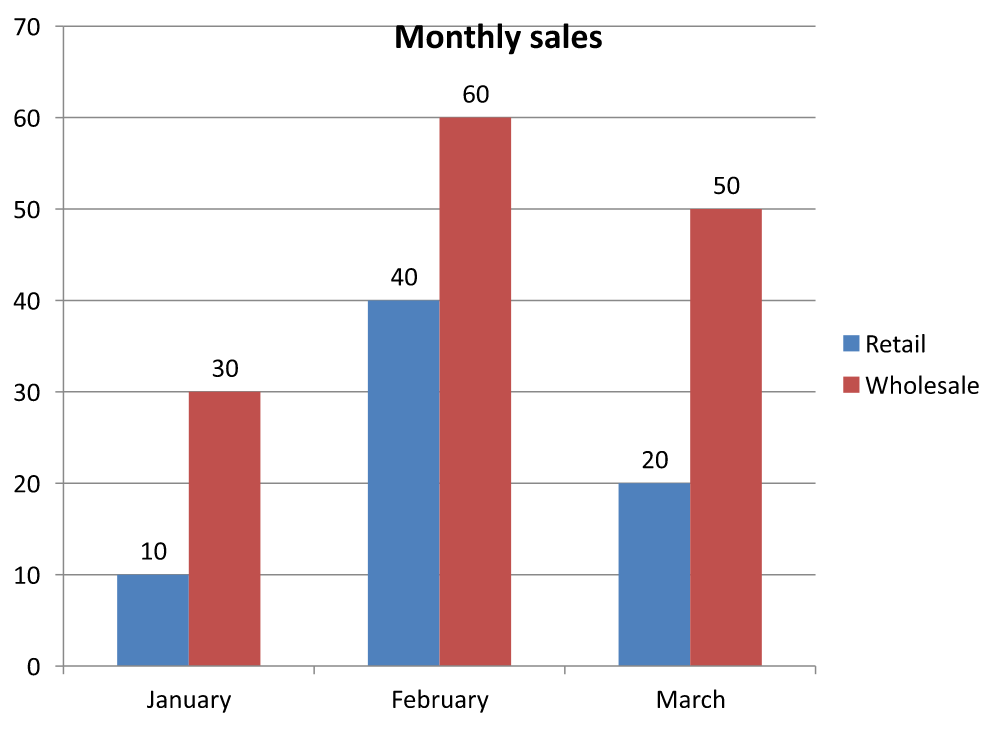

## **Overzicht**

Dit artikel legt uit hoe u met grafiek‑werkboeken werkt in Aspose.Slides. Het toont hoe u grafiekgegevens kunt lezen en schrijven via werkboek‑streams, werkboekcellen kunt gebruiken als grafiekdatalabels, toegang krijgt tot werkbladcollecties en het type gegevensbron voor grafiekwaarden kunt opgeven.

Het behandelt ook het werken met externe werkboeken als gegevensbron voor grafieken. De voorbeelden laten zien hoe u een extern werkboek maakt en toewijst, het pad van een extern werkboek opvraagt dat aan een grafiek is gekoppeld, en grafiekgegevens bewerkt wanneer het werkboek beschikbaar is.

Voor werkboekcellen die ontbrekende gegevens vertegenwoordigen, zie [Controleer de weergave van lege cellen](/slides/nl/net/chart-series/) voor het verschil tussen een lege cel en nul, en een lijngrafiekvergelijking van de beschikbare weergavemodi.

## **Gegevens opnemen van verborgen rijen en kolommen**

Gebruik [IChart.PlotVisibleCellsOnly](https://reference.aspose.com/slides/net/aspose.slides.charts/ichart/plotvisiblecellsonly/) om te bepalen of een grafiek gegevens plot vanuit verborgen werkblad‑rijen en -kolommen. Stel in op `true` om alleen zichtbare cellen te plotten, of op `false` om zowel zichtbare als verborgen cellen op te nemen. Deze instelling beïnvloedt alleen het plotten van de grafiek; hij verbergt of toont geen werkblad‑rijen of -kolommen.

De [voorbeeldpresentatie](hidden-source-data.pptx) bevat een kolomgrafiek als het eerste object op de eerste dia. Het ingebedde werkblad, `Sheet1`, bevat het bronbereik `A1:C4`. Rij 3 en kolom C zijn verborgen, maar hun cellen bevatten nog steeds waarden.

| Werkblad‑rij | A: Maand | B: Retail | C: Wholesale (verborgen kolom) |
| --- | --- | --- | --- |
| 2 | January | 10 | 30 |
| 3 (verborgen rij) | February | 40 | 60 |
| 4 | March | 20 | 50 |

Toegang tot broncellen via [IChartData.ChartDataWorkbook](https://reference.aspose.com/slides/net/aspose.slides.charts/ichartdata/chartdataworkbook/) en lees [IChartDataCell.IsHidden](https://reference.aspose.com/slides/net/aspose.slides.charts/ichartdatacell/ishidden/) om de verborgen status te inspecteren. Deze eigenschap is alleen‑lezen. In dit bestand is B2 zichtbaar, B3 behoort tot de verborgen rij en C2 tot de verborgen kolom; het voorbeeld geeft respectievelijk `False`, `True` en `True` weer.

Voor dit voorbeeld moet u de grafiekgegevens vernieuwen nadat u de plot‑instelling hebt gewijzigd: behoud het ingebedde werkboek met [ReadWorkbookStream](https://reference.aspose.com/slides/net/aspose.slides.charts/ichartdata/readworkbookstream/) en laad het opnieuw met [WriteWorkbookStream](https://reference.aspose.com/slides/net/aspose.slides.charts/ichartdata/writeworkbookstream/). Wanneer u alle cellen opneemt, gebruik dan ook [SetRange](https://reference.aspose.com/slides/net/aspose.slides.charts/ichartdata/setrange/) om het volledige bereik te herstellen, inclusief de verborgen februari‑categorie. Alleen de vlag wijzigen is niet voldoende om de in‑cache grafiekgegevens en categoriëlables van dit voorbeeld te verversen.

```csharp
using System;
using Aspose.Slides;
using Aspose.Slides.Charts;
using Aspose.Slides.Export;

using var presentation = new Presentation("hidden-source-data.pptx");
var slide = presentation.Slides[0];

if (slide.Shapes[0] is IChart chart)
{
    var workbook = chart.ChartData.ChartDataWorkbook;
    Console.WriteLine($"B2 hidden: {workbook.GetCell(0, "B2").IsHidden}");
    Console.WriteLine($"B3 hidden: {workbook.GetCell(0, "B3").IsHidden}");
    Console.WriteLine($"C2 hidden: {workbook.GetCell(0, "C2").IsHidden}");

    using var workbookStream = chart.ChartData.ReadWorkbookStream();
    foreach (var visibleOnly in new[] { true, false })
    {
        chart.PlotVisibleCellsOnly = visibleOnly;

        // Ververs de grafiekgegevens vanuit het ingebedde werkboek.
        workbookStream.Position = 0;
        chart.ChartData.WriteWorkbookStream(workbookStream);
        if (!visibleOnly)
        {
            // Herstel het volledige bronbereik, inclusief verborgen categorieën.
            chart.ChartData.SetRange("Sheet1!$A$1:$C$4");
        }

        presentation.Save($"hidden_cells_{visibleOnly}.pptx", SaveFormat.Pptx);
    }
}
else
{
    Console.WriteLine("The first shape is not a chart.");
}
```

Het voorbeeld slaat twee versies van de presentatie op: één met alleen de zichtbare retail‑waarden (10 en 20) en één met alle zes waarden. De onderstaande afbeeldingen zijn gerenderd vanuit de opgeslagen presentaties na het heropenen; beide bestanden behouden hun toegewezen plot‑instelling. Rij 3 en kolom C blijven verborgen in beide ingebedde werkboeken.

| Alleen zichtbare cellen (`true`) | Alle cellen (`false`) |
| --- | --- |
|  |  |

Een verborgen cel met een waarde is anders dan een lege cel. [IChart.DisplayBlanksAs](https://reference.aspose.com/slides/net/aspose.slides.charts/ichart/displayblanksas/) bepaalt hoe ontbrekende waarden worden weergegeven; het omvat of sluit geen verborgen brongegevens uit. Zie [Controleer de weergave van lege cellen](/slides/nl/net/chart-series/#control-the-display-of-empty-cells) voor een voorbeeld.

## **Het gegevensbereik van een grafiek ophalen**

Voordat u werkboekgegevens bijwerkt in een bestaande presentatie, inspecteert u de bronbereiken om te bepalen welke werkbladcellen elke grafiek gebruikt. De methode [IChartData.GetRange](https://reference.aspose.com/slides/net/aspose.slides.charts/ichartdata/getrange/) retourneert het huidige gegevensbereik als een werkblad‑gekwalificeerde formule, bijvoorbeeld `Sheet1!$A$1:$D$5`. Hier is `Sheet1` de werkbladnaam, `!` scheidt deze van het celbereik, en `$A$1:$D$5` identificeert de cellen A1 tot en met D5, inclusief. De dollartekens geven absolute rij‑ en kolomreferenties aan.

De methode leest het huidige bereik zonder de grafiek of het werkboek te wijzigen. Als de grafiek geen werkboek als gegevensbron gebruikt, wordt een [InvalidOperationException](https://learn.microsoft.com/en-us/dotnet/api/system.invalidoperationexception) opgegooid. Voor meer informatie, zie de [ChartData API‑referentie](https://reference.aspose.com/slides/net/aspose.slides.charts/chartdata/).

Dit voorbeeld opent een presentatie en controleert de objecten direct op elke dia op grafieken. Het toont de naam en het bronbereik van elke grafiek. Als een grafiek geen werkboek gebruikt, geeft het een bericht weer en gaat verder met de volgende grafiek.

```csharp
using System;
using Aspose.Slides;
using Aspose.Slides.Charts;

using var presentation = new Presentation("presentation.pptx");

foreach (var slide in presentation.Slides)
{
    foreach (var shape in slide.Shapes)
    {
        if (shape is IChart chart)
        {
            try
            {
                var range = chart.ChartData.GetRange();
                Console.WriteLine($"{chart.Name}: {range}");
            }
            catch (InvalidOperationException)
            {
                Console.WriteLine($"{chart.Name}: The chart does not use a workbook as its data source.");
            }
        }
    }
}
```

## **Grafiekgegevens lezen en schrijven vanuit een werkboek**

Aspose.Slides for .NET biedt de methoden [ReadWorkbookStream](https://reference.aspose.com/slides/net/aspose.slides.charts/ichartdata/readworkbookstream/) en [WriteWorkbookStream](https://reference.aspose.com/slides/net/aspose.slides.charts/ichartdata/writeworkbookstream/) waarmee u werkboeken met grafiekgegevens kunt lezen en schrijven (bevat grafiekgegevens bewerkt met Aspose.Cells). **Opmerking** dat de grafiekgegevens op dezelfde manier moeten zijn georganiseerd of een vergelijkbare structuur moeten hebben als de bron.

Dit voorbeeld gebruikt een presentatie met een grafiek als eerste object op de eerste dia. Het leest het ingebedde werkboek in een stream, wist de bestaande series en categorieën, en schrijft hetzelfde werkboek terug. De wijzigingen blijven in het geheugen; het voorbeeld slaat de presentatie niet op.

```csharp
using System;
using Aspose.Slides;
using Aspose.Slides.Charts;

using var presentation = new Presentation("chart.pptx");
var slide = presentation.Slides[0];

var shapeCount = slide.Shapes.Count;
if (shapeCount > 0 && slide.Shapes[0] is IChart chart)
{
    var chartData = chart.ChartData;
    using var workbookStream = chartData.ReadWorkbookStream();

    chartData.Series.Clear();
    chartData.Categories.Clear();

    workbookStream.Position = 0;
    chartData.WriteWorkbookStream(workbookStream);
}
else
{
    Console.WriteLine("The first shape is not a chart.");
}
```

### **Grafieklay‑out valideren na werkboekwijziging**

Wanneer u een ingebed werkboek vervangt door een aangepast werkboek, behoudt de grafiek de oorspronkelijke series‑ en categorieverzamelingen. Deze mismatch kan er toe leiden dat [IChart.ValidateChartLayout](https://reference.aspose.com/slides/net/aspose.slides.charts/ichart/validatechartlayout/) faalt met een index‑out‑of‑range‑fout. Wis de bestaande series en categorieën vóór het schrijven van het bijgewerkte werkboek terug naar de grafiek. Dit voorbeeld gebruikt een grafiek die het eerste object is op de eerste dia. De commentaarmarkering geeft aan waar de bewerking van het werkboek zou plaatsvinden; het uitvoerbare voorbeeld schrijft het originele werkboek terug en valideert de lay‑out in het geheugen.

```csharp
using System;
using Aspose.Slides;
using Aspose.Slides.Charts;

using var presentation = new Presentation("chart.pptx");
var slide = presentation.Slides[0];

var shapeCount = slide.Shapes.Count;
if (shapeCount > 0 && slide.Shapes[0] is IChart chart)
{
    var chartData = chart.ChartData;
    using var workbookStream = chartData.ReadWorkbookStream();

    // Wijzig de workbookstream hier, bijvoorbeeld met Aspose.Cells.

    chartData.Series.Clear();
    chartData.Categories.Clear();

    workbookStream.Position = 0;
    chartData.WriteWorkbookStream(workbookStream);
    chart.ValidateChartLayout();
}
else
{
    Console.WriteLine("The first shape is not a chart.");
}
```

Het wissen van de collecties verwijdert verouderde gegevensverwijzingen voordat het werkboek wordt weggeschreven. Bouw eventuele vereiste series‑ en categorietoewijzingen opnieuw voor het bijgewerkte werkboek voordat u de grafiek gebruikt.

## **Aangepaste getalformaten instellen voor werkboekcellen**

Gebruik [ChartDataCell.CustomNumberFormat](https://reference.aspose.com/slides/net/aspose.slides.charts/chartdatacell/customnumberformat/) om te bepalen hoe numerieke waarden verschijnen in het ingebedde werkboek van een grafiek. Bijvoorbeeld, een rapport kan een conversieratio willen weergeven als percentage met vier decimalen en een coëfficiënt met vijf decimalen. Houd beide waarden numeriek zodat ze beschikbaar blijven voor berekeningen en grafiekplotting.

Een getalformaat wijzigt alleen de weergave, niet de opgeslagen waarde. Het formaat `0.0000%` toont `0.125` als `12.5000%`; het vervangt niet het opgeslagen getal door `12.5`. Evenzo toont `0.00000` `0.1234567` als `0.12346` zonder de opgeslagen waarde af te ronden. Als het aangepaste formaat een lege tekenreeks (`""`) is, wordt [PresetNumberFormat](https://reference.aspose.com/slides/net/aspose.slides.charts/chartdatacell/presetnumberformat/) gebruikt.

Het volgende voorbeeld maakt een kolomgrafiek en krijgt toegang tot de cellen via [ChartDataWorkbook](https://reference.aspose.com/slides/net/aspose.slides.charts/ichartdata/chartdataworkbook/). Op werkblad 0 bevat B2 de conversieratio en C2 de coëfficiënt. Beide cellen leveren grafiekwaarden. Het voorbeeld schakelt ook waardelabels in die gekoppeld zijn aan de bronformaten.

```csharp
using Aspose.Slides;
using Aspose.Slides.Charts;
using Aspose.Slides.Export;

using var presentation = new Presentation();
presentation.SlideSize.SetSize(720, 270, SlideSizeScaleType.DoNotScale);
var slide = presentation.Slides[0];

var chart = slide.Shapes.AddChart(ChartType.ClusteredColumn, 50, 20, 620, 210);
chart.HasTitle = false;

chart.Axes.VerticalAxis.IsNumberFormatLinkedToSource = false;
chart.Axes.VerticalAxis.NumberFormat = "0.00";
chart.Axes.VerticalAxis.IsAutomaticMinValue = false;
chart.Axes.VerticalAxis.MinValue = 0;

chart.ChartData.Series.Clear();
chart.ChartData.Categories.Clear();

var workbook = chart.ChartData.ChartDataWorkbook;
workbook.Clear(0);

var categoryCell = workbook.GetCell(0, "A2", "Sample");
chart.ChartData.Categories.Add(categoryCell);

var percentageCell = workbook.GetCell(0, "B2", 0.125);
percentageCell.CustomNumberFormat = "0.0000%";
var percentageName = workbook.GetCell(0, "B1", "Conversion rate");
var percentageSeries = chart.ChartData.Series.Add(percentageName, chart.Type);
percentageSeries.DataPoints.AddDataPointForBarSeries(percentageCell);

var precisionCell = workbook.GetCell(0, "C2", 0.1234567);
precisionCell.CustomNumberFormat = "0.00000";
var precisionName = workbook.GetCell(0, "C1", "Coefficient");
var precisionSeries = chart.ChartData.Series.Add(precisionName, chart.Type);
precisionSeries.DataPoints.AddDataPointForBarSeries(precisionCell);

foreach (var series in chart.ChartData.Series)
{
    var labelFormat = series.DataPoints[0].Label.DataLabelFormat;
    labelFormat.ShowValue = true;
    labelFormat.IsNumberFormatLinkedToSource = true;
}

presentation.Save("CustomCellFormats.pptx", SaveFormat.Pptx);
```

Werkboekcelformaten staan los van de formatten die direct op grafiekassen of datalabels worden ingesteld. In dit voorbeeld toont elk label de waarde van de broncel omdat [ShowValue](https://reference.aspose.com/slides/net/aspose.slides.charts/idatalabelformat/showvalue/) is ingeschakeld, en volgt het brongetalformaat omdat [IsNumberFormatLinkedToSource](https://reference.aspose.com/slides/net/aspose.slides.charts/idatalabelformat/isnumberformatlinkedtosource/) `true` is. Na het opslaan en heropenen van de presentatie tonen de labels `12.5000%` en `0.12346`, zoals hieronder weergegeven. De verticale as gebruikt zijn eigen [NumberFormat](https://reference.aspose.com/slides/net/aspose.slides.charts/iaxis/numberformat/) `0.00`, met [IsNumberFormatLinkedToSource](https://reference.aspose.com/slides/net/aspose.slides.charts/iaxis/isnumberformatlinkedtosource/) ingesteld op `false`.

Om een datalabel onafhankelijk te formatteren, zet u de bron‑link‑vlag op `false` en kent u een [NumberFormat](https://reference.aspose.com/slides/net/aspose.slides.charts/idatalabelformat/numberformat/) toe. Dit wijzigt niet het formaat van de werkboekcel. Bijvoorbeeld, een onafhankelijke label‑opmaak `0.00` toont de eerste waarde als `0.13`, terwijl B2 nog steeds `12.5000%` toont. Zie [Grafiekdatelabels](/slides/nl/net/chart-data-label/#set-percentage-sign-with-chart-data-labels) voor directe labelopmaak.

De afbeelding hieronder is gerenderd vanuit de opgeslagen presentatie na het heropenen:


## **Een werkboekcel als grafiekdatalabel instellen**

U kunt tekst uit werkboekcellen gebruiken als grafiekdatalabels.

Dit voorbeeld voegt een bubbelformulegrafiek met standaardgegevens toe aan de eerste dia van een bestaande presentatie. Het gebruikt de cellen A10:A12 op werkblad 0 voor de eerste drie labels in de eerste serie, schakelt labels vanuit cellen in, en slaat de bijgewerkte presentatie op.

```csharp
using Aspose.Slides;
using Aspose.Slides.Charts;
using Aspose.Slides.Export;

using var presentation = new Presentation("chart2.pptx");
var slide = presentation.Slides[0];

var chart = slide.Shapes.AddChart(ChartType.Bubble, 50, 50, 600, 400, true);
var series = chart.ChartData.Series[0];
var workbook = chart.ChartData.ChartDataWorkbook;

series.Labels.DefaultDataLabelFormat.ShowLabelValueFromCell = true;
series.Labels[0].ValueFromCell = workbook.GetCell(0, "A10", "Label 0 cell value");
series.Labels[1].ValueFromCell = workbook.GetCell(0, "A11", "Label 1 cell value");
series.Labels[2].ValueFromCell = workbook.GetCell(0, "A12", "Label 2 cell value");

presentation.Save("resultchart.pptx", SaveFormat.Pptx);
```

## **Werkbladen beheren**

De eigenschap [IChartDataWorkbook.Worksheets](https://reference.aspose.com/slides/net/aspose.slides.charts/ichartdataworkbook/worksheets/) biedt toegang tot de werkbladen in een grafiekwerkboek. Dit voorbeeld maakt een taartgrafiek met standaardgegevens en toont elke werkbladnaam op de console.

```csharp
using System;
using Aspose.Slides;
using Aspose.Slides.Charts;

using var presentation = new Presentation();
var slide = presentation.Slides[0];

var chart = slide.Shapes.AddChart(ChartType.Pie, 50, 50, 400, 500);
var workbook = chart.ChartData.ChartDataWorkbook;

for (var i = 0; i < workbook.Worksheets.Count; i++)
{
    Console.WriteLine(workbook.Worksheets[i].Name);
}
```

## **Gegevensbrontype opgeven**

Waarde‑punten van series kunnen ook rechtstreeks als numerieke letterlijke waarden worden opgeslagen. Zie [Serieswaarden instellen met numerieke letterlijke waarden](/slides/nl/net/chart-series/#set-series-values-using-numeric-literals) voor een volledig voorbeeld dat ze opslaat en leest. Het brontype van puntwaarden is gescheiden van de interne of externe werkboekconfiguratie van de grafiek; het gebruik van numerieke letterlijke waarden verwijdert op zichzelf het ingebedde werkboek niet.

Dit voorbeeld maakt een 3D‑kolomgrafiek met standaardgegevens en stelt twee serienamen in met verschillende gegevensbronnen. De eerste naam gebruikt een tekenreeks‑literal; de tweede gebruikt cel C1 op werkblad 0. De enumeratie [DataSourceType](https://reference.aspose.com/slides/net/aspose.slides.charts/datasourcetype/) selecteert de bron voor elke naam. Het voorbeeld slaat de presentatie op met de bijgewerkte serienamen.

```csharp
using Aspose.Slides;
using Aspose.Slides.Charts;
using Aspose.Slides.Export;

using var presentation = new Presentation();
var slide = presentation.Slides[0];

var chart = slide.Shapes.AddChart(ChartType.Column3D, 50, 50, 600, 400, true);
var literalName = chart.ChartData.Series[0].Name;

literalName.DataSourceType = DataSourceType.StringLiterals;
literalName.Data = "LiteralString";

var cellName = chart.ChartData.Series[1].Name;
var nameCell = chart.ChartData.ChartDataWorkbook.GetCell(0, "C1", "NewCell");
cellName.DataSourceType = DataSourceType.Worksheet;
cellName.Data = nameCell;

presentation.Save("pres.pptx", SaveFormat.Pptx);
```

## **Niet‑ondersteunde ingebedde werkboekformaten detecteren**

Aspose.Slides ondersteunt het Excel‑binaire werkboek‑formaat (.xlsb) dat in sommige grafieken kan worden ingebed niet. U kunt de eigenschap [EmbeddedWorkbookType](https://reference.aspose.com/slides/net/aspose.slides.charts/ichartdata/embeddedworkbooktype/) op [IChartData](https://reference.aspose.com/slides/net/aspose.slides.charts/ichartdata/) gebruiken samen met de enumeratie [WorkbookType](https://reference.aspose.com/slides/net/aspose.slides.charts/workbooktype/) om niet‑ondersteunde formaten te detecteren en die grafieken over te slaan. Dit voorbeeld inspecteert de objecten op de eerste dia van een bestaande presentatie, slaat niet‑grafiek‑objecten over, en geeft een diagnostisch bericht weer voor elke grafiek met een ingebed .xlsb‑werkboek.

```csharp
using System;
using Aspose.Slides;
using Aspose.Slides.Charts;

using var presentation = new Presentation("sample.pptx");
var slide = presentation.Slides[0];

foreach (var shape in slide.Shapes)
{
    if (shape is not IChart chart)
    {
        continue;
    }

    var chartData = chart.ChartData;
    var isInternalWorkbook = chartData.DataSourceType == ChartDataSourceType.InternalWorkbook;
    var isBinaryMacro = chartData.EmbeddedWorkbookType == WorkbookType.WorkbookBinaryMacro;

    if (isInternalWorkbook && isBinaryMacro)
    {
        Console.WriteLine("Skipping a chart with an unsupported .xlsb workbook.");
        continue;
    }

    // Lees of wijzig ondersteunde grafiekwerkboekgegevens hier.
}
```

## **Extern werkboek**

Aspose.Slides ondersteunt het gebruik van externe werkboeken als gegevensbron voor grafieken.

### **Een extern werkboek maken**

Gebruik [ReadWorkbookStream](https://reference.aspose.com/slides/net/aspose.slides.charts/ichartdata/readworkbookstream/) en [SetExternalWorkbook](https://reference.aspose.com/slides/net/aspose.slides.charts/ichartdata/setexternalworkbook/) om een ingebed grafiekwerkboek naar een bestand te exporteren en de grafiek aan dat externe werkboek te koppelen.

Dit voorbeeld maakt een taartgrafiek met standaardgegevens en exporteert het bijbehorende werkboek. Het sluit de uitgaande stream voordat het externe werkboek als gegevensbron voor de grafiek wordt toegewezen, en slaat vervolgens de gekoppelde presentatie op.

```csharp
using System.IO;
using Aspose.Slides;
using Aspose.Slides.Charts;
using Aspose.Slides.Export;

using var presentation = new Presentation();
var slide = presentation.Slides[0];

var chart = slide.Shapes.AddChart(ChartType.Pie, 50, 50, 400, 600);
var workbookPath = Path.GetFullPath("externalWorkbook1.xlsx");

using (var workbookStream = chart.ChartData.ReadWorkbookStream())
using (var fileStream = File.Create(workbookPath))
{
    workbookStream.CopyTo(fileStream);
}

chart.ChartData.SetExternalWorkbook(workbookPath);
presentation.Save("externalWorkbook.pptx", SaveFormat.Pptx);
```

### **Een extern werkboek instellen**

Met de methode [SetExternalWorkbook](https://reference.aspose.com/slides/net/aspose.slides.charts/ichartdata/setexternalworkbook/) kunt u een extern werkboek aan een grafiek toewijzen als diens gegevensbron. Deze methode kan ook worden gebruikt om een pad naar het externe werkboek bij te werken (als het bestand is verplaatst).

Hoewel u de gegevens in werkboeken die op externe locaties of bronnen staan niet kunt bewerken, kunt u die werkboeken wel als externe gegevensbron gebruiken. Als een relatief pad voor een extern werkboek wordt opgegeven, wordt dit automatisch omgezet naar een volledig pad.

Dit voorbeeld gebruikt een extern werkboek waarvan werkblad `Sheet1` een serienaam bevat in B1, categorienamen in A2:A4 en numerieke waarden in B2:B4. Het voorbeeld maakt een taartgrafiek, koppelt het werkboek en gebruikt [SetRange](https://reference.aspose.com/slides/net/aspose.slides.charts/ichartdata/setrange/) om A1:B4 toe te wijzen aan één serie en drie categorieën. Het slaat de presentatie met de gekoppelde grafiek op.

```csharp
using System.IO;
using Aspose.Slides;
using Aspose.Slides.Charts;
using Aspose.Slides.Export;

using var presentation = new Presentation();
var slide = presentation.Slides[0];

var chart = slide.Shapes.AddChart(ChartType.Pie, 50, 50, 400, 600, true);
var chartData = chart.ChartData;
var workbookPath = Path.GetFullPath("externalWorkbook.xlsx");

chartData.SetExternalWorkbook(workbookPath);
chartData.SetRange("Sheet1!$A$1:$B$4");

presentation.Save("Presentation_with_externalWorkbook.pptx", SaveFormat.Pptx);
```

De parameter `updateChartData` van [SetExternalWorkbook](https://reference.aspose.com/slides/net/aspose.slides.charts/ichartdata/setexternalworkbook/) bepaalt of het werkboek wordt geladen.

* Wanneer `updateChartData` `false` is, wordt alleen het pad van het werkboek bijgewerkt. De grafiekgegevens worden niet geladen of bijgewerkt vanuit het doelwerkboek, zodat het werkboek niet beschikbaar kan zijn.
* Wanneer `updateChartData` `true` is, worden de grafiekgegevens bijgewerkt vanuit het doelwerkboek.

Het volgende voorbeeld kent een plaatsaanduiding‑URL toe met `updateChartData` ingesteld op `false`. Het behoudt de standaardgegevens van de taartgrafiek en slaat de presentatie op zonder het niet‑beschikbare werkboek te laden.

```csharp
using Aspose.Slides;
using Aspose.Slides.Charts;
using Aspose.Slides.Export;

using var presentation = new Presentation();
var slide = presentation.Slides[0];

var chart = slide.Shapes.AddChart(ChartType.Pie, 50, 50, 400, 600, true);

chart.ChartData.SetExternalWorkbook("https://example.com/unavailable-workbook.xlsx", false);
presentation.Save("SetExternalWorkbookWithUpdateChartData.pptx", SaveFormat.Pptx);
```

### **Het pad van het externe gegevensbron‑werkboek van een grafiek ophalen**

Om te bepalen welk werkboek aan een grafiek is gekoppeld, controleert u of de grafiek een externe gegevensbron gebruikt en haalt u het pad van het werkboek op.

Dit voorbeeld inspecteert het eerste object op de eerste dia van een presentatie met een gekoppeld extern werkboek. Als het een grafiek is die verbonden is met een extern werkboek, toont het voorbeeld [ExternalWorkbookPath](https://reference.aspose.com/slides/net/aspose.slides.charts/ichartdata/externalworkbookpath/) in de console. Vervolgens slaat het een kopie van de presentatie op.

```csharp
using System;
using Aspose.Slides;
using Aspose.Slides.Charts;
using Aspose.Slides.Export;

using var presentation = new Presentation("externalWorkbook.pptx");
var slide = presentation.Slides[0];

var shapeCount = slide.Shapes.Count;
if (shapeCount > 0 && slide.Shapes[0] is IChart chart)
{
    var chartData = chart.ChartData;
    if (chartData.DataSourceType == ChartDataSourceType.ExternalWorkbook)
    {
        Console.WriteLine(chartData.ExternalWorkbookPath);
    }
    else
    {
        Console.WriteLine("The chart does not use an external workbook.");
    }
}
else
{
    Console.WriteLine("The first shape is not a chart.");
}

presentation.Save("Result.pptx", SaveFormat.Pptx);
```

### **Grafiekgegevens bewerken**

U kunt de gegevens in externe werkboeken bewerken op dezelfde manier als u de inhoud van interne werkboeken wijzigt. Wanneer een extern werkboek niet kan worden geladen, wordt een uitzondering opgegooid.

Dit voorbeeld gebruikt een grafiek die het eerste object is op de eerste dia en gekoppeld is aan een toegankelijk extern werkboek. Het stelt de cel‑achtergrondwaarde van het eerste gegevenspunt in de eerste serie in op 100 en slaat de bijgewerkte presentatie op. Het bewerken van celwaarden kan het gekoppelde externe XLSX‑bestand bijwerken; gebruik dus een kopie als u het originele werkboek moet behouden.

```csharp
using System;
using Aspose.Slides;
using Aspose.Slides.Charts;
using Aspose.Slides.Export;

using var presentation = new Presentation("presentation.pptx");
var slide = presentation.Slides[0];

var shapeCount = slide.Shapes.Count;
if (shapeCount > 0 && slide.Shapes[0] is IChart chart)
{
    var series = chart.ChartData.Series;
    if (series.Count > 0 && series[0].DataPoints.Count > 0)
    {
        var valueCell = series[0].DataPoints[0].Value.AsCell;
        if (valueCell != null)
        {
            valueCell.Value = 100;
            presentation.Save("presentation_out.pptx", SaveFormat.Pptx);
        }
        else
        {
            Console.WriteLine("The first data point is not linked to a workbook cell.");
        }
    }
    else
    {
        Console.WriteLine("The chart has no data points to edit.");
    }
}
else
{
    Console.WriteLine("The first shape is not a chart.");
}
```

## **Grafiekgegevens verversen vanuit bronwerkboeken**

Aspose.Slides for .NET 26.11 voegt [IChartData.RefreshData](https://reference.aspose.com/slides/net/aspose.slides.charts/ichartdata/refreshdata/) toe voor één grafiek en [IPresentation.RefreshChartsData](https://reference.aspose.com/slides/net/aspose.slides/ipresentation/refreshchartsdata/) voor de presentatie. Gebruik deze nadat waarden in het bronwerkboek zijn gewijzigd. Externe werkboeken moeten toegankelijk en ondersteund zijn.

Met [Aspose.Slides for .NET](/slides/nl/net/installation/) 26.11 of later geïnstalleerd, ververst dit voorbeeld de eerste grafiek op de eerste dia van `charts.pptx`. Het bronwerkboek moet beschikbaar zijn. Sla het resultaat op om de bijgewerkte grafiekgegevens te behouden.

```csharp
using System;
using System.Linq;
using Aspose.Slides;
using Aspose.Slides.Charts;
using Aspose.Slides.Export;

using var presentation = new Presentation("charts.pptx");
var chart = presentation.Slides[0].Shapes.OfType<IChart>().FirstOrDefault();
if (chart == null)
{
    Console.WriteLine("The first slide must contain a chart.");
    return;
}

chart.ChartData.RefreshData();
presentation.Save("refreshed-chart.pptx", SaveFormat.Pptx);
```

Om alle grafieken te verversen, gebruikt u een aparte presentatiewinstand als volgt. Het doorgeven van `false` zorgt ervoor dat een verversingsfout wordt doorgegeven aan de oproeper; het maakt geen rollback van al verversde grafieken.

```csharp
using Aspose.Slides;
using Aspose.Slides.Export;

using var presentation = new Presentation("charts.pptx");
presentation.RefreshChartsData(skipFailedCharts: false);
presentation.Save("refreshed-charts.pptx", SaveFormat.Pptx);
```

De parameter heeft als standaardwaarde `true`: [RefreshChartsData](https://reference.aspose.com/slides/net/aspose.slides/ipresentation/refreshchartsdata/) slaat een mislukte grafiek over en gaat door met de rest. Het retourneert geen per‑grafiek resultaten, dus een geslaagde oproep bewijst niet dat elke grafiek is verversd. Gebruik individuele [RefreshData](https://reference.aspose.com/slides/net/aspose.slides.charts/ichartdata/refreshdata/)‑oproepen als u elke falende grafiek moet identificeren.

Verversen laadt brongegevens opnieuw. Het is gescheiden van formules berekenen, grafieklay‑out valideren en een OLE‑voorbeeld bijwerken. Inspecteer live cel‑achtergrondwaarden om een verversing in het geheugen te controleren. Een [CachedValue](https://reference.aspose.com/slides/net/aspose.slides.charts/ichartdatapoint/cachedvalue/) kan nog steeds de eerder opgeslagen grafiek beschrijven totdat u de presentatie opslaat en opnieuw opent.

### **Gecachete grafiekwaarden lezen zonder een werkboek**

In .NET 26.11 lezen gecachete‑waarde‑accessors de waarden die met de grafiek zijn opgeslagen zonder het werkboek te openen. Ze zijn nuttig wanneer het gekoppelde bestand niet beschikbaar is en u alleen de laatst opgeslagen gegevens van de grafiek nodig hebt. Dit verschilt van het reconstrueren van een werkboek met de hersteloptie hieronder.

| Object | Gecachete accessor |
| --- | --- |
| Gewoon series‑datapunt | [CachedValue](https://reference.aspose.com/slides/net/aspose.slides.charts/ichartdatapoint/cachedvalue/) |
| Scatter‑ of bubbelformule‑datapunt | [CachedXValue](https://reference.aspose.com/slides/net/aspose.slides.charts/ichartdatapoint/cachedxvalue/), [CachedYValue](https://reference.aspose.com/slides/net/aspose.slides.charts/ichartdatapoint/cachedyvalue/) |
| Bubbel‑datapunt | [CachedBubbleSize](https://reference.aspose.com/slides/net/aspose.slides.charts/ichartdatapoint/cachedbubblesize/) |
| Grafiekkategorie | [CachedValue](https://reference.aspose.com/slides/net/aspose.slides.charts/ichartcategory/cachedvalue/) |

Elke accessor retourneert een [ICachedChartValue](https://reference.aspose.com/slides/net/aspose.slides.charts/icachedchartvalue/). [Data](https://reference.aspose.com/slides/net/aspose.slides.charts/icachedchartvalue/data/) legt het opgeslagen object bloot; [ToString](https://reference.aspose.com/slides/net/aspose.slides.charts/cachedchartvalue/tostring/) levert tekst; [ToDouble](https://reference.aspose.com/slides/net/aspose.slides.charts/icachedchartvalue/todouble/) geeft `NaN` terug voor een ontbrekende of niet‑numerieke waarde. Een cache kan ontbreken of verouderd zijn, ook bij een nieuw aangemaakte grafiek die nog niet is opgeslagen. Ga er niet vanuit dat elk veld bestaat of een getal bevat.

Dit voorbeeld leest al deze velden uit `cached-chart.pptx`, een opgeslagen presentatie met grafieken. Een ontbrekend extern werkboek is acceptabel omdat de code geen toegang krijgt tot [ChartDataWorkbook](https://reference.aspose.com/slides/net/aspose.slides.charts/ichartdata/chartdataworkbook/) of levende werkboekcellen.

```csharp
using System;
using Aspose.Slides;
using Aspose.Slides.Charts;

using var presentation = new Presentation("cached-chart.pptx");
foreach (var slide in presentation.Slides)
foreach (var shape in slide.Shapes)
{
    if (shape is not IChart chart)
        continue;

    foreach (var category in chart.ChartData.Categories)
        PrintCache("Category", category.CachedValue);

    foreach (var series in chart.ChartData.Series)
    foreach (var point in series.DataPoints)
    {
        PrintCache("Value", point.CachedValue);
        PrintCache("X", point.CachedXValue);
        PrintCache("Y", point.CachedYValue);
        PrintCache("Bubble size", point.CachedBubbleSize);
    }
}

static void PrintCache(string name, ICachedChartValue value)
{
    var number = value.ToDouble();
    if (value.Data == null)
        Console.WriteLine($"{name}: no cached value");
    else if (double.IsNaN(number))
        Console.WriteLine($"{name}: {value} (not numeric)");
    else
        Console.WriteLine($"{name}: {number}");
}
```

Gebruik verversen wanneer u actuele brongegevens nodig hebt; gebruik gecachte lecties wanneer het opgeslagen momentopname voldoende is. De cache is geen volledige kopie van het werkboek en kan geen wijzigingen leveren die na de laatste update zijn aangebracht.

### **Een werkboek herstellen vanuit de grafiekcache**

Als een grafiek een extern werkboek gebruikt dat ontbreekt of niet beschikbaar is, kan Aspose.Slides het grafiekwerkboek reconstrueren uit de in de presentatie gecachte gegevens. Maak een [LoadOptions](https://reference.aspose.com/slides/net/aspose.slides/loadoptions/) aan, configureer de [SpreadsheetOptions](https://reference.aspose.com/slides/net/aspose.slides/loadoptions/spreadsheetoptions/), en stel [ISpreadsheetOptions.RecoverWorkbookFromChartCache](https://reference.aspose.com/slides/net/aspose.slides/ispreadsheetoptions/recoverworkbookfromchartcache/) in op `true` vóór het openen van de presentatie.

Het volgende C#‑voorbeeld herstelt werkboekgegevens voor een grafiek die het eerste object is op de eerste dia en verwijst naar een niet‑beschikbaar extern werkboek. Het krijgt toegang tot de herstelde gegevens via [IChart.ChartData](https://reference.aspose.com/slides/net/aspose.slides.charts/ichart/chartdata/) en [IChartData.ChartDataWorkbook](https://reference.aspose.com/slides/net/aspose.slides.charts/ichartdata/chartdataworkbook/):

```csharp
using System;
using Aspose.Slides;
using Aspose.Slides.Charts;

var spreadsheetOptions = new SpreadsheetOptions
{
    RecoverWorkbookFromChartCache = true
};
var loadOptions = new LoadOptions
{
    SpreadsheetOptions = spreadsheetOptions
};

using var presentation = new Presentation("presentation.pptx", loadOptions);
var slide = presentation.Slides[0];

var shapeCount = slide.Shapes.Count;
if (shapeCount > 0 && slide.Shapes[0] is IChart chart)
{
    var recoveredWorkbook = chart.ChartData.ChartDataWorkbook;

    // Lees of wijzig de herstelde werkboekgegevens hier.
}
else
{
    Console.WriteLine("The first shape is not a chart.");
}
```

Als code toegang probeert te krijgen tot het externe werkboek terwijl het niet beschikbaar is en herstel is uitgeschakeld, gooit Aspose.Slides een [InvalidOperationException](https://learn.microsoft.com/en-us/dotnet/api/system.invalidoperationexception). Schakel herstel alleen in wanneer het gebruik van de gecachete grafiekgegevens een acceptabele fallback is, want de cache kan wijzigingen missen die na de laatste presentatie‑update in het externe werkboek zijn aangebracht.

## **FAQ**

**Kan ik bepalen of een specifieke grafiek is gekoppeld aan een extern of ingebed werkboek?**

Ja. Een grafiek heeft een [data source type](https://reference.aspose.com/slides/net/aspose.slides.charts/chartdata/datasourcetype/) en een [path to an external workbook](https://reference.aspose.com/slides/net/aspose.slides.charts/chartdata/externalworkbookpath/); als de bron een extern werkboek is, kunt u het volledige pad lezen om zeker te zijn dat een extern bestand wordt gebruikt.

**Worden relatieve paden naar externe werkboeken ondersteund, en hoe worden ze opgeslagen?**

Ja. Als u een relatief pad opgeeft, wordt dit automatisch omgezet naar een absoluut pad. De presentatie slaat het absolute pad op in het PPTX‑bestand, dus het verplaatsen van het werkboek kan een update van de koppeling vereisen.

**Kan ik werkboeken gebruiken die zich op netwerk‑resources/‑shares bevinden?**

Ja, dergelijke werkboeken kunnen worden gebruikt als externe gegevensbron. Het direct bewerken van externe werkboeken vanuit Aspose.Slides wordt echter niet ondersteund – ze kunnen alleen als bron worden gebruikt.

**Overschrijft Aspose.Slides het externe XLSX‑bestand bij het opslaan van de presentatie?**

De presentatie slaat een [link to the external file](https://reference.aspose.com/slides/net/aspose.slides.charts/chartdata/externalworkbookpath/) op. Het bewerken van cel‑achtergrond‑grafiekgegevens kan ook het gekoppelde lokale XLSX‑bestand bijwerken. Gebruik een kopie van het werkboek als het origineel ongewijzigd moet blijven.

**Wat moet ik doen als het externe bestand met een wachtwoord beschermd is?**

Aspose.Slides accepteert geen wachtwoord bij het koppelen. Een gangbare aanpak is het wachtwoord vooraf te verwijderen of een ontcijferde kopie (bijvoorbeeld met [Aspose.Cells](https://reference.aspose.com/cells/net/)) te maken en naar die kopie te koppelen.

**Kunnen meerdere grafieken naar hetzelfde externe werkboek verwijzen?**

Ja. Elke grafiek slaat zijn eigen koppeling op. Als ze allemaal naar hetzelfde bestand wijzen, wordt een update van dat bestand in elke grafiek gereflecteerd bij de volgende gegevenslading.