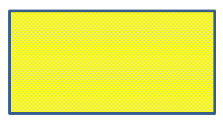

## **Introductie**

In PowerPoint kun je vormen aan dia's toevoegen. Omdat vormen bestaan uit lijnen, kun je ze opmaken door de contouren te wijzigen of er effecten op toe te passen. Daarnaast kun je vormen opmaken door instellingen op te geven die bepalen hoe hun binnenkant wordt gevuld.


Aspose.Slides for PHP via Java biedt klassen en methoden waarmee je vormen kunt opmaken met dezelfde opties die in PowerPoint beschikbaar zijn.

## **Lijnen Opmaken**

Met Aspose.Slides kun je een aangepaste lijnstijl voor een vorm opgeven. De volgende stappen beschrijven de procedure:

1. Maak een instantie van de [Presentation](https://reference.aspose.com/slides/php-java/aspose.slides/presentation/)‑klasse.
1. Haal een referentie op naar een dia op basis van de index.
1. Voeg een [AutoShape](https://reference.aspose.com/slides/php-java/aspose.slides/autoshape/) toe aan de dia.
1. Stel de [line style](https://reference.aspose.com/slides/php-java/aspose.slides/linestyle/) van de vorm in.
1. Stel de lijndikte in.
1. Stel de [dash style](https://reference.aspose.com/slides/php-java/aspose.slides/linedashstyle/) van de lijn in.
1. Stel de lijnkleur voor de vorm in.
1. Sla de gewijzigde presentatie op als een PPTX‑bestand.

De volgende PHP‑code laat zien hoe je een rechthoekige `AutoShape` kunt opmaken:

```php
// Instantieer de Presentation-klasse die een presentatiebestand vertegenwoordigt.
$presentation = new Presentation();
try {
    // Haal de eerste dia op.
    $slide = $presentation->getSlides()->get_Item(0);

    // Voeg een auto shape van het type Rectangle toe.
    $shape = $slide->getShapes()->addAutoShape(ShapeType::Rectangle, 50, 150, 150, 75);

    // Stel de vulkleur in voor de rechthoekvorm.
    $shape->getFillFormat()->setFillType(FillType::NoFill);

    // Pas opmaak toe op de lijnen van de rechthoek.
    $shape->getLineFormat()->setStyle(LineStyle::ThickThin);
    $shape->getLineFormat()->setWidth(7);
    $shape->getLineFormat()->setDashStyle(LineDashStyle::Dash);

    // Stel de kleur in voor de lijn van de rechthoek.
    $shape->getLineFormat()->getFillFormat()->setFillType(FillType::Solid);
    $shape->getLineFormat()->getFillFormat()->getSolidFillColor()->setColor(java("java.awt.Color")->BLUE);

    // Sla het PPTX-bestand op schijf.
    $presentation->save("formatted_lines.pptx", SaveFormat::Pptx);
} finally {
    $presentation->dispose();
}
```

Het resultaat:


## **Schets‑effecten Toepassen op Vormlijnen**

Een schets‑effect maakt dat een vormlijn handgetekend lijkt. Gebruik [Shape.getLineFormat](https://reference.aspose.com/slides/php-java/aspose.slides/shape/) om de lijninstellingen te benaderen, [LineFormat.getSketchFormat](https://reference.aspose.com/slides/php-java/aspose.slides/lineformat/) om de schetseigenschappen te benaderen, en [SketchFormat.setSketchType](https://reference.aspose.com/slides/php-java/aspose.slides/sketchformat/) om een waarde uit de enumeratie [LineSketchType](https://reference.aspose.com/slides/php-java/aspose.slides/linesketchtype/) te selecteren.

De volgende PHP‑code toont hoe je een [LineSketchType.Curved](https://reference.aspose.com/slides/php-java/aspose.slides/linesketchtype/)-effect toepast, de expliciet toegewezen waarde uitleest, en het effect verwijdert met [LineSketchType.None](https://reference.aspose.com/slides/php-java/aspose.slides/linesketchtype/):

```php
$presentation = new Presentation();
try {
    $slide = $presentation->getSlides()->get_Item(0);
    $shape = $slide->getShapes()->addAutoShape(ShapeType::Rectangle, 50, 50, 200, 100);

    // Toegang tot de lijnopmaak van de vorm en de schetsopmaak.
    $sketchFormat = $shape->getLineFormat()->getSketchFormat();

    // Pas een schetseffect toe.
    $sketchFormat->setSketchType(LineSketchType::Curved);

    // Lees het schetseffect dat rechtstreeks aan de vorm is toegewezen.
    $explicitSketchType = $sketchFormat->getSketchType();
    echo "Explicit sketch type: " . $explicitSketchType . PHP_EOL;

    // Verwijder het schetseffect.
    $sketchFormat->setSketchType(LineSketchType::None);
} finally {
    $presentation->dispose();
}
```

De waarde die wordt geretourneerd door [SketchFormat.getSketchType](https://reference.aspose.com/slides/php-java/aspose.slides/sketchformat/) vertegenwoordigt de instelling die rechtstreeks aan de vorm is toegewezen. Als de lijnopmaak kan worden geërfd van een thema, master‑dia of layout‑dia, gebruik dan [LineFormat.getEffective](https://reference.aspose.com/slides/php-java/aspose.slides/lineformat/), benader de `getSketchFormat`‑methode van het geretourneerde object en lees de `getSketchType`‑waarde. De effectieve waarde weerspiegelt de opmaak die daadwerkelijk wordt toegepast nadat de overerving is opgelost:

```php
$presentation = new Presentation("presentation.pptx");
try {
    $shape = $presentation->getSlides()->get_Item(0)->getShapes()->get_Item(0);
    $lineFormat = $shape->getLineFormat();

    $explicitSketchType = $lineFormat->getSketchFormat()->getSketchType();
    $effectiveLineFormat = $lineFormat->getEffective();
    $effectiveSketchType = $effectiveLineFormat->getSketchFormat()->getSketchType();

    echo "Explicit sketch type: " . $explicitSketchType . PHP_EOL;
    echo "Effective sketch type: " . $effectiveSketchType . PHP_EOL;
} finally {
    $presentation->dispose();
}
```

## **Samenvoeg‑Stijlen Opmaken**

Hier zijn de drie opties voor het type samenvoeging:

* Round
* Miter
* Bevel

Standaard gebruikt PowerPoint de instelling **Round** wanneer twee lijnen onder een hoek (bijvoorbeeld op een hoek van een vorm) worden samengevoegd. Als je echter een vorm met scherpe hoeken tekent, kun je de optie **Miter** verkiezen.


De volgende PHP‑code laat zien hoe drie rechthoeken (zoals in de afbeelding hierboven) werden gemaakt met de Miter‑, Bevel‑ en Round‑instellingen:

```php
// Instantieer de Presentation-klasse die een presentatiebestand vertegenwoordigt.
$presentation = new Presentation();
try {
    // Haal de eerste dia op.
    $slide = $presentation->getSlides()->get_Item(0);

    // Voeg drie auto shapes van het type Rectangle toe.
    $shape1 = $slide->getShapes()->addAutoShape(ShapeType::Rectangle, 20, 20, 150, 75);
    $shape2 = $slide->getShapes()->addAutoShape(ShapeType::Rectangle, 210, 20, 150, 75);
    $shape3 = $slide->getShapes()->addAutoShape(ShapeType::Rectangle, 20, 135, 150, 75);

    // Stel de vulkleur in voor elke rechthoekvorm.
    $shape1->getFillFormat()->setFillType(FillType::Solid);
    $shape1->getFillFormat()->getSolidFillColor()->setColor(java("java.awt.Color")->BLACK);
    $shape2->getFillFormat()->setFillType(FillType::Solid);
    $shape2->getFillFormat()->getSolidFillColor()->setColor(java("java.awt.Color")->BLACK);
    $shape3->getFillFormat()->setFillType(FillType::Solid);
    $shape3->getFillFormat()->getSolidFillColor()->setColor(java("java.awt.Color")->BLACK);

    // Stel de lijndikte in.
    $shape1->getLineFormat()->setWidth(15);
    $shape2->getLineFormat()->setWidth(15);
    $shape3->getLineFormat()->setWidth(15);

    // Stel de kleur in voor de lijn van elke rechthoek.
    $shape1->getLineFormat()->getFillFormat()->setFillType(FillType::Solid);
    $shape1->getLineFormat()->getFillFormat()->getSolidFillColor()->setColor(java("java.awt.Color")->BLUE);
    $shape2->getLineFormat()->getFillFormat()->setFillType(FillType::Solid);
    $shape2->getLineFormat()->getFillFormat()->getSolidFillColor()->setColor(java("java.awt.Color")->BLUE);
    $shape3->getLineFormat()->getFillFormat()->setFillType(FillType::Solid);
    $shape3->getLineFormat()->getFillFormat()->getSolidFillColor()->setColor(java("java.awt.Color")->BLUE);

    // Stel de samenvoegstijl in.
    $shape1->getLineFormat()->setJoinStyle(LineJoinStyle::Miter);
    $shape2->getLineFormat()->setJoinStyle(LineJoinStyle::Bevel);
    $shape3->getLineFormat()->setJoinStyle(LineJoinStyle::Round);

    // Voeg tekst toe aan elke rechthoek.
    $shape1->getTextFrame()->setText("Miter Join Style");
    $shape2->getTextFrame()->setText("Bevel Join Style");
    $shape3->getTextFrame()->setText("Round Join Style");

    // Sla het PPTX-bestand op schijf.
    $presentation->save("join_styles.pptx", SaveFormat::Pptx);
} finally {
    $presentation->dispose();
}
```

## **Verloopvulling**

In PowerPoint is Verloopvulling een opmaakoptie waarmee je een continue kleurovergang op een vorm kunt toepassen. Je kunt bijvoorbeeld twee of meer kleuren zo combineren dat de ene geleidelijk in de andere overloopt.

Zo pas je een verloopvulling toe op een vorm met Aspose.Slides:

1. Maak een instantie van de [Presentation](https://reference.aspose.com/slides/php-java/aspose.slides/presentation/)‑klasse.
1. Haal een referentie op naar een dia op basis van de index.
1. Voeg een [AutoShape](https://reference.aspose.com/slides/php-java/aspose.slides/autoshape/) toe aan de dia.
1. Stel de [FillType](https://reference.aspose.com/slides/php-java/aspose.slides/filltype/) van de vorm in op `Gradient`.
1. Voeg je twee voorkeurskleuren toe met gedefinieerde posities via de `add`‑methoden van de verzameling gradientstops die wordt blootgesteld door de [GradientFormat](https://reference.aspose.com/slides/php-java/aspose.slides/gradientformat/)‑klasse.
1. Sla de gewijzigde presentatie op als een PPTX‑bestand.

De volgende PHP‑code laat zien hoe je een verloopvulling toepast op een ellips:

```php
// Instantieer de Presentation-klasse die een presentatiebestand vertegenwoordigt.
$presentation = new Presentation();
try {
    // Haal de eerste dia op.
    $slide = $presentation->getSlides()->get_Item(0);

    // Voeg een auto shape van het type Ellipse toe.
    $shape = $slide->getShapes()->addAutoShape(ShapeType::Ellipse, 50, 50, 150, 75);

    // Pas verloopopmaak toe op de ellips.
    $shape->getFillFormat()->setFillType(FillType::Gradient);
    $shape->getFillFormat()->getGradientFormat()->setGradientShape(GradientShape::Linear);

    // Stel de richting van het verloop in.
    $shape->getFillFormat()->getGradientFormat()->setGradientDirection(GradientDirection::FromCorner2);

    // Voeg twee verloopstops toe.
    $shape->getFillFormat()->getGradientFormat()->getGradientStops()->addPresetColor(1.0, PresetColor::Purple);
    $shape->getFillFormat()->getGradientFormat()->getGradientStops()->addPresetColor(0, PresetColor::Red);

    // Sla het PPTX-bestand op schijf.
    $presentation->save("gradient_fill.pptx", SaveFormat::Pptx);
} finally {
    $presentation->dispose();
}
```

Het resultaat:


Als een verloop er in een geëxporteerde afbeelding anders uitziet dan in PowerPoint, zie dan [Choose a Gradient Rendering Style](/slides/nl/php-java/convert-powerpoint-to-png/#choose-a-gradient-rendering-style). Je kunt een render‑stijl selecteren zonder de opgeslagen verloopvulling in de presentatie te wijzigen.

## **Patroonvulling**

In PowerPoint is Patroonvulling een opmaakoptie waarmee je een tweekleurig ontwerp—zoals stippen, strepen, kruislings of geruite patronen—op een vorm kunt toepassen. Je kunt aangepaste kleuren kiezen voor de voor‑ en achtergrond van het patroon.

Aspose.Slides biedt meer dan 45 vooraf gedefinieerde patroonstijlen die je kunt toepassen op vormen om de visuele uitstraling van je presentaties te verbeteren. Zelfs nadat je een voorgedefinieerd patroon hebt gekozen, kun je de exacte kleuren die moeten worden gebruikt nog steeds opgeven.

Zo pas je een patroonvulling toe op een vorm met Aspose.Slides:

1. Maak een instantie van de [Presentation](https://reference.aspose.com/slides/php-java/aspose.slides/presentation/)‑klasse.
1. Haal een referentie op naar een dia op basis van de index.
1. Voeg een [AutoShape](https://reference.aspose.com/slides/php-java/aspose.slides/autoshape/) toe aan de dia.
1. Stel de [FillType](https://reference.aspose.com/slides/php-java/aspose.slides/filltype/) van de vorm in op `Pattern`.
1. Kies een patroonstijl uit de vooraf gedefinieerde opties.
1. Stel de [Background Color](https://reference.aspose.com/slides/php-java/aspose.slides/patternformat/#getBackColor) van het patroon in.
1. Stel de [Foreground Color](https://reference.aspose.com/slides/php-java/aspose.slides/patternformat/#getForeColor) van het patroon in.
1. Sla de gewijzigde presentatie op als een PPTX‑bestand.

De volgende PHP‑code laat zien hoe je een patroonvulling toepast op een rechthoek:

```php
// Instantieer de Presentation-klasse die een presentatiebestand vertegenwoordigt.
$presentation = new Presentation();
try {
    // Haal de eerste dia op.
    $slide = $presentation->getSlides()->get_Item(0);

    // Voeg een auto shape van het type Rectangle toe.
    $shape = $slide->getShapes()->addAutoShape(ShapeType::Rectangle, 50, 50, 150, 75);

    // Stel het vultype in op Pattern.
    $shape->getFillFormat()->setFillType(FillType::Pattern);

    // Stel de patroonstijl in.
    $shape->getFillFormat()->getPatternFormat()->setPatternStyle(PatternStyle::Trellis);

    // Stel de achtergrond- en voorgrondkleuren van het patroon in.
    $shape->getFillFormat()->getPatternFormat()->getBackColor()->setColor(java("java.awt.Color")->LIGHT_GRAY);
    $shape->getFillFormat()->getPatternFormat()->getForeColor()->setColor(java("java.awt.Color")->YELLOW);

    // Sla het PPTX-bestand op schijf.
    $presentation->save("pattern_fill.pptx", SaveFormat::Pptx);
} finally {
    $presentation->dispose();
}
```

Het resultaat:



## **Afbeeldingsvulling**

In PowerPoint is Afbeeldingsvulling een opmaakoptie waarmee je een afbeelding in een vorm kunt invoegen—de afbeelding fungeert dan als achtergrond van de vorm.

Zo gebruik je Aspose.Slides om een afbeeldingvulling op een vorm toe te passen:

1. Maak een instantie van de [Presentation](https://reference.aspose.com/slides/php-java/aspose.slides/presentation/)‑klasse.
1. Haal een referentie op naar een dia op basis van de index.
1. Voeg een [AutoShape](https://reference.aspose.com/slides/php-java/aspose.slides/autoshape/) toe aan de dia.
1. Stel de [FillType](https://reference.aspose.com/slides/php-java/aspose.slides/filltype/) van de vorm in op `Picture`.
1. Stel de afbeeldingvulling‑modus in op `Tile` (of een andere gewenste modus).
1. Maak een [PPImage](https://reference.aspose.com/slides/php-java/aspose.slides/ppimage/)‑object van de afbeelding die je wilt gebruiken.
1. Geef de afbeelding door aan de `SlidesPicture.setImage`‑methode.
1. Sla de gewijzigde presentatie op als een PPTX‑bestand.

Stel dat we een bestand “lotus.png” hebben met de volgende afbeelding:


De volgende PHP‑code laat zien hoe je een vorm vult met de afbeelding:

```php
// Instantieer de Presentation-klasse die een presentatiebestand vertegenwoordigt.
$presentation = new Presentation();
try {
    // Haal de eerste dia op.
    $slide = $presentation->getSlides()->get_Item(0);

    // Voeg een auto shape van het type Rectangle toe.
    $shape = $slide->getShapes()->addAutoShape(ShapeType::Rectangle, 50, 50, 255, 130);

    // Stel het vultype in op Picture.
    $shape->getFillFormat()->setFillType(FillType::Picture);

    // Stel de afbeeldingvullingsmodus in.
    $shape->getFillFormat()->getPictureFillFormat()->setPictureFillMode(PictureFillMode::Tile);

    // Laad een afbeelding en voeg deze toe aan de presentatie-bronnen.
    $image = Images::fromFile("lotus.png");
    $picture = $presentation->getImages()->addImage($image);
    $image->dispose();

    // Stel de afbeelding in.
    $shape->getFillFormat()->getPictureFillFormat()->getPicture()->setImage($picture);

    // Sla het PPTX-bestand op schijf.
    $presentation->save("picture_fill.pptx", SaveFormat::Pptx);
} finally {
    $presentation->dispose();
}
```

Het resultaat:


### **Afbeelding Tegelen Als Textuur**

Als je een getegelde afbeelding als textuur wilt instellen en het tegelgedrag wilt aanpassen, kun je de volgende methoden van de [PictureFillFormat](https://reference.aspose.com/slides/php-java/aspose.slides/picturefillformat/)‑klasse gebruiken:

- [setPictureFillMode](https://reference.aspose.com/slides/php-java/aspose.slides/picturefillformat/#setPictureFillMode): Stelt de afbeeldingvulling‑modus in—`Tile` of `Stretch`.
- [setTileAlignment](https://reference.aspose.com/slides/php-java/aspose.slides/picturefillformat/#setTileAlignment): Bepaalt de uitlijning van de tegels binnen de vorm.
- [setTileFlip](https://reference.aspose.com/slides/php-java/aspose.slides/picturefillformat/#setTileFlip): Bepaalt of de tegel horizontaal, verticaal of beide keren wordt gespiegeld.
- [setTileOffsetX](https://reference.aspose.com/slides/php-java/aspose.slides/picturefillformat/#setTileOffsetX): Stelt de horizontale offset van de tegel (in points) ten opzichte van de oorsprong van de vorm in.
- [setTileOffsetY](https://reference.aspose.com/slides/php-java/aspose.slides/picturefillformat/#setTileOffsetY): Stelt de verticale offset van de tegel (in points) ten opzichte van de oorsprong van de vorm in.
- [setTileScaleX](https://reference.aspose.com/slides/php-java/aspose.slides/picturefillformat/#setTileScaleX): Definieert de horizontale schaal van de tegel als een percentage.
- [setTileScaleY](https://reference.aspose.com/slides/php-java/aspose.slides/picturefillformat/#setTileScaleY): Definieert de verticale schaal van de tegel als een percentage.

De volgende codevoorbeeld toont hoe je een rechthoekige vorm toevoegt met een getegelde afbeeldingvulling en tegel‑opties configureert:

```php
// Instantieer de Presentation-klasse die een presentatiebestand vertegenwoordigt.
$presentation = new Presentation();
try {
    // Haal de eerste dia op.
    $firstSlide = $presentation->getSlides()->get_Item(0);

    // Voeg een rechthoekige auto shape toe.
    $shape = $firstSlide->getShapes()->addAutoShape(ShapeType::Rectangle, 50, 50, 190, 95);

    // Stel het vultype van de vorm in op Picture.
    $shape->getFillFormat()->setFillType(FillType::Picture);

    // Laad de afbeelding en voeg deze toe aan de presentatie-bronnen.
    $sourceImage = Images::fromFile("lotus.png");
    $presentationImage = $presentation->getImages()->addImage($sourceImage);
    $sourceImage->dispose();

    // Wijs de afbeelding toe aan de vorm.
    $pictureFillFormat = $shape->getFillFormat()->getPictureFillFormat();
    $pictureFillFormat->getPicture()->setImage($presentationImage);

    // Configureer de afbeeldingvullingsmodus en tegel-eigenschappen.
    $pictureFillFormat->setPictureFillMode(PictureFillMode::Tile);
    $pictureFillFormat->setTileOffsetX(-32);
    $pictureFillFormat->setTileOffsetY(-32);
    $pictureFillFormat->setTileScaleX(50);
    $pictureFillFormat->setTileScaleY(50);
    $pictureFillFormat->setTileAlignment(RectangleAlignment::BottomRight);
    $pictureFillFormat->setTileFlip(TileFlip::FlipBoth);

    // Sla het PPTX-bestand op schijf.
    $presentation->save("tile.pptx", SaveFormat::Pptx);
} finally {
    $presentation->dispose();
}
```

Het resultaat:


## **Vulling Met Effen Kleur**

In PowerPoint is Vulling Met Effen Kleur een opmaakoptie die een vorm vult met één uniforme kleur. Deze eenvoudige achtergrondkleur wordt toegepast zonder verlopen, texturen of patronen.

Zo pas je een effen kleurvulling toe op een vorm met Aspose.Slides:

1. Maak een instantie van de [Presentation](https://reference.aspose.com/slides/php-java/aspose.slides/presentation/)‑klasse.
1. Haal een referentie op naar een dia op basis van de index.
1. Voeg een [AutoShape](https://reference.aspose.com/slides/php-java/aspose.slides/autoshape/) toe aan de dia.
1. Stel de [FillType](https://reference.aspose.com/slides/php-java/aspose.slides/filltype/) van de vorm in op `Solid`.
1. Wijs je gewenste vulkleur toe aan de vorm.
1. Sla de gewijzigde presentatie op als een PPTX‑bestand.

De volgende PHP‑code laat zien hoe je een effen kleurvulling toepast op een rechthoek in een PowerPoint‑dia:

```php
// Instantieer de Presentation-klasse die een presentatiebestand vertegenwoordigt.
$presentation = new Presentation();
try {
    // Haal de eerste dia op.
    $slide = $presentation->getSlides()->get_Item(0);

    // Voeg een auto shape van het type Rectangle toe.
    $shape = $slide->getShapes()->addAutoShape(ShapeType::Rectangle, 50, 50, 150, 75);

    // Stel het vultype in op Solid.
    $shape->getFillFormat()->setFillType(FillType::Solid);

    // Stel de vulkleur in.
    $shape->getFillFormat()->getSolidFillColor()->setColor(java("java.awt.Color")->YELLOW);

    // Sla het PPTX-bestand op schijf.
    $presentation->save("solid_color_fill.pptx", SaveFormat::Pptx);
} finally {
    $presentation->dispose();
}
```

Het resultaat:


## **Doorzichtigheid Instellen**

In PowerPoint kun je, naast een effen kleur, een verloop‑, afbeelding‑ of textuurvulling, ook de doorzichtigheid instellen om de opaciteit van de vulling te regelen. Een hogere doorzichtigheidswaarde maakt de vorm meer doorschijnend, zodat de achtergrond of onderliggende objecten gedeeltelijk zichtbaar worden.

Aspose.Slides laat je de doorzichtigheidswaarde aanpassen door de alfa‑waarde van de gebruikte kleur voor de vulling te wijzigen. Zo doe je dat:

1. Maak een instantie van de [Presentation](https://reference.aspose.com/slides/php-java/aspose.slides/presentation/)‑klasse.
1. Haal een referentie op naar een dia op basis van de index.
1. Voeg een [AutoShape](https://reference.aspose.com/slides/php-java/aspose.slides/autoshape/) toe aan de dia.
1. Stel de [FillType](https://reference.aspose.com/slides/php-java/aspose.slides/filltype/) in op `Solid`.
1. Gebruik `Color` om een kleur met doorzichtigheid te definiëren (de `alpha`‑component bepaalt de doorzichtigheid).
1. Sla de presentatie op.

De volgende PHP‑code laat zien hoe je een doorzichtige vulkleur toepast op een rechthoek:

```php
// Instantieer de Presentation-klasse die een presentatiebestand vertegenwoordigt.
$presentation = new Presentation();
try {
    // Haal de eerste dia op.
    $slide = $presentation->getSlides()->get_Item(0);

    // Voeg een solide rechthoekige auto shape toe.
    $solidShape = $slide->getShapes()->addAutoShape(ShapeType::Rectangle, 50, 50, 150, 75);

    // Voeg een transparante rechthoekige auto shape toe boven de solide vorm.
    $transparentShape = $slide->getShapes()->addAutoShape(ShapeType::Rectangle, 80, 80, 150, 75);
    $transparentShape->getFillFormat()->setFillType(FillType::Solid);
    $transparentShape->getFillFormat()->getSolidFillColor()->setColor(new java("java.awt.Color", 255, 255, 0, 204));

    // Sla het PPTX-bestand op schijf.
    $presentation->save("shape_transparency.pptx", SaveFormat::Pptx);
} finally {
    $presentation->dispose();
}
```

Het resultaat:


## **Vormen Roteren**

Aspose.Slides maakt het mogelijk om vormen in PowerPoint‑presentaties te roteren. Dit is handig bij het positioneren van visuele elementen met specifieke uitlijning‑ of ontwerpvereisten.

Om een vorm op een dia te roteren, volg je deze stappen:

1. Maak een instantie van de [Presentation](https://reference.aspose.com/slides/php-java/aspose.slides/presentation/)‑klasse.
1. Haal een referentie op naar een dia op basis van de index.
1. Voeg een [AutoShape](https://reference.aspose.com/slides/php-java/aspose.slides/autoshape/) toe aan de dia.
1. Stel de rotatie‑eigenschap van de vorm in op de gewenste hoek.
1. Sla de presentatie op.

De volgende PHP‑code toont hoe je een vorm 5 graden draait:

```php
// Instantieer de Presentation-klasse die een presentatiebestand vertegenwoordigt.
$presentation = new Presentation();
try {
    // Haal de eerste dia op.
    $slide = $presentation->getSlides()->get_Item(0);

    // Voeg een auto shape van het type Rectangle toe.
    $shape = $slide->getShapes()->addAutoShape(ShapeType::Rectangle, 50, 50, 150, 75);

    // Roteer de vorm met 5 graden.
    $shape->setRotation(5);

    // Sla het PPTX-bestand op schijf.
    $presentation->save("shape_rotation.pptx", SaveFormat::Pptx);
} finally {
    $presentation->dispose();
}
```

Het resultaat:


## **3D‑Schuine Effecten Toevoegen**

Aspose.Slides stelt je in staat om 3D‑schuine (bevel) effecten toe te passen op vormen door hun [ThreeDFormat](https://reference.aspose.com/slides/php-java/aspose.slides/threedformat/)‑eigenschappen te configureren.

Om 3D‑schuine effecten aan een vorm toe te voegen, volg je deze stappen:

1. Instantieer de [Presentation](https://reference.aspose.com/slides/php-java/aspose.slides/presentation/)‑klasse.
1. Haal een referentie op naar een dia op basis van de index.
1. Voeg een [AutoShape](https://reference.aspose.com/slides/php-java/aspose.slides/autoshape/) toe aan de dia.
1. Configureer de [ThreeDFormat](https://reference.aspose.com/slides/php-java/aspose.slides/threedformat/) van de vorm om de schuine instellingen te definiëren.
1. Sla de presentatie op.

De volgende PHP‑code laat zien hoe je 3D‑schuine effecten toepast op een vorm:

```php
// Maak een instantie van de Presentation-klasse.
$presentation = new Presentation();
try {
    $slide = $presentation->getSlides()->get_Item(0);

    // Voeg een vorm toe aan de dia.
    $shape = $slide->getShapes()->addAutoShape(ShapeType::Ellipse, 50, 50, 100, 100);
    $shape->getFillFormat()->setFillType(FillType::Solid);
    $shape->getFillFormat()->getSolidFillColor()->setColor(java("java.awt.Color")->GREEN);
    $shape->getLineFormat()->getFillFormat()->setFillType(FillType::Solid);
    $shape->getLineFormat()->getFillFormat()->getSolidFillColor()->setColor(java("java.awt.Color")->ORANGE);
    $shape->getLineFormat()->setWidth(2.0);

    // Stel de ThreeDFormat-eigenschappen van de vorm in.
    $shape->getThreeDFormat()->setDepth(4);
    $shape->getThreeDFormat()->getBevelTop()->setBevelType(BevelPresetType::Circle);
    $shape->getThreeDFormat()->getBevelTop()->setHeight(6);
    $shape->getThreeDFormat()->getBevelTop()->setWidth(6);
    $shape->getThreeDFormat()->getCamera()->setCameraType(CameraPresetType::OrthographicFront);
    $shape->getThreeDFormat()->getLightRig()->setLightType(LightRigPresetType::ThreePt);
    $shape->getThreeDFormat()->getLightRig()->setDirection(LightingDirection::Top);

    // Sla de presentatie op als een PPTX-bestand.
    $presentation->save("3D_bevel_effect.pptx", SaveFormat::Pptx);
} finally {
    $presentation->dispose();
}
```

Het resultaat:


## **3D‑Rotatie‑Effecten Toevoegen**

Aspose.Slides maakt het mogelijk om 3D‑rotatie‑effecten toe te passen op vormen door hun [ThreeDFormat](https://reference.aspose.com/slides/php-java/aspose.slides/threedformat/)‑eigenschappen te configureren.

Om 3D‑rotatie op een vorm toe te passen:

1. Maak een instantie van de [Presentation](https://reference.aspose.com/slides/php-java/aspose.slides/presentation/)‑klasse.
1. Haal een referentie op naar een dia op basis van de index.
1. Voeg een [AutoShape](https://reference.aspose.com/slides/php-java/aspose.slides/autoshape/) toe aan de dia.
1. Gebruik [setCameraType](https://reference.aspose.com/slides/php-java/aspose.slides/camera/#setCameraType) en [setLightType](https://reference.aspose.com/slides/php-java/aspose.slides/lightrig/#setLightType) om de 3D‑rotatie te definiëren.
1. Sla de presentatie op.

De volgende PHP‑code toont hoe je 3D‑rotatie‑effecten toepast op een vorm:

```php
// Maak een instantie van de Presentation-klasse.
$presentation = new Presentation();
try {
    $slide = $presentation->getSlides()->get_Item(0);

    $autoShape = $slide->getShapes()->addAutoShape(ShapeType::Rectangle, 50, 50, 150, 75);
    $autoShape->getTextFrame()->setText("Hello, Aspose!");

    $autoShape->getThreeDFormat()->setDepth(6);
    $autoShape->getThreeDFormat()->getCamera()->setRotation(40, 35, 20);
    $autoShape->getThreeDFormat()->getCamera()->setCameraType(CameraPresetType::IsometricLeftUp);
    $autoShape->getThreeDFormat()->getLightRig()->setLightType(LightRigPresetType::Balanced);

    // Sla de presentatie op als een PPTX-bestand.
    $presentation->save("3D_rotation_effect.pptx", SaveFormat::Pptx);
} finally {
    $presentation->dispose();
}
```

Het resultaat:


## **Zwart‑Wit‑Weergave voor Vormen Beheren**

De methode [Shape::setBlackWhiteMode](https://reference.aspose.com/slides/php-java/aspose.slides/shape/#setBlackWhiteMode) bepaalt hoe een individuele vorm wordt weergegeven wanneer een presentatie wordt bekeken of verwerkt in zwart‑wit‑modus. De methode activeert de zwart‑wit‑weergave niet zelf en wijzigt de vul‑, lijn‑ of andere opmaak van de vorm niet in de normale kleermodus.

Gebruik een waarde uit de klasse [BlackWhiteMode](https://reference.aspose.com/slides/php-java/aspose.slides/blackwhitemode/) om het gewenste gedrag te selecteren. Bijvoorbeeld, `Automatic` laat de render‑applicatie de conversie kiezen, `Gray` en `LightGray` gebruiken grijstinten, `BlackWhite` gebruikt alleen zwart en wit, `Black` en `White` dwingen één enkele kleur, `Color` behoudt de normale kleuring, en `Hidden` laat de vorm weg in zwart‑wit‑modus. `NotDefined` betekent dat er geen modus op vorm‑niveau is toegewezen.

De volgende PHP‑code maakt een gekleurde vorm aan en laat deze grijs verschijnen in de zwart‑wit‑weergavemode:

```php
use aspose\slides\BlackWhiteMode;
use aspose\slides\FillType;
use aspose\slides\Presentation;
use aspose\slides\SaveFormat;
use aspose\slides\ShapeType;

$presentation = new Presentation();
try {
    $slide = $presentation->getSlides()->get_Item(0);

    $shape = $slide->getShapes()->addAutoShape(ShapeType::Rectangle, 50, 50, 200, 100);
    $shape->getFillFormat()->setFillType(FillType::Solid);
    $orange = new Java("java.awt.Color", 255, 165, 0);
    $shape->getFillFormat()->getSolidFillColor()->setColor($orange);

    // Behoud de oranje vulling in kleermodus, maar geef de vorm een grijze kleur in zwart-wit-modus.
    $shape->setBlackWhiteMode(BlackWhiteMode::Gray);

    $presentation->save("shape_black_white_mode.pptx", SaveFormat::Pptx);
} finally {
    $presentation->dispose();
}
```

In de normale kleermodus behoudt de rechthoek zijn oranje vulling. In een zwart‑wit‑workflow wordt hij grijs weergegeven omdat de modus is ingesteld op `Gray`. Zo kun je een volledige‑kleur slide behouden terwijl je een aparte weergave definieert voor afdrukken, preview‑scenario’s of andere workflows die rekening houden met de zwart‑wit‑instellingen van de presentatie.

## **Opmaak Resetten**

De volgende Java‑code laat zien hoe je de opmaak van een dia reset en de positie, grootte en opmaak van alle vormen met placeholders op de [LayoutSlide](https://reference.aspose.com/slides/php-java/aspose.slides/layoutslide/) terugzet naar de standaardinstellingen:

```php
$presentation = new Presentation("sample.pptx");
try {
    for ($i = 0; $i < java_values($presentation->getSlides()->size()); $i++) {
        $slide = $presentation->getSlides()->get_Item($i);
        // Reset elke vorm op de dia die een placeholder in de lay-out heeft.
        $slide->reset();
    }
    $presentation->save("reset_formatting.pptx", SaveFormat::Pptx);
} finally {
    $presentation->dispose();
}
```

## **FAQ**

**Heeft de opmaak van vormen invloed op de uiteindelijke bestandsgrootte van de presentatie?**

Alleen minimaal. Ingevoegde afbeeldingen en media nemen het grootste deel van de opslagruimte in beslag, terwijl vormparameters zoals kleuren, effecten en verlopen als metadata worden opgeslagen en vrijwel geen extra grootte toevoegen.

**Hoe kan ik vormen op een dia detecteren die identieke opmaak hebben zodat ik ze kan groeperen?**

Vergelijk de sleutel‑opmaak‑eigenschappen van elke vorm—vulling, lijn en effectinstellingen. Als alle overeenkomstige waarden gelijk zijn, beschouw je hun stijlen als identiek en groepeer je die vormen logisch, wat later beheer van stijlen vereenvoudigt.

**Kan ik een set aangepaste vormstijlen opslaan in een apart bestand voor hergebruik in andere presentaties?**

Ja. Bewaar voorbeeldvormen met de gewenste stijlen in een template‑presentatie of een .POTX‑templatebestand. Wanneer je een nieuwe presentatie maakt, open je de template, kloont u de gestileerde vormen die je nodig hebt, en pas je hun opmaak toe waar nodig.