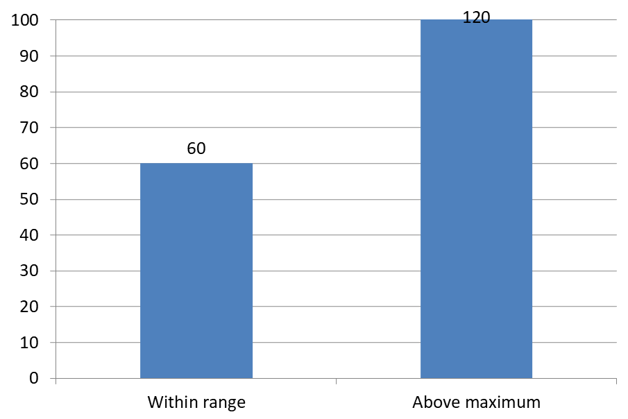

## **Introductie**

Datapuntenlabels tonen informatie over grafiekseries en individuele datapunten, waardoor lezers waarden kunnen identificeren en de grafiek beter begrijpen. Dit artikel legt uit hoe u waarden kunt opmaken, percentages kunt weergeven, labeltekst kunt uitlezen, labels buiten de as‑maximum kunt beheersen, de afstand tussen categorie‑as‑labels kunt aanpassen en taartgrafieklabels kunt positioneren.

## **Aantal zichtbare datapuntenlabels tellen**

Gebruik [count_of_visible_data_labels](https://reference.aspose.com/slides/python-net/aspose.slides.charts/datalabelcollection/count_of_visible_data_labels/) om te controleren hoeveel datapuntenlabels zijn ingeschakeld voor weergave voordat u een presentatie publiceert. In tegenstelling tot `len(labels)`, dat het totale aantal labels in de collectie retourneert, houdt dit rekening met de standaardinstellingen van de series en individuele labelinstellingen.

Dit voorbeeld maakt een kolomgrafiek met één serie en drie datapunten. Het benadert de [labels](https://reference.aspose.com/slides/python-net/aspose.slides.charts/chartseries/labels/)‑collectie van de serie en drukt het zichtbare aantal af terwijl de instellingen wijzigen: **0, 3, 2, 3**. Het totale aantal blijft **3**.

```python
import aspose.slides as slides
import aspose.slides.charts as charts

with slides.Presentation() as presentation:
    slide = presentation.slides[0]

    chart = slide.shapes.add_chart(charts.ChartType.CLUSTERED_COLUMN, 50, 50, 500, 300)

    chart.chart_data.series.clear()
    chart.chart_data.categories.clear()

    workbook = chart.chart_data.chart_data_workbook
    series_cell = workbook.get_cell(0, 0, 1, "Values")
    series = chart.chart_data.series.add(series_cell, chart.type)

    for i in range(3):
        category_cell = workbook.get_cell(0, i + 1, 0, f"Category {i + 1}")
        chart.chart_data.categories.add(category_cell)
        value_cell = workbook.get_cell(0, i + 1, 1, (i + 1) * 10)
        series.data_points.add_data_point_for_bar_series(value_cell)

    labels = series.labels
    print(f"Total: {len(labels)}; visible: {labels.count_of_visible_data_labels}")  # Totaal: 3; zichtbaar: 0

    labels.default_data_label_format.show_value = True
    print(f"Visible: {labels.count_of_visible_data_labels}")  # Zichtbaar: 3

    labels[1].data_label_format.show_value = False
    print(f"Visible: {labels.count_of_visible_data_labels}")  # Zichtbaar: 2

    labels[1].data_label_format.show_legend_key = True
    print(f"Visible: {labels.count_of_visible_data_labels}")  # Zichtbaar: 3
```

De [default_data_label_format](https://reference.aspose.com/slides/python-net/aspose.slides.charts/datalabelcollection/default_data_label_format/) van de serie levert de standaardinstellingen. Het inschakelen van [show_value](https://reference.aspose.com/slides/python-net/aspose.slides.charts/datalabelformat/show_value/) daar toont waarden voor alle drie de labels. Het op `False` zetten via de [data_label_format](https://reference.aspose.com/slides/python-net/aspose.slides.charts/datalabel/data_label_format/) van één label overschrijft die instelling voor het geselecteerde label. Het inschakelen van [show_legend_key](https://reference.aspose.com/slides/python-net/aspose.slides.charts/datalabelformat/show_legend_key/) zorgt ervoor dat dat label weer als zichtbaar wordt geteld, ook al blijft de waarde verborgen.

Het zichtbare aantal weerspiegelt de zichtbaarheidinstellingen. Het meet niet of labels overlappen, afgesneden worden of leesbaar zijn in de gerenderde grafiek.

## **Precisie van waarden in grafiekdatapuntenlabels instellen**

Gebruik [number_format_of_values](https://reference.aspose.com/slides/python-net/aspose.slides.charts/chartseries/number_format_of_values/) om serieswaarden op te maken. Dit voorbeeld maakt een lijngrafiek met standaardgegevens, toont de gegevenstabel en schakelt waardelabels in voor de eerste serie. Het formaat `#,##0.00` toont een duizendtallen‑scheidingsteken en twee decimalen zonder de onderliggende waarden te wijzigen.

```python
import aspose.slides as slides
import aspose.slides.charts as charts

with slides.Presentation() as presentation:
    slide = presentation.slides[0]

    chart = slide.shapes.add_chart(charts.ChartType.LINE, 50, 50, 450, 300)
    chart.has_data_table = True

    series = chart.chart_data.series[0]
    series.number_format_of_values = "#,##0.00"
    series.labels.default_data_label_format.show_value = True

    presentation.save("PrecisionOfDatalabels_out.pptx", slides.export.SaveFormat.PPTX)
```

Om de numerieke cellen in een ingebedde werkmap van een grafiek op te maken, zie [Set Custom Number Formats for Workbook Cells](/slides/nl/python-net/chart-workbook/#set-custom-number-formats-for-workbook-cells). Dat voorbeeld toont ook waardelabels die de opmaak van hun broncel volgen, terwijl de opgeslagen numerieke waarden behouden blijven.

## **Percentage als labels weergeven**

Voor een gestapelde kolomgrafiek berekent u elke waarde als een percentage van het totaalsom van de categorie en kent u de tekst toe aan [text_frame_for_overriding](https://reference.aspose.com/slides/python-net/aspose.slides.charts/datalabel/text_frame_for_overriding/). Dit voorbeeld gebruikt de standaardgrafiekgegevens en toont percentages met twee decimalen in een lettertypegrootte van 8 punten. Categorieën met een totaal van nul worden overgeslagen om deling door nul te vermijden. Herbereken de aangepaste labeltekst als de grafiekgegevens wijzigen.

```python
import aspose.slides as slides
import aspose.slides.charts as charts

with slides.Presentation() as presentation:
    slide = presentation.slides[0]

    chart = slide.shapes.add_chart(charts.ChartType.STACKED_COLUMN, 20, 20, 400, 400)

    category_totals = [0.0] * len(chart.chart_data.categories)
    for k in range(len(chart.chart_data.categories)):
        for series in chart.chart_data.series:
            point_value = float(series.data_points[k].value.data)
            category_totals[k] += point_value

    for series in chart.chart_data.series:
        series.labels.default_data_label_format.show_legend_key = False

        for j in range(len(series.data_points)):
            label = series.data_points[j].label
            if category_totals[j] == 0:
                continue

            point_value = float(series.data_points[j].value.data)
            data_point_percent = point_value / category_totals[j] * 100

            portion = slides.Portion()
            portion.text = f"{data_point_percent:.2f} %"
            portion.portion_format.font_height = 8

            label.text_frame_for_overriding.text = ""

            paragraph = label.text_frame_for_overriding.paragraphs[0]
            paragraph.portions.add(portion)

            label.data_label_format.show_value = True
            label.data_label_format.show_series_name = False
            label.data_label_format.show_percentage = False
            label.data_label_format.show_legend_key = False
            label.data_label_format.show_category_name = False
            label.data_label_format.show_bubble_size = False

    presentation.save("DisplayPercentageAsLabels_out.pptx", slides.export.SaveFormat.PPTX)
```

## **Procentteken instellen bij grafiekdatapuntenlabels**

Wanneer waarden als breuken zijn opgeslagen, gebruikt u [number_format](https://reference.aspose.com/slides/python-net/aspose.slides.charts/datalabelformat/number_format/) om percentages weer te geven. Zet [is_number_format_linked_to_source](https://reference.aspose.com/slides/python-net/aspose.slides.charts/datalabelformat/is_number_format_linked_to_source/) op `False` om het labelformaat onafhankelijk van de broncellen toe te passen.

Dit voorbeeld maakt een 100 % gestapelde kolomgrafiek met rode en blauwe series over vier categorieën. Elk waardepaar telt op tot 1. Het labelformaat `0.0%` toont 0.30 als 30,0 %, terwijl de verticale as twee decimalen gebruikt. Beide series gebruiken witte labels met een lettergrootte van 10 punten.

```python
import aspose.slides as slides
import aspose.slides.charts as charts
import aspose.pydrawing as drawing

with slides.Presentation() as presentation:
    slide = presentation.slides[0]

    chart = slide.shapes.add_chart(charts.ChartType.PERCENTS_STACKED_COLUMN, 20, 20, 500, 400)

    chart.axes.vertical_axis.is_number_format_linked_to_source = False
    chart.axes.vertical_axis.number_format = "0.00%"

    chart.chart_data.series.clear()
    chart.chart_data.categories.clear()

    workbook = chart.chart_data.chart_data_workbook
    worksheet_index = 0
    for i in range(4):
        category_cell = workbook.get_cell(worksheet_index, i + 1, 0, f"Category {i + 1}")
        chart.chart_data.categories.add(category_cell)

    series_names = ["Reds", "Blues"]
    series_colors = [drawing.Color.red, drawing.Color.blue]
    values = [[0.30, 0.50, 0.80, 0.65], [0.70, 0.50, 0.20, 0.35]]

    for i in range(len(series_names)):
        series_cell = workbook.get_cell(worksheet_index, 0, i + 1, series_names[i])
        series = chart.chart_data.series.add(series_cell, chart.type)
        for j in range(4):
            value_cell = workbook.get_cell(worksheet_index, j + 1, i + 1, values[i][j])
            series.data_points.add_data_point_for_bar_series(value_cell)

        series.format.fill.fill_type = slides.FillType.SOLID
        series.format.fill.solid_fill_color.color = series_colors[i]

        label_format = series.labels.default_data_label_format
        label_format.show_value = True
        label_format.is_number_format_linked_to_source = False
        label_format.number_format = "0.0%"
        label_format.text_format.portion_format.font_height = 10
        label_format.text_format.portion_format.fill_format.fill_type = slides.FillType.SOLID
        label_format.text_format.portion_format.fill_format.solid_fill_color.color = drawing.Color.white

    presentation.save("SetDataLabelsPercentageSign_out.pptx", slides.export.SaveFormat.PPTX)
```

## **De feitelijke tekst van datapuntenlabels uitlezen**

Gebruik [get_actual_label_text](https://reference.aspose.com/slides/python-net/aspose.slides.charts/datalabel/get_actual_label_text/) om de tekst op te halen die door de labelinstellingen wordt gegenereerd. Dit is handig bij het extraheren van labels voor rapporten, het doorzoeken van presentatie‑inhoud, of het valideren van gegenereerde grafieken. In het onderstaande voorbeeld combineert het standaard [data label format](https://reference.aspose.com/slides/python-net/aspose.slides.charts/datalabelformat/) elke categorienaam, serienaam en waarde. Eén punt formatteert zijn waarde als percentage, en een ander gebruikt aangepaste tekst uit [text_frame_for_overriding](https://reference.aspose.com/slides/python-net/aspose.slides.charts/datalabel/text_frame_for_overriding/).

```python
import aspose.slides as slides
import aspose.slides.charts as charts

with slides.Presentation() as presentation:
    slide = presentation.slides[0]

    chart = slide.shapes.add_chart(charts.ChartType.CLUSTERED_COLUMN, 20, 20, 500, 300)

    chart.chart_data.series.clear()
    chart.chart_data.categories.clear()

    workbook = chart.chart_data.chart_data_workbook
    for i, category_name in enumerate(["Q1", "Q2"]):
        category_cell = workbook.get_cell(0, i + 1, 0, category_name)
        chart.chart_data.categories.add(category_cell)

    north_cell = workbook.get_cell(0, 0, 1, "North")
    north = chart.chart_data.series.add(north_cell, chart.type)
    for i, value in enumerate([0.25, 0.75]):
        value_cell = workbook.get_cell(0, i + 1, 1, value)
        north.data_points.add_data_point_for_bar_series(value_cell)

    south_cell = workbook.get_cell(0, 0, 2, "South")
    south = chart.chart_data.series.add(south_cell, chart.type)
    for i, value in enumerate([0.40, 0.60]):
        value_cell = workbook.get_cell(0, i + 1, 2, value)
        south.data_points.add_data_point_for_bar_series(value_cell)

    for series in chart.chart_data.series:
        label_format = series.labels.default_data_label_format
        label_format.show_category_name = True
        label_format.show_series_name = True
        label_format.show_value = True

    north.labels[1].data_label_format.is_number_format_linked_to_source = False
    north.labels[1].data_label_format.number_format = "0%"
    south.labels[0].text_frame_for_overriding.text = "Reviewed"

    for series in chart.chart_data.series:
        for point in series.data_points:
            label = point.label
            if not label.is_visible:
                continue

            label_text = label.get_actual_label_text()
            print(f"Value: {point.value.data}; label: {label_text}")
```

Het getal dat in een datapunt is opgeslagen blijft `0.75`, ook al toont het label `75 %` samen met de categorie‑ en serienamen. Aangepaste tekst vervangt de automatisch gegenereerde labeltekst. [get_actual_label_text](https://reference.aspose.com/slides/python-net/aspose.slides.charts/datalabel/get_actual_label_text/) retourneert in beide gevallen de resulterende label‑string. Controleer [is_visible](https://reference.aspose.com/slides/python-net/aspose.slides.charts/datalabel/is_visible/) afzonderlijk, zoals hierboven getoond, wanneer u alleen zichtbare labels wilt extraheren.

## **Datapuntenlabels buiten de as‑maximum beheren**

Wanneer u handmatig een asbereik beperkt, kunnen sommige datapunten de maximumwaarde overschrijden. Gebruik [show_data_labels_over_maximum](https://reference.aspose.com/slides/python-net/aspose.slides.charts/chart/show_data_labels_over_maximum/) om te bepalen of hun labels worden getoond. Deze instelling wijzigt de label‑zichtbaarheid; ze verandert niet het asbereik of de onderliggende data‑waarden.

Het voorbeeld hieronder maakt een 2D‑gegroepeerde kolomgrafiek met waarden van 60 en 120. Het zet [is_automatic_max_value](https://reference.aspose.com/slides/python-net/aspose.slides.charts/axis/is_automatic_max_value/) op `False` en [max_value](https://reference.aspose.com/slides/python-net/aspose.slides.charts/axis/max_value/) op 100 voor de verticale as. De eerste dia staat labels toe die over het maximum gaan; een kopie van die dia schakelt ze uit. Beide dia’s worden opgeslagen in `DataLabelsOverMaximum.pptx`.

Schakel waardelabels in met [show_value](https://reference.aspose.com/slides/python-net/aspose.slides.charts/datalabelformat/show_value/). De instelling op grafiekniveau zorgt niet zelf voor weergave van waarden en overschrijft niet een individueel label dat uitgeschakeld is. Dit voorbeeld schakelt waarden in voor de volledige serie en gebruikt [position](https://reference.aspose.com/slides/python-net/aspose.slides.charts/datalabelformat/position/) om labels aan het buitenste uiteinde van elke kolom te plaatsen.

```python
import aspose.slides as slides
import aspose.slides.charts as charts

with slides.Presentation() as presentation:
    slide = presentation.slides[0]

    chart = slide.shapes.add_chart(charts.ChartType.CLUSTERED_COLUMN, 50, 50, 600, 400)
    chart.has_legend = False

    chart.chart_data.series.clear()
    chart.chart_data.categories.clear()

    workbook = chart.chart_data.chart_data_workbook

    first_category = workbook.get_cell(0, 1, 0, "Within range")
    second_category = workbook.get_cell(0, 2, 0, "Above maximum")

    chart.chart_data.categories.add(first_category)
    chart.chart_data.categories.add(second_category)

    series_name = workbook.get_cell(0, 0, 1, "Values")
    series = chart.chart_data.series.add(series_name, chart.type)

    first_value = workbook.get_cell(0, 1, 1, 60)
    second_value = workbook.get_cell(0, 2, 1, 120)

    series.data_points.add_data_point_for_bar_series(first_value)
    series.data_points.add_data_point_for_bar_series(second_value)

    series.labels.default_data_label_format.show_value = True
    series.labels.default_data_label_format.position = charts.LegendDataLabelPosition.OUTSIDE_END

    chart.axes.vertical_axis.is_automatic_max_value = False
    chart.axes.vertical_axis.max_value = 100
    chart.show_data_labels_over_maximum = True

    second_slide = presentation.slides.add_clone(slide)
    second_chart = second_slide.shapes[0]
    second_chart.show_data_labels_over_maximum = False

    presentation.save("DataLabelsOverMaximum.pptx", slides.export.SaveFormat.PPTX)
```

De volgende afbeeldingen tonen de opgeslagen dia’s zoals gerenderd door Microsoft PowerPoint. Met `True` is het label **120** zichtbaar aan de bovenste grens; met `False` is het verborgen. Het label **60** blijft zichtbaar, de as‑maximum blijft **100**, en het tweede datapunt blijft **120** in beide gevallen.

| show_data_labels_over_maximum = True | show_data_labels_over_maximum = False |
| --- | --- |
|  |  |

{}

Dit voorbeeld gebruikt een 2D‑kolomgrafiek met een waardenas. Grafieken zonder waardenas, zoals taart‑ en donutgrafieken, hebben geen as‑maximum dat op deze manier beperkt kan worden.

{}

## **Labelafstand tot een as instellen**

Gebruik [label_offset](https://reference.aspose.com/slides/python-net/aspose.slides.charts/axis/label_offset/) om de afstand tussen categorie‑as‑labels en de as te regelen. De waarde is een percentage van de maximale lettergrootte van de as‑labels. Dit voorbeeld maakt een gegroepeerde kolomgrafiek en zet de horizontale as‑labeloffset op 500. Deze instelling beïnvloedt categorie‑as‑labels in plaats van labels gekoppeld aan individuele datapunten.

```python
import aspose.slides as slides
import aspose.slides.charts as charts

with slides.Presentation() as presentation:
    slide = presentation.slides[0]

    chart = slide.shapes.add_chart(charts.ChartType.CLUSTERED_COLUMN, 20, 20, 500, 300)
    chart.axes.horizontal_axis.label_offset = 500

    presentation.save("SetCategoryAxisLabelDistance_out.pptx", slides.export.SaveFormat.PPTX)
```

## **Labelpositie aanpassen**

Op een taartgrafiek kunt u de positie van datapuntenlabels aanpassen om de spatiëring te verbeteren en ruimte te maken voor verbindingslijnen.

Dit voorbeeld toont de waarde van het eerste datapunt, plaatst zijn label buiten de sector en past de [x](https://reference.aspose.com/slides/python-net/aspose.slides.charts/datalabel/x/)‑ en [y](https://reference.aspose.com/slides/python-net/aspose.slides.charts/datalabel/y/)‑offsets aan. Deze offsets zijn respectievelijk relatief aan de breedte en hoogte van de grafiek.

```python
import aspose.slides as slides
import aspose.slides.charts as charts

with slides.Presentation() as presentation:
    slide = presentation.slides[0]

    chart = slide.shapes.add_chart(charts.ChartType.PIE, 50, 50, 200, 200)
    series = chart.chart_data.series

    label = series[0].labels[0]
    label.data_label_format.show_value = True
    label.data_label_format.position = charts.LegendDataLabelPosition.OUTSIDE_END
    label.x = 0.71
    label.y = 0.04

    presentation.save("presentation.pptx", slides.export.SaveFormat.PPTX)
```


## **Verbindingslijnen opmaken**

Wanneer taartgrafieklabels buiten hun sectoren staan, helpen verbindingslijnen lezers de juiste waarde aan de juiste sector te koppelen. Een contrasterende kleur en een iets dikkere lijn kunnen deze verbindingen duidelijker maken, terwijl transparantie en een gestreepte stijl de lijnen visueel onopvallend houden.

Gebruik [leader_lines_format](https://reference.aspose.com/slides/python-net/aspose.slides.charts/datalabelcollection/leader_lines_format/) om verbindingslijnen op te maken op het niveau van de labelcollectie van de serie. De instellingen in `series.labels.leader_lines_format.line` gelden voor de verzameling, niet voor een individueel label.

Dit voorbeeld maakt een taartgrafiek met standaardgegevens, toont waarden buiten de sectoren en schakelt [show_leader_lines](https://reference.aspose.com/slides/python-net/aspose.slides.charts/datalabelformat/show_leader_lines/) in. Het verplaatst twee labels verder van hun sectoren met behulp van [x](https://reference.aspose.com/slides/python-net/aspose.slides.charts/datalabel/x/)‑ en [y](https://reference.aspose.com/slides/python-net/aspose.slides.charts/datalabel/y/)‑offsets, uitgedrukt als breuken van de grafiekbreedte en -hoogte. Er is geen invoer‑presentatie vereist.

De [fill_format](https://reference.aspose.com/slides/python-net/aspose.slides/lineformat/fill_format/) van de lijn zet een solide blauwe kleur met een alfa‑waarde van 191 van de 255, wat ongeveer 25 % transparantie geeft. [width](https://reference.aspose.com/slides/python-net/aspose.slides/lineformat/width/) stelt de dikte in op 2 punten, en [dash_style](https://reference.aspose.com/slides/python-net/aspose.slides/lineformat/dash_style/) maakt de lijn gestreept.

```python
import aspose.slides as slides
import aspose.slides.charts as charts
import aspose.pydrawing as drawing

with slides.Presentation() as presentation:
    slide = presentation.slides[0]

    chart = slide.shapes.add_chart(charts.ChartType.PIE, 80, 50, 560, 400)
    chart.has_legend = False

    series = chart.chart_data.series[0]

    label_format = series.labels.default_data_label_format
    label_format.show_value = True
    label_format.position = charts.LegendDataLabelPosition.OUTSIDE_END
    label_format.show_leader_lines = True

    # Verplaats twee labels verder weg van hun sectoren.
    series.labels[0].x = 0.10
    series.labels[0].y = -0.05
    series.labels[1].x = -0.10
    series.labels[1].y = 0.05

    line = series.labels.leader_lines_format.line
    line.fill_format.fill_type = slides.FillType.SOLID
    line.fill_format.solid_fill_color.color = drawing.Color.from_argb(191, 30, 90, 160)
    line.width = 2
    line.dash_style = slides.LineDashStyle.DASH

    presentation.save("FormattedLeaderLines.pptx", slides.export.SaveFormat.PPTX)
```

Het inschakelen van verbindingslijnen garandeert niet dat er voor elk label een lijn verschijnt. De zichtbaarheid hangt af van de labelplaatsing en het lay‑outgedrag van de grafiek. In dit voorbeeld hebben de twee verplaatste labels zichtbare verbindingslijnen; de labels die dicht bij hun sectoren blijven, hebben ze niet nodig.

De volgende afbeelding toont de opgeslagen `FormattedLeaderLines.pptx` gerenderd met Aspose.Slides:


## **Meerdere rijen datapuntenlabels boven een kolomgrafiek toevoegen**

Dit voorbeeld maakt een kolomgrafiek met twee rijen datapuntenlabels boven het plotgebied. Serie A toont de zichtbare kolommen, terwijl Serie B en Serie C de extra labels leveren. Hun kolommen worden verborgen door de vulling en omtrek te verwijderen. De eigenschap [overlap](https://reference.aspose.com/slides/python-net/aspose.slides.charts/chartseriesgroup/overlap/) brengt alle drie de series op dezelfde categoriebenen.

De instellingen van [plot_area](https://reference.aspose.com/slides/python-net/aspose.slides.charts/chart/plot_area/) reserveren ruimte voor de label‑rijen. Na [validate_chart_layout](https://reference.aspose.com/slides/python-net/aspose.slides.charts/chart/validate_chart_layout/) de standaardposities berekent, behouden [x](https://reference.aspose.com/slides/python-net/aspose.slides.charts/datalabel/x/) en [y](https://reference.aspose.com/slides/python-net/aspose.slides.charts/datalabel/y/) de horizontale uitlijning en passen ze verticale offsets toe om de labels in twee rijen te rangschikken. De cijfers blijven datapuntenlabels gekoppeld aan de seriewaarden; alleen de rij‑koppen zijn aparte tekstvormen.

```python
import aspose.slides as slides
import aspose.slides.charts as charts
import aspose.pydrawing as drawing

with slides.Presentation() as presentation:
    slide = presentation.slides[0]

    chart = slide.shapes.add_chart(charts.ChartType.CLUSTERED_COLUMN, 40, 40, 640, 200)
    chart.has_title = False
    chart.has_legend = False
    chart.text_format.portion_format.font_height = 12

    chart.chart_data.series.clear()
    chart.chart_data.categories.clear()

    workbook = chart.chart_data.chart_data_workbook
    workbook.clear(0)

    categories = ["North", "South", "East", "West"]
    series_names = ["Series A", "Series B", "Series C"]
    series_values = [
        [35, 42, 28, 47],
        [22, 31, 19, 26],
        [12, 16, 14, 18]
    ]

    for category_index, category_name in enumerate(categories):
        category_cell = workbook.get_cell(0, category_index + 1, 0, category_name)
        chart.chart_data.categories.add(category_cell)

    for series_index, series_name in enumerate(series_names):
        series_cell = workbook.get_cell(0, 0, series_index + 1, series_name)
        series = chart.chart_data.series.add(series_cell, charts.ChartType.CLUSTERED_COLUMN)

        for category_index in range(len(categories)):
            value_cell = workbook.get_cell(0, category_index + 1, series_index + 1, series_values[series_index][category_index])
            series.data_points.add_data_point_for_bar_series(value_cell)

        if series_index > 0:
            # Verberg de kolommen van B en C, maar behoud hun datalabels.
            series.format.fill.fill_type = slides.FillType.NO_FILL
            series.format.line.fill_format.fill_type = slides.FillType.NO_FILL
            label_format = series.labels.default_data_label_format
            label_format.show_value = True
            label_format.text_format.portion_format.font_height = 12
            label_fill = label_format.text_format.portion_format.fill_format
            label_fill.fill_type = slides.FillType.SOLID
            label_fill.solid_fill_color.color = drawing.Color.black
            label_format.position = charts.LegendDataLabelPosition.INSIDE_BASE

    # Lijn alle drie series uit met dezelfde categorie‑centra.
    chart.chart_data.series[0].parent_series_group.overlap = 100

    # Gebruik minder rasterlijnen voor dit compacte voorbeeld.
    chart.axes.vertical_axis.is_automatic_major_unit = False
    chart.axes.vertical_axis.major_unit = 10

    # Reserveer ruimte boven de plot voor twee rijen datalabels.
    chart.plot_area.layout_target_type = charts.LayoutTargetType.INNER
    chart.plot_area.x = 0.15
    chart.plot_area.y = 0.32
    chart.plot_area.width = 0.80
    chart.plot_area.height = 0.48
    chart.validate_chart_layout()

    for series_index in range(1, len(series_names)):
        series = chart.chart_data.series[series_index]
        row_top = 0.15 if series_index == 1 else 0.03

        for category_index in range(len(categories)):
            data_label = series.data_points[category_index].label
            # Houd de standaard horizontale positie. Y is een offset ten opzichte van
            # de standaard labelpositie, uitgedrukt als een fractie van de grafiekhoogte.
            data_label.x = 0
            data_label.y = row_top - data_label.actual_y / chart.height

        # Alleen de rij‑kop is een afzonderlijke tekstvorm.
        row_heading = slide.shapes.add_auto_shape(slides.ShapeType.RECTANGLE, chart.x, chart.y + row_top * chart.height, 85, 18)
        row_heading.fill_format.fill_type = slides.FillType.NO_FILL
        row_heading.line_format.fill_format.fill_type = slides.FillType.NO_FILL
        row_heading.add_text_frame(series_names[series_index])
        row_heading.text_frame.text_frame_format.margin_top = 0
        row_heading.text_frame.text_frame_format.margin_bottom = 0
        heading_format = row_heading.text_frame.paragraphs[0].portions[0].portion_format
        heading_format.font_height = 12
        heading_format.fill_format.fill_type = slides.FillType.SOLID
        heading_format.fill_format.solid_fill_color.color = drawing.Color.black

    presentation.save("multiple-rows-of-labels.pptx", slides.export.SaveFormat.PPTX)
```


## **FAQ**

**Hoe kan ik voorkomen dat datapuntenlabels overlappen in dichte grafieken?**

Combineer automatische labelplaatsing, verbindingslijnen en een kleinere lettergrootte; verberg eventueel bepaalde velden (bijvoorbeeld de categorie) of toon alleen labels voor extreme of belangrijke punten.

**Hoe kan ik labels uitschakelen alleen voor nul‑, negatieve of lege waarden?**

Filter datapunten vóór het inschakelen van labels en schakel de weergave uit voor waarden van 0, negatieve waarden of ontbrekende waarden volgens een vaste regel.

**Hoe zorg ik voor een consistente labelstijl bij export naar PDF/afbeeldingen?**

Stel expliciet de lettertypefamilie en -grootte in en verifieer dat het lettertype beschikbaar is in de renderomgeving om fallback te voorkomen.