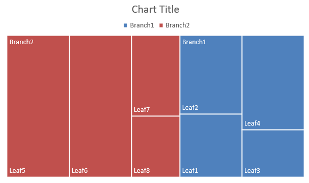

## **Overzicht**

Dit artikel biedt een uitgebreide handleiding voor het maken en aanpassen van grafieken met Aspose.Slides voor Python via .NET. Je leert hoe je programmatically een grafiek aan een dia toevoegt, deze vult met data en verschillende opmaakopties toepast om te voldoen aan je specifieke ontwerpeisen. Gedurende het artikel illustreren gedetailleerde code‑voorbeelden elke stap, van het initialiseren van de presentatie en grafiekobject tot het configureren van series, assen en legenda’s. Door deze gids te volgen, krijg je een solide inzicht in hoe je dynamische grafiekgeneratie integreert in je Python‑toepassingen, waardoor het proces van het maken van datagedreven presentaties wordt gestroomlijnd.

## **Een grafiek maken**

Grafieken helpen mensen snel data te visualiseren en inzichten te verkrijgen die niet meteen duidelijk zijn uit een tabel of spreadsheet.

**Waarom grafieken maken?**

Met grafieken kun je:

* grote hoeveelheden data aggregeren, condenseren of samenvatten op één dia in een presentatie;
* patronen en trends in data blootleggen;
* de richting en impuls van data in de tijd of ten opzichte van een specifieke meeteenheid afleiden;
* uitschieters, afwijkingen, fouten en onzinnige data opsporen;
* complexe data communiceren of presenteren.

In PowerPoint kun je grafieken maken via de *Insert*-functie, die sjablonen biedt voor het ontwerpen van vele grafiektype­n. Met Aspose.Slides kun je zowel reguliere grafieken (gebaseerd op populaire grafiektype­n) als aangepaste grafieken maken.

{}
Gebruik de [ChartType](https://reference.aspose.com/slides/python-net/aspose.slides.charts/charttype/)‑enumeratie onder de [aspose.slides.charts](https://reference.aspose.com/slides/python-net/aspose.slides.charts/)‑module. De waarden in deze enumeratie komen overeen met verschillende grafiektype­n.
{}

### **Clustered Column‑grafieken maken**

Dit voorbeeld gebruikt [add_chart](https://reference.aspose.com/slides/python-net/aspose.slides/shapecollection/add_chart/) om een clustered column‑grafiek te maken die twee series over drie categorieën vergelijkt. De series gebruiken rode en groene vullingen, en individuele labels tonen categorienamen, serienamen en waarden. Werkblad‑index 0 verwijst naar het eerste blad in de embedded grafiek‑werkmap.

```python
import aspose.pydrawing as draw
import aspose.slides as slides
import aspose.slides.charts as charts

with slides.Presentation() as presentation:
    slide = presentation.slides[0]

    chart = slide.shapes.add_chart(charts.ChartType.CLUSTERED_COLUMN, 20, 20, 500, 300)

    chart.chart_title.add_text_frame_for_overriding("Sample Title")
    chart.chart_title.text_frame_for_overriding.text_frame_format.center_text = slides.NullableBool.TRUE
    chart.chart_title.height = 20
    chart.has_title = True

    workbook = chart.chart_data.chart_data_workbook
    worksheet_index = 0

    chart.chart_data.series.clear()
    chart.chart_data.categories.clear()

    series_name_cell = workbook.get_cell(worksheet_index, 0, 1, "Series 1")
    chart.chart_data.series.add(series_name_cell, chart.type)
    series_name_cell = workbook.get_cell(worksheet_index, 0, 2, "Series 2")
    chart.chart_data.series.add(series_name_cell, chart.type)

    category_cell = workbook.get_cell(worksheet_index, 1, 0, "Category 1")
    chart.chart_data.categories.add(category_cell)
    category_cell = workbook.get_cell(worksheet_index, 2, 0, "Category 2")
    chart.chart_data.categories.add(category_cell)
    category_cell = workbook.get_cell(worksheet_index, 3, 0, "Category 3")
    chart.chart_data.categories.add(category_cell)

    series = chart.chart_data.series[0]

    value_cell = workbook.get_cell(worksheet_index, 1, 1, 20)
    series.data_points.add_data_point_for_bar_series(value_cell)
    value_cell = workbook.get_cell(worksheet_index, 2, 1, 50)
    series.data_points.add_data_point_for_bar_series(value_cell)
    value_cell = workbook.get_cell(worksheet_index, 3, 1, 30)
    series.data_points.add_data_point_for_bar_series(value_cell)

    series.format.fill.fill_type = slides.FillType.SOLID
    series.format.fill.solid_fill_color.color = draw.Color.red

    series = chart.chart_data.series[1]

    value_cell = workbook.get_cell(worksheet_index, 1, 2, 30)
    series.data_points.add_data_point_for_bar_series(value_cell)
    value_cell = workbook.get_cell(worksheet_index, 2, 2, 10)
    series.data_points.add_data_point_for_bar_series(value_cell)
    value_cell = workbook.get_cell(worksheet_index, 3, 2, 60)
    series.data_points.add_data_point_for_bar_series(value_cell)

    series.format.fill.fill_type = slides.FillType.SOLID
    series.format.fill.solid_fill_color.color = draw.Color.green

    label = series.data_points[0].label
    label.data_label_format.show_category_name = True

    label = series.data_points[1].label
    label.data_label_format.show_series_name = True

    label = series.data_points[2].label
    label.data_label_format.show_value = True
    label.data_label_format.show_series_name = True
    label.data_label_format.separator = "/"

    presentation.save("AsposeChart.pptx", slides.export.SaveFormat.PPTX)
```

Het resultaat:


### **Scatter‑grafieken maken**

Scatter‑grafieken (ook bekend als spreidingsdiagrammen of x‑y‑grafieken) worden vaak gebruikt om patronen te zoeken of correlaties tussen twee variabelen aan te tonen.

Gebruik een scatter‑grafiek wanneer:

* je gekoppelde numerieke data hebt;
* je twee variabelen hebt die goed bij elkaar passen;
* je wilt bepalen of de twee variabelen met elkaar verband houden;
* je een onafhankelijke variabele hebt met meerdere waarden voor een afhankelijke variabele.

Dit voorbeeld plot twee sets x‑y‑waarden. De eerste serie gebruikt rechte lijnen met ster‑markers, terwijl de tweede gladde lijnen met cirkel‑markers gebruikt; beide gebruiken een [size](https://reference.aspose.com/slides/python-net/aspose.slides.charts/marker/size/) van 10. De [symbol](https://reference.aspose.com/slides/python-net/aspose.slides.charts/marker/symbol/)‑eigenschap bepaalt de vorm van de marker.

```python
import aspose.slides as slides
import aspose.slides.charts as charts

with slides.Presentation() as presentation:
    slide = presentation.slides[0]

    chart = slide.shapes.add_chart(charts.ChartType.SCATTER_WITH_SMOOTH_LINES, 20, 20, 500, 300)

    workbook = chart.chart_data.chart_data_workbook
    worksheet_index = 0

    chart.chart_data.series.clear()

    series_name_cell = workbook.get_cell(worksheet_index, 1, 1, "Series 1")
    chart.chart_data.series.add(series_name_cell, chart.type)
    series_name_cell = workbook.get_cell(worksheet_index, 1, 3, "Series 2")
    chart.chart_data.series.add(series_name_cell, chart.type)

    series = chart.chart_data.series[0]

    x_value_cell = workbook.get_cell(worksheet_index, 2, 1, 1)
    y_value_cell = workbook.get_cell(worksheet_index, 2, 2, 3)
    series.data_points.add_data_point_for_scatter_series(x_value_cell, y_value_cell)

    x_value_cell = workbook.get_cell(worksheet_index, 3, 1, 2)
    y_value_cell = workbook.get_cell(worksheet_index, 3, 2, 10)
    series.data_points.add_data_point_for_scatter_series(x_value_cell, y_value_cell)

    series.type = charts.ChartType.SCATTER_WITH_STRAIGHT_LINES_AND_MARKERS

    series.marker.size = 10
    series.marker.symbol = charts.MarkerStyleType.STAR

    series = chart.chart_data.series[1]

    x_value_cell = workbook.get_cell(worksheet_index, 2, 3, 5)
    y_value_cell = workbook.get_cell(worksheet_index, 2, 4, 2)
    series.data_points.add_data_point_for_scatter_series(x_value_cell, y_value_cell)

    x_value_cell = workbook.get_cell(worksheet_index, 3, 3, 3)
    y_value_cell = workbook.get_cell(worksheet_index, 3, 4, 1)
    series.data_points.add_data_point_for_scatter_series(x_value_cell, y_value_cell)

    x_value_cell = workbook.get_cell(worksheet_index, 4, 3, 2)
    y_value_cell = workbook.get_cell(worksheet_index, 4, 4, 2)
    series.data_points.add_data_point_for_scatter_series(x_value_cell, y_value_cell)

    x_value_cell = workbook.get_cell(worksheet_index, 5, 3, 5)
    y_value_cell = workbook.get_cell(worksheet_index, 5, 4, 1)
    series.data_points.add_data_point_for_scatter_series(x_value_cell, y_value_cell)

    series.marker.size = 10
    series.marker.symbol = charts.MarkerStyleType.CIRCLE

    presentation.save("AsposeChart.pptx", slides.export.SaveFormat.PPTX)
```

Het resultaat:


### **Taartgrafieken maken**

Taartgrafieken zijn het meest geschikt om de deel‑tot‑geheel‑relatie in data weer te geven, vooral wanneer de data categorische labels met numerieke waarden bevat. Als je data echter veel delen of labels bevat, kun je beter een staafgrafiek gebruiken.

Dit voorbeeld maakt een taartgrafiek met drie kwartaalwaarden. Elke slice heeft een aangepaste vulling en rand, en de labels tonen verschillende combinaties van waarden, percentages en series‑informatie. De [first_slice_angle](https://reference.aspose.com/slides/python-net/aspose.slides.charts/chartseriesgroup/first_slice_angle/)‑eigenschap stelt de eerste slice in op 180 graden.

```python
import aspose.pydrawing as draw
import aspose.slides as slides
import aspose.slides.charts as charts

with slides.Presentation() as presentation:
    slide = presentation.slides[0]

    chart = slide.shapes.add_chart(charts.ChartType.PIE, 20, 20, 500, 300)

    chart.chart_title.add_text_frame_for_overriding("Sample Title")
    chart.chart_title.text_frame_for_overriding.text_frame_format.center_text = slides.NullableBool.TRUE
    chart.chart_title.height = 20
    chart.has_title = True

    chart.chart_data.series[0].labels.default_data_label_format.show_value = True

    workbook = chart.chart_data.chart_data_workbook
    worksheet_index = 0

    chart.chart_data.series.clear()
    chart.chart_data.categories.clear()

    category_cell = workbook.get_cell(0, 1, 0, "1st Qtr")
    chart.chart_data.categories.add(category_cell)
    category_cell = workbook.get_cell(0, 2, 0, "2nd Qtr")
    chart.chart_data.categories.add(category_cell)
    category_cell = workbook.get_cell(0, 3, 0, "3rd Qtr")
    chart.chart_data.categories.add(category_cell)

    series_name_cell = workbook.get_cell(0, 0, 1, "Series 1")
    series = chart.chart_data.series.add(series_name_cell, chart.type)

    value_cell = workbook.get_cell(worksheet_index, 1, 1, 20)
    series.data_points.add_data_point_for_pie_series(value_cell)
    value_cell = workbook.get_cell(worksheet_index, 2, 1, 50)
    series.data_points.add_data_point_for_pie_series(value_cell)
    value_cell = workbook.get_cell(worksheet_index, 3, 1, 30)
    series.data_points.add_data_point_for_pie_series(value_cell)

    chart.chart_data.series_groups[0].is_color_varied = True

    first_slice = series.data_points[0]
    first_slice.format.fill.fill_type = slides.FillType.SOLID
    first_slice.format.fill.solid_fill_color.color = draw.Color.cyan

    first_slice.format.line.fill_format.fill_type = slides.FillType.SOLID
    first_slice.format.line.fill_format.solid_fill_color.color = draw.Color.gray
    first_slice.format.line.width = 3.0
    first_slice.format.line.style = slides.LineStyle.THIN_THICK
    first_slice.format.line.dash_style = slides.LineDashStyle.LARGE_DASH

    second_slice = series.data_points[1]
    second_slice.format.fill.fill_type = slides.FillType.SOLID
    second_slice.format.fill.solid_fill_color.color = draw.Color.brown

    second_slice.format.line.fill_format.fill_type = slides.FillType.SOLID
    second_slice.format.line.fill_format.solid_fill_color.color = draw.Color.blue
    second_slice.format.line.width = 3.0
    second_slice.format.line.style = slides.LineStyle.SINGLE
    second_slice.format.line.dash_style = slides.LineDashStyle.LARGE_DASH_DOT

    third_slice = series.data_points[2]
    third_slice.format.fill.fill_type = slides.FillType.SOLID
    third_slice.format.fill.solid_fill_color.color = draw.Color.coral

    third_slice.format.line.fill_format.fill_type = slides.FillType.SOLID
    third_slice.format.line.fill_format.solid_fill_color.color = draw.Color.red
    third_slice.format.line.width = 2.0
    third_slice.format.line.style = slides.LineStyle.THIN_THIN
    third_slice.format.line.dash_style = slides.LineDashStyle.LARGE_DASH_DOT_DOT

    first_label = series.data_points[0].label
    first_label.data_label_format.show_value = True

    second_label = series.data_points[1].label
    second_label.data_label_format.show_value = True
    second_label.data_label_format.show_legend_key = True
    second_label.data_label_format.show_percentage = True

    third_label = series.data_points[2].label
    third_label.data_label_format.show_series_name = True
    third_label.data_label_format.show_percentage = True

    series.labels.default_data_label_format.show_leader_lines = True

    chart.chart_data.series_groups[0].first_slice_angle = 180

    presentation.save("PieChart.pptx", slides.export.SaveFormat.PPTX)
```

Het resultaat:


### **Lijngrafieken maken**

Lijngrafieken (ook bekend als lijndiagrammen) zijn het meest geschikt wanneer je veranderingen in waarde over de tijd wilt aantonen. Met een lijngrafiek kun je grote hoeveelheden data tegelijk vergelijken, veranderingen en trends in de tijd volgen, anomalieën in dataseries accentueren, enzovoort.

Dit voorbeeld gebruikt [add_chart](https://reference.aspose.com/slides/python-net/aspose.slides/shapecollection/add_chart/) om een lijngrafiek te maken met de standaard series en categorieën, en slaat de presentatie op als PPTX.

```python
import aspose.slides as slides
import aspose.slides.charts as charts

with slides.Presentation() as presentation:
    slide = presentation.slides[0]

    line_chart = slide.shapes.add_chart(charts.ChartType.LINE, 20, 20, 500, 300)

    presentation.save("lineChart.pptx", slides.export.SaveFormat.PPTX)
```

Standaard worden punten in een lijngrafiek verbonden door rechte doorlopende lijnen. Als je de punten liever met stippellijnen verbindt, stel je [dash_style](https://reference.aspose.com/slides/python-net/aspose.slides/lineformat/dash_style/) in op een waarde uit [LineDashStyle](https://reference.aspose.com/slides/python-net/aspose.slides/linedashstyle/):

```python
import aspose.slides as slides
import aspose.slides.charts as charts

with slides.Presentation() as presentation:
    slide = presentation.slides[0]

    line_chart = slide.shapes.add_chart(charts.ChartType.LINE, 20, 20, 500, 300)

    for series in line_chart.chart_data.series:
        series.format.line.dash_style = slides.LineDashStyle.DASH
```

Het resultaat:


### **Tree‑Map‑grafieken maken**

Tree‑Map‑grafieken zijn ideaal voor verkoopdata wanneer je de relatieve grootte van datacategorieën wilt weergeven en snel de items wilt markeren die grote bijdragers binnen elke categorie zijn.

Dit voorbeeld maakt een tree‑map met acht bladeren gegroepeerd in vier stammen en twee takken. De [set_grouping_item](https://reference.aspose.com/slides/python-net/aspose.slides.charts/chartcategorylevelsmanager/set_grouping_item/)‑methode kent stammen toe op groeperingsniveau 1 en takken op niveau 2. Waarden bepalen de relatieve rechthoekgroottes, terwijl categorielabels en overlappende bovenliggende labels de hiërarchie aangeven.

```python
import aspose.slides as slides
import aspose.slides.charts as charts

with slides.Presentation() as presentation:
    slide = presentation.slides[0]

    chart = slide.shapes.add_chart(charts.ChartType.TREEMAP, 20, 20, 500, 300)

    chart.chart_data.categories.clear()
    chart.chart_data.series.clear()

    workbook = chart.chart_data.chart_data_workbook
    workbook.clear(0)

    # Tak 1
    category_cell = workbook.get_cell(0, "C1", "Leaf1")
    leaf = chart.chart_data.categories.add(category_cell)
    leaf.grouping_levels.set_grouping_item(1, "Stem1")
    leaf.grouping_levels.set_grouping_item(2, "Branch1")

    category_cell = workbook.get_cell(0, "C2", "Leaf2")
    chart.chart_data.categories.add(category_cell)

    category_cell = workbook.get_cell(0, "C3", "Leaf3")
    leaf = chart.chart_data.categories.add(category_cell)
    leaf.grouping_levels.set_grouping_item(1, "Stem2")

    category_cell = workbook.get_cell(0, "C4", "Leaf4")
    chart.chart_data.categories.add(category_cell)

    # Tak 2
    category_cell = workbook.get_cell(0, "C5", "Leaf5")
    leaf = chart.chart_data.categories.add(category_cell)
    leaf.grouping_levels.set_grouping_item(1, "Stem3")
    leaf.grouping_levels.set_grouping_item(2, "Branch2")

    category_cell = workbook.get_cell(0, "C6", "Leaf6")
    chart.chart_data.categories.add(category_cell)

    category_cell = workbook.get_cell(0, "C7", "Leaf7")
    leaf = chart.chart_data.categories.add(category_cell)
    leaf.grouping_levels.set_grouping_item(1, "Stem4")

    category_cell = workbook.get_cell(0, "C8", "Leaf8")
    chart.chart_data.categories.add(category_cell)

    series = chart.chart_data.series.add(charts.ChartType.TREEMAP)
    series.labels.default_data_label_format.show_category_name = True
    value_cell = workbook.get_cell(0, "D1", 4)
    series.data_points.add_data_point_for_treemap_series(value_cell)
    value_cell = workbook.get_cell(0, "D2", 5)
    series.data_points.add_data_point_for_treemap_series(value_cell)
    value_cell = workbook.get_cell(0, "D3", 3)
    series.data_points.add_data_point_for_treemap_series(value_cell)
    value_cell = workbook.get_cell(0, "D4", 6)
    series.data_points.add_data_point_for_treemap_series(value_cell)
    value_cell = workbook.get_cell(0, "D5", 9)
    series.data_points.add_data_point_for_treemap_series(value_cell)
    value_cell = workbook.get_cell(0, "D6", 9)
    series.data_points.add_data_point_for_treemap_series(value_cell)
    value_cell = workbook.get_cell(0, "D7", 4)
    series.data_points.add_data_point_for_treemap_series(value_cell)
    value_cell = workbook.get_cell(0, "D8", 3)
    series.data_points.add_data_point_for_treemap_series(value_cell)

    series.parent_label_layout = charts.ParentLabelLayoutType.OVERLAPPING

    presentation.save("Treemap.pptx", slides.export.SaveFormat.PPTX)
```

Het resultaat:



### **Waterval‑grafieken maken**

Een waterval‑grafiek toont hoe positieve en negatieve veranderingen bijdragen aan een eindwaarde. Bijvoorbeeld, een winst­analyse kan beginnen met omzet, kosten aftrekken en andere inkomsten toevoegen. Verandermarkeringen zweven tussen de vorige en nieuwe tussenwaarden, terwijl totalen van nul tot de geaccumuleerde waarde lopen.

Het volgende voorbeeld gebruikt bedragen in duizenden Amerikaanse dollars:

| Categorie | Werkbladwaarde | Kolomtype |
| --- | ---: | --- |
| Omzet | 1000 | Toename |
| Kosten van de verkoop | -400 | Afname |
| Brutowinst | 600 | Tussentotaal |
| Bedrijfskosten | -200 | Afname |
| Andere inkomsten | 50 | Toename |
| Nettowinst | 450 | Eindtotaal |

Om een punt te markeren als een tussentotaal of eindtotaal, stel je de [set_as_total](https://reference.aspose.com/slides/python-net/aspose.slides.charts/chartdatapoint/set_as_total/)‑eigenschap in op `True`. Geef het werkbladcellen‑bedrag op: `600` voor brutowinst (`1000 - 400`) en `450` voor nettowinst (`600 - 200 + 50`). De eigenschap markeert de kolom als een totaal; hij berekent of vult de celwaarde niet. Gebruik geen nul als placeholder en voeg geen andere wijziging toe voor een totaalpunt. Een totaalkolom toont de geaccumuleerde waarde zonder die opnieuw bij de tussenwaarde op te tellen.

Deze volledige C#‑voorbeeld maakt een grafiek met het `Waterfall`‑lid van [ChartType](https://reference.aspose.com/slides/python-net/aspose.slides.charts/charttype/), wist de standaard data en vult de embedded werkmap. Werkblad‑index `0` selecteert het eerste werkblad; kolom A bevat categorienamen en kolom B waarden. Elke waardecel wordt toegevoegd met [add_data_point_for_waterfall_series](https://reference.aspose.com/slides/python-net/aspose.slides.charts/chartdatapointcollection/add_data_point_for_waterfall_series/). De nul‑gebaseerde punt‑indices `2` en `5` identificeren respectievelijk het tussentotaal en eindtotaal. Het inschakelen van [show_value](https://reference.aspose.com/slides/python-net/aspose.slides.charts/datalabelformat/show_value/) toont de bedragen op de kolommen. Er is geen invoer‑presentatie of werkmap nodig.

```python
import aspose.slides as slides
import aspose.slides.charts as charts

with slides.Presentation() as presentation:
    slide = presentation.slides[0]

    chart = slide.shapes.add_chart(charts.ChartType.WATERFALL, 20, 20, 680, 200)

    chart.has_title = True
    chart.chart_title.add_text_frame_for_overriding("Profit breakdown (USD thousands)")
    chart.chart_title.overlay = False
    chart.has_legend = False

    chart.chart_data.series.clear()
    chart.chart_data.categories.clear()

    workbook = chart.chart_data.chart_data_workbook
    worksheet_index = 0

    workbook.clear(worksheet_index)

    series_name_cell = workbook.get_cell(worksheet_index, 0, 1, "Profit")
    series = chart.chart_data.series.add(series_name_cell, charts.ChartType.WATERFALL)
    categories = ["Revenue", "Cost of sales", "Gross profit", "Operating expenses", "Other income", "Net profit"]
    values = [1000, -400, 600, -200, 50, 450]

    for i in range(len(categories)):
        category_cell = workbook.get_cell(worksheet_index, i + 1, 0, categories[i])
        chart.chart_data.categories.add(category_cell)
        value_cell = workbook.get_cell(worksheet_index, i + 1, 1, values[i])
        series.data_points.add_data_point_for_waterfall_series(value_cell)

    # De derde en zesde punten zijn totalen, geen extra wijzigingen.
    series.data_points[2].set_as_total = True
    series.data_points[5].set_as_total = True
    series.show_connector_lines = True
    series.labels.default_data_label_format.show_value = True

    presentation.save("WaterfallChart.pptx", slides.export.SaveFormat.PPTX)
```

Stel de series‑niveau‑[show_connector_lines](https://reference.aspose.com/slides/python-net/aspose.slides.charts/chartseries/show_connector_lines/)‑eigenschap in op `True` om lijnen tussen opeenvolgende kolommen te tonen en de tussenwaarde beter traceerbaar te maken. Om deze lijnen te verbergen, vervang je de toewijzing in het voorbeeld door `series.show_connector_lines = False` vóór het opslaan. Dit verandert alleen de zichtbaarheid van de lijnen, niet de data of totalen.

De opgeslagen presentatie toont een brutowinst van 600 en een nettowinst van 450, waarbij beide totalen van nul worden getekend:


### **Aandelen‑grafieken maken**

Aandelen‑grafieken worden gebruikt om financiële gegevens weer te geven, zoals open, high, low en close prijzen, en helpen markttrends en volatiliteit te analyseren. Ze bieden essentiële inzichten in de aandelenprestaties, waardoor investeerders en analisten beter onderbouwde beslissingen kunnen nemen.

Dit voorbeeld maakt een open‑high‑low‑close‑grafiek met vier series in die volgorde en drie categorieën. De [has_up_down_bars](https://reference.aspose.com/slides/python-net/aspose.slides.charts/updownbarsmanager/has_up_down_bars/)‑eigenschap activeert op‑/neer‑balken, en [hi_low_lines_format](https://reference.aspose.com/slides/python-net/aspose.slides.charts/chartseriesgroup/hi_low_lines_format/) regelt de high‑low‑lijnen die de prijsranges tonen, terwijl de individuele serielijnen en de kleinere horizontale rasterlijnen verborgen blijven.

```python
import aspose.slides as slides
import aspose.slides.charts as charts

with slides.Presentation() as presentation:
    slide = presentation.slides[0]

    chart = slide.shapes.add_chart(charts.ChartType.OPEN_HIGH_LOW_CLOSE, 20, 20, 500, 300, False)

    workbook = chart.chart_data.chart_data_workbook

    category_cell = workbook.get_cell(0, 1, 0, "A")
    chart.chart_data.categories.add(category_cell)
    category_cell = workbook.get_cell(0, 2, 0, "B")
    chart.chart_data.categories.add(category_cell)
    category_cell = workbook.get_cell(0, 3, 0, "C")
    chart.chart_data.categories.add(category_cell)

    series_name_cell = workbook.get_cell(0, 0, 1, "Open")
    chart.chart_data.series.add(series_name_cell, charts.ChartType.OPEN_HIGH_LOW_CLOSE)
    series_name_cell = workbook.get_cell(0, 0, 2, "High")
    chart.chart_data.series.add(series_name_cell, charts.ChartType.OPEN_HIGH_LOW_CLOSE)
    series_name_cell = workbook.get_cell(0, 0, 3, "Low")
    chart.chart_data.series.add(series_name_cell, charts.ChartType.OPEN_HIGH_LOW_CLOSE)
    series_name_cell = workbook.get_cell(0, 0, 4, "Close")
    chart.chart_data.series.add(series_name_cell, charts.ChartType.OPEN_HIGH_LOW_CLOSE)

    series = chart.chart_data.series[0]
    value_cell = workbook.get_cell(0, 1, 1, 72)
    series.data_points.add_data_point_for_stock_series(value_cell)
    value_cell = workbook.get_cell(0, 2, 1, 25)
    series.data_points.add_data_point_for_stock_series(value_cell)
    value_cell = workbook.get_cell(0, 3, 1, 38)
    series.data_points.add_data_point_for_stock_series(value_cell)

    series = chart.chart_data.series[1]
    value_cell = workbook.get_cell(0, 1, 2, 172)
    series.data_points.add_data_point_for_stock_series(value_cell)
    value_cell = workbook.get_cell(0, 2, 2, 57)
    series.data_points.add_data_point_for_stock_series(value_cell)
    value_cell = workbook.get_cell(0, 3, 2, 57)
    series.data_points.add_data_point_for_stock_series(value_cell)

    series = chart.chart_data.series[2]
    value_cell = workbook.get_cell(0, 1, 3, 12)
    series.data_points.add_data_point_for_stock_series(value_cell)
    value_cell = workbook.get_cell(0, 2, 3, 12)
    series.data_points.add_data_point_for_stock_series(value_cell)
    value_cell = workbook.get_cell(0, 3, 3, 13)
    series.data_points.add_data_point_for_stock_series(value_cell)

    series = chart.chart_data.series[3]
    value_cell = workbook.get_cell(0, 1, 4, 25)
    series.data_points.add_data_point_for_stock_series(value_cell)
    value_cell = workbook.get_cell(0, 2, 4, 38)
    series.data_points.add_data_point_for_stock_series(value_cell)
    value_cell = workbook.get_cell(0, 3, 4, 50)
    series.data_points.add_data_point_for_stock_series(value_cell)

    chart.chart_data.series_groups[0].up_down_bars.has_up_down_bars = True
    chart.chart_data.series_groups[0].hi_low_lines_format.line.fill_format.fill_type = slides.FillType.SOLID

    for stock_series in chart.chart_data.series:
        stock_series.format.line.fill_format.fill_type = slides.FillType.NO_FILL

    chart.axes.vertical_axis.minor_grid_lines_format.line.fill_format.fill_type = slides.FillType.NO_FILL

    presentation.save("Stock-chart.pptx", slides.export.SaveFormat.PPTX)
```

Het resultaat:


### **Box‑en‑whisker‑grafieken maken**

Box‑en‑whisker‑grafieken tonen de verdeling van data door belangrijke statistische maten samen te vatten, zoals de mediaan, kwartielen en mogelijke uitschieters. Ze zijn bijzonder nuttig in exploratieve data‑analyse en statistische studies om snel de variabiliteit van data te begrijpen en eventuele anomalieën te identificeren.

Dit voorbeeld maakt een box‑en‑whisker‑grafiek van zes waarden. De [quartile_method](https://reference.aspose.com/slides/python-net/aspose.slides.charts/chartseries/quartile_method/)‑eigenschap kiest de exclusieve kwartiel‑berekening. Het voorbeeld activeert ook gemiddellijnen, gemiddelde‑markers, interne punten en uitscheider‑punten.

```python
import aspose.slides as slides
import aspose.slides.charts as charts

with slides.Presentation() as presentation:
    slide = presentation.slides[0]

    chart = slide.shapes.add_chart(charts.ChartType.BOX_AND_WHISKER, 20, 20, 500, 300)

    chart.chart_data.categories.clear()
    chart.chart_data.series.clear()

    workbook = chart.chart_data.chart_data_workbook
    workbook.clear(0)

    category_cell = workbook.get_cell(0, "A1", "Category 1")
    chart.chart_data.categories.add(category_cell)
    category_cell = workbook.get_cell(0, "A2", "Category 2")
    chart.chart_data.categories.add(category_cell)
    category_cell = workbook.get_cell(0, "A3", "Category 3")
    chart.chart_data.categories.add(category_cell)
    category_cell = workbook.get_cell(0, "A4", "Category 4")
    chart.chart_data.categories.add(category_cell)
    category_cell = workbook.get_cell(0, "A5", "Category 5")
    chart.chart_data.categories.add(category_cell)
    category_cell = workbook.get_cell(0, "A6", "Category 6")
    chart.chart_data.categories.add(category_cell)

    series = chart.chart_data.series.add(charts.ChartType.BOX_AND_WHISKER)

    series.quartile_method = charts.QuartileMethodType.EXCLUSIVE
    series.show_mean_line = True
    series.show_mean_markers = True
    series.show_inner_points = True
    series.show_outlier_points = True

    value_cell = workbook.get_cell(0, "B1", 15)
    series.data_points.add_data_point_for_box_and_whisker_series(value_cell)
    value_cell = workbook.get_cell(0, "B2", 41)
    series.data_points.add_data_point_for_box_and_whisker_series(value_cell)
    value_cell = workbook.get_cell(0, "B3", 16)
    series.data_points.add_data_point_for_box_and_whisker_series(value_cell)
    value_cell = workbook.get_cell(0, "B4", 10)
    series.data_points.add_data_point_for_box_and_whisker_series(value_cell)
    value_cell = workbook.get_cell(0, "B5", 23)
    series.data_points.add_data_point_for_box_and_whisker_series(value_cell)
    value_cell = workbook.get_cell(0, "B6", 16)
    series.data_points.add_data_point_for_box_and_whisker_series(value_cell)

    presentation.save("BoxAndWhisker.pptx", slides.export.SaveFormat.PPTX)
```

### **Trechtergrafieken maken**

Trechtergrafieken visualiseren processen met opeenvolgende fasen, waarbij het volume data afneemt naarmate het van de ene stap naar de volgende gaat. Ze zijn bijzonder nuttig voor het analyseren van conversieratio’s, het identificeren van knelpunten en het volgen van de efficiëntie van verkoop‑ of marketingprocessen.

Dit voorbeeld gebruikt [add_chart](https://reference.aspose.com/slides/python-net/aspose.slides/shapecollection/add_chart/) om een trechtergrafiek toe te voegen aan de eerste dia van een bestaande presentatie. Het vervangt de standaard data door zes categorieën met waarden van 50 tot 500, en slaat de bijgewerkte presentatie op. De invoer‑presentatie moet minimaal één dia bevatten.

```python
import aspose.slides as slides
import aspose.slides.charts as charts

with slides.Presentation("test.pptx") as presentation:
    slide = presentation.slides[0]

    chart = slide.shapes.add_chart(charts.ChartType.FUNNEL, 50, 50, 500, 400)

    chart.chart_data.categories.clear()
    chart.chart_data.series.clear()

    workbook = chart.chart_data.chart_data_workbook
    workbook.clear(0)

    category_cell = workbook.get_cell(0, "A1", "Category 1")
    chart.chart_data.categories.add(category_cell)
    category_cell = workbook.get_cell(0, "A2", "Category 2")
    chart.chart_data.categories.add(category_cell)
    category_cell = workbook.get_cell(0, "A3", "Category 3")
    chart.chart_data.categories.add(category_cell)
    category_cell = workbook.get_cell(0, "A4", "Category 4")
    chart.chart_data.categories.add(category_cell)
    category_cell = workbook.get_cell(0, "A5", "Category 5")
    chart.chart_data.categories.add(category_cell)
    category_cell = workbook.get_cell(0, "A6", "Category 6")
    chart.chart_data.categories.add(category_cell)

    series = chart.chart_data.series.add(charts.ChartType.FUNNEL)

    value_cell = workbook.get_cell(0, "B1", 50)
    series.data_points.add_data_point_for_funnel_series(value_cell)
    value_cell = workbook.get_cell(0, "B2", 100)
    series.data_points.add_data_point_for_funnel_series(value_cell)
    value_cell = workbook.get_cell(0, "B3", 200)
    series.data_points.add_data_point_for_funnel_series(value_cell)
    value_cell = workbook.get_cell(0, "B4", 300)
    series.data_points.add_data_point_for_funnel_series(value_cell)
    value_cell = workbook.get_cell(0, "B5", 400)
    series.data_points.add_data_point_for_funnel_series(value_cell)
    value_cell = workbook.get_cell(0, "B6", 500)
    series.data_points.add_data_point_for_funnel_series(value_cell)

    presentation.save("Funnel.pptx", slides.export.SaveFormat.PPTX)
```

Het resultaat:


### **Sunburst‑grafieken maken**

Sunburst‑grafieken visualiseren hiërarchische data, waarbij niveaus als concentrische ringen worden weergegeven. Ze illustreren deel‑tot‑geheel‑relaties en zijn ideaal om geneste categorieën en subcategorieën helder en compact te presenteren.

Dit voorbeeld maakt een sunburst‑grafiek met acht bladeren gegroepeerd in vier stammen en twee takken. De [set_grouping_item](https://reference.aspose.com/slides/python-net/aspose.slides.charts/chartcategorylevelsmanager/set_grouping_item/)‑methode kent stammen toe op groeperingsniveau 1 en takken op niveau 2. Categorielabels identificeren de segmenten en de waarden bepalen hun relatieve grootte.

```python
import aspose.slides as slides
import aspose.slides.charts as charts

with slides.Presentation() as presentation:
    slide = presentation.slides[0]

    chart = slide.shapes.add_chart(charts.ChartType.SUNBURST, 20, 20, 500, 300)

    chart.chart_data.categories.clear()
    chart.chart_data.series.clear()

    workbook = chart.chart_data.chart_data_workbook
    workbook.clear(0)

    # Tak 1
    category_cell = workbook.get_cell(0, "C1", "Leaf1")
    leaf = chart.chart_data.categories.add(category_cell)
    leaf.grouping_levels.set_grouping_item(1, "Stem1")
    leaf.grouping_levels.set_grouping_item(2, "Branch1")

    category_cell = workbook.get_cell(0, "C2", "Leaf2")
    chart.chart_data.categories.add(category_cell)

    category_cell = workbook.get_cell(0, "C3", "Leaf3")
    leaf = chart.chart_data.categories.add(category_cell)
    leaf.grouping_levels.set_grouping_item(1, "Stem2")

    category_cell = workbook.get_cell(0, "C4", "Leaf4")
    chart.chart_data.categories.add(category_cell)

    # Tak 2
    category_cell = workbook.get_cell(0, "C5", "Leaf5")
    leaf = chart.chart_data.categories.add(category_cell)
    leaf.grouping_levels.set_grouping_item(1, "Stem3")
    leaf.grouping_levels.set_grouping_item(2, "Branch2")

    category_cell = workbook.get_cell(0, "C6", "Leaf6")
    chart.chart_data.categories.add(category_cell)

    category_cell = workbook.get_cell(0, "C7", "Leaf7")
    leaf = chart.chart_data.categories.add(category_cell)
    leaf.grouping_levels.set_grouping_item(1, "Stem4")

    category_cell = workbook.get_cell(0, "C8", "Leaf8")
    chart.chart_data.categories.add(category_cell)

    series = chart.chart_data.series.add(charts.ChartType.SUNBURST)
    series.labels.default_data_label_format.show_category_name = True
    value_cell = workbook.get_cell(0, "D1", 4)
    series.data_points.add_data_point_for_sunburst_series(value_cell)
    value_cell = workbook.get_cell(0, "D2", 5)
    series.data_points.add_data_point_for_sunburst_series(value_cell)
    value_cell = workbook.get_cell(0, "D3", 3)
    series.data_points.add_data_point_for_sunburst_series(value_cell)
    value_cell = workbook.get_cell(0, "D4", 6)
    series.data_points.add_data_point_for_sunburst_series(value_cell)
    value_cell = workbook.get_cell(0, "D5", 9)
    series.data_points.add_data_point_for_sunburst_series(value_cell)
    value_cell = workbook.get_cell(0, "D6", 9)
    series.data_points.add_data_point_for_sunburst_series(value_cell)
    value_cell = workbook.get_cell(0, "D7", 4)
    series.data_points.add_data_point_for_sunburst_series(value_cell)
    value_cell = workbook.get_cell(0, "D8", 3)
    series.data_points.add_data_point_for_sunburst_series(value_cell)

    presentation.save("Sunburst.pptx", slides.export.SaveFormat.PPTX)
```

Het resultaat:


### **Histogram‑grafieken maken**

Histogram‑grafieken tonen hoe numerieke waarden over intervallen (bins) zijn verdeeld. Voor maandelijkse rapporten over doorlooptijden van bestellingen, gebruik je dezelfde bin‑breedte en drempels om intervallen consistent te houden en verdelingen makkelijker te vergelijken.

Stel de horizontale as‑[aggregation_type](https://reference.aspose.com/slides/python-net/aspose.slides.charts/axis/aggregation_type/) in op een modus van [AxisAggregationType](https://reference.aspose.com/slides/python-net/aspose.slides.charts/axisaggregationtype/). [bin_width](https://reference.aspose.com/slides/python-net/aspose.slides.charts/axis/bin_width/) geldt alleen voor `BY_BIN_WIDTH`; [number_of_bins](https://reference.aspose.com/slides/python-net/aspose.slides.charts/axis/number_of_bins/) geldt alleen voor `BY_NUMBER_OF_BINS`. Gebruik `AUTOMATIC` om de grafiek de bins te laten bepalen.

#### **Een vaste bin‑breedte gebruiken**

Dit voorbeeld groepeert doorlooptijden in 10‑minuten‑intervallen, met aparte bins voor tijden ≤ 10 min en > 40 min. Schakel deze bins in met [is_underflow_bin](https://reference.aspose.com/slides/python-net/aspose.slides.charts/axis/is_underflow_bin/) en [is_overflow_bin](https://reference.aspose.com/slides/python-net/aspose.slides.charts/axis/is_overflow_bin/). Wanneer je expliciete [underflow_bin](https://reference.aspose.com/slides/python-net/aspose.slides.charts/axis/underflow_bin/)‑ en [overflow_bin](https://reference.aspose.com/slides/python-net/aspose.slides.charts/axis/overflow_bin/)‑drempels opgeeft, stel dan [is_automatic_underflow_bin](https://reference.aspose.com/slides/python-net/aspose.slides.charts/axis/is_automatic_underflow_bin/) en [is_automatic_overflow_bin](https://reference.aspose.com/slides/python-net/aspose.slides.charts/axis/is_automatic_overflow_bin/) in op `False`.

```python
import aspose.slides as slides
import aspose.slides.charts as charts

with slides.Presentation() as presentation:
    slide = presentation.slides[0]

    chart = slide.shapes.add_chart(charts.ChartType.HISTOGRAM, 20, 20, 680, 200)

    chart.has_legend = False
    chart.has_title = False

    chart.chart_data.categories.clear()
    chart.chart_data.series.clear()

    workbook = chart.chart_data.chart_data_workbook
    workbook.clear(0)

    series = chart.chart_data.series.add(charts.ChartType.HISTOGRAM)
    values = [5, 10, 10, 11, 15, 20, 20, 21, 25, 30, 30, 31, 35, 40, 40, 41, 50]
    for i, value in enumerate(values):
        value_cell = workbook.get_cell(0, i, 0, value)
        series.data_points.add_data_point_for_histogram_series(value_cell)

    axis = chart.axes.horizontal_axis
    axis.aggregation_type = charts.AxisAggregationType.BY_BIN_WIDTH
    axis.bin_width = 10
    axis.is_underflow_bin = True
    axis.is_automatic_underflow_bin = False
    axis.underflow_bin = 10
    axis.is_overflow_bin = True
    axis.is_automatic_overflow_bin = False
    axis.overflow_bin = 40

    presentation.save("Histogram-bin-width.pptx", slides.export.SaveFormat.PPTX)
```

De presentatie getoond in PowerPoint geeft bin‑tellingen van **3, 4, 4, 4 en 2**. De underflow‑bin omvat `5, 10, 10`, dus de drempel is inclusief. De overflow‑bin omvat alleen `41, 50`, dus de drempel is exclusief; beide waarden gelijk aan `40` blijven in het voorgaande interval. De binnenste bins bevatten waarden groter dan hun ondergrens en kleiner of gelijk aan hun bovengrens.


#### **Het aantal bins specificeren**

Voor een vaste detail‑niveau in plaats van vaste intervallen, vraag je vijf bins aan voor dezelfde data. Dit voorbeeld laat under‑ en overflow‑bins uitgeschakeld. De grafiek bepaalt de breedte vanuit het dat bereik, waardoor grenzen tussen rapporten kunnen variëren.

```python
import aspose.slides as slides
import aspose.slides.charts as charts

with slides.Presentation() as presentation:
    slide = presentation.slides[0]

    chart = slide.shapes.add_chart(charts.ChartType.HISTOGRAM, 20, 20, 680, 200)

    chart.has_legend = False
    chart.has_title = False

    chart.chart_data.categories.clear()
    chart.chart_data.series.clear()

    workbook = chart.chart_data.chart_data_workbook
    workbook.clear(0)

    series = chart.chart_data.series.add(charts.ChartType.HISTOGRAM)
    values = [5, 10, 10, 11, 15, 20, 20, 21, 25, 30, 30, 31, 35, 40, 40, 41, 50]
    for i, value in enumerate(values):
        value_cell = workbook.get_cell(0, i, 0, value)
        series.data_points.add_data_point_for_histogram_series(value_cell)

    axis = chart.axes.horizontal_axis
    axis.aggregation_type = charts.AxisAggregationType.BY_NUMBER_OF_BINS
    axis.number_of_bins = 5

    presentation.save("Histogram-bin-count.pptx", slides.export.SaveFormat.PPTX)
```

De vijf bins hebben tellen van **4, 4, 4, 4 en 1**. Vergelijk deze verdeling met het vaste‑breedte‑resultaat hierboven: de invoerwaarden zijn identiek, maar de grenzen verschillen.


### **Radar‑grafieken maken**

Radar‑grafieken visualiseren multivariate data in een tweedimensionaal format, waardoor meerdere variabelen eenvoudig tegelijk kunnen worden vergeleken. Ze zijn vooral nuttig om patronen, sterktes en zwaktes over diverse prestatie‑metrics of attributen te identificeren.

Dit voorbeeld gebruikt [add_chart](https://reference.aspose.com/slides/python-net/aspose.slides/shapecollection/add_chart/) om een radar‑grafiek te maken met de standaard series en categorieën, en slaat de presentatie op als PPTX.

```python
import aspose.slides as slides
import aspose.slides.charts as charts

with slides.Presentation() as presentation:
    slide = presentation.slides[0]

    slide.shapes.add_chart(charts.ChartType.RADAR, 20, 20, 500, 300)

    presentation.save("Radar-chart.pptx", slides.export.SaveFormat.PPTX)
```

Het resultaat:


### **Multi‑categorie‑grafieken maken**

Multi‑categorie‑grafieken visualiseren data die meer dan één categorische groepering bevatten, waardoor je waarden over meerdere dimensies tegelijk kunt vergelijken. Ze zijn bijzonder behulpzaam bij het analyseren van trends en relaties binnen complexe, meerlagige datasets.

Dit voorbeeld maakt een clustered column‑grafiek met acht categorieën verdeeld over vier paren. De [set_grouping_item](https://reference.aspose.com/slides/python-net/aspose.slides.charts/chartcategorylevelsmanager/set_grouping_item/)‑methode geeft elk paar een gedeeld label op groeperingsniveau 1, waardoor een categorische as ontstaat met zowel individuele als groepslabels.

```python
import aspose.slides as slides
import aspose.slides.charts as charts

with slides.Presentation() as presentation:
    slide = presentation.slides[0]

    chart = slide.shapes.add_chart(charts.ChartType.CLUSTERED_COLUMN, 20, 20, 500, 300)

    chart.chart_data.series.clear()
    chart.chart_data.categories.clear()

    workbook = chart.chart_data.chart_data_workbook
    workbook.clear(0)

    worksheet_index = 0

    category_cell = workbook.get_cell(0, "c2", "A")
    category = chart.chart_data.categories.add(category_cell)
    category.grouping_levels.set_grouping_item(1, "Group1")
    category_cell = workbook.get_cell(0, "c3", "B")
    category = chart.chart_data.categories.add(category_cell)

    category_cell = workbook.get_cell(0, "c4", "C")
    category = chart.chart_data.categories.add(category_cell)
    category.grouping_levels.set_grouping_item(1, "Group2")
    category_cell = workbook.get_cell(0, "c5", "D")
    category = chart.chart_data.categories.add(category_cell)

    category_cell = workbook.get_cell(0, "c6", "E")
    category = chart.chart_data.categories.add(category_cell)
    category.grouping_levels.set_grouping_item(1, "Group3")
    category_cell = workbook.get_cell(0, "c7", "F")
    category = chart.chart_data.categories.add(category_cell)

    category_cell = workbook.get_cell(0, "c8", "G")
    category = chart.chart_data.categories.add(category_cell)
    category.grouping_levels.set_grouping_item(1, "Group4")
    category_cell = workbook.get_cell(0, "c9", "H")
    category = chart.chart_data.categories.add(category_cell)

    series_name_cell = workbook.get_cell(0, "D1", "Series 1")
    series = chart.chart_data.series.add(series_name_cell, charts.ChartType.CLUSTERED_COLUMN)

    value_cell = workbook.get_cell(worksheet_index, "D2", 10)
    series.data_points.add_data_point_for_bar_series(value_cell)
    value_cell = workbook.get_cell(worksheet_index, "D3", 20)
    series.data_points.add_data_point_for_bar_series(value_cell)
    value_cell = workbook.get_cell(worksheet_index, "D4", 30)
    series.data_points.add_data_point_for_bar_series(value_cell)
    value_cell = workbook.get_cell(worksheet_index, "D5", 40)
    series.data_points.add_data_point_for_bar_series(value_cell)
    value_cell = workbook.get_cell(worksheet_index, "D6", 50)
    series.data_points.add_data_point_for_bar_series(value_cell)
    value_cell = workbook.get_cell(worksheet_index, "D7", 60)
    series.data_points.add_data_point_for_bar_series(value_cell)
    value_cell = workbook.get_cell(worksheet_index, "D8", 70)
    series.data_points.add_data_point_for_bar_series(value_cell)
    value_cell = workbook.get_cell(worksheet_index, "D9", 80)
    series.data_points.add_data_point_for_bar_series(value_cell)

    presentation.save("AsposeChart.pptx", slides.export.SaveFormat.PPTX)
```

Het resultaat:


### **Kaart‑grafieken maken**

Kaart‑grafieken visualiseren geografische data door informatie aan specifieke locaties (landen, provincies, steden) te koppelen. Ze zijn zeer geschikt voor het analyseren van regionale trends, demografische data en ruimtelijke verdelingen op een duidelijke, visueel aantrekkelijke manier.

Dit voorbeeld gebruikt [add_chart](https://reference.aspose.com/slides/python-net/aspose.slides/shapecollection/add_chart/) om een kaart‑grafiek te maken met de standaard geografische data en slaat deze op voor weergave in PowerPoint.

```python
import aspose.slides as slides
import aspose.slides.charts as charts

with slides.Presentation() as presentation:
    slide = presentation.slides[0]

    chart = slide.shapes.add_chart(charts.ChartType.MAP, 20, 20, 500, 300)

    presentation.save("mapChart.pptx", slides.export.SaveFormat.PPTX)
```

Het resultaat:


{}
De afbeelding hierboven toont de opgeslagen presentatie geopend in PowerPoint. Aspose.Slides schrijft de kaart‑grafiek en de bijbehorende data correct weg, maar tekent zelf geen kaart‑grafieken: wanneer een dia met een kaart‑grafiek wordt gerenderd naar een afbeelding of geconverteerd naar PDF of SVG, blijft het grafiek‑gebied leeg. Andere vormen op dezelfde dia blijven onaangetast.
{}

### **Combinatie‑grafieken maken**

Een combinatie‑grafiek (of combo‑grafiek) combineert twee of meer grafiektype­n in één diagram. Deze grafiek laat je toe om verschillen tussen twee of meer datasets te benadrukken, vergelijken of te onderzoeken, waardoor relaties tussen hen duidelijker worden.


Dit voorbeeld combineert twee clustered column‑series met een lijn‑serie over vier categorieën. De kolommen gebruiken de primaire verticale as, terwijl [plot_on_second_axis](https://reference.aspose.com/slides/python-net/aspose.slides.charts/chartseries/plot_on_second_axis/) de lijn op een secundaire verticale as rechts plaatst. Helper‑functies configureren titel, legenda, as‑labels en rasterlijnen.

```python
import aspose.pydrawing as draw
import aspose.slides as slides
import aspose.slides.charts as charts

def create_combo_chart():
    with slides.Presentation() as presentation:
        chart = create_chart_with_first_series(presentation.slides[0])

        add_second_series_to_chart(chart)
        add_third_series_to_chart(chart)

        set_primary_axes_format(chart)
        set_secondary_axes_format(chart)

        presentation.save("combo-chart.pptx", slides.export.SaveFormat.PPTX)

def create_chart_with_first_series(slide):
    chart = slide.shapes.add_chart(charts.ChartType.CLUSTERED_COLUMN, 50, 50, 600, 400)

    chart.has_title = True
    chart.chart_title.add_text_frame_for_overriding("Chart Title")
    chart.chart_title.overlay = False
    portion_format = chart.chart_title.text_frame_for_overriding.paragraphs[0].paragraph_format.default_portion_format
    portion_format.font_bold = slides.NullableBool.FALSE
    portion_format.font_height = 18

    chart.legend.position = charts.LegendPositionType.BOTTOM
    chart.legend.text_format.portion_format.font_height = 12

    chart.chart_data.series.clear()
    chart.chart_data.categories.clear()

    workbook = chart.chart_data.chart_data_workbook
    worksheet_index = 0

    category_cell = workbook.get_cell(worksheet_index, 1, 0, "Category 1")
    chart.chart_data.categories.add(category_cell)
    category_cell = workbook.get_cell(worksheet_index, 2, 0, "Category 2")
    chart.chart_data.categories.add(category_cell)
    category_cell = workbook.get_cell(worksheet_index, 3, 0, "Category 3")
    chart.chart_data.categories.add(category_cell)
    category_cell = workbook.get_cell(worksheet_index, 4, 0, "Category 4")
    chart.chart_data.categories.add(category_cell)

    series_name_cell = workbook.get_cell(worksheet_index, 0, 1, "Series 1")
    series = chart.chart_data.series.add(series_name_cell, chart.type)

    series.parent_series_group.overlap = -25
    series.parent_series_group.gap_width = 220

    value_cell = workbook.get_cell(worksheet_index, 1, 1, 4.3)
    series.data_points.add_data_point_for_bar_series(value_cell)
    value_cell = workbook.get_cell(worksheet_index, 2, 1, 2.5)
    series.data_points.add_data_point_for_bar_series(value_cell)
    value_cell = workbook.get_cell(worksheet_index, 3, 1, 3.5)
    series.data_points.add_data_point_for_bar_series(value_cell)
    value_cell = workbook.get_cell(worksheet_index, 4, 1, 4.5)
    series.data_points.add_data_point_for_bar_series(value_cell)

    return chart

def add_second_series_to_chart(chart):
    workbook = chart.chart_data.chart_data_workbook
    worksheet_index = 0

    series_name_cell = workbook.get_cell(worksheet_index, 0, 2, "Series 2")
    series = chart.chart_data.series.add(series_name_cell, charts.ChartType.CLUSTERED_COLUMN)

    series.parent_series_group.overlap = -25
    series.parent_series_group.gap_width = 220

    value_cell = workbook.get_cell(worksheet_index, 1, 2, 2.4)
    series.data_points.add_data_point_for_bar_series(value_cell)
    value_cell = workbook.get_cell(worksheet_index, 2, 2, 4.4)
    series.data_points.add_data_point_for_bar_series(value_cell)
    value_cell = workbook.get_cell(worksheet_index, 3, 2, 1.8)
    series.data_points.add_data_point_for_bar_series(value_cell)
    value_cell = workbook.get_cell(worksheet_index, 4, 2, 2.8)
    series.data_points.add_data_point_for_bar_series(value_cell)

def add_third_series_to_chart(chart):
    workbook = chart.chart_data.chart_data_workbook
    worksheet_index = 0

    series_name_cell = workbook.get_cell(worksheet_index, 0, 3, "Series 3")
    series = chart.chart_data.series.add(series_name_cell, charts.ChartType.LINE)

    value_cell = workbook.get_cell(worksheet_index, 1, 3, 2.0)
    series.data_points.add_data_point_for_line_series(value_cell)
    value_cell = workbook.get_cell(worksheet_index, 2, 3, 2.0)
    series.data_points.add_data_point_for_line_series(value_cell)
    value_cell = workbook.get_cell(worksheet_index, 3, 3, 3.0)
    series.data_points.add_data_point_for_line_series(value_cell)
    value_cell = workbook.get_cell(worksheet_index, 4, 3, 5.0)
    series.data_points.add_data_point_for_line_series(value_cell)

    series.plot_on_second_axis = True

def set_primary_axes_format(chart):
    horizontal_axis = chart.axes.horizontal_axis
    horizontal_axis.text_format.portion_format.font_height = 12
    horizontal_axis.format.line.fill_format.fill_type = slides.FillType.NO_FILL

    set_axis_title(horizontal_axis, "X Axis")

    vertical_axis = chart.axes.vertical_axis
    vertical_axis.text_format.portion_format.font_height = 12
    vertical_axis.format.line.fill_format.fill_type = slides.FillType.NO_FILL

    set_axis_title(vertical_axis, "Y Axis 1")

    major_grid_lines_format = vertical_axis.major_grid_lines_format.line.fill_format
    major_grid_lines_format.fill_type = slides.FillType.SOLID
    major_grid_lines_format.solid_fill_color.color = draw.Color.from_argb(217, 217, 217)

def set_secondary_axes_format(chart):
    secondary_horizontal_axis = chart.axes.secondary_horizontal_axis
    secondary_horizontal_axis.position = charts.AxisPositionType.BOTTOM
    secondary_horizontal_axis.cross_type = charts.CrossesType.MAXIMUM
    secondary_horizontal_axis.is_visible = False
    secondary_horizontal_axis.major_grid_lines_format.line.fill_format.fill_type = slides.FillType.NO_FILL
    secondary_horizontal_axis.minor_grid_lines_format.line.fill_format.fill_type = slides.FillType.NO_FILL

    secondary_vertical_axis = chart.axes.secondary_vertical_axis
    secondary_vertical_axis.position = charts.AxisPositionType.RIGHT
    secondary_vertical_axis.text_format.portion_format.font_height = 12
    secondary_vertical_axis.format.line.fill_format.fill_type = slides.FillType.NO_FILL
    secondary_vertical_axis.major_grid_lines_format.line.fill_format.fill_type = slides.FillType.NO_FILL
    secondary_vertical_axis.minor_grid_lines_format.line.fill_format.fill_type = slides.FillType.NO_FILL

    set_axis_title(secondary_vertical_axis, "Y Axis 2")

def set_axis_title(axis, axis_title):
    axis.has_title = True
    axis.title.overlay = False
    title_portion_format = axis.title.add_text_frame_for_overriding(axis_title).paragraphs[0].paragraph_format.default_portion_format
    title_portion_format.font_bold = slides.NullableBool.FALSE
    title_portion_format.font_height = 12


create_combo_chart()
```

## **Grafieken bijwerken**

Aspose.Slides voor Python via .NET stelt je in staat PowerPoint‑grafieken bij te werken door grafiek‑data, opmaak en styling te wijzigen. Deze functionaliteit vereenvoudigt het up‑daten van presentaties met dynamische content en zorgt ervoor dat grafieken nauwkeurig de huidige data en visuele standaarden weergeven.

Dit voorbeeld werkt de grafiek met de naam "My chart" op de eerste dia van een bestaande presentatie bij. Het vereist twee kolom‑series met elk drie datapunten, met categorielabels in kolom A en serienamen in de eerste rij van het eerste werkblad. Het voorbeeld gebruikt [get_cell](https://reference.aspose.com/slides/python-net/aspose.slides.charts/chartdataworkbook/get_cell/) om werkbladcellen te wijzigen, werkt series‑waarden bij, voegt een derde serie toe en verandert de grafiek in clustered cylinders via [type](https://reference.aspose.com/slides/python-net/aspose.slides.charts/chart/type/).

```python
import aspose.slides as slides
import aspose.slides.charts as charts

chart_name = "My chart"

with slides.Presentation("ExistingChart.pptx") as presentation:
    slide = presentation.slides[0]

    for shape in slide.shapes:
        if isinstance(shape, charts.Chart) and shape.name == chart_name:
            chart = shape
            worksheet_index = 0

            workbook = chart.chart_data.chart_data_workbook

            workbook.get_cell(worksheet_index, 1, 0, "Modified Category 1")
            workbook.get_cell(worksheet_index, 2, 0, "Modified Category 2")

            series = chart.chart_data.series[0]

            workbook.get_cell(worksheet_index, 0, 1, "New_Series 1")
            series.data_points[0].value.data = 90
            series.data_points[1].value.data = 123
            series.data_points[2].value.data = 44

            series = chart.chart_data.series[1]

            workbook.get_cell(worksheet_index, 0, 2, "New_Series 2")
            series.data_points[0].value.data = 23
            series.data_points[1].value.data = 67
            series.data_points[2].value.data = 99

            series_name_cell = workbook.get_cell(worksheet_index, 0, 3, "Series 3")
            series = chart.chart_data.series.add(series_name_cell, chart.type)

            value_cell = workbook.get_cell(worksheet_index, 1, 3, 20)
            series.data_points.add_data_point_for_bar_series(value_cell)
            value_cell = workbook.get_cell(worksheet_index, 2, 3, 50)
            series.data_points.add_data_point_for_bar_series(value_cell)
            value_cell = workbook.get_cell(worksheet_index, 3, 3, 30)
            series.data_points.add_data_point_for_bar_series(value_cell)

            chart.type = charts.ChartType.CLUSTERED_CYLINDER

    presentation.save("AsposeChartModified.pptx", slides.export.SaveFormat.PPTX)
```

## **Databereik voor een grafiek instellen**

Om het al gebruikte bereik van een bestaande grafiek te inspecteren, zie [Retrieve a Chart's Data Range](/slides/nl/python-net/chart-workbook/#retrieve-a-charts-data-range).

Aspose.Slides voor Python via .NET biedt de flexibiliteit om een specifiek databereik uit een werkblad als bron voor de grafiek‑data te definiëren. Dit betekent dat je een gedeelte van je werkblad direct kunt koppelen aan de grafiek, waardoor je controle hebt over welke cellen bijdragen aan de series en categorieën. Hierdoor kun je je grafieken eenvoudig bijwerken en synchroniseren met de laatste data‑wijzigingen in je werkblad, zodat je PowerPoint‑presentaties altijd actuele en accurate informatie bevatten.

Dit voorbeeld gebruikt [set_range](https://reference.aspose.com/slides/python-net/aspose.slides.charts/chartdata/set_range/) om de gegevensbron van de grafiek met de naam "My chart" op de eerste dia van een bestaande presentatie in te stellen op `Sheet1!A1:B4`. De grafiek‑werkmap moet dat werkblad en een gevulde range bevatten met een seriekop in de eerste rij, categorielabels in kolom A en drie waarden in kolom B.

```python
import aspose.slides as slides
import aspose.slides.charts as charts

chart_name = "My chart"

with slides.Presentation("ExistingChart.pptx") as presentation:
    slide = presentation.slides[0]

    for shape in slide.shapes:
        if isinstance(shape, charts.Chart) and shape.name == chart_name:
            chart = shape
            chart.chart_data.set_range("Sheet1!A1:B4")

    presentation.save("SetDataRange.pptx", slides.export.SaveFormat.PPTX)
```

## **Standaard‑markers gebruiken in grafieken**

Wanneer je standaard‑markers in grafieken gebruikt, krijgt elke grafiek‑serie automatisch een ander standaard‑markersymbool toegewezen.

Dit voorbeeld gebruikt [add_chart](https://reference.aspose.com/slides/python-net/aspose.slides/shapecollection/add_chart/) om een grafiek met twee lijn‑series en een legenda te maken. De [marker](https://reference.aspose.com/slides/python-net/aspose.slides.charts/chartseries/marker/)‑instellingen behouden de automatisch toegewezen markersymbolen. De eerste serie bevat een negatieve waarde en een ontbrekende waarde, weergegeven als `None`, terwijl de tweede serie voor elke categorie een waarde heeft.

```python
import aspose.slides as slides
import aspose.slides.charts as charts

with slides.Presentation() as presentation:
    slide = presentation.slides[0]

    chart = slide.shapes.add_chart(charts.ChartType.LINE_WITH_MARKERS, 10, 10, 400, 400)

    chart.chart_data.series.clear()
    chart.chart_data.categories.clear()

    workbook = chart.chart_data.chart_data_workbook

    series_name_cell = workbook.get_cell(0, 0, 1, "Series 1")
    series = chart.chart_data.series.add(series_name_cell, chart.type)

    category_cell = workbook.get_cell(0, 1, 0, "C1")
    chart.chart_data.categories.add(category_cell)
    value_cell = workbook.get_cell(0, 1, 1, 24)
    series.data_points.add_data_point_for_line_series(value_cell)

    category_cell = workbook.get_cell(0, 2, 0, "C2")
    chart.chart_data.categories.add(category_cell)
    value_cell = workbook.get_cell(0, 2, 1, 23)
    series.data_points.add_data_point_for_line_series(value_cell)

    category_cell = workbook.get_cell(0, 3, 0, "C3")
    chart.chart_data.categories.add(category_cell)
    value_cell = workbook.get_cell(0, 3, 1, -10)
    series.data_points.add_data_point_for_line_series(value_cell)

    category_cell = workbook.get_cell(0, 4, 0, "C4")
    chart.chart_data.categories.add(category_cell)
    value_cell = workbook.get_cell(0, 4, 1, None)
    series.data_points.add_data_point_for_line_series(value_cell)

    series_name_cell = workbook.get_cell(0, 0, 2, "Series 2")
    second_series = chart.chart_data.series.add(series_name_cell, chart.type)

    value_cell = workbook.get_cell(0, 1, 2, 30)
    second_series.data_points.add_data_point_for_line_series(value_cell)
    value_cell = workbook.get_cell(0, 2, 2, 10)
    second_series.data_points.add_data_point_for_line_series(value_cell)
    value_cell = workbook.get_cell(0, 3, 2, 60)
    second_series.data_points.add_data_point_for_line_series(value_cell)
    value_cell = workbook.get_cell(0, 4, 2, 40)
    second_series.data_points.add_data_point_for_line_series(value_cell)

    chart.has_legend = True
    chart.legend.overlay = False

    presentation.save("DefaultMarkersInChart.pptx", slides.export.SaveFormat.PPTX)
```

## **FAQ**

**Welke grafiektype­n worden ondersteund door Aspose.Slides voor Python via .NET?**

Aspose.Slides voor Python via .NET ondersteunt een breed scala aan grafiektype­n, waaronder staaf, lijn, taart, gebied, spreiding, histogram, radar en vele andere. Deze flexibiliteit stelt je in staat het meest geschikte grafiektype voor je data‑visualisatie‑behoeften te kiezen.

**Hoe voeg ik een nieuwe grafiek toe aan een dia?**

Om een grafiek toe te voegen, maak je eerst een instantie van de [Presentation](https://reference.aspose.com/slides/python-net/aspose.slides/presentation/)‑klasse, haal je de gewenste dia op via de index en roep je vervolgens de methode aan om een grafiek toe te voegen, waarbij je het grafiektype en de start‑data opgeeft. Dit proces integreert de grafiek rechtstreeks in je presentatie.

**Hoe kan ik de weergegeven data in een grafiek bijwerken?**

Je kunt de data van een grafiek bijwerken door toegang te krijgen tot de bijbehorende data‑werkmap ([ChartDataWorkbook](https://reference.aspose.com/slides/python-net/aspose.slides.charts/chartdataworkbook/)), de standaard series en categorieën te wissen, en vervolgens je eigen data toe te voegen. Hiermee kun je de grafiek programmatically vernieuwen zodat deze de nieuwste data weergeeft.

**Is het mogelijk het uiterlijk van de grafiek aan te passen?**

Ja, Aspose.Slides voor Python via .NET biedt uitgebreide aanpassingsopties. Je kunt kleuren, lettertypen, labels, legendes en andere opmaakelementen wijzigen om het uiterlijk van de grafiek af te stemmen op jouw specifieke ontwerpvereisten.