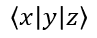

## **Overzicht**

PowerPoint slaat vergelijkingen op als Office Math Markup Language (OMML). Met Aspose.Slides for Python via .NET kun je hetzelfde type wiskundige inhoud programmatisch maken: breuken, wortels, functies, limieten, N-ary operatoren, matrices, arrays en opgemaakte wiskundige blokken.

In PowerPoint voegen gebruikers normaal gesproken vergelijkingen toe via **Insert > Equation**:


Het resultaat is bewerkbare wiskundige tekst op de dia:


Aspose.Slides bouwt die wiskundige tekst op via drie hoofdobjecten:

- Een wiskundige vorm, gemaakt met [add_math_shape](https://reference.aspose.com/slides/python-net/aspose.slides/shapecollection/add_math_shape/), is de vorm die de vergelijking bevat.
- [MathPortion](https://reference.aspose.com/slides/python-net/aspose.slides.mathtext/mathportion/) slaat wiskundige inhoud op in het tekstframe van de vorm.
- [MathParagraph](https://reference.aspose.com/slides/python-net/aspose.slides.mathtext/mathparagraph/) bevat één of meer [MathBlock](https://reference.aspose.com/slides/python-net/aspose.slides.mathtext/mathblock/)-objecten.

De meeste onderstaande voorbeelden gebruiken [MathematicalText](https://reference.aspose.com/slides/python-net/aspose.slides.mathtext/mathematicaltext/) en de vlotte methoden van [IMathElement](https://reference.aspose.com/slides/python-net/aspose.slides.mathtext/imathelement/) om de code kort en leesbaar te houden.

Voor MathML-exportscenario's, zie [Exporteer wiskundige vergelijkingen vanuit presentaties in Python via .NET](/slides/nl/python-net/exporting-math-equations/).

## **Maak een vergelijking**

Dit voorbeeld gebruikt [add_math_shape](https://reference.aspose.com/slides/python-net/aspose.slides/shapecollection/add_math_shape/) om een wiskundige vorm te maken en voegt de stelling van Pythagoras toe:


```py
import aspose.slides as slides
import aspose.slides.mathtext as math

with slides.Presentation() as presentation:
    slide = presentation.slides[0]

    math_shape = slide.shapes.add_math_shape(20, 20, 700, 120)
    math_paragraph = math_shape.text_frame.paragraphs[0].portions[0].math_paragraph

    equation = (
        math.MathematicalText("c")
        .set_superscript("2")
        .join("=")
        .join(math.MathematicalText("a").set_superscript("2"))
        .join("+")
        .join(math.MathematicalText("b").set_superscript("2"))
    )

    math_paragraph.add(equation)

    presentation.save("pythagorean-theorem.pptx", slides.export.SaveFormat.PPTX)
```

{}
[add_math_shape](https://reference.aspose.com/slides/python-net/aspose.slides/shapecollection/add_math_shape/) maakt een vorm die al een wiskundige alinea bevat. Toegang tot de eerste [MathPortion](https://reference.aspose.com/slides/python-net/aspose.slides.mathtext/mathportion/), haal zijn [math_paragraph](https://reference.aspose.com/slides/python-net/aspose.slides.mathtext/mathportion/math_paragraph/), en voeg wiskundige blokken of wiskundige elementen toe.
{}

## **Voeg breuken toe**

Gebruik [divide](https://reference.aspose.com/slides/python-net/aspose.slides.mathtext/imathelement/divide/) om een breuk te maken. Je kunt een breukstijl kiezen met [MathFractionTypes](https://reference.aspose.com/slides/python-net/aspose.slides.mathtext/mathfractiontypes/).


```py
import aspose.slides as slides
import aspose.slides.mathtext as math

with slides.Presentation() as presentation:
    slide = presentation.slides[0]

    math_shape = slide.shapes.add_math_shape(20, 20, 700, 100)
    math_paragraph = math_shape.text_frame.paragraphs[0].portions[0].math_paragraph

    fraction = math.MathematicalText("1").divide("x", math.MathFractionTypes.SKEWED)

    math_paragraph.add(math.MathBlock(fraction))

    presentation.save("fraction.pptx", slides.export.SaveFormat.PPTX)
```

Voor een gestapelde breuk, gebruik [MathFractionTypes.BAR](https://reference.aspose.com/slides/python-net/aspose.slides.mathtext/mathfractiontypes/):

```py
import aspose.slides.mathtext as math

stacked_fraction = math.MathematicalText("x + 1").divide("y - 1", math.MathFractionTypes.BAR)
```

## **Voeg wortels toe**

Gebruik [radical](https://reference.aspose.com/slides/python-net/aspose.slides.mathtext/imathelement/radical/) om een vierkantswortel, derdemachtswortel of een andere wortel te maken. Het huidige element wordt de basis, en het argument wordt de graad.


```py
import aspose.slides as slides
import aspose.slides.mathtext as math

with slides.Presentation() as presentation:
    slide = presentation.slides[0]

    math_shape = slide.shapes.add_math_shape(20, 20, 700, 100)
    math_paragraph = math_shape.text_frame.paragraphs[0].portions[0].math_paragraph

    radical = math.MathematicalText("x").radical("n")

    math_paragraph.add(math.MathBlock(radical))

    presentation.save("radical.pptx", slides.export.SaveFormat.PPTX)
```

## **Voeg functies en limieten toe**

Gebruik [as_argument_of_function](https://reference.aspose.com/slides/python-net/aspose.slides.mathtext/imathelement/as_argument_of_function/) of [function](https://reference.aspose.com/slides/python-net/aspose.slides.mathtext/imathelement/function/) voor functies zoals `sin(x)`, `log(x)` of aangepaste functienamen. Voor limieten, plaats `lim` in een [MathLimit](https://reference.aspose.com/slides/python-net/aspose.slides.mathtext/mathlimit/) of gebruik [set_lower_limit](https://reference.aspose.com/slides/python-net/aspose.slides.mathtext/imathelement/set_lower_limit/).


```py
import aspose.slides as slides
import aspose.slides.mathtext as math

with slides.Presentation() as presentation:
    slide = presentation.slides[0]

    math_shape = slide.shapes.add_math_shape(20, 20, 700, 100)
    math_paragraph = math_shape.text_frame.paragraphs[0].portions[0].math_paragraph

    limit = (
        math.MathematicalText("lim")
        .set_lower_limit("x\u2192\u221E")
        .function("x")
    )

    math_paragraph.add(math.MathBlock(limit))

    presentation.save("functions-and-limits.pptx", slides.export.SaveFormat.PPTX)
```

Voor een aangepaste functienaam, maak de functienaam het huidige element en roep [function](https://reference.aspose.com/slides/python-net/aspose.slides.mathtext/imathelement/function/) aan met zijn argument:

```py
import aspose.slides.mathtext as math

custom_function = math.MathematicalText("f").function("x + 1")
```

## **Voeg N-ary operatoren en integralen toe**

Gebruik [nary](https://reference.aspose.com/slides/python-net/aspose.slides.mathtext/imathelement/nary/) voor sommaties, unies, intersecties en andere grote operatoren. Gebruik [integral](https://reference.aspose.com/slides/python-net/aspose.slides.mathtext/imathelement/integral/) voor integralen. Beide methoden laten je onder‑ en bovengrenzen instellen.


```py
import aspose.slides as slides
import aspose.slides.mathtext as math

with slides.Presentation() as presentation:
    slide = presentation.slides[0]

    math_shape = slide.shapes.add_math_shape(20, 20, 700, 120)
    math_paragraph = math_shape.text_frame.paragraphs[0].portions[0].math_paragraph

    summation_base = (
        math.MathematicalText("x")
        .set_superscript("k")
        .join(math.MathematicalText("a").set_superscript("n-k"))
    )

    summation = summation_base.nary(math.MathNaryOperatorTypes.SUMMATION, "k=0", "n")

    math_paragraph.add(math.MathBlock(summation))

    presentation.save("nary-operators.pptx", slides.export.SaveFormat.PPTX)
```

N-ary operatoren zijn voor grote operatoren met optionele grenzen. Simpele operatoren zoals `+`, `-` en `=` worden meestal toegevoegd als [MathematicalText](https://reference.aspose.com/slides/python-net/aspose.slides.mathtext/mathematicaltext/) en samengevoegd in de expressie.

Voor een integraal, gebruik [integral](https://reference.aspose.com/slides/python-net/aspose.slides.mathtext/imathelement/integral/):

```py
import aspose.slides.mathtext as math

integral_base = math.MathematicalText("x").join(math.MathematicalText("dx").to_box())
integral = integral_base.integral(math.MathIntegralTypes.SIMPLE, "0", "1")
```

## **Voeg matrices toe**

Gebruik [MathMatrix](https://reference.aspose.com/slides/python-net/aspose.slides.mathtext/mathmatrix/) voor rijen en kolommen. Matrices bevatten standaard geen haakjes, dus omkader de matrix wanneer je haakjes, vierkante of accolades nodig hebt.


```py
import aspose.slides as slides
import aspose.slides.mathtext as math

with slides.Presentation() as presentation:
    slide = presentation.slides[0]

    math_shape = slide.shapes.add_math_shape(20, 20, 700, 120)
    math_paragraph = math_shape.text_frame.paragraphs[0].portions[0].math_paragraph

    matrix = math.MathMatrix(2, 3)

    # Een matrix heeft geen eigen haakjes, dus omsluit hem met haakjes.
    math_paragraph.add(math.MathBlock(matrix.enclose("(", ")")))

    presentation.save("matrix.pptx", slides.export.SaveFormat.PPTX)
```

{}
`MathMatrix` bouwt het raster van rijen en kolommen, stelt de tussenruimtes in en alignt de kolommen, maar Aspose.Slides for Python via .NET biedt geen accessor voor een individuele matrixcel. Een in code gemaakte matrix behoudt daardoor lege cellen; de cellen van een matrix die uit een bestaande presentatie komt kunnen worden gelezen met `get_children`. Gebruik een vergelijkingsarray wanneer je rijen vanuit code moet vullen.
{}

## **Voeg vergelijkingsarrays toe**

Gebruik [to_math_array](https://reference.aspose.com/slides/python-net/aspose.slides.mathtext/imathelement/to_math_array/) wanneer je uitgelijnde vergelijkingen of een verticale stapel van expressies nodig hebt.


```py
import aspose.slides as slides
import aspose.slides.mathtext as math

with slides.Presentation() as presentation:
    slide = presentation.slides[0]

    math_shape = slide.shapes.add_math_shape(20, 20, 700, 140)
    math_paragraph = math_shape.text_frame.paragraphs[0].portions[0].math_paragraph

    equation_array = (
        math.MathematicalText("x")
        .join("y")
        .to_math_array()
    )

    math_paragraph.add(math.MathBlock(equation_array))

    presentation.save("equation-array.pptx", slides.export.SaveFormat.PPTX)
```

## **Voeg trigonometrische functies toe**

Gebruik [as_argument_of_function](https://reference.aspose.com/slides/python-net/aspose.slides.mathtext/imathelement/as_argument_of_function/) wanneer het argument het huidige element is en de functienaam bekend is.


```py
import aspose.slides as slides
import aspose.slides.mathtext as math

with slides.Presentation() as presentation:
    slide = presentation.slides[0]

    math_shape = slide.shapes.add_math_shape(20, 20, 700, 100)
    math_paragraph = math_shape.text_frame.paragraphs[0].portions[0].math_paragraph

    cosine = math.MathematicalText("2x").as_argument_of_function(
        math.MathFunctionsOfOneArgument.COS
    )

    math_paragraph.add(math.MathBlock(cosine))

    presentation.save("trigonometric-function.pptx", slides.export.SaveFormat.PPTX)
```

## **Voeg subscripties en superscripties toe**

Gebruik de subscript- en superscript-hulpmiddelen voor indexen en exponenten. Wanneer de indexen aan de linkerkant van de basis moeten verschijnen, gebruik [set_sub_superscript_on_the_left](https://reference.aspose.com/slides/python-net/aspose.slides.mathtext/imathelement/set_sub_superscript_on_the_left/).


```py
import aspose.slides as slides
import aspose.slides.mathtext as math

with slides.Presentation() as presentation:
    slide = presentation.slides[0]

    math_shape = slide.shapes.add_math_shape(20, 20, 700, 100)
    math_paragraph = math_shape.text_frame.paragraphs[0].portions[0].math_paragraph

    scripts = math.MathematicalText("Y").set_sub_superscript_on_the_left("1", "n")

    math_paragraph.add(math.MathBlock(scripts))

    presentation.save("subscript-superscript.pptx", slides.export.SaveFormat.PPTX)
```

## **Voeg delimiters toe**

Gebruik [enclose](https://reference.aspose.com/slides/python-net/aspose.slides.mathtext/imathelement/enclose/) om een expressie in delimiters te plaatsen. Je kunt ook een scheidingsteken instellen voor delimiter-expressies die meerdere elementen bevatten.



```py
import aspose.slides as slides
import aspose.slides.mathtext as math

with slides.Presentation() as presentation:
    slide = presentation.slides[0]

    math_shape = slide.shapes.add_math_shape(20, 20, 700, 100)
    math_paragraph = math_shape.text_frame.paragraphs[0].portions[0].math_paragraph

    delimiter = (
        math.MathematicalText("x")
        .join("y")
        .join("z")
        .enclose("<", ">")
    )
    delimiter.separator_character = "|"

    math_paragraph.add(math.MathBlock(delimiter))

    presentation.save("delimiters.pptx", slides.export.SaveFormat.PPTX)
```

### **Grootte en uitlijning van delimiters**

Stel [grow_to_match_operand_height](https://reference.aspose.com/slides/python-net/aspose.slides.mathtext/imathdelimiter/grow_to_match_operand_height/) in op `True` om de haakjes te laten groeien rond een lange operand, of op `False` om ze op hun normale grootte te houden. [delimiter_shape](https://reference.aspose.com/slides/python-net/aspose.slides.mathtext/imathdelimiter/delimiter_shape/) neemt een van twee [MathDelimiterShape](https://reference.aspose.com/slides/python-net/aspose.slides.mathtext/mathdelimitershape/)‑waarden aan. `CENTERED` centreert de haakjes op de wiskundige as, die door het midden van het gelijkteken loopt. `MATCH` legt ze uit op de ingesloten inhoud. Beide instellingen beïnvloeden alleen de delimiters. De expressie erin blijft gelijk.

Het voorbeeld plaatst een breuk in de exponent van `x` zodat de expressie verder boven de basislijn uitsteekt dan eronder. Alle vier de vergelijkingen gebruiken dezelfde haakjes en lettertype‑instellingen.

```python
import aspose.slides as slides
import aspose.slides.mathtext as math


def add_expression(slide, left, top, grow, shape):
    fraction = math.MathematicalText("a + b").divide("c + d")
    power = math.MathematicalText("x").set_superscript(fraction)
    delimiter = power.enclose("(", ")")
    delimiter.grow_to_match_operand_height = grow
    delimiter.delimiter_shape = shape

    math_shape = slide.shapes.add_math_shape(left, top, 300, 100)
    portion = math_shape.text_frame.paragraphs[0].portions[0]
    portion.portion_format.font_height = 32
    equation = math.MathematicalText("y = ").join(delimiter)
    portion.math_paragraph.add(equation)


with slides.Presentation() as presentation:
    slide = presentation.slides[0]
    add_expression(slide, 20, 20, True, math.MathDelimiterShape.CENTERED)
    add_expression(slide, 350, 20, True, math.MathDelimiterShape.MATCH)
    add_expression(slide, 20, 140, False, math.MathDelimiterShape.CENTERED)
    add_expression(slide, 350, 140, False, math.MathDelimiterShape.MATCH)

    presentation.save("delimiter-sizing.pptx", slides.export.SaveFormat.PPTX)
```

In PowerPoint, vergelijk de rijen om het groeieffect te zien. In de bovenste rij groeien de haakjes om de exponent te omhullen en zien ze er gelijk uit voor beide vormen. In de onderste rij is groei uitgeschakeld. De kleinere haakjes links (`CENTERED`) aligneren met het gelijkteken, terwijl die rechts (`MATCH`) hoger rondom de expressie staan.


## **Voeg een randvak toe**

Gebruik [to_border_box](https://reference.aspose.com/slides/python-net/aspose.slides.mathtext/imathelement/to_border_box/) wanneer de vergelijking zelf moet worden omlijnd.


```py
import aspose.slides as slides
import aspose.slides.mathtext as math

with slides.Presentation() as presentation:
    slide = presentation.slides[0]

    math_shape = slide.shapes.add_math_shape(20, 20, 700, 100)
    math_paragraph = math_shape.text_frame.paragraphs[0].portions[0].math_paragraph

    boxed_equation = (
        math.MathematicalText("a")
        .set_superscript("2")
        .join("=")
        .join(math.MathematicalText("b").set_superscript("2"))
        .join("+")
        .join(math.MathematicalText("c").set_superscript("2"))
        .to_border_box()
    )

    math_paragraph.add(math.MathBlock(boxed_equation))

    presentation.save("border-box.pptx", slides.export.SaveFormat.PPTX)
```

## **Groeperen van termen**

Gebruik [group](https://reference.aspose.com/slides/python-net/aspose.slides.mathtext/imathelement/group/) om een groepeerteken boven of onder een expressie te plaatsen. Voeg een limiet toe om de gegroepeerde termen te labelen.


```py
import aspose.slides as slides
import aspose.slides.mathtext as math

with slides.Presentation() as presentation:
    slide = presentation.slides[0]

    math_shape = slide.shapes.add_math_shape(20, 20, 700, 120)
    math_paragraph = math_shape.text_frame.paragraphs[0].portions[0].math_paragraph

    grouped = (
        math.MathematicalText("x + y")
        .group(chr(0x23DF), math.MathTopBotPositions.BOTTOM, math.MathTopBotPositions.TOP)
        .set_lower_limit("any text")
    )

    math_paragraph.add(math.MathBlock(grouped))

    presentation.save("grouped-terms.pptx", slides.export.SaveFormat.PPTX)
```

## **Formatteer wiskundige elementen**

Gebruik opmaak-hulpmiddelen alleen waar ze de formule verduidelijken. Bijvoorbeeld, [overbar](https://reference.aspose.com/slides/python-net/aspose.slides.mathtext/imathelement/overbar/) plaatst een balk boven een wiskundig element.


```py
import aspose.slides as slides
import aspose.slides.mathtext as math

with slides.Presentation() as presentation:
    slide = presentation.slides[0]

    math_shape = slide.shapes.add_math_shape(20, 20, 700, 100)
    math_paragraph = math_shape.text_frame.paragraphs[0].portions[0].math_paragraph

    overbar = math.MathematicalText("ABC").overbar()

    math_paragraph.add(math.MathBlock(overbar))

    presentation.save("overbar.pptx", slides.export.SaveFormat.PPTX)
```

### **Formateer tekst in een bestaande vergelijking**

Om tekst door een bestaande vergelijking heen te formatteren, doorloop je de elementboom van elk wiskundig blok. [IMathElement.get_children](https://reference.aspose.com/slides/python-net/aspose.slides.mathtext/imathelement/get_children/) geeft alleen de directe kinderen terug, dus roep het recursief aan om tekst binnen breuken, scripts, wortels en andere geneste structuren te bereiken. Controleer het huidige element evenals zijn kinderen om het start‑element op te nemen wanneer het [MathematicalText](https://reference.aspose.com/slides/python-net/aspose.slides.mathtext/mathematicaltext/) is.

Dit voorbeeld gaat ervan uit dat `input.pptx` een vergelijking bevat zoals `z = xᵢ / ∛y`, met een breuk die een subscript in de teller en een wortel in de noemer bevat. Alleen de boven‑niveau‑elementen van het blok verwerken zou de tekst in de breuk missen. Het voorbeeld vindt wiskundige gedeelten in dia‑tekstframes, benadert hun blokken via [MathPortion.math_paragraph](https://reference.aspose.com/slides/python-net/aspose.slides.mathtext/mathportion/math_paragraph/), en stelt [font_height](https://reference.aspose.com/slides/python-net/aspose.slides/baseportionformat/font_height/) in op 28 punten via de [format](https://reference.aspose.com/slides/python-net/aspose.slides.mathtext/mathematicaltext/format/)‑eigenschap van elk textelement.

```py
import aspose.slides as slides
import aspose.slides.mathtext as math


def format_math_text(element):
    if isinstance(element, math.MathematicalText):
        element.format.font_height = 28

    for child in element.get_children():
        format_math_text(child)


with slides.Presentation("input.pptx") as presentation:
    for slide in presentation.slides:
        for shape in slide.shapes:
            if not isinstance(shape, slides.AutoShape) or shape.text_frame is None:
                continue

            for paragraph in shape.text_frame.paragraphs:
                for portion in paragraph.portions:
                    if isinstance(portion, math.MathPortion):
                        for block in portion.math_paragraph:
                            format_math_text(block)

    presentation.save("formatted-equations.pptx", slides.export.SaveFormat.PPTX)
```

De opgeslagen presentatie bevat de bijgewerkte tekstopmaak op elk niveau van elke verwerkte vergelijking, terwijl de tekstinhoud en wiskundige structuur behouden blijven.

## **Snelle referentie**

| Taak | Hoofd‑API |
| --- | --- |
| Maak wiskundige tekst | [MathematicalText](https://reference.aspose.com/slides/python-net/aspose.slides.mathtext/mathematicaltext/) |
| Combineer elementen | [IMathElement.join](https://reference.aspose.com/slides/python-net/aspose.slides.mathtext/imathelement/join/) |
| Maak breuken | [IMathElement.divide](https://reference.aspose.com/slides/python-net/aspose.slides.mathtext/imathelement/divide/) |
| Voeg superscript of subscript toe | [set_superscript](https://reference.aspose.com/slides/python-net/aspose.slides.mathtext/imathelement/set_superscript/), [set_subscript](https://reference.aspose.com/slides/python-net/aspose.slides.mathtext/imathelement/set_subscript/) |
| Voeg functies toe | [function](https://reference.aspose.com/slides/python-net/aspose.slides.mathtext/imathelement/function/), [as_argument_of_function](https://reference.aspose.com/slides/python-net/aspose.slides.mathtext/imathelement/as_argument_of_function/) |
| Voeg wortels toe | [radical](https://reference.aspose.com/slides/python-net/aspose.slides.mathtext/imathelement/radical/) |
| Voeg limieten toe | [set_lower_limit](https://reference.aspose.com/slides/python-net/aspose.slides.mathtext/imathelement/set_lower_limit/), [set_upper_limit](https://reference.aspose.com/slides/python-net/aspose.slides.mathtext/imathelement/set_upper_limit/) |
| Voeg scripts aan de linkerkant toe | [set_sub_superscript_on_the_left](https://reference.aspose.com/slides/python-net/aspose.slides.mathtext/imathelement/set_sub_superscript_on_the_left/) |
| Voeg sommaties en integralen toe | [nary](https://reference.aspose.com/slides/python-net/aspose.slides.mathtext/imathelement/nary/), [integral](https://reference.aspose.com/slides/python-net/aspose.slides.mathtext/imathelement/integral/) |
| Voeg matrices toe | [MathMatrix](https://reference.aspose.com/slides/python-net/aspose.slides.mathtext/mathmatrix/) |
| Voeg vergelijkingsarrays toe | [to_math_array](https://reference.aspose.com/slides/python-net/aspose.slides.mathtext/imathelement/to_math_array/) |
| Voeg delimiters toe | [enclose](https://reference.aspose.com/slides/python-net/aspose.slides.mathtext/imathelement/enclose/) |
| Voeg balken en randen toe | [overbar](https://reference.aspose.com/slides/python-net/aspose.slides.mathtext/imathelement/overbar/), [to_border_box](https://reference.aspose.com/slides/python-net/aspose.slides.mathtext/imathelement/to_border_box/) |
| Groeperen van termen | [group](https://reference.aspose.com/slides/python-net/aspose.slides.mathtext/imathelement/group/) |

## **Veelgestelde vragen**

**Kan ik een bestaande PowerPoint‑vergelijking bewerken?**

Ja. Open de presentatie, vind de vorm die een [MathPortion](https://reference.aspose.com/slides/python-net/aspose.slides.mathtext/mathportion/) bevat, haal zijn [math_paragraph](https://reference.aspose.com/slides/python-net/aspose.slides.mathtext/mathportion/math_paragraph/) op, en werk de wiskundige blokken in die alinea bij.

**Worden vergelijkingen opgeslagen als bewerkbare PowerPoint‑wiskunde?**

Ja. Wanneer je opslaat naar PPTX, schrijft Aspose.Slides de vergelijking als bewerkbare Office‑wiskundige inhoud.

**Kan ik vergelijkingen exporteren naar LaTeX?**

Ja. Haal de [MathParagraph](https://reference.aspose.com/slides/python-net/aspose.slides.mathtext/mathparagraph/) van de [MathPortion](https://reference.aspose.com/slides/python-net/aspose.slides.mathtext/mathportion/) op, en roep [MathParagraph.to_latex](https://reference.aspose.com/slides/python-net/aspose.slides.mathtext/mathparagraph/to_latex/) aan om direct te exporteren. Voor een compleet voorbeeld, zie [Exporteer wiskundige vergelijkingen vanuit presentaties in Python via .NET](/slides/nl/python-net/exporting-math-equations/#export-math-equations-to-latex).