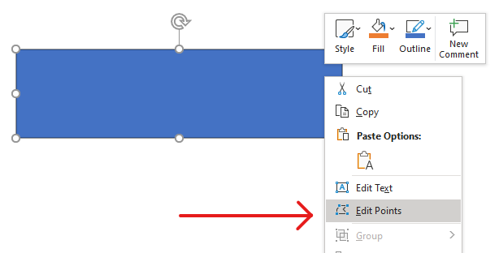

## **Overzicht**

Dit artikel legt uit hoe u presentatiesvormen in Aspose.Slides kunt aanpassen door de vormgeometrie te bewerken via bewerkingspunten en geometriepaden. Het laat zien hoe u werkt met [GeometryPath](https://reference.aspose.com/slides/python-net/aspose.slides/geometrypath/) om bestaande vormen te wijzigen, basisbewerkingsbewerkingen uit te voeren, punten toe te voegen of te verwijderen, en de bijgewerkte geometrie terug toe te passen op een vorm.

Het demonstreert ook hoe u aangepaste en samengestelde vormen maakt, vormen met gebogen hoeken bouwt, bepaalt of een vormgeometrie gesloten is, en vorm‑elementen extraheert voor contouranalyse.

## **Vorm wijzigen met bewerkingspunten**

In PowerPoint kunt u **Bewerkingspunten** gebruiken om een vierkant te wijzigen:

* Een hoekpunt naar binnen of naar buiten verplaatsen.
* De kromming op een punt aanpassen.
* Nieuwe punten toevoegen.

Bewerkingspunten laten u de omtrek van een vorm aanpassen of een bestaande vorm als basis voor een nieuwe gebruiken.

## **Tips voor vormbewerking**



Bij het bewerken van PowerPoint‑vormen moet u deze concepten in gedachten houden:

* Een vorm (of het pad) kan gesloten of open zijn.
* Het pad van een vorm bestaat uit ankerpunten die met segmenten verbonden zijn.
* Een segment kan recht of gebogen zijn. Ankerpunten en controlehandvatten bepalen de vorm.
* Ankerpunten bestaan als hoekpunten, rechte punten of vloeiende punten:
  * Bij een hoekpunt kunnen aangrenzende segmenten onder een hoek elkaar ontmoeten.
  * Bij een vloeiend punt zijn de twee controlehandvatten uitgelijnd en op gelijke afstand van het ankerpunt.
  * Bij een recht punt zijn de twee controlehandvatten uitgelijnd, maar kunnen ze verschillende afstanden van het ankerpunt hebben.
* Het verplaatsen van ankerpunten of het aanpassen van hun handvatten wijzigt de omtrek van de vorm.

Om PowerPoint‑vormen te bewerken via bewerkingspunten, biedt **Aspose.Slides** de klasse [GeometryPath](https://reference.aspose.com/slides/python-net/aspose.slides/geometrypath/) aan.

* Een [GeometryPath](https://reference.aspose.com/slides/python-net/aspose.slides/geometrypath/) instantie vertegenwoordigt een geometriepad van het [GeometryShape](https://reference.aspose.com/slides/python-net/aspose.slides/geometryshape/) object.
* Om de [GeometryPath](https://reference.aspose.com/slides/python-net/aspose.slides/geometrypath/) op te halen van de [GeometryShape](https://reference.aspose.com/slides/python-net/aspose.slides/geometryshape/) instantie, kunt u de methode [GeometryShape.get_geometry_paths](https://reference.aspose.com/slides/python-net/aspose.slides/geometryshape/get_geometry_paths/) gebruiken.
* Om de [GeometryPath](https://reference.aspose.com/slides/python-net/aspose.slides/geometrypath/) voor een vorm in te stellen, kunt u deze methoden gebruiken: [GeometryShape.set_geometry_path](https://reference.aspose.com/slides/python-net/aspose.slides/geometryshape/set_geometry_path/) voor vormen met één enkel pad en [GeometryShape.set_geometry_paths](https://reference.aspose.com/slides/python-net/aspose.slides/geometryshape/set_geometry_paths/) voor vormen met meerdere paden.
* Om segmenten toe te voegen, kunt u de methoden onder [GeometryPath](https://reference.aspose.com/slides/python-net/aspose.slides/geometrypath/) gebruiken.
* Met de eigenschappen [GeometryPath.stroke](https://reference.aspose.com/slides/python-net/aspose.slides/geometrypath/stroke/) en [GeometryPath.fill_mode](https://reference.aspose.com/slides/python-net/aspose.slides/geometrypath/fill_mode/) kunt u het uiterlijk van een geometriepad instellen.
* Met de eigenschap [GeometryPath.path_data](https://reference.aspose.com/slides/python-net/aspose.slides/geometrypath/path_data/) kunt u het geometriepad van een [GeometryShape](https://reference.aspose.com/slides/python-net/aspose.slides/geometryshape/) als een array van padsegmenten ophalen.

## **Eenvoudige bewerkingsoperaties**

Gebruik de volgende methoden om een geometriepad te bewerken. Overloads die een index accepteren, voegen een segment in op die nulgebaseerde positie in de segmentarray van het pad.

| Operatie | Methode |
| --- | --- |
| Een rechte lijn toevoegen of invoegen. | [GeometryPath.line_to](https://reference.aspose.com/slides/python-net/aspose.slides/geometrypath/line_to/) |
| Een kubieke Bézier‑curve met twee controlepunten en een eindpunt toevoegen of invoegen. | [GeometryPath.cubic_bezier_to](https://reference.aspose.com/slides/python-net/aspose.slides/geometrypath/cubic_bezier_to/) |
| Een kwadratische Bézier‑curve met één controlepunt en een eindpunt toevoegen of invoegen. | [GeometryPath.quadratic_bezier_to](https://reference.aspose.com/slides/python-net/aspose.slides/geometrypath/quadratic_bezier_to/) |
| Een elliptische boog met de opgegeven afmetingen en hoeken in graden toevoegen. | [GeometryPath.arc_to](https://reference.aspose.com/slides/python-net/aspose.slides/geometrypath/arc_to/) |
| De huidige figuur sluiten door het eindpunt aan het startpunt te verbinden. | [GeometryPath.close_figure](https://reference.aspose.com/slides/python-net/aspose.slides/geometrypath/close_figure/) |
| Het startpunt van een figuur instellen. | [GeometryPath.move_to](https://reference.aspose.com/slides/python-net/aspose.slides/geometrypath/move_to/) |
| Een segment verwijderen op een nulgebaseerde index. | [GeometryPath.remove_at](https://reference.aspose.com/slides/python-net/aspose.slides/geometrypath/remove_at/) |

## **Aangepaste punten aan een vorm toevoegen**

Dit voorbeeld voegt twee punten toe aan een rechthoekige vorm met behulp van [GeometryPath.line_to](https://reference.aspose.com/slides/python-net/aspose.slides/geometrypath/line_to/) en past het bewerkte pad toe met [GeometryShape.set_geometry_path](https://reference.aspose.com/slides/python-net/aspose.slides/geometryshape/set_geometry_path/). De coördinaten zijn lokaal ten opzichte van de vorm: beide nieuwe punten bevinden zich in het midden, 100 punten van links en 50 punten van boven. Segmentindices 1 en 4 plaatsen ze op respectievelijk de boven‑ en onderrand, waardoor die randen naar binnen worden getrokken.

```python
import aspose.slides as slides

with slides.Presentation() as presentation:
    slide = presentation.slides[0]

    shape = slide.shapes.add_auto_shape(slides.ShapeType.RECTANGLE, 100, 100, 200, 100)

    geometry_path = shape.get_geometry_paths()[0]
    geometry_path.line_to(100, 50, 1)
    geometry_path.line_to(100, 50, 4)

    shape.set_geometry_path(geometry_path)
```


## **Punten uit een vorm verwijderen**

Dit voorbeeld wijzigt een hart‑vormige omtrek door het segment op nulgebaseerde index 2 te verwijderen met [GeometryPath.remove_at](https://reference.aspose.com/slides/python-net/aspose.slides/geometrypath/remove_at/). Het toepassen van het gewijzigde pad met [GeometryShape.set_geometry_path](https://reference.aspose.com/slides/python-net/aspose.slides/geometryshape/set_geometry_path/) werkt de contour van de vorm bij.

```python
import aspose.slides as slides

with slides.Presentation() as presentation:
    slide = presentation.slides[0]

    shape = slide.shapes.add_auto_shape(slides.ShapeType.HEART, 100, 100, 300, 300)

    path = shape.get_geometry_paths()[0]
    path.remove_at(2)

    shape.set_geometry_path(path)
```


## **Een aangepaste vorm maken**

Dit voorbeeld bouwt een ster met vijf punten met behulp van [GeometryPath](https://reference.aspose.com/slides/python-net/aspose.slides/geometrypath/). Afwisselend buiten‑ en binnenstraal van respectievelijk 100 en 50 punten bepalen de punten en inkepingen; een stap van 72 graden verdeelt de vijf punten gelijkmatig. Het pad wordt gesloten met [GeometryPath.close_figure](https://reference.aspose.com/slides/python-net/aspose.slides/geometrypath/close_figure/) en toegepast op een rechthoekige vorm via [GeometryShape.set_geometry_path](https://reference.aspose.com/slides/python-net/aspose.slides/geometryshape/set_geometry_path/), waardoor de eerdere omtrek wordt vervangen.

```python
import aspose.slides as slides
import aspose.pydrawing as draw
import math

points = []

outer_radius = 100
inner_radius = 50
angle_step = 72

for angle in range(-90, 270, angle_step):
    radians = angle * (math.pi / 180)
    x = outer_radius * math.cos(radians)
    y = outer_radius * math.sin(radians)
    points.append(slides.PointF(x + outer_radius, y + outer_radius))

    radians = math.pi * (angle + angle_step / 2) / 180.0
    x = inner_radius * math.cos(radians)
    y = inner_radius * math.sin(radians)
    points.append(slides.PointF(x + outer_radius, y + outer_radius))

star_path = slides.GeometryPath()
star_path.move_to(points[0])

for i in range(1, len(points)):
    star_path.line_to(points[i])

star_path.close_figure()

with slides.Presentation() as presentation:
    slide = presentation.slides[0]

    shape = slide.shapes.add_auto_shape(slides.ShapeType.RECTANGLE, 100, 100, outer_radius * 2, outer_radius * 2)
    shape.set_geometry_path(star_path)
```


## **Een samengestelde aangepaste vorm maken**

Dit voorbeeld definieert twee gesloten [GeometryPath](https://reference.aspose.com/slides/python-net/aspose.slides/geometrypath/) objecten voor respectievelijk het boven‑ en onderste derde deel van een vorm. Het toepassen van beide paden met [GeometryShape.set_geometry_paths](https://reference.aspose.com/slides/python-net/aspose.slides/geometryshape/set_geometry_paths/) creëert één samengestelde vorm met een opening door het middelste derde deel.

```python
import aspose.slides as slides

with slides.Presentation() as presentation:
    slide = presentation.slides[0]

    shape = slide.shapes.add_auto_shape(slides.ShapeType.RECTANGLE, 100, 100, 200, 100)

    top_path = slides.GeometryPath()
    top_path.move_to(0, 0)
    top_path.line_to(shape.width, 0)
    top_path.line_to(shape.width, shape.height / 3)
    top_path.line_to(0, shape.height / 3)
    top_path.close_figure()

    bottom_path = slides.GeometryPath()
    bottom_path.move_to(0, shape.height / 3 * 2)
    bottom_path.line_to(shape.width, shape.height / 3 * 2)
    bottom_path.line_to(shape.width, shape.height)
    bottom_path.line_to(0, shape.height)
    bottom_path.close_figure()

    shape.set_geometry_paths([top_path, bottom_path])
```


## **Een aangepaste vorm met gebogen hoeken maken**

Dit voorbeeld combineert rechte segmenten met [GeometryPath.arc_to](https://reference.aspose.com/slides/python-net/aspose.slides/geometrypath/arc_to/) om een vorm met naar binnen gebogen hoeken te maken. Elke hoekgrootte bepaalt de breedte en hoogte van de boog in punten, en de sweep van –90 graden tekent een tegen‑klok kwart‑ellips. Het voltooide pad wordt toegepast met [GeometryShape.set_geometry_path](https://reference.aspose.com/slides/python-net/aspose.slides/geometryshape/set_geometry_path/), en de presentatie wordt opgeslagen in PPTX‑formaat.

```python
import aspose.slides as slides
import aspose.pydrawing as draw

shape_x = 20
shape_y = 20
shape_width = 300
shape_height = 200

left_top_size = 50
right_top_size = 20
right_bottom_size = 40
left_bottom_size = 10

with slides.Presentation() as presentation:
    slide = presentation.slides[0]

    shape = slide.shapes.add_auto_shape(slides.ShapeType.CUSTOM, shape_x, shape_y, shape_width, shape_height)

    top_left = slides.PointF(left_top_size, 0)
    top_right = slides.PointF(shape_width - right_top_size, 0)
    right_bottom = slides.PointF(shape_width, shape_height - right_bottom_size)
    bottom_left = slides.PointF(left_bottom_size, shape_height)
    left_top = slides.PointF(0, left_top_size)

    geometry_path = slides.GeometryPath()
    geometry_path.move_to(top_left)
    geometry_path.line_to(top_right)
    geometry_path.arc_to(right_top_size, right_top_size, 180, -90)
    geometry_path.line_to(right_bottom)
    geometry_path.arc_to(right_bottom_size, right_bottom_size, -90, -90)
    geometry_path.line_to(bottom_left)
    geometry_path.arc_to(left_bottom_size, left_bottom_size, 0, -90)
    geometry_path.line_to(left_top)
    geometry_path.arc_to(left_top_size, left_top_size, 90, -90)
    geometry_path.close_figure()

    shape.set_geometry_path(geometry_path)

    presentation.save("output.pptx", slides.export.SaveFormat.PPTX)
```

## **Nagaan of een vormgeometrie gesloten is**

De onderstaande helper controleert of elke niet‑lege geometrie‑pad eindigt met een sluit‑segment. Hij leest [GeometryPath.path_data](https://reference.aspose.com/slides/python-net/aspose.slides/geometrypath/path_data/) en vergelijkt het laatste segment‑commando [PathSegment.path_command](https://reference.aspose.com/slides/python-net/aspose.slides/pathsegment/path_command/) met [PathCommandType.CLOSE](https://reference.aspose.com/slides/python-net/aspose.slides/pathcommandtype/). Hij retourneert false wanneer er geen niet‑lege paden zijn. Deze controle bekijkt alleen het laatste commando van elk pad; hij inspecteert niet elke subfiguur binnen een pad. Het voorbeeld print `True` voor een rechthoek.

```python
import aspose.slides as slides


def is_geometry_closed(geometry_shape):
    has_nonempty_path = False

    for geometry_path in geometry_shape.get_geometry_paths():
        segments = geometry_path.path_data
        if len(segments) == 0:
            continue

        has_nonempty_path = True
        last_segment = segments[len(segments) - 1]
        if last_segment.path_command != slides.PathCommandType.CLOSE:
            return False

    return has_nonempty_path


with slides.Presentation() as presentation:
    slide = presentation.slides[0]
    shape = slide.shapes.add_auto_shape(slides.ShapeType.RECTANGLE, 100, 100, 200, 100)
    print(is_geometry_closed(shape))
```

## **Geometriepad‑commando’s inspecteren**

Download [contour.pptx](contour.pptx) en plaats het in uw werkmap. De eerste vorm op de eerste dia heeft een rechte bovenrand, een kubieke Bézier‑curve en een rechte sluitrand. Gebruik [GeometryShape.get_geometry_paths](https://reference.aspose.com/slides/python-net/aspose.slides/geometryshape/get_geometry_paths/) om de paden uit te lezen. Voor elk pad geeft [GeometryPath.path_data](https://reference.aspose.com/slides/python-net/aspose.slides/geometrypath/path_data/) de segmenten in tekeningvolgorde weer. Het [PathSegment.path_command](https://reference.aspose.com/slides/python-net/aspose.slides/pathsegment/path_command/) van elk segment bepaalt hoe de bijbehorende [PathSegment.segment_data](https://reference.aspose.com/slides/python-net/aspose.slides/pathsegment/segment_data/) geïnterpreteerd moet worden.

```python
import aspose.slides as slides

with slides.Presentation("contour.pptx") as presentation:
    shape = presentation.slides[0].shapes[0]
    for i, path in enumerate(shape.get_geometry_paths()):
        for j, segment in enumerate(path.path_data):
            command = segment.path_command
            data = segment.segment_data
            if command in (slides.PathCommandType.MOVE_TO, slides.PathCommandType.LINE_TO):
                detail = f"destination={tuple(data)}"
            elif command == slides.PathCommandType.CUBIC_BEZIER_TO:
                detail = f"control1={tuple(data[:2])} control2={tuple(data[2:4])} end={tuple(data[4:])}"
            elif command == slides.PathCommandType.CLOSE:
                detail = "no coordinates"
            else:
                detail = f"raw={data}"
            print(f"Path {i}, segment {j}: {command.name} {detail}")
```

De vorm bevindt zich op (200, 100) punten op de dia. De gerapporteerde coördinaten zijn lokaal ten opzichte van de vorm. De linkerbovenhoek is (0, 0), x stijgt naar rechts en y stijgt naar beneden. Het sluit‑segment keert terug naar het startpunt zonder extra coördinaten.

```text
Path 0, segment 0: MOVE_TO destination=(0, 0)
Path 0, segment 1: LINE_TO destination=(80, 0)
Path 0, segment 2: CUBIC_BEZIER_TO control1=(70, 15) control2=(30, 45) end=(0, 60)
Path 0, segment 3: CLOSE no coordinates
```


## **Vorm‑elementen extraheren en inspecteren**

Gebruik [GeometryShape.create_shape_elements](https://reference.aspose.com/slides/python-net/aspose.slides/geometryshape/create_shape_elements/) om een bestaande vorm te inspecteren als elementen die padpunten en punt‑types bevatten. Elk teruggegeven [ShapeElement](https://reference.aspose.com/slides/python-net/aspose.slides/shapeelement/) exposeert zijn arrays [path_points](https://reference.aspose.com/slides/python-net/aspose.slides/shapeelement/path_points/) en [path_types](https://reference.aspose.com/slides/python-net/aspose.slides/shapeelement/path_types/). Deze weergave is nuttig voor contouranalyse of om geometrie door te geven aan aangepaste tekengereedschappen.

Het voorbeeld opent een presentatie, vindt de eerste geometrievorm rechtstreeks op de eerste dia, en print de padsegmenten. Gebruik een presentatie die een vorm met rechte en gebogen segmenten bevat om beide soorten output te zien. Het zoekt niet binnen groepen.

```python
import aspose.slides as slides

with slides.Presentation("input.pptx") as presentation:
    slide = presentation.slides[0]
    shape = next((item for item in slide.shapes if isinstance(item, slides.GeometryShape)), None)

    if shape is None:
        print("No geometry shape found on the first slide.")
    else:
        for element in shape.create_shape_elements():
            points = element.path_points
            types = element.path_types
            print("Shape element:")

            i = 0
            while i < len(points):
                point_type = types[i] & 0x07  # Houd het segmenttype, exclusief vlaggen.
                if point_type == 0:
                    print(f"Start figure at {points[i]}")
                elif point_type == 1:
                    print(f"Line to {points[i]}")
                elif point_type == 3:
                    print(f"Cubic Bezier: controls {points[i]}, {points[i + 1]}; end {points[i + 2]}")
                    i += 2  # Verwerk beide controlepunten en het eindpunt.

                if (types[i] & 0x80) != 0:
                    print("Close subpath back to its starting point.")
                i += 1
```

De arrays corresponderen op index: `points[i]` is een punt en `types[i]` beschrijft de rol ervan. Type `0` start een figuur, en type `1` tekent een lijn van het vorige punt naar het huidige punt. Een kubiek Bézier‑segment start bij het vorige eindpunt en gebruikt drie opeenvolgende type‑`3` items: twee controlepunten gevolgd door het nieuwe eindpunt. De lus consumeert deze drie items samen en controleert of het eindpunt gesloten is.

Punt‑types bevatten ook vlaggen. Maskeer met `0x07` om het segmenttype te identificeren, en test `0x80` apart om een gesloten subpad te detecteren. Bijvoorbeeld, `129` (`0x81`) betekent een lijn‑eindpunt dat een subpad sluit, en `131` (`0x83`) betekent een Bézier‑eindpunt dat een subpad sluit. Alleen vergelijken met `1` of `3` zou deze gevallen missen. Andere vlaggen, zoals streep (`0x10`) en marker (`0x20`), wijzigen het basistype van het segment niet.

**Coördinaten en transformaties.** Punten worden gemeten in points (1/72 inch), waarbij X naar rechts en Y naar beneden stijgt. Voor een niet‑gegroepeerde vorm zijn de geëxtraheerde coördinaten al inclusief de [x](https://reference.aspose.com/slides/python-net/aspose.slides/shape/x/)‑ en [y](https://reference.aspose.com/slides/python-net/aspose.slides/shape/y/)‑positie en weerspiegelen ze de actuele breedte en hoogte. Een niet‑geroteerde rechthoek op `(100, 200)` met grootte `120 × 80` heeft contourgrenzen `(100, 200)`–`(220, 280)`. Voeg de positie van de vorm niet opnieuw toe. Trek de X‑ en Y‑waarde af om coördinaten te verkrijgen ten opzichte van het niet‑geroteerde frame.

De geëxtraheerde punten passen de [rotation](https://reference.aspose.com/slides/python-net/aspose.slides/shape/rotation/) of horizontale en verticale omkeringen van de vorm niet toe. Om de weergegeven contour te reproduceren, moet u die transformaties rond het middelpunt van de vorm toepassen. Voor gegroepeerde vormen moet u ook rekening houden met de groeps‑coördinaten‑mapping en transformaties; ga er niet van uit dat de geëxtraheerde punten de definitieve gerenderde dia‑coördinaten zijn of dat u een translatie of schaal tweemaal moet toepassen als deze al in het kind‑frame is verwerkt.

**Inspectie versus bewerking.** Geëxtraheerde arrays beschrijven de contour; wijzigen ervan werkt de oorspronkelijke vorm niet bij. Kies deze aanpak wanneer uw analyse‑ of teken‑code punt‑/type‑arrays nodig heeft. Gebruik [get_geometry_paths](https://reference.aspose.com/slides/python-net/aspose.slides/geometryshape/get_geometry_paths/) wanneer u geometrie‑commando’s in het lokale coördinatensysteem van de vorm nodig heeft of de geometrie wilt bewerken. Pas bewerkte paden toe via [set_geometry_path](https://reference.aspose.com/slides/python-net/aspose.slides/geometryshape/set_geometry_path/) of [set_geometry_paths](https://reference.aspose.com/slides/python-net/aspose.slides/geometryshape/set_geometry_paths/) .

## **Veelgestelde vragen**

**Wat gebeurt er met de vulling en omtrek nadat de geometrie is vervangen?**

De stijl blijft behouden bij de vorm; alleen de contour verandert. De vulling en omtrek worden automatisch op de nieuwe geometrie toegepast.

**Hoe roteer ik een aangepaste vorm correct samen met de geometrie?**

Gebruik de [rotation](https://reference.aspose.com/slides/python-net/aspose.slides/shape/rotation/)‑eigenschap van de vorm; de geometrie roteert mee omdat deze gebonden is aan het eigen coördinatensysteem van de vorm.

**Kan ik een aangepaste vorm naar een afbeelding converteren om het resultaat te "vergrendelen"?**

Ja. Exporteer het gewenste [slide](/slides/nl/python-net/convert-powerpoint-to-png/)‑gebied of de [shape](/slides/nl/python-net/create-shape-thumbnails/) zelf naar een rasterformaat; dit vereenvoudigt verdere verwerking van complexe geometrieën.