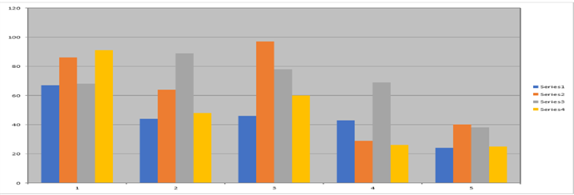

## **Przegląd**

Ten artykuł pokazuje, jak utworzyć wykres kolumnowy Excel przy użyciu Aspose.Cells for Android via Java i osadzić jego skoroszyt w prezentacji PowerPoint przy użyciu Aspose.Slides for Android via Java. Osadzony skoroszyt zawiera zarówno dane źródłowe, jak i wykres. Oddzielny podgląd PNG wyświetla wykres na slajdzie przed aktywacją obiektu OLE.

Rezultatem jest osadzony obiekt Excel, a nie natywny wykres PowerPoint. Edycja skoroszytu poprzez OLE wymaga aplikacji desktopowej obsługującej aktywację OLE oraz kompatybilnej instalacji Excel.

## **Wymagania wstępne**

Dodaj Aspose.Cells for Android via Java oraz Aspose.Slides for Android via Java do zależności projektu. Wywołaj `ExcelChartEmbedding.createPresentation(getFilesDir())` z aktywności Android. Microsoft Office nie jest wymagany do generowania prezentacji przy użyciu tych bibliotek.

Pliki wejściowe nie są potrzebne: przykład tworzy dane i wykres w pamięci, a następnie zapisuje `OutputChart.pptx` w wewnętrznym katalogu plików aplikacji. Zastosuj licencje dla obu produktów, gdy uruchamiasz poza trybem ewaluacyjnym.

## **Jak działa osadzanie**

1. Utwórz skoroszyt z arkuszem danych i arkuszem wykresu.  
2. Ustaw arkusz wykresu jako aktywny, aby skoroszyt otwierał się na wykresie.  
3. Ustaw zakres wyświetlania OLE skoroszytu i wyrenderuj wykres do PNG.  
4. Zapisz skoroszyt jako XLSX w pamięci i osadź te bajty na slajdzie.  
5. Przypisz PNG jako podgląd obiektu OLE i zapisz prezentację jako PPTX.

Zakres wyświetlania skoroszytu i ramka na slajdzie pełnią różne role. [setOleSize](https://reference.aspose.com/cells/java/com.aspose.cells/worksheetcollection/#setOleSize-int-int-int-int-) przyjmuje indeksy wierszy i kolumn zaczynające się od zera. [ChartCollection.add](https://reference.aspose.com/cells/java/com.aspose.cells/chartcollection/#add-int-int-int-int-int-) przyjmuje natomiast wiersz górny, kolumnę lewą, wiersz dolny i kolumnę prawą. Przykład używa indeksu wiersza 55 i indeksu kolumny 25 jako dolno‑prawych granic; wartości te są wyborem układu, a nie liczbą wierszy czy kolumn danych.

Rama slajdu używa punktów. Przykład dopasowuje ją do slajdu i centruje, zachowując proporcje PNG, zamiast rozciągać podgląd, aby wypełnić slajd.

## **Utwórz i osadź wykres**

Poniższy kompletny przykład wypełnia `DataSheet` czterema wierszami i pięcioma kolumnami wartości. Każdy wiersz staje się serią wykresu. `ChartSheet` jest wybierany jako aktywny arkusz przed zapisaniem skoroszytu.

Skoroszyt jest jawnie zapisywany jako XLSX, zgodnie z rozszerzeniem `xlsx` przekazanym do [OleEmbeddedDataInfo](https://reference.aspose.com/slides/androidjava/com.aspose.slides/oleembeddeddatainfo/). PNG jest ładowany bezpośrednio z bajtów, bez pośredniej konwersji bitmapy. Przypisanie go poprzez [getSubstitutePictureFormat](https://reference.aspose.com/slides/androidjava/com.aspose.slides/ioleobjectframe/#getSubstitutePictureFormat--) zastępuje domyślny placeholder OLE.

```java
import com.aspose.cells.Chart;
import com.aspose.cells.ChartType;
import com.aspose.cells.ImageOrPrintOptions;
import com.aspose.cells.ImageType;
import static com.aspose.cells.SaveFormat.XLSX;
import static com.aspose.slides.SaveFormat.Pptx;
import com.aspose.cells.SheetType;
import com.aspose.cells.Workbook;
import com.aspose.cells.Worksheet;
import com.aspose.slides.IImage;
import com.aspose.slides.Images;
import com.aspose.slides.IOleObjectFrame;
import com.aspose.slides.IPPImage;
import com.aspose.slides.ISlide;
import com.aspose.slides.OleEmbeddedDataInfo;
import com.aspose.slides.Presentation;
import java.io.ByteArrayOutputStream;
import java.io.File;

public class ExcelChartEmbedding {
    public static void createPresentation(File filesDirectory) {
        try {
            Workbook workbook = new Workbook();
            try {
                Worksheet dataSheet = workbook.getWorksheets().get(0);
                dataSheet.setName("DataSheet");

                int[][] values = {
                    { 67, 44, 46, 43, 24 },
                    { 86, 64, 97, 29, 40 },
                    { 68, 89, 78, 69, 38 },
                    { 91, 48, 60, 26, 25 }
                };

                for (int row = 0; row < values.length; row++) {
                    for (int column = 0; column < values[row].length; column++) {
                        dataSheet.getCells().get(row, column).putValue(values[row][column]);
                    }
                }

                int chartSheetIndex = workbook.getWorksheets().add(SheetType.CHART);
                Worksheet chartSheet = workbook.getWorksheets().get(chartSheetIndex);
                chartSheet.setName("ChartSheet");

                int lastChartRow = 55;
                int lastChartColumn = 25;
                int chartIndex = chartSheet.getCharts().add(ChartType.COLUMN, 0, 0, lastChartRow, lastChartColumn);
                Chart chart = chartSheet.getCharts().get(chartIndex);
                for (int row = 1; row <= values.length; row++) {
                    chart.getNSeries().add("DataSheet!A" + row + ":E" + row, false);
                }

                workbook.getWorksheets().setActiveSheetIndex(chartSheetIndex);
                workbook.getWorksheets().setOleSize(0, lastChartRow, 0, lastChartColumn);

                // Wygeneruj podgląd wykresu i osobno zserializuj edytowalny skoroszyt.
                ImageOrPrintOptions imageOptions = new ImageOrPrintOptions();
                imageOptions.setImageType(ImageType.PNG);
                ByteArrayOutputStream chartImageStream = new ByteArrayOutputStream();
                chart.toImage(chartImageStream, imageOptions);
                byte[] chartImageBytes = chartImageStream.toByteArray();

                ByteArrayOutputStream workbookStream = new ByteArrayOutputStream();
                workbook.save(workbookStream, XLSX);
                byte[] workbookBytes = workbookStream.toByteArray();

                IImage chartImage = Images.fromData(chartImageBytes);
                try {
                    Presentation presentation = new Presentation();
                    try {
                        ISlide slide = presentation.getSlides().get_Item(0);
                        double slideWidth = presentation.getSlideSize().getSize().getWidth();
                        double slideHeight = presentation.getSlideSize().getSize().getHeight();

                        // Dopasuj podgląd w obrębie slajdu bez zmiany jego proporcji.
                        double scale = Math.min(slideWidth / chartImage.getWidth(), slideHeight / chartImage.getHeight());
                        float frameWidth = (float) (chartImage.getWidth() * scale);
                        float frameHeight = (float) (chartImage.getHeight() * scale);
                        float frameX = (float) ((slideWidth - frameWidth) / 2);
                        float frameY = (float) ((slideHeight - frameHeight) / 2);

                        OleEmbeddedDataInfo embeddedData = new OleEmbeddedDataInfo(workbookBytes, "xlsx");
                        IOleObjectFrame oleFrame = slide.getShapes().addOleObjectFrame(frameX, frameY, frameWidth, frameHeight, embeddedData);
                        IPPImage previewImage = presentation.getImages().addImage(chartImage);
                        oleFrame.getSubstitutePictureFormat().getPicture().setImage(previewImage);

                        File outputFile = new File(filesDirectory, "OutputChart.pptx");
                        presentation.save(outputFile.getAbsolutePath(), Pptx);
                    } finally {
                        presentation.dispose();
                    }
                } finally {
                    chartImage.dispose();
                }
            } finally {
                workbook.dispose();
            }
        } catch (Exception exception) {
            System.err.println("Could not create the presentation: " + exception.getMessage());
        }
    }
}
```

## **Oczekiwany wynik**

`OutputChart.pptx` zawiera jeden slajd z osadzonym skoroszytem Excel i podglądem wykresu. Skoroszyt zawiera oryginalne dane oraz wykres kolumnowy z czterema seriami. Podgląd jest wyśrodkowany na slajdzie i zachowuje swoje proporcje.



W kompatybilnym środowisku PowerPoint na komputerze, z dostępem do Excela, dwukrotne kliknięcie obiektu aktywuje i umożliwi edycję osadzonego skoroszytu. Aktywacja i edycja zależą od obsługi OLE i ustawień zabezpieczeń aplikacji hosta.

## **FAQ**

**Dlaczego potrzebny jest obraz podglądu?**

Osadzony skoroszyt i jego podgląd na slajdzie to osobne treści. Dostarcz obraz wykresu, aby slajd wyświetlał wykres zamiast domyślnego placeholdera „EMBEDDED OLE OBJECT”. Zobacz [Problem z podglądem obiektu przy dodawaniu OleObjectFrame](/slides/pl/androidjava/object-preview-issue-when-adding-oleobjectframe/).

**Czy podgląd aktualizuje się automatycznie po zmianie skoroszytu w kodzie?**

Traktuj podgląd jako migawkę. Po zmianie danych skoroszytu programowo, wygeneruj ponownie obraz wykresu i zamień podgląd oraz osadzone dane skoroszytu.

**Czy mogę użyć XLS zamiast XLSX?**

Tak. Zapisz skoroszyt w formacie XLS i użyj `xls` jako rozszerzenia danych osadzonych. Rozszerzenie musi odpowiadać rzeczywistemu formatowi skoroszytu; samo zmienienie rozszerzenia nie konwertuje danych.

**Dlaczego obiekt może zmienić rozmiar po aktywacji?**

Aplikacja hosta może zaktualizować prezentację obiektu OLE podczas aktywacji skoroszytu. Zarówno zakres wyświetlania OLE skoroszytu, jak i wymiary ramki na slajdzie mają znaczenie. Zobacz [Rozwiązanie działające dla zmiany rozmiaru arkusza](/slides/pl/androidjava/working-solution-for-worksheet-resizing/).

## **Powiązane sekcje**

- [Rozwiązanie działające dla zmiany rozmiaru arkusza](/slides/pl/androidjava/working-solution-for-worksheet-resizing/)
- [Problem z podglądem obiektu przy dodawaniu OleObjectFrame](/slides/pl/androidjava/object-preview-issue-when-adding-oleobjectframe/)
- [Zarządzanie OLE](/slides/pl/androidjava/manage-ole/)