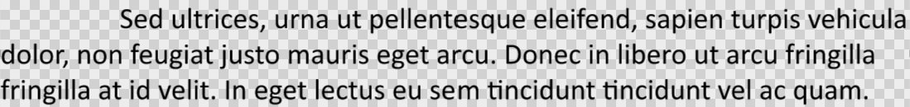

## **Przegląd**

Aspose.Slides dla C++ reprezentuje tekst jako hierarchię ramek tekstowych, akapitów i fragmentów:

* [ITextFrame](https://reference.aspose.com/slides/cpp/aspose.slides/itextframe/) reprezentuje kontener tekstowy w kształcie i zapewnia dostęp do jego kolekcji akapitów.
* [IParagraph](https://reference.aspose.com/slides/cpp/aspose.slides/iparagraph/) reprezentuje jeden akapit w ramce tekstowej i zapewnia dostęp do jego fragmentów oraz formatowania na poziomie akapitu.
* [IPortion](https://reference.aspose.com/slides/cpp/aspose.slides/iportion/) reprezentuje fragment tekstu w akapicie. Każdy fragment może mieć własny tekst i formatowanie na poziomie znaków.

Akapit może więc zawierać tekst w różnych czcionkach, kolorach, rozmiarach i innym formatowaniu, używając wielu fragmentów.

## **Tworzenie i formatowanie akapitów**

Twórz akapity w ramce tekstowej kształtu i używaj fragmentów do formatowania pojedynczych fragmentów tekstu. W tej sekcji pokazano, jak łączyć wiele fragmentów w każdym akapicie i stosować różne kolory, rozmiary czcionek i style.

### **Tworzenie akapitów z wieloma fragmentami**

Poniższy przykład C++ tworzy trzy akapity, z których każdy zawiera trzy fragmenty tekstu w swojej kolekcji [IParagraph::get_Portions](https://reference.aspose.com/slides/cpp/aspose.slides/iparagraph/get_portions/). Ponownie wykorzystuje domyślny akapit i jego pusty fragment, a następnie dodaje pozostałe akapity i fragmenty. Formatowanie jest stosowane za pomocą [IPortion::get_PortionFormat](https://reference.aspose.com/slides/cpp/aspose.slides/iportion/get_portionformat/): pierwszy fragment w każdym akapicie jest czerwony, pogrubiony i ma 15 punktów; drugi jest niebieski, kursywny i ma 18 punktów. Trzeci fragment zachowuje domyślne formatowanie:

```cpp
#include <DOM/FillType.h>
#include <DOM/IAutoShape.h>
#include <DOM/IParagraphCollection.h>
#include <DOM/IPortionCollection.h>
#include <DOM/NullableBool.h>
#include <DOM/Paragraph.h>
#include <DOM/Portion.h>
#include <DOM/Presentation.h>
#include <DOM/ShapeType.h>
#include <Export/SaveFormat.h>
#include <drawing/color.h>
#include <system/string.h>

using namespace Aspose::Slides;
using namespace Aspose::Slides::Export;
using namespace System;
using namespace System::Drawing;

auto presentation = MakeObject<Presentation>();
auto slide = presentation->get_Slide(0);

auto shape = slide->get_Shapes()->AddAutoShape(ShapeType::Rectangle, 50, 150, 300, 150);
auto textFrame = shape->get_TextFrame();

auto firstParagraph = textFrame->get_Paragraph(0);
firstParagraph->get_Portions()->Add(MakeObject<Portion>());
firstParagraph->get_Portions()->Add(MakeObject<Portion>());

auto secondParagraph = MakeObject<Paragraph>();
secondParagraph->get_Portions()->Add(MakeObject<Portion>());
secondParagraph->get_Portions()->Add(MakeObject<Portion>());
secondParagraph->get_Portions()->Add(MakeObject<Portion>());
textFrame->get_Paragraphs()->Add(secondParagraph);

auto thirdParagraph = MakeObject<Paragraph>();
thirdParagraph->get_Portions()->Add(MakeObject<Portion>());
thirdParagraph->get_Portions()->Add(MakeObject<Portion>());
thirdParagraph->get_Portions()->Add(MakeObject<Portion>());
textFrame->get_Paragraphs()->Add(thirdParagraph);

auto paragraphCount = textFrame->get_Paragraphs()->get_Count();
for (auto paragraphIndex = 0; paragraphIndex < paragraphCount; paragraphIndex++)
{
    auto paragraph = textFrame->get_Paragraph(paragraphIndex);
    auto portionCount = paragraph->get_Portions()->get_Count();
    for (auto portionIndex = 0; portionIndex < portionCount; portionIndex++)
    {
        auto portion = paragraph->get_Portion(portionIndex);
        portion->set_Text(String::Format(u"Portion {0}.{1}", paragraphIndex + 1, portionIndex + 1));
        auto portionFormat = portion->get_PortionFormat();

        if (portionIndex == 0)
        {
            portionFormat->get_FillFormat()->set_FillType(FillType::Solid);
            portionFormat->get_FillFormat()->get_SolidFillColor()->set_Color(Color::get_Red());
            portionFormat->set_FontBold(NullableBool::True);
            portionFormat->set_FontHeight(15);
        }
        else if (portionIndex == 1)
        {
            portionFormat->get_FillFormat()->set_FillType(FillType::Solid);
            portionFormat->get_FillFormat()->get_SolidFillColor()->set_Color(Color::get_Blue());
            portionFormat->set_FontItalic(NullableBool::True);
            portionFormat->set_FontHeight(18);
        }
    }
}

presentation->Save(u"paragraphs_with_portions.pptx", SaveFormat::Pptx);
presentation->Dispose();
```

## **Tworzenie list punktowanych i numerowanych**

Organizuj tekst akapitu w listy z symbolami, liczbami lub własnymi obrazkami. Przykłady w tej sekcji obejmują formatowanie punktorów, listy wielopoziomowe oraz własne wartości początkowe numeracji.

### **Tworzenie listy punktowanej lub numerowanej**

Punktory i numeracja ułatwiają skanowanie powiązanych elementów. W Aspose.Slides ustawienia listy są definiowane przez [IBulletFormat](https://reference.aspose.com/slides/cpp/aspose.slides/ibulletformat/).

Ten przykład C++ dodaje symboliczny punktor i numerowaną pozycję do tej samej ramki tekstowej. [IBulletFormat::set_Type](https://reference.aspose.com/slides/cpp/aspose.slides/ibulletformat/set_type/) wybiera typ punktora, podczas gdy [IBulletFormat::set_Char](https://reference.aspose.com/slides/cpp/aspose.slides/ibulletformat/set_char/) podaje symbol, a [IBulletFormat::set_NumberedBulletStyle](https://reference.aspose.com/slides/cpp/aspose.slides/ibulletformat/set_numberedbulletstyle/) wybiera styl numeracji. Oba elementy używają czarnych punktorów o wysokości 100 % i wcięcia akapitu wynoszącego 25 punktów:

```cpp
#include <DOM/BulletType.h>
#include <DOM/ColorType.h>
#include <DOM/IAutoShape.h>
#include <DOM/IParagraphCollection.h>
#include <DOM/NullableBool.h>
#include <DOM/NumberedBulletStyle.h>
#include <DOM/Paragraph.h>
#include <DOM/Presentation.h>
#include <DOM/ShapeType.h>
#include <Export/SaveFormat.h>
#include <drawing/color.h>
#include <system/convert.h>

using namespace Aspose::Slides;
using namespace Aspose::Slides::Export;
using namespace System;
using namespace System::Drawing;

auto presentation = MakeObject<Presentation>();
auto slide = presentation->get_Slide(0);

auto shape = slide->get_Shapes()->AddAutoShape(ShapeType::Rectangle, 200, 200, 400, 200);
auto textFrame = shape->get_TextFrame();
textFrame->get_Paragraphs()->Clear();

auto symbolParagraph = MakeObject<Paragraph>();
symbolParagraph->set_Text(u"Welcome to Aspose.Slides");
symbolParagraph->get_ParagraphFormat()->get_Bullet()->set_Type(BulletType::Symbol);
symbolParagraph->get_ParagraphFormat()->get_Bullet()->set_Char(Convert::ToChar(0x2022));
symbolParagraph->get_ParagraphFormat()->set_Indent(25);
symbolParagraph->get_ParagraphFormat()->get_Bullet()->get_Color()->set_ColorType(ColorType::RGB);
symbolParagraph->get_ParagraphFormat()->get_Bullet()->get_Color()->set_Color(Color::get_Black());
symbolParagraph->get_ParagraphFormat()->get_Bullet()->set_IsBulletHardColor(NullableBool::True);
symbolParagraph->get_ParagraphFormat()->get_Bullet()->set_Height(100);
textFrame->get_Paragraphs()->Add(symbolParagraph);

auto numberedParagraph = MakeObject<Paragraph>();
numberedParagraph->set_Text(u"This is a numbered item");
numberedParagraph->get_ParagraphFormat()->get_Bullet()->set_Type(BulletType::Numbered);
numberedParagraph->get_ParagraphFormat()->get_Bullet()->set_NumberedBulletStyle(NumberedBulletStyle::BulletCircleNumWDBlackPlain);
numberedParagraph->get_ParagraphFormat()->set_Indent(25);
numberedParagraph->get_ParagraphFormat()->get_Bullet()->get_Color()->set_ColorType(ColorType::RGB);
numberedParagraph->get_ParagraphFormat()->get_Bullet()->get_Color()->set_Color(Color::get_Black());
numberedParagraph->get_ParagraphFormat()->get_Bullet()->set_IsBulletHardColor(NullableBool::True);
numberedParagraph->get_ParagraphFormat()->get_Bullet()->set_Height(100);
textFrame->get_Paragraphs()->Add(numberedParagraph);

presentation->Save(u"bulleted_and_numbered_list.pptx", SaveFormat::Pptx);
presentation->Dispose();
```

### **Użycie obrazków jako punktory**

Obrazkowe punktory pozwalają używać własnego obrazu zamiast symbolu lub liczby.

Przykład wymaga pliku `bullets.png` w katalogu roboczym. Ten przykład C++ dodaje obraz do kolekcji obrazów prezentacji jako [IPPImage](https://reference.aspose.com/slides/cpp/aspose.slides/ippimage/) i używa go jako punktora akapitu. Ustawia [IBulletFormat::set_Type](https://reference.aspose.com/slides/cpp/aspose.slides/ibulletformat/set_type/) na użycie punktora obrazkowego i przypisuje obraz przez [IBulletFormat::get_Picture](https://reference.aspose.com/slides/cpp/aspose.slides/ibulletformat/get_picture/). [IBulletFormat::set_Height](https://reference.aspose.com/slides/cpp/aspose.slides/ibulletformat/set_height/) jest ustawiony na 100 % aby dopasować rozmiar punktora względem tekstu akapitu:

```cpp
#include <DOM/BulletType.h>
#include <DOM/IAutoShape.h>
#include <DOM/IImageCollection.h>
#include <DOM/IParagraphCollection.h>
#include <DOM/Paragraph.h>
#include <DOM/Presentation.h>
#include <DOM/ShapeType.h>
#include <Export/SaveFormat.h>
#include <IImage.h>
#include <Util/Images.h>

using namespace Aspose::Slides;
using namespace Aspose::Slides::Export;
using namespace System;

auto presentation = MakeObject<Presentation>();
auto slide = presentation->get_Slide(0);

auto bulletImage = Images::FromFile(u"bullets.png");
auto presentationImage = presentation->get_Images()->AddImage(bulletImage);
bulletImage->Dispose();

auto shape = slide->get_Shapes()->AddAutoShape(ShapeType::Rectangle, 200, 200, 400, 200);
auto textFrame = shape->get_TextFrame();
textFrame->get_Paragraphs()->Clear();

auto paragraph = MakeObject<Paragraph>();
paragraph->set_Text(u"Welcome to Aspose.Slides");
paragraph->get_ParagraphFormat()->get_Bullet()->set_Type(BulletType::Picture);
paragraph->get_ParagraphFormat()->get_Bullet()->get_Picture()->set_Image(presentationImage);
paragraph->get_ParagraphFormat()->get_Bullet()->set_Height(100);
textFrame->get_Paragraphs()->Add(paragraph);

presentation->Save(u"picture_bullet.pptx", SaveFormat::Pptx);
presentation->Save(u"picture_bullet.ppt", SaveFormat::Ppt);
presentation->Dispose();
```

### **Tworzenie listy wielopoziomowej**

Ustaw [IParagraphFormat::set_Depth](https://reference.aspose.com/slides/cpp/aspose.slides/iparagraphformat/set_depth/), aby umieścić akapity na różnych poziomach listy. Najwyższy poziom ma głębokość `0`.

Ten przykład C++ przypisuje wartości [IParagraphFormat::set_Depth](https://reference.aspose.com/slides/cpp/aspose.slides/iparagraphformat/set_depth/) od 0 do 3 czterem akapitom, tworząc hierarchię w jednej ramce tekstowej. Każdy akapit używa symbolicznego punktora, przy czym [IBulletFormat::set_Char](https://reference.aspose.com/slides/cpp/aspose.slides/ibulletformat/set_char/) przełącza się pomiędzy okrągłym puktorem a łącznikiem, aby odróżnić sąsiadujące poziomy:

```cpp
#include <DOM/BulletType.h>
#include <DOM/FillType.h>
#include <DOM/IAutoShape.h>
#include <DOM/IParagraphCollection.h>
#include <DOM/Paragraph.h>
#include <DOM/Presentation.h>
#include <DOM/ShapeType.h>
#include <Export/SaveFormat.h>
#include <drawing/color.h>
#include <system/convert.h>

using namespace Aspose::Slides;
using namespace Aspose::Slides::Export;
using namespace System;
using namespace System::Drawing;

auto presentation = MakeObject<Presentation>();
auto slide = presentation->get_Slide(0);

auto shape = slide->get_Shapes()->AddAutoShape(ShapeType::Rectangle, 200, 200, 400, 200);
auto textFrame = shape->get_TextFrame();
textFrame->get_Paragraphs()->Clear();

auto firstParagraph = MakeObject<Paragraph>();
firstParagraph->set_Text(u"Content");
firstParagraph->get_ParagraphFormat()->get_Bullet()->set_Type(BulletType::Symbol);
firstParagraph->get_ParagraphFormat()->get_Bullet()->set_Char(Convert::ToChar(0x2022));
firstParagraph->get_ParagraphFormat()->get_DefaultPortionFormat()->get_FillFormat()->set_FillType(FillType::Solid);
firstParagraph->get_ParagraphFormat()->get_DefaultPortionFormat()->get_FillFormat()->get_SolidFillColor()->set_Color(Color::get_Black());
firstParagraph->get_ParagraphFormat()->set_Depth(0);

auto secondParagraph = MakeObject<Paragraph>();
secondParagraph->set_Text(u"Second level");
secondParagraph->get_ParagraphFormat()->get_Bullet()->set_Type(BulletType::Symbol);
secondParagraph->get_ParagraphFormat()->get_Bullet()->set_Char(u'-');
secondParagraph->get_ParagraphFormat()->get_DefaultPortionFormat()->get_FillFormat()->set_FillType(FillType::Solid);
secondParagraph->get_ParagraphFormat()->get_DefaultPortionFormat()->get_FillFormat()->get_SolidFillColor()->set_Color(Color::get_Black());
secondParagraph->get_ParagraphFormat()->set_Depth(1);

auto thirdParagraph = MakeObject<Paragraph>();
thirdParagraph->set_Text(u"Third level");
thirdParagraph->get_ParagraphFormat()->get_Bullet()->set_Type(BulletType::Symbol);
thirdParagraph->get_ParagraphFormat()->get_Bullet()->set_Char(Convert::ToChar(0x2022));
thirdParagraph->get_ParagraphFormat()->get_DefaultPortionFormat()->get_FillFormat()->set_FillType(FillType::Solid);
thirdParagraph->get_ParagraphFormat()->get_DefaultPortionFormat()->get_FillFormat()->get_SolidFillColor()->set_Color(Color::get_Black());
thirdParagraph->get_ParagraphFormat()->set_Depth(2);

auto fourthParagraph = MakeObject<Paragraph>();
fourthParagraph->set_Text(u"Fourth level");
fourthParagraph->get_ParagraphFormat()->get_Bullet()->set_Type(BulletType::Symbol);
fourthParagraph->get_ParagraphFormat()->get_Bullet()->set_Char(u'-');
fourthParagraph->get_ParagraphFormat()->get_DefaultPortionFormat()->get_FillFormat()->set_FillType(FillType::Solid);
fourthParagraph->get_ParagraphFormat()->get_DefaultPortionFormat()->get_FillFormat()->get_SolidFillColor()->set_Color(Color::get_Black());
fourthParagraph->get_ParagraphFormat()->set_Depth(3);

textFrame->get_Paragraphs()->Add(firstParagraph);
textFrame->get_Paragraphs()->Add(secondParagraph);
textFrame->get_Paragraphs()->Add(thirdParagraph);
textFrame->get_Paragraphs()->Add(fourthParagraph);

presentation->Save(u"multilevel_list.pptx", SaveFormat::Pptx);
presentation->Dispose();
```

### **Rozpoczęcie elementów listy numerowanej od niestandardowych wartości**

Użyj [IBulletFormat::set_NumberedBulletStartWith](https://reference.aspose.com/slides/cpp/aspose.slides/ibulletformat/set_numberedbulletstartwith/), aby ustawić początkowy numer wyświetlany dla numerowanego akapitu.

Ten przykład C++ ustawia [IBulletFormat::set_Type](https://reference.aspose.com/slides/cpp/aspose.slides/ibulletformat/set_type/) na użycie numeracji dla trzech akapitów i przypisuje wartości [IBulletFormat::set_NumberedBulletStartWith](https://reference.aspose.com/slides/cpp/aspose.slides/ibulletformat/set_numberedbulletstartwith/) 2, 3 i 7. Wartość początkowa jest konfigurowana oddzielnie dla każdego akapitu, co pozwala pominąć niektóre liczby:

```cpp
#include <DOM/BulletType.h>
#include <DOM/IAutoShape.h>
#include <DOM/IParagraphCollection.h>
#include <DOM/Paragraph.h>
#include <DOM/Presentation.h>
#include <DOM/ShapeType.h>
#include <Export/SaveFormat.h>

using namespace Aspose::Slides;
using namespace Aspose::Slides::Export;
using namespace System;

auto presentation = MakeObject<Presentation>();
auto slide = presentation->get_Slide(0);

auto shape = slide->get_Shapes()->AddAutoShape(ShapeType::Rectangle, 200, 200, 400, 200);
auto textFrame = shape->get_TextFrame();
textFrame->get_Paragraphs()->Clear();

auto firstParagraph = MakeObject<Paragraph>();
firstParagraph->set_Text(u"Start at 2");
firstParagraph->get_ParagraphFormat()->get_Bullet()->set_Type(BulletType::Numbered);
firstParagraph->get_ParagraphFormat()->get_Bullet()->set_NumberedBulletStartWith(2);
textFrame->get_Paragraphs()->Add(firstParagraph);

auto secondParagraph = MakeObject<Paragraph>();
secondParagraph->set_Text(u"Start at 3");
secondParagraph->get_ParagraphFormat()->get_Bullet()->set_Type(BulletType::Numbered);
secondParagraph->get_ParagraphFormat()->get_Bullet()->set_NumberedBulletStartWith(3);
textFrame->get_Paragraphs()->Add(secondParagraph);

auto thirdParagraph = MakeObject<Paragraph>();
thirdParagraph->set_Text(u"Start at 7");
thirdParagraph->get_ParagraphFormat()->get_Bullet()->set_Type(BulletType::Numbered);
thirdParagraph->get_ParagraphFormat()->get_Bullet()->set_NumberedBulletStartWith(7);
textFrame->get_Paragraphs()->Add(thirdParagraph);

presentation->Save(u"custom_numbered_list.pptx", SaveFormat::Pptx);
presentation->Dispose();
```

## **Kontrola układu akapitu i właściwości końcowych**

Dostosuj marginesy i wcięcia akapitu, aby kontrolować pozycję pierwszej linii oraz linii zawijających się. Możesz także formatować znak końcowy akapitu oddzielnie od widocznych fragmentów tekstu.

### **Ustawienie wcięcia pierwszej linii**

Użyj metody [IParagraphFormat::set_Indent](https://reference.aspose.com/slides/cpp/aspose.slides/iparagraphformat/set_indent/), aby kontrolować wcięcie pierwszej linii akapitu. Metoda ta przesuwa tylko pierwszą linię względem lewego marginesu akapitu. Dodatnia wartość przesuwa pierwszą linię w prawo, podczas gdy pozostałe linie pozostają wyrównane do treści akapitu.

Użyj [IParagraphFormat::set_MarginLeft](https://reference.aspose.com/slides/cpp/aspose.slides/iparagraphformat/set_marginleft/) gdy potrzebujesz przesunąć cały akapit. Użyj [IParagraphFormat::set_Indent](https://reference.aspose.com/slides/cpp/aspose.slides/iparagraphformat/set_indent/) gdy potrzebujesz przesunąć tylko pierwszą linię.

Poniższy przykład nadaje trzem akapitom ten sam [IParagraphFormat::set_MarginLeft](https://reference.aspose.com/slides/cpp/aspose.slides/iparagraphformat/set_marginleft/) równy 20 punktów oraz wartości [IParagraphFormat::set_Indent](https://reference.aspose.com/slides/cpp/aspose.slides/iparagraphformat/set_indent/) 0, 20 i 40 punktów. Pierwsze linie zaczynają się w kolejno większych odległościach, podczas gdy linie zawijające zachowują ten sam lewy margines:

```cpp
#include <DOM/FillType.h>
#include <DOM/IAutoShape.h>
#include <DOM/IParagraphCollection.h>
#include <DOM/Paragraph.h>
#include <DOM/Presentation.h>
#include <DOM/ShapeType.h>
#include <DOM/TextAutofitType.h>
#include <Export/SaveFormat.h>
#include <drawing/color.h>

using namespace Aspose::Slides;
using namespace Aspose::Slides::Export;
using namespace System;
using namespace System::Drawing;

auto presentation = MakeObject<Presentation>();
auto slide = presentation->get_Slide(0);

auto shape = slide->get_Shapes()->AddAutoShape(ShapeType::Rectangle, 50, 50, 420, 220);
shape->get_FillFormat()->set_FillType(FillType::NoFill);
shape->get_LineFormat()->get_FillFormat()->set_FillType(FillType::Solid);
shape->get_LineFormat()->get_FillFormat()->get_SolidFillColor()->set_Color(Color::get_Gray());

auto textFrame = shape->get_TextFrame();
textFrame->get_TextFrameFormat()->set_AutofitType(TextAutofitType::Shape);
textFrame->get_Paragraphs()->Clear();

auto firstParagraph = MakeObject<Paragraph>();
firstParagraph->set_Text(u"No first-line indent. Wrapped lines start at the same position as the first line.");
firstParagraph->get_ParagraphFormat()->get_DefaultPortionFormat()->get_FillFormat()->set_FillType(FillType::Solid);
firstParagraph->get_ParagraphFormat()->get_DefaultPortionFormat()->get_FillFormat()->get_SolidFillColor()->set_Color(Color::get_Black());
firstParagraph->get_ParagraphFormat()->set_MarginLeft(20);
firstParagraph->get_ParagraphFormat()->set_Indent(0);

auto secondParagraph = MakeObject<Paragraph>();
secondParagraph->set_Text(u"First-line indent of 20 points. The first line moves to the right, while wrapped lines remain aligned to the paragraph body.");
secondParagraph->get_ParagraphFormat()->get_DefaultPortionFormat()->get_FillFormat()->set_FillType(FillType::Solid);
secondParagraph->get_ParagraphFormat()->get_DefaultPortionFormat()->get_FillFormat()->get_SolidFillColor()->set_Color(Color::get_Black());
secondParagraph->get_ParagraphFormat()->set_MarginLeft(20);
secondParagraph->get_ParagraphFormat()->set_Indent(20);

auto thirdParagraph = MakeObject<Paragraph>();
thirdParagraph->set_Text(u"First-line indent of 40 points. This paragraph shows a larger first-line offset to make the effect easier to see.");
thirdParagraph->get_ParagraphFormat()->get_DefaultPortionFormat()->get_FillFormat()->set_FillType(FillType::Solid);
thirdParagraph->get_ParagraphFormat()->get_DefaultPortionFormat()->get_FillFormat()->get_SolidFillColor()->set_Color(Color::get_Black());
thirdParagraph->get_ParagraphFormat()->set_MarginLeft(20);
thirdParagraph->get_ParagraphFormat()->set_Indent(40);

textFrame->get_Paragraphs()->Add(firstParagraph);
textFrame->get_Paragraphs()->Add(secondParagraph);
textFrame->get_Paragraphs()->Add(thirdParagraph);

presentation->Save(u"paragraph_indent.pptx", SaveFormat::Pptx);
presentation->Dispose();
```

Wynik:


### **Ustawienie wcięcia wiszącego**

Wcięcie wiszące jest układem akapitu, w którym pierwsza linia zaczyna się po lewej stronie pozostałych linii. W Aspose.Slides efekt ten uzyskuje się metodą [IParagraphFormat::set_Indent](https://reference.aspose.com/slides/cpp/aspose.slides/iparagraphformat/set_indent/). Przekazanie wartości ujemnej przenosi pierwszą linię w lewo względem treści akapitu.

W praktyce [IParagraphFormat::set_MarginLeft](https://reference.aspose.com/slides/cpp/aspose.slides/iparagraphformat/set_marginleft/) definiuje lewą pozycję treści akapitu, a [IParagraphFormat::set_Indent](https://reference.aspose.com/slides/cpp/aspose.slides/iparagraphformat/set_indent/) określa pozycję pierwszej linii względem tego marginesu. Aby stworzyć wcięcie wiszące, ustaw dodatnią wartość `MarginLeft` i ujemną wartość `Indent`.

To formatowanie jest przydatne w bibliografiach, przypisach, hasłach słownika i innych akapitach, w których linie zawijające muszą być wyrównane pod treścią akapitu, a nie pod pierwszym znakiem pierwszej linii.

Poniższy przykład C++ łączy wartości [IParagraphFormat::set_MarginLeft](https://reference.aspose.com/slides/cpp/aspose.slides/iparagraphformat/set_marginleft/) 40 i 60 punktów z wartościami [IParagraphFormat::set_Indent](https://reference.aspose.com/slides/cpp/aspose.slides/iparagraphformat/set_indent/) -20 i -30 punktów. W każdym akapicie pierwsza linia zaczyna się po lewej stronie linii zawijających; drugi akapit ma głębsze wcięcie wiszące:

```cpp
#include <DOM/FillType.h>
#include <DOM/IAutoShape.h>
#include <DOM/IParagraphCollection.h>
#include <DOM/Paragraph.h>
#include <DOM/Presentation.h>
#include <DOM/ShapeType.h>
#include <DOM/TextAutofitType.h>
#include <Export/SaveFormat.h>
#include <drawing/color.h>

using namespace Aspose::Slides;
using namespace Aspose::Slides::Export;
using namespace System;
using namespace System::Drawing;

auto presentation = MakeObject<Presentation>();
auto slide = presentation->get_Slide(0);

auto shape = slide->get_Shapes()->AddAutoShape(ShapeType::Rectangle, 50, 50, 420, 220);
shape->get_FillFormat()->set_FillType(FillType::NoFill);
shape->get_LineFormat()->get_FillFormat()->set_FillType(FillType::Solid);
shape->get_LineFormat()->get_FillFormat()->get_SolidFillColor()->set_Color(Color::get_Gray());

auto textFrame = shape->get_TextFrame();
textFrame->get_TextFrameFormat()->set_AutofitType(TextAutofitType::Shape);
textFrame->get_Paragraphs()->Clear();

auto firstParagraph = MakeObject<Paragraph>();
firstParagraph->set_Text(u"A hanging indent is created by combining a positive left margin with a negative indent. The first line starts to the left, while wrapped lines align with the paragraph body.");
firstParagraph->get_ParagraphFormat()->get_DefaultPortionFormat()->get_FillFormat()->set_FillType(FillType::Solid);
firstParagraph->get_ParagraphFormat()->get_DefaultPortionFormat()->get_FillFormat()->get_SolidFillColor()->set_Color(Color::get_Black());
firstParagraph->get_ParagraphFormat()->set_MarginLeft(40);
firstParagraph->get_ParagraphFormat()->set_Indent(-20);

auto secondParagraph = MakeObject<Paragraph>();
secondParagraph->set_Text(u"This second example uses a deeper hanging indent so the difference between the first line and the wrapped lines is easier to compare.");
secondParagraph->get_ParagraphFormat()->get_DefaultPortionFormat()->get_FillFormat()->set_FillType(FillType::Solid);
secondParagraph->get_ParagraphFormat()->get_DefaultPortionFormat()->get_FillFormat()->get_SolidFillColor()->set_Color(Color::get_Black());
secondParagraph->get_ParagraphFormat()->set_MarginLeft(60);
secondParagraph->get_ParagraphFormat()->set_Indent(-30);

textFrame->get_Paragraphs()->Add(firstParagraph);
textFrame->get_Paragraphs()->Add(secondParagraph);

presentation->Save(u"hanging_indent.pptx", SaveFormat::Pptx);
presentation->Dispose();
```

Wynik:


### **Ustawienie właściwości końcowego fragmentu akapitu**

Metoda [IParagraph::set_EndParagraphPortionFormat](https://reference.aspose.com/slides/cpp/aspose.slides/iparagraph/set_endparagraphportionformat/) kontroluje formatowanie znaku końcowego akapitu. Przykład ładuje plik `Test.pptx`, który musi zawierać przynajmniej jeden slajd. Poniższy przykład tworzy [PortionFormat](https://reference.aspose.com/slides/cpp/aspose.slides/portionformat/) z [IBasePortionFormat::set_FontHeight](https://reference.aspose.com/slides/cpp/aspose.slides/ibaseportionformat/set_fontheight/) ustawionym na 48 punktów oraz [IBasePortionFormat::set_LatinFont](https://reference.aspose.com/slides/cpp/aspose.slides/ibaseportionformat/set_latinfont/) ustawionym na Times New Roman. Przypisuje ten format do znaku końcowego drugiego akapitu, pozostawiając widoczne fragmenty tekstu niezmienione:

```cpp
#include <DOM/Fonts/FontData.h>
#include <DOM/IAutoShape.h>
#include <DOM/IParagraphCollection.h>
#include <DOM/IPortionCollection.h>
#include <DOM/Paragraph.h>
#include <DOM/Portion.h>
#include <DOM/PortionFormat.h>
#include <DOM/Presentation.h>
#include <DOM/ShapeType.h>
#include <Export/SaveFormat.h>

using namespace Aspose::Slides;
using namespace Aspose::Slides::Export;
using namespace System;

auto presentation = MakeObject<Presentation>(u"Test.pptx");
auto slide = presentation->get_Slide(0);

auto shape = slide->get_Shapes()->AddAutoShape(ShapeType::Rectangle, 10, 10, 200, 250);
auto textFrame = shape->get_TextFrame();
textFrame->get_Paragraphs()->Clear();

auto firstParagraph = MakeObject<Paragraph>();
firstParagraph->get_Portions()->Add(MakeObject<Portion>(u"Sample text"));

auto secondParagraph = MakeObject<Paragraph>();
secondParagraph->get_Portions()->Add(MakeObject<Portion>(u"Sample text 2"));

auto endParagraphFormat = MakeObject<PortionFormat>();
endParagraphFormat->set_FontHeight(48);
endParagraphFormat->set_LatinFont(MakeObject<FontData>(u"Times New Roman"));
secondParagraph->set_EndParagraphPortionFormat(endParagraphFormat);

textFrame->get_Paragraphs()->Add(firstParagraph);
textFrame->get_Paragraphs()->Add(secondParagraph);

presentation->Save(u"end_paragraph_format.pptx", SaveFormat::Pptx);
presentation->Dispose();
```

## **Liczenie renderowanych linii**

W przypadku reguł akapitu wpływających na automatyczne zawijanie i interpunkcję na końcach linii, zobacz [Control Line Breaking](/slides/pl/cpp/text-formatting/#control-line-breaking) oraz [Control Hanging Punctuation](/slides/pl/cpp/text-formatting/#control-hanging-punctuation).

Użyj [IParagraph::GetLinesCount](https://reference.aspose.com/slides/cpp/aspose.slides/iparagraph/getlinescount/), aby policzyć linie zajmowane przez akapit po rozmieszczeniu tekstu, włącznie z automatycznym zawijaniem. Jest to przydatne przy sprawdzaniu długości tekstu i układu w szablonach prezentacji.

Akapit jest jednym elementem w [ITextFrame::get_Paragraphs](https://reference.aspose.com/slides/cpp/aspose.slides/itextframe/get_paragraphs/) i może zajmować kilka renderowanych linii. Jawne łamanie wiersza wewnątrz akapitu wymusza nową linię bez tworzenia kolejnego akapitu. Automatyczne zawijanie tworzy linie na podstawie dostępnej szerokości, nie wstawiając jawnych znaków nowej linii do tekstu. Dlatego liczenie akapitów lub znaków łamania wiersza nie daje liczby renderowanych linii.

Poniższy przykład tworzy kształt tekstowy, liczy jego linie, zwęża kształt, a następnie zastępuje tekst krótszym łańcuchem. Przykład włącza [ITextFrameFormat::set_WrapText](https://reference.aspose.com/slides/cpp/aspose.slides/itextframeformat/set_wraptext/) i wyłącza [ITextFrameFormat::set_AutofitType](https://reference.aspose.com/slides/cpp/aspose.slides/itextframeformat/set_autofittype/), aby szerokość kształtu kontrolowała zawijanie bez automatycznego zmniejszania tekstu lub zmiany rozmiaru kształtu. Każdy pomiar wykorzystuje [IParagraph::GetLinesCount](https://reference.aspose.com/slides/cpp/aspose.slides/iparagraph/getlinescount/). Wymiary kształtu podane są w punktach. Na koniec przykład dodaje kolejny akapit i sumuje liczbę linii w całej ramce tekstowej:

```cpp
#include <DOM/IAutoShape.h>
#include <DOM/IParagraphCollection.h>
#include <DOM/NullableBool.h>
#include <DOM/Paragraph.h>
#include <DOM/Presentation.h>
#include <DOM/ShapeType.h>
#include <DOM/TextAutofitType.h>
#include <system/console.h>

using namespace Aspose::Slides;
using namespace System;

auto presentation = MakeObject<Presentation>();
auto slide = presentation->get_Slide(0);

auto shape = slide->get_Shapes()->AddAutoShape(ShapeType::Rectangle, 50, 50, 400, 200);
auto textFrame = shape->get_TextFrame();
textFrame->get_TextFrameFormat()->set_WrapText(NullableBool::True);
textFrame->get_TextFrameFormat()->set_AutofitType(TextAutofitType::None);

auto paragraph = textFrame->get_Paragraph(0);
paragraph->get_ParagraphFormat()->get_DefaultPortionFormat()->set_FontHeight(20);
paragraph->set_Text(u"This text demonstrates how automatic wrapping changes the number of rendered lines.");
Console::WriteLine(u"Original width: {0}", paragraph->GetLinesCount());

shape->set_Width(150);
Console::WriteLine(u"Narrower shape: {0}", paragraph->GetLinesCount());

paragraph->set_Text(u"Short text.");
Console::WriteLine(u"Shorter text: {0}", paragraph->GetLinesCount());

auto secondParagraph = MakeObject<Paragraph>();
secondParagraph->set_Text(u"Another paragraph.");
secondParagraph->get_ParagraphFormat()->get_DefaultPortionFormat()->set_FontHeight(20);
textFrame->get_Paragraphs()->Add(secondParagraph);

auto totalLineCount = 0;
for (auto currentParagraph : textFrame->get_Paragraphs())
{
    totalLineCount += currentParagraph->GetLinesCount();
}
Console::WriteLine(u"Total lines in the text frame: {0}", totalLineCount);
presentation->Dispose();
```

Przy tym tekście i wymiarach zwężanie kształtu zwiększa liczbę linii, natomiast zastąpienie tekstu krótkim łańcuchem ją zmniejsza. Dokładne liczby mogą się różnić w zależności od dostępności i podstawień czcionek, rozmiaru czcionki, marginesów, wcięć, zawijania i ustawień autofitu. Używaj czcionek i ustawień układu przeznaczonych dla docelowego środowiska podczas weryfikacji szablonu.

Liczba linii sama w sobie nie określa, czy tekst wykracza poza swój pojemnik. Ważne są także dostępna wysokość, wysokość linii, interlinia akapitu i linii oraz zachowanie autofitu; nawet pojedyncza linia może przekroczyć dostępną szerokość, gdy zawijanie jest wyłączone.

## **Import i eksport treści akapitów**

Użyj HTML, aby wprowadzić tekst do prezentacji lub wyeksportować istniejące akapity do użycia poza nią. Ta sekcja pokazuje także, jak renderować pojedyncze akapity jako obrazy, w tym akapity w komórkach tabel.

### **Import tekstu HTML do akapitów**

Użyj [ParagraphCollection::AddFromHtml](https://reference.aspose.com/slides/cpp/aspose.slides/paragraphcollection/addfromhtml/) do konwersji znaczników HTML na akapity i fragmenty w ramce tekstowej.

Ten przykład C++ odczytuje HTML z pliku i przekazuje znacznik do [ParagraphCollection::AddFromHtml](https://reference.aspose.com/slides/cpp/aspose.slides/paragraphcollection/addfromhtml/). Czyści domyślny akapit ramki tekstowej, aby ramka zawierała wyłącznie zaimportowaną treść. Prostokątny kształt pozostawia margines 10 punktów po każdej stronie slajdu:

```cpp
#include <DOM/FillType.h>
#include <DOM/IAutoShape.h>
#include <DOM/IParagraphCollection.h>
#include <DOM/ISlideSize.h>
#include <DOM/Presentation.h>
#include <DOM/ShapeType.h>
#include <Export/SaveFormat.h>
#include <system/io/stream_reader.h>

using namespace Aspose::Slides;
using namespace Aspose::Slides::Export;
using namespace System;
using namespace System::IO;

auto presentation = MakeObject<Presentation>();
auto slide = presentation->get_Slide(0);

auto slideSize = presentation->get_SlideSize()->get_Size();
auto shape = slide->get_Shapes()->AddAutoShape(ShapeType::Rectangle, 10, 10, slideSize.get_Width() - 20, slideSize.get_Height() - 20);
shape->get_FillFormat()->set_FillType(FillType::NoFill);
shape->get_TextFrame()->get_Paragraphs()->Clear();

auto reader = MakeObject<StreamReader>(u"file.html");
auto html = reader->ReadToEnd();
reader->Close();
shape->get_TextFrame()->get_Paragraphs()->AddFromHtml(html);

presentation->Save(u"html_text.pptx", SaveFormat::Pptx);
presentation->Dispose();
```

### **Eksport tekstu akapitu do HTML**

Użyj [ParagraphCollection::ExportToHtml](https://reference.aspose.com/slides/cpp/aspose.slides/paragraphcollection/exporttohtml/) do wyeksportowania wybranego zakresu akapitów jako HTML. Przy ponownym wykorzystaniu tekstu z prezentacji na stronie internetowej możesz chcieć zachować lokalne podkreślenia bez przenoszenia czcionki, rozmiaru ani stylów pola tekstowego z prezentacji. Ustaw [TextToHtmlConversionOptions::set_TextInheritanceLimit](https://reference.aspose.com/slides/cpp/aspose.slides.export/texttohtmlconversionoptions/set_textinheritancelimit/), aby kontrolować, jak daleko eksporter podąża za dziedziczeniem formatowania.

Pobierz [przykładową prezentację](text-inheritance.pptx) i umieść ją w katalogu roboczym aplikacji. Jej pierwszy slajd zawiera jeden kształt tekstowy z tekstem „Inherited text; explicit red 18pt”. Wejście celowo używa kilku poziomów formatowania:

- Domyślny styl tekstu prezentacji dostarcza czcionkę Calibri i rozmiar 28 pt.
- Styl tekstu pierwszego poziomu ramki tekstowej dostarcza niebieski tekst i kursywę.
- Akapit explicite ustawia pogrubiony tekst.
- Drugi fragment, „explicit red 18pt”, explicite ustawia czerwony tekst i rozmiar 18 pt.

Poniższy przykład eksportuje te same akapity trzy razy. Przekazuje [TextToHtmlConversionOptions](https://reference.aspose.com/slides/cpp/aspose.slides.export/texttohtmlconversionoptions/) do metody eksportu i zapisuje każdy wynik jako osobny plik HTML w kodowaniu UTF‑8:

```cpp
#include <DOM/IAutoShape.h>
#include <DOM/IParagraphCollection.h>
#include <DOM/Presentation.h>
#include <Export/TextInheritanceLimit.h>
#include <Export/TextToHtmlConversionOptions.h>
#include <system/array.h>
#include <system/console.h>
#include <system/io/file.h>
#include <system/object_ext.h>
#include <system/text/encoding.h>

using namespace Aspose::Slides;
using namespace Aspose::Slides::Export;
using namespace System;
using namespace System::IO;
using namespace System::Text;

auto presentation = MakeObject<Presentation>(u"text-inheritance.pptx");
auto shape = presentation->get_Slide(0)->get_Shape(0);
auto textShape = AsCast<IAutoShape>(shape);

if (textShape != nullptr && textShape->get_TextFrame() != nullptr)
{
    auto paragraphs = textShape->get_TextFrame()->get_Paragraphs();
    auto modes = MakeArray<TextInheritanceLimit>({TextInheritanceLimit::All, TextInheritanceLimit::TextBox, TextInheritanceLimit::ParagraphOnly});
    auto fileNames = MakeArray<String>({u"All.html", u"TextBox.html", u"ParagraphOnly.html"});

    for (auto i = 0; i < modes->get_Length(); i++)
    {
        auto options = MakeObject<TextToHtmlConversionOptions>();
        options->set_TextInheritanceLimit(modes[i]);

        auto html = paragraphs->ExportToHtml(0, paragraphs->get_Count(), options);
        File::WriteAllText(fileNames[i], html, Encoding::get_UTF8());
    }
}
else
{
    Console::WriteLine(u"The first shape is not a text shape.");
}

presentation->Dispose();
```

Wygenerowany HTML zawiera następujący CSS dla pierwszego fragmentu, „Inherited text; ”. Tabela wymienia odpowiednie deklaracje; inne wygenerowane właściwości zostały pominięte dla przejrzystości.

| Output | Relevant CSS for the first portion | Appearance |
| --- | --- | --- |
| `All.html` | `font-family:'Calibri'; font-size:28pt; color:#0000ff; font-style:italic; font-weight:bold` | Niebieski, pogrubiony, kursywny tekst o rozmiarze 28 pt w Calibri, jeśli ta czcionka jest dostępna. |
| `TextBox.html` | `color:#0000ff; font-style:italic; font-weight:bold` | Niebieski, pogrubiony, kursywny tekst; otaczająca strona lub przeglądarka dostarcza rodzinę czcionki i rozmiar. |
| `ParagraphOnly.html` | `font-weight:bold` | Pogrubiony tekst; otaczająca strona lub przeglądarka dostarcza rodzinę czcionki, rozmiar, kolor i styl kursywy. |

Drugi fragment zachowuje `color:#ff0000`, `font-size:18pt` i `font-weight:bold` we wszystkich trzech wyjściach. Zachowuje również kursywę w `All` i `TextBox`, ale nie w `ParagraphOnly`. Ograniczanie dziedziczenia dlatego nie usuwa formatowania przypisanego explicite do akapitu lub fragmentu.

Otwórz pliki w tej samej przeglądarce, aby je porównać. W dwóch trybach ograniczonych pominięte właściwości CSS są rozwiązywane przez style strony docelowej lub domyślne przeglądarki, więc ostateczny wygląd zależy od miejsca użycia HTML.

### **Renderowanie akapitu jako obrazu**

[IParagraph::GetImage](https://reference.aspose.com/slides/cpp/aspose.slides/iparagraph/getimage/) renderuje pojedynczy akapit bezpośrednio i zwraca [IImage](https://reference.aspose.com/slides/cpp/aspose.slides/iimage/). Zapisz wynik do pliku lub strumienia za pomocą [IImage::Save](https://reference.aspose.com/slides/cpp/aspose.slides/iimage/save/). Nie musisz renderować otaczającego kształtu ani ręcznie przycinać bitmapy.

[IParagraph::GetImage](https://reference.aspose.com/slides/cpp/aspose.slides/iparagraph/getimage/) może zwrócić `nullptr`, jeśli akapit nie zostanie znaleziony w kolekcji nadrzędnej, nie ma prawidłowych granic renderowania lub nie może być renderowany. Sprawdź wynik przed zapisem i zwolnij zwrócony obraz po użyciu.

#### **Renderowanie akapitu w domyślnej skali**

Przykład używa pliku `sample.pptx`, prezentacji z jednym slajdem, którego pierwszy kształt to pole tekstowe zawierające trzy akapity.


Poniższy przykład wybiera drugi akapit o indeksie 1 i wywołuje [IParagraph::GetImage](https://reference.aspose.com/slides/cpp/aspose.slides/iparagraph/getimage/) bez parametrów skali. Sprawdza, czy kształt zawiera wymaganego akapitu i czy renderowanie zwraca obraz, przed wywołaniem [IImage::Save](https://reference.aspose.com/slides/cpp/aspose.slides/iimage/save/) w formacie PNG. Przykład zwalnia obraz po zapisaniu.

```cpp
#include <DOM/IAutoShape.h>
#include <DOM/IParagraph.h>
#include <DOM/Presentation.h>
#include <IImage.h>
#include <ImageFormat.h>
#include <system/console.h>
#include <system/object_ext.h>

using namespace Aspose::Slides;
using namespace System;

auto presentation = MakeObject<Presentation>(u"sample.pptx");
auto shape = presentation->get_Slide(0)->get_Shape(0);
auto textShape = AsCast<IAutoShape>(shape);

if (textShape != nullptr && textShape->get_TextFrame() != nullptr && textShape->get_TextFrame()->get_Paragraphs()->get_Count() > 1)
{
    auto paragraph = textShape->get_TextFrame()->get_Paragraph(1);
    auto paragraphImage = paragraph->GetImage();

    if (paragraphImage != nullptr)
    {
        paragraphImage->Save(u"paragraph.png", ImageFormat::Png);
        paragraphImage->Dispose();
    }
    else
    {
        Console::WriteLine(u"The paragraph could not be rendered.");
    }
}
else
{
    Console::WriteLine(u"The expected text shape or paragraph was not found.");
}

presentation->Dispose();
```

Wynik:



#### **Renderowanie akapitu w komórce tabeli ze skalowaniem**

Użyj przeciążenia [IParagraph::GetImage](https://reference.aspose.com/slides/cpp/aspose.slides/iparagraph/getimage/), które przyjmuje parametry `float scaleX` i `float scaleY`, aby ustawić czynniki skali poziomej i pionowej. Poniższy przykład tworzy tabelę, renderuje akapit w pierwszej komórce przy dwukrotnej szerokości i wysokości domyślnej i zapisuje wynik jako obraz PNG.

```cpp
#include <DOM/IParagraph.h>
#include <DOM/Presentation.h>
#include <DOM/Table/ITable.h>
#include <IImage.h>
#include <ImageFormat.h>
#include <system/array.h>
#include <system/console.h>

using namespace Aspose::Slides;
using namespace System;

auto scaleX = 2.0f;
auto scaleY = 2.0f;

auto presentation = MakeObject<Presentation>();
auto slide = presentation->get_Slide(0);

auto table = slide->get_Shapes()->AddTable(50, 50, MakeArray<double>({300}), MakeArray<double>({80}));
auto paragraph = table->idx_get(0, 0)->get_TextFrame()->get_Paragraph(0);
paragraph->set_Text(u"Text in a table cell");

auto paragraphImage = paragraph->GetImage(scaleX, scaleY);
if (paragraphImage != nullptr)
{
    paragraphImage->Save(u"table_paragraph.png", ImageFormat::Png);
    paragraphImage->Dispose();
}
else
{
    Console::WriteLine(u"The paragraph could not be rendered.");
}

presentation->Dispose();
```

Współczynnik skali `1` zachowuje ten oś w domyślnym rozmiarze pikseli. Na przykład `2` dla obu współczynników daje obraz, którego szerokość i wysokość są w przybliżeniu dwa razy większe od wymiarów domyślnych, co skutkuje czterokrotną liczbą pikseli. Większe współczynniki zwykle dają ostrzejszy tekst przy powiększaniu lub wyjściu wysokiej rozdzielczości, ale zwiększają zużycie pamięci i rozmiar pliku. Współczynniki poniżej `1` dają mniejsze obrazy o niższej szczegółowości. Używaj równych współczynników, aby zachować proporcje akapitu; różne współczynniki poziome i pionowe rozciągają wynik niezależnie.

Renderowanie całego kształtu metodą [IShape::GetImage](https://reference.aspose.com/slides/cpp/aspose.slides/ishape/getimage/) pozostaje przydatne, gdy wyjście musi zawierać wypełnienie, obramowanie lub inny kontekst wizualny kształtu. Dla obrazu jedynie akapitu użyj [IParagraph::GetImage](https://reference.aspose.com/slides/cpp/aspose.slides/iparagraph/getimage/).

## **FAQ**

**Czy mogę całkowicie wyłączyć zawijanie wierszy w ramce tekstowej?**

Tak. Użyj [ITextFrameFormat::set_WrapText](https://reference.aspose.com/slides/cpp/aspose.slides/itextframeformat/set_wraptext/), aby wyłączyć zawijanie, dzięki czemu linie nie łamią się przy krawędziach ramki tekstowej.

**Jak mogę uzyskać dokładne granice na slajdzie konkretnego akapitu?**

Użyj [IParagraph::GetRect](https://reference.aspose.com/slides/cpp/aspose.slides/iparagraph/getrect/), aby pobrać prostokąt granic akapitu. [IPortion::GetRect](https://reference.aspose.com/slides/cpp/aspose.slides/iportion/getrect/) dostarcza granice pojedynczego fragmentu.

**Gdzie kontroluje się wyrównanie akapitu (lewo, prawo, środro, wyjustowanie)?**

[IParagraphFormat::set_Alignment](https://reference.aspose.com/slides/cpp/aspose.slides/iparagraphformat/set_alignment/) jest ustawieniem na poziomie akapitu i ma zastosowanie do całego akapitu, niezależnie od formatowania poszczególnych fragmentów.

Aby pionowo wyrównać fragmenty o różnych rozmiarach czcionki w każdej linii, zobacz [Align Fonts Within a Line](/slides/pl/cpp/text-formatting/#align-fonts-within-a-line).

**Czy mogę ustawić język korekty dla części akapitu?**

Tak. Użyj [IBasePortionFormat::set_LanguageId](https://reference.aspose.com/slides/cpp/aspose.slides/ibaseportionformat/set_languageid/) dla poszczególnych fragmentów, aby jeden akapit mógł zawierać tekst w wielu językach.