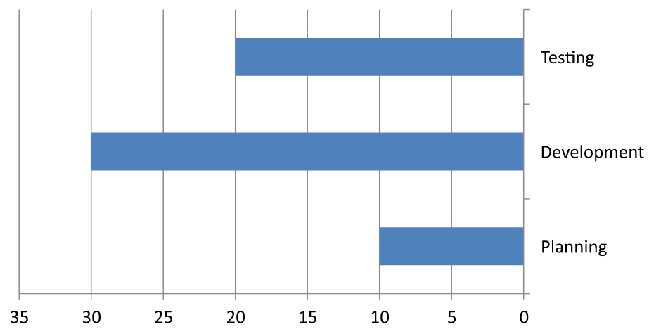

## **Przegląd**

Ten artykuł wyjaśnia, jak dostosować osie wykresu przy użyciu Aspose.Slides for Java. Omówiono obliczone wartości osi, zamianę wierszy i kolumn wykresu, widoczność osi, interwały etykiet kategorii i znaczników podziałki, kategorie dat i formatowanie, obrót tytułu, pozycjonowanie osi, jednostki wyświetlania oraz skalowanie logarytmiczne.

## **Uzyskaj maksymalne wartości na pionowej osi wykresów**

Utwórz [Presentation](https://reference.aspose.com/slides/java/com.aspose.slides/presentation/) i dodaj wykres powierzchniowy z danymi domyślnymi. Wywołaj [validateChartLayout](https://reference.aspose.com/slides/java/com.aspose.slides/chart/#validateChartLayout--) przed odczytaniem obliczonych wartości osi, aby układ wykresu był aktualny.

Odczytaj [getActualMaxValue](https://reference.aspose.com/slides/java/com.aspose.slides/axis/#getActualMaxValue--) i [getActualMinValue](https://reference.aspose.com/slides/java/com.aspose.slides/axis/#getActualMinValue--) dla granic osi oraz [getActualMajorUnit](https://reference.aspose.com/slides/java/com.aspose.slides/axis/#getActualMajorUnit--) i [getActualMinorUnit](https://reference.aspose.com/slides/java/com.aspose.slides/axis/#getActualMinorUnit--) dla interwałów podziałek. [getActualMajorUnitScale](https://reference.aspose.com/slides/java/com.aspose.slides/axis/#getActualMajorUnitScale--) i [getActualMinorUnitScale](https://reference.aspose.com/slides/java/com.aspose.slides/axis/#getActualMinorUnitScale--) dostarczają skal jednostek czasu, które mają znaczenie dla osi dat. Przykład zapisuje te wartości w zmiennych lokalnych i zapisuje wykres.

```java
import com.aspose.slides.*;

Presentation presentation = new Presentation();
try {
    ISlide slide = presentation.getSlides().get_Item(0);

    IChart chart = slide.getShapes().addChart(ChartType.Area, 100, 100, 500, 350);
    chart.validateChartLayout();

    double maxValue = chart.getAxes().getVerticalAxis().getActualMaxValue();
    double minValue = chart.getAxes().getVerticalAxis().getActualMinValue();

    double majorUnit = chart.getAxes().getVerticalAxis().getActualMajorUnit();
    double minorUnit = chart.getAxes().getVerticalAxis().getActualMinorUnit();

    int majorUnitScale = chart.getAxes().getVerticalAxis().getActualMajorUnitScale();
    int minorUnitScale = chart.getAxes().getVerticalAxis().getActualMinorUnitScale();

    presentation.save("AxisValues_out.pptx", SaveFormat.Pptx);
} finally {
    presentation.dispose();
}
```

## **Zamień dane między osiami**

Użyj [switchRowColumn](https://reference.aspose.com/slides/java/com.aspose.slides/chartdata/#switchRowColumn--) aby wymienić role serii i kategorii w danych wykresu. Każda wcześniejsza kategoria staje się serią, a każda wcześniejsza seria staje się kategorią. Zmienia to sposób grupowania danych; nie wymienia to osi poziomej i pionowej. Przykład używa [setRange](https://reference.aspose.com/slides/java/com.aspose.slides/chartdata/#setRange-java.lang.String-) aby powiązać domyślne dane z `Sheet1!A1:D5`, włączając wiersz nagłówka i kolumnę kategorii, przed zamianą wierszy i kolumn. Zapisuje wykres z czterema seriami i trzema kategoriami.

```java
import com.aspose.slides.*;

Presentation presentation = new Presentation();
try {
    ISlide slide = presentation.getSlides().get_Item(0);

    IChart chart = slide.getShapes().addChart(ChartType.ClusteredColumn, 100, 100, 400, 300);
    chart.getChartData().setRange("Sheet1!A1:D5");
    chart.getChartData().switchRowColumn();

    presentation.save("SwitchChartRowColumns_out.pptx", SaveFormat.Pptx);
} finally {
    presentation.dispose();
}
```

## **Odwróć kolejność rysowania osi**

Użyj [setPlotOrderReversed](https://reference.aspose.com/slides/java/com.aspose.slides/axis/#setPlotOrderReversed-boolean-) aby odwrócić oś kategorii lub wartości. Na przykład wykres słupkowy poziomy może pokazywać etapy projektu od góry do dołu w tej samej kolejności, co arkusz: Planowanie, Rozwój, Testowanie. Odwrócenie osi zmienia kierunek rysowania; nie sortuje ani nie przestawia danych w skoroszycie. Dla porównania, [switchRowColumn](https://reference.aspose.com/slides/java/com.aspose.slides/chartdata/#switchRowColumn--) wymienia role serii i kategorii.

Poniższy przykład tworzy wykres słupkowy poziomy z trzema etapami i jedną serią. Zapisuje prezentację z trzema slajdami: normalna kolejność, odwrócone kategorie i odwrócone wartości. Każda kopia używa tego samego zestawu danych, a na każdej kopii odwrócona jest tylko jedna oś.

```java
import com.aspose.slides.*;

Presentation presentation = new Presentation();
try {
    ISlide slide = presentation.getSlides().get_Item(0);

    IChart chart = slide.getShapes().addChart(ChartType.ClusteredBar, 50, 40, 620, 320);
    chart.setLegend(false);

    chart.getChartData().getCategories().clear();
    chart.getChartData().getSeries().clear();

    IChartDataWorkbook workbook = chart.getChartData().getChartDataWorkbook();
    workbook.clear(0);

    IChartSeries series = chart.getChartData().getSeries().add(ChartType.ClusteredBar);
    String[] stages = { "Planning", "Development", "Testing" };
    int[] values = { 10, 30, 20 };
    for (int i = 0; i < stages.length; i++) {
        IChartDataCell categoryCell = workbook.getCell(0, i + 1, 0, stages[i]);
        chart.getChartData().getCategories().add(categoryCell);
        IChartDataCell valueCell = workbook.getCell(0, i + 1, 1, values[i]);
        series.getDataPoints().addDataPointForBarSeries(valueCell);
    }

    // Slajd 2: wyświetl pierwszą kategorię na górze.
    ISlide categorySlide = presentation.getSlides().addClone(slide);
    IChart categoryChart = (IChart)categorySlide.getShapes().get_Item(0);
    categoryChart.getAxes().getVerticalAxis().setPlotOrderReversed(true);
    // Zachowaj poziomą oś wartości na dole.
    categoryChart.getAxes().getVerticalAxis().setCrossType(CrossesType.Maximum);

    // Slajd 3: odwróć tylko poziomą skalę liczbową.
    ISlide valueSlide = presentation.getSlides().addClone(slide);
    IChart valueChart = (IChart)valueSlide.getShapes().get_Item(0);
    valueChart.getAxes().getHorizontalAxis().setPlotOrderReversed(true);

    presentation.save("ReversedAxes.pptx", SaveFormat.Pptx);
} finally {
    presentation.dispose();
}
```

Odwrócenie osi może także przenieść prostopadłą oś na przeciwną stronę wykresu. [setCrossType](https://reference.aspose.com/slides/java/com.aspose.slides/axis/#setCrossType-int-) kontroluje, gdzie druga oś przecina konfigurowaną oś. Na slajdzie 2 wywołanie z `CrossesType.Maximum` na odwróconej osi kategorii utrzymuje poziomą oś wartości na dole. Dla konkretnego punktu przecięcia użyj [setCrossAt](https://reference.aspose.com/slides/java/com.aspose.slides/axis/#setCrossAt-float-). Sprawdź ustawienia przecięcia przy zmianie kierunku, zwłaszcza jeśli wykres ma już własny punkt przecięcia. Wywołaj `setPlotOrderReversed` z `false`, aby przywrócić normalny kierunek rysowania; ustawienia przecięcia są niezależne.

| Normalna kolejność (slajd 1) | Odwrócone kategorie (slajd 2) | Odwrócone wartości (slajd 3) |
| --- | --- | --- |
|  |  |  |
| Kategorie rosną od dołu do góry; wartości rosną od lewej do prawej. | Planowanie, Rozwój i Testowanie rosną od góry do dołu. Wartości i kolejność wierszy skoroszytu pozostają niezmienione. | Kategorie zachowują normalną kolejność; wartości rosną od prawej do lewej. Oś kategorii przecina się w zerze po prawej stronie. |

## **Ukryj pionową oś w wykresach liniowych**

Wywołaj [setVisible](https://reference.aspose.com/slides/java/com.aspose.slides/axis/#setVisible-boolean-) z `false` na pionowej osi, aby ją ukryć. Przykład tworzy wykres liniowy z danymi domyślnymi i zapisuje go z ukrytą pionową osią.

```java
import com.aspose.slides.*;

Presentation presentation = new Presentation();
try {
    ISlide slide = presentation.getSlides().get_Item(0);

    IChart chart = slide.getShapes().addChart(ChartType.Line, 100, 100, 400, 300);
    chart.getAxes().getVerticalAxis().setVisible(false);

    presentation.save("HiddenVerticalAxis.pptx", SaveFormat.Pptx);
} finally {
    presentation.dispose();
}
```

## **Ukryj poziomą oś w wykresach liniowych**

Wywołaj [setVisible](https://reference.aspose.com/slides/java/com.aspose.slides/axis/#setVisible-boolean-) z `false` na poziomej osi, aby ją ukryć. Przykład tworzy wykres liniowy z danymi domyślnymi i zapisuje go z ukrytą poziomą osią.

```java
import com.aspose.slides.*;

Presentation presentation = new Presentation();
try {
    ISlide slide = presentation.getSlides().get_Item(0);

    IChart chart = slide.getShapes().addChart(ChartType.Line, 100, 100, 400, 300);
    chart.getAxes().getHorizontalAxis().setVisible(false);

    presentation.save("HiddenHorizontalAxis.pptx", SaveFormat.Pptx);
} finally {
    presentation.dispose();
}
```

## **Zmień oś kategorii**

Użyj [setCategoryAxisType](https://reference.aspose.com/slides/java/com.aspose.slides/axis/#setCategoryAxisType-int-) aby wybrać oś dat lub tekstową. Ten przykład wymaga pliku `ExistingChart.pptx`, w którym wykres jest pierwszym kształtem na pierwszym slajdzie, a komórki kategorii zawierają numeryczne wartości dat Excel. Zmienia poziomą oś na oś dat. Wywołanie [setAutomaticMajorUnit](https://reference.aspose.com/slides/java/com.aspose.slides/axis/#setAutomaticMajorUnit-boolean-) z `false`, [setMajorUnit](https://reference.aspose.com/slides/java/com.aspose.slides/axis/#setMajorUnit-double-) z `1` oraz [setMajorUnitScale](https://reference.aspose.com/slides/java/com.aspose.slides/axis/#setMajorUnitScale-int-) z `TimeUnitType.Months` ustawia główne podziały co jeden miesiąc.

```java
import com.aspose.slides.*;

Presentation presentation = new Presentation("ExistingChart.pptx");
try {
    ISlide slide = presentation.getSlides().get_Item(0);

    IChart chart = (IChart) slide.getShapes().get_Item(0);
    chart.getAxes().getHorizontalAxis().setCategoryAxisType(CategoryAxisType.Date);
    chart.getAxes().getHorizontalAxis().setAutomaticMajorUnit(false);
    chart.getAxes().getHorizontalAxis().setMajorUnit(1);
    chart.getAxes().getHorizontalAxis().setMajorUnitScale(TimeUnitType.Months);

    presentation.save("ChangeChartCategoryAxis_out.pptx", SaveFormat.Pptx);
} finally {
    presentation.dispose();
}
```

## **Kontroluj interwały etykiet osi kategorii**

Gdy wykres posiada wiele kategorii, zmniejsz liczbę widocznych etykiet osi bez usuwania kategorii lub punktów danych. Wywołaj [setAutomaticTickLabelSpacing](https://reference.aspose.com/slides/java/com.aspose.slides/iaxis/#setAutomaticTickLabelSpacing-boolean-) z `false`, a następnie przekaż żądany interwał kategorii do [setTickLabelSpacing](https://reference.aspose.com/slides/java/com.aspose.slides/iaxis/#setTickLabelSpacing-long-). Dla tekstowych kategorii w ich normalnym porządku liczenie zaczyna się od pierwszej kategorii:

| Interwał | Etykiety wyświetlane w przykładzie |
| --- | --- |
| `1` | Kategoria 1, Kategoria 2, Kategoria 3, … Kategoria 24 |
| `2` | Kategoria 1, Kategoria 3, Kategoria 5, … Kategoria 23 |
| `3` | Kategoria 1, Kategoria 4, Kategoria 7, … Kategoria 22 |

Interwał `3` wyświetla co trzecią etykietę, ukrywając dwie etykiety pomiędzy wyświetlanymi. Nie usuwa to odpowiadających kolumn. Automatyczne rozmieszczenie wybiera interwał w zależności od dostępnego miejsca; nie musi wyświetlać każdej etykiety.

Znaczniki podziałek mają oddzielne kontrolki. Wywołaj [setAutomaticTickMarksSpacing](https://reference.aspose.com/slides/java/com.aspose.slides/iaxis/#setAutomaticTickMarksSpacing-boolean-) z `false` i użyj [setTickMarksSpacing](https://reference.aspose.com/slides/java/com.aspose.slides/iaxis/#setTickMarksSpacing-long-) aby ustawić ich interwał. Na przykład `1` pozostawia znacznik podziałki przy każdym interwale kategorii, podczas gdy etykiety pojawiają się co trzecią kategorię. Użyj [setMajorTickMark](https://reference.aspose.com/slides/java/com.aspose.slides/iaxis/#setMajorTickMark-int-) z widocznym stylem, aby zobaczyć rezultat. Ponowne wywołanie któregokolwiek z automatycznych setterów z `true` pozwala wykresowi ponownie wybrać interwał.

Poniższy, samodzielny przykład tworzy 24 kategorie i jedną serię, a następnie zapisuje trzy slajdy w `CategoryAxisIntervals.pptx`: automatyczne rozmieszczenie, ręczne rozmieszczenie etykiet przy niezależnych znacznikach podziałek oraz przywrócone automatyczne rozmieszczenie. Dwie kopie zachowują pierwotne dane wykresu. Nie wymaga wejściowej prezentacji. Tekst poziomych etykiet uwidacznia różnicę w gęstości.

```java
import com.aspose.slides.*;

Presentation presentation = new Presentation();
try {
    ISlide slide = presentation.getSlides().get_Item(0);

    IChart chart = slide.getShapes().addChart(ChartType.ClusteredColumn, 30, 40, 660, 320);

    chart.setLegend(false);
    chart.getChartData().getCategories().clear();
    chart.getChartData().getSeries().clear();

    IChartDataWorkbook workbook = chart.getChartData().getChartDataWorkbook();
    workbook.clear(0);

    IChartSeries series = chart.getChartData().getSeries().add(ChartType.ClusteredColumn);
    for (int i = 0; i < 24; i++) {
        IChartDataCell categoryCell = workbook.getCell(0, i + 1, 0, "Category " + (i + 1));
        chart.getChartData().getCategories().add(categoryCell);
        IChartDataCell valueCell = workbook.getCell(0, i + 1, 1, 10 + i % 6 * 5);
        series.getDataPoints().addDataPointForBarSeries(valueCell);
    }

    IAxis axis = chart.getAxes().getHorizontalAxis();
    axis.setCategoryAxisType(CategoryAxisType.Text);
    axis.getTextFormat().getTextBlockFormat().setRotationAngle(0);
    axis.getTextFormat().getPortionFormat().setFontHeight(12);
    axis.setMajorTickMark(TickMarkType.Outside);
    axis.setAutomaticTickLabelSpacing(true);
    axis.setAutomaticTickMarksSpacing(true);

    // Slajd 2: pokaż co trzecią etykietę, ale zachowaj znacznik podziałki dla każdej kategorii.
    ISlide manualSlide = presentation.getSlides().addClone(slide);
    IChart manualChart = (IChart)manualSlide.getShapes().get_Item(0);
    IAxis manualAxis = manualChart.getAxes().getHorizontalAxis();
    manualAxis.setAutomaticTickLabelSpacing(false);
    manualAxis.setTickLabelSpacing(3);
    manualAxis.setAutomaticTickMarksSpacing(false);
    manualAxis.setTickMarksSpacing(1);

    // Slajd 3: pozwól wykresowi ponownie wybrać oba interwały.
    ISlide restoredSlide = presentation.getSlides().addClone(manualSlide);
    IChart restoredChart = (IChart)restoredSlide.getShapes().get_Item(0);
    restoredChart.getAxes().getHorizontalAxis().setAutomaticTickLabelSpacing(true);
    restoredChart.getAxes().getHorizontalAxis().setAutomaticTickMarksSpacing(true);

    presentation.save("CategoryAxisIntervals.pptx", SaveFormat.Pptx);
} finally {
    presentation.dispose();
}
```

**Automatyczne rozmieszczenie (slajd 1):** W tym renderowaniu co druga etykieta kategorii jest wyświetlana i łamie się na dwie linie. Wynik automatyczny może się różnić w zależności od rozmiaru wykresu, czcionek i renderera.


**Ręczne rozmieszczenie (slajd 2):** Co trzecia etykieta jest wyświetlana w jednej linii, a znaczniki podziałek pozostają przy każdym interwale kategorii. Wszystkie 24 kolumny, w tym te bez etykiet, pozostają widoczne z tymi samymi wartościami. Slajd 3 przywraca automatyczny wygląd pokazany powyżej.


### **Wybierz właściwą oś i interwał**

Użyj tego interwału liczenia kategorii dla tekstowej osi kategorii, takiej jak oś kategorii wykresu kolumnowego, liniowego, powierzchniowego lub słupkowego. W wykresie kolumnowym jest to oś pozioma. W wykresie słupkowym poziomym oś kategorii jest pionowa, więc zastosuj te ustawienia do osi zwróconej przez [getVerticalAxis](https://reference.aspose.com/slides/java/com.aspose.slides/iaxesmanager/#getVerticalAxis--). Rozstawienie znaczników podziałek odnosi się także do osi serii w wykresach, które taką posiadają.

Nie używaj rozmieszczenia etykiet kategorii do ustawiania skal liczbowych osi wartości. Na osi wartości [setMajorUnit](https://reference.aspose.com/slides/java/com.aspose.slides/iaxis/#setMajorUnit-double-) określa różnicę wartości: na przykład jednostka główna `10` tworzy znaczniki w 0, 10, 20 itd., gdy oś zaczyna się od zera. Interwał etykiet kategorii `3` liczy pozycje kategorii, niezależnie od ich wartości danych. Wykresy punktowe i bąbelkowe używają osi wartości, a nie tekstowej osi kategorii. Dla osi dat użyj jednostek i skal czasowych opisanych w sekcji [Zmień oś kategorii](#zmień-osi-kategorii).

## **Ustaw format daty dla wartości osi kategorii**

Przykład zastępuje domyślne dane wykresu czterema rocznymi wartościami. Daty są przechowywane jako liczby seryjne OLE Automation w pierwszym arkuszu (indeks `0`), obliczane jako liczba dni od 30 grudnia 1899 dla tych dat. Użyj [setCategoryAxisType](https://reference.aspose.com/slides/java/com.aspose.slides/axis/#setCategoryAxisType-int-) z `CategoryAxisType.Date`, wywołaj [setNumberFormatLinkedToSource](https://reference.aspose.com/slides/java/com.aspose.slides/axis/#setNumberFormatLinkedToSource-boolean-) z `false`, i przekaż `yyyy` do [setNumberFormat](https://reference.aspose.com/slides/java/com.aspose.slides/axis/#setNumberFormat-java.lang.String-), aby etykiety kategorii wyświetlały czterocyfrowe lata niezależnie od formatowania komórki.

```java
import com.aspose.slides.*;
import java.time.LocalDate;

Presentation presentation = new Presentation();
try {
    ISlide slide = presentation.getSlides().get_Item(0);

    IChart chart = slide.getShapes().addChart(ChartType.Line, 50, 50, 450, 300);

    chart.getChartData().getCategories().clear();
    chart.getChartData().getSeries().clear();

    IChartDataWorkbook workbook = chart.getChartData().getChartDataWorkbook();
    workbook.clear(0);

    LocalDate baseDate = LocalDate.of(1899, 12, 30);

    IChartSeries series = chart.getChartData().getSeries().add(ChartType.Line);
    for (int i = 0; i < 4; i++) {
        LocalDate date = LocalDate.of(2015 + i, 1, 1);
        IChartDataCell categoryCell = workbook.getCell(0, i + 1, 0, date.toEpochDay() - baseDate.toEpochDay());
        chart.getChartData().getCategories().add(categoryCell);

        IChartDataCell valueCell = workbook.getCell(0, i + 1, 1, i + 1);
        series.getDataPoints().addDataPointForLineSeries(valueCell);
    }

    chart.getAxes().getHorizontalAxis().setCategoryAxisType(CategoryAxisType.Date);
    chart.getAxes().getHorizontalAxis().setNumberFormatLinkedToSource(false);
    chart.getAxes().getHorizontalAxis().setNumberFormat("yyyy");

    presentation.save("DateAxisFormat.pptx", SaveFormat.Pptx);
} finally {
    presentation.dispose();
}
```

## **Ustaw kąt obrotu tytułu osi wykresu**

Wywołaj [setTitle](https://reference.aspose.com/slides/java/com.aspose.slides/axis/#setTitle-boolean-) z `true` na pionowej osi, podaj tekst tytułu i użyj [setRotationAngle](https://reference.aspose.com/slides/java/com.aspose.slides/icharttextblockformat/#setRotationAngle-float-) aby obrócić tytuł. Kąt jest podawany w stopniach; ten przykład zapisuje wykres kolumnowy z tytułem osi wartości obróconym o 90 stopni.

```java
import com.aspose.slides.*;

Presentation presentation = new Presentation();
try {
    ISlide slide = presentation.getSlides().get_Item(0);

    IChart chart = slide.getShapes().addChart(ChartType.ClusteredColumn, 50, 50, 450, 300);
    chart.getAxes().getVerticalAxis().setTitle(true);
    chart.getAxes().getVerticalAxis().getTitle().addTextFrameForOverriding("Value");
    chart.getAxes().getVerticalAxis().getTitle().getTextFormat().getTextBlockFormat().setRotationAngle(90);

    presentation.save("RotatedAxisTitle.pptx", SaveFormat.Pptx);
} finally {
    presentation.dispose();
}
```

## **Ustaw pozycję osi na osi kategorii lub wartości**

Użyj [setAxisBetweenCategories](https://reference.aspose.com/slides/java/com.aspose.slides/axis/#setAxisBetweenCategories-boolean-) aby kontrolować, czy oś wartości przecina oś kategorii pomiędzy kategoriami, czy na znacznikach podziałek kategorii. To ustawienie dotyczy osi kategorii. Przykład ustawia tę wartość na `true` na poziomej osi kategorii wykresu kolumnowego i zapisuje wynik.

```java
import com.aspose.slides.*;

Presentation presentation = new Presentation();
try {
    ISlide slide = presentation.getSlides().get_Item(0);

    IChart chart = slide.getShapes().addChart(ChartType.ClusteredColumn, 50, 50, 450, 300);
    chart.getAxes().getHorizontalAxis().setAxisBetweenCategories(true);

    presentation.save("AxisBetweenCategories.pptx", SaveFormat.Pptx);
} finally {
    presentation.dispose();
}
```

## **Ustaw jednostkę wyświetlania na osi wartości wykresu**

Użyj [setDisplayUnit](https://reference.aspose.com/slides/java/com.aspose.slides/axis/#setDisplayUnit-int-) aby skalować etykiety na osi wartości bez zmiany podstawowych danych. Przy [DisplayUnitType](https://reference.aspose.com/slides/java/com.aspose.slides/displayunittype/) ustawionym na `Millions`, wartość 60 000 000 jest wyświetlana jako 60. Przykład tworzy wykres kolumnowy i stosuje jednostkę wyświetlania „miliony” do jego pionowej osi.

```java
import com.aspose.slides.*;

Presentation presentation = new Presentation();
try {
    ISlide slide = presentation.getSlides().get_Item(0);

    IChart chart = slide.getShapes().addChart(ChartType.ClusteredColumn, 50, 50, 450, 300);
    chart.getAxes().getVerticalAxis().setDisplayUnit(DisplayUnitType.Millions);

    presentation.save("Result.pptx", SaveFormat.Pptx);
} finally {
    presentation.dispose();
}
```

## **Skonfiguruj logarytmiczną oś wartości**

Logarytmiczna oś wartości jest przydatna, gdy dodatnie wartości rozciągają się na kilka rzędów wielkości. Na przykład usługa może otrzymać 10, 100, 1 000, 10 000 i 100 000 żądań w pięciu okresach. Na skali liniowej mniejsze wartości znajdują się blisko siebie w pobliżu zera. Skala logarytmiczna ułatwia porównanie ich względnego wzrostu: równe odległości oznaczają równe stosunki, a nie równe różnice.

Wywołaj [setLogarithmic](https://reference.aspose.com/slides/java/com.aspose.slides/axis/#setLogarithmic-boolean-) z `true` na osi wartości i użyj [setLogBase](https://reference.aspose.com/slides/java/com.aspose.slides/axis/#setLogBase-double-) aby wybrać podstawę. Zmienia to sposób wyświetlania istniejących wartości; nie zmienia danych ani nie dodaje logarytmicznej linii trendu. Linia trendu reprezentuje dopasowaną zależność w danych i jest osobną funkcją.

### **Wybierz oś wartości i podstawę**

Dla wykresu liniowego lub kolumnowego oś wartości zwracana jest przez [getVerticalAxis](https://reference.aspose.com/slides/java/com.aspose.slides/iaxesmanager/#getVerticalAxis--). Dla wykresu słupkowego poziomego zwracana jest przez [getHorizontalAxis](https://reference.aspose.com/slides/java/com.aspose.slides/iaxesmanager/#getHorizontalAxis--). Wykresy punktowe i bąbelkowe mają dwie osie wartości, więc wybierz oś poziomą dla wartości X, oś pionową dla Y lub obie. Nie stosuj skalowania logarytmicznego do osi kategorii.

Domyślna podstawa logarytmu to `10`. Dla wykresów PPTX można używać podstaw od `2` do `1000`, włącznie; obsługiwane są także ułamkowe podstawy, takie jak `2.5`. Przy podstawie `10` kolejne potęgi, takie jak 10, 100, 1 000 i 10 000, są równomiernie rozmieszczone.

### **Porównaj skalowanie liniowe i logarytmiczne**

Poniższy, samodzielny przykład tworzy wykres liniowy z pięcioma liczbami żądań na slajdzie 1, a następnie klonuje ten slajd i włącza logarytmiczną oś wartości o podstawie 10 na slajdzie 2. Oba slajdy zachowują te same dane.

```java
import com.aspose.slides.*;

Presentation presentation = new Presentation();
try {
    ISlide slide = presentation.getSlides().get_Item(0);

    IChart chart = slide.getShapes().addChart(ChartType.Line, 30, 40, 660, 200);

    chart.setLegend(false);

    chart.getChartData().getCategories().clear();
    chart.getChartData().getSeries().clear();

    IChartDataWorkbook workbook = chart.getChartData().getChartDataWorkbook();
    workbook.clear(0);

    IChartSeries series = chart.getChartData().getSeries().add(ChartType.Line);
    double[] values = { 10, 100, 1000, 10000, 100000 };

    for (int i = 0; i < values.length; i++) {
        IChartDataCell categoryCell = workbook.getCell(0, i + 1, 0, "Period " + (i + 1));
        chart.getChartData().getCategories().add(categoryCell);

        IChartDataCell valueCell = workbook.getCell(0, i + 1, 1, values[i]);
        series.getDataPoints().addDataPointForLineSeries(valueCell);
    }

    // Zachowaj pierwszy slajd w trybie liniowym i zmień tylko skalę osi wartości w kopii.
    ISlide logarithmicSlide = presentation.getSlides().addClone(slide);
    IChart logarithmicChart = (IChart)logarithmicSlide.getShapes().get_Item(0);
    IAxis valueAxis = logarithmicChart.getAxes().getVerticalAxis();
    valueAxis.setLogarithmic(true);
    valueAxis.setLogBase(10);

    presentation.save("LogarithmicAxis.pptx", SaveFormat.Pptx);
} finally {
    presentation.dispose();
}
```

**Skala liniowa (slajd 1):** Równe odległości pionowe oznaczają równe różnice w liczbie żądań. Największa wartość dominuje wykres, utrudniając rozróżnienie mniejszych wartości.


**Skala logarytmiczna (slajd 2):** Równe odległości pionowe oznaczają równe stosunki. Każdy okres ma dziesięć razy więcej żądań niż poprzedni, więc punkty tworzą prostą rosnącą linię na skali logarytmicznej o podstawie 10. Etykiety osi wciąż pokazują pierwotne liczby żądań.


### **Obsługa zer i wartości ujemnych**

Skala logarytmiczna może wyświetlać wyłącznie wartości ściśle dodatnie. Sprawdź dane przed jej włączeniem. Jeśli zero lub wartości ujemne mają znaczenie, zachowaj skalę liniową lub pokaż je oddzielnie. Jeśli pominięcie tych wartości jest uzasadnione, wyjaśnij ten zabieg. Nie zastępuj ich cicho małymi dodatnimi liczbami, gdyż zmienia to znaczenie danych. Każde ręcznie skonfigurowane minimum lub maksimum dla logarytmicznej osi musi również być dodatnie.

## **FAQ**

**Jak ustawić wartość, w której jedna oś przecina drugą (przecięcie osi)?**

Użyj [setCrossType](https://reference.aspose.com/slides/java/com.aspose.slides/axis/#setCrossType-int-) aby wybrać zachowanie przecięcia. Aby określić liczbową wartość przecięcia, użyj [setCrossAt](https://reference.aspose.com/slides/java/com.aspose.slides/axis/#setCrossAt-float-). Te ustawienia pozwalają przesunąć przecięcie osi do odpowiedniej linii bazowej.

**Jak mogę pozycjonować etykiety podziałek względem osi?**

Wywołaj [setTickLabelPosition](https://reference.aspose.com/slides/java/com.aspose.slides/axis/#setTickLabelPosition-int-) używając [TickLabelPositionType](https://reference.aspose.com/slides/java/com.aspose.slides/ticklabelpositiontype/): `Low`, `High`, `NextTo` lub `None`. Aby kontrolować same znaczniki podziałek, użyj [setMajorTickMark](https://reference.aspose.com/slides/java/com.aspose.slides/axis/#setMajorTickMark-int-) lub [setMinorTickMark](https://reference.aspose.com/slides/java/com.aspose.slides/axis/#setMinorTickMark-int-); są one niezależne od pozycjonowania etykiet.