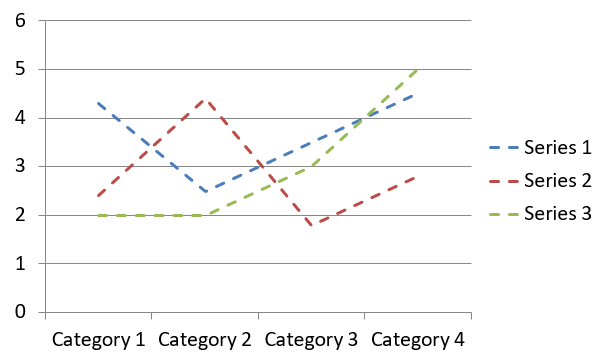

## **Przegląd**

Ten artykuł zawiera kompleksowy przewodnik, jak tworzyć i dostosowywać wykresy przy użyciu Aspose.Slides for Java. Dowiesz się, jak programowo dodać wykres do slajdu, wypełnić go danymi oraz zastosować różne opcje formatowania, aby dopasować go do konkretnych wymagań projektowych. W całym artykule szczegółowe przykłady kodu ilustrują każdy krok, od inicjalizacji prezentacji i obiektu wykresu po konfigurowanie serii, osi i legend. Postępując zgodnie z tym przewodnikiem, zdobędziesz solidną wiedzę na temat integracji dynamicznego generowania wykresów w aplikacjach Java, usprawniając proces tworzenia prezentacji opartych na danych.

## **Tworzenie wykresu**

Wykresy pomagają szybciej wizualizować dane i uzyskać wnioski, które mogą nie być od razu widoczne w tabeli lub arkuszu kalkulacyjnym.

**Dlaczego tworzyć wykresy?**

Using charts, you can:
* agregować, zagęszczać lub podsumowywać duże ilości danych na jednym slajdzie prezentacji;
* ujawniać wzorce i trendy w danych;
* wykonywać wnioski o kierunku i dynamice danych w czasie lub w odniesieniu do określonej jednostki miary;
* wykrywać wartości odstające, anomalie, odchylenia, błędy i nielogiczne dane;
* komunikować lub prezentować złożone dane.

W programie PowerPoint możesz tworzyć wykresy za pomocą funkcji *Wstawianie*, która udostępnia szablony do projektowania wielu typów wykresów. Korzystając z Aspose.Slides, możesz tworzyć zarówno standardowe wykresy (oparte na popularnych typach) jak i wykresy niestandardowe.

{}
Użyj wyliczenia [ChartType](https://reference.aspose.com/slides/java/com.aspose.slides/charttype/) w pakiecie [com.aspose.slides](https://reference.aspose.com/slides/java/com.aspose.slides/). Wartości w tym wyliczeniu odpowiadają różnym typom wykresów.
{}

### **Utworzenie wykresów kolumnowych grupowanych**

Ten przykład używa [addChart](https://reference.aspose.com/slides/java/com.aspose.slides/ishapecollection/#addChart-int-float-float-float-float-) do stworzenia wykresu kolumnowego grupowanego, który porównuje dwie serie w trzech kategoriach. Serie używają wypełnień czerwonego i zielonego, a indywidualne etykiety pokazują nazwy kategorii, nazwy serii oraz wartości. Indeks arkusza 0 odnosi się do pierwszego arkusza w osadzonym skoroszycie wykresu.

```java
import com.aspose.slides.*;
import java.awt.Color;

Presentation presentation = new Presentation();
try
{
    ISlide slide = presentation.getSlides().get_Item(0);

    IChart chart = slide.getShapes().addChart(ChartType.ClusteredColumn, 20, 20, 500, 300);

    chart.getChartTitle().addTextFrameForOverriding("Sample Title");
    chart.getChartTitle().getTextFrameForOverriding().getTextFrameFormat().setCenterText(NullableBool.True);
    chart.getChartTitle().setHeight(20);
    chart.setTitle(true);

    IChartDataWorkbook workbook = chart.getChartData().getChartDataWorkbook();
    int worksheetIndex = 0;

    chart.getChartData().getSeries().clear();
    chart.getChartData().getCategories().clear();

    IChartDataCell seriesNameCell = workbook.getCell(worksheetIndex, 0, 1, "Series 1");
    chart.getChartData().getSeries().add(seriesNameCell, chart.getType());
    seriesNameCell = workbook.getCell(worksheetIndex, 0, 2, "Series 2");
    chart.getChartData().getSeries().add(seriesNameCell, chart.getType());

    IChartDataCell categoryCell = workbook.getCell(worksheetIndex, 1, 0, "Category 1");
    chart.getChartData().getCategories().add(categoryCell);
    categoryCell = workbook.getCell(worksheetIndex, 2, 0, "Category 2");
    chart.getChartData().getCategories().add(categoryCell);
    categoryCell = workbook.getCell(worksheetIndex, 3, 0, "Category 3");
    chart.getChartData().getCategories().add(categoryCell);

    IChartSeries series = chart.getChartData().getSeries().get_Item(0);

    IChartDataCell valueCell = workbook.getCell(worksheetIndex, 1, 1, 20);
    series.getDataPoints().addDataPointForBarSeries(valueCell);
    valueCell = workbook.getCell(worksheetIndex, 2, 1, 50);
    series.getDataPoints().addDataPointForBarSeries(valueCell);
    valueCell = workbook.getCell(worksheetIndex, 3, 1, 30);
    series.getDataPoints().addDataPointForBarSeries(valueCell);

    series.getFormat().getFill().setFillType(FillType.Solid);
    series.getFormat().getFill().getSolidFillColor().setColor(Color.RED);

    series = chart.getChartData().getSeries().get_Item(1);

    valueCell = workbook.getCell(worksheetIndex, 1, 2, 30);
    series.getDataPoints().addDataPointForBarSeries(valueCell);
    valueCell = workbook.getCell(worksheetIndex, 2, 2, 10);
    series.getDataPoints().addDataPointForBarSeries(valueCell);
    valueCell = workbook.getCell(worksheetIndex, 3, 2, 60);
    series.getDataPoints().addDataPointForBarSeries(valueCell);

    series.getFormat().getFill().setFillType(FillType.Solid);
    series.getFormat().getFill().getSolidFillColor().setColor(new Color(0, 128, 0));

    IDataLabel label = series.getDataPoints().get_Item(0).getLabel();
    label.getDataLabelFormat().setShowCategoryName(true);

    label = series.getDataPoints().get_Item(1).getLabel();
    label.getDataLabelFormat().setShowSeriesName(true);

    label = series.getDataPoints().get_Item(2).getLabel();
    label.getDataLabelFormat().setShowValue(true);
    label.getDataLabelFormat().setShowSeriesName(true);
    label.getDataLabelFormat().setSeparator("/");

    presentation.save("AsposeChart.pptx", SaveFormat.Pptx);
}
finally
{
    presentation.dispose();
}
```

Wynik:


### **Utworzenie wykresów punktowych**

Wykresy punktowe (znane również jako wykresy punktowe lub wykresy x‑y) są często używane do sprawdzania wzorców lub prezentowania korelacji pomiędzy dwoma zmiennymi.

Użyj wykresu punktowego, gdy:
* Masz powiązane dane liczbowe.
* Masz dwie zmienne, które dobrze się ze sobą łączą.
* Chcesz określić, czy dwie zmienne są ze sobą powiązane.
* Masz zmienną niezależną, która ma wiele wartości dla zmiennej zależnej.

Ten przykład rysuje dwa zestawy wartości x‑y. Pierwsza seria używa prostych linii ze znacznikiem‑gwiazdką, natomiast druga używa wygładzonych linii ze znacznikiem‑kółkiem; obie korzystają z rozmiaru znacznika 10, skonfigurowanego przy użyciu [setSize](https://reference.aspose.com/slides/java/com.aspose.slides/imarker/#setSize-int-). Metoda [setSymbol](https://reference.aspose.com/slides/java/com.aspose.slides/imarker/#setSymbol-int-) kontroluje kształt znacznika.

```java
import com.aspose.slides.*;

Presentation presentation = new Presentation();
try
{
    ISlide slide = presentation.getSlides().get_Item(0);

    IChart chart = slide.getShapes().addChart(ChartType.ScatterWithSmoothLines, 20, 20, 500, 300);

    IChartDataWorkbook workbook = chart.getChartData().getChartDataWorkbook();
    int worksheetIndex = 0;

    chart.getChartData().getSeries().clear();

    IChartDataCell seriesNameCell = workbook.getCell(worksheetIndex, 1, 1, "Series 1");
    chart.getChartData().getSeries().add(seriesNameCell, chart.getType());
    seriesNameCell = workbook.getCell(worksheetIndex, 1, 3, "Series 2");
    chart.getChartData().getSeries().add(seriesNameCell, chart.getType());

    IChartSeries series = chart.getChartData().getSeries().get_Item(0);

    IChartDataCell xValueCell = workbook.getCell(worksheetIndex, 2, 1, 1);
    IChartDataCell yValueCell = workbook.getCell(worksheetIndex, 2, 2, 3);
    series.getDataPoints().addDataPointForScatterSeries(xValueCell, yValueCell);

    xValueCell = workbook.getCell(worksheetIndex, 3, 1, 2);
    yValueCell = workbook.getCell(worksheetIndex, 3, 2, 10);
    series.getDataPoints().addDataPointForScatterSeries(xValueCell, yValueCell);

    series.setType(ChartType.ScatterWithStraightLinesAndMarkers);

    series.getMarker().setSize(10);
    series.getMarker().setSymbol(MarkerStyleType.Star);

    series = chart.getChartData().getSeries().get_Item(1);

    xValueCell = workbook.getCell(worksheetIndex, 2, 3, 5);
    yValueCell = workbook.getCell(worksheetIndex, 2, 4, 2);
    series.getDataPoints().addDataPointForScatterSeries(xValueCell, yValueCell);

    xValueCell = workbook.getCell(worksheetIndex, 3, 3, 3);
    yValueCell = workbook.getCell(worksheetIndex, 3, 4, 1);
    series.getDataPoints().addDataPointForScatterSeries(xValueCell, yValueCell);

    xValueCell = workbook.getCell(worksheetIndex, 4, 3, 2);
    yValueCell = workbook.getCell(worksheetIndex, 4, 4, 2);
    series.getDataPoints().addDataPointForScatterSeries(xValueCell, yValueCell);

    xValueCell = workbook.getCell(worksheetIndex, 5, 3, 5);
    yValueCell = workbook.getCell(worksheetIndex, 5, 4, 1);
    series.getDataPoints().addDataPointForScatterSeries(xValueCell, yValueCell);

    series.getMarker().setSize(10);
    series.getMarker().setSymbol(MarkerStyleType.Circle);

    presentation.save("AsposeChart.pptx", SaveFormat.Pptx);
}
finally
{
    presentation.dispose();
}
```

Wynik:


### **Utworzenie wykresów kołowych**

Wykresy kołowe najlepiej służą do pokazania relacji część‑całość w danych, szczególnie gdy dane zawierają etykiety kategoryczne z wartościami liczbowymi. Jednak jeśli dane zawierają wiele części lub etykiet, warto rozważyć użycie wykresu słupkowego.

Ten przykład tworzy wykres kołowy z trzema wartościami kwartalnymi. Każdy wycinek ma własne wypełnienie i obramowanie, a etykiety wyświetlają różne kombinacje wartości, procentów i informacji o serii. Metoda [setFirstSliceAngle](https://reference.aspose.com/slides/java/com.aspose.slides/ichartseriesgroup/#setFirstSliceAngle-int-) ustawia pierwszy wycinek na 180 stopni.

```java
import com.aspose.slides.*;
import java.awt.Color;

Presentation presentation = new Presentation();
try
{
    ISlide slide = presentation.getSlides().get_Item(0);

    IChart chart = slide.getShapes().addChart(ChartType.Pie, 20, 20, 500, 300);

    chart.getChartTitle().addTextFrameForOverriding("Sample Title");
    chart.getChartTitle().getTextFrameForOverriding().getTextFrameFormat().setCenterText(NullableBool.True);
    chart.getChartTitle().setHeight(20);
    chart.setTitle(true);

    chart.getChartData().getSeries().get_Item(0).getLabels().getDefaultDataLabelFormat().setShowValue(true);

    IChartDataWorkbook workbook = chart.getChartData().getChartDataWorkbook();
    int worksheetIndex = 0;

    chart.getChartData().getSeries().clear();
    chart.getChartData().getCategories().clear();

    IChartDataCell categoryCell = workbook.getCell(0, 1, 0, "1st Qtr");
    chart.getChartData().getCategories().add(categoryCell);
    categoryCell = workbook.getCell(0, 2, 0, "2nd Qtr");
    chart.getChartData().getCategories().add(categoryCell);
    categoryCell = workbook.getCell(0, 3, 0, "3rd Qtr");
    chart.getChartData().getCategories().add(categoryCell);

    IChartDataCell seriesNameCell = workbook.getCell(0, 0, 1, "Series 1");
    IChartSeries series = chart.getChartData().getSeries().add(seriesNameCell, chart.getType());

    IChartDataCell valueCell = workbook.getCell(worksheetIndex, 1, 1, 20);
    series.getDataPoints().addDataPointForPieSeries(valueCell);
    valueCell = workbook.getCell(worksheetIndex, 2, 1, 50);
    series.getDataPoints().addDataPointForPieSeries(valueCell);
    valueCell = workbook.getCell(worksheetIndex, 3, 1, 30);
    series.getDataPoints().addDataPointForPieSeries(valueCell);

    chart.getChartData().getSeriesGroups().get_Item(0).setColorVaried(true);

    IChartDataPoint firstSlice = series.getDataPoints().get_Item(0);
    firstSlice.getFormat().getFill().setFillType(FillType.Solid);
    firstSlice.getFormat().getFill().getSolidFillColor().setColor(Color.CYAN);

    firstSlice.getFormat().getLine().getFillFormat().setFillType(FillType.Solid);
    firstSlice.getFormat().getLine().getFillFormat().getSolidFillColor().setColor(Color.GRAY);
    firstSlice.getFormat().getLine().setWidth(3.0);
    firstSlice.getFormat().getLine().setStyle(LineStyle.ThinThick);
    firstSlice.getFormat().getLine().setDashStyle(LineDashStyle.LargeDash);

    IChartDataPoint secondSlice = series.getDataPoints().get_Item(1);
    secondSlice.getFormat().setFillType(FillType.Solid);
    secondSlice.getFormat().getFill().getSolidFillColor().setColor(new Color(165, 42, 42));

    secondSlice.getFormat().getLine().getFillFormat().setFillType(FillType.Solid);
    secondSlice.getFormat().getLine().getFillFormat().getSolidFillColor().setColor(Color.BLUE);
    secondSlice.getFormat().getLine().setWidth(3.0);
    secondSlice.getFormat().getLine().setStyle(LineStyle.Single);
    secondSlice.getFormat().getLine().setDashStyle(LineDashStyle.LargeDashDot);

    IChartDataPoint thirdSlice = series.getDataPoints().get_Item(2);
    thirdSlice.getFormat().getFill().setFillType(FillType.Solid);
    thirdSlice.getFormat().getFill().getSolidFillColor().setColor(new Color(255, 127, 80));

    thirdSlice.getFormat().getLine().getFillFormat().setFillType(FillType.Solid);
    thirdSlice.getFormat().getLine().getFillFormat().getSolidFillColor().setColor(Color.RED);
    thirdSlice.getFormat().getLine().setWidth(2.0);
    thirdSlice.getFormat().getLine().setStyle(LineStyle.ThinThin);
    thirdSlice.getFormat().getLine().setDashStyle(LineDashStyle.LargeDashDotDot);

    IDataLabel firstLabel = series.getDataPoints().get_Item(0).getLabel();
    firstLabel.getDataLabelFormat().setShowValue(true);

    IDataLabel secondLabel = series.getDataPoints().get_Item(1).getLabel();
    secondLabel.getDataLabelFormat().setShowValue(true);
    secondLabel.getDataLabelFormat().setShowLegendKey(true);
    secondLabel.getDataLabelFormat().setShowPercentage(true);

    IDataLabel thirdLabel = series.getDataPoints().get_Item(2).getLabel();
    thirdLabel.getDataLabelFormat().setShowSeriesName(true);
    thirdLabel.getDataLabelFormat().setShowPercentage(true);

    series.getLabels().getDefaultDataLabelFormat().setShowLeaderLines(true);

    chart.getChartData().getSeriesGroups().get_Item(0).setFirstSliceAngle(180);

    presentation.save("PieChart.pptx", SaveFormat.Pptx);
}
finally
{
    presentation.dispose();
}
```

Wynik:


### **Utworzenie wykresów liniowych**

Wykresy liniowe (znane również jako wykresy liniowe) są najlepsze w sytuacjach, gdy chcesz pokazać zmiany wartości w czasie. Dzięki wykresowi liniowemu możesz jednocześnie porównać dużą ilość danych, śledzić zmiany i trendy, podkreślić anomalie w seriach danych i wiele więcej.

Ten przykład używa [addChart](https://reference.aspose.com/slides/java/com.aspose.slides/ishapecollection/#addChart-int-float-float-float-float-) do stworzenia wykresu liniowego z domyślnymi seriami i kategoriami, a następnie zapisuje prezentację jako PPTX.

```java
import com.aspose.slides.*;

Presentation presentation = new Presentation();
try
{
    ISlide slide = presentation.getSlides().get_Item(0);

    IChart lineChart = slide.getShapes().addChart(ChartType.Line, 20, 20, 500, 300);

    presentation.save("lineChart.pptx", SaveFormat.Pptx);
}
finally
{
    presentation.dispose();
}
```

Domyślnie punkty na wykresie liniowym są połączone prostymi liniami ciągłymi. Jeśli chcesz, aby punkty były połączone kreskami, wywołaj [setDashStyle](https://reference.aspose.com/slides/java/com.aspose.slides/ilineformat/#setDashStyle-byte-) z wartością z [LineDashStyle](https://reference.aspose.com/slides/java/com.aspose.slides/linedashstyle/):

```java
import com.aspose.slides.*;

Presentation presentation = new Presentation();
try
{
    ISlide slide = presentation.getSlides().get_Item(0);

    IChart lineChart = slide.getShapes().addChart(ChartType.Line, 20, 20, 500, 300);

    for (IChartSeries series : lineChart.getChartData().getSeries())
    {
        series.getFormat().getLine().setDashStyle(LineDashStyle.Dash);
    }
}
finally
{
    presentation.dispose();
}
```

Wynik:



### **Utworzenie wykresów mapy drzewa**

Wykresy mapy drzewa najlepiej sprawdzają się przy danych sprzedażowych, gdy chcesz pokazać względny rozmiar kategorii danych i szybko zwrócić uwagę na elementy będące dużymi wkładaczami w każdej kategorii.

Ten przykład tworzy mapę drzewa z ośmioma liśćmi pogrupowanymi w cztery pędy i dwie gałęzie. Metoda [setGroupingItem](https://reference.aspose.com/slides/java/com.aspose.slides/ichartcategorylevelsmanager/#setGroupingItem-int-java.lang.Object-) przypisuje pędy na poziomie grupowania 1 i gałęzie na poziomie 2. Wartości określają względne rozmiary prostokątów, a etykiety kategorii i nakładające się etykiety nadrzędne identyfikują hierarchię.

```java
import com.aspose.slides.*;

Presentation presentation = new Presentation();
try
{
    ISlide slide = presentation.getSlides().get_Item(0);

    IChart chart = slide.getShapes().addChart(ChartType.Treemap, 20, 20, 500, 300);

    chart.getChartData().getCategories().clear();
    chart.getChartData().getSeries().clear();

    IChartDataWorkbook workbook = chart.getChartData().getChartDataWorkbook();
    workbook.clear(0);

    // Gałąź 1
    IChartDataCell categoryCell = workbook.getCell(0, "C1", "Leaf1");
    IChartCategory leaf = chart.getChartData().getCategories().add(categoryCell);
    leaf.getGroupingLevels().setGroupingItem(1, "Stem1");
    leaf.getGroupingLevels().setGroupingItem(2, "Branch1");

    categoryCell = workbook.getCell(0, "C2", "Leaf2");
    chart.getChartData().getCategories().add(categoryCell);

    categoryCell = workbook.getCell(0, "C3", "Leaf3");
    leaf = chart.getChartData().getCategories().add(categoryCell);
    leaf.getGroupingLevels().setGroupingItem(1, "Stem2");

    categoryCell = workbook.getCell(0, "C4", "Leaf4");
    chart.getChartData().getCategories().add(categoryCell);

    // Gałąź 2
    categoryCell = workbook.getCell(0, "C5", "Leaf5");
    leaf = chart.getChartData().getCategories().add(categoryCell);
    leaf.getGroupingLevels().setGroupingItem(1, "Stem3");
    leaf.getGroupingLevels().setGroupingItem(2, "Branch2");

    categoryCell = workbook.getCell(0, "C6", "Leaf6");
    chart.getChartData().getCategories().add(categoryCell);

    categoryCell = workbook.getCell(0, "C7", "Leaf7");
    leaf = chart.getChartData().getCategories().add(categoryCell);
    leaf.getGroupingLevels().setGroupingItem(1, "Stem4");

    categoryCell = workbook.getCell(0, "C8", "Leaf8");
    chart.getChartData().getCategories().add(categoryCell);

    IChartSeries series = chart.getChartData().getSeries().add(ChartType.Treemap);
    series.getLabels().getDefaultDataLabelFormat().setShowCategoryName(true);
    IChartDataCell valueCell = workbook.getCell(0, "D1", 4);
    series.getDataPoints().addDataPointForTreemapSeries(valueCell);
    valueCell = workbook.getCell(0, "D2", 5);
    series.getDataPoints().addDataPointForTreemapSeries(valueCell);
    valueCell = workbook.getCell(0, "D3", 3);
    series.getDataPoints().addDataPointForTreemapSeries(valueCell);
    valueCell = workbook.getCell(0, "D4", 6);
    series.getDataPoints().addDataPointForTreemapSeries(valueCell);
    valueCell = workbook.getCell(0, "D5", 9);
    series.getDataPoints().addDataPointForTreemapSeries(valueCell);
    valueCell = workbook.getCell(0, "D6", 9);
    series.getDataPoints().addDataPointForTreemapSeries(valueCell);
    valueCell = workbook.getCell(0, "D7", 4);
    series.getDataPoints().addDataPointForTreemapSeries(valueCell);
    valueCell = workbook.getCell(0, "D8", 3);
    series.getDataPoints().addDataPointForTreemapSeries(valueCell);

    series.setParentLabelLayout(ParentLabelLayoutType.Overlapping);

    presentation.save("Treemap.pptx", SaveFormat.Pptx);
}
finally
{
    presentation.dispose();
}
```

Wynik:


### **Utworzenie wykresów wodospadowych**

Wykres wodospadowy pokazuje, jak dodatnie i ujemne zmiany przyczyniają się do wartości końcowej. Na przykład podział zysku może zaczynać się od przychodu, odejmować koszty i dodawać inne przychody. Kolumny zmian "pływają" pomiędzy poprzednią a nową wartością bieżącą, a kolumny sumaryczne rozciągają się od zera do wartości skumulowanej.

Poniższy przykład używa kwot w tysiącach dolarów amerykańskich:

| Kategoria | Wartość w skoroszycie | Typ kolumny |
| --- | ---: | --- |
| Przychód | 1000 | Wzrost |
| Koszt sprzedaży | -400 | Spadek |
| Zysk brutto | 600 | Suma pośrednia |
| Koszty operacyjne | -200 | Spadek |
| Inny przychód | 50 | Wzrost |
| Zysk netto | 450 | Suma końcowa |

Aby oznaczyć punkt jako sumę pośrednią lub końcową, wywołaj jego metodę [setSetAsTotal](https://reference.aspose.com/slides/java/com.aspose.slides/chartdatapoint/#setSetAsTotal-boolean-) z wartością `true`. Podaj rzeczywistą skumulowaną kwotę w komórce skoroszytu tego punktu: `600` dla zysku brutto (`1000 - 400`) i `450` dla zysku netto (`600 - 200 + 50`). Metoda oznacza kolumnę jako sumę; nie oblicza ani nie wypełnia wartości komórki. Nie używaj zera jako symbolu zastępczego ani nie podawaj innej zmiany dla punktu sumy. Kolumna sumy wyświetla skumulowaną wartość bez ponownego dodawania jej do wartości bieżącej.

Ten kompletny przykład w Javie tworzy wykres przy użyciu członka `Waterfall` wyliczenia [ChartType](https://reference.aspose.com/slides/java/com.aspose.slides/charttype/), czyści domyślne dane i wypełnia osadzony skoroszyt. Indeks arkusza `0` wybiera pierwszy arkusz; kolumna A zawiera nazwy kategorii, a kolumna B wartości. Każda komórka wartości jest dodawana metodą [addDataPointForWaterfallSeries](https://reference.aspose.com/slides/java/com.aspose.slides/ichartdatapointcollection/#addDataPointForWaterfallSeries-com.aspose.slides.IChartDataCell-). Indeksy punktów zerobazowe `2` i `5` identyfikują sumy pośrednie i końcowe. Wywołanie [setShowValue](https://reference.aspose.com/slides/java/com.aspose.slides/idatalabelformat/#setShowValue-boolean-) z `true` wyświetla kwoty na kolumnach. Nie jest wymagane żadne wejściowe źródło prezentacji ani skoroszyt.

```java
import com.aspose.slides.*;

Presentation presentation = new Presentation();
try
{
    ISlide slide = presentation.getSlides().get_Item(0);

    IChart chart = slide.getShapes().addChart(ChartType.Waterfall, 20, 20, 680, 200);

    chart.setTitle(true);
    chart.getChartTitle().addTextFrameForOverriding("Profit breakdown (USD thousands)");
    chart.getChartTitle().setOverlay(false);
    chart.setLegend(false);

    chart.getChartData().getSeries().clear();
    chart.getChartData().getCategories().clear();

    IChartDataWorkbook workbook = chart.getChartData().getChartDataWorkbook();
    int worksheetIndex = 0;

    workbook.clear(worksheetIndex);

    IChartDataCell seriesNameCell = workbook.getCell(worksheetIndex, 0, 1, "Profit");
    IChartSeries series = chart.getChartData().getSeries().add(seriesNameCell, ChartType.Waterfall);
    String[] categories = new String[] { "Revenue", "Cost of sales", "Gross profit", "Operating expenses", "Other income", "Net profit" };
    double[] values = new double[] { 1000, -400, 600, -200, 50, 450 };

    for (int i = 0; i < categories.length; i++)
    {
        IChartDataCell categoryCell = workbook.getCell(worksheetIndex, i + 1, 0, categories[i]);
        chart.getChartData().getCategories().add(categoryCell);
        IChartDataCell valueCell = workbook.getCell(worksheetIndex, i + 1, 1, values[i]);
        series.getDataPoints().addDataPointForWaterfallSeries(valueCell);
    }

    // Trzeci i szósty punkt reprezentują sumy, a nie dodatkowe zmiany.
    series.getDataPoints().get_Item(2).setSetAsTotal(true);
    series.getDataPoints().get_Item(5).setSetAsTotal(true);
    series.setShowConnectorLines(true);
    series.getLabels().getDefaultDataLabelFormat().setShowValue(true);

    presentation.save("WaterfallChart.pptx", SaveFormat.Pptx);
}
finally
{
    presentation.dispose();
}
```

Wywołaj metodę na poziomie serii [setShowConnectorLines](https://reference.aspose.com/slides/java/com.aspose.slides/chartseries/#setShowConnectorLines-boolean-) z `true`, aby wyświetlić linie łączące kolejne kolumny i ułatwić śledzenie wartości bieżącej. Aby ukryć te linie, zamień wywołanie metody w przykładzie na `series.setShowConnectorLines(false);` przed zapisem. Zmienia to tylko widoczność linii, nie dane ani sumy.

Zapisana prezentacja pokazuje zysk brutto 600 i zysk netto 450, przy czym obie sumy są rysowane od zera:


### **Utworzenie wykresów giełdowych**

Wykresy giełdowe służą do wyświetlania danych finansowych, takich jak ceny otwarcia, maksymalne, minimalne i zamknięcia, pomagając analizować trendy rynkowe i zmienność. Dostarczają kluczowych informacji o wydajności akcji, wspierając inwestorów i analityków w podejmowaniu świadomych decyzji.

Ten przykład tworzy wykres otwarcia‑maksimum‑minimum‑zamknięcia z czterema seriami w tej kolejności i trzema kategoriami. Metoda [setUpDownBars](https://reference.aspose.com/slides/java/com.aspose.slides/iupdownbarsmanager/#setUpDownBars-boolean-) włącza słupki wzrostu/spadku, a [getHiLowLinesFormat](https://reference.aspose.com/slides/java/com.aspose.slides/ichartseriesgroup/#getHiLowLinesFormat--) kontroluje linie wysokich‑niskich pokazujące zakresy cen, podczas gdy linie serii i drobne linie siatki poziome są ukryte.

```java
import com.aspose.slides.*;

Presentation presentation = new Presentation();
try
{
    ISlide slide = presentation.getSlides().get_Item(0);

    IChart chart = slide.getShapes().addChart(ChartType.OpenHighLowClose, 20, 20, 500, 300, false);

    IChartDataWorkbook workbook = chart.getChartData().getChartDataWorkbook();

    IChartDataCell categoryCell = workbook.getCell(0, 1, 0, "A");
    chart.getChartData().getCategories().add(categoryCell);
    categoryCell = workbook.getCell(0, 2, 0, "B");
    chart.getChartData().getCategories().add(categoryCell);
    categoryCell = workbook.getCell(0, 3, 0, "C");
    chart.getChartData().getCategories().add(categoryCell);

    IChartDataCell seriesNameCell = workbook.getCell(0, 0, 1, "Open");
    chart.getChartData().getSeries().add(seriesNameCell, ChartType.OpenHighLowClose);
    seriesNameCell = workbook.getCell(0, 0, 2, "High");
    chart.getChartData().getSeries().add(seriesNameCell, ChartType.OpenHighLowClose);
    seriesNameCell = workbook.getCell(0, 0, 3, "Low");
    chart.getChartData().getSeries().add(seriesNameCell, ChartType.OpenHighLowClose);
    seriesNameCell = workbook.getCell(0, 0, 4, "Close");
    chart.getChartData().getSeries().add(seriesNameCell, ChartType.OpenHighLowClose);

    IChartSeries series = chart.getChartData().getSeries().get_Item(0);
    IChartDataCell valueCell = workbook.getCell(0, 1, 1, 72);
    series.getDataPoints().addDataPointForStockSeries(valueCell);
    valueCell = workbook.getCell(0, 2, 1, 25);
    series.getDataPoints().addDataPointForStockSeries(valueCell);
    valueCell = workbook.getCell(0, 3, 1, 38);
    series.getDataPoints().addDataPointForStockSeries(valueCell);

    series = chart.getChartData().getSeries().get_Item(1);
    valueCell = workbook.getCell(0, 1, 2, 172);
    series.getDataPoints().addDataPointForStockSeries(valueCell);
    valueCell = workbook.getCell(0, 2, 2, 57);
    series.getDataPoints().addDataPointForStockSeries(valueCell);
    valueCell = workbook.getCell(0, 3, 2, 57);
    series.getDataPoints().addDataPointForStockSeries(valueCell);

    series = chart.getChartData().getSeries().get_Item(2);
    valueCell = workbook.getCell(0, 1, 3, 12);
    series.getDataPoints().addDataPointForStockSeries(valueCell);
    valueCell = workbook.getCell(0, 2, 3, 12);
    series.getDataPoints().addDataPointForStockSeries(valueCell);
    valueCell = workbook.getCell(0, 3, 3, 13);
    series.getDataPoints().addDataPointForStockSeries(valueCell);

    series = chart.getChartData().getSeries().get_Item(3);
    valueCell = workbook.getCell(0, 1, 4, 25);
    series.getDataPoints().addDataPointForStockSeries(valueCell);
    valueCell = workbook.getCell(0, 2, 4, 38);
    series.getDataPoints().addDataPointForStockSeries(valueCell);
    valueCell = workbook.getCell(0, 3, 4, 50);
    series.getDataPoints().addDataPointForStockSeries(valueCell);

    chart.getChartData().getSeriesGroups().get_Item(0).getUpDownBars().setUpDownBars(true);
    chart.getChartData().getSeriesGroups().get_Item(0).getHiLowLinesFormat().getLine().getFillFormat().setFillType(FillType.Solid);

    for (IChartSeries stockSeries : chart.getChartData().getSeries())
    {
        stockSeries.getFormat().getLine().getFillFormat().setFillType(FillType.NoFill);
    }

    chart.getAxes().getVerticalAxis().getMinorGridLinesFormat().getLine().getFillFormat().setFillType(FillType.NoFill);

    presentation.save("Stock-chart.pptx", SaveFormat.Pptx);
}
finally
{
    presentation.dispose();
}
```

Wynik:


### **Utworzenie wykresów pudełkowych (Box and Whisker)**

Wykresy pudełkowe są używane do wyświetlania rozkładu danych przez podsumowanie kluczowych miar statystycznych, takich jak mediana, kwartyle i potencjalne wartości odstające. Są szczególnie przydatne w analizie eksploracyjnej i badaniach statystycznych, aby szybko zrozumieć zmienność danych i zidentyfikować ewentualne anomalie.

Ten przykład tworzy wykres pudełkowy z sześciu wartości. Metoda [setQuartileMethod](https://reference.aspose.com/slides/java/com.aspose.slides/ichartseries/#setQuartileMethod-int-) wybiera wyłączny sposób obliczania kwartylów. Przykład włącza także linie średniej, znaczniki średniej, punkty wewnętrzne i punkty odstające.

```java
import com.aspose.slides.*;

Presentation presentation = new Presentation();
try
{
    ISlide slide = presentation.getSlides().get_Item(0);

    IChart chart = slide.getShapes().addChart(ChartType.BoxAndWhisker, 20, 20, 500, 300);

    chart.getChartData().getCategories().clear();
    chart.getChartData().getSeries().clear();

    IChartDataWorkbook workbook = chart.getChartData().getChartDataWorkbook();
    workbook.clear(0);

    IChartDataCell categoryCell = workbook.getCell(0, "A1", "Category 1");
    chart.getChartData().getCategories().add(categoryCell);
    categoryCell = workbook.getCell(0, "A2", "Category 2");
    chart.getChartData().getCategories().add(categoryCell);
    categoryCell = workbook.getCell(0, "A3", "Category 3");
    chart.getChartData().getCategories().add(categoryCell);
    categoryCell = workbook.getCell(0, "A4", "Category 4");
    chart.getChartData().getCategories().add(categoryCell);
    categoryCell = workbook.getCell(0, "A5", "Category 5");
    chart.getChartData().getCategories().add(categoryCell);
    categoryCell = workbook.getCell(0, "A6", "Category 6");
    chart.getChartData().getCategories().add(categoryCell);

    IChartSeries series = chart.getChartData().getSeries().add(ChartType.BoxAndWhisker);

    series.setQuartileMethod(QuartileMethodType.Exclusive);
    series.setShowMeanLine(true);
    series.setShowMeanMarkers(true);
    series.setShowInnerPoints(true);
    series.setShowOutlierPoints(true);

    IChartDataCell valueCell = workbook.getCell(0, "B1", 15);
    series.getDataPoints().addDataPointForBoxAndWhiskerSeries(valueCell);
    valueCell = workbook.getCell(0, "B2", 41);
    series.getDataPoints().addDataPointForBoxAndWhiskerSeries(valueCell);
    valueCell = workbook.getCell(0, "B3", 16);
    series.getDataPoints().addDataPointForBoxAndWhiskerSeries(valueCell);
    valueCell = workbook.getCell(0, "B4", 10);
    series.getDataPoints().addDataPointForBoxAndWhiskerSeries(valueCell);
    valueCell = workbook.getCell(0, "B5", 23);
    series.getDataPoints().addDataPointForBoxAndWhiskerSeries(valueCell);
    valueCell = workbook.getCell(0, "B6", 16);
    series.getDataPoints().addDataPointForBoxAndWhiskerSeries(valueCell);

    presentation.save("BoxAndWhisker.pptx", SaveFormat.Pptx);
}
finally
{
    presentation.dispose();
}
```

### **Utworzenie wykresów lejkowych (Funnel)**

Wykresy lejkowe służą do wizualizacji procesów, które obejmują kolejne etapy, przy czym wolumen danych maleje w miarę przechodzenia z jednego kroku do następnego. Są szczególnie pomocne przy analizie wskaźników konwersji, identyfikacji wąskich gardeł i śledzeniu efektywności procesów sprzedaży lub marketingu.

Ten przykład używa [addChart](https://reference.aspose.com/slides/java/com.aspose.slides/ishapecollection/#addChart-int-float-float-float-float-) do dodania wykresu lejkowego do pierwszego slajdu istniejącej prezentacji. Zastępuje domyślne dane sześcioma kategoriami i wartościami od 50 do 500, a następnie zapisuje zaktualizowaną prezentację. Wejściowa prezentacja musi zawierać co najmniej jeden slajd.

```java
import com.aspose.slides.*;

Presentation presentation = new Presentation("test.pptx");
try
{
    ISlide slide = presentation.getSlides().get_Item(0);

    IChart chart = slide.getShapes().addChart(ChartType.Funnel, 50, 50, 500, 400);

    chart.getChartData().getCategories().clear();
    chart.getChartData().getSeries().clear();

    IChartDataWorkbook workbook = chart.getChartData().getChartDataWorkbook();
    workbook.clear(0);

    IChartDataCell categoryCell = workbook.getCell(0, "A1", "Category 1");
    chart.getChartData().getCategories().add(categoryCell);
    categoryCell = workbook.getCell(0, "A2", "Category 2");
    chart.getChartData().getCategories().add(categoryCell);
    categoryCell = workbook.getCell(0, "A3", "Category 3");
    chart.getChartData().getCategories().add(categoryCell);
    categoryCell = workbook.getCell(0, "A4", "Category 4");
    chart.getChartData().getCategories().add(categoryCell);
    categoryCell = workbook.getCell(0, "A5", "Category 5");
    chart.getChartData().getCategories().add(categoryCell);
    categoryCell = workbook.getCell(0, "A6", "Category 6");
    chart.getChartData().getCategories().add(categoryCell);

    IChartSeries series = chart.getChartData().getSeries().add(ChartType.Funnel);

    IChartDataCell valueCell = workbook.getCell(0, "B1", 50);
    series.getDataPoints().addDataPointForFunnelSeries(valueCell);
    valueCell = workbook.getCell(0, "B2", 100);
    series.getDataPoints().addDataPointForFunnelSeries(valueCell);
    valueCell = workbook.getCell(0, "B3", 200);
    series.getDataPoints().addDataPointForFunnelSeries(valueCell);
    valueCell = workbook.getCell(0, "B4", 300);
    series.getDataPoints().addDataPointForFunnelSeries(valueCell);
    valueCell = workbook.getCell(0, "B5", 400);
    series.getDataPoints().addDataPointForFunnelSeries(valueCell);
    valueCell = workbook.getCell(0, "B6", 500);
    series.getDataPoints().addDataPointForFunnelSeries(valueCell);

    presentation.save("Funnel.pptx", SaveFormat.Pptx);
}
finally
{
    presentation.dispose();
}
```

Wynik:


### **Utworzenie wykresów promieniowych (Sunburst)**

Wykresy promieniowe służą do wizualizacji danych hierarchicznych, wyświetlając poziomy jako koncentryczne pierścienie. Pomagają zilustrować relacje część‑całość i są idealne do przedstawiania zagnieżdżonych kategorii i podkategorii w przejrzystym, zwartym formacie.

Ten przykład tworzy wykres promieniowy z ośmioma liśćmi pogrupowanymi w cztery pędy i dwie gałęzie. Metoda [setGroupingItem](https://reference.aspose.com/slides/java/com.aspose.slides/ichartcategorylevelsmanager/#setGroupingItem-int-java.lang.Object-) przypisuje pędy na poziomie grupowania 1 i gałęzie na poziomie 2. Etykiety kategorii identyfikują segmenty, a wartości określają ich względne rozmiary.

```java
import com.aspose.slides.*;

Presentation presentation = new Presentation();
try
{
    ISlide slide = presentation.getSlides().get_Item(0);

    IChart chart = slide.getShapes().addChart(ChartType.Sunburst, 20, 20, 500, 300);

    chart.getChartData().getCategories().clear();
    chart.getChartData().getSeries().clear();

    IChartDataWorkbook workbook = chart.getChartData().getChartDataWorkbook();
    workbook.clear(0);

    // Gałąź 1
    IChartDataCell categoryCell = workbook.getCell(0, "C1", "Leaf1");
    IChartCategory leaf = chart.getChartData().getCategories().add(categoryCell);
    leaf.getGroupingLevels().setGroupingItem(1, "Stem1");
    leaf.getGroupingLevels().setGroupingItem(2, "Branch1");

    categoryCell = workbook.getCell(0, "C2", "Leaf2");
    chart.getChartData().getCategories().add(categoryCell);

    categoryCell = workbook.getCell(0, "C3", "Leaf3");
    leaf = chart.getChartData().getCategories().add(categoryCell);
    leaf.getGroupingLevels().setGroupingItem(1, "Stem2");

    categoryCell = workbook.getCell(0, "C4", "Leaf4");
    chart.getChartData().getCategories().add(categoryCell);

    // Gałąź 2
    categoryCell = workbook.getCell(0, "C5", "Leaf5");
    leaf = chart.getChartData().getCategories().add(categoryCell);
    leaf.getGroupingLevels().setGroupingItem(1, "Stem3");
    leaf.getGroupingLevels().setGroupingItem(2, "Branch2");

    categoryCell = workbook.getCell(0, "C6", "Leaf6");
    chart.getChartData().getCategories().add(categoryCell);

    categoryCell = workbook.getCell(0, "C7", "Leaf7");
    leaf = chart.getChartData().getCategories().add(categoryCell);
    leaf.getGroupingLevels().setGroupingItem(1, "Stem4");

    categoryCell = workbook.getCell(0, "C8", "Leaf8");
    chart.getChartData().getCategories().add(categoryCell);

    IChartSeries series = chart.getChartData().getSeries().add(ChartType.Sunburst);
    series.getLabels().getDefaultDataLabelFormat().setShowCategoryName(true);
    IChartDataCell valueCell = workbook.getCell(0, "D1", 4);
    series.getDataPoints().addDataPointForSunburstSeries(valueCell);
    valueCell = workbook.getCell(0, "D2", 5);
    series.getDataPoints().addDataPointForSunburstSeries(valueCell);
    valueCell = workbook.getCell(0, "D3", 3);
    series.getDataPoints().addDataPointForSunburstSeries(valueCell);
    valueCell = workbook.getCell(0, "D4", 6);
    series.getDataPoints().addDataPointForSunburstSeries(valueCell);
    valueCell = workbook.getCell(0, "D5", 9);
    series.getDataPoints().addDataPointForSunburstSeries(valueCell);
    valueCell = workbook.getCell(0, "D6", 9);
    series.getDataPoints().addDataPointForSunburstSeries(valueCell);
    valueCell = workbook.getCell(0, "D7", 4);
    series.getDataPoints().addDataPointForSunburstSeries(valueCell);
    valueCell = workbook.getCell(0, "D8", 3);
    series.getDataPoints().addDataPointForSunburstSeries(valueCell);

    presentation.save("Sunburst.pptx", SaveFormat.Pptx);
}
finally
{
    presentation.dispose();
}
```

Wynik:


### **Utworzenie wykresów histogramów**

Histogramy służą do przedstawiania rozkładu danych liczbowych poprzez grupowanie wartości w przedziały (koszyki). Są szczególnie przydatne do identyfikacji wzorców danych, takich jak częstotliwość, skośność i rozproszenie, oraz do wykrywania wartości odstających w zestawie danych.

Ten przykład tworzy histogram z sześciu wartości liczbowych, w tym wartości ujemnych. Wywołanie [setAggregationType](https://reference.aspose.com/slides/java/com.aspose.slides/iaxis/#setAggregationType-int-) z automatycznym typem agregacji pozwala wykresowi określić koszyki używane do wyświetlenia rozkładu.

```java
import com.aspose.slides.*;

Presentation presentation = new Presentation();
try
{
    ISlide slide = presentation.getSlides().get_Item(0);

    IChart chart = slide.getShapes().addChart(ChartType.Histogram, 20, 20, 500, 300);

    chart.getChartData().getCategories().clear();
    chart.getChartData().getSeries().clear();

    IChartDataWorkbook workbook = chart.getChartData().getChartDataWorkbook();
    workbook.clear(0);

    IChartSeries series = chart.getChartData().getSeries().add(ChartType.Histogram);
    IChartDataCell valueCell = workbook.getCell(0, "A1", 15);
    series.getDataPoints().addDataPointForHistogramSeries(valueCell);
    valueCell = workbook.getCell(0, "A2", -41);
    series.getDataPoints().addDataPointForHistogramSeries(valueCell);
    valueCell = workbook.getCell(0, "A3", 16);
    series.getDataPoints().addDataPointForHistogramSeries(valueCell);
    valueCell = workbook.getCell(0, "A4", 10);
    series.getDataPoints().addDataPointForHistogramSeries(valueCell);
    valueCell = workbook.getCell(0, "A5", -23);
    series.getDataPoints().addDataPointForHistogramSeries(valueCell);
    valueCell = workbook.getCell(0, "A6", 16);
    series.getDataPoints().addDataPointForHistogramSeries(valueCell);

    chart.getAxes().getHorizontalAxis().setAggregationType(AxisAggregationType.Automatic);

    presentation.save("Histogram.pptx", SaveFormat.Pptx);
}
finally
{
    presentation.dispose();
}
```

Wynik:


### **Utworzenie wykresów radarowych**

Wykresy radarowe służą do wyświetlania danych wielowymiarowych w dwuwymiarowym formacie, umożliwiając łatwe porównanie kilku zmiennych jednocześnie. Są szczególnie przydatne do identyfikacji wzorców, mocnych i słabych stron w wielu metrykach wydajności lub atrybutach.

Ten przykład używa [addChart](https://reference.aspose.com/slides/java/com.aspose.slides/ishapecollection/#addChart-int-float-float-float-float-) do stworzenia wykresu radarowego z domyślnymi seriami i kategoriami, a następnie zapisuje prezentację jako PPTX.

```java
import com.aspose.slides.*;

Presentation presentation = new Presentation();
try
{
    ISlide slide = presentation.getSlides().get_Item(0);

    slide.getShapes().addChart(ChartType.Radar, 20, 20, 500, 300);

    presentation.save("Radar-chart.pptx", SaveFormat.Pptx);
}
finally
{
    presentation.dispose();
}
```

Wynik:


### **Utworzenie wykresów wielokategorii**

Wykresy wielokategorii służą do wyświetlania danych, które obejmują więcej niż jedną grupę kategoryczną, umożliwiając porównywanie wartości w wielu wymiarach jednocześnie. Są szczególnie pomocne, gdy trzeba analizować trendy i zależności w złożonych, wielowarstwowych zestawach danych.

Ten przykład tworzy wykres kolumnowy grupowany z ośmioma kategoriami ułożonymi w cztery pary. Metoda [setGroupingItem](https://reference.aspose.com/slides/java/com.aspose.slides/ichartcategorylevelsmanager/#setGroupingItem-int-java.lang.Object-) nadaje każdej parze wspólną etykietę na poziomie grupowania 1, tworząc oś kategorii z indywidualnymi i grupowymi etykietami.

```java
import com.aspose.slides.*;

Presentation presentation = new Presentation();
try
{
    ISlide slide = presentation.getSlides().get_Item(0);

    IChart chart = slide.getShapes().addChart(ChartType.ClusteredColumn, 20, 20, 500, 300);

    chart.getChartData().getSeries().clear();
    chart.getChartData().getCategories().clear();

    IChartDataWorkbook workbook = chart.getChartData().getChartDataWorkbook();
    workbook.clear(0);

    int worksheetIndex = 0;

    IChartDataCell categoryCell = workbook.getCell(0, "c2", "A");
    IChartCategory category = chart.getChartData().getCategories().add(categoryCell);
    category.getGroupingLevels().setGroupingItem(1, "Group1");
    categoryCell = workbook.getCell(0, "c3", "B");
    category = chart.getChartData().getCategories().add(categoryCell);

    categoryCell = workbook.getCell(0, "c4", "C");
    category = chart.getChartData().getCategories().add(categoryCell);
    category.getGroupingLevels().setGroupingItem(1, "Group2");
    categoryCell = workbook.getCell(0, "c5", "D");
    category = chart.getChartData().getCategories().add(categoryCell);

    categoryCell = workbook.getCell(0, "c6", "E");
    category = chart.getChartData().getCategories().add(categoryCell);
    category.getGroupingLevels().setGroupingItem(1, "Group3");
    categoryCell = workbook.getCell(0, "c7", "F");
    category = chart.getChartData().getCategories().add(categoryCell);

    categoryCell = workbook.getCell(0, "c8", "G");
    category = chart.getChartData().getCategories().add(categoryCell);
    category.getGroupingLevels().setGroupingItem(1, "Group4");
    categoryCell = workbook.getCell(0, "c9", "H");
    category = chart.getChartData().getCategories().add(categoryCell);

    IChartDataCell seriesNameCell = workbook.getCell(0, "D1", "Series 1");
    IChartSeries series = chart.getChartData().getSeries().add(seriesNameCell, ChartType.ClusteredColumn);

    IChartDataCell valueCell = workbook.getCell(worksheetIndex, "D2", 10);
    series.getDataPoints().addDataPointForBarSeries(valueCell);
    valueCell = workbook.getCell(worksheetIndex, "D3", 20);
    series.getDataPoints().addDataPointForBarSeries(valueCell);
    valueCell = workbook.getCell(worksheetIndex, "D4", 30);
    series.getDataPoints().addDataPointForBarSeries(valueCell);
    valueCell = workbook.getCell(worksheetIndex, "D5", 40);
    series.getDataPoints().addDataPointForBarSeries(valueCell);
    valueCell = workbook.getCell(worksheetIndex, "D6", 50);
    series.getDataPoints().addDataPointForBarSeries(valueCell);
    valueCell = workbook.getCell(worksheetIndex, "D7", 60);
    series.getDataPoints().addDataPointForBarSeries(valueCell);
    valueCell = workbook.getCell(worksheetIndex, "D8", 70);
    series.getDataPoints().addDataPointForBarSeries(valueCell);
    valueCell = workbook.getCell(worksheetIndex, "D9", 80);
    series.getDataPoints().addDataPointForBarSeries(valueCell);

    presentation.save("AsposeChart.pptx", SaveFormat.Pptx);
}
finally
{
    presentation.dispose();
}
```

Wynik:


### **Utworzenie wykresów mapowych**

Wykresy mapowe służą do wizualizacji danych geograficznych poprzez mapowanie informacji na konkretne lokalizacje, takie jak kraje, stany lub miasta. Są szczególnie przydatne do analizy trendów regionalnych, danych demograficznych i rozkładów przestrzennych w przejrzysty, wizualnie atrakcyjny sposób.

Ten przykład używa [addChart](https://reference.aspose.com/slides/java/com.aspose.slides/ishapecollection/#addChart-int-float-float-float-float-) do stworzenia wykresu mapowego z domyślnymi danymi geograficznymi i zapisuje go do przeglądania w PowerPoint.

```java
import com.aspose.slides.*;

Presentation presentation = new Presentation();
try
{
    ISlide slide = presentation.getSlides().get_Item(0);

    IChart chart = slide.getShapes().addChart(ChartType.Map, 20, 20, 500, 300);

    presentation.save("mapChart.pptx", SaveFormat.Pptx);
}
finally
{
    presentation.dispose();
}
```

Wynik:


{}
Powyższy obrazek przedstawia zapisany plik prezentacji otwarty w PowerPoint. Aspose.Slides zapisuje wykres mapowy i jego dane prawidłowo, ale sam nie rysuje wykresów mapowych: gdy slajd zawierający taki wykres jest renderowany do obrazu lub konwertowany na PDF lub SVG, obszar wykresu pozostaje pusty. Inne kształty na tym samym slajdzie pozostają nienaruszone.
{}

### **Utworzenie wykresów kombinowanych**

Wykres kombinowany (lub wykres combo) łączy dwa lub więcej typów wykresów w jednym wykresie. Pozwala podkreślić, porównać lub zbadać różnice między dwoma lub większą liczbą zestawów danych, pomagając zidentyfikować zależności pomiędzy nimi.


Ten przykład łączy dwie serie kolumn grupowanych z serią liniową w czterech kategoriach. Kolumny używają głównej pionowej osi, podczas gdy [setPlotOnSecondAxis](https://reference.aspose.com/slides/java/com.aspose.slides/ichartseries/#setPlotOnSecondAxis-boolean-) umieszcza linię na drugiej pionowej osi po prawej stronie. Funkcje pomocnicze konfigurują tytuł, legendę, etykiety osi i linie siatki.

```java
import com.aspose.slides.*;
import java.awt.Color;

class ComboChartExample
{
    void createComboChart()
    {
        Presentation presentation = new Presentation();
        try
        {
            IChart chart = createChartWithFirstSeries(presentation.getSlides().get_Item(0));

            addSecondSeriesToChart(chart);
            addThirdSeriesToChart(chart);

            setPrimaryAxesFormat(chart);
            setSecondaryAxesFormat(chart);

            presentation.save("combo-chart.pptx", SaveFormat.Pptx);
        }
        finally
        {
            presentation.dispose();
        }
    }

    IChart createChartWithFirstSeries(ISlide slide)
    {
        IChart chart = slide.getShapes().addChart(ChartType.ClusteredColumn, 50, 50, 600, 400);

        chart.setTitle(true);
        chart.getChartTitle().addTextFrameForOverriding("Chart Title");
        chart.getChartTitle().setOverlay(false);
        IPortionFormat portionFormat = chart.getChartTitle().getTextFrameForOverriding().getParagraphs().get_Item(0).getParagraphFormat().getDefaultPortionFormat();
        portionFormat.setFontBold(NullableBool.False);
        portionFormat.setFontHeight(18f);

        chart.getLegend().setPosition(LegendPositionType.Bottom);
        chart.getLegend().getTextFormat().getPortionFormat().setFontHeight(12f);

        chart.getChartData().getSeries().clear();
        chart.getChartData().getCategories().clear();

        IChartDataWorkbook workbook = chart.getChartData().getChartDataWorkbook();
        int worksheetIndex = 0;

        IChartDataCell categoryCell = workbook.getCell(worksheetIndex, 1, 0, "Category 1");
        chart.getChartData().getCategories().add(categoryCell);
        categoryCell = workbook.getCell(worksheetIndex, 2, 0, "Category 2");
        chart.getChartData().getCategories().add(categoryCell);
        categoryCell = workbook.getCell(worksheetIndex, 3, 0, "Category 3");
        chart.getChartData().getCategories().add(categoryCell);
        categoryCell = workbook.getCell(worksheetIndex, 4, 0, "Category 4");
        chart.getChartData().getCategories().add(categoryCell);

        IChartDataCell seriesNameCell = workbook.getCell(worksheetIndex, 0, 1, "Series 1");
        IChartSeries series = chart.getChartData().getSeries().add(seriesNameCell, chart.getType());

        series.getParentSeriesGroup().setOverlap((byte) -25);
        series.getParentSeriesGroup().setGapWidth(220);

        IChartDataCell valueCell = workbook.getCell(worksheetIndex, 1, 1, 4.3);
        series.getDataPoints().addDataPointForBarSeries(valueCell);
        valueCell = workbook.getCell(worksheetIndex, 2, 1, 2.5);
        series.getDataPoints().addDataPointForBarSeries(valueCell);
        valueCell = workbook.getCell(worksheetIndex, 3, 1, 3.5);
        series.getDataPoints().addDataPointForBarSeries(valueCell);
        valueCell = workbook.getCell(worksheetIndex, 4, 1, 4.5);
        series.getDataPoints().addDataPointForBarSeries(valueCell);

        return chart;
    }

    void addSecondSeriesToChart(IChart chart)
    {
        IChartDataWorkbook workbook = chart.getChartData().getChartDataWorkbook();
        final int worksheetIndex = 0;

        IChartDataCell seriesNameCell = workbook.getCell(worksheetIndex, 0, 2, "Series 2");
        IChartSeries series = chart.getChartData().getSeries().add(seriesNameCell, ChartType.ClusteredColumn);

        series.getParentSeriesGroup().setOverlap((byte) -25);
        series.getParentSeriesGroup().setGapWidth(220);

        IChartDataCell valueCell = workbook.getCell(worksheetIndex, 1, 2, 2.4);
        series.getDataPoints().addDataPointForBarSeries(valueCell);
        valueCell = workbook.getCell(worksheetIndex, 2, 2, 4.4);
        series.getDataPoints().addDataPointForBarSeries(valueCell);
        valueCell = workbook.getCell(worksheetIndex, 3, 2, 1.8);
        series.getDataPoints().addDataPointForBarSeries(valueCell);
        valueCell = workbook.getCell(worksheetIndex, 4, 2, 2.8);
        series.getDataPoints().addDataPointForBarSeries(valueCell);
    }

    void addThirdSeriesToChart(IChart chart)
    {
        IChartDataWorkbook workbook = chart.getChartData().getChartDataWorkbook();
        final int worksheetIndex = 0;

        IChartDataCell seriesNameCell = workbook.getCell(worksheetIndex, 0, 3, "Series 3");
        IChartSeries series = chart.getChartData().getSeries().add(seriesNameCell, ChartType.Line);

        IChartDataCell valueCell = workbook.getCell(worksheetIndex, 1, 3, 2.0);
        series.getDataPoints().addDataPointForLineSeries(valueCell);
        valueCell = workbook.getCell(worksheetIndex, 2, 3, 2.0);
        series.getDataPoints().addDataPointForLineSeries(valueCell);
        valueCell = workbook.getCell(worksheetIndex, 3, 3, 3.0);
        series.getDataPoints().addDataPointForLineSeries(valueCell);
        valueCell = workbook.getCell(worksheetIndex, 4, 3, 5.0);
        series.getDataPoints().addDataPointForLineSeries(valueCell);

        series.setPlotOnSecondAxis(true);
    }

    void setPrimaryAxesFormat(IChart chart)
    {
        IAxis horizontalAxis = chart.getAxes().getHorizontalAxis();
        horizontalAxis.getTextFormat().getPortionFormat().setFontHeight(12f);
        horizontalAxis.getFormat().getLine().getFillFormat().setFillType(FillType.NoFill);

        setAxisTitle(horizontalAxis, "X Axis");

        IAxis verticalAxis = chart.getAxes().getVerticalAxis();
        verticalAxis.getTextFormat().getPortionFormat().setFontHeight(12f);
        verticalAxis.getFormat().getLine().getFillFormat().setFillType(FillType.NoFill);

        setAxisTitle(verticalAxis, "Y Axis 1");

        ILineFillFormat majorGridLinesFormat = verticalAxis.getMajorGridLinesFormat().getLine().getFillFormat();
        majorGridLinesFormat.setFillType(FillType.Solid);
        majorGridLinesFormat.getSolidFillColor().setColor(new Color(217, 217, 217));
    }

    void setSecondaryAxesFormat(IChart chart)
    {
        IAxis secondaryHorizontalAxis = chart.getAxes().getSecondaryHorizontalAxis();
        secondaryHorizontalAxis.setPosition(AxisPositionType.Bottom);
        secondaryHorizontalAxis.setCrossType(CrossesType.Maximum);
        secondaryHorizontalAxis.setVisible(false);
        secondaryHorizontalAxis.getMajorGridLinesFormat().getLine().getFillFormat().setFillType(FillType.NoFill);
        secondaryHorizontalAxis.getMinorGridLinesFormat().getLine().getFillFormat().setFillType(FillType.NoFill);

        IAxis secondaryVerticalAxis = chart.getAxes().getSecondaryVerticalAxis();
        secondaryVerticalAxis.setPosition(AxisPositionType.Right);
        secondaryVerticalAxis.getTextFormat().getPortionFormat().setFontHeight(12f);
        secondaryVerticalAxis.getFormat().getLine().getFillFormat().setFillType(FillType.NoFill);
        secondaryVerticalAxis.getMajorGridLinesFormat().getLine().getFillFormat().setFillType(FillType.NoFill);
        secondaryVerticalAxis.getMinorGridLinesFormat().getLine().getFillFormat().setFillType(FillType.NoFill);

        setAxisTitle(secondaryVerticalAxis, "Y Axis 2");
    }

    void setAxisTitle(IAxis axis, String axisTitle)
    {
        axis.setTitle(true);
        axis.getTitle().setOverlay(false);
        IPortionFormat titlePortionFormat = axis.getTitle().addTextFrameForOverriding(axisTitle).getParagraphs().get_Item(0).getParagraphFormat().getDefaultPortionFormat();
        titlePortionFormat.setFontBold(NullableBool.False);
        titlePortionFormat.setFontHeight(12f);
    }
}

ComboChartExample example = new ComboChartExample();
example.createComboChart();
```

## **Aktualizacja wykresów**

Aspose.Slides for Java umożliwia aktualizację wykresów PowerPoint poprzez modyfikację danych wykresu, formatowania i stylizacji. Funkcjonalność ta upraszcza proces utrzymania prezentacji w aktualności przy dynamicznej treści i zapewnia, że wykresy dokładnie odzwierciedlają bieżące dane oraz standardy wizualne.

Ten przykład aktualizuje wykres o nazwie "My chart" na pierwszym slajdzie istniejącej prezentacji. Wymaga dwóch serii kolumnowych po trzy punkty danych każda, przy czym etykiety kategorii znajdują się w kolumnie A, a nazwy serii w pierwszym wierszu pierwszego arkusza. Przykład używa [getCell](https://reference.aspose.com/slides/java/com.aspose.slides/ichartdataworkbook/#getCell-int-int-int-java.lang.Object-) do zmiany komórek skoroszytu, aktualizuje wartości serii, dodaje trzecią serię i zmienia wykres na cylindry grupowane przez [setType](https://reference.aspose.com/slides/java/com.aspose.slides/ichart/#setType-int-).

```java
import com.aspose.slides.*;

final String chartName = "My chart";

Presentation presentation = new Presentation("ExistingChart.pptx");
try
{
    ISlide slide = presentation.getSlides().get_Item(0);

    for (IShape shape : slide.getShapes())
    {
        if (shape instanceof IChart && chartName.equals(shape.getName()))
        {
            IChart chart = (IChart) shape;
            int worksheetIndex = 0;

            IChartDataWorkbook workbook = chart.getChartData().getChartDataWorkbook();

            workbook.getCell(worksheetIndex, 1, 0, "Modified Category 1");
            workbook.getCell(worksheetIndex, 2, 0, "Modified Category 2");

            IChartSeries series = chart.getChartData().getSeries().get_Item(0);

            workbook.getCell(worksheetIndex, 0, 1, "New_Series 1");
            series.getDataPoints().get_Item(0).getValue().setData(90);
            series.getDataPoints().get_Item(1).getValue().setData(123);
            series.getDataPoints().get_Item(2).getValue().setData(44);

            series = chart.getChartData().getSeries().get_Item(1);

            workbook.getCell(worksheetIndex, 0, 2, "New_Series 2");
            series.getDataPoints().get_Item(0).getValue().setData(23);
            series.getDataPoints().get_Item(1).getValue().setData(67);
            series.getDataPoints().get_Item(2).getValue().setData(99);

            IChartDataCell seriesNameCell = workbook.getCell(worksheetIndex, 0, 3, "Series 3");
            series = chart.getChartData().getSeries().add(seriesNameCell, chart.getType());

            IChartDataCell valueCell = workbook.getCell(worksheetIndex, 1, 3, 20);
            series.getDataPoints().addDataPointForBarSeries(valueCell);
            valueCell = workbook.getCell(worksheetIndex, 2, 3, 50);
            series.getDataPoints().addDataPointForBarSeries(valueCell);
            valueCell = workbook.getCell(worksheetIndex, 3, 3, 30);
            series.getDataPoints().addDataPointForBarSeries(valueCell);

            chart.setType(ChartType.ClusteredCylinder);
        }
    }

    presentation.save("AsposeChartModified.pptx", SaveFormat.Pptx);
}
finally
{
    presentation.dispose();
}
```

## **Ustawienie zakresu danych dla wykresu**

Aby sprawdzić zakres już używany przez istniejący wykres, zobacz [Retrieve a Chart's Data Range](/slides/pl/java/chart-workbook/#retrieve-a-charts-data-range).

Aspose.Slides for Java zapewnia elastyczność definiowania konkretnego zakresu danych z arkusza jako źródła danych wykresu. Oznacza to, że możesz bezpośrednio mapować część arkusza na wykres, kontrolując, które komórki przyczyniają się do serii i kategorii wykresu. Dzięki temu łatwo aktualizujesz i synchronizujesz wykresy z najnowszymi zmianami danych w arkuszu, zapewniając, że prezentacje PowerPoint odzwierciedlają aktualne i dokładne informacje.

Ten przykład używa [setRange](https://reference.aspose.com/slides/java/com.aspose.slides/ichartdata/#setRange-java.lang.String-) do ustawienia źródła danych wykresu o nazwie "My chart" na pierwszym slajdzie istniejącej prezentacji na `Sheet1!A1:B4`. Skoroszyt wykresu musi zawierać ten arkusz i wypełniony zakres z nagłówkiem serii w pierwszym wierszu, etykietami kategorii w kolumnie A oraz trzema wartościami w kolumnie B.

```java
import com.aspose.slides.*;

final String chartName = "My chart";

Presentation presentation = new Presentation("ExistingChart.pptx");
try
{
    ISlide slide = presentation.getSlides().get_Item(0);

    for (IShape shape : slide.getShapes())
    {
        if (shape instanceof IChart && chartName.equals(shape.getName()))
        {
            IChart chart = (IChart) shape;
            chart.getChartData().setRange("Sheet1!A1:B4");
        }
    }

    presentation.save("SetDataRange.pptx", SaveFormat.Pptx);
}
finally
{
    presentation.dispose();
}
```

## **Użycie domyślnych znaczników w wykresach**

Gdy używasz domyślnych znaczników w wykresach, każda seria wykresu otrzymuje automatycznie inny domyślny symbol znacznika.

Ten przykład używa [addChart](https://reference.aspose.com/slides/java/com.aspose.slides/ishapecollection/#addChart-int-float-float-float-float-) do stworzenia wykresu z dwoma seriami liniowymi i legendą. Ustawienia znacznika dostępne przez [getMarker](https://reference.aspose.com/slides/java/com.aspose.slides/ichartseries/#getMarker--) zachowują automatycznie przypisane symbole znaczników. Pierwsza seria zawiera wartość ujemną i brakującą wartość, reprezentowaną przez `null`, natomiast druga ma wartość dla każdej kategorii.

```java
import com.aspose.slides.*;

Presentation presentation = new Presentation();
try
{
    ISlide slide = presentation.getSlides().get_Item(0);

    IChart chart = slide.getShapes().addChart(ChartType.LineWithMarkers, 10, 10, 400, 400);

    chart.getChartData().getSeries().clear();
    chart.getChartData().getCategories().clear();

    IChartDataWorkbook workbook = chart.getChartData().getChartDataWorkbook();

    IChartDataCell seriesNameCell = workbook.getCell(0, 0, 1, "Series 1");
    IChartSeries series = chart.getChartData().getSeries().add(seriesNameCell, chart.getType());

    IChartDataCell categoryCell = workbook.getCell(0, 1, 0, "C1");
    chart.getChartData().getCategories().add(categoryCell);
    IChartDataCell valueCell = workbook.getCell(0, 1, 1, 24);
    series.getDataPoints().addDataPointForLineSeries(valueCell);

    categoryCell = workbook.getCell(0, 2, 0, "C2");
    chart.getChartData().getCategories().add(categoryCell);
    valueCell = workbook.getCell(0, 2, 1, 23);
    series.getDataPoints().addDataPointForLineSeries(valueCell);

    categoryCell = workbook.getCell(0, 3, 0, "C3");
    chart.getChartData().getCategories().add(categoryCell);
    valueCell = workbook.getCell(0, 3, 1, -10);
    series.getDataPoints().addDataPointForLineSeries(valueCell);

    categoryCell = workbook.getCell(0, 4, 0, "C4");
    chart.getChartData().getCategories().add(categoryCell);
    valueCell = workbook.getCell(0, 4, 1, null);
    series.getDataPoints().addDataPointForLineSeries(valueCell);

    seriesNameCell = workbook.getCell(0, 0, 2, "Series 2");
    IChartSeries secondSeries = chart.getChartData().getSeries().add(seriesNameCell, chart.getType());

    valueCell = workbook.getCell(0, 1, 2, 30);
    secondSeries.getDataPoints().addDataPointForLineSeries(valueCell);
    valueCell = workbook.getCell(0, 2, 2, 10);
    secondSeries.getDataPoints().addDataPointForLineSeries(valueCell);
    valueCell = workbook.getCell(0, 3, 2, 60);
    secondSeries.getDataPoints().addDataPointForLineSeries(valueCell);
    valueCell = workbook.getCell(0, 4, 2, 40);
    secondSeries.getDataPoints().addDataPointForLineSeries(valueCell);

    chart.setLegend(true);
    chart.getLegend().setOverlay(false);

    presentation.save("DefaultMarkersInChart.pptx", SaveFormat.Pptx);
}
finally
{
    presentation.dispose();
}
```

## **FAQ**

**Jakie typy wykresów są obsługiwane przez Aspose.Slides for Java?**

Aspose.Slides for Java obsługuje szeroką gamę typów wykresów, w tym słupkowe, liniowe, kołowe, obszarowe, punktowe, histogramy, radarowe i wiele innych. Ta elastyczność pozwala wybrać najbardziej odpowiedni typ wykresu do potrzeb wizualizacji danych.

**Jak dodać nowy wykres do slajdu?**

Aby dodać wykres, najpierw tworzysz instancję klasy [Presentation](https://reference.aspose.com/slides/java/com.aspose.slides/presentation/), pobierasz żądany slajd za pomocą jego indeksu, a następnie wywołujesz metodę dodającą wykres, określając typ wykresu i początkowe dane. Proces ten integruje wykres bezpośrednio w prezentacji.

**Jak mogę zaktualizować dane wyświetlane w wykresie?**

Możesz zaktualizować dane wykresu, uzyskując dostęp do jego skoroszytu danych ([IChartDataWorkbook](https://reference.aspose.com/slides/java/com.aspose.slides/ichartdataworkbook/)), czyszcząc domyślne serie i kategorie, a następnie dodając własne dane. Umożliwia to programatyczne odświeżenie wykresu, aby odzwierciedlał najnowsze dane.

**Czy można dostosować wygląd wykresu?**

Tak, Aspose.Slides for Java oferuje rozbudowane opcje dostosowywania. Możesz modyfikować kolory, czcionki, etykiety, legendy i inne elementy formatowania, aby dostosować wygląd wykresu do konkretnych wymagań projektowych.