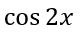

## **Przegląd**

PowerPoint przechowuje równania jako Office Math Markup Language (OMML). Dzięki Aspose.Slides for Java możesz programowo tworzyć taki sam rodzaj treści matematycznych: ułamki, pierwiastki, funkcje, granice, operatory N-ary, macierze, tablice i sformatowane bloki matematyczne.

W programie PowerPoint użytkownicy zazwyczaj dodają równania z **Insert > Equation**:


Slajd PowerPoint zawierający edytowalne równanie matematyczne:


Aspose.Slides buduje ten tekst matematyczny poprzez trzy główne obiekty:

- Kształt matematyczny, tworzony za pomocą [addMathShape](https://reference.aspose.com/slides/java/com.aspose.slides/ishapecollection/#addMathShape-float-float-float-float-), jest kształtem zawierającym równanie.
- [MathPortion](https://reference.aspose.com/slides/java/com.aspose.slides/mathportion/) przechowuje treść matematyczną wewnątrz ramki tekstowej kształtu.
- [MathParagraph](https://reference.aspose.com/slides/java/com.aspose.slides/mathparagraph/) zawiera jeden lub więcej obiektów [MathBlock](https://reference.aspose.com/slides/java/com.aspose.slides/mathblock/).

Większość przykładów poniżej używa [MathematicalText](https://reference.aspose.com/slides/java/com.aspose.slides/mathematicaltext/) oraz płynnych metod z [IMathElement](https://reference.aspose.com/slides/java/com.aspose.slides/imathelement/) , aby kod był krótki i czytelny.

W scenariuszach eksportu MathML zobacz [Eksportuj równania matematyczne z prezentacji w Javie](/slides/pl/java/exporting-math-equations/).

## **Utwórz równanie**

Ten przykład używa [addMathShape](https://reference.aspose.com/slides/java/com.aspose.slides/ishapecollection/#addMathShape-float-float-float-float-) do utworzenia kształtu matematycznego i dodaje twierdzenie Pitagorasa:


```java
import com.aspose.slides.*;

Presentation presentation = new Presentation();
try {
    ISlide slide = presentation.getSlides().get_Item(0);

    IAutoShape mathShape = slide.getShapes().addMathShape(20, 20, 700, 120);
    IMathParagraph mathParagraph = ((MathPortion) mathShape.getTextFrame().getParagraphs()
            .get_Item(0).getPortions().get_Item(0)).getMathParagraph();

    IMathBlock equation = new MathematicalText("c")
            .setSuperscript("2")
            .join("=")
            .join(new MathematicalText("a").setSuperscript("2"))
            .join("+")
            .join(new MathematicalText("b").setSuperscript("2"));

    mathParagraph.add(equation);

    presentation.save("pythagorean-theorem.pptx", SaveFormat.Pptx);
} finally {
    presentation.dispose();
}
```

{}
[addMathShape](https://reference.aspose.com/slides/java/com.aspose.slides/ishapecollection/#addMathShape-float-float-float-float-) tworzy kształt, który już zawiera akapit matematyczny. Uzyskaj dostęp do pierwszego [MathPortion](https://reference.aspose.com/slides/java/com.aspose.slides/mathportion/), wywołaj [getMathParagraph](https://reference.aspose.com/slides/java/com.aspose.slides/imathportion/#getMathParagraph--), i dodaj bloki matematyczne lub elementy matematyczne do niego.
{}

## **Dodaj ułamki**

Użyj [divide](https://reference.aspose.com/slides/java/com.aspose.slides/imathelement/#divide-com.aspose.slides.IMathElement-) do utworzenia ułamka. Możesz wybrać styl ułamka za pomocą [MathFractionTypes](https://reference.aspose.com/slides/java/com.aspose.slides/mathfractiontypes/).


```java
import com.aspose.slides.*;

Presentation presentation = new Presentation();
try {
    ISlide slide = presentation.getSlides().get_Item(0);

    IAutoShape mathShape = slide.getShapes().addMathShape(20, 20, 700, 100);
    IMathParagraph mathParagraph = ((MathPortion) mathShape.getTextFrame().getParagraphs()
            .get_Item(0).getPortions().get_Item(0)).getMathParagraph();

    IMathFraction fraction = new MathematicalText("1")
            .divide("x", MathFractionTypes.Skewed);

    mathParagraph.add(new MathBlock(fraction));

    presentation.save("fraction.pptx", SaveFormat.Pptx);
} finally {
    presentation.dispose();
}
```

Dla ułamka z kreską użyj [MathFractionTypes.Bar](https://reference.aspose.com/slides/java/com.aspose.slides/mathfractiontypes/#Bar):

```java
import com.aspose.slides.*;

IMathFraction stackedFraction = new MathematicalText("x + 1").divide("y - 1", MathFractionTypes.Bar);
```

## **Dodaj pierwiastki**

Użyj [radical](https://reference.aspose.com/slides/java/com.aspose.slides/imathelement/#radical-com.aspose.slides.IMathElement-) do utworzenia pierwiastka kwadratowego, sześciennego lub innego. Bieżący element staje się podstawą, a argument określa stopień.


```java
import com.aspose.slides.*;

Presentation presentation = new Presentation();
try {
    ISlide slide = presentation.getSlides().get_Item(0);

    IAutoShape mathShape = slide.getShapes().addMathShape(20, 20, 700, 100);
    IMathParagraph mathParagraph = ((MathPortion) mathShape.getTextFrame().getParagraphs()
            .get_Item(0).getPortions().get_Item(0)).getMathParagraph();

    IMathRadical radical = new MathematicalText("x")
            .radical("n");

    mathParagraph.add(new MathBlock(radical));

    presentation.save("radical.pptx", SaveFormat.Pptx);
} finally {
    presentation.dispose();
}
```

## **Dodaj funkcje i granice**

Użyj [asArgumentOfFunction](https://reference.aspose.com/slides/java/com.aspose.slides/imathelement/#asArgumentOfFunction-com.aspose.slides.IMathElement-) lub [function](https://reference.aspose.com/slides/java/com.aspose.slides/imathelement/#function-com.aspose.slides.IMathElement-) dla funkcji takich jak `sin(x)`, `log(x)` lub własnych nazw funkcji. Dla granic umieść `lim` w [MathLimit](https://reference.aspose.com/slides/java/com.aspose.slides/mathlimit/) lub użyj [setLowerLimit](https://reference.aspose.com/slides/java/com.aspose.slides/imathelement/#setLowerLimit-com.aspose.slides.IMathElement-).


```java
import com.aspose.slides.*;

Presentation presentation = new Presentation();
try {
    ISlide slide = presentation.getSlides().get_Item(0);

    IAutoShape mathShape = slide.getShapes().addMathShape(20, 20, 700, 100);
    IMathParagraph mathParagraph = ((MathPortion) mathShape.getTextFrame().getParagraphs()
            .get_Item(0).getPortions().get_Item(0)).getMathParagraph();

    IMathFunction limit = new MathematicalText("lim")
            .setLowerLimit("x\u2192\u221E")
            .function("x");

    mathParagraph.add(new MathBlock(limit));

    presentation.save("functions-and-limits.pptx", SaveFormat.Pptx);
} finally {
    presentation.dispose();
}
```

Dla własnej nazwy funkcji, ustaw nazwę funkcji jako bieżący element i wywołaj [function](https://reference.aspose.com/slides/java/com.aspose.slides/imathelement/#function-com.aspose.slides.IMathElement-) z jej argumentem:

```java
import com.aspose.slides.*;

IMathFunction customFunction = new MathematicalText("f").function("x + 1");
```

## **Dodaj operatory N-ary i całki**

Użyj [nary](https://reference.aspose.com/slides/java/com.aspose.slides/imathelement/#nary-int-com.aspose.slides.IMathElement-com.aspose.slides.IMathElement-) do sumowań, unii, przecięć i innych dużych operatorów. Użyj [integral](https://reference.aspose.com/slides/java/com.aspose.slides/imathelement/#integral-int-com.aspose.slides.IMathElement-com.aspose.slides.IMathElement-) do całek. Obie metody pozwalają ustawić dolne i górne limity.


```java
import com.aspose.slides.*;

Presentation presentation = new Presentation();
try {
    ISlide slide = presentation.getSlides().get_Item(0);

    IAutoShape mathShape = slide.getShapes().addMathShape(20, 20, 700, 120);
    IMathParagraph mathParagraph = ((MathPortion) mathShape.getTextFrame().getParagraphs()
            .get_Item(0).getPortions().get_Item(0)).getMathParagraph();

    IMathBlock summationBase = new MathematicalText("x")
            .setSuperscript("k")
            .join(new MathematicalText("a").setSuperscript("n-k"));

    IMathNaryOperator summation = summationBase.nary(MathNaryOperatorTypes.Summation, "k=0", "n");

    mathParagraph.add(new MathBlock(summation));

    presentation.save("nary-operators.pptx", SaveFormat.Pptx);
} finally {
    presentation.dispose();
}
```

Operatory N-ary służą do dużych operatorów z opcjonalnymi limitami. Proste operatory takie jak `+`, `-` i `=` są zwykle dodawane jako [MathematicalText](https://reference.aspose.com/slides/java/com.aspose.slides/mathematicaltext/) i łączone w wyrażenie.

Dla całki użyj [integral](https://reference.aspose.com/slides/java/com.aspose.slides/imathelement/#integral-int-com.aspose.slides.IMathElement-com.aspose.slides.IMathElement-):

```java
import com.aspose.slides.*;

IMathBlock integralBase = new MathematicalText("x").join(new MathematicalText("dx").toBox());
IMathNaryOperator integral = integralBase.integral(MathIntegralTypes.Simple, "0", "1");
```

## **Dodaj macierze**

Użyj [MathMatrix](https://reference.aspose.com/slides/java/com.aspose.slides/mathmatrix/) dla wierszy i kolumn. Macierze domyślnie nie zawierają nawiasów, więc otocz macierz, gdy potrzebujesz nawiasów okrągłych, kwadratowych lub klamrowych.


```java
import com.aspose.slides.*;

Presentation presentation = new Presentation();
try {
    ISlide slide = presentation.getSlides().get_Item(0);

    IAutoShape mathShape = slide.getShapes().addMathShape(20, 20, 700, 120);
    IMathParagraph mathParagraph = ((MathPortion) mathShape.getTextFrame().getParagraphs()
            .get_Item(0).getPortions().get_Item(0)).getMathParagraph();

    MathMatrix matrix = new MathMatrix(2, 3);
    matrix.set_Item(0, 0, new MathematicalText("1"));
    matrix.set_Item(0, 1, new MathematicalText("x"));
    matrix.set_Item(1, 0, new MathematicalText("x"));
    matrix.set_Item(1, 1, new MathematicalText("2"));
    matrix.set_Item(1, 2, new MathematicalText("y"));

    mathParagraph.add(new MathBlock(matrix));

    presentation.save("matrix.pptx", SaveFormat.Pptx);
} finally {
    presentation.dispose();
}
```

## **Dodaj tablice równań**

Użyj [toMathArray](https://reference.aspose.com/slides/java/com.aspose.slides/imathelement/#toMathArray--) , gdy potrzebujesz wyrównanych równań lub pionowego stosu wyrażeń.


```java
import com.aspose.slides.*;

Presentation presentation = new Presentation();
try {
    ISlide slide = presentation.getSlides().get_Item(0);

    IAutoShape mathShape = slide.getShapes().addMathShape(20, 20, 700, 140);
    IMathParagraph mathParagraph = ((MathPortion) mathShape.getTextFrame().getParagraphs()
            .get_Item(0).getPortions().get_Item(0)).getMathParagraph();

    IMathArray equationArray = new MathematicalText("x")
            .join("y")
            .toMathArray();

    mathParagraph.add(new MathBlock(equationArray));

    presentation.save("equation-array.pptx", SaveFormat.Pptx);
} finally {
    presentation.dispose();
}
```

### **Wyrównaj tablicę z otaczającymi elementami**

[setBaseJustification](https://reference.aspose.com/slides/java/com.aspose.slides/imatharray/#setBaseJustification-int-) kontroluje pionowe wyrównanie tablicy względem elementów matematycznych obok niej. Poniższy przykład porównuje wyrównanie z pierwszym wierszem, środkiem tablicy i ostatnim wierszem.

Następny przykład tworzy trzy identyczne tablice, każda z trzema wierszami i sąsiadującymi elementami `A=` i `=B`. Cały tekst matematyczny używa czcionki Cambria Math o rozmiarze 24 punkty. Zmienia się tylko wyrównanie tablicy.

```java
import com.aspose.slides.*;
import java.awt.Color;

class MathTextFactory {
    MathematicalText createText(String value) {
        MathematicalText text = new MathematicalText(value);
        text.getFormat().setFontHeight(24);
        text.getFormat().setLatinFont(new FontData("Cambria Math"));
        return text;
    }
}

MathTextFactory factory = new MathTextFactory();
Presentation presentation = new Presentation();
try {
    presentation.getSlideSize().setSize(780, 200, SlideSizeScaleType.DoNotScale);
    ISlide slide = presentation.getSlides().get_Item(0);
    
    int[] alignments = { MathVerticalAlignment.Top, MathVerticalAlignment.Center, MathVerticalAlignment.Bottom };
    String[] alignmentNames = { "Top", "Center", "Bottom" };

    for (int i = 0; i < alignments.length; i++) {
        IAutoShape label = slide.getShapes().addAutoShape(ShapeType.Rectangle, 20 + i * 260, 10, 240, 30);
        label.getFillFormat().setFillType(FillType.NoFill);
        label.getLineFormat().getFillFormat().setFillType(FillType.NoFill);
        label.getTextFrame().setText(alignmentNames[i]);
        IPortionFormat labelFormat = label.getTextFrame().getParagraphs().get_Item(0).getPortions().get_Item(0).getPortionFormat();
        labelFormat.setFontHeight(16);
        labelFormat.getFillFormat().setFillType(FillType.Solid);
        labelFormat.getFillFormat().getSolidFillColor().setColor(Color.BLACK);

        IAutoShape mathShape = slide.getShapes().addMathShape(20 + i * 260, 60, 240, 130);
        mathShape.getTextFrame().getTextFrameFormat().setAnchoringType(TextAnchorType.Top);
        IMathParagraph mathParagraph = ((IMathPortion) mathShape.getTextFrame().getParagraphs().get_Item(0).getPortions().get_Item(0)).getMathParagraph();
        mathParagraph.setJustification(MathJustification.LeftJustified);

        IMathElement[] rows = { factory.createText("x+y=3"), factory.createText("x-y=1"), factory.createText("x=2") };
        MathArray equationArray = new MathArray(rows[0]);
        equationArray.getArguments().add(rows[1]);
        equationArray.getArguments().add(rows[2]);
        equationArray.setBaseJustification(alignments[i]);
        MathematicalText leftText = factory.createText("A=");
        MathematicalText rightText = factory.createText("=B");
        IMathBlock equation = new MathBlock(leftText).join(equationArray).join(rightText);
        mathParagraph.add(equation);
    }

    presentation.save("equation-array-alignment.pptx", SaveFormat.Pptx);
} finally {
    presentation.dispose();
}
```

Poniższe porównanie pokazuje zapisaną prezentację w PowerPoint. Zauważ pozycję `A=` i `=B` obok każdej tablicy.


### **Skonfiguruj odstępy wierszy**

[setRowSpacingRule](https://reference.aspose.com/slides/java/com.aspose.slides/imatharray/#setRowSpacingRule-int-) wybiera regułę odstępu dla wierszy w tablicy. [setRowSpacing](https://reference.aspose.com/slides/java/com.aspose.slides/imatharray/#setRowSpacing-long-) podaje wartość liczbową dla wyraźnej reguły odstępu i jest ignorowane przez reguły wstępne.

Dla dokładnego odstępu wartość jest mierzona w punktach. Dla odstępu proporcjonalnego mierzy się w półwierszach: wartość `3` w przykładzie oznacza 1,5 linii. Ustaw obie właściwości przy określaniu wyraźnej wartości; zmiana samej wartości liczbowej nie wybiera reguły odstępu.

Poniższy przykład zapisuje pięć prezentacji z tymi samymi równaniami, wyrównaniem i ustawieniami czcionki. Pierwsze trzy używają ustawień wstępnych; ostatnie dwa pokazują wyraźne wartości.

```java
import com.aspose.slides.*;

class MathTextFactory {
    MathematicalText createText(String value) {
        MathematicalText text = new MathematicalText(value);
        text.getFormat().setFontHeight(24);
        text.getFormat().setLatinFont(new FontData("Cambria Math"));
        return text;
    }
}

MathTextFactory factory = new MathTextFactory();
int[] rules = { MathRowSpacingRule.SingleLineGap, MathRowSpacingRule.OneAndAHalfLineGap, MathRowSpacingRule.TwoLineGap, MathRowSpacingRule.Exactly, MathRowSpacingRule.Multiple };
int[] spacingValues = { 0, 0, 0, 20, 3 };
String[] ruleNames = { "SingleLineGap", "OneAndAHalfLineGap", "TwoLineGap", "Exactly", "Multiple" };

for (int i = 0; i < rules.length; i++) {
    String fileName = "equation-array-" + ruleNames[i] + ".pptx";
    Presentation presentation = new Presentation();
    try {
        IAutoShape mathShape = presentation.getSlides().get_Item(0).getShapes().addMathShape(20, 20, 600, 300);
        IParagraph paragraph = mathShape.getTextFrame().getParagraphs().get_Item(0);
        paragraph.getParagraphFormat().setSpaceBefore(0);
        paragraph.getParagraphFormat().setSpaceAfter(0);
        IMathParagraph mathParagraph = ((IMathPortion) paragraph.getPortions().get_Item(0)).getMathParagraph();
        mathParagraph.setJustification(MathJustification.LeftJustified);

        IMathElement[] rows = { factory.createText("x+y=3"), factory.createText("x-y=1"), factory.createText("x=2") };
        MathArray equationArray = new MathArray(rows[0]);
        equationArray.getArguments().add(rows[1]);
        equationArray.getArguments().add(rows[2]);
        equationArray.setBaseJustification(MathVerticalAlignment.Center);
        equationArray.setRowSpacingRule(rules[i]);
        equationArray.setRowSpacing(spacingValues[i]);
        MathematicalText leftText = factory.createText("A=");
        MathematicalText rightText = factory.createText("=B");
        IMathBlock equation = new MathBlock(leftText).join(equationArray).join(rightText);
        mathParagraph.add(equation);

        presentation.save(fileName, SaveFormat.Pptx);
    } finally {
        presentation.dispose();
    }
}
```

Odstępy wierszy tablicy są oddzielne od odstępów akapitu. [setSpaceBefore](https://reference.aspose.com/slides/java/com.aspose.slides/iparagraphformat/#setSpaceBefore-float-) i [setSpaceAfter](https://reference.aspose.com/slides/java/com.aspose.slides/iparagraphformat/#setSpaceAfter-float-) dodają odstęp wokół zawierającego akapitu, nie między wierszami tablicy. Podobnie [IMathParagraph.setJustification](https://reference.aspose.com/slides/java/com.aspose.slides/imathparagraph/#setJustification-int-) pozycjonuje cały akapit matematyczny poziomo; nie zastępuje ustawienia pionowego wyrównania tablicy.

## **Dodaj funkcje trygonometryczne**

Użyj [asArgumentOfFunction](https://reference.aspose.com/slides/java/com.aspose.slides/imathelement/#asArgumentOfFunction-com.aspose.slides.IMathElement-) , gdy argument jest bieżącym elementem i nazwa funkcji jest znana.



```java
import com.aspose.slides.*;

Presentation presentation = new Presentation();
try {
    ISlide slide = presentation.getSlides().get_Item(0);

    IAutoShape mathShape = slide.getShapes().addMathShape(20, 20, 700, 100);
    IMathParagraph mathParagraph = ((MathPortion) mathShape.getTextFrame().getParagraphs()
            .get_Item(0).getPortions().get_Item(0)).getMathParagraph();

    IMathFunction cosine = new MathematicalText("2x")
            .asArgumentOfFunction(MathFunctionsOfOneArgument.Cos);

    mathParagraph.add(new MathBlock(cosine));

    presentation.save("trigonometric-function.pptx", SaveFormat.Pptx);
} finally {
    presentation.dispose();
}
```

## **Dodaj indeksy dolne i górne**

Użyj pomocników indeksu dolnego i górnego dla indeksów i potęg. Gdy indeksy muszą pojawić się po lewej stronie podstawy, użyj [setSubSuperscriptOnTheLeft](https://reference.aspose.com/slides/java/com.aspose.slides/imathelement/#setSubSuperscriptOnTheLeft-com.aspose.slides.IMathElement-com.aspose.slides.IMathElement-).


```java
import com.aspose.slides.*;

Presentation presentation = new Presentation();
try {
    ISlide slide = presentation.getSlides().get_Item(0);

    IAutoShape mathShape = slide.getShapes().addMathShape(20, 20, 700, 100);
    IMathParagraph mathParagraph = ((MathPortion) mathShape.getTextFrame().getParagraphs()
            .get_Item(0).getPortions().get_Item(0)).getMathParagraph();

    IMathLeftSubSuperscriptElement scripts = new MathematicalText("Y")
            .setSubSuperscriptOnTheLeft("1", "n");

    mathParagraph.add(new MathBlock(scripts));

    presentation.save("subscript-superscript.pptx", SaveFormat.Pptx);
} finally {
    presentation.dispose();
}
```

## **Dodaj delimitery**

Użyj [enclose](https://reference.aspose.com/slides/java/com.aspose.slides/imathelement/#enclose-char-char-) , aby umieścić wyrażenie wewnątrz delimiterów. Możesz także ustawić znak separatora dla wyrażeń delimiterowych zawierających kilka elementów.


```java
import com.aspose.slides.*;

Presentation presentation = new Presentation();
try {
    ISlide slide = presentation.getSlides().get_Item(0);

    IAutoShape mathShape = slide.getShapes().addMathShape(20, 20, 700, 100);
    IMathParagraph mathParagraph = ((MathPortion) mathShape.getTextFrame().getParagraphs()
            .get_Item(0).getPortions().get_Item(0)).getMathParagraph();

    IMathDelimiter delimiter = new MathematicalText("x")
            .join("y")
            .join("z")
            .enclose('<', '>');
    delimiter.setSeparatorCharacter('|');

    mathParagraph.add(new MathBlock(delimiter));

    presentation.save("delimiters.pptx", SaveFormat.Pptx);
} finally {
    presentation.dispose();
}
```

### **Rozmiar i wyrównanie delimiterów**

Przekaż `true` do [setGrowToMatchOperandHeight](https://reference.aspose.com/slides/java/com.aspose.slides/imathdelimiter/#setGrowToMatchOperandHeight-boolean-) , aby nawiasy rosły wokół wysokiego operandu, lub `false`, aby zachować ich normalny rozmiar. Użyj [setDelimiterShape](https://reference.aspose.com/slides/java/com.aspose.slides/imathdelimiter/#setDelimiterShape-int-) z jedną z dwóch wartości [MathDelimiterShape](https://reference.aspose.com/slides/java/com.aspose.slides/mathdelimitershape/) . `Centered` centruje nawiasy na osi matematycznej, która przebiega przez środek znaku równości. `Match` wyrównuje je z zawartością. Oba ustawienia wpływają tylko na delimitery. Wyrażenie wewnątrz pozostaje niezmienione.

Przykład umieszcza ułamek w wykładniku `x`, więc wyrażenie rozciąga się wyżej powyżej linii bazowej niż poniżej. Wszystkie cztery równania używają tych samych nawiasów i ustawień czcionki.

```java
import com.aspose.slides.*;

Presentation presentation = new Presentation();
try {
    ISlide slide = presentation.getSlides().get_Item(0);
    for (int row = 0; row < 2; row++) {
        for (int column = 0; column < 2; column++) {
            IMathFraction fraction = new MathematicalText("a + b").divide("c + d");
            IMathSuperscriptElement power = new MathematicalText("x").setSuperscript(fraction);
            IMathDelimiter delimiter = power.enclose('(', ')');
            delimiter.setGrowToMatchOperandHeight(row == 0);
            delimiter.setDelimiterShape(column == 0 ? MathDelimiterShape.Centered : MathDelimiterShape.Match);

            IAutoShape mathShape = slide.getShapes().addMathShape(20 + 330 * column, 20 + 120 * row, 300, 100);
            MathPortion portion = (MathPortion) mathShape.getTextFrame().getParagraphs().get_Item(0).getPortions().get_Item(0);
            portion.getPortionFormat().setFontHeight(32);
            IMathBlock equation = new MathematicalText("y = ").join(delimiter);
            portion.getMathParagraph().add(equation);
        }
    }
    presentation.save("delimiter-sizing.pptx", SaveFormat.Pptx);
} finally {
    presentation.dispose();
}
```

W PowerPoint porównaj wiersze, aby zobaczyć efekt rozrostu. W górnym wierszu nawiasy rosną, aby otoczyć wykładnik i wyglądają tak samo dla obu kształtów. W dolnym wierszu rozrost jest wyłączony. Mniejsze nawiasy po lewej (`Centered`) są wyrównane ze znakiem równości, a po prawej (`Match`) są wyżej wokół wyrażenia.


## **Dodaj ramkę**

Wywołaj [toBorderBox](https://reference.aspose.com/slides/java/com.aspose.slides/imathelement/#toBorderBox--) na ułamku, aby otoczyć całą wyrażenie ramką. Zwrócony [IMathBorderBox](https://reference.aspose.com/slides/java/com.aspose.slides/imathborderbox/) domyślnie pokazuje wszystkie cztery strony. Użyj [setHideTop](https://reference.aspose.com/slides/java/com.aspose.slides/imathborderbox/#setHideTop-boolean-), [setHideBottom](https://reference.aspose.com/slides/java/com.aspose.slides/imathborderbox/#setHideBottom-boolean-), [setHideLeft](https://reference.aspose.com/slides/java/com.aspose.slides/imathborderbox/#setHideLeft-boolean-), i [setHideRight](https://reference.aspose.com/slides/java/com.aspose.slides/imathborderbox/#setHideRight-boolean-) , aby usunąć poszczególne strony.

Przykład umieszcza sześć kopii tego samego ułamka na jednym slajdzie. Aby pokazać anulowanie, ukryj wszystkie cztery strony i przekaż `true` do [setStrikethroughBottomLeftToTopRight](https://reference.aspose.com/slides/java/com.aspose.slides/imathborderbox/#setStrikethroughBottomLeftToTopRight-boolean-) dla rosnącej przekątnej (↗) lub [setStrikethroughTopLeftToBottomRight](https://reference.aspose.com/slides/java/com.aspose.slides/imathborderbox/#setStrikethroughTopLeftToBottomRight-boolean-) dla spadającej przekątnej (↘). Możesz także użyć [setStrikethroughHorizontal](https://reference.aspose.com/slides/java/com.aspose.slides/imathborderbox/#setStrikethroughHorizontal-boolean-) lub [setStrikethroughVertical](https://reference.aspose.com/slides/java/com.aspose.slides/imathborderbox/#setStrikethroughVertical-boolean-) z dowolną kombinacją widocznych stron.

```java
import com.aspose.slides.*;

Presentation presentation = new Presentation();
try {
    presentation.getSlideSize().setSize(540, 220, SlideSizeScaleType.DoNotScale);
    ISlide slide = presentation.getSlides().get_Item(0);

    class FractionBuilder {
        IMathBorderBox addFraction(float x, float y, boolean hideBorder) {
            IMathFraction fraction = new MathematicalText("x+1").divide("y+2");
            IMathBorderBox box = fraction.toBorderBox();
            box.setHideTop(hideBorder);
            box.setHideBottom(hideBorder);
            box.setHideLeft(hideBorder);
            box.setHideRight(hideBorder);

            IAutoShape shape = slide.getShapes().addMathShape(x, y, 160, 90);
            MathPortion portion = (MathPortion) shape.getTextFrame().getParagraphs().get_Item(0).getPortions().get_Item(0);
            portion.getPortionFormat().setFontHeight(28);
            portion.getMathParagraph().add(new MathBlock(box));
            return box;
        }
    }

    FractionBuilder builder = new FractionBuilder();
    builder.addFraction(10, 10, false);

    IMathBorderBox partial = builder.addFraction(190, 10, false);
    partial.setHideTop(true);
    partial.setHideRight(true);

    builder.addFraction(370, 10, true).setStrikethroughBottomLeftToTopRight(true);
    builder.addFraction(10, 120, true).setStrikethroughTopLeftToBottomRight(true);
    builder.addFraction(190, 120, true).setStrikethroughHorizontal(true);
    builder.addFraction(370, 120, false).setStrikethroughVertical(true);

    presentation.save("border-box.pptx", SaveFormat.Pptx);
} finally {
    presentation.dispose();
}
```


Na tym ułamku poziome przekreślenie zachodzi na kreskę ułamka. Pionowe przekreślenie przecina zarówno licznik, jak i mianownik, podczas gdy otaczająca ramka pozostaje widoczna. Te linie ozdabiają całe wyrażenie. Zwykłe przekreślenie tekstu dotyczy znaków w biegu tekstowym. Po ponownym otwarciu prezentacji w PowerPoint nadal można edytować licznik i mianownik niezależnie.

## **Kontroluj widoczność i układ za pomocą elementów Phantom**

Umieść wyrażenie w [MathPhantom](https://reference.aspose.com/slides/java/com.aspose.slides/mathphantom/) , aby niezależnie kontrolować jego widoczność i przestrzeń, jaką wnosi do równania. Metody [IMathPhantom](https://reference.aspose.com/slides/java/com.aspose.slides/imathphantom/) kontrolują następujące:

| Metoda | Efekt |
| --- | --- |
| [setShow](https://reference.aspose.com/slides/java/com.aspose.slides/imathphantom/#setShow-boolean-) | Przekaż `false`, aby ukryć wyrażenie. Jego wymiary nadal wpływają na układ, chyba że poniższe metody otrzymają `true`. |
| [setZeroWidth](https://reference.aspose.com/slides/java/com.aspose.slides/imathphantom/#setZeroWidth-boolean-) | Traktuj poziomą szerokość wyrażenia jako zero, co pozwala sąsiadującym elementom zbliżyć się do siebie. |
| [setZeroAsc](https://reference.aspose.com/slides/java/com.aspose.slides/imathphantom/#setZeroAsc-boolean-) | Traktuj jego wzniesienie, wysokość powyżej linii bazowej, jako zero. To może zmniejszyć przestrzeń zarezerwowaną powyżej sąsiadujących elementów. |
| [setZeroDesc](https://reference.aspose.com/slides/java/com.aspose.slides/imathphantom/#setZeroDesc-boolean-) | Traktuj jego opad, głębokość poniżej linii bazowej, jako zero. To może przesunąć kreskę ułamka lub inną zawartość pod wyrażeniem bliżej sąsiadów. |

Linia bazowa to linia odniesienia, na której znajdują się zwykłe litery matematyczne. Ukrywanie treści nie usuwa jej wymiarów, a traktowanie wymiaru jako zero nie usuwa wyrażenia. Podstawowe wyrażenie pozostaje dostępne przez [getBase](https://reference.aspose.com/slides/java/com.aspose.slides/imathphantom/#getBase--) . Przekaż `true` do [setShow](https://reference.aspose.com/slides/java/com.aspose.slides/imathphantom/#setShow-boolean-) , aby ponownie je wyświetlić; ustawienia wymiarów pozostają niezmienione.

Poniższy przykład tworzy pięć wariantów obok siebie: widoczny ułamek, ukryty ułamek zachowujący miejsce oraz trzy ukryte ułamki, w których jeden wymiar jest traktowany jako zero. Każdy wariant używa tego samego otaczającego wyrażenia i czcionki Cambria Math o rozmiarze 24 punkty. Wszystkie kształty równań mają tę samą pozycję górną, oznaczoną szarym prowadnicą. Umieszczenie elementu phantom w liczniku zewnętrznego ułamka ułatwia obserwację zmian w układzie pionowym.

```java
import com.aspose.slides.*;
import java.awt.Color;

class MathTextFactory {
    MathematicalText createText(String value) {
        MathematicalText text = new MathematicalText(value);
        text.getFormat().setFontHeight(24);
        text.getFormat().setLatinFont(new FontData("Cambria Math"));
        return text;
    }
}

MathTextFactory factory = new MathTextFactory();
Presentation presentation = new Presentation();
try {
    presentation.getSlideSize().setSize(1000, 180, SlideSizeScaleType.DoNotScale);
    ISlide slide = presentation.getSlides().get_Item(0);

    String[] labels = { "Visible", "Hidden: reserves space", "Hidden: ZeroWidth", "Hidden: ZeroAsc", "Hidden: ZeroDesc" };

    IAutoShape guide = slide.getShapes().addAutoShape(ShapeType.Line, 10, 60, 980, 0);
    guide.getLineFormat().getFillFormat().setFillType(FillType.Solid);
    guide.getLineFormat().getFillFormat().getSolidFillColor().setColor(Color.LIGHT_GRAY);

    for (int i = 0; i < labels.length; i++) {
        int left = 10 + i * 200;

        IAutoShape label = slide.getShapes().addAutoShape(ShapeType.Rectangle, left, 10, 190, 30);
        label.getFillFormat().setFillType(FillType.NoFill);
        label.getLineFormat().getFillFormat().setFillType(FillType.NoFill);
        label.getTextFrame().setText(labels[i]);

        IPortionFormat labelFormat = label.getTextFrame().getParagraphs().get_Item(0).getPortions().get_Item(0).getPortionFormat();
        labelFormat.setFontHeight(14);
        labelFormat.getFillFormat().setFillType(FillType.Solid);
        labelFormat.getFillFormat().getSolidFillColor().setColor(Color.BLACK);

        MathematicalText fractionNumerator = factory.createText("a+b");
        MathematicalText fractionDenominator = factory.createText("c+d");
        MathFraction fraction = new MathFraction(fractionNumerator, fractionDenominator);
        MathPhantom phantom = new MathPhantom(fraction);
        phantom.setShow(i == 0);
        phantom.setZeroWidth(i == 2);
        phantom.setZeroAsc(i == 3);
        phantom.setZeroDesc(i == 4);

        MathematicalText leftText = factory.createText("x+");
        MathematicalText rightText = factory.createText("+y");
        IMathBlock numerator = new MathBlock(leftText).join(phantom).join(rightText);
        MathematicalText denominator = factory.createText("z");
        MathFraction equation = new MathFraction(numerator, denominator);

        IAutoShape shape = slide.getShapes().addMathShape(left, 60, 190, 100);
        shape.getTextFrame().getTextFrameFormat().setAnchoringType(TextAnchorType.Top);

        IMathPortion mathPortion = (IMathPortion) shape.getTextFrame().getParagraphs().get_Item(0).getPortions().get_Item(0);
        IMathParagraph mathParagraph = mathPortion.getMathParagraph();
        mathParagraph.add(new MathBlock(equation));
    }

    presentation.save("math-phantom.pptx", SaveFormat.Pptx);
} finally {
    presentation.dispose();
}
```


## **Grupuj wyrażenia**

Użyj [group](https://reference.aspose.com/slides/java/com.aspose.slides/imathelement/#group-char-int-int-) , aby umieścić znak grupowania nad lub pod wyrażeniem. Dodaj limit, aby oznaczyć zgrupowane wyrażenia.


```java
import com.aspose.slides.*;

Presentation presentation = new Presentation();
try {
    ISlide slide = presentation.getSlides().get_Item(0);

    IAutoShape mathShape = slide.getShapes().addMathShape(20, 20, 700, 120);
    IMathParagraph mathParagraph = ((MathPortion) mathShape.getTextFrame().getParagraphs()
            .get_Item(0).getPortions().get_Item(0)).getMathParagraph();

    IMathLimit grouped = new MathematicalText("x + y")
            .group('\u23DF', MathTopBotPositions.Bottom, MathTopBotPositions.Top)
            .setLowerLimit("any text");

    mathParagraph.add(new MathBlock(grouped));

    presentation.save("grouped-terms.pptx", SaveFormat.Pptx);
} finally {
    presentation.dispose();
}
```

## **Formatuj elementy matematyczne**

Używaj pomocników formatowania tylko tam, gdzie wyjaśniają formułę. Na przykład [overbar](https://reference.aspose.com/slides/java/com.aspose.slides/imathelement/#overbar--) umieszcza pasek nad elementem matematycznym.


```java
import com.aspose.slides.*;

Presentation presentation = new Presentation();
try {
    ISlide slide = presentation.getSlides().get_Item(0);

    IAutoShape mathShape = slide.getShapes().addMathShape(20, 20, 700, 100);
    IMathParagraph mathParagraph = ((MathPortion) mathShape.getTextFrame().getParagraphs()
            .get_Item(0).getPortions().get_Item(0)).getMathParagraph();

    IMathBar overbar = new MathematicalText("ABC").overbar();

    mathParagraph.add(new MathBlock(overbar));

    presentation.save("overbar.pptx", SaveFormat.Pptx);
} finally {
    presentation.dispose();
}
```

### **Formatuj tekst w istniejącym równaniu**

Aby sformatować tekst w całym istniejącym równaniu, przejdź przez drzewo elementów każdego bloku matematycznego. [IMathElement.getChildren](https://reference.aspose.com/slides/java/com.aspose.slides/imathelement/#getChildren--) zwraca tylko bezpośrednie dzieci, więc wywołaj je rekurencyjnie, aby dotrzeć do tekstu wewnątrz ułamków, skryptów, pierwiastków i innych zagnieżdżonych struktur. Sprawdź bieżący element oraz jego dzieci, aby uwzględnić element początkowy, gdy jest [MathematicalText](https://reference.aspose.com/slides/java/com.aspose.slides/mathematicaltext/).

Ten przykład zakłada, że `input.pptx` zawiera równanie, takie jak `z = xᵢ / ∛y`, z ułamkiem zawierającym indeks dolny w liczniku i pierwiastek w mianowniku. Przetwarzanie tylko elementów najwyższego poziomu bloku pominęłoby tekst wewnątrz ułamka. Przykład znajduje części matematyczne w ramkach tekstowych slajdów, uzyskuje dostęp do ich bloków przez [IMathPortion.getMathParagraph](https://reference.aspose.com/slides/java/com.aspose.slides/imathportion/#getMathParagraph--) i używa [setFontHeight](https://reference.aspose.com/slides/java/com.aspose.slides/baseportionformat/#setFontHeight-float-) , aby ustawić rozmiar czcionki na 28 punktów poprzez metodę [getFormat](https://reference.aspose.com/slides/java/com.aspose.slides/mathematicaltext/#getFormat--) każdego elementu tekstowego.

```java
import com.aspose.slides.*;

class MathTextFormatter {
    void formatMathText(IMathElement element) {
        if (element instanceof MathematicalText) {
            MathematicalText text = (MathematicalText) element;
            text.getFormat().setFontHeight(28);
        }

        for (IMathElement child : element.getChildren()) {
            formatMathText(child);
        }
    }
}

MathTextFormatter formatter = new MathTextFormatter();
Presentation presentation = new Presentation("input.pptx");
try {
    for (ISlide slide : presentation.getSlides()) {
        for (IShape shape : slide.getShapes()) {
            if (!(shape instanceof IAutoShape)) {
                continue;
            }

            IAutoShape autoShape = (IAutoShape) shape;
            if (autoShape.getTextFrame() == null) {
                continue;
            }

            for (IParagraph paragraph : autoShape.getTextFrame().getParagraphs()) {
                for (IPortion portion : paragraph.getPortions()) {
                    if (portion instanceof IMathPortion) {
                        IMathPortion mathPortion = (IMathPortion) portion;
                        for (IMathBlock block : mathPortion.getMathParagraph()) {
                            formatter.formatMathText(block);
                        }
                    }
                }
            }
        }
    }

    presentation.save("formatted-equations.pptx", SaveFormat.Pptx);
} finally {
    presentation.dispose();
}
```

Zapisana prezentacja zawiera zaktualizowane formatowanie tekstu na każdym poziomie każdego przetworzonego równania, zachowując jednocześnie jego treść i strukturę matematyczną.

## **Szybkie odniesienie**

| Zadanie | Główne API |
| --- | --- |
| Utwórz tekst matematyczny | [MathematicalText](https://reference.aspose.com/slides/java/com.aspose.slides/mathematicaltext/) |
| Połącz elementy | [IMathElement.join](https://reference.aspose.com/slides/java/com.aspose.slides/imathelement/#join-com.aspose.slides.IMathElement-) |
| Utwórz ułamki | [IMathElement.divide](https://reference.aspose.com/slides/java/com.aspose.slides/imathelement/#divide-com.aspose.slides.IMathElement-) |
| Dodaj indeks górny lub dolny | [setSuperscript](https://reference.aspose.com/slides/java/com.aspose.slides/imathelement/#setSuperscript-com.aspose.slides.IMathElement-), [setSubscript](https://reference.aspose.com/slides/java/com.aspose.slides/imathelement/#setSubscript-com.aspose.slides.IMathElement-) |
| Dodaj funkcje | [function](https://reference.aspose.com/slides/java/com.aspose.slides/imathelement/#function-com.aspose.slides.IMathElement-), [asArgumentOfFunction](https://reference.aspose.com/slides/java/com.aspose.slides/imathelement/#asArgumentOfFunction-com.aspose.slides.IMathElement-) |
| Dodaj pierwiastki | [IMathElement.radical](https://reference.aspose.com/slides/java/com.aspose.slides/imathelement/#radical-com.aspose.slides.IMathElement-) |
| Dodaj granice | [setLowerLimit](https://reference.aspose.com/slides/java/com.aspose.slides/imathelement/#setLowerLimit-com.aspose.slides.IMathElement-), [setUpperLimit](https://reference.aspose.com/slides/java/com.aspose.slides/imathelement/#setUpperLimit-com.aspose.slides.IMathElement-) |
| Dodaj skrypty po lewej stronie | [setSubSuperscriptOnTheLeft](https://reference.aspose.com/slides/java/com.aspose.slides/imathelement/#setSubSuperscriptOnTheLeft-com.aspose.slides.IMathElement-com.aspose.slides.IMathElement-) |
| Dodaj sumowania i całki | [nary](https://reference.aspose.com/slides/java/com.aspose.slides/imathelement/#nary-int-com.aspose.slides.IMathElement-com.aspose.slides.IMathElement-), [integral](https://reference.aspose.com/slides/java/com.aspose.slides/imathelement/#integral-int-com.aspose.slides.IMathElement-com.aspose.slides.IMathElement-) |
| Dodaj macierze | [MathMatrix](https://reference.aspose.com/slides/java/com.aspose.slides/mathmatrix/) |
| Dodaj tablice równań | [toMathArray](https://reference.aspose.com/slides/java/com.aspose.slides/imathelement/#toMathArray--) |
| Dodaj delimitery | [enclose](https://reference.aspose.com/slides/java/com.aspose.slides/imathelement/#enclose-char-char-) |
| Dodaj kreski i ramki | [overbar](https://reference.aspose.com/slides/java/com.aspose.slides/imathelement/#overbar--), [toBorderBox](https://reference.aspose.com/slides/java/com.aspose.slides/imathelement/#toBorderBox--) |
| Grupuj wyrażenia | [group](https://reference.aspose.com/slides/java/com.aspose.slides/imathelement/#group-char-int-int-) |

## **FAQ**

**Czy mogę edytować istniejące równanie w PowerPoint?**

Tak. Otwórz prezentację, znajdź kształt zawierający [MathPortion](https://reference.aspose.com/slides/java/com.aspose.slides/mathportion/), wywołaj [getMathParagraph](https://reference.aspose.com/slides/java/com.aspose.slides/imathportion/#getMathParagraph--) i zaktualizuj bloki matematyczne w tym akapicie.

**Czy równania są zapisywane jako edytowalna matematyka PowerPoint?**

Tak. Gdy zapisujesz do PPTX, Aspose.Slides zapisuje równanie jako edytowalną treść Office Math.

**Czy mogę wyeksportować równania do LaTeX?**

Tak. Pobierz [IMathParagraph](https://reference.aspose.com/slides/java/com.aspose.slides/imathparagraph/) równania z jego [IMathPortion](https://reference.aspose.com/slides/java/com.aspose.slides/imathportion/) i wywołaj [IMathParagraph.toLatex](https://reference.aspose.com/slides/java/com.aspose.slides/imathparagraph/#toLatex--) , aby wyeksportować go bezpośrednio. Pełny przykład znajdziesz w [Eksportuj równania matematyczne z prezentacji w Javie](/slides/pl/java/exporting-math-equations/#export-math-equations-to-latex).