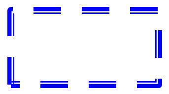

## **Wprowadzenie**

Formatuj kształty w programie PowerPoint, dostosowując ich kontury, wypełnienia i efekty. Aspose.Slides for Java umożliwia kontrolowanie tych ustawień programowo, w tym przezroczystości, obrót i formatowanie 3D.


Aspose.Slides for Java udostępnia interfejsy i metody, które pozwalają formatować kształty przy użyciu tych samych opcji, które są dostępne w programie PowerPoint.

## **Formatowanie linii**

Użyj [IShape.getLineFormat](https://reference.aspose.com/slides/java/com.aspose.slides/ishape/#getLineFormat--) aby kontrolować kontur kształtu. Ten przykład tworzy prostokąt bez wypełnienia z niebieskim, przerywanym konturem. [ILineFormat.setStyle](https://reference.aspose.com/slides/java/com.aspose.slides/ilineformat/#setStyle-byte-) wybiera linię złożoną gruba-cienka, natomiast [ILineFormat.setWidth](https://reference.aspose.com/slides/java/com.aspose.slides/ilineformat/#setWidth-double-) ustawia jej szerokość na 7 punktów, a [ILineFormat.setDashStyle](https://reference.aspose.com/slides/java/com.aspose.slides/ilineformat/#setDashStyle-byte-) wybiera wzór kreski.

```java
import com.aspose.slides.*;
import java.awt.Color;

Presentation presentation = new Presentation();
try {
    ISlide slide = presentation.getSlides().get_Item(0);

    IAutoShape shape = slide.getShapes().addAutoShape(ShapeType.Rectangle, 50, 50, 150, 75);
    shape.getFillFormat().setFillType(FillType.NoFill);
    shape.getLineFormat().setStyle(LineStyle.ThickThin);
    shape.getLineFormat().setWidth(7);
    shape.getLineFormat().setDashStyle(LineDashStyle.Dash);
    shape.getLineFormat().getFillFormat().setFillType(FillType.Solid);
    shape.getLineFormat().getFillFormat().getSolidFillColor().setColor(Color.BLUE);

    presentation.save("formatted_lines.pptx", SaveFormat.Pptx);
} finally {
    presentation.dispose();
}
```

Wynik:



### **Ustawianie niestandardowych wzorów kreski**

Użyj [ILineFormat.setCustomDashPattern](https://reference.aspose.com/slides/java/com.aspose.slides/ilineformat/#setCustomDashPattern-float---), gdy gotowe style linii nie zapewniają potrzebnych długości kreski i przerw, na przykład dla znaków firmowych lub diagramów technicznych. Przypisanie wzoru automatycznie zmienia styl kreski na [LineDashStyle.Custom](https://reference.aspose.com/slides/java/com.aspose.slides/linedashstyle/).

Elementy tablicy naprzemiennie określają długości kreski i przerwy, zaczynając od kreski. Każda wartość jest wielokrotnością szerokości linii: `{ 4, 2 }` przy szerokości 3 punktów daje kreskę o długości 12 punktów i przerwę 6 punktów. Używaj par skończonych, nieujemnych wartości, aby określić pełne segmenty kreska‑przerwa. Przykład używa dodatnich wartości, aby każda kreska i przerwa były widoczne.

Ten przykład tworzy pięć niebieskich linii o tej samej długości i płaskich zakończeniach. Pierwsze trzy porównują wzory przy szerokości 3 punktów. Czwarta powtarza pierwszy wzór przy dwukrotnej szerokości, podwajając zarówno kreski, jak i przerwy. Piąta przełącza się z wzoru niestandardowego na linię ciągłą.

```java
import com.aspose.slides.*;
import java.awt.Color;

Presentation presentation = new Presentation();
try {
    presentation.getSlideSize().setSize(600, 300, SlideSizeScaleType.DoNotScale);
    ISlide slide = presentation.getSlides().get_Item(0);

    float[][] patterns = {
        { 4, 2 },
        { 1, 2 },
        { 6, 2, 1, 2 },
        { 4, 2 },
        { 4, 2 }
    };

    for (int i = 0; i < patterns.length; i++) {
        IAutoShape line = slide.getShapes().addAutoShape(ShapeType.Line, 50, 50 + i * 50, 500, 0);
        line.getLineFormat().setWidth(i == 3 ? 6 : 3);
        line.getLineFormat().getFillFormat().setFillType(FillType.Solid);
        line.getLineFormat().getFillFormat().getSolidFillColor().setColor(new Color(0, 0, 139));
        line.getLineFormat().setCapStyle(LineCapStyle.Flat);
        line.getLineFormat().setBeginArrowheadStyle(LineArrowheadStyle.None);
        line.getLineFormat().setEndArrowheadStyle(LineArrowheadStyle.None);
        line.getLineFormat().setCustomDashPattern(patterns[i]);
    }

    // Przywróć ostatnią linię do stylu ciągłego.
    slide.getShapes().get_Item(4).getLineFormat().setDashStyle(LineDashStyle.Solid);

    presentation.save("custom_dash_patterns.pptx", SaveFormat.Pptx);
} finally {
    presentation.dispose();
}
```

Aby powrócić do gotowego stylu przerywanego, przekaż [LineDashStyle.Dash](https://reference.aspose.com/slides/java/com.aspose.slides/linedashstyle/) do [ILineFormat.setDashStyle](https://reference.aspose.com/slides/java/com.aspose.slides/ilineformat/#setDashStyle-byte-). Wybrany styl kontroluje wygląd linii.

Wynik w programie PowerPoint, od góry do dołu: **{4, 2}, 3 pt**; **{1, 2}, 3 pt**; **{6, 2, 1, 2}, 3 pt**; **{4, 2}, 6 pt**; oraz **Solid, 3 pt**.


### **Ustawianie zakończeń linii**

Użyj [ILineFormat.setCapStyle](https://reference.aspose.com/slides/java/com.aspose.slides/ilineformat/#setCapStyle-byte-), aby określić końce otwartej linii. Klasa [LineCapStyle](https://reference.aspose.com/slides/java/com.aspose.slides/linecapstyle/) dostarcza trzy wyraźne style zakończeń:

- `Flat`: Pędzel zatrzymuje się na końcowym punkcie.
- `Round`: Półokrągłe zakończenie wychodzi poza punkt końcowy o połowę szerokości linii.
- `Square`: Kwadratowe zakończenie wychodzi poza punkt końcowy o połowę szerokości linii.

Klasa zawiera również `NotDefined`, co oznacza, że nie przypisano wyraźnego stylu zakończenia.

Zakończenia różnią się od grotów strzałek, które dodają symbole do końców linii, oraz połączeń, które kontrolują narożniki między segmentami linii. Ten przykład wyłącza groty strzałek poprzez [ILineFormat.setBeginArrowheadStyle](https://reference.aspose.com/slides/java/com.aspose.slides/ilineformat/#setBeginArrowheadStyle-byte-) i [ILineFormat.setEndArrowheadStyle](https://reference.aspose.com/slides/java/com.aspose.slides/ilineformat/#setEndArrowheadStyle-byte-), aby porównać jedynie kształty zakończeń.

Poniższy przykład tworzy trzy identyczne poziome linie o szerokości 20 punktów. Od góry do dołu używają kolejno płaskich, okrągłych i kwadratowych zakończeń. Ich końcowe współrzędne poziome są takie same; okrągłe i kwadratowe zakończenia wystają 10 punktów poza każdy koniec.

```java
import com.aspose.slides.*;
import java.awt.Color;

Presentation presentation = new Presentation();
try {
    presentation.getSlideSize().setSize(500, 240, SlideSizeScaleType.DoNotScale);
    ISlide slide = presentation.getSlides().get_Item(0);

    byte[] capStyles = new byte[] { LineCapStyle.Flat, LineCapStyle.Round, LineCapStyle.Square };

    for (int i = 0; i < capStyles.length; i++) {
        IAutoShape line = slide.getShapes().addAutoShape(ShapeType.Line, 100, 50 + i * 70, 300, 0);
        line.getLineFormat().setWidth(20);
        line.getLineFormat().getFillFormat().setFillType(FillType.Solid);
        line.getLineFormat().getFillFormat().getSolidFillColor().setColor(new Color(0, 0, 139));
        line.getLineFormat().setDashStyle(LineDashStyle.Solid);
        line.getLineFormat().setCapStyle(capStyles[i]);
        line.getLineFormat().setBeginArrowheadStyle(LineArrowheadStyle.None);
        line.getLineFormat().setEndArrowheadStyle(LineArrowheadStyle.None);
    }

    presentation.save("line_caps.pptx", SaveFormat.Pptx);
} finally {
    presentation.dispose();
}
```

Wynik w programie PowerPoint, od góry do dołu: **Flat**, **Round** i **Square**.


## **Zastosowanie efektu szkicu do linii kształtu**

Efekt szkicu sprawia, że linia kształtu wygląda na odręczną. Użyj [IShape.getLineFormat](https://reference.aspose.com/slides/java/com.aspose.slides/ishape/#getLineFormat--) aby uzyskać dostęp do ustawień linii, [ILineFormat.getSketchFormat](https://reference.aspose.com/slides/java/com.aspose.slides/ilineformat/#getSketchFormat--) aby uzyskać dostęp do ustawień szkicu oraz [ISketchFormat.setSketchType](https://reference.aspose.com/slides/java/com.aspose.slides/isketchformat/#setSketchType-int-) aby wybrać wartość z klasy [LineSketchType](https://reference.aspose.com/slides/java/com.aspose.slides/linesketchtype/).

Poniższy kod Java pokazuje, jak zastosować efekt [LineSketchType.Curved](https://reference.aspose.com/slides/java/com.aspose.slides/linesketchtype/), odczytać wyraźnie przypisaną wartość i usunąć efekt za pomocą [LineSketchType.None](https://reference.aspose.com/slides/java/com.aspose.slides/linesketchtype/):

```java
import com.aspose.slides.*;

Presentation presentation = new Presentation();
try {
    ISlide slide = presentation.getSlides().get_Item(0);

    IAutoShape shape = slide.getShapes().addAutoShape(ShapeType.Rectangle, 50, 50, 200, 100);

    ISketchFormat sketchFormat = shape.getLineFormat().getSketchFormat();
    sketchFormat.setSketchType(LineSketchType.Curved);
    int explicitSketchType = sketchFormat.getSketchType();
    System.out.println("Explicit sketch type: " + explicitSketchType);
    sketchFormat.setSketchType(LineSketchType.None);
} finally {
    presentation.dispose();
}
```

Wartość zwrócona przez [ISketchFormat.getSketchType](https://reference.aspose.com/slides/java/com.aspose.slides/isketchformat/#getSketchType--) reprezentuje ustawienie przypisane bezpośrednio do kształtu. Jeśli formatowanie linii może być dziedziczone z motywu, slajdu głównego lub slajdu układu, użyj [ILineFormat.getEffective](https://reference.aspose.com/slides/java/com.aspose.slides/ilineformat/#getEffective--), odwołaj się do [ILineFormatEffectiveData.getSketchFormat](https://reference.aspose.com/slides/java/com.aspose.slides/ilineformateffectivedata/#getSketchFormat--), a następnie odczytaj [ISketchFormatEffectiveData.getSketchType](https://reference.aspose.com/slides/java/com.aspose.slides/isketchformateffectivedata/#getSketchType--). Wartość efektywna odzwierciedla formatowanie faktycznie zastosowane po rozwiązaniu dziedziczenia. Przykład wymaga istniejącej prezentacji z co najmniej jednym kształtem na pierwszym slajdzie i wypisuje obie wartości:

```java
import com.aspose.slides.*;

Presentation presentation = new Presentation("presentation.pptx");
try {
    IShape shape = presentation.getSlides().get_Item(0).getShapes().get_Item(0);

    ILineFormat lineFormat = shape.getLineFormat();
    int explicitSketchType = lineFormat.getSketchFormat().getSketchType();
    ILineFormatEffectiveData effectiveLineFormat = lineFormat.getEffective();
    int effectiveSketchType = effectiveLineFormat.getSketchFormat().getSketchType();

    System.out.println("Explicit sketch type: " + explicitSketchType);
    System.out.println("Effective sketch type: " + effectiveSketchType);
} finally {
    presentation.dispose();
}
```

## **Formatowanie stylów połączeń**

Oto trzy dostępne opcje typu połączenia:

* Round
* Miter
* Bevel

Styl połączenia kontroluje, jak dwa segmenty konturu spotykają się w narożniku. Użyj **Round** dla zaokrąglonych narożników, **Miter** dla ostrych narożników lub **Bevel** dla spłaszczonych narożników.


Ten przykład tworzy trzy czarne prostokąty z niebieskimi konturami o szerokości 15 punktów. Używa [ILineFormat.setJoinStyle](https://reference.aspose.com/slides/java/com.aspose.slides/ilineformat/#setJoinStyle-byte-) aby ustawić kolejno wartości miter, bevel i round z klasy [LineJoinStyle](https://reference.aspose.com/slides/java/com.aspose.slides/linejoinstyle/), aby porównać, jak rysowane są narożniki.

```java
import com.aspose.slides.*;
import java.awt.Color;

Presentation presentation = new Presentation();
try {
    ISlide slide = presentation.getSlides().get_Item(0);

    IAutoShape miterShape = slide.getShapes().addAutoShape(ShapeType.Rectangle, 20, 20, 150, 75);
    IAutoShape bevelShape = slide.getShapes().addAutoShape(ShapeType.Rectangle, 210, 20, 150, 75);
    IAutoShape roundShape = slide.getShapes().addAutoShape(ShapeType.Rectangle, 20, 135, 150, 75);

    miterShape.getFillFormat().setFillType(FillType.Solid);
    miterShape.getFillFormat().getSolidFillColor().setColor(Color.BLACK);
    bevelShape.getFillFormat().setFillType(FillType.Solid);
    bevelShape.getFillFormat().getSolidFillColor().setColor(Color.BLACK);
    roundShape.getFillFormat().setFillType(FillType.Solid);
    roundShape.getFillFormat().getSolidFillColor().setColor(Color.BLACK);

    miterShape.getLineFormat().setWidth(15);
    bevelShape.getLineFormat().setWidth(15);
    roundShape.getLineFormat().setWidth(15);

    miterShape.getLineFormat().getFillFormat().setFillType(FillType.Solid);
    miterShape.getLineFormat().getFillFormat().getSolidFillColor().setColor(Color.BLUE);
    bevelShape.getLineFormat().getFillFormat().setFillType(FillType.Solid);
    bevelShape.getLineFormat().getFillFormat().getSolidFillColor().setColor(Color.BLUE);
    roundShape.getLineFormat().getFillFormat().setFillType(FillType.Solid);
    roundShape.getLineFormat().getFillFormat().getSolidFillColor().setColor(Color.BLUE);

    miterShape.getLineFormat().setJoinStyle(LineJoinStyle.Miter);
    bevelShape.getLineFormat().setJoinStyle(LineJoinStyle.Bevel);
    roundShape.getLineFormat().setJoinStyle(LineJoinStyle.Round);

    miterShape.getTextFrame().setText("Miter Join Style");
    bevelShape.getTextFrame().setText("Bevel Join Style");
    roundShape.getTextFrame().setText("Round Join Style");

    presentation.save("join_styles.pptx", SaveFormat.Pptx);
} finally {
    presentation.dispose();
}
```

### **Ograniczanie połączeń miter przy ostrych narożnikach**

Użyj [ILineFormat.setMiterLimit](https://reference.aspose.com/slides/java/com.aspose.slides/ilineformat/#setMiterLimit-float-) razem z [ILineFormat.setJoinStyle](https://reference.aspose.com/slides/java/com.aspose.slides/ilineformat/#setJoinStyle-byte-) ustawionym na [LineJoinStyle.Miter](https://reference.aspose.com/slides/java/com.aspose.slides/linejoinstyle/), aby ograniczyć, jak daleko ostry narożnik może się rozciągać.

Limit jest stosunkiem odległości pomiędzy wewnętrznym a zewnętrznym narożnikiem połączenia do szerokości linii. Na przykład wartość `8` pozwala na długość miteru do ośmiu razy szerokości linii; nie jest to pomiar w punktach. Jeśli narożnik przekroczyłby limit, PowerPoint zastosuje połączenie wycięte (bevel) w tym miejscu. Większy limit pozwala na ostrzejsze punkty. Ustawienie wpływa wyłącznie na połączenia miter i nie ma widocznego efektu, gdy narożnik pozostaje w granicach limitu.

Ten przykład tworzy dwa identyczne, niewypełnione trójkąty z konturami o szerokości 20 punktów. Lewy trójkąt używa limitu `2`, a prawy `8`. Każdy trójkąt ma szerokość 80 punktów i wysokość 160 punktów, co daje stosunek długości miteru do szerokości linii w górnym narożniku około `4,12`. W rezultacie PowerPoint przycina lewy wierzchołek i zachowuje prawy.

```java
import com.aspose.slides.*;
import java.awt.Color;

Presentation presentation = new Presentation();
try {
    presentation.getSlideSize().setSize(500, 320, SlideSizeScaleType.DoNotScale);
    ISlide slide = presentation.getSlides().get_Item(0);

    float[] miterLimits = new float[] { 2f, 8f };

    for (int i = 0; i < miterLimits.length; i++) {
        IAutoShape triangle = slide.getShapes().addAutoShape(ShapeType.Triangle, 90 + i * 240, 110, 80, 160);
        triangle.getFillFormat().setFillType(FillType.NoFill);
        triangle.getLineFormat().setWidth(20);
        triangle.getLineFormat().getFillFormat().setFillType(FillType.Solid);
        triangle.getLineFormat().getFillFormat().getSolidFillColor().setColor(new Color(0, 0, 139));
        triangle.getLineFormat().setJoinStyle(LineJoinStyle.Miter);
        triangle.getLineFormat().setMiterLimit(miterLimits[i]);
    }

    presentation.save("miter_limits.pptx", SaveFormat.Pptx);
} finally {
    presentation.dispose();
}
```

Wynik w PowerPoint: **Miter limit 2** po lewej i **miter limit 8** po prawej.


## **Wypełnienie gradientem**

Wypełnienie gradientem łączy kolory w obrębie kształtu. Ten przykład wypełnia elipsę gradientem liniowym pod kątem 45 stopni od czerwonego do fioletowego przy użyciu [IFillFormat.getGradientFormat](https://reference.aspose.com/slides/java/com.aspose.slides/ifillformat/#getGradientFormat--). Metoda [IGradientStopCollection.addPresetColor](https://reference.aspose.com/slides/java/com.aspose.slides/igradientstopcollection/#addPresetColor-float-int-) umieszcza punkty stopu koloru w pozycjach 0 i 1, czyli na początku i końcu gradientu. Usunięcie istniejących punktów zapewnia, że używane będą tylko te dwa kolory.

```java
import com.aspose.slides.*;

Presentation presentation = new Presentation();
try {
    ISlide slide = presentation.getSlides().get_Item(0);

    IAutoShape shape = slide.getShapes().addAutoShape(ShapeType.Ellipse, 50, 50, 150, 75);
    shape.getFillFormat().setFillType(FillType.Gradient);
    shape.getFillFormat().getGradientFormat().setGradientShape(GradientShape.Linear);
    shape.getFillFormat().getGradientFormat().setLinearGradientAngle(45);
    shape.getFillFormat().getGradientFormat().getGradientStops().clear();
    shape.getFillFormat().getGradientFormat().getGradientStops().addPresetColor(1.0f, PresetColor.Purple);
    shape.getFillFormat().getGradientFormat().getGradientStops().addPresetColor(0.0f, PresetColor.Red);

    presentation.save("gradient_fill.pptx", SaveFormat.Pptx);
} finally {
    presentation.dispose();
}
```

Wynik:


Jeśli gradient wygląda inaczej w wyeksportowanym obrazie niż w programie PowerPoint, zobacz [Choose a Gradient Rendering Style](/slides/pl/java/convert-powerpoint-to-png/#choose-a-gradient-rendering-style). Możesz wybrać styl renderowania bez zmiany gradientu przechowywanego w prezentacji.

### **Ustawianie kąta gradientu liniowego**

Użyj [IGradientFormat.setLinearGradientAngle](https://reference.aspose.com/slides/java/com.aspose.slides/igradientformat/#setLinearGradientAngle-float-) aby kontrolować orientację wypełnienia [GradientShape.Linear](https://reference.aspose.com/slides/java/com.aspose.slides/gradientshape/). Kąt jest mierzony w stopniach i rośnie zgodnie z ruchem wskazówek zegara: `0` przebiega od lewej do prawej, `90` od góry do dołu, `180` od prawej do lewej i `270` od dołu do góry. Obsługiwane są kąty ułamkowe. Kąty skończone poza zakresem `[0, 360)` są normalizowane do jednego obrotu; na przykład `-45` staje się `315`, a `360` staje się `0`.

Ten przykład tworzy sześć prostokątów z identycznymi punktami stopu czerwonego, zielonego i niebieskiego w pozycjach `0`, `0,5` i `1`. Skalowanie jest wyłączone, aby kąt można było porównać niezależnie od proporcji prostokątów. Kąty, od lewej do prawej, to `0`, `45` i `90` w pierwszym wierszu oraz `135`, `180` i `270` w drugim wierszu.

```java
import com.aspose.slides.*;
import java.awt.Color;

Presentation presentation = new Presentation();
try {
    presentation.getSlideSize().setSize(720, 400, SlideSizeScaleType.DoNotScale);
    ISlide slide = presentation.getSlides().get_Item(0);

    float[] angles = new float[] { 0, 45, 90, 135, 180, 270 };

    for (int i = 0; i < angles.length; i++) {
        int x = 30 + (i % 3) * 230;
        int y = 30 + (i / 3) * 190;

        IAutoShape shape = slide.getShapes().addAutoShape(ShapeType.Rectangle, x, y, 200, 150);
        shape.getLineFormat().getFillFormat().setFillType(FillType.NoFill);
        shape.getFillFormat().setFillType(FillType.Gradient);

        IGradientFormat gradient = shape.getFillFormat().getGradientFormat();
        gradient.setGradientShape(GradientShape.Linear);
        gradient.getGradientStops().clear();
        gradient.getGradientStops().add(0f, Color.RED);
        gradient.getGradientStops().add(0.5f, Color.GREEN);
        gradient.getGradientStops().add(1f, Color.BLUE);
        gradient.setLinearGradientScaled(NullableBool.False);
        gradient.setLinearGradientAngle(angles[i]);
    }

    presentation.save("linear_gradient_angles.pptx", SaveFormat.Pptx);
} finally {
    presentation.dispose();
}
```

Wynik w PowerPoint:


### **Skalowanie gradientu liniowego wraz z kształtem**

[IGradientFormat.setLinearGradientScaled](https://reference.aspose.com/slides/java/com.aspose.slides/igradientformat/#setLinearGradientScaled-byte-) przyjmuje wartość [NullableBool](https://reference.aspose.com/slides/java/com.aspose.slides/nullablebool/). Ustaw ją explicite na `False`, aby zachować geometryczny kąt gradientu przy zmianie proporcji kształtu, lub na `True`, aby skalować gradient wraz z szerokością i wysokością kształtu. Przy włączonej skali widoczny kąt może różnić się od przypisanego kąta w przypadku kształtu niebędącego kwadratem.

Poniższy przykład używa kąta `45` stopni i tych samych punktów stopu koloru co w porównaniu kątów. Lewa kolumna używa `False`; prawa kolumna używa `True`. Każda kolumna zawiera szeroki prostokąt nad wysokim prostokątem. Oba zaczynają się od tych samych szerokich wymiarów; zmiana szerokości i wysokości drugiego prostokąta pokazuje, jak wypełnienie reaguje na zmianę rozmiaru bez zmiany ustawień gradientu.

```java
import com.aspose.slides.*;
import java.awt.Color;

Presentation presentation = new Presentation();
try {
    presentation.getSlideSize().setSize(720, 460, SlideSizeScaleType.DoNotScale);
    ISlide slide = presentation.getSlides().get_Item(0);

    byte[] scalingOptions = new byte[] { NullableBool.False, NullableBool.True };

    for (int column = 0; column < scalingOptions.length; column++) {
        for (int row = 0; row < 2; row++) {
            int x = 30 + column * 360;
            int y = row == 0 ? 30 : 150;

            IAutoShape shape = slide.getShapes().addAutoShape(ShapeType.Rectangle, x, y, 300, 90);
            shape.getLineFormat().getFillFormat().setFillType(FillType.NoFill);
            shape.getFillFormat().setFillType(FillType.Gradient);

            IGradientFormat gradient = shape.getFillFormat().getGradientFormat();
            gradient.setGradientShape(GradientShape.Linear);
            gradient.getGradientStops().clear();
            gradient.getGradientStops().add(0f, Color.RED);
            gradient.getGradientStops().add(0.5f, Color.GREEN);
            gradient.getGradientStops().add(1f, Color.BLUE);
            gradient.setLinearGradientAngle(45);
            gradient.setLinearGradientScaled(scalingOptions[column]);

            if (row == 1) {
                shape.setWidth(90);
                shape.setHeight(280);
            }
        }
    }

    presentation.save("linear_gradient_scaling.pptx", SaveFormat.Pptx);
} finally {
    presentation.dispose();
}
```

Wynik w PowerPoint, przy wyłączonej skali po lewej i włączonej po prawej:


Przy wyłączonej skali, diagonalne paski kolorów zachowują tę samą orientację w obu prostokątach. Przy włączonej skali paski rozciągają się zgodnie z proporcjami kształtu. Pomaga to odtworzyć gradient szablonu przy dopasowywaniu kształtu do innego rozmiaru. Na kwadracie włączenie skalowania nie zmienia wyglądu tego gradientu `45`‑stopniowego.

Zarówno kąt, jak i ustawienie skalowania mają zastosowanie do gradientów liniowych. Nie kontrolują one wypełnień [GradientShape.Radial or GradientShape.Rectangle](https://reference.aspose.com/slides/java/com.aspose.slides/gradientshape/).

### **Łączenie kąta ze kierunkiem gradientu**

[IGradientFormat.setGradientDirection](https://reference.aspose.com/slides/java/com.aspose.slides/igradientformat/#setGradientDirection-int-) wybiera styl gradientu z klasy [GradientDirection](https://reference.aspose.com/slides/java/com.aspose.slides/gradientdirection/); nie jest to zamiennik kąta liczbowego. Dla gradientu liniowego style narożników mogą zmieniać obszar, na którym rozłożone są kolory, bez zmiany kąta ustawionego przez [setLinearGradientAngle](https://reference.aspose.com/slides/java/com.aspose.slides/igradientformat/#setLinearGradientAngle-float-). Zachowaj niezmieniony kierunek przy porównywaniu kątów lub skalowania.

Poniższy przykład stosuje te same ustawienia w odwrotnej kolejności. Dwa prostokąty wyglądają identycznie: ustawienie kierunku przed lub po kącie nie zmienia wyniku.

```java
import com.aspose.slides.*;
import java.awt.Color;

Presentation presentation = new Presentation();
try {
    ISlide slide = presentation.getSlides().get_Item(0);

    for (int i = 0; i < 2; i++) {
        IAutoShape shape = slide.getShapes().addAutoShape(ShapeType.Rectangle, 30, 30 + i * 140, 320, 100);
        shape.getLineFormat().getFillFormat().setFillType(FillType.NoFill);
        shape.getFillFormat().setFillType(FillType.Gradient);

        IGradientFormat gradient = shape.getFillFormat().getGradientFormat();
        gradient.setGradientShape(GradientShape.Linear);
        gradient.getGradientStops().clear();
        gradient.getGradientStops().add(0f, Color.RED);
        gradient.getGradientStops().add(0.5f, Color.GREEN);
        gradient.getGradientStops().add(1f, Color.BLUE);
        gradient.setLinearGradientScaled(NullableBool.True);

        if (i == 0) {
            gradient.setGradientDirection(GradientDirection.FromCorner1);
            gradient.setLinearGradientAngle(30);
        } else {
            gradient.setLinearGradientAngle(30);
            gradient.setGradientDirection(GradientDirection.FromCorner1);
        }
    }

    presentation.save("linear_gradient_direction.pptx", SaveFormat.Pptx);
} finally {
    presentation.dispose();
}
```

## **Wypełnienie wzorem**

Wypełnienie wzorem nakłada dwukolorowy wzór, taki jak kropki, paski lub szachownica. Ten przykład używa [IPatternFormat.setPatternStyle](https://reference.aspose.com/slides/java/com.aspose.slides/ipatternformat/#setPatternStyle-byte-) aby wybrać wzór kratki. [IPatternFormat.getBackColor](https://reference.aspose.com/slides/java/com.aspose.slides/ipatternformat/#getBackColor--) dostarcza jasnoszare tło, a [IPatternFormat.getForeColor](https://reference.aspose.com/slides/java/com.aspose.slides/ipatternformat/#getForeColor--) dostarcza żółty kolor wzoru.

```java
import com.aspose.slides.*;
import java.awt.Color;

Presentation presentation = new Presentation();
try {
    ISlide slide = presentation.getSlides().get_Item(0);

    IAutoShape shape = slide.getShapes().addAutoShape(ShapeType.Rectangle, 50, 50, 150, 75);
    shape.getFillFormat().setFillType(FillType.Pattern);
    shape.getFillFormat().getPatternFormat().setPatternStyle(PatternStyle.Trellis);
    shape.getFillFormat().getPatternFormat().getBackColor().setColor(Color.LIGHT_GRAY);
    shape.getFillFormat().getPatternFormat().getForeColor().setColor(Color.YELLOW);

    presentation.save("pattern_fill.pptx", SaveFormat.Pptx);
} finally {
    presentation.dispose();
}
```

Wynik:


## **Wypełnienie obrazem**

Wypełnienie obrazem używa obrazu wewnątrz kształtu. Ten przykład wymaga lokalnego obrazu i używa [Images.fromFile](https://reference.aspose.com/slides/java/com.aspose.slides/images/#fromFile-java.lang.String-) aby załadować go do kolekcji obrazów prezentacji. Ustawienie [IPictureFillFormat.setPictureFillMode](https://reference.aspose.com/slides/java/com.aspose.slides/ipicturefillformat/#setPictureFillMode-int-) na tryb kafelkowy powtarza obraz w obrębie prostokąta. Obraz źródłowy użyty w tym przykładzie jest pokazany poniżej:


```java
import com.aspose.slides.*;

Presentation presentation = new Presentation();
try {
    ISlide slide = presentation.getSlides().get_Item(0);

    IAutoShape shape = slide.getShapes().addAutoShape(ShapeType.Rectangle, 50, 50, 255, 130);
    shape.getFillFormat().setFillType(FillType.Picture);
    shape.getFillFormat().getPictureFillFormat().setPictureFillMode(PictureFillMode.Tile);

    IImage image = Images.fromFile("lotus.png");
    IPPImage picture;
    try {
        picture = presentation.getImages().addImage(image);
    } finally {
        image.dispose();
    }
    shape.getFillFormat().getPictureFillFormat().getPicture().setImage(picture);

    presentation.save("picture_fill.pptx", SaveFormat.Pptx);
} finally {
    presentation.dispose();
}
```

Wynik:


### **Kafelkowanie obrazu jako tekstury**

Jeśli chcesz ustawić kafelkowany obraz jako teksturę i dostosować zachowanie kafelkowania, możesz użyć następujących metod interfejsu [IPictureFillFormat](https://reference.aspose.com/slides/java/com.aspose.slides/ipicturefillformat/) i klasy [PictureFillFormat](https://reference.aspose.com/slides/java/com.aspose.slides/picturefillformat/):

- [setPictureFillMode](https://reference.aspose.com/slides/java/com.aspose.slides/ipicturefillformat/#setPictureFillMode-int-): Ustawia tryb wypełnienia obrazu — `Tile` lub `Stretch`.
- [setTileAlignment](https://reference.aspose.com/slides/java/com.aspose.slides/ipicturefillformat/#setTileAlignment-byte-): Określa wyrównanie kafelków w obrębie kształtu.
- [setTileFlip](https://reference.aspose.com/slides/java/com.aspose.slides/ipicturefillformat/#setTileFlip-int-): Kontroluje, czy kafelek jest odwrócony poziomo, pionowo czy w obu kierunkach.
- [setTileOffsetX](https://reference.aspose.com/slides/java/com.aspose.slides/ipicturefillformat/#setTileOffsetX-float-): Ustawia poziomy offset kafelka (w punktach) od początku kształtu.
- [setTileOffsetY](https://reference.aspose.com/slides/java/com.aspose.slides/ipicturefillformat/#setTileOffsetY-float-): Ustawia pionowy offset kafelka (w punktach) od początku kształtu.
- [setTileScaleX](https://reference.aspose.com/slides/java/com.aspose.slides/ipicturefillformat/#setTileScaleX-float-): Definiuje poziomą skalę kafelka jako procent.
- [setTileScaleY](https://reference.aspose.com/slides/java/com.aspose.slides/ipicturefillformat/#setTileScaleY-float-): Definiuje pionową skalę kafelka jako procent.

Ten przykład wymaga lokalnego obrazu i konfiguruje [IPictureFillFormat](https://reference.aspose.com/slides/java/com.aspose.slides/ipicturefillformat/) aby powtarzać go w 50 % pierwotnego rozmiaru. Offsets o –32 punkty przesuwają kafelki poziomo i pionowo; wyrównanie do prawego dolnego rogu oraz odwrócenie w obu kierunkach określają, jak powtarzana tekstura jest rozmieszczona.

```java
import com.aspose.slides.*;

Presentation presentation = new Presentation();
try {
    ISlide firstSlide = presentation.getSlides().get_Item(0);

    IAutoShape shape = firstSlide.getShapes().addAutoShape(ShapeType.Rectangle, 50, 50, 190, 95);
    shape.getFillFormat().setFillType(FillType.Picture);

    IImage sourceImage = Images.fromFile("lotus.png");
    IPPImage presentationImage;
    try {
        presentationImage = presentation.getImages().addImage(sourceImage);
    } finally {
        sourceImage.dispose();
    }

    IPictureFillFormat pictureFillFormat = shape.getFillFormat().getPictureFillFormat();
    pictureFillFormat.getPicture().setImage(presentationImage);
    pictureFillFormat.setPictureFillMode(PictureFillMode.Tile);
    pictureFillFormat.setTileOffsetX(-32);
    pictureFillFormat.setTileOffsetY(-32);
    pictureFillFormat.setTileScaleX(50);
    pictureFillFormat.setTileScaleY(50);
    pictureFillFormat.setTileAlignment(RectangleAlignment.BottomRight);
    pictureFillFormat.setTileFlip(TileFlip.FlipBoth);

    presentation.save("tile.pptx", SaveFormat.Pptx);
} finally {
    presentation.dispose();
}
```

Wynik:


## **Wypełnienie kolorem stałym**

Wypełnienie stałe nadaje kształtowi jednolity kolor. Ten przykład używa [IFillFormat.setFillType](https://reference.aspose.com/slides/java/com.aspose.slides/ifillformat/#setFillType-byte-) aby ustawić tryb wypełnienia stałym i przypisuje żółty kolor poprzez [IFillFormat.getSolidFillColor](https://reference.aspose.com/slides/java/com.aspose.slides/ifillformat/#getSolidFillColor--), po czym zapisuje prostokąt w prezentacji.

```java
import com.aspose.slides.*;
import java.awt.Color;

Presentation presentation = new Presentation();
try {
    ISlide slide = presentation.getSlides().get_Item(0);

    IAutoShape shape = slide.getShapes().addAutoShape(ShapeType.Rectangle, 50, 50, 150, 75);
    shape.getFillFormat().setFillType(FillType.Solid);
    shape.getFillFormat().getSolidFillColor().setColor(Color.YELLOW);

    presentation.save("solid_color_fill.pptx", SaveFormat.Pptx);
} finally {
    presentation.dispose();
}
```

Wynik:


### **Kopiowanie kolorów przy zachowaniu odwołań do motywu**

Użyj [IColorFormat.copyFrom](https://reference.aspose.com/slides/java/com.aspose.slides/icolorformat/#copyFrom-com.aspose.slides.IColorFormat-) aby skopiować definicję koloru, w tym typ koloru, odwołanie do motywu i transformacje. Jest to przydatne przy przenoszeniu koloru wypełnienia między kształtami, które powinny nadal podążać za motywem prezentacji. Metoda kopiuje tylko kolor: nie kopiuje typu wypełnienia, konturu ani innych formatowań kształtu. Ustaw typ wypełnienia docelowego wyraźnie przy pomocy [IFillFormat.setFillType](https://reference.aspose.com/slides/java/com.aspose.slides/ifillformat/#setFillType-byte-).

Ten przykład tworzy trzy prostokąty, od lewej do prawej: źródłowy, kopiowany z zachowaniem motywu oraz stały RGB. Źródłowy używa [IColorFormat.setSchemeColor](https://reference.aspose.com/slides/java/com.aspose.slides/icolorformat/#setSchemeColor-int-) aby odwołać się do pierwszego koloru akcentu i dodaje odcień poprzez [IColorOperationCollection.add](https://reference.aspose.com/slides/java/com.aspose.slides/icoloroperationcollection/#add-int-float-). Kopia RGB używa efektywnego koloru wypełnienia źródła, więc wszystkie trzy początkowo wyglądają identycznie. Wywołanie [IColorFormat.setColor](https://reference.aspose.com/slides/java/com.aspose.slides/icolorformat/#setColor-java.awt.Color-) ustawia stałą wartość RGB i usuwa wszelkie istniejące transformacje koloru.

```java
import com.aspose.slides.*;
import java.awt.Color;

Presentation presentation = new Presentation();
try {
    presentation.getSlideSize().setSize(660, 220, SlideSizeScaleType.DoNotScale);
    ISlide slide = presentation.getSlides().get_Item(0);

    presentation.getMasterTheme().getColorScheme().getAccent1().setColor(new Color(65, 105, 225));

    IAutoShape source = slide.getShapes().addAutoShape(ShapeType.Rectangle, 30, 40, 180, 140);
    IAutoShape themeCopy = slide.getShapes().addAutoShape(ShapeType.Rectangle, 240, 40, 180, 140);
    IAutoShape rgbCopy = slide.getShapes().addAutoShape(ShapeType.Rectangle, 450, 40, 180, 140);

    for (IAutoShape shape : new IAutoShape[] { source, themeCopy, rgbCopy }) {
        shape.getFillFormat().setFillType(FillType.Solid);
        shape.getLineFormat().getFillFormat().setFillType(FillType.NoFill);
    }

    IColorFormat sourceColor = source.getFillFormat().getSolidFillColor();
    sourceColor.setSchemeColor(SchemeColor.Accent1);
    sourceColor.getColorTransform().add(ColorTransformOperation.Tint, 0.75f);

    themeCopy.getFillFormat().getSolidFillColor().copyFrom(sourceColor);
    rgbCopy.getFillFormat().getSolidFillColor().setColor(source.getFillFormat().getEffective().getSolidFillColor());

    IImage before = slide.getImage(1f, 1f);
    try {
        before.save("color-copy-before.png", ImageFormat.Png);
    } finally {
        before.dispose();
    }

    // Odwołania do motywu podążają za nowym kolorem akcentu; stała wartość RGB nie podąża.
    presentation.getMasterTheme().getColorScheme().getAccent1().setColor(new Color(255, 69, 0));

    IImage after = slide.getImage(1f, 1f);
    try {
        after.save("color-copy-after.png", ImageFormat.Png);
    } finally {
        after.dispose();
    }
    presentation.save("copied_colors.pptx", SaveFormat.Pptx);
} finally {
    presentation.dispose();
}
```

Przed zmianą motywu wszystkie trzy wypełnienia są takie same:


Po zmianie motywu źródło i kopia z zachowaniem motywu podążają za nowym kolorem akcentu i zachowują odcień. Kopia stała RGB pozostaje niebieska:


Skopiowana definicja jest niezależna od źródła. Kolejna zmiana odwołania motywu źródła, przypisanie innego koloru lub dodanie/usunięcie jego transformacji nie wpływa na docelowy kształt. Zmiana motywu nadal wpływa na oba kształty, ponieważ każdy z nich odwołuje się niezależnie do tego samego koloru motywu.

Zapis i ponowne otwarcie pliku PPTX zachowuje typ skopiowanego koloru zwrócony przez [IColorFormat.getColorType](https://reference.aspose.com/slides/java/com.aspose.slides/icolorformat/#getColorType--), odwołanie do motywu oraz kolekcję transformacji zwróconą przez [IColorFormat.getColorTransform](https://reference.aspose.com/slides/java/com.aspose.slides/icolorformat/#getColorTransform--); nie spłaszcza definicji do RGB.

Podczas kopiowania między różnymi kontekstami motywu, takimi jak prezentacje z różnymi paletami akcentów, skopiowane odwołanie jest rozwiązywane względem motywu docelowego. To samo odwołanie i transformacje mogą więc dawać inny widoczny kolor. Zobacz [Presentation Theme](/slides/pl/java/presentation-theme/) po więcej informacji o konfigurowaniu kolorów motywu.

## **Użycie tła slajdu jako wypełnienia kształtu**

Użyj [IAutoShape.setUseBackgroundFill](https://reference.aspose.com/slides/java/com.aspose.slides/iautoshape/#setUseBackgroundFill-boolean-), gdy kształt ma pasować do tła slajdu, na przykład w szablonie prezentacji. Ustaw najpierw typ wypełnienia na [FillType.NotDefined](https://reference.aspose.com/slides/java/com.aspose.slides/filltype/) przy pomocy [IFillFormat.setFillType](https://reference.aspose.com/slides/java/com.aspose.slides/ifillformat/#setFillType-byte-), aby usunąć wszelkie wyraźne wypełnienie. Dzięki temu połączeniu kształt używa tła slajdu zamiast swojego własnego wypełnienia. Włączenie samej flagi nie usuwa istniejącego wyraźnego wypełnienia.

Różni się to od [FillType.NoFill](https://reference.aspose.com/slides/java/com.aspose.slides/filltype/): wypełnienie tłem pokrywa obiekty za kształtem odpowiednim obszarem tła slajdu, natomiast brak wypełnienia pozostawia te obiekty widoczne. Gradient pozostaje wyrównany do slajdu, a nie rozpoczyna się wewnątrz każdego kształtu.

Poniższy przykład tworzy tło nadrzędne dziedziczone przez slajd i umieszcza magentową wstęgę za trzema prostokątami. Lewy prostokąt używa tła, środkowy nie ma wypełnienia, a prawy przełącza się z wypełnienia tłem na wyraźne pomarańczowe wypełnienie.

```java
import com.aspose.slides.*;
import java.awt.Color;

Presentation presentation = new Presentation();
try {
    presentation.getSlideSize().setSize(720, 400, SlideSizeScaleType.DoNotScale);
    ISlide slide = presentation.getSlides().get_Item(0);

    // Dziedzicz gradient z szablonu nadrzędnego.
    slide.getBackground().setType(BackgroundType.NotDefined);
    slide.getLayoutSlide().getBackground().setType(BackgroundType.NotDefined);
    IBackground background = slide.getLayoutSlide().getMasterSlide().getBackground();
    background.setType(BackgroundType.OwnBackground);
    background.getFillFormat().setFillType(FillType.Gradient);
    IGradientFormat gradient = background.getFillFormat().getGradientFormat();
    gradient.setGradientShape(GradientShape.Linear);
    gradient.setLinearGradientAngle(0);
    gradient.getGradientStops().clear();
    gradient.getGradientStops().add(0, new Color(0, 0, 139));
    gradient.getGradientStops().add(1, new Color(135, 206, 250));

    // Dodaj ten obiekt jako pierwszy, aby znajdował się za prostokątami.
    IAutoShape band = slide.getShapes().addAutoShape(ShapeType.Rectangle, 25, 150, 670, 100);
    band.getFillFormat().setFillType(FillType.Solid);
    band.getFillFormat().getSolidFillColor().setColor(Color.MAGENTA);
    band.getLineFormat().getFillFormat().setFillType(FillType.NoFill);

    IAutoShape backgroundShape = slide.getShapes().addAutoShape(ShapeType.Rectangle, 50, 100, 160, 200);
    backgroundShape.getFillFormat().setFillType(FillType.NotDefined);
    backgroundShape.setUseBackgroundFill(true);

    IAutoShape noFillShape = slide.getShapes().addAutoShape(ShapeType.Rectangle, 280, 100, 160, 200);
    noFillShape.getFillFormat().setFillType(FillType.NoFill);

    IAutoShape explicitShape = slide.getShapes().addAutoShape(ShapeType.Rectangle, 510, 100, 160, 200);
    explicitShape.getFillFormat().setFillType(FillType.NotDefined);
    explicitShape.setUseBackgroundFill(true);

    // Wyłącz wypełnienie tłem przed zastosowaniem wyraźnego wypełnienia.
    explicitShape.setUseBackgroundFill(false);
    explicitShape.getFillFormat().setFillType(FillType.Solid);
    explicitShape.getFillFormat().getSolidFillColor().setColor(new Color(255, 165, 0));

    presentation.save("background_fill.pptx", SaveFormat.Pptx);
} finally {
    presentation.dispose();
}
```

Wynik, od lewej do prawej: **wypełnienie tłem**, **brak wypełnienia** i **wyraźne wypełnienie**. Magentowa wstęga jest ukryta przez lewy i prawy prostokąt, ale pozostaje widoczna przez środkowy prostokąt.


To samo zachowanie dotyczy tła zdefiniowanego bezpośrednio na slajdzie lub dziedziczonego z układu. Kształt używa rozstrzygniętego tła slajdu; przykład pozostawia zarówno tła slajdu, jak i układu niezdefiniowane, tak aby dostarczył je nadrzędny slajd.

## **Ustawianie przezroczystości**

Dla wypełnienia stałego, składnik alfa koloru kontroluje nieprzezroczystość: 0 oznacza w pełni przezroczyste, a 255 w pełni nieprzezroczyste. Ten przykład używa wartości alfa 128 dla żółtego prostokąta, co czyni go w przybliżeniu w 50 % przezroczystym, tak że prostokąt pod nim pozostaje widoczny. Kolor jest przypisany poprzez [IFillFormat.getSolidFillColor](https://reference.aspose.com/slides/java/com.aspose.slides/ifillformat/#getSolidFillColor--).

```java
import com.aspose.slides.*;
import java.awt.Color;

Presentation presentation = new Presentation();
try {
    ISlide slide = presentation.getSlides().get_Item(0);

    IAutoShape solidShape = slide.getShapes().addAutoShape(ShapeType.Rectangle, 50, 50, 150, 75);

    IAutoShape transparentShape = slide.getShapes().addAutoShape(ShapeType.Rectangle, 80, 80, 150, 75);
    transparentShape.getFillFormat().setFillType(FillType.Solid);
    transparentShape.getFillFormat().getSolidFillColor().setColor(new Color(255, 255, 0, 128));

    presentation.save("shape_transparency.pptx", SaveFormat.Pptx);
} finally {
    presentation.dispose();
}
```

Wynik:


## **Obracanie kształtów**

Użyj [IShape.setRotation](https://reference.aspose.com/slides/java/com.aspose.slides/ishape/#setRotation-float-) aby obrócić kształt w płaszczyźnie slajdu. Kąt jest mierzony w stopniach; ten przykład obraca prostokąt o 5 stopni zgodnie z ruchem wskazówek zegara i zapisuje prezentację.

```java
import com.aspose.slides.*;

Presentation presentation = new Presentation();
try {
    ISlide slide = presentation.getSlides().get_Item(0);

    IAutoShape shape = slide.getShapes().addAutoShape(ShapeType.Rectangle, 50, 50, 150, 75);
    shape.setRotation(5);

    presentation.save("shape_rotation.pptx", SaveFormat.Pptx);
} finally {
    presentation.dispose();
}
```

Wynik:


## **Dodawanie efektów fazowania 3D**

Użyj [IShape.getThreeDFormat](https://reference.aspose.com/slides/java/com.aspose.slides/ishape/#getThreeDFormat--) aby nadać kształtowi głębię i fazowane krawędzie. Ten przykład tworzy zieloną elipsę z pomarańczowym konturem, używa [IThreeDFormat.setDepth](https://reference.aspose.com/slides/java/com.aspose.slides/ithreedformat/#setDepth-double-) aby ustawić głębokość na 4 punkty oraz stosuje górny fazek kołowy o szerokości i wysokości 6 punktów poprzez [IThreeDFormat.getBevelTop](https://reference.aspose.com/slides/java/com.aspose.slides/ithreedformat/#getBevelTop--). Kamera ortograficzna skierowana na przód oraz oświetlenie trójpunktowe sprawiają, że fazka jest widoczna.

```java
import com.aspose.slides.*;
import java.awt.Color;

Presentation presentation = new Presentation();
try {
    ISlide slide = presentation.getSlides().get_Item(0);

    IAutoShape shape = slide.getShapes().addAutoShape(ShapeType.Ellipse, 50, 50, 100, 100);
    shape.getFillFormat().setFillType(FillType.Solid);
    shape.getFillFormat().getSolidFillColor().setColor(new Color(0, 128, 0));
    shape.getLineFormat().getFillFormat().setFillType(FillType.Solid);
    shape.getLineFormat().getFillFormat().getSolidFillColor().setColor(new Color(255, 165, 0));
    shape.getLineFormat().setWidth(2.0);
    shape.getThreeDFormat().setDepth(4);
    shape.getThreeDFormat().getBevelTop().setBevelType(BevelPresetType.Circle);
    shape.getThreeDFormat().getBevelTop().setHeight(6);
    shape.getThreeDFormat().getBevelTop().setWidth(6);
    shape.getThreeDFormat().getCamera().setCameraType(CameraPresetType.OrthographicFront);
    shape.getThreeDFormat().getLightRig().setLightType(LightRigPresetType.ThreePt);
    shape.getThreeDFormat().getLightRig().setDirection(LightingDirection.Top);

    presentation.save("3D_bevel_effect.pptx", SaveFormat.Pptx);
} finally {
    presentation.dispose();
}
```

Wynik:


## **Dodawanie efektów obrotu 3D**

Widok 3D kształtu jest kontrolowany przez ustawienia kamery. Ten przykład używa [ICamera.setRotation](https://reference.aspose.com/slides/java/com.aspose.slides/icamera/#setRotation-float-float-float-) z kątami szerokości, długości i obrotu odpowiednio 40, 35 i 20 stopni. Wybiera kamerę izometryczną poprzez [ICamera.setCameraType](https://reference.aspose.com/slides/java/com.aspose.slides/icamera/#setCameraType-int-) oraz zbalansowane oświetlenie poprzez [ILightRig.setLightType](https://reference.aspose.com/slides/java/com.aspose.slides/ilightrig/#setLightType-int-), po czym zapisuje sformatowany prostokąt.

```java
import com.aspose.slides.*;

Presentation presentation = new Presentation();
try {
    ISlide slide = presentation.getSlides().get_Item(0);

    IAutoShape autoShape = slide.getShapes().addAutoShape(ShapeType.Rectangle, 50, 50, 150, 75);
    autoShape.getTextFrame().setText("Hello, Aspose!");
    autoShape.getThreeDFormat().getCamera().setCameraType(CameraPresetType.IsometricLeftUp);
    autoShape.getThreeDFormat().getCamera().setRotation(40, 35, 20);
    autoShape.getThreeDFormat().getLightRig().setLightType(LightRigPresetType.Balanced);

    presentation.save("3D_rotation_effect.pptx", SaveFormat.Pptx);
} finally {
    presentation.dispose();
}
```

Wynik:


## **Kontrola renderowania czarno‑białego dla kształtów**

Metoda [IShape.setBlackWhiteMode](https://reference.aspose.com/slides/java/com.aspose.slides/ishape/#setBlackWhiteMode-byte-) określa, jak pojedynczy kształt jest renderowany, gdy prezentacja jest wyświetlana lub przetwarzana w trybie czarno‑białym. Nie włącza ona samego wyświetlania w czerni i bieli oraz nie zmienia wypełnienia, linii ani innych formatowań kształtu w normalnym trybie kolorowym.

Użyj wartości z klasy [BlackWhiteMode](https://reference.aspose.com/slides/java/com.aspose.slides/blackwhitemode/) aby wybrać pożądane zachowanie. Na przykład `Automatic` pozwala aplikacji renderującej wybrać konwersję, `Gray` i `LightGray` używają odcieni szarości, `BlackWhite` używa wyłącznie czerni i bieli, `Black` i `White` wymuszają pojedynczy kolor, `Color` zachowuje normalne kolorowanie, a `Hidden` pomija kształt w trybie czarno‑białym. `NotDefined` oznacza, że nie przypisano trybu na poziomie kształtu.

Ten przykład tworzy pomarańczowy prostokąt i używa [IShape.setBlackWhiteMode](https://reference.aspose.com/slides/java/com.aspose.slides/ishape/#setBlackWhiteMode-byte-) aby ustawić tryb na szary. Zapisany kształt zachowuje pomarańczowe wypełnienie w normalnym trybie kolorowym i żąda szarego kolorowania od aplikacji, które honorują ustawienia wyświetlania czarno‑białego:

```java
import com.aspose.slides.*;
import java.awt.Color;

Presentation presentation = new Presentation();
try {
    ISlide slide = presentation.getSlides().get_Item(0);

    IAutoShape shape = slide.getShapes().addAutoShape(ShapeType.Rectangle, 50, 50, 200, 100);
    shape.getFillFormat().setFillType(FillType.Solid);
    shape.getFillFormat().getSolidFillColor().setColor(new Color(255, 165, 0));
    shape.setBlackWhiteMode(BlackWhiteMode.Gray);

    presentation.save("shape_black_white_mode.pptx", SaveFormat.Pptx);
} finally {
    presentation.dispose();
}
```

W normalnym trybie kolorowym prostokąt zachowuje pomarańczowe wypełnienie. W przepływie pracy z wyświetlaniem czarno‑białym używa szarego kolorowania, ponieważ jego tryb jest ustawiony na `Gray`. Umożliwia to zachowanie slajdu w pełnym kolorze przy definiowaniu odrębnego wyglądu dla druku, podglądu lub innych przepływów, które respektują ustawienia wyświetlania czarno‑białego prezentacji.

## **Resetowanie formatowania**

Użyj [ISlide.reset](https://reference.aspose.com/slides/java/com.aspose.slides/islide/#reset--) aby przywrócić pozycję, rozmiar i formatowanie elementów zastępczych slajdu z ich odpowiednimi elementami zastępczymi układu. Ten przykład wymaga istniejącej prezentacji z elementami zastępczymi powiązanymi z układem i resetuje każdy slajd przed zapisaniem. Kształty bez odpowiadających elementów zastępczych układu nie są resetowane.

```java
import com.aspose.slides.*;

Presentation presentation = new Presentation("sample.pptx");
try {
    for (ISlide slide : presentation.getSlides()) {
        slide.reset();
    }

    presentation.save("reset_formatting.pptx", SaveFormat.Pptx);
} finally {
    presentation.dispose();
}
```

## **FAQ**

**Czy formatowanie kształtów wpływa na ostateczny rozmiar pliku prezentacji?**

Kolory, style linii i ustawienia efektów zazwyczaj dodają niewiele danych w porównaniu z osadzonymi obrazami i multimediami. Wypełnienia obrazami mogą zwiększyć rozmiar pliku, ponieważ ich obrazy są przechowywane w prezentacji.

**Jak mogę wykryć kształty na slajdzie, które mają identyczne formatowanie, aby je pogrupować?**

Porównaj kluczowe właściwości formatowania każdego kształtu — wypełnienie, linię i ustawienia efektów. Jeśli wszystkie odpowiadające sobie wartości są takie same, traktuj ich style jako identyczne i logicznie grupuj te kształty, co upraszcza późniejsze zarządzanie stylami.

**Czy mogę zapisać zestaw własnych stylów kształtów w osobnym pliku do ponownego użycia w innych prezentacjach?**

Tak. Przechowuj przykładowe kształty z żądanymi stylami w szablonie zestawu slajdów lub pliku szablonu .POTX. Tworząc nową prezentację, otwórz szablon, sklonuj potrzebne stylowane kształty i ponownie zastosuj ich formatowanie tam, gdzie jest to wymagane.