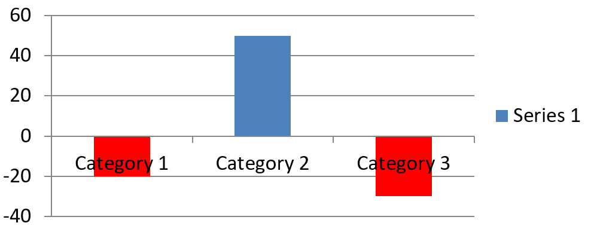

## **Przegląd**

Wykres może przechowywać swoje wykreślone wartości w komórkach skoroszytu lub bezpośrednio jako literały liczbowe. [IChartSeries](https://reference.aspose.com/slides/net/aspose.slides.charts/ichartseries/) reprezentuje jeden zestaw powiązanych wartości, a każdy [IChartDataPoint](https://reference.aspose.com/slides/net/aspose.slides.charts/ichartdatapoint/) reprezentuje punkt w tej serii. Obiekty [IChartCategory](https://reference.aspose.com/slides/net/aspose.slides.charts/ichartcategory/) dostarczają etykiety lub wartości grupujące wspólne dla serii. W wykresach tworzonych z danymi domyślnymi nazwy serii, kategorie i wartości punktów używają obiektów [IChartDataCell](https://reference.aspose.com/slides/net/aspose.slides.charts/ichartdatacell/) z skoroszytu wykresu.

Dla typowego wykresu kategoriowego domyślny skoroszyt używa wiersza 0 dla nazw serii, kolumny 0 dla nazw kategorii oraz pozostałych komórek dla wartości serii. Indeksy arkusza, wiersza i kolumny przekazywane do [IChartDataWorkbook.GetCell](https://reference.aspose.com/slides/net/aspose.slides.charts/ichartdataworkbook/getcell/) są zerowo‑indeksowane. Ten układ jest przydatny, gdy tworzysz wykres z danymi domyślnymi, ale nie zakładaj, że każdy istniejący wykres go używa. Dla załadowanej prezentacji sprawdź komórki odwoływane przez serie, kategorie i punkty danych przed zmianą wartości w skoroszycie.

Ustawienia wykresu mają trzy różne zakresy:

- Ustawienia na poziomie serii, takie jak [IChartSeries.Format](https://reference.aspose.com/slides/net/aspose.slides.charts/ichartseries/format/), dostarczają domyślny wygląd dla wszystkich punktów w jednej serii.
- Ustawienia punktu danych, takie jak [IChartDataPoint.Format](https://reference.aspose.com/slides/net/aspose.slides.charts/ichartdatapoint/format/), nadpisują wygląd serii dla jednego punktu.
- Ustawienia grupy mają zastosowanie do kompatybilnych serii należących do tego samego [IChartSeriesGroup](https://reference.aspose.com/slides/net/aspose.slides.charts/ichartseriesgroup/). Uzyskaj dostęp do grupy przez [IChartSeries.ParentSeriesGroup](https://reference.aspose.com/slides/net/aspose.slides.charts/ichartseries/parentseriesgroup/) wtedy, gdy musisz ustawić opcje takie jak overlap lub szerokość luki.

Gdy nie jest ustawione jawne wypełnienie punktu lub serii, styl wykresu i motyw określają automatyczny wygląd. Gdy istnieją zarówno formatowanie serii, jak i punktu, formatowanie punktu ma pierwszeństwo dla tego punktu.


## **Ustaw wartości serii przy użyciu literałów liczbowych**

Używaj literałów liczbowych, gdy wartości serii pochodzą z danych aplikacji lub obliczeń i nie potrzebują odwołań do komórek arkusza. Ustaw [DataSourceTypeForValues](https://reference.aspose.com/slides/net/aspose.slides.charts/ichartdatapointcollection/datasourcetypeforvalues/) na [DataSourceType.DoubleLiterals](https://reference.aspose.com/slides/net/aspose.slides.charts/datasourcetype/) przed przypisaniem każdej [Value](https://reference.aspose.com/slides/net/aspose.slides.charts/ichartdatapoint/value/) punktu przez [AsLiteralDouble](https://reference.aspose.com/slides/net/aspose.slides.charts/idoublechartvalue/asliteraldouble/).

Ustawienie kolekcji kontroluje typ źródła wszystkich wartości punktów w tej serii. Każdy punkt ma [Value.DataSourceType](https://reference.aspose.com/slides/net/aspose.slides.charts/ibasechartvalue/datasourcetype/), które zgłasza wybrany typ; zmień go poprzez ustawienie kolekcji. Z `Worksheet` użyj [AsCell](https://reference.aspose.com/slides/net/aspose.slides.charts/isinglecellchartvalue/ascell/), aby uzyskać dostęp do odwoływanej komórki. Z `DoubleLiterals` użyj `AsLiteralDouble`, aby odczytać lub zapisać liczbę bezpośrednio.

Poniższy przykład tworzy wykres słupkowy z domyślnymi seriami i kategoriami, a następnie przypisuje obliczone wartości 10, 20 itd. istniejącym punktom pierwszej serii. Zapisuje prezentację, otwiera ją ponownie i wypisuje zapisane wartości.

```cs
using System;
using Aspose.Slides;
using Aspose.Slides.Charts;
using Aspose.Slides.Export;

using var presentation = new Presentation();
var slide = presentation.Slides[0];

var chart = slide.Shapes.AddChart(ChartType.ClusteredColumn, 20, 20, 500, 300);
var series = chart.ChartData.Series[0];

series.DataPoints.DataSourceTypeForValues = DataSourceType.DoubleLiterals;
for (var i = 0; i < series.DataPoints.Count; i++)
{
    series.DataPoints[i].Value.AsLiteralDouble = (i + 1) * 10;
}

presentation.Save("numeric_literals.pptx", SaveFormat.Pptx);

using var reopenedPresentation = new Presentation("numeric_literals.pptx");
var reopenedSlide = reopenedPresentation.Slides[0];
var reopenedChart = (IChart)reopenedSlide.Shapes[0];
var reopenedSeries = reopenedChart.ChartData.Series[0];
foreach (var point in reopenedSeries.DataPoints)
{
    Console.WriteLine(point.Value.AsLiteralDouble);
}
```

Typ źródła wartości punktu jest odrębny od [IChartData.DataSourceType](https://reference.aspose.com/slides/net/aspose.slides.charts/ichartdata/datasourcetype/), który identyfikuje wewnętrzną lub zewnętrzną konfigurację skoroszytu wykresu. Użycie literałów liczbowych nie usuwa samodzielnie osadzonego skoroszytu. W tym przykładzie skoroszyt pozostaje dostępny dla etykiet kategorii, nazw serii i pozostałych serii. Zobacz [Chart Workbook](/slides/pl/net/chart-workbook/) po zarządzanie skoroszytem.

Dla wykresów punktowych i bąbelkowych ustaw [DataSourceTypeForXValues](https://reference.aspose.com/slides/net/aspose.slides.charts/ichartdatapointcollection/datasourcetypeforxvalues/) i [DataSourceTypeForYValues](https://reference.aspose.com/slides/net/aspose.slides.charts/ichartdatapointcollection/datasourcetypeforyvalues/) aby wybrać źródła dla [XValue](https://reference.aspose.com/slides/net/aspose.slides.charts/ichartdatapoint/xvalue/) i [YValue](https://reference.aspose.com/slides/net/aspose.slides.charts/ichartdatapoint/yvalue/). Wykresy bąbelkowe używają także [DataSourceTypeForBubbleSizes](https://reference.aspose.com/slides/net/aspose.slides.charts/ichartdatapointcollection/datasourcetypeforbubblesizes/) dla [BubbleSize](https://reference.aspose.com/slides/net/aspose.slides.charts/ichartdatapoint/bubblesize/). Ustaw każdy odpowiedni typ źródła na `DoubleLiterals` przed przypisaniem liczb przez właściwość `AsLiteralDouble` tego źródła.

## **Ustaw overlap serii wykresu**

[IChartSeries.Overlap](https://reference.aspose.com/slides/net/aspose.slides.charts/ichartseries/overlap/) wskazuje, o ile słupki lub kolumny nakładają się w wykresie 2D, w przedziale od ‑100 do 100 procent. Jest to tylko odczytywana projekcja ustawienia w grupie nadrzędnej serii. Ustaw [IChartSeriesGroup.Overlap](https://reference.aspose.com/slides/net/aspose.slides.charts/ichartseriesgroup/overlap/), aby zaktualizować wszystkie kompatybilne serie w tej grupie. Opcja ma zastosowanie do typów wykresów wyświetlających grupowane słupki lub kolumny; nie wpływa na niepowiązane grupy serii w wykresie kombinowanym.

Poniższy przykład ustawia overlap dla grupy zawierającej pierwszą serię:

```cs
using Aspose.Slides;
using Aspose.Slides.Charts;
using Aspose.Slides.Export;

const int firstSlideIndex = 0;
const int firstSeriesIndex = 0;
const sbyte overlapPercent = 30;

using var presentation = new Presentation();
var slide = presentation.Slides[firstSlideIndex];

// Nowy wykres zawiera przykładowe serie, kategorie i wartości.
var chart = slide.Shapes.AddChart(ChartType.ClusteredColumn, 20, 20, 500, 200);

var series = chart.ChartData.Series[firstSeriesIndex];
series.ParentSeriesGroup.Overlap = overlapPercent;

presentation.Save("series_overlap.pptx", SaveFormat.Pptx);
```

Wynik:


## **Zmień kolor wypełnienia serii**

Użyj [IChartSeries.Format](https://reference.aspose.com/slides/net/aspose.slides.charts/ichartseries/format/), aby ustawić domyślne wypełnienie dla całej serii. Jeśli punkt ma już jawne wypełnienie, jego ustawienie [IChartDataPoint.Format](https://reference.aspose.com/slides/net/aspose.slides.charts/ichartdatapoint/format/) nadpisuje wypełnienie serii dla tego punktu.

Poniższy przykład stosuje jednolite niebieskie wypełnienie do pierwszej serii:

```cs
using System.Drawing;
using Aspose.Slides;
using Aspose.Slides.Charts;
using Aspose.Slides.Export;

const int firstSlideIndex = 0;
const int firstSeriesIndex = 0;

using var presentation = new Presentation();
var slide = presentation.Slides[firstSlideIndex];

var chart = slide.Shapes.AddChart(ChartType.ClusteredColumn, 20, 20, 500, 200);

var series = chart.ChartData.Series[firstSeriesIndex];
series.Format.Fill.FillType = FillType.Solid;
series.Format.Fill.SolidFillColor.Color = Color.Blue;

presentation.Save("series_color.pptx", SaveFormat.Pptx);
```

Wynik:


## **Zmień nazwę serii**

Nazwa serii jest przechowywana w skoroszycie danych wykresu i zwykle wyświetlana w legendzie. W domyślnym skoroszycie utworzonym dla wykresu słupkowego grupowanego komórka B1 znajduje się w wierszu 0, kolumnie 1 i zawiera nazwę pierwszej serii. Stałe nazwane w poniższym przykładzie wyjaśniają tę strukturę:

```cs
using Aspose.Slides;
using Aspose.Slides.Charts;
using Aspose.Slides.Export;

const int firstSlideIndex = 0;
const int worksheetIndex = 0;
const int seriesNameRowIndex = 0;
const int firstSeriesColumnIndex = 1;

using var presentation = new Presentation();
var slide = presentation.Slides[firstSlideIndex];

var chart = slide.Shapes.AddChart(ChartType.ClusteredColumn, 20, 20, 500, 200);

var workbook = chart.ChartData.ChartDataWorkbook;
var seriesNameCell = workbook.GetCell(worksheetIndex, seriesNameRowIndex, firstSeriesColumnIndex);
seriesNameCell.Value = "Revenue";

presentation.Save("series_name.pptx", SaveFormat.Pptx);
```

Możesz także zaktualizować komórkę już odwoływaną przez [IChartSeries.Name](https://reference.aspose.com/slides/net/aspose.slides.charts/ichartseries/name/). To podejście eliminuje domyślanie się konkretnego wiersza i kolumny w istniejącym wykresie:

```cs
using Aspose.Slides;
using Aspose.Slides.Charts;
using Aspose.Slides.Export;

const int firstSlideIndex = 0;
const int firstSeriesIndex = 0;
const int firstNameCellIndex = 0;

using var presentation = new Presentation();
var slide = presentation.Slides[firstSlideIndex];

var chart = slide.Shapes.AddChart(ChartType.ClusteredColumn, 20, 20, 500, 200);

var series = chart.ChartData.Series[firstSeriesIndex];
var seriesNameCell = series.Name.AsCells[firstNameCellIndex];
seriesNameCell.Value = "Revenue";

presentation.Save("series_name.pptx", SaveFormat.Pptx);
```

Wynik:


### **Utwórz serię z nazwą z wielu komórek**

Złożona nazwa serii jest przydatna, gdy nazwa produktu i okres sprawozdawczy są przechowywane w oddzielnych komórkach skoroszytu. Na przykład możesz połączyć `Product A` w B1 i `2026` w C1 w jedną nazwę serii, zachowując oba elementy połączone z ich źródłowymi komórkami.

Użyj [IChartDataWorkbook.GetCellCollection](https://reference.aspose.com/slides/net/aspose.slides.charts/ichartdataworkbook/getcellcollection/), aby pobrać zakres nazw, a następnie przekaż tę kolekcję do [IChartSeriesCollection.Add](https://reference.aspose.com/slides/net/aspose.slides.charts/ichartseriescollection/add/). Argument `skipHiddenCells` kontroluje, czy ukryte komórki są uwzględniane: `true` je wyklucza, `false` włącza. Ten przykład używa `false`, aby włączyć każdą komórkę w zakresie nazwy.

Poniższy przykład tworzy prezentację z jedną serią i dwoma punktami danych. Komórki B1:C1 dostarczają jedynie nazwę serii; A2:A3 dostarczają etykiety kategorii, a B2:B3 – wartości liczbowe.

```cs
using Aspose.Slides;
using Aspose.Slides.Charts;
using Aspose.Slides.Export;

using var presentation = new Presentation();
var slide = presentation.Slides[0];

var chart = slide.Shapes.AddChart(ChartType.ClusteredColumn, 50, 50, 620, 180);

chart.ChartData.Series.Clear();
chart.ChartData.Categories.Clear();
chart.HasLegend = true;

var workbook = chart.ChartData.ChartDataWorkbook;
workbook.Clear(0);

// Te dwie komórki dostarczają nazwę serii.
workbook.GetCell(0, 0, 1, "Product A");
workbook.GetCell(0, 0, 2, "2026");
var nameCells = workbook.GetCellCollection("Sheet1!$B$1:$C$1", skipHiddenCells: false);
var series = chart.ChartData.Series.Add(nameCells, ChartType.ClusteredColumn);

// Separate cells supply the categories and numeric data points.
var northCategory = workbook.GetCell(0, 1, 0, "North");
var southCategory = workbook.GetCell(0, 2, 0, "South");
chart.ChartData.Categories.Add(northCategory);
chart.ChartData.Categories.Add(southCategory);
var northValue = workbook.GetCell(0, 1, 1, 120);
var southValue = workbook.GetCell(0, 2, 1, 150);
series.DataPoints.AddDataPointForBarSeries(northValue);
series.DataPoints.AddDataPointForBarSeries(southValue);

presentation.Save("composite_series_name.pptx", SaveFormat.Pptx);
```

Wynikowa nazwa serii to `Product A 2026`, ze spacją pomiędzy wartościami dwóch komórek. Legenda wyświetla to jako jedną pozycję dla obu kolumn. Poniższy obraz został wygenerowany z zapisanej prezentacji:


## **Uzyskaj automatyczny kolor wypełnienia serii**

[IChartSeries.GetAutomaticSeriesColor](https://reference.aspose.com/slides/net/aspose.slides.charts/ichartseries/getautomaticseriescolor/) zwraca kolor obliczony na podstawie indeksu serii i stylu wykresu. Jest to kolor używany, gdy wypełnienie serii nie zostało jawnie określone. Wywołanie metody odczytuje obliczony kolor; nie przypisuje nowego wypełnienia.

Poniższy przykład wypisuje automatyczny kolor każdej domyślnej serii:

```cs
using System;
using Aspose.Slides;
using Aspose.Slides.Charts;

const int firstSlideIndex = 0;

using var presentation = new Presentation();
var slide = presentation.Slides[firstSlideIndex];

var chart = slide.Shapes.AddChart(ChartType.ClusteredColumn, 20, 20, 500, 200);

var seriesCount = chart.ChartData.Series.Count;
for (var seriesIndex = 0; seriesIndex < seriesCount; seriesIndex++)
{
    var series = chart.ChartData.Series[seriesIndex];
    var automaticColor = series.GetAutomaticSeriesColor();
    Console.WriteLine($"Series {seriesIndex}: {automaticColor.Name}");
}
```

Przykładowe wyjście dla domyślnego stylu wykresu:

```text
Series 0: ff4f81bd
Series 1: ffc0504d
Series 2: ff9bbb59
```

Dokładne kolory zależą od stylu wykresu i motywu.

## **Ustaw odwrócony kolor wypełnienia dla serii wykresu**

Dla serii słupkowych, kolumnowych i bąbelkowych [IChartSeries.InvertIfNegative](https://reference.aspose.com/slides/net/aspose.slides.charts/ichartseries/invertifnegative/) może wyświetlać wartości ujemne innym wypełnieniem. Ustaw regularne wypełnienie serii na jednolite, włącz odwrócenie i przypisz kolor wartości ujemnej przez [IChartSeries.InvertedSolidFillColor](https://reference.aspose.com/slides/net/aspose.slides.charts/ichartseries/invertedsolidfillcolor/). Liczby ujemne pozostają niezmienione w skoroszycie; zmienia się tylko ich kolor wyświetlania.

Poniższy przykład zastępuje domyślne dane wykresu jedną serią. Wiersz 0 arkusza zawiera nazwę serii, kolumna 0 – nazwy kategorii, a kolumna 1 – wartości:

```cs
using System.Drawing;
using Aspose.Slides;
using Aspose.Slides.Charts;
using Aspose.Slides.Export;

const int firstSlideIndex = 0;
const int worksheetIndex = 0;
const int headerRowIndex = 0;
const int categoryColumnIndex = 0;
const int firstSeriesColumnIndex = 1;
const int firstDataRowIndex = 1;

var categoryNames = new[] { "Category 1", "Category 2", "Category 3" };
var seriesValues = new[] { -20, 50, -30 };

using var presentation = new Presentation();
var slide = presentation.Slides[firstSlideIndex];

var chart = slide.Shapes.AddChart(ChartType.ClusteredColumn, 20, 20, 500, 200);
var chartData = chart.ChartData;
var workbook = chartData.ChartDataWorkbook;

chartData.Series.Clear();
chartData.Categories.Clear();

var seriesNameCell = workbook.GetCell(worksheetIndex, headerRowIndex, firstSeriesColumnIndex, "Series 1");
var series = chartData.Series.Add(seriesNameCell, chart.Type);

for (var categoryIndex = 0; categoryIndex < categoryNames.Length; categoryIndex++)
{
    var dataRowIndex = firstDataRowIndex + categoryIndex;
    var categoryName = categoryNames[categoryIndex];
    var seriesValue = seriesValues[categoryIndex];

    var categoryCell = workbook.GetCell(worksheetIndex, dataRowIndex, categoryColumnIndex, categoryName);
    chartData.Categories.Add(categoryCell);

    var valueCell = workbook.GetCell(worksheetIndex, dataRowIndex, firstSeriesColumnIndex, seriesValue);
    series.DataPoints.AddDataPointForBarSeries(valueCell);
}

var automaticSeriesColor = series.GetAutomaticSeriesColor();
series.Format.Fill.FillType = FillType.Solid;
series.Format.Fill.SolidFillColor.Color = automaticSeriesColor;
series.InvertIfNegative = true;
series.InvertedSolidFillColor.Color = Color.Red;

presentation.Save("inverted_solid_fill_color.pptx", SaveFormat.Pptx);
```

Wynik:



Możesz włączyć odwrócenie dla jednego punktu przez [IChartDataPoint.InvertIfNegative](https://reference.aspose.com/slides/net/aspose.slides.charts/ichartdatapoint/invertifnegative/). W poniższym przykładzie odwrócenie jest wyłączone dla serii i włączone tylko dla wybranego punktu. Punktowi przypisano także wartość ujemną, aby efekt był widoczny:

```cs
using System.Drawing;
using Aspose.Slides;
using Aspose.Slides.Charts;
using Aspose.Slides.Export;

const int firstSlideIndex = 0;
const int firstSeriesIndex = 0;
const int targetDataPointIndex = 2;
const int negativeValue = -30;

using var presentation = new Presentation();
var slide = presentation.Slides[firstSlideIndex];

var chart = slide.Shapes.AddChart(ChartType.ClusteredColumn, 20, 20, 500, 200);

var series = chart.ChartData.Series[firstSeriesIndex];
var automaticSeriesColor = series.GetAutomaticSeriesColor();
series.Format.Fill.FillType = FillType.Solid;
series.Format.Fill.SolidFillColor.Color = automaticSeriesColor;
series.InvertedSolidFillColor.Color = Color.Red;
series.InvertIfNegative = false;

var dataPoint = series.DataPoints[targetDataPointIndex];
dataPoint.YValue.AsCell.Value = negativeValue;
dataPoint.InvertIfNegative = true;

presentation.Save("data_point_invert_color_if_negative.pptx", SaveFormat.Pptx);
```

## **Wyczyść konkretną wartość punktu danych**

Aby pozostawić jeden punkt pusty bez usuwania pozostałych punktów, ustaw jego komórkę w skoroszycie na `null`. Dla wykresu słupkowego wyświetlana wartość jest dostępna przez [IChartDataPoint.YValue](https://reference.aspose.com/slides/net/aspose.slides.charts/ichartdatapoint/yvalue/). Punkt danych pozostaje w tej samej pozycji kategorii, ale wykres traktuje jego wartość jako pustą zgodnie z ustawieniami wykresu dotyczącymi pustych wartości.

Poniższy przykład czyści tylko drugi punkt w pierwszej serii:

```cs
using Aspose.Slides;
using Aspose.Slides.Charts;
using Aspose.Slides.Export;

const int firstSlideIndex = 0;
const int firstSeriesIndex = 0;
const int targetDataPointIndex = 1;

using var presentation = new Presentation();
var slide = presentation.Slides[firstSlideIndex];

var chart = slide.Shapes.AddChart(ChartType.ClusteredColumn, 20, 20, 500, 200);

var series = chart.ChartData.Series[firstSeriesIndex];
var dataPoint = series.DataPoints[targetDataPointIndex];
dataPoint.YValue.AsCell.Value = null;

presentation.Save("clear_data_point_value.pptx", SaveFormat.Pptx);
```

Wykresy punktowe używają oddzielnych komórek X i Y, a wykresy bąbelkowe dodatkowo komórki rozmiaru. Czyść tylko tę komórkę, która reprezentuje wartość, którą chcesz usunąć. Nie wywołuj [IChartDataPointCollection.Clear](https://reference.aspose.com/slides/net/aspose.slides.charts/ichartdatapointcollection/clear/) gdy chcesz zachować pozostałe punkty, ponieważ metoda ta usuwa wszystkie punkty z kolekcji.

## **Kontroluj wyświetlanie pustych komórek**

Ukryte komórki zawierające wartości to odrębny przypadek od pustych komórek. Aby włączać lub wyłączać dane z ukrytych wierszy i kolumn arkusza, zobacz [Include Data from Hidden Rows and Columns](/slides/pl/net/chart-workbook/#include-data-from-hidden-rows-and-columns).

Pusta komórka skoroszytu reprezentuje brak danych; komórka zawierająca `0` oznacza znaną wartość liczbową. Ustaw [IChartDataCell.Value](https://reference.aspose.com/slides/net/aspose.slides.charts/ichartdatacell/value/) na `null`, aby uczynić komórkę pustą. Zero liczbowe pozostaje zerem niezależnie od ustawienia pustej komórki.

Użyj [IChart.DisplayBlanksAs](https://reference.aspose.com/slides/net/aspose.slides.charts/ichart/displayblanksas/), aby wybrać, jak wykres wyświetla puste komórki. To ustawienie ma zastosowanie do całego wykresu. Zmienia sposób rysowania pustych miejsc, nie wypełniając pustej komórki zerem ani interpolowaną wartością.

Poniższy, samodzielny przykład tworzy wykres liniowy z jedną serią, czyści wartość dla Dnia 3 i zapisuje wykres w każdym trybie. Nie wymaga pliku wejściowego. [IChartDataWorkbook](https://reference.aspose.com/slides/net/aspose.slides.charts/ichartdataworkbook/) używa arkusza 0, kolumny 0 dla etykiet kategorii i kolumny 1 dla wartości; wiersz 0 przechowuje nazwę serii. Końcowe dane to `10, 20, empty, 30, 40`.

```cs
using Aspose.Slides;
using Aspose.Slides.Charts;
using Aspose.Slides.Export;

using var presentation = new Presentation();
var slide = presentation.Slides[0];

var chart = slide.Shapes.AddChart(ChartType.LineWithMarkers, 40, 40, 640, 400);
var chartData = chart.ChartData;
var workbook = chartData.ChartDataWorkbook;

chartData.Series.Clear();
chartData.Categories.Clear();

var seriesNameCell = workbook.GetCell(0, 0, 1, "Measurements");
var series = chartData.Series.Add(seriesNameCell, chart.Type);
var values = new[] { 10, 20, 25, 30, 40 };

for (var i = 0; i < values.Length; i++)
{
    var categoryCell = workbook.GetCell(0, i + 1, 0, $"Day {i + 1}");
    chartData.Categories.Add(categoryCell);
    var valueCell = workbook.GetCell(0, i + 1, 1, values[i]);
    series.DataPoints.AddDataPointForLineSeries(valueCell);
}

// Pozostaw Dzień 3 rzeczywiście pusty, zachowując jego kategorię i punkt danych.
workbook.GetCell(0, 3, 1).Value = null;

var modes = new[] { DisplayBlanksAsType.Gap, DisplayBlanksAsType.Zero, DisplayBlanksAsType.Span };
foreach (var mode in modes)
{
    chart.DisplayBlanksAs = mode;
    presentation.Save($"empty_cells_{mode}.pptx", SaveFormat.Pptx);
}
```

Każdy plik wyjściowy przechowuje tryb przypisany przed zapisaniem: `empty_cells_Gap.pptx`, `empty_cells_Zero.pptx` i `empty_cells_Span.pptx`. Aby zapisać tylko jedną wersję, ustaw żądany tryb i zapisz prezentację jednokrotnie zamiast iterować po trybach.

Porównanie poniżej pokazuje te same dane we wszystkich trzech plikach. Dzień 3 jest pusty w skoroszycie we wszystkich przypadkach:


Widoczny efekt zależy od typu wykresu. Wykres liniowy umożliwia łatwe porównanie wszystkich trzech trybów. Wykresy słupkowe i kolumnowe nie mają linii łączącej brakującą kategorię, więc `Span` nie może wygenerować pokazanego segmentu; brakująca kolumna i kolumna o wysokości zerowej mogą wyglądać podobnie. Podobnie, wykres punktowy z samymi znacznikami nie ma linii łączącej. Nie oczekuj trzech odrębnych wyników dla każdego typu wykresu; sprawdź wynik dla używanego typu.

## **Ustaw szerokość luki serii**

Szerokość luki to odstęp między sąsiednimi grupami słupków lub kolumn, wyrażony jako procent szerokości słupka lub kolumny. Podobnie jak overlap, należy do grupy nadrzędnej serii, a nie do pojedynczej serii. Ustaw [IChartSeriesGroup.GapWidth](https://reference.aspose.com/slides/net/aspose.slides.charts/ichartseriesgroup/gapwidth/) raz dla grupy. Większa wartość tworzy więcej przestrzeni między grupami; mniejsza – gęstsze rozmieszczenie.

Poniższy przykład zmienia szerokość luki i zapisuje tylko końcową prezentację:

```cs
using Aspose.Slides;
using Aspose.Slides.Charts;
using Aspose.Slides.Export;

const int firstSlideIndex = 0;
const int firstSeriesIndex = 0;
const int gapWidthPercent = 30;

using var presentation = new Presentation();
var slide = presentation.Slides[firstSlideIndex];

var chart = slide.Shapes.AddChart(ChartType.StackedColumn, 20, 20, 500, 200);

var series = chart.ChartData.Series[firstSeriesIndex];
series.ParentSeriesGroup.GapWidth = gapWidthPercent;

presentation.Save("gap_width_30.pptx", SaveFormat.Pptx);
```

Wynik:


## **FAQ**

**Które typy wykresów obsługują serie danych?**

Wszystkie typy wykresów reprezentowane przez wyliczenie [ChartType](https://reference.aspose.com/slides/net/aspose.slides.charts/charttype/) używają danych wykresu, ale ich serie nie zawsze mają taką samą strukturę wartości lub ustawienia. Na przykład wykresy kategoriowe używają kategorii i wartości, wykresy punktowe – wartości X i Y, a wykresy bąbelkowe dodatkowo rozmiary bąbelków. Użyj metody tworzenia punktów danych odpowiadającej typowi serii. Opcje takie jak overlap i szerokość luki mają zastosowanie tylko do kompatybilnych grup słupków lub kolumn.

**Czym jest grupa serii wykresu?**

[IChartSeriesGroup](https://reference.aspose.com/slides/net/aspose.slides.charts/ichartseriesgroup/) zawiera kompatybilne serie, które współdzielą ustawienia grupowe wykreślania. Wykres kombinowany może zawierać więcej niż jedną grupę, więc zmiana grupy uzyskanej przez jedną serię niekoniecznie zmieni wszystkie serie w wykresie.

**Czy nowo utworzony wykres zawiera domyślne dane?**

Tak. Domyślnie [IShapeCollection.AddChart](https://reference.aspose.com/slides/net/aspose.slides/ishapecollection/addchart/) tworzy przykładowe serie, kategorie i wartości. Możesz edytować te komórki lub wyczyścić zarówno kolekcje serii, jak i kategorii przed dodaniem całkowicie własnego zestawu danych. Przeciążenie może także utworzyć wykres bez danych domyślnych.

**Jak obiekty wykresu są połączone z komórkami skoroszytu?**

Nazwy serii, etykiety kategorii i wartości punktów danych odwołują się do komórek w [IChartDataWorkbook](https://reference.aspose.com/slides/net/aspose.slides.charts/ichartdataworkbook/). Zmiana odwoływanej komórki aktualizuje odpowiadający element wykresu. Budując własne dane, utrzymuj wyrównanie wierszy kategorii i wierszy wartości serii, aby każdy punkt był wykreślony pod zamierzoną kategorią.

**Jak wyczyścić jeden punkt zamiast całej serii?**

Ustaw odpowiednią komórkę wartości na `null`, aby zachować pozycję kategorii punktu jako pusty punkt. Używaj [IChartDataPointCollection.Clear](https://reference.aspose.com/slides/net/aspose.slides.charts/ichartdatapointcollection/clear/) tylko wtedy, gdy zamierzasz usunąć wszystkie punkty z tej serii. Jeśli usuwasz również kategorie, zaktualizuj wszystkie serie, aby ich wartości pozostały wyrównane z kolekcją kategorii.

**Jak wyświetlane są puste punkty?**

Wynik zależy od typu wykresu i [IChart.DisplayBlanksAs](https://reference.aspose.com/slides/net/aspose.slides.charts/ichart/displayblanksas/). Obsługiwane wykresy mogą wyświetlać puste miejsca jako przerwy, jako wartości zero lub łącząc sąsiednie punkty. Wybierz ustawienie pasujące do znaczenia brakujących danych w Twojej prezentacji. Zobacz [Control the Display of Empty Cells](#control-the-display-of-empty-cells) po pełny przykład i porównanie wizualne.

**Jak formatowane są wartości ujemne?**

W przypadku obsługiwanych serii słupkowych, kolumnowych i bąbelkowych włącz [IChartSeries.InvertIfNegative](https://reference.aspose.com/slides/net/aspose.slides.charts/ichartseries/invertifnegative/) i ustaw [IChartSeries.InvertedSolidFillColor](https://reference.aspose.com/slides/net/aspose.slides.charts/ichartseries/invertedsolidfillcolor/). Zachowanie można nadpisać dla pojedynczego punktu za pomocą [IChartDataPoint.InvertIfNegative](https://reference.aspose.com/slides/net/aspose.slides.charts/ichartdatapoint/invertifnegative/). Właściwości te wpływają na formatowanie, nie na zapisane wartości liczbowe.

**Które formatowanie ma pierwszeństwo, gdy zarówno seria, jak i punkt są sformatowane?**

Jawne formatowanie punktu danych ma pierwszeństwo dla tego punktu. Inne punkty nadal korzystają z jawnego formatu serii lub, gdy format serii nie jest określony, z automatycznego stylu wykresu i motywu. Właściwości grupy, takie jak overlap i szerokość luki, sterują układem i nie są nadpisaniami formatowania na poziomie punktu.

**Czy istnieje limit liczby serii, które może zawierać wykres?**

Aspose.Slides nie narzuca osobnego stałego limitu liczby serii. W praktyce ograniczenia pliku prezentacji, dostępna pamięć, czas renderowania i czytelność wykresu określają użyteczny limit.

**Co zmienić, gdy kolumny są zbyt blisko siebie lub zbyt daleko od siebie?**

Ustaw [IChartSeriesGroup.GapWidth](https://reference.aspose.com/slides/net/aspose.slides.charts/ichartseriesgroup/gapwidth/) w odpowiedniej grupie nadrzędnej serii. Zwiększ wartość, aby poszerzyć odstęp między grupami, lub zmniejsz ją, aby przybliżyć grupy do siebie.