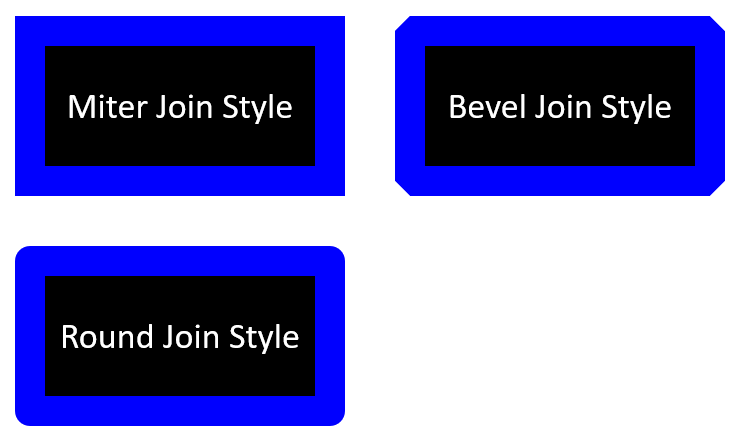

## **Wprowadzenie**

Formatuj kształty w programie PowerPoint, dostosowując ich kontury, wypełnienia i efekty. Aspose.Slides for .NET umożliwia programowe sterowanie tymi ustawieniami, w tym przezroczystością, obrotem i formatowaniem 3D.


Aspose.Slides for .NET udostępnia interfejsy i właściwości, które pozwalają formatować kształty przy użyciu tych samych opcji dostępnych w programie PowerPoint.

## **Formatowanie linii**

Użyj [IShape.LineFormat](https://reference.aspose.com/slides/net/aspose.slides/ishape/lineformat/) aby kontrolować obrys kształtu. Ten przykład tworzy prostokąt bez wypełnienia z niebieskim, przerywanym konturem. [ILineFormat.Style](https://reference.aspose.com/slides/net/aspose.slides/ilineformat/style/) wybiera linię złożoną z grubego i cienkiego odcinka, natomiast [ILineFormat.Width](https://reference.aspose.com/slides/net/aspose.slides/ilineformat/width/) ustawia jej szerokość na 7 punktów, a [ILineFormat.DashStyle](https://reference.aspose.com/slides/net/aspose.slides/ilineformat/dashstyle/) wybiera wzór kreski.

```csharp
using System.Drawing;
using Aspose.Slides;
using Aspose.Slides.Export;

using var presentation = new Presentation();
var slide = presentation.Slides[0];

var shape = slide.Shapes.AddAutoShape(ShapeType.Rectangle, 50, 50, 150, 75);
shape.FillFormat.FillType = FillType.NoFill;
shape.LineFormat.Style = LineStyle.ThickThin;
shape.LineFormat.Width = 7;
shape.LineFormat.DashStyle = LineDashStyle.Dash;
shape.LineFormat.FillFormat.FillType = FillType.Solid;
shape.LineFormat.FillFormat.SolidFillColor.Color = Color.Blue;

presentation.Save("formatted_lines.pptx", SaveFormat.Pptx);
```

Wynik:


### **Ustaw niestandardowe wzory kresk linii**

Użyj [ILineFormat.CustomDashPattern](https://reference.aspose.com/slides/net/aspose.slides/ilineformat/customdashpattern/) gdy wstępnie zdefiniowane style linii nie zapewniają potrzebnych długości kresek i przerw, na przykład dla niestandardowych obrysów lub diagramów technicznych. Przypisanie wzoru automatycznie ustawia [ILineFormat.DashStyle](https://reference.aspose.com/slides/net/aspose.slides/ilineformat/dashstyle/) na [LineDashStyle.Custom](https://reference.aspose.com/slides/net/aspose.slides/linedashstyle/).

Elementy tablicy naprzemiennie określają długość kreski i przerwy, zaczynając od kreski. Każda wartość jest wielokrotnością szerokości linii: `{ 4, 2 }` przy szerokości 3 punktów daje kreskę 12‑punktową, po której następuje przerwa 6‑punktowa. Używaj par skończonych, nieujemnych wartości, aby zdefiniować pełne segmenty kreska‑przerwa. Przykład używa dodatnich wartości, aby każda kreska i przerwa były widoczne.

Ten przykład tworzy pięć niebieskich linii o tej samej długości i płaskich zakończeniach. Pierwsze trzy porównują wzory przy szerokości 3 punktów. Czwarta powtarza pierwszy wzór przy podwojonej szerokości, podwajając zarówno długość kreski, jak i przerwy. Piąta przełącza się z niestandardowego wzoru na linię ciągłą.

```csharp
using System.Drawing;
using Aspose.Slides;
using Aspose.Slides.Export;

using var presentation = new Presentation();
presentation.SlideSize.SetSize(600, 300, SlideSizeScaleType.DoNotScale);
var slide = presentation.Slides[0];

var patterns = new[]
{
    new float[] { 4, 2 },
    new float[] { 1, 2 },
    new float[] { 6, 2, 1, 2 },
    new float[] { 4, 2 },
    new float[] { 4, 2 }
};

for (var i = 0; i < patterns.Length; i++)
{
    var line = slide.Shapes.AddAutoShape(ShapeType.Line, 50, 50 + i * 50, 500, 0);
    line.LineFormat.Width = i == 3 ? 6 : 3;
    line.LineFormat.FillFormat.FillType = FillType.Solid;
    line.LineFormat.FillFormat.SolidFillColor.Color = Color.DarkBlue;
    line.LineFormat.CapStyle = LineCapStyle.Flat;
    line.LineFormat.BeginArrowheadStyle = LineArrowheadStyle.None;
    line.LineFormat.EndArrowheadStyle = LineArrowheadStyle.None;
    line.LineFormat.CustomDashPattern = patterns[i];
}

// Return the last line to a solid style.
slide.Shapes[4].LineFormat.DashStyle = LineDashStyle.Solid;

presentation.Save("custom_dash_patterns.pptx", SaveFormat.Pptx);
```

Aby powrócić do wstępnie zdefiniowanego stylu przerywanego, przypisz [LineDashStyle.Dash](https://reference.aspose.com/slides/net/aspose.slides/linedashstyle/) do [ILineFormat.DashStyle](https://reference.aspose.com/slides/net/aspose.slides/ilineformat/dashstyle/). Wybrany styl kontroluje wygląd linii.

Wynik w programie PowerPoint, od góry do dołu: **{4, 2}, 3 pt**; **{1, 2}, 3 pt**; **{6, 2, 1, 2}, 3 pt**; **{4, 2}, 6 pt**; oraz **Solid, 3 pt**.


### **Ustaw zakończenia linii**

Użyj [ILineFormat.CapStyle](https://reference.aspose.com/slides/net/aspose.slides/ilineformat/capstyle/) aby ustawić końce otwartej linii. Wyliczenie [LineCapStyle](https://reference.aspose.com/slides/net/aspose.slides/linecapstyle/) zapewnia trzy explicite style zakończeń:

- `Flat`: Pędzel zatrzymuje się na końcowym punkcie.
- `Round`: Półokrągłe zakończenie wystaje poza punkt końcowy o połowę szerokości linii.
- `Square`: Kwadratowe zakończenie wystaje poza punkt końcowy o połowę szerokości linii.

Wyliczenie zawiera również `NotDefined`, co oznacza, że żaden styl zakończenia nie jest explicite przypisany.

Zakończenia różnią się od grotów strzałek, które dodają symbole do końcówek linii, oraz od połączeń, które kontrolują kąty między segmentami linii. Ten przykład wyłącza groty strzałek poprzez [ILineFormat.BeginArrowheadStyle](https://reference.aspose.com/slides/net/aspose.slides/ilineformat/beginarrowheadstyle/) i [ILineFormat.EndArrowheadStyle](https://reference.aspose.com/slides/net/aspose.slides/ilineformat/endarrowheadstyle/), tak aby porównywane były tylko kształty zakończeń.

Poniższy przykład tworzy trzy w przeciwnym razie identyczne poziome linie o szerokości 20 punktów. Od góry do dołu używają odpowiednio zakończeń płaskiego, okrągłego i kwadratowego. Ich końcowe punkty mają te same współrzędne poziome; zakończenia okrągłe i kwadratowe wystają o 10 punktów poza każdy punkt końcowy.

```csharp
using System.Drawing;
using Aspose.Slides;
using Aspose.Slides.Export;

using var presentation = new Presentation();
presentation.SlideSize.SetSize(500, 240, SlideSizeScaleType.DoNotScale);
var slide = presentation.Slides[0];

var capStyles = new[] { LineCapStyle.Flat, LineCapStyle.Round, LineCapStyle.Square };

for (var i = 0; i < capStyles.Length; i++)
{
    var line = slide.Shapes.AddAutoShape(ShapeType.Line, 100, 50 + i * 70, 300, 0);
    line.LineFormat.Width = 20;
    line.LineFormat.FillFormat.FillType = FillType.Solid;
    line.LineFormat.FillFormat.SolidFillColor.Color = Color.DarkBlue;
    line.LineFormat.DashStyle = LineDashStyle.Solid;
    line.LineFormat.CapStyle = capStyles[i];
    line.LineFormat.BeginArrowheadStyle = LineArrowheadStyle.None;
    line.LineFormat.EndArrowheadStyle = LineArrowheadStyle.None;
}

presentation.Save("line_caps.pptx", SaveFormat.Pptx);
```

Wynik w programie PowerPoint, od góry do dołu: **Flat**, **Round** i **Square**.


## **Zastosuj efekty szkicu do linii kształtu**

Efekt szkicu sprawia, że linia kształtu wygląda na odręczną. Użyj [IShape.LineFormat](https://reference.aspose.com/slides/net/aspose.slides/ishape/lineformat/) aby uzyskać dostęp do ustawień linii, [ILineFormat.SketchFormat](https://reference.aspose.com/slides/net/aspose.slides/ilineformat/sketchformat/) aby uzyskać dostęp do ustawień szkicu, oraz [ISketchFormat.SketchType](https://reference.aspose.com/slides/net/aspose.slides/isketchformat/sketchtype/) aby wybrać wartość z wyliczenia [LineSketchType](https://reference.aspose.com/slides/net/aspose.slides/linesketchtype/).

Poniższy kod C# pokazuje, jak zastosować efekt [LineSketchType.Curved](https://reference.aspose.com/slides/net/aspose.slides/linesketchtype/) , odczytać explicite przypisaną wartość oraz usunąć efekt przy użyciu [LineSketchType.None](https://reference.aspose.com/slides/net/aspose.slides/linesketchtype/):

```csharp
using System;
using Aspose.Slides;

using var presentation = new Presentation();
var slide = presentation.Slides[0];

var shape = slide.Shapes.AddAutoShape(ShapeType.Rectangle, 50, 50, 200, 100);

var sketchFormat = shape.LineFormat.SketchFormat;
sketchFormat.SketchType = LineSketchType.Curved;
var explicitSketchType = sketchFormat.SketchType;
Console.WriteLine($"Explicit sketch type: {explicitSketchType}");
sketchFormat.SketchType = LineSketchType.None;
```

Wartość zwracana przez [ISketchFormat.SketchType](https://reference.aspose.com/slides/net/aspose.slides/isketchformat/sketchtype/) reprezentuje ustawienie przypisane bezpośrednio do kształtu. Jeśli formatowanie linii może być dziedziczone z motywu, slajdu głównego lub slajdu układu, użyj [ILineFormat.GetEffective](https://reference.aspose.com/slides/net/aspose.slides/ilineformat/geteffective/), uzyskaj dostęp do [ILineFormatEffectiveData.SketchFormat](https://reference.aspose.com/slides/net/aspose.slides/ilineformateffectivedata/sketchformat/), i odczytaj [ISketchFormatEffectiveData.SketchType](https://reference.aspose.com/slides/net/aspose.slides/isketchformateffectivedata/sketchtype/). Wartość efektywna odzwierciedla formatowanie, które jest faktycznie zastosowane po rozwiązaniu dziedziczenia. Ten przykład wymaga istniejącej prezentacji z co najmniej jednym kształtem na pierwszym slajdzie i wypisuje obie wartości:

```csharp
using System;
using Aspose.Slides;

using var presentation = new Presentation("presentation.pptx");
var shape = presentation.Slides[0].Shapes[0];

var lineFormat = shape.LineFormat;
var explicitSketchType = lineFormat.SketchFormat.SketchType;
var effectiveLineFormat = lineFormat.GetEffective();
var effectiveSketchType = effectiveLineFormat.SketchFormat.SketchType;

Console.WriteLine($"Explicit sketch type: {explicitSketchType}");
Console.WriteLine($"Effective sketch type: {effectiveSketchType}");
```

## **Formatowanie stylów połączeń**

Oto trzy opcje typu połączenia:

* Round
* Miter
* Bevel

Styl połączenia kontroluje, jak dwa segmenty obrysu łączą się w rogu. Użyj **Round** dla zaokrąglonych rogów, **Miter** dla ostrych rogów lub **Bevel** dla spłaszczonych rogów.



Ten przykład tworzy trzy czarne prostokąty z niebieskimi obrysami o szerokości 15 punktów. Ustawia [ILineFormat.JoinStyle](https://reference.aspose.com/slides/net/aspose.slides/ilineformat/joinstyle/) na wartości miter, bevel i round z [LineJoinStyle](https://reference.aspose.com/slides/net/aspose.slides/linejoinstyle/), odpowiednio, aby porównać, jak rysowane są rogi.

```csharp
using System.Drawing;
using Aspose.Slides;
using Aspose.Slides.Export;

using var presentation = new Presentation();
var slide = presentation.Slides[0];

var miterShape = slide.Shapes.AddAutoShape(ShapeType.Rectangle, 20, 20, 150, 75);
var bevelShape = slide.Shapes.AddAutoShape(ShapeType.Rectangle, 210, 20, 150, 75);
var roundShape = slide.Shapes.AddAutoShape(ShapeType.Rectangle, 20, 135, 150, 75);

miterShape.FillFormat.FillType = FillType.Solid;
miterShape.FillFormat.SolidFillColor.Color = Color.Black;
bevelShape.FillFormat.FillType = FillType.Solid;
bevelShape.FillFormat.SolidFillColor.Color = Color.Black;
roundShape.FillFormat.FillType = FillType.Solid;
roundShape.FillFormat.SolidFillColor.Color = Color.Black;

miterShape.LineFormat.Width = 15;
bevelShape.LineFormat.Width = 15;
roundShape.LineFormat.Width = 15;

miterShape.LineFormat.FillFormat.FillType = FillType.Solid;
miterShape.LineFormat.FillFormat.SolidFillColor.Color = Color.Blue;
bevelShape.LineFormat.FillFormat.FillType = FillType.Solid;
bevelShape.LineFormat.FillFormat.SolidFillColor.Color = Color.Blue;
roundShape.LineFormat.FillFormat.FillType = FillType.Solid;
roundShape.LineFormat.FillFormat.SolidFillColor.Color = Color.Blue;

miterShape.LineFormat.JoinStyle = LineJoinStyle.Miter;
bevelShape.LineFormat.JoinStyle = LineJoinStyle.Bevel;
roundShape.LineFormat.JoinStyle = LineJoinStyle.Round;

miterShape.TextFrame.Text = "Miter Join Style";
bevelShape.TextFrame.Text = "Bevel Join Style";
roundShape.TextFrame.Text = "Round Join Style";

presentation.Save("join_styles.pptx", SaveFormat.Pptx);
```

### **Ogranicz połączenia Miter w ostrych rogach**

Użyj [ILineFormat.MiterLimit](https://reference.aspose.com/slides/net/aspose.slides/ilineformat/miterlimit/) wraz z [ILineFormat.JoinStyle](https://reference.aspose.com/slides/net/aspose.slides/ilineformat/joinstyle/) ustawionym na [LineJoinStyle.Miter](https://reference.aspose.com/slides/net/aspose.slides/linejoinstyle/) , aby ograniczyć, jak daleko może wystawać ostry róg.

Limit jest stosunkiem odległości pomiędzy wewnętrznym i zewnętrznym rogiem połączenia do szerokości linii. Na przykład wartość `8` pozwala na długość miteru do ośmiu razy większą niż szerokość linii; nie jest to pomiar w punktach. Jeśli róg przekroczy limit, PowerPoint używa połączenia ukośnego w tym miejscu. Większy limit pozwala na ostrzejsze punkty. Ustawienie wpływa tylko na połączenia miter, a jego zmiana nie ma widocznego efektu, gdy róg pozostaje w granicach limitu.

Ten przykład tworzy dwa identyczne, nie wypełnione trójkąty z obrysami o szerokości 20 punktów. Lewy trójkąt używa limitu `2`, a prawy `8`. Każdy trójkąt ma szerokość 80 punktów i wysokość 160 punktów, co daje stosunek długości miteru do szerokości linii w górnym rogu wynoszący około `4.12`. W konsekwencji PowerPoint spłaszcza lewy wierzchołek i zachowuje prawy wierzchołek.

```csharp
using System.Drawing;
using Aspose.Slides;
using Aspose.Slides.Export;

using var presentation = new Presentation();
presentation.SlideSize.SetSize(500, 320, SlideSizeScaleType.DoNotScale);
var slide = presentation.Slides[0];

var miterLimits = new[] { 2f, 8f };

for (var i = 0; i < miterLimits.Length; i++)
{
    var triangle = slide.Shapes.AddAutoShape(ShapeType.Triangle, 90 + i * 240, 110, 80, 160);
    triangle.FillFormat.FillType = FillType.NoFill;
    triangle.LineFormat.Width = 20;
    triangle.LineFormat.FillFormat.FillType = FillType.Solid;
    triangle.LineFormat.FillFormat.SolidFillColor.Color = Color.DarkBlue;
    triangle.LineFormat.JoinStyle = LineJoinStyle.Miter;
    triangle.LineFormat.MiterLimit = miterLimits[i];
}

presentation.Save("miter_limits.pptx", SaveFormat.Pptx);
```

Wynik w programie PowerPoint: **Miter limit 2** po lewej i **miter limit 8** po prawej.


## **Wypełnienie gradientem**

Wypełnienie gradientem miesza kolory w obrębie kształtu. Ten przykład wypełnia elipsę gradientem liniowym pod kątem 45 stopni od czerwieni do fioletu przy użyciu [IFillFormat.GradientFormat](https://reference.aspose.com/slides/net/aspose.slides/ifillformat/gradientformat/). Metoda [IGradientStopCollection.Add](https://reference.aspose.com/slides/net/aspose.slides/igradientstopcollection/add/) umieszcza punkty zatrzymania koloru na 0 i 1, czyli na początku i końcu gradientu. Usunięcie istniejących punktów zapewnia użycie tylko tych dwóch kolorów.

```csharp
using Aspose.Slides;
using Aspose.Slides.Export;

using var presentation = new Presentation();
var slide = presentation.Slides[0];

var shape = slide.Shapes.AddAutoShape(ShapeType.Ellipse, 50, 50, 150, 75);
shape.FillFormat.FillType = FillType.Gradient;
shape.FillFormat.GradientFormat.GradientShape = GradientShape.Linear;
shape.FillFormat.GradientFormat.LinearGradientAngle = 45;
shape.FillFormat.GradientFormat.GradientStops.Clear();
shape.FillFormat.GradientFormat.GradientStops.Add(1.0f, PresetColor.Purple);
shape.FillFormat.GradientFormat.GradientStops.Add(0.0f, PresetColor.Red);

presentation.Save("gradient_fill.pptx", SaveFormat.Pptx);
```

Wynik:


Jeśli gradient wygląda inaczej na wyeksportowanym obrazie niż w programie PowerPoint, zobacz [Choose a Gradient Rendering Style](/slides/pl/net/convert-powerpoint-to-png/#choose-a-gradient-rendering-style). Możesz wybrać styl renderowania bez zmiany gradientu zapisanego w prezentacji.

### **Ustaw kąt gradientu liniowego**

Użyj [IGradientFormat.LinearGradientAngle](https://reference.aspose.com/slides/net/aspose.slides/igradientformat/lineargradientangle/) , aby kontrolować orientację wypełnienia [GradientShape.Linear](https://reference.aspose.com/slides/net/aspose.slides/gradientshape/) . Kąt jest mierzony w stopniach i rośnie w kierunku zgodnym z ruchem wskazówek zegara: `0` biegnie od lewej do prawej, `90` od góry do dołu, `180` od prawej do lewej, a `270` od dołu do góry. Obsługiwane są kąty ułamkowe. Kąty skończone poza zakresem `[0, 360)` są normalizowane do jednego obrotu; na przykład `-45` staje się `315`, a `360` staje się `0`.

Ten przykład tworzy sześć prostokątów z identycznymi punktami zatrzymania czerwonego, zielonego i niebieskiego w pozycjach `0`, `0.5` i `1`. Skalowanie jest wyłączone, aby kąt można było porównać niezależnie od proporcji prostokątów. Kąty, od lewej do prawej, to `0`, `45` i `90` w pierwszym wierszu oraz `135`, `180` i `270` w drugim wierszu.

```csharp
using System.Drawing;
using Aspose.Slides;
using Aspose.Slides.Export;

using var presentation = new Presentation();
presentation.SlideSize.SetSize(720, 400, SlideSizeScaleType.DoNotScale);
var slide = presentation.Slides[0];

var angles = new float[] { 0, 45, 90, 135, 180, 270 };

for (var i = 0; i < angles.Length; i++)
{
    var x = 30 + (i % 3) * 230;
    var y = 30 + (i / 3) * 190;

    var shape = slide.Shapes.AddAutoShape(ShapeType.Rectangle, x, y, 200, 150);
    shape.LineFormat.FillFormat.FillType = FillType.NoFill;
    shape.FillFormat.FillType = FillType.Gradient;

    var gradient = shape.FillFormat.GradientFormat;
    gradient.GradientShape = GradientShape.Linear;
    gradient.GradientStops.Clear();
    gradient.GradientStops.Add(0f, Color.Red);
    gradient.GradientStops.Add(0.5f, Color.Lime);
    gradient.GradientStops.Add(1f, Color.Blue);
    gradient.LinearGradientScaled = NullableBool.False;
    gradient.LinearGradientAngle = angles[i];
}

presentation.Save("linear_gradient_angles.pptx", SaveFormat.Pptx);
```

Wynik w programie PowerPoint:


### **Skaluj gradient liniowy razem z kształtem**

[IGradientFormat.LinearGradientScaled](https://reference.aspose.com/slides/net/aspose.slides/igradientformat/lineargradientscaled/) przyjmuje wartość [NullableBool](https://reference.aspose.com/slides/net/aspose.slides/nullablebool/). Ustaw ją explicite na `False`, aby zachować geometryczny kąt gradientu przy zmianie proporcji kształtu, lub na `True`, aby skalować gradient wraz z szerokością i wysokością kształtu. Przy włączonym skalowaniu widoczny kąt może różnić się od przypisanego kąta w przypadku niekwadratowego kształtu.

Poniższy przykład używa kąta `45` stopni oraz tych samych punktów zatrzymania kolorów co porównanie kątów. Lewa kolumna używa `False`; prawa kolumna używa `True`. Każda kolumna zawiera szeroki prostokąt nad wysokim prostokątem. Oba zaczynają się od tych samych szerokich wymiarów; zmiana szerokości i wysokości drugiego prostokąta demonstruje, jak wypełnienie reaguje na zmianę rozmiaru bez zmiany ustawień gradientu.

```csharp
using System.Drawing;
using Aspose.Slides;
using Aspose.Slides.Export;

using var presentation = new Presentation();
presentation.SlideSize.SetSize(720, 460, SlideSizeScaleType.DoNotScale);
var slide = presentation.Slides[0];

var scalingOptions = new[] { NullableBool.False, NullableBool.True };

for (var column = 0; column < scalingOptions.Length; column++)
{
    for (var row = 0; row < 2; row++)
    {
        var x = 30 + column * 360;
        var y = row == 0 ? 30 : 150;
        
        var shape = slide.Shapes.AddAutoShape(ShapeType.Rectangle, x, y, 300, 90);
        shape.LineFormat.FillFormat.FillType = FillType.NoFill;
        shape.FillFormat.FillType = FillType.Gradient;

        var gradient = shape.FillFormat.GradientFormat;
        gradient.GradientShape = GradientShape.Linear;
        gradient.GradientStops.Clear();
        gradient.GradientStops.Add(0f, Color.Red);
        gradient.GradientStops.Add(0.5f, Color.Lime);
        gradient.GradientStops.Add(1f, Color.Blue);
        gradient.LinearGradientAngle = 45;
        gradient.LinearGradientScaled = scalingOptions[column];

        if (row == 1)
        {
            shape.Width = 90;
            shape.Height = 280;
        }
    }
}

presentation.Save("linear_gradient_scaling.pptx", SaveFormat.Pptx);
```

Wynik w programie PowerPoint, przy wyłączonym skalowaniu po lewej i włączonym po prawej:


Przy wyłączonym skalowaniu, ukośne pasma kolorów zachowują tę samą orientację w obu prostokątach. Przy włączonym skalowaniu pasma rozciągają się wraz z proporcjami kształtu. Pomaga to odtworzyć gradient szablonu przy dostosowywaniu kształtu do innego rozmiaru. W kwadracie włączenie skalowania nie zmienia wyglądu tego gradientu `45`‑stopniowego.

Zarówno ustawienie kąta, jak i skalowanie mają zastosowanie do gradientów liniowych. Nie kontrolują one wypełnień [GradientShape.Radial or GradientShape.Rectangle](https://reference.aspose.com/slides/net/aspose.slides/gradientshape/).

### **Połącz kąt z kierunkiem gradientu**

[IGradientFormat.GradientDirection](https://reference.aspose.com/slides/net/aspose.slides/igradientformat/gradientdirection/) wybiera styl gradientu z wyliczenia [GradientDirection](https://reference.aspose.com/slides/net/aspose.slides/gradientdirection/) . Nie jest to zamiennik kąta liczbowego. Dla gradientu liniowego style narożników mogą zmieniać obszar, na którym rozprowadzane są kolory, bez zmiany [LinearGradientAngle](https://reference.aspose.com/slides/net/aspose.slides/igradientformat/lineargradientangle/). Zachowaj niezmieniony kierunek przy porównywaniu kątów lub skalowaniu.

Poniższy przykład stosuje te same ustawienia w odwrotnej kolejności. Dwa prostokąty mają taki sam wygląd: przypisanie kierunku przed lub po kącie nie zmienia wyniku.

```csharp
using System.Drawing;
using Aspose.Slides;
using Aspose.Slides.Export;

using var presentation = new Presentation();
var slide = presentation.Slides[0];

for (var i = 0; i < 2; i++)
{
    var shape = slide.Shapes.AddAutoShape(ShapeType.Rectangle, 30, 30 + i * 140, 320, 100);
    shape.LineFormat.FillFormat.FillType = FillType.NoFill;
    shape.FillFormat.FillType = FillType.Gradient;

    var gradient = shape.FillFormat.GradientFormat;
    gradient.GradientShape = GradientShape.Linear;
    gradient.GradientStops.Clear();
    gradient.GradientStops.Add(0f, Color.Red);
    gradient.GradientStops.Add(0.5f, Color.Lime);
    gradient.GradientStops.Add(1f, Color.Blue);
    gradient.LinearGradientScaled = NullableBool.True;

    if (i == 0)
    {
        gradient.GradientDirection = GradientDirection.FromCorner1;
        gradient.LinearGradientAngle = 30;
    }
    else
    {
        gradient.LinearGradientAngle = 30;
        gradient.GradientDirection = GradientDirection.FromCorner1;
    }
}

presentation.Save("linear_gradient_direction.pptx", SaveFormat.Pptx);
```

## **Wypełnienie wzorem**

Wypełnienie wzorem nakłada dwukolorowy wzór, taki jak kropki, paski lub kratkę. Ten przykład używa [IPatternFormat.PatternStyle](https://reference.aspose.com/slides/net/aspose.slides/ipatternformat/patternstyle/) , aby wybrać wzór kratki. [IPatternFormat.BackColor](https://reference.aspose.com/slides/net/aspose.slides/ipatternformat/backcolor/) dostarcza jasnoszare tło, a [IPatternFormat.ForeColor](https://reference.aspose.com/slides/net/aspose.slides/ipatternformat/forecolor/) dostarcza żółty kolor wzoru.

```csharp
using System.Drawing;
using Aspose.Slides;
using Aspose.Slides.Export;

using var presentation = new Presentation();
var slide = presentation.Slides[0];

var shape = slide.Shapes.AddAutoShape(ShapeType.Rectangle, 50, 50, 150, 75);
shape.FillFormat.FillType = FillType.Pattern;
shape.FillFormat.PatternFormat.PatternStyle = PatternStyle.Trellis;
shape.FillFormat.PatternFormat.BackColor.Color = Color.LightGray;
shape.FillFormat.PatternFormat.ForeColor.Color = Color.Yellow;

presentation.Save("pattern_fill.pptx", SaveFormat.Pptx);
```

Wynik:


## **Wypełnienie obrazem**

Wypełnienie obrazem używa obrazu wewnątrz kształtu. Ten przykład wymaga lokalnego obrazu i używa [Images.FromFile](https://reference.aspose.com/slides/net/aspose.slides/images/fromfile/) , aby załadować go do kolekcji obrazów prezentacji. Ustawienie [IPictureFillFormat.PictureFillMode](https://reference.aspose.com/slides/net/aspose.slides/ipicturefillformat/picturefillmode/) na tryb kafelkowy powtarza obraz wewnątrz prostokąta. Źródłowy obraz użyty tutaj jest pokazany poniżej:


```csharp
using Aspose.Slides;
using Aspose.Slides.Export;

using var presentation = new Presentation();
var slide = presentation.Slides[0];

var shape = slide.Shapes.AddAutoShape(ShapeType.Rectangle, 50, 50, 255, 130);
shape.FillFormat.FillType = FillType.Picture;
shape.FillFormat.PictureFillFormat.PictureFillMode = PictureFillMode.Tile;

using var image = Images.FromFile("lotus.png");
var presentationImage = presentation.Images.AddImage(image);
shape.FillFormat.PictureFillFormat.Picture.Image = presentationImage;

presentation.Save("picture_fill.pptx", SaveFormat.Pptx);
```

Wynik:


### **Kafelkowanie obrazu jako tekstury**

Jeśli chcesz ustawić obraz kafelkowany jako teksturę i dostosować zachowanie kafelkowania, możesz użyć następujących właściwości interfejsu [IPictureFillFormat](https://reference.aspose.com/slides/net/aspose.slides/ipicturefillformat/) i klasy [PictureFillFormat](https://reference.aspose.com/slides/net/aspose.slides/picturefillformat/) :

- [PictureFillMode](https://reference.aspose.com/slides/net/aspose.slides/ipicturefillformat/picturefillmode/): Ustawia tryb wypełnienia obrazu — `Tile` lub `Stretch`.
- [TileAlignment](https://reference.aspose.com/slides/net/aspose.slides/ipicturefillformat/tilealignment/): Określa wyrównanie kafelków wewnątrz kształtu.
- [TileFlip](https://reference.aspose.com/slides/net/aspose.slides/ipicturefillformat/tileflip/): Kontroluje, czy kafelek jest odbity poziomo, pionowo, czy w obu kierunkach.
- [TileOffsetX](https://reference.aspose.com/slides/net/aspose.slides/ipicturefillformat/tileoffsetx/): Ustawia poziomy offset kafelka (w punktach) od początku kształtu.
- [TileOffsetY](https://reference.aspose.com/slides/net/aspose.slides/ipicturefillformat/tileoffsety/): Ustawia pionowy offset kafelka (w punktach) od początku kształtu.
- [TileScaleX](https://reference.aspose.com/slides/net/aspose.slides/ipicturefillformat/tilescalex/): Definiuje poziomą skalę kafelka jako procent.
- [TileScaleY](https://reference.aspose.com/slides/net/aspose.slides/ipicturefillformat/tilescaley/): Definiuje pionową skalę kafelka jako procent.

Ten przykład wymaga lokalnego obrazu i konfiguruje [IPictureFillFormat](https://reference.aspose.com/slides/net/aspose.slides/ipicturefillformat/) , aby powtarzał go w 50 % oryginalnego rozmiaru. Offsety −32 punktów przesuwają kafelki poziomo i pionowo; wyrównanie w prawym dolnym rogu oraz odbicie w obu kierunkach określają, jak powtarzana tekstura jest rozmieszczona.

```csharp
using Aspose.Slides;
using Aspose.Slides.Export;

using var presentation = new Presentation();
var firstSlide = presentation.Slides[0];

var shape = firstSlide.Shapes.AddAutoShape(ShapeType.Rectangle, 50, 50, 190, 95);
shape.FillFormat.FillType = FillType.Picture;

using var sourceImage = Images.FromFile("lotus.png");
var presentationImage = presentation.Images.AddImage(sourceImage);

var pictureFillFormat = shape.FillFormat.PictureFillFormat;
pictureFillFormat.Picture.Image = presentationImage;
pictureFillFormat.PictureFillMode = PictureFillMode.Tile;
pictureFillFormat.TileOffsetX = -32;
pictureFillFormat.TileOffsetY = -32;
pictureFillFormat.TileScaleX = 50;
pictureFillFormat.TileScaleY = 50;
pictureFillFormat.TileAlignment = RectangleAlignment.BottomRight;
pictureFillFormat.TileFlip = TileFlip.FlipBoth;

presentation.Save("tile.pptx", SaveFormat.Pptx);
```

Wynik:


## **Wypełnienie kolorem jednolitym**

Wypełnienie jednolite nadaje kształtowi jeden, jednolity kolor. Ten przykład ustawia [IFillFormat.FillType](https://reference.aspose.com/slides/net/aspose.slides/ifillformat/filltype/) na tryb wypełnienia jednolitego i przypisuje żółty kolor przez [IFillFormat.SolidFillColor](https://reference.aspose.com/slides/net/aspose.slides/ifillformat/solidfillcolor/) , a następnie zapisuje prostokąt w prezentacji.

```csharp
using System.Drawing;
using Aspose.Slides;
using Aspose.Slides.Export;

using var presentation = new Presentation();
var slide = presentation.Slides[0];

var shape = slide.Shapes.AddAutoShape(ShapeType.Rectangle, 50, 50, 150, 75);
shape.FillFormat.FillType = FillType.Solid;
shape.FillFormat.SolidFillColor.Color = Color.Yellow;

presentation.Save("solid_color_fill.pptx", SaveFormat.Pptx);
```

Wynik:


## **Użyj tła slajdu jako wypełnienia kształtu**

Użyj [IAutoShape.UseBackgroundFill](https://reference.aspose.com/slides/net/aspose.slides/iautoshape/usebackgroundfill/) , gdy kształt powinien pasować do tła slajdu, na przykład w szablonie prezentacji. Najpierw ustaw [IFillFormat.FillType](https://reference.aspose.com/slides/net/aspose.slides/ifillformat/filltype/) na [FillType.NotDefined](https://reference.aspose.com/slides/net/aspose.slides/filltype/) , aby usunąć wszelkie explicite wypełnienie. Dzięki tej kombinacji kształt używa tła slajdu zamiast swojego stylowego wypełnienia. Włączenie samej flagi nie usuwa istniejącego explicite wypełnienia.

Różni się to od [FillType.NoFill](https://reference.aspose.com/slides/net/aspose.slides/filltype/) : wypełnienie tłem pokrywa obiekty za kształtem odpowiednim obszarem tła slajdu, podczas gdy brak wypełnienia pozostawia te obiekty widoczne. Gradient pozostaje wyrównany do slajdu, a nie zaczyna się od nowa wewnątrz każdego kształtu.

Poniższy przykład tworzy tło nadrzędne dziedziczone przez slajd i umieszcza magentowy pasek za trzema prostokątami. Lewy prostokąt używa tła, środkowy nie ma wypełnienia, a prawy przełącza się z wypełnienia tłem na explicite pomarańczowe wypełnienie.

```csharp
using System.Drawing;
using Aspose.Slides;
using Aspose.Slides.Export;

using var presentation = new Presentation();
presentation.SlideSize.SetSize(720, 400, SlideSizeScaleType.DoNotScale);
var slide = presentation.Slides[0];

// Dziedzicz gradient z szablonu głównego.
slide.Background.Type = BackgroundType.NotDefined;
slide.LayoutSlide.Background.Type = BackgroundType.NotDefined;
var background = slide.LayoutSlide.MasterSlide.Background;
background.Type = BackgroundType.OwnBackground;
background.FillFormat.FillType = FillType.Gradient;
var gradient = background.FillFormat.GradientFormat;
gradient.GradientShape = GradientShape.Linear;
gradient.LinearGradientAngle = 0;
gradient.GradientStops.Clear();
gradient.GradientStops.Add(0, Color.DarkBlue);
gradient.GradientStops.Add(1, Color.LightSkyBlue);

// Dodaj ten obiekt najpierw, aby pojawił się za prostokątami.
var band = slide.Shapes.AddAutoShape(ShapeType.Rectangle, 25, 150, 670, 100);
band.FillFormat.FillType = FillType.Solid;
band.FillFormat.SolidFillColor.Color = Color.Magenta;
band.LineFormat.FillFormat.FillType = FillType.NoFill;

var backgroundShape = slide.Shapes.AddAutoShape(ShapeType.Rectangle, 50, 100, 160, 200);
backgroundShape.FillFormat.FillType = FillType.NotDefined;
backgroundShape.UseBackgroundFill = true;

var noFillShape = slide.Shapes.AddAutoShape(ShapeType.Rectangle, 280, 100, 160, 200);
noFillShape.FillFormat.FillType = FillType.NoFill;

var explicitShape = slide.Shapes.AddAutoShape(ShapeType.Rectangle, 510, 100, 160, 200);
explicitShape.FillFormat.FillType = FillType.NotDefined;
explicitShape.UseBackgroundFill = true;

// Wyłącz wypełnienie tłem przed zastosowaniem explicitego wypełnienia.
explicitShape.UseBackgroundFill = false;
explicitShape.FillFormat.FillType = FillType.Solid;
explicitShape.FillFormat.SolidFillColor.Color = Color.Orange;

presentation.Save("background_fill.pptx", SaveFormat.Pptx);
```

Wynik, od lewej do prawej: **background fill**, **no fill** i **explicit fill**. Magentowy pasek jest ukryty przez lewy i prawy prostokąt, ale pozostaje widoczny przez środkowy prostokąt.


To samo zachowanie dotyczy tła zdefiniowanego bezpośrednio na slajdzie lub dziedziczonego z układu. Kształt używa rozwiązania tła slajdu; przykład pozostawia tła slajdu i układu niezdefiniowane, więc dostarcza je nadrzędny szablon.

## **Ustaw przezroczystość**

Dla wypełnienia jednolitego składnik alfa koloru kontroluje nieprzezroczystość: 0 oznacza całkowitą przezroczystość, a 255 pełną nieprzezroczystość. Ten przykład używa wartości alfa 128 dla żółtego prostokąta, co sprawia, że jest on w przybliżeniu w 50 % przezroczysty, więc prostokąt pod nim pozostaje widoczny. Kolor jest przypisany przez [IFillFormat.SolidFillColor](https://reference.aspose.com/slides/net/aspose.slides/ifillformat/solidfillcolor/) .

```csharp
using System.Drawing;
using Aspose.Slides;
using Aspose.Slides.Export;

const int alpha = 128;

using var presentation = new Presentation();
var slide = presentation.Slides[0];

var solidShape = slide.Shapes.AddAutoShape(ShapeType.Rectangle, 50, 50, 150, 75);

var transparentShape = slide.Shapes.AddAutoShape(ShapeType.Rectangle, 80, 80, 150, 75);
transparentShape.FillFormat.FillType = FillType.Solid;
transparentShape.FillFormat.SolidFillColor.Color = Color.FromArgb(alpha, Color.Yellow);

presentation.Save("shape_transparency.pptx", SaveFormat.Pptx);
```

Wynik:


## **Obróć kształty**

Użyj [IShape.Rotation](https://reference.aspose.com/slides/net/aspose.slides/ishape/rotation/) , aby obrócić kształt w płaszczyźnie slajdu. Kąt jest mierzony w stopniach; ten przykład obraca prostokąt o 5 stopni zgodnie z ruchem wskazówek zegara i zapisuje prezentację.

```csharp
using Aspose.Slides;
using Aspose.Slides.Export;

using var presentation = new Presentation();
var slide = presentation.Slides[0];

var shape = slide.Shapes.AddAutoShape(ShapeType.Rectangle, 50, 50, 150, 75);
shape.Rotation = 5;

presentation.Save("shape_rotation.pptx", SaveFormat.Pptx);
```

Wynik:


## **Dodaj efekty fazowania 3D**

Użyj [IShape.ThreeDFormat](https://reference.aspose.com/slides/net/aspose.slides/ishape/threedformat/) , aby nadać kształtowi głębokość i fazowane krawędzie. Ten przykład tworzy zieloną elipsę z pomarańczowym obrysem, ustawia [IThreeDFormat.Depth](https://reference.aspose.com/slides/net/aspose.slides/ithreedformat/depth/) na 4 punkty i stosuje okrągłe fazowanie górne o szerokości i wysokości 6 punktów przez [IThreeDFormat.BevelTop](https://reference.aspose.com/slides/net/aspose.slides/ithreedformat/beveltop/) . Kamera ortograficzna skierowana na przód oraz oświetlenie trójpunktowe sprawiają, że fazowanie jest widoczne.

```csharp
using System.Drawing;
using Aspose.Slides;
using Aspose.Slides.Export;

using var presentation = new Presentation();
var slide = presentation.Slides[0];

var shape = slide.Shapes.AddAutoShape(ShapeType.Ellipse, 50, 50, 100, 100);
shape.FillFormat.FillType = FillType.Solid;
shape.FillFormat.SolidFillColor.Color = Color.Green;
shape.LineFormat.FillFormat.FillType = FillType.Solid;
shape.LineFormat.FillFormat.SolidFillColor.Color = Color.Orange;
shape.LineFormat.Width = 2.0;
shape.ThreeDFormat.Depth = 4;
shape.ThreeDFormat.BevelTop.BevelType = BevelPresetType.Circle;
shape.ThreeDFormat.BevelTop.Height = 6;
shape.ThreeDFormat.BevelTop.Width = 6;
shape.ThreeDFormat.Camera.CameraType = CameraPresetType.OrthographicFront;
shape.ThreeDFormat.LightRig.LightType = LightRigPresetType.ThreePt;
shape.ThreeDFormat.LightRig.Direction = LightingDirection.Top;

presentation.Save("3D_bevel_effect.pptx", SaveFormat.Pptx);
```

Wynik:


## **Dodaj efekty obrotu 3D**

Widok 3D kształtu jest kontrolowany przez ustawienia kamery. Ten przykład używa [ICamera.SetRotation](https://reference.aspose.com/slides/net/aspose.slides/icamera/setrotation/) z kątami szerokości, długości i obrotu wynoszącymi odpowiednio 40, 35 i 20 stopni. Wybiera kamerę izometryczną przez [ICamera.CameraType](https://reference.aspose.com/slides/net/aspose.slides/icamera/cameratype/) oraz zrównoważone oświetlenie przez [ILightRig.LightType](https://reference.aspose.com/slides/net/aspose.slides/ilightrig/lighttype/) , a następnie zapisuje sformatowany prostokąt.

```csharp
using Aspose.Slides;
using Aspose.Slides.Export;

using var presentation = new Presentation();
var slide = presentation.Slides[0];

var autoShape = slide.Shapes.AddAutoShape(ShapeType.Rectangle, 50, 50, 150, 75);
autoShape.TextFrame.Text = "Hello, Aspose!";
autoShape.ThreeDFormat.Camera.CameraType = CameraPresetType.IsometricLeftUp;
autoShape.ThreeDFormat.Camera.SetRotation(40, 35, 20);
autoShape.ThreeDFormat.LightRig.LightType = LightRigPresetType.Balanced;

presentation.Save("3D_rotation_effect.pptx", SaveFormat.Pptx);
```

Wynik:


## **Kontroluj renderowanie czarno‑białe dla kształtów**

Właściwość [IShape.BlackWhiteMode](https://reference.aspose.com/slides/net/aspose.slides/ishape/blackwhitemode/) określa, jak pojedynczy kształt jest renderowany, gdy prezentacja jest wyświetlana lub przetwarzana w trybie czarno‑białym. Nie włącza ona samej wyświetlania w czerni i bieli i nie zmienia wypełnienia, linii ani innych formatowań kształtu w normalnym trybie kolorowym.

Użyj wartości z wyliczenia [BlackWhiteMode](https://reference.aspose.com/slides/net/aspose.slides/blackwhitemode/) , aby wybrać pożądane zachowanie. Na przykład `Automatic` pozwala aplikacji renderującej wybrać konwersję, `Gray` i `LightGray` używają szarego koloru, `BlackWhite` używa tylko czerni i bieli, `Black` i `White` wymuszają pojedynczy kolor, `Color` zachowuje normalne kolorowanie, a `Hidden` pomija kształt w trybie czarno‑białym. `NotDefined` oznacza, że nie przypisano trybu na poziomie kształtu.

Ten przykład tworzy pomarańczowy prostokąt i ustawia [IShape.BlackWhiteMode](https://reference.aspose.com/slides/net/aspose.slides/ishape/blackwhitemode/) na szary. Zapisany kształt zachowuje pomarańczowe wypełnienie w zwykłym wyświetlaniu kolorowym i żąda szarego kolorowania od aplikacji, które respektują ustawienia wyświetlania czarno‑białego:

```csharp
using System.Drawing;
using Aspose.Slides;
using Aspose.Slides.Export;

using var presentation = new Presentation();
var slide = presentation.Slides[0];

var shape = slide.Shapes.AddAutoShape(ShapeType.Rectangle, 50, 50, 200, 100);
shape.FillFormat.FillType = FillType.Solid;
shape.FillFormat.SolidFillColor.Color = Color.Orange;
shape.BlackWhiteMode = BlackWhiteMode.Gray;

presentation.Save("shape_black_white_mode.pptx", SaveFormat.Pptx);
```

W normalnym trybie kolorowym prostokąt zachowuje pomarańczowe wypełnienie. W przepływie pracy wyświetlania czarno‑białego używa szarego kolorowania, ponieważ jego tryb jest ustawiony na `Gray`. Pozwala to zachować pełnokolorowy slajd, jednocześnie definiując odrębny wygląd dla druku, podglądu lub innych przepływów pracy, które respektują ustawienia wyświetlania czarno‑białego prezentacji.

## **Resetuj formatowanie**

Użyj [ISlide.Reset](https://reference.aspose.com/slides/net/aspose.slides/islide/reset/) , aby przywrócić pozycję, rozmiar i formatowanie pól zastępczych slajdu z ich odpowiadającymi polami zastępczymi układu. Ten przykład wymaga istniejącej prezentacji z polami zastępczymi powiązanymi z układem i resetuje każdy slajd przed zapisaniem. Kształty bez odpowiadających pól zastępczych układu nie są resetowane.

```csharp
using Aspose.Slides;
using Aspose.Slides.Export;

using var presentation = new Presentation("sample.pptx");
foreach (var slide in presentation.Slides)
{
    slide.Reset();
}

presentation.Save("reset_formatting.pptx", SaveFormat.Pptx);
```

## **FAQ**

**Czy formatowanie kształtu wpływa na ostateczny rozmiar pliku prezentacji?**

Kolory, style linii i ustawienia efektów zazwyczaj dodają niewiele danych w porównaniu z osadzonymi obrazami i multimediami. Wypełnienia obrazem mogą zwiększyć rozmiar pliku, ponieważ ich obrazy są przechowywane w prezentacji.

**Jak mogę wykryć kształty na slajdzie, które mają identyczne formatowanie, aby je pogrupować?**

Porównaj kluczowe właściwości formatowania każdego kształtu — wypełnienie, linię i ustawienia efektów. Jeśli wszystkie odpowiadające wartości się zgadzają, traktuj ich style jako identyczne i logicznie grupuj te kształty, co upraszcza późniejsze zarządzanie stylami.

**Czy mogę zapisać zestaw niestandardowych stylów kształtów do osobnego pliku w celu ponownego użycia w innych prezentacjach?**

Tak. Przechowaj przykładowe kształty z pożądanymi stylami w zestawie slajdów szablonu lub pliku szablonu .POTX. Tworząc nową prezentację, otwórz szablon, sklonuj potrzebne stylowane kształty i ponownie zastosuj ich formatowanie w odpowiednich miejscach.