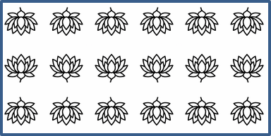

## **Wprowadzenie**

W programie PowerPoint możesz dodawać kształty do slajdów. Ponieważ kształty składają się z linii, możesz je formatować, modyfikując lub nakładając efekty na ich kontury. Dodatkowo możesz formatować kształty, określając ustawienia kontrolujące wypełnienie ich wnętrza.


Aspose.Slides for .NET udostępnia interfejsy i właściwości, które pozwalają formatować kształty przy użyciu tych samych opcji, które są dostępne w programie PowerPoint.

## **Formatowanie linii**

Korzystając z Aspose.Slides, możesz określić własny styl linii dla kształtu. Poniżej opisano kolejne kroki:

1. Utwórz instancję klasy [Prezentacja](https://reference.aspose.com/slides/net/aspose.slides/presentation/).
1. Pobierz odwołanie do slajdu według jego indeksu.
1. Dodaj [IAutoShape](https://reference.aspose.com/slides/net/aspose.slides/iautoshape/) do slajdu.
1. Ustaw [styl linii](https://reference.aspose.com/slides/net/aspose.slides/linestyle/) kształtu.
1. Ustaw grubość linii.
1. Ustaw [styl kreski](https://reference.aspose.com/slides/net/aspose.slides/linedashstyle/) linii.
1. Ustaw kolor linii dla kształtu.
1. Zapisz zmodyfikowaną prezentację jako plik PPTX.

Poniższy kod C# pokazuje, jak sformatować prostokąt typu `AutoShape`:

```c#
using System.Drawing;
using Aspose.Slides;
using Aspose.Slides.Export;

// Utwórz instancję klasy Presentation, która reprezentuje plik prezentacji.
using (Presentation presentation = new Presentation())
{
    // Pobierz pierwszy slajd.
    ISlide slide = presentation.Slides[0];

    // Dodaj automatyczny kształt typu Rectangle.
    IAutoShape shape = slide.Shapes.AddAutoShape(ShapeType.Rectangle, 50, 50, 150, 75);

    // Ustaw kolor wypełnienia dla kształtu prostokątnego.
    shape.FillFormat.FillType = FillType.NoFill;

    // Zastosuj formatowanie do linii prostokąta.
    shape.LineFormat.Style = LineStyle.ThickThin;
    shape.LineFormat.Width = 7;
    shape.LineFormat.DashStyle = LineDashStyle.Dash;

    // Ustaw kolor linii prostokąta.
    shape.LineFormat.FillFormat.FillType = FillType.Solid;
    shape.LineFormat.FillFormat.SolidFillColor.Color = Color.Blue;

    // Zapisz plik PPTX na dysku.
    presentation.Save("formatted_lines.pptx", SaveFormat.Pptx);
}
```

Wynik:


## **Zastosowanie efektu szkicu do linii kształtu**

Efekt szkicu sprawia, że linia kształtu wygląda na odręczną. Użyj [IShape.LineFormat](https://reference.aspose.com/slides/net/aspose.slides/ishape/lineformat/), aby uzyskać dostęp do ustawień linii, [ILineFormat.SketchFormat](https://reference.aspose.com/slides/net/aspose.slides/ilineformat/sketchformat/), aby uzyskać dostęp do ustawień szkicu, oraz [ISketchFormat.SketchType](https://reference.aspose.com/slides/net/aspose.slides/isketchformat/sketchtype/), aby wybrać wartość z wyliczenia [LineSketchType](https://reference.aspose.com/slides/net/aspose.slides/linesketchtype/).

Poniższy kod C# pokazuje, jak zastosować efekt [LineSketchType.Curved](https://reference.aspose.com/slides/net/aspose.slides/linesketchtype/), odczytać przypisaną wartość oraz usunąć efekt przy użyciu [LineSketchType.None](https://reference.aspose.com/slides/net/aspose.slides/linesketchtype/):

```csharp
using Aspose.Slides;

using var presentation = new Presentation();

var slide = presentation.Slides[0];
var shape = slide.Shapes.AddAutoShape(ShapeType.Rectangle, 50, 50, 200, 100);

// Access the shape's line format and its sketch format.
var sketchFormat = shape.LineFormat.SketchFormat;

// Apply a sketch effect.
sketchFormat.SketchType = LineSketchType.Curved;

// Read the sketch effect assigned directly to the shape.
var explicitSketchType = sketchFormat.SketchType;
Console.WriteLine($"Explicit sketch type: {explicitSketchType}");

// Remove the sketch effect.
sketchFormat.SketchType = LineSketchType.None;
```

Wartość zwracana przez `ISketchFormat.SketchType` reprezentuje ustawienie przypisane bezpośrednio do kształtu. Jeśli formatowanie linii może być dziedziczone z motywu, slajdu nadrzędnego lub slajdu układu, użyj [ILineFormat.GetEffective](https://reference.aspose.com/slides/net/aspose.slides/ilineformat/geteffective/), uzyskaj dostęp do [ILineFormatEffectiveData.SketchFormat](https://reference.aspose.com/slides/net/aspose.slides/ilineformateffectivedata/sketchformat/), oraz odczytaj [ISketchFormatEffectiveData.SketchType](https://reference.aspose.com/slides/net/aspose.slides/isketchformateffectivedata/sketchtype/). Wartość efektywna odzwierciedla formatowanie, które faktycznie zostaje zastosowane po rozwiązaniu dziedziczenia:

```csharp
using Aspose.Slides;

using var presentation = new Presentation("presentation.pptx");

var shape = presentation.Slides[0].Shapes[0];
var lineFormat = shape.LineFormat;

var explicitSketchType = lineFormat.SketchFormat.SketchType;
var effectiveLineFormat = lineFormat.GetEffective();
var effectiveSketchType = effectiveLineFormat.SketchFormat.SketchType;

Console.WriteLine($"Explicit sketch type: {explicitSketchType}");
Console.WriteLine($"Effective sketch type: {effectiveSketchType}");
```

## **Formatowanie stylów połączeń**

Oto trzy dostępne opcje typu połączenia:

* Zaokrąglony
* Kątowy
* Fazowany

Domyślnie, gdy PowerPoint łączy dwie linie pod kątem (np. w rogu kształtu), używa ustawienia **Zaokrąglony**. Jednak przy rysowaniu kształtu o ostrych kątach możesz preferować opcję **Kątowy**.


Poniższy kod C# demonstruje, jak trzy prostokąty (jak na powyższym obrazku) zostały utworzone przy użyciu ustawień połączeń Kątowy, Fazowany i Zaokrąglony:

```c#
using System.Drawing;
using Aspose.Slides;
using Aspose.Slides.Export;

// Utwórz instancję klasy Presentation, która reprezentuje plik prezentacji.
using (Presentation presentation = new Presentation())
{
    // Pobierz pierwszy slajd.
    ISlide slide = presentation.Slides[0];

    // Dodaj trzy automatyczne kształty typu Rectangle.
    IAutoShape shape1 = slide.Shapes.AddAutoShape(ShapeType.Rectangle, 20, 20, 150, 75);
    IAutoShape shape2 = slide.Shapes.AddAutoShape(ShapeType.Rectangle, 210, 20, 150, 75);
    IAutoShape shape3 = slide.Shapes.AddAutoShape(ShapeType.Rectangle, 20, 135, 150, 75);

    // Ustaw kolor wypełnienia dla każdego prostokątnego kształtu.
    shape1.FillFormat.FillType = FillType.Solid;
    shape1.FillFormat.SolidFillColor.Color = Color.Black;
    shape2.FillFormat.FillType = FillType.Solid;
    shape2.FillFormat.SolidFillColor.Color = Color.Black;
    shape3.FillFormat.FillType = FillType.Solid;
    shape3.FillFormat.SolidFillColor.Color = Color.Black;

    // Ustaw szerokość linii.
    shape1.LineFormat.Width = 15;
    shape2.LineFormat.Width = 15;
    shape3.LineFormat.Width = 15;

    // Ustaw kolor linii dla każdego prostokąta.
    shape1.LineFormat.FillFormat.FillType = FillType.Solid;
    shape1.LineFormat.FillFormat.SolidFillColor.Color = Color.Blue;
    shape2.LineFormat.FillFormat.FillType = FillType.Solid;
    shape2.LineFormat.FillFormat.SolidFillColor.Color = Color.Blue;
    shape3.LineFormat.FillFormat.FillType = FillType.Solid;
    shape3.LineFormat.FillFormat.SolidFillColor.Color = Color.Blue;

    // Ustaw styl połączenia.
    shape1.LineFormat.JoinStyle = LineJoinStyle.Miter;
    shape2.LineFormat.JoinStyle = LineJoinStyle.Bevel;
    shape3.LineFormat.JoinStyle = LineJoinStyle.Round;

    // Dodaj tekst do każdego prostokąta.
    shape1.TextFrame.Text = "Miter Join Style";
    shape2.TextFrame.Text = "Bevel Join Style";
    shape3.TextFrame.Text = "Round Join Style";

    // Zapisz plik PPTX na dysku.
    presentation.Save("join_styles.pptx", SaveFormat.Pptx);
}
```

## **Gradient Fill**

W programie PowerPoint wypełnienie gradientowe jest opcją formatowania, która pozwala na zastosowanie płynnego przejścia kilku kolorów w kształcie. Na przykład możesz zastosować dwa lub więcej kolorów w taki sposób, że jeden stopniowo przechodzi w drugi.

Oto jak zastosować wypełnienie gradientowe do kształtu przy użyciu Aspose.Slides:

1. Utwórz instancję klasy [Prezentacja](https://reference.aspose.com/slides/net/aspose.slides/presentation/).
1. Pobierz odwołanie do slajdu według jego indeksu.
1. Dodaj [IAutoShape](https://reference.aspose.com/slides/net/aspose.slides/iautoshape/) do slajdu.
1. Ustaw właściwość [FillType](https://reference.aspose.com/slides/net/aspose.slides/filltype/) kształtu na `Gradient`.
1. Dodaj dwie wybrane przez siebie kolory wraz z określonymi pozycjami, używając metod `Add` z kolekcji przystanków gradientu udostępnianej przez interfejs [IGradientFormat](https://reference.aspose.com/slides/net/aspose.slides/igradientformat/).
1. Zapisz zmodyfikowaną prezentację jako plik PPTX.

Poniższy kod C# pokazuje, jak zastosować efekt gradientu do elipsy:

```c#
using Aspose.Slides;
using Aspose.Slides.Export;

// Utwórz instancję klasy Presentation, która reprezentuje plik prezentacji.
using (Presentation presentation = new Presentation())
{
    // Pobierz pierwszy slajd.
    ISlide slide = presentation.Slides[0];

    // Dodaj automatyczny kształt typu Ellipse.
    IAutoShape shape = slide.Shapes.AddAutoShape(ShapeType.Ellipse, 50, 50, 150, 75);

    // Zastosuj formatowanie gradientowe do elipsy.
    shape.FillFormat.FillType = FillType.Gradient;
    shape.FillFormat.GradientFormat.GradientShape = GradientShape.Linear;

    // Ustaw kierunek gradientu.
    shape.FillFormat.GradientFormat.GradientDirection = GradientDirection.FromCorner2;

    // Dodaj dwa przystanki gradientu.
    shape.FillFormat.GradientFormat.GradientStops.Add(1.0f, PresetColor.Purple);
    shape.FillFormat.GradientFormat.GradientStops.Add(0.0f, PresetColor.Red);

    // Zapisz plik PPTX na dysku.
    presentation.Save("gradient_fill.pptx", SaveFormat.Pptx);
}
```

Wynik:


Jeśli gradient wygląda inaczej w wyeksportowanym obrazie niż w programie PowerPoint, zobacz [Wybór stylu renderowania gradientu](/slides/pl/net/convert-powerpoint-to-png/#choose-a-gradient-rendering-style). Możesz wybrać styl renderowania bez zmiany samego wypełnienia gradientowego zapisanego w prezentacji.

## **Pattern Fill**

W programie PowerPoint wypełnienie wzorem jest opcją formatowania, która pozwala zastosować dwukolorowy wzór — np. kropki, paski, krzyżowania lub szachownicę — do kształtu. Możesz wybrać własne kolory dla pierwszego planu i tła wzoru.

Aspose.Slides udostępnia ponad 45 predefiniowanych stylów wzorów, które możesz zastosować do kształtów, aby zwiększyć atrakcyjność wizualną swoich prezentacji. Nawet po wybraniu predefiniowanego wzoru możesz określić dokładne kolory, jakich ma używać.

Oto jak zastosować wypełnienie wzorem do kształtu przy użyciu Aspose.Slides:

1. Utwórz instancję klasy [Prezentacja](https://reference.aspose.com/slides/net/aspose.slides/presentation/).
1. Pobierz odwołanie do slajdu według jego indeksu.
1. Dodaj [IAutoShape](https://reference.aspose.com/slides/net/aspose.slides/iautoshape/) do slajdu.
1. Ustaw właściwość [FillType](https://reference.aspose.com/slides/net/aspose.slides/filltype/) kształtu na `Pattern`.
1. Wybierz styl wzoru z predefiniowanych opcji.
1. Ustaw [Background Color](https://reference.aspose.com/slides/net/aspose.slides/ipatternformat/backcolor/) wzoru.
1. Ustaw [Foreground Color](https://reference.aspose.com/slides/net/aspose.slides/ipatternformat/forecolor/) wzoru.
1. Zapisz zmodyfikowaną prezentację jako plik PPTX.

Poniższy kod C# demonstruje, jak zastosować wypełnienie wzorem do prostokąta:

```c#
using System.Drawing;
using Aspose.Slides;
using Aspose.Slides.Export;

// Utwórz instancję klasy Presentation, która reprezentuje plik prezentacji.
using (Presentation presentation = new Presentation())
{
    // Pobierz pierwszy slajd.
    ISlide slide = presentation.Slides[0];

    // Dodaj automatyczny kształt typu Rectangle.
    IAutoShape shape = slide.Shapes.AddAutoShape(ShapeType.Rectangle, 50, 50, 150, 75);

    // Ustaw typ wypełnienia na Pattern.
    shape.FillFormat.FillType = FillType.Pattern;

    // Ustaw styl wzoru.
    shape.FillFormat.PatternFormat.PatternStyle = PatternStyle.Trellis;

    // Ustaw kolory tła i pierwszego planu wzoru.
    shape.FillFormat.PatternFormat.BackColor.Color = Color.LightGray;
    shape.FillFormat.PatternFormat.ForeColor.Color = Color.Yellow;

    // Zapisz plik PPTX na dysku.
    presentation.Save("pattern_fill.pptx", SaveFormat.Pptx);
}
```

Wynik:


## **Picture Fill**

W programie PowerPoint wypełnienie obrazem jest opcją formatowania, która pozwala wstawić obraz wewnątrz kształtu — skutecznie używając obrazu jako tła kształtu.

Oto jak przy użyciu Aspose.Slides zastosować wypełnienie obrazem do kształtu:

1. Utwórz instancję klasy [Prezentacja](https://reference.aspose.com/slides/net/aspose.slides/presentation/).
1. Pobierz odwołanie do slajdu według jego indeksu.
1. Dodaj [IAutoShape](https://reference.aspose.com/slides/net/aspose.slides/iautoshape/) do slajdu.
1. Ustaw właściwość [FillType](https://reference.aspose.com/slides/net/aspose.slides/filltype/) kształtu na `Picture`.
1. Ustaw tryb wypełnienia obrazu na `Tile` (lub inny wybrany).
1. Utwórz obiekt [IPPImage](https://reference.aspose.com/slides/net/aspose.slides/ippimage/) z obrazu, którego chcesz użyć.
1. Przypisz ten obraz do właściwości `Picture.Image` formatu wypełnienia obrazu (`PictureFillFormat`) kształtu.
1. Zapisz zmodyfikowaną prezentację jako plik PPTX.

Załóżmy, że mamy plik **lotus.png** o następującym obrazie:


Poniższy kod C# pokazuje, jak wypełnić kształt tym obrazem:

```c#
using Aspose.Slides;
using Aspose.Slides.Export;

// Utwórz instancję klasy Presentation, która reprezentuje plik prezentacji.
using (Presentation presentation = new Presentation())
{
    // Pobierz pierwszy slajd.
    ISlide slide = presentation.Slides[0];

    // Dodaj automatyczny kształt typu Rectangle.
    IAutoShape shape = slide.Shapes.AddAutoShape(ShapeType.Rectangle, 50, 50, 255, 130);

    // Ustaw typ wypełnienia na Picture.
    shape.FillFormat.FillType = FillType.Picture;

    // Ustaw tryb wypełnienia obrazu.
    shape.FillFormat.PictureFillFormat.PictureFillMode = PictureFillMode.Tile;

    // Wczytaj obraz i dodaj go do zasobów prezentacji.
    IImage image = Images.FromFile("lotus.png");
    IPPImage presentationImage = presentation.Images.AddImage(image);
    image.Dispose();

    // Ustaw obraz.
    shape.FillFormat.PictureFillFormat.Picture.Image = presentationImage;

    // Zapisz plik PPTX na dysku.
    presentation.Save("picture_fill.pptx", SaveFormat.Pptx);
}
```

Wynik:


### **Tile Picture As Texture**

Jeśli chcesz ustawić obraz jako teksturę w trybie kafelkowania i dostosować zachowanie kafelkowania, możesz użyć następujących właściwości interfejsu [IPictureFillFormat](https://reference.aspose.com/slides/net/aspose.slides/ipicturefillformat/) oraz klasy [PictureFillFormat](https://reference.aspose.com/slides/net/aspose.slides/picturefillformat/):

- [PictureFillMode](https://reference.aspose.com/slides/net/aspose.slides/ipicturefillformat/picturefillmode/): określa tryb wypełnienia obrazu — `Tile` lub `Stretch`.
- [TileAlignment](https://reference.aspose.com/slides/net/aspose.slides/ipicturefillformat/tilealignment/): określa wyrównanie kafelków wewnątrz kształtu.
- [TileFlip](https://reference.aspose.com/slides/net/aspose.slides/ipicturefillformat/tileflip/): kontroluje, czy kafelek jest odbity w poziomie, w pionie lub w obu kierunkach.
- [TileOffsetX](https://reference.aspose.com/slides/net/aspose.slides/ipicturefillformat/tileoffsetx/): ustawia poziomy offset kafelka (w punktach) względem początku kształtu.
- [TileOffsetY](https://reference.aspose.com/slides/net/aspose.slides/ipicturefillformat/tileoffsety/): ustawia pionowy offset kafelka (w punktach) względem początku kształtu.
- [TileScaleX](https://reference.aspose.com/slides/net/aspose.slides/ipicturefillformat/tilescalex/): definiuje poziomą skalę kafelka w procentach.
- [TileScaleY](https://reference.aspose.com/slides/net/aspose.slides/ipicturefillformat/tilescaley/): definiuje pionową skalę kafelka w procentach.

Poniższy przykład kodu pokazuje, jak dodać prostokąt z wypełnieniem obrazu kafelkowanym i skonfigurować opcje kafelkowania:

```c#
using Aspose.Slides;
using Aspose.Slides.Export;

// Utwórz instancję klasy Presentation, która reprezentuje plik prezentacji.
using (Presentation presentation = new Presentation())
{
    // Pobierz pierwszy slajd.
    ISlide firstSlide = presentation.Slides[0];

    // Dodaj automatyczny kształt prostokątny.
    IAutoShape shape = firstSlide.Shapes.AddAutoShape(ShapeType.Rectangle, 50, 50, 190, 95);

    // Ustaw typ wypełnienia kształtu na Picture.
    shape.FillFormat.FillType = FillType.Picture;

    // Wczytaj obraz i dodaj go do zasobów prezentacji.
    IPPImage presentationImage;
    using (IImage sourceImage = Images.FromFile("lotus.png"))
        presentationImage = presentation.Images.AddImage(sourceImage);

    // Przypisz obraz do kształtu.
    IPictureFillFormat pictureFillFormat = shape.FillFormat.PictureFillFormat;
    pictureFillFormat.Picture.Image = presentationImage;

    // Skonfiguruj tryb wypełnienia obrazu i właściwości kafelkowania.
    pictureFillFormat.PictureFillMode = PictureFillMode.Tile;
    pictureFillFormat.TileOffsetX = -32;
    pictureFillFormat.TileOffsetY = -32;
    pictureFillFormat.TileScaleX = 50;
    pictureFillFormat.TileScaleY = 50;
    pictureFillFormat.TileAlignment = RectangleAlignment.BottomRight;
    pictureFillFormat.TileFlip = TileFlip.FlipBoth;

    // Zapisz plik PPTX na dysku.
    presentation.Save("tile.pptx", SaveFormat.Pptx);
}
```

Wynik:



## **Solid Color Fill**

W programie PowerPoint wypełnienie jednolitym kolorem jest opcją formatowania, która wypełnia kształt jednym, jednolitym kolorem. Ten prosty kolor tła jest stosowany bez gradientów, tekstur ani wzorów.

Aby zastosować wypełnienie jednolitym kolorem do kształtu przy użyciu Aspose.Slides, wykonaj następujące kroki:

1. Utwórz instancję klasy [Prezentacja](https://reference.aspose.com/slides/net/aspose.slides/presentation/).
1. Pobierz odwołanie do slajdu według jego indeksu.
1. Dodaj [IAutoShape](https://reference.aspose.com/slides/net/aspose.slides/iautoshape/) do slajdu.
1. Ustaw właściwość [FillType](https://reference.aspose.com/slides/net/aspose.slides/filltype/) kształtu na `Solid`.
1. Przypisz wybrany kolor wypełnienia do kształtu.
1. Zapisz zmodyfikowaną prezentację jako plik PPTX.

Poniższy kod C# demonstruje, jak zastosować wypełnienie jednolitym kolorem do prostokąta w slajdzie PowerPoint:

```c#
using System.Drawing;
using Aspose.Slides;
using Aspose.Slides.Export;

// Utwórz instancję klasy Presentation, która reprezentuje plik prezentacji.
using (Presentation presentation = new Presentation())
{
    // Pobierz pierwszy slajd.
    ISlide slide = presentation.Slides[0];

    // Dodaj automatyczny kształt typu Rectangle.
    IAutoShape shape = slide.Shapes.AddAutoShape(ShapeType.Rectangle, 50, 50, 150, 75);

    // Ustaw typ wypełnienia na Solid.
    shape.FillFormat.FillType = FillType.Solid;

    // Ustaw kolor wypełnienia.
    shape.FillFormat.SolidFillColor.Color = Color.Yellow;

    // Zapisz plik PPTX na dysku.
    presentation.Save("solid_color_fill.pptx", SaveFormat.Pptx);
}
```

Wynik:


## **Ustawienie przezroczystości**

W programie PowerPoint, gdy zastosujesz wypełnienie jednolitym kolorem, gradientem, obrazem lub teksturą do kształtów, możesz również określić poziom przezroczystości, aby kontrolować krycie wypełnienia. Wyższa wartość przezroczystości sprawia, że kształt jest bardziej przejrzysty, co pozwala częściowo widzieć tło lub obiekty pod nim.

Aspose.Slides umożliwia ustawienie poziomu przezroczystości poprzez dostosowanie wartości alfa w kolorze używanym do wypełnienia. Oto jak to zrobić:

1. Utwórz instancję klasy [Prezentacja](https://reference.aspose.com/slides/net/aspose.slides/presentation/).
1. Pobierz odwołanie do slajdu według jego indeksu.
1. Dodaj [IAutoShape](https://reference.aspose.com/slides/net/aspose.slides/iautoshape/) do slajdu.
1. Ustaw [FillType](https://reference.aspose.com/slides/net/aspose.slides/filltype/) na `Solid`.
1. Użyj `Color.FromArgb(alpha, baseColor)`, aby zdefiniować kolor z przezroczystością (składnik `alpha` steruje przezroczystością).
1. Zapisz prezentację.

Poniższy kod C# pokazuje, jak zastosować przezroczysty kolor wypełnienia do prostokąta:

```c#
using System.Drawing;
using Aspose.Slides;
using Aspose.Slides.Export;

const int alpha = 128;

// Utwórz instancję klasy Presentation, która reprezentuje plik prezentacji.
using (Presentation presentation = new Presentation())
{
    // Pobierz pierwszy slajd.
    ISlide slide = presentation.Slides[0];

    // Dodaj automatyczny prostokąt wypełniony.
    IAutoShape solidShape = slide.Shapes.AddAutoShape(ShapeType.Rectangle, 50, 50, 150, 75);

    // Dodaj przezroczysty prostokąt automatyczny nad wypełnionym kształtem.
    IAutoShape transparentShape = slide.Shapes.AddAutoShape(ShapeType.Rectangle, 80, 80, 150, 75);
    transparentShape.FillFormat.FillType = FillType.Solid;
    transparentShape.FillFormat.SolidFillColor.Color = Color.FromArgb(alpha, Color.Yellow);

    // Zapisz plik PPTX na dysku.
    presentation.Save("shape_transparency.pptx", SaveFormat.Pptx);
}
```

Wynik:


## **Obracanie kształtów**

Aspose.Slides umożliwia obracanie kształtów w prezentacjach PowerPoint. Może to być przydatne przy pozycjonowaniu elementów wizualnych z określonym wyrównaniem lub wymaganiami projektowymi.

Aby obrócić kształt na slajdzie, wykonaj następujące kroki:

1. Utwórz instancję klasy [Prezentacja](https://reference.aspose.com/slides/net/aspose.slides/presentation/).
1. Pobierz odwołanie do slajdu według jego indeksu.
1. Dodaj [IAutoShape](https://reference.aspose.com/slides/net/aspose.slides/iautoshape/) do slajdu.
1. Ustaw właściwość `Rotation` kształtu na żądany kąt.
1. Zapisz prezentację.

Poniższy kod C# demonstruje, jak obrócić kształt o 5 stopni:

```c#
using Aspose.Slides;
using Aspose.Slides.Export;

// Utwórz instancję klasy Presentation, która reprezentuje plik prezentacji.
using (Presentation presentation = new Presentation())
{
    // Pobierz pierwszy slajd.
    ISlide slide = presentation.Slides[0];

    // Dodaj automatyczny kształt typu Rectangle.
    IAutoShape shape = slide.Shapes.AddAutoShape(ShapeType.Rectangle, 50, 50, 150, 75);

    // Obróć kształt o 5 stopni.
    shape.Rotation = 5;

    // Zapisz plik PPTX na dysku.
    presentation.Save("shape_rotation.pptx", SaveFormat.Pptx);
}
```

Wynik:


## **Dodawanie efektów 3D Bevel**

Aspose.Slides pozwala na zastosowanie efektów 3D Bevel do kształtów poprzez konfigurację ich właściwości [ThreeDFormat](https://reference.aspose.com/slides/net/aspose.slides/threedformat/).

Aby dodać efekty 3D Bevel do kształtu, wykonaj następujące kroki:

1. Utwórz instancję klasy [Prezentacja](https://reference.aspose.com/slides/net/aspose.slides/presentation/).
1. Pobierz odwołanie do slajdu według jego indeksu.
1. Dodaj [IAutoShape](https://reference.aspose.com/slides/net/aspose.slides/iautoshape/) do slajdu.
1. Skonfiguruj właściwość [ThreeDFormat](https://reference.aspose.com/slides/net/aspose.slides/threedformat/) kształtu, aby określić ustawienia bevel.
1. Zapisz prezentację.

Poniższy kod C# pokazuje, jak zastosować efekt 3D Bevel do kształtu:

```c#
using System.Drawing;
using Aspose.Slides;
using Aspose.Slides.Export;

// Utwórz instancję klasy Presentation.
using (Presentation presentation = new Presentation())
{
    ISlide slide = presentation.Slides[0];

    // Dodaj kształt do slajdu.
    IAutoShape shape = slide.Shapes.AddAutoShape(ShapeType.Ellipse, 50, 50, 100, 100);
    shape.FillFormat.FillType = FillType.Solid;
    shape.FillFormat.SolidFillColor.Color = Color.Green;
    shape.LineFormat.FillFormat.FillType = FillType.Solid;
    shape.LineFormat.FillFormat.SolidFillColor.Color = Color.Orange;
    shape.LineFormat.Width = 2.0;

    // Ustaw właściwości ThreeDFormat kształtu.
    shape.ThreeDFormat.Depth = 4;
    shape.ThreeDFormat.BevelTop.BevelType = BevelPresetType.Circle;
    shape.ThreeDFormat.BevelTop.Height = 6;
    shape.ThreeDFormat.BevelTop.Width = 6;
    shape.ThreeDFormat.Camera.CameraType = CameraPresetType.OrthographicFront;
    shape.ThreeDFormat.LightRig.LightType = LightRigPresetType.ThreePt;
    shape.ThreeDFormat.LightRig.Direction = LightingDirection.Top;

    // Zapisz prezentację jako plik PPTX.
    presentation.Save("3D_bevel_effect.pptx", SaveFormat.Pptx);
}
```

Wynik:


## **Dodawanie efektów 3D Rotation**

Aspose.Slides pozwala na zastosowanie efektów 3D Rotation do kształtów poprzez konfigurację ich właściwości [ThreeDFormat](https://reference.aspose.com/slides/net/aspose.slides/threedformat/).

Aby zastosować rotację 3D do kształtu:

1. Utwórz instancję klasy [Prezentacja](https://reference.aspose.com/slides/net/aspose.slides/presentation/).
1. Pobierz odwołanie do slajdu według jego indeksu.
1. Dodaj [IAutoShape](https://reference.aspose.com/slides/net/aspose.slides/iautoshape/) do slajdu.
1. Ustaw [CameraType](https://reference.aspose.com/slides/net/aspose.slides/icamera/cameratype/) i [LightType](https://reference.aspose.com/slides/net/aspose.slides/ilightrig/lighttype/) kształtu, aby zdefiniować rotację 3D.
1. Zapisz prezentację.

Poniższy kod C# demonstruje, jak zastosować efekt 3D Rotation do kształtu:

```c#
using Aspose.Slides;
using Aspose.Slides.Export;

// Utwórz instancję klasy Presentation.
using (Presentation presentation = new Presentation())
{
    ISlide slide = presentation.Slides[0];

    IAutoShape autoShape = slide.Shapes.AddAutoShape(ShapeType.Rectangle, 50, 50, 150, 75);
    autoShape.TextFrame.Text = "Hello, Aspose!";

    autoShape.ThreeDFormat.Camera.SetRotation(40, 35, 20);
    autoShape.ThreeDFormat.Camera.CameraType = CameraPresetType.IsometricLeftUp;
    autoShape.ThreeDFormat.LightRig.LightType = LightRigPresetType.Balanced;

    // Zapisz prezentację jako plik PPTX.
    presentation.Save("3D_rotation_effect.pptx", SaveFormat.Pptx);
}
```

Wynik:


## **Kontrola renderowania czarno‑białego dla kształtów**

Właściwość [IShape.BlackWhiteMode](https://reference.aspose.com/slides/net/aspose.slides/ishape/blackwhitemode/) określa, w jaki sposób pojedynczy kształt jest renderowany, gdy prezentacja jest wyświetlana lub przetwarzana w trybie czarno‑białym. Nie włącza ona samego trybu czarno‑białego i nie zmienia wypełnienia, linii ani innych formatowań w normalnym trybie kolorowym.

Użyj wartości z wyliczenia [BlackWhiteMode](https://reference.aspose.com/slides/net/aspose.slides/blackwhitemode/), aby wybrać pożądane zachowanie. Na przykład `Automatic` pozwala aplikacji renderującej wybrać konwersję, `Gray` i `LightGray` używają odcieni szarości, `BlackWhite` używa wyłącznie czerni i bieli, `Black` i `White` wymuszają jednolity kolor, `Color` zachowuje normalne kolory, a `Hidden` pomija kształt w trybie czarno‑białym. `NotDefined` oznacza, że nie przypisano trybu na poziomie kształtu.

Poniższy kod C# tworzy kolorowy kształt i sprawia, że w trybie czarno‑białym jest on wyświetlany jako szary:

```csharp
using System.Drawing;
using Aspose.Slides;
using Aspose.Slides.Export;

using var presentation = new Presentation();
var slide = presentation.Slides[0];

var shape = slide.Shapes.AddAutoShape(ShapeType.Rectangle, 50, 50, 200, 100);
shape.FillFormat.FillType = FillType.Solid;
shape.FillFormat.SolidFillColor.Color = Color.Orange;

// Zachowaj pomarańczowe wypełnienie w trybie kolorowym, ale renderuj kształt w odcieniach szarości w trybie czarno-białym.
shape.BlackWhiteMode = BlackWhiteMode.Gray;

presentation.Save("shape_black_white_mode.pptx", SaveFormat.Pptx);
```

W normalnym trybie kolorowym prostokąt zachowuje pomarańczowe wypełnienie. W trybie czarno‑białym używa szarości, ponieważ jego tryb został ustawiony na `Gray`. Dzięki temu możesz zachować pełnokolorowy slajd, jednocześnie definiując odrębny wygląd dla druku, podglądu lub innych procesów, które respektują ustawienia wyświetlania czarno‑białego prezentacji.

## **Resetowanie formatowania**

Poniższy kod C# pokazuje, jak zresetować formatowanie slajdu i przywrócić pozycję, rozmiar oraz formatowanie wszystkich kształtów z placeholderami na [LayoutSlide](https://reference.aspose.com/slides/net/aspose.slides/layoutslide/) do ich domyślnych ustawień:

```c#
using Aspose.Slides;
using Aspose.Slides.Export;

using (Presentation presentation = new Presentation("sample.pptx"))
{
    foreach (ISlide slide in presentation.Slides)
    {
        // Zresetuj każdy kształt na slajdzie, który ma placeholder w układzie.
        slide.Reset();
    }

    presentation.Save("reset_formatting.pptx", SaveFormat.Pptx);
}
```

## **FAQ**

**Czy formatowanie kształtu wpływa na ostateczny rozmiar pliku prezentacji?**

Tylko minimalnie. Osadzone obrazy i multimedia zajmują większość miejsca, podczas gdy parametry kształtu, takie jak kolory, efekty i gradienty, są przechowywane jako metadane i praktycznie nie zwiększają rozmiaru.

**Jak mogę wykryć kształty na slajdzie, które mają identyczne formatowanie, aby je pogrupować?**

Porównaj kluczowe właściwości formatowania każdego kształtu — wypełnienie, linię i ustawienia efektów. Jeśli wszystkie odpowiadające sobie wartości są równe, traktuj ich style jako identyczne i logicznie grupuj te kształty, co upraszcza późniejsze zarządzanie stylami.

**Czy mogę zapisać zestaw własnych stylów kształtów w oddzielnym pliku, aby ponownie używać ich w innych prezentacjach?**

Tak. Przechowuj przykładowe kształty z pożądanymi stylami w szablonie prezentacji lub pliku szablonu .POTX. Tworząc nową prezentację, otwórz szablon, sklonuj potrzebne stylowe kształty i ponownie zastosuj ich formatowanie tam, gdzie jest to wymagane.