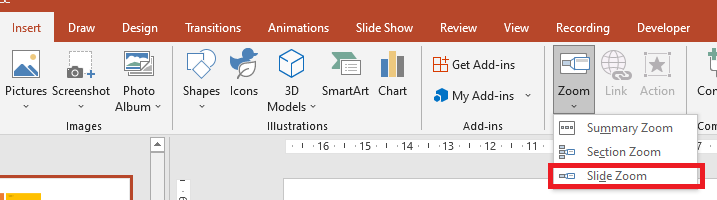

## **Wstęp**

Zoomy w PowerPoint umożliwiają nawigację pomiędzy konkretnymi slajdami i sekcjami podczas pokazu slajdów. Korzystając z Aspose.Slides dla Node.js via Java, można tworzyć zoomy slajdów, sekcji i podsumowania oraz dostosowywać ich podglądy, obramowania i przejścia.


* Aby podsumować całą prezentację na jednym slajdzie, użyj [Zoomu podsumowania](#summary-zoom).
* Aby wyświetlić tylko wybrane slajdy, użyj [Zoomu slajdu](#slide-zoom).
* Aby wyświetlić tylko jedną sekcję, użyj [Zoomu sekcji](#section-zoom).

## **Zoom slajdu**

Zoom slajdu może uczynić prezentację bardziej dynamiczną, umożliwiając swobodną nawigację pomiędzy slajdami w dowolnej kolejności bez przerywania płynności prezentacji. Zoomy slajdów są świetne dla krótkich prezentacji bez wielu sekcji, ale można ich używać w różnych scenariuszach prezentacji.

Zoomy slajdów pozwalają na eksplorację powiązanej informacji z jednego slajdu przeglądowego.



Dla obiektów zoomu slajdu, Aspose.Slides udostępnia wyliczenie [ZoomImageType](https://reference.aspose.com/slides/nodejs-java/aspose.slides/zoomimagetype/), klasę [ZoomFrame](https://reference.aspose.com/slides/nodejs-java/aspose.slides/zoomframe/) oraz metody na klasie [ShapeCollection](https://reference.aspose.com/slides/nodejs-java/aspose.slides/shapecollection/).

### **Utworzenie ramek zoomu**

Użyj [ShapeCollection.addZoomFrame](https://reference.aspose.com/slides/nodejs-java/aspose.slides/shapecollection/#addZoomFrame), aby umieścić odnośniki do poszczególnych slajdów na slajdzie przeglądowym. Ten przykład tworzy dwa docelowe slajdy z odmiennymi tłami i etykietami, a następnie dodaje podgląd każdego z nich do pierwszego slajdu i zapisuje prezentację jako PPTX. Pozycje i wymiary ramek podane są w punktach.

```javascript
const aspose = { slides: require("aspose.slides.via.java") };
const java = require("java");

let presentation = new aspose.slides.Presentation();
try {
    let overviewSlide = presentation.getSlides().get_Item(0);

    let secondSlide = presentation.getSlides().addEmptySlide(overviewSlide.getLayoutSlide());
    let thirdSlide = presentation.getSlides().addEmptySlide(overviewSlide.getLayoutSlide());

    secondSlide.getBackground().setType(java.newByte(aspose.slides.BackgroundType.OwnBackground));
    secondSlide.getBackground().getFillFormat().setFillType(java.newByte(aspose.slides.FillType.Solid));
    secondSlide.getBackground().getFillFormat().getSolidFillColor().setColor(java.getStaticFieldValue("java.awt.Color", "CYAN"));

    let textBox = secondSlide.getShapes().addAutoShape(aspose.slides.ShapeType.Rectangle, 100, 200, 500, 200);
    textBox.getTextFrame().setText("Second Slide");

    thirdSlide.getBackground().setType(java.newByte(aspose.slides.BackgroundType.OwnBackground));
    thirdSlide.getBackground().getFillFormat().setFillType(java.newByte(aspose.slides.FillType.Solid));
    thirdSlide.getBackground().getFillFormat().getSolidFillColor().setColor(java.newInstanceSync("java.awt.Color", 189, 183, 107));

    textBox = thirdSlide.getShapes().addAutoShape(aspose.slides.ShapeType.Rectangle, 100, 200, 500, 200);
    textBox.getTextFrame().setText("Third Slide");

    overviewSlide.getShapes().addZoomFrame(20, 20, 250, 200, secondSlide);
    overviewSlide.getShapes().addZoomFrame(200, 250, 250, 200, thirdSlide);

    presentation.save("presentation.pptx", aspose.slides.SaveFormat.Pptx);
} finally {
    presentation.dispose();
}
```

### **Utworzenie ramek zoomu z własnymi obrazami**

Przekaż własny obraz do [ShapeCollection.addZoomFrame](https://reference.aspose.com/slides/nodejs-java/aspose.slides/shapecollection/#addZoomFrame), aby zastąpić domyślny podgląd docelowego slajdu. Przykład wymaga lokalnego obrazu, ładuje go przy pomocy [Images.fromFile](https://reference.aspose.com/slides/nodejs-java/aspose.slides/images/#fromFile) i dodaje do prezentacji przy użyciu [ImageCollection.addImage](https://reference.aspose.com/slides/nodejs-java/aspose.slides/imagecollection/#addImage). Powstała ramka wyświetla ten obraz, jednocześnie odwołując się do drugiego slajdu.

```javascript
const aspose = { slides: require("aspose.slides.via.java") };
const java = require("java");

let presentation = new aspose.slides.Presentation();
try {
    let overviewSlide = presentation.getSlides().get_Item(0);

    let slide = presentation.getSlides().addEmptySlide(overviewSlide.getLayoutSlide());
    slide.getBackground().setType(java.newByte(aspose.slides.BackgroundType.OwnBackground));
    slide.getBackground().getFillFormat().setFillType(java.newByte(aspose.slides.FillType.Solid));
    slide.getBackground().getFillFormat().getSolidFillColor().setColor(java.getStaticFieldValue("java.awt.Color", "CYAN"));

    let textBox = slide.getShapes().addAutoShape(aspose.slides.ShapeType.Rectangle, 100, 200, 500, 200);
    textBox.getTextFrame().setText("Second Slide");

    let previewImage;
    let image = aspose.slides.Images.fromFile("image.png");
    try {
        previewImage = presentation.getImages().addImage(image);
    } finally {
        image.dispose();
    }

    overviewSlide.getShapes().addZoomFrame(20, 20, 300, 200, slide, previewImage);

    presentation.save("presentation.pptx", aspose.slides.SaveFormat.Pptx);
} finally {
    presentation.dispose();
}
```

### **Formatowanie ramek zoomu**

Ten przykład dostosowuje dwie ramki zoomu slajdu. Przypisuje lokalny obraz do pierwszej ramki za pomocą [ZoomObject.setZoomImage](https://reference.aspose.com/slides/nodejs-java/aspose.slides/zoomobject/#setZoomImage) i nadaje drugiej ramce różowy obramowanie o grubości pięciu punktów i stylu kreska-kropka przy użyciu [Shape.getLineFormat](https://reference.aspose.com/slides/nodejs-java/aspose.slides/shape/#getLineFormat). Przekazanie `false` do [ZoomObject.setShowBackground](https://reference.aspose.com/slides/nodejs-java/aspose.slides/zoomobject/#setShowBackground) ukrywa tło drugiej ramki. Do niestandardowego podglądu wymagany jest lokalny obraz; obie ramki zachowują swoje docelowe slajdy w zapisanym pliku PPTX.

```javascript
const aspose = { slides: require("aspose.slides.via.java") };
const java = require("java");

let presentation = new aspose.slides.Presentation();
try {
    let overviewSlide = presentation.getSlides().get_Item(0);

    let secondSlide = presentation.getSlides().addEmptySlide(overviewSlide.getLayoutSlide());
    let thirdSlide = presentation.getSlides().addEmptySlide(overviewSlide.getLayoutSlide());

    secondSlide.getBackground().setType(java.newByte(aspose.slides.BackgroundType.OwnBackground));
    secondSlide.getBackground().getFillFormat().setFillType(java.newByte(aspose.slides.FillType.Solid));
    secondSlide.getBackground().getFillFormat().getSolidFillColor().setColor(java.getStaticFieldValue("java.awt.Color", "CYAN"));

    let textBox = secondSlide.getShapes().addAutoShape(aspose.slides.ShapeType.Rectangle, 100, 200, 500, 200);
    textBox.getTextFrame().setText("Second Slide");

    thirdSlide.getBackground().setType(java.newByte(aspose.slides.BackgroundType.OwnBackground));
    thirdSlide.getBackground().getFillFormat().setFillType(java.newByte(aspose.slides.FillType.Solid));
    thirdSlide.getBackground().getFillFormat().getSolidFillColor().setColor(java.newInstanceSync("java.awt.Color", 189, 183, 107));

    textBox = thirdSlide.getShapes().addAutoShape(aspose.slides.ShapeType.Rectangle, 100, 200, 500, 200);
    textBox.getTextFrame().setText("Third Slide");

    let firstZoomFrame = overviewSlide.getShapes().addZoomFrame(20, 20, 250, 200, secondSlide);
    let secondZoomFrame = overviewSlide.getShapes().addZoomFrame(200, 250, 250, 200, thirdSlide);

    let previewImage;
    let image = aspose.slides.Images.fromFile("image.png");
    try {
        previewImage = presentation.getImages().addImage(image);
    } finally {
        image.dispose();
    }

    firstZoomFrame.setZoomImage(previewImage);

    secondZoomFrame.getLineFormat().setWidth(5);
    secondZoomFrame.getLineFormat().getFillFormat().setFillType(java.newByte(aspose.slides.FillType.Solid));
    secondZoomFrame.getLineFormat().getFillFormat().getSolidFillColor().setColor(java.newInstanceSync("java.awt.Color", 255, 105, 180));
    secondZoomFrame.getLineFormat().setDashStyle(java.newByte(aspose.slides.LineDashStyle.DashDot));

    secondZoomFrame.setShowBackground(false);

    presentation.save("presentation.pptx", aspose.slides.SaveFormat.Pptx);
} finally {
    presentation.dispose();
}
```

## **Zoom sekcji**

Zoom sekcji odwołuje się do sekcji w prezentacji. Użyj go, aby wrócić do tematu lub pokazać, jak różne części prezentacji są ze sobą powiązane.


Dla obiektów zoomu sekcji, Aspose.Slides udostępnia klasę [SectionZoomFrame](https://reference.aspose.com/slides/nodejs-java/aspose.slides/sectionzoomframe/) oraz metody na klasie [ShapeCollection](https://reference.aspose.com/slides/nodejs-java/aspose.slides/shapecollection/).

### **Utworzenie ramek zoomu sekcji**

Utwórz sekcję przy pomocy [SectionCollection.addSection](https://reference.aspose.com/slides/nodejs-java/aspose.slides/sectioncollection/#addSection), a następnie przekaż zwróconą sekcję do [ShapeCollection.addSectionZoomFrame](https://reference.aspose.com/slides/nodejs-java/aspose.slides/shapecollection/#addSectionZoomFrame). Ten przykład umieszcza zoom sekcji na pierwszym slajdzie i odwołuje go do sekcji rozpoczynającej się od slajdu z kolorem. Pozycja i wymiary ramki podane są w punktach, a prezentacja zapisywana jest jako PPTX.

```javascript
const aspose = { slides: require("aspose.slides.via.java") };
const java = require("java");

let presentation = new aspose.slides.Presentation();
try {
    let overviewSlide = presentation.getSlides().get_Item(0);

    let slide = presentation.getSlides().addEmptySlide(overviewSlide.getLayoutSlide());
    slide.getBackground().getFillFormat().setFillType(java.newByte(aspose.slides.FillType.Solid));
    slide.getBackground().getFillFormat().getSolidFillColor().setColor(java.newInstanceSync("java.awt.Color", 154, 205, 50));
    slide.getBackground().setType(java.newByte(aspose.slides.BackgroundType.OwnBackground));

    let section = presentation.getSections().addSection("Section 1", slide);
    let sectionZoomFrame = overviewSlide.getShapes().addSectionZoomFrame(20, 20, 300, 200, section);

    presentation.save("presentation.pptx", aspose.slides.SaveFormat.Pptx);
} finally {
    presentation.dispose();
}
```

### **Utworzenie ramek zoomu sekcji z własnymi obrazami**

Przeciążenie obrazu metody [ShapeCollection.addSectionZoomFrame](https://reference.aspose.com/slides/nodejs-java/aspose.slides/shapecollection/#addSectionZoomFrame) pozwala wyświetlić własny podgląd bez zmiany docelowej sekcji. Przykład wymaga lokalnego obrazu, który jest ładowany przy pomocy [Images.fromFile](https://reference.aspose.com/slides/nodejs-java/aspose.slides/images/#fromFile) i dodawany przez [ImageCollection.addImage](https://reference.aspose.com/slides/nodejs-java/aspose.slides/imagecollection/#addImage). Zapisana prezentacja zawiera zoom sekcji na pierwszym slajdzie, odwołujący się do nowo utworzonej sekcji.

```javascript
const aspose = { slides: require("aspose.slides.via.java") };
const java = require("java");

let presentation = new aspose.slides.Presentation();
try {
    let overviewSlide = presentation.getSlides().get_Item(0);

    let slide = presentation.getSlides().addEmptySlide(overviewSlide.getLayoutSlide());
    slide.getBackground().getFillFormat().setFillType(java.newByte(aspose.slides.FillType.Solid));
    slide.getBackground().getFillFormat().getSolidFillColor().setColor(java.newInstanceSync("java.awt.Color", 154, 205, 50));
    slide.getBackground().setType(java.newByte(aspose.slides.BackgroundType.OwnBackground));

    let previewImage;
    let image = aspose.slides.Images.fromFile("image.png");
    try {
        previewImage = presentation.getImages().addImage(image);
    } finally {
        image.dispose();
    }

    let section = presentation.getSections().addSection("Section 1", slide);
    let sectionZoomFrame = overviewSlide.getShapes().addSectionZoomFrame(20, 20, 300, 200, section, previewImage);

    presentation.save("presentation.pptx", aspose.slides.SaveFormat.Pptx);
} finally {
    presentation.dispose();
}
```

### **Zmiana docelowej sekcji zoomu sekcji**

Użyj [SectionZoomFrame.setTargetSection](https://reference.aspose.com/slides/nodejs-java/aspose.slides/sectionzoomframe/#setTargetSection), aby przekierować istniejący zoom sekcji bez jego ponownego tworzenia. Wybierz wypełnioną sekcję z kolekcji [Presentation.getSections](https://reference.aspose.com/slides/nodejs-java/aspose.slides/presentation/#getSections) tej samej prezentacji. Przypisanie pustej sekcji pozostawia bieżący cel niezmieniony, dlatego przed przypisaniem sprawdź [Section.getSlidesListOfSection](https://reference.aspose.com/slides/nodejs-java/aspose.slides/section/#getSlidesListOfSection). Zobacz [Manage Slide Sections](/slides/pl/nodejs-java/slide-section/) po więcej informacji o sekcjach.

Poniższy przykład ładuje plik prezentacji, który musi zawierać wiele wypełnionych sekcji, istniejący zoom sekcji o nazwie `Section navigation` oraz sekcję o unikalnej nazwie `Results`. Przeszukuje wszystkie slajdy w poszukiwaniu zoomu i znajduje docelową sekcję po nazwie zamiast po indeksie kolekcji, który może się zmienić przy przestawianiu sekcji. Jeśli nazwy nie są unikalne, użyj [Section.getSectionId](https://reference.aspose.com/slides/nodejs-java/aspose.slides/section/#getSectionId), aby zidentyfikować docelową sekcję.

```javascript
const aspose = { slides: require("aspose.slides.via.java") };
const java = require("java");

let presentation = new aspose.slides.Presentation("section-zoom.pptx");
try {
    let zoom = null;
    for (let i = 0; i < presentation.getSlides().size(); i++) {
        const slide = presentation.getSlides().get_Item(i);
        for (let j = 0; j < slide.getShapes().size(); j++) {
            const shape = slide.getShapes().get_Item(j);
            if (java.instanceOf(shape, "com.aspose.slides.ISectionZoomFrame") && shape.getName() === "Section navigation") {
                zoom = shape;
                break;
            }
        }
        if (zoom != null) {
            break;
        }
    }

    let targetSection = null;
    for (let i = 0; i < presentation.getSections().size(); i++) {
        const section = presentation.getSections().get_Item(i);
        if (section.getName() === "Results") {
            targetSection = section;
            break;
        }
    }

    if (zoom == null || targetSection == null) {
        console.log("The section zoom or destination section was not found.");
    } else if (targetSection.getSlidesListOfSection().size() == 0) {
        console.log("The destination section is empty.");
    } else {
        let currentSection = zoom.getTargetSection();
        console.log("Current section: " + (currentSection == null ? "" : currentSection.getName()));
        zoom.setTargetSection(targetSection);
        presentation.save("section-zoom-updated.pptx", aspose.slides.SaveFormat.Pptx);
    }
} finally {
    presentation.dispose();
}
```

### **Formatowanie ramek zoomu sekcji**

Ten przykład przemieszcza i zmienia rozmiar zoomu sekcji do 100 × 75 punktów, przypisuje lokalny obraz poprzez [ZoomObject.setZoomImage](https://reference.aspose.com/slides/nodejs-java/aspose.slides/zoomobject/#setZoomImage) oraz stosuje brązowe obramowanie o grubości 2,5 punktu i stylu kreska‑kropka. Włącza [ZoomObject.setReturnToParent](https://reference.aspose.com/slides/nodejs-java/aspose.slides/zoomobject/#setReturnToParent), aby po sekcji wrócić do slajdu źródłowego, wyłącza [ZoomObject.setShowBackground](https://reference.aspose.com/slides/nodejs-java/aspose.slides/zoomobject/#setShowBackground) i ustawia [ZoomObject.setTransitionDuration](https://reference.aspose.com/slides/nodejs-java/aspose.slides/zoomobject/#setTransitionDuration) na 1,5 sekundy. Do niestandardowego podglądu wymaga się lokalnego obrazu.

```javascript
const aspose = { slides: require("aspose.slides.via.java") };
const java = require("java");

let presentation = new aspose.slides.Presentation();
try {
    let overviewSlide = presentation.getSlides().get_Item(0);

    let slide = presentation.getSlides().addEmptySlide(overviewSlide.getLayoutSlide());
    slide.getBackground().getFillFormat().setFillType(java.newByte(aspose.slides.FillType.Solid));
    slide.getBackground().getFillFormat().getSolidFillColor().setColor(java.newInstanceSync("java.awt.Color", 154, 205, 50));
    slide.getBackground().setType(java.newByte(aspose.slides.BackgroundType.OwnBackground));

    let section = presentation.getSections().addSection("Section 1", slide);

    let sectionZoomFrame = overviewSlide.getShapes().addSectionZoomFrame(20, 20, 300, 200, section);
    sectionZoomFrame.setX(100);
    sectionZoomFrame.setY(300);
    sectionZoomFrame.setWidth(100);
    sectionZoomFrame.setHeight(75);

    let previewImage;
    let image = aspose.slides.Images.fromFile("image.png");
    try {
        previewImage = presentation.getImages().addImage(image);
    } finally {
        image.dispose();
    }

    sectionZoomFrame.setZoomImage(previewImage);

    sectionZoomFrame.setReturnToParent(true);
    sectionZoomFrame.setShowBackground(false);

    sectionZoomFrame.getLineFormat().getFillFormat().setFillType(java.newByte(aspose.slides.FillType.Solid));
    sectionZoomFrame.getLineFormat().getFillFormat().getSolidFillColor().setColor(java.newInstanceSync("java.awt.Color", 165, 42, 42));
    sectionZoomFrame.getLineFormat().setDashStyle(java.newByte(aspose.slides.LineDashStyle.DashDot));
    sectionZoomFrame.getLineFormat().setWidth(2.5);

    sectionZoomFrame.setTransitionDuration(java.newFloat(1.5));

    presentation.save("presentation.pptx", aspose.slides.SaveFormat.Pptx);
} finally {
    presentation.dispose();
}
```

## **Zoom podsumowania**

Zoom podsumowania zapewnia przegląd sekcji prezentacji. Podczas pokazu slajdów możesz używać go do przejścia do sekcji, przeskoku do przodu lub powrotu do tematu bez podążania kolejno za kolejnością slajdów.


Dla obiektów zoomu podsumowania, Aspose.Slides udostępnia klasy [SummaryZoomFrame](https://reference.aspose.com/slides/nodejs-java/aspose.slides/summaryzoomframe/), [SummaryZoomSection](https://reference.aspose.com/slides/nodejs-java/aspose.slides/summaryzoomsection/) i [SummaryZoomSectionCollection](https://reference.aspose.com/slides/nodejs-java/aspose.slides/summaryzoomsectioncollection/) oraz metody na klasie [ShapeCollection](https://reference.aspose.com/slides/nodejs-java/aspose.slides/shapecollection/).

### **Utworzenie zoomu podsumowania**

Użyj [ShapeCollection.addSummaryZoomFrame](https://reference.aspose.com/slides/nodejs-java/aspose.slides/shapecollection/#addSummaryZoomFrame), aby utworzyć przegląd sekcji prezentacji. Przykład tworzy cztery sekcje z odmiennymi tłami slajdów i dodaje zoom podsumowania do pierwszego slajdu. Pozycja i wymiary ramki podane są w punktach, a powstały przegląd zapisywany jest w prezentacji PPTX.

```javascript
const aspose = { slides: require("aspose.slides.via.java") };
const java = require("java");

let presentation = new aspose.slides.Presentation();
try {
    let overviewSlide = presentation.getSlides().get_Item(0);

    let slide = presentation.getSlides().addEmptySlide(overviewSlide.getLayoutSlide());
    slide.getBackground().getFillFormat().setFillType(java.newByte(aspose.slides.FillType.Solid));
    slide.getBackground().getFillFormat().getSolidFillColor().setColor(java.newInstanceSync("java.awt.Color", 165, 42, 42));
    slide.getBackground().setType(java.newByte(aspose.slides.BackgroundType.OwnBackground));

    presentation.getSections().addSection("Section 1", slide);

    slide = presentation.getSlides().addEmptySlide(overviewSlide.getLayoutSlide());
    slide.getBackground().getFillFormat().setFillType(java.newByte(aspose.slides.FillType.Solid));
    slide.getBackground().getFillFormat().getSolidFillColor().setColor(java.getStaticFieldValue("java.awt.Color", "CYAN"));
    slide.getBackground().setType(java.newByte(aspose.slides.BackgroundType.OwnBackground));

    presentation.getSections().addSection("Section 2", slide);

    slide = presentation.getSlides().addEmptySlide(overviewSlide.getLayoutSlide());
    slide.getBackground().getFillFormat().setFillType(java.newByte(aspose.slides.FillType.Solid));
    slide.getBackground().getFillFormat().getSolidFillColor().setColor(java.newInstanceSync("java.awt.Color", 127, 255, 0));
    slide.getBackground().setType(java.newByte(aspose.slides.BackgroundType.OwnBackground));

    presentation.getSections().addSection("Section 3", slide);

    slide = presentation.getSlides().addEmptySlide(overviewSlide.getLayoutSlide());
    slide.getBackground().getFillFormat().setFillType(java.newByte(aspose.slides.FillType.Solid));
    slide.getBackground().getFillFormat().getSolidFillColor().setColor(java.newInstanceSync("java.awt.Color", 0, 100, 0));
    slide.getBackground().setType(java.newByte(aspose.slides.BackgroundType.OwnBackground));

    presentation.getSections().addSection("Section 4", slide);

    let summaryZoomFrame = overviewSlide.getShapes().addSummaryZoomFrame(150, 50, 300, 200);

    presentation.save("presentation.pptx", aspose.slides.SaveFormat.Pptx);
} finally {
    presentation.dispose();
}
```

### **Dodawanie i usuwanie sekcji zoomu podsumowania**

Zoom podsumowania przechowuje obiekty [SummaryZoomSection](https://reference.aspose.com/slides/nodejs-java/aspose.slides/summaryzoomsection/) w kolekcji zwracanej przez [SummaryZoomFrame.getSummaryZoomCollection](https://reference.aspose.com/slides/nodejs-java/aspose.slides/summaryzoomframe/#getSummaryZoomCollection). Przykład tworzy przegląd dwóch sekcji, dodaje trzecią sekcję przy użyciu [SummaryZoomSectionCollection.addSummaryZoomSection](https://reference.aspose.com/slides/nodejs-java/aspose.slides/summaryzoomsectioncollection/#addSummaryZoomSection) i usuwa wpis pierwszej sekcji przy pomocy [SummaryZoomSectionCollection.removeSummaryZoomSection](https://reference.aspose.com/slides/nodejs-java/aspose.slides/summaryzoomsectioncollection/#removeSummaryZoomSection). Usunięcie wpisu pozostawia sekcję prezentacji i jej slajdy nienaruszone.

```javascript
const aspose = { slides: require("aspose.slides.via.java") };
const java = require("java");

let presentation = new aspose.slides.Presentation();
try {
    let overviewSlide = presentation.getSlides().get_Item(0);

    let slide = presentation.getSlides().addEmptySlide(overviewSlide.getLayoutSlide());
    slide.getBackground().getFillFormat().setFillType(java.newByte(aspose.slides.FillType.Solid));
    slide.getBackground().getFillFormat().getSolidFillColor().setColor(java.newInstanceSync("java.awt.Color", 165, 42, 42));
    slide.getBackground().setType(java.newByte(aspose.slides.BackgroundType.OwnBackground));

    let firstSection = presentation.getSections().addSection("Section 1", slide);

    slide = presentation.getSlides().addEmptySlide(overviewSlide.getLayoutSlide());
    slide.getBackground().getFillFormat().setFillType(java.newByte(aspose.slides.FillType.Solid));
    slide.getBackground().getFillFormat().getSolidFillColor().setColor(java.getStaticFieldValue("java.awt.Color", "CYAN"));
    slide.getBackground().setType(java.newByte(aspose.slides.BackgroundType.OwnBackground));

    presentation.getSections().addSection("Section 2", slide);

    let summaryZoomFrame = overviewSlide.getShapes().addSummaryZoomFrame(150, 50, 300, 200);

    slide = presentation.getSlides().addEmptySlide(overviewSlide.getLayoutSlide());
    slide.getBackground().getFillFormat().setFillType(java.newByte(aspose.slides.FillType.Solid));
    slide.getBackground().getFillFormat().getSolidFillColor().setColor(java.newInstanceSync("java.awt.Color", 127, 255, 0));
    slide.getBackground().setType(java.newByte(aspose.slides.BackgroundType.OwnBackground));

    let thirdSection = presentation.getSections().addSection("Section 3", slide);

    summaryZoomFrame.getSummaryZoomCollection().addSummaryZoomSection(thirdSection);

    summaryZoomFrame.getSummaryZoomCollection().removeSummaryZoomSection(firstSection);

    presentation.save("presentation.pptx", aspose.slides.SaveFormat.Pptx);
} finally {
    presentation.dispose();
}
```

### **Formatowanie sekcji zoomu podsumowania**

Ten przykład formatuje pierwszy wpis w [SummaryZoomFrame.getSummaryZoomCollection](https://reference.aspose.com/slides/nodejs-java/aspose.slides/summaryzoomframe/#getSummaryZoomCollection), używając indeksu zerowego `0`. Wymaga lokalnego obrazu dla [ZoomObject.setZoomImage](https://reference.aspose.com/slides/nodejs-java/aspose.slides/zoomobject/#setZoomImage), nakłada obramowanie czarne o grubości 1,5 punktu i stylu kreska‑kropka oraz ustawia [ZoomObject.setTransitionDuration](https://reference.aspose.com/slides/nodejs-java/aspose.slides/zoomobject/#setTransitionDuration) na 1,5 sekundy. Przekazanie `false` do [ZoomObject.setReturnToParent](https://reference.aspose.com/slides/nodejs-java/aspose.slides/zoomobject/#setReturnToParent) wyłącza automatyczny powrót do slajdu podsumowania dla tego wpisu.

```javascript
const aspose = { slides: require("aspose.slides.via.java") };
const java = require("java");

let presentation = new aspose.slides.Presentation();
try {
    let overviewSlide = presentation.getSlides().get_Item(0);

    let slide = presentation.getSlides().addEmptySlide(overviewSlide.getLayoutSlide());
    slide.getBackground().getFillFormat().setFillType(java.newByte(aspose.slides.FillType.Solid));
    slide.getBackground().getFillFormat().getSolidFillColor().setColor(java.newInstanceSync("java.awt.Color", 165, 42, 42));
    slide.getBackground().setType(java.newByte(aspose.slides.BackgroundType.OwnBackground));

    presentation.getSections().addSection("Section 1", slide);

    slide = presentation.getSlides().addEmptySlide(overviewSlide.getLayoutSlide());
    slide.getBackground().getFillFormat().setFillType(java.newByte(aspose.slides.FillType.Solid));
    slide.getBackground().getFillFormat().getSolidFillColor().setColor(java.getStaticFieldValue("java.awt.Color", "CYAN"));
    slide.getBackground().setType(java.newByte(aspose.slides.BackgroundType.OwnBackground));

    presentation.getSections().addSection("Section 2", slide);

    let summaryZoomFrame = overviewSlide.getShapes().addSummaryZoomFrame(150, 50, 300, 200);

    let summarySection = summaryZoomFrame.getSummaryZoomCollection().get_Item(0);

    let previewImage;
    let image = aspose.slides.Images.fromFile("image.png");
    try {
        previewImage = presentation.getImages().addImage(image);
    } finally {
        image.dispose();
    }

    summarySection.setZoomImage(previewImage);
    summarySection.setReturnToParent(false);

    summarySection.getLineFormat().getFillFormat().setFillType(java.newByte(aspose.slides.FillType.Solid));
    summarySection.getLineFormat().getFillFormat().getSolidFillColor().setColor(java.getStaticFieldValue("java.awt.Color", "BLACK"));
    summarySection.getLineFormat().setDashStyle(java.newByte(aspose.slides.LineDashStyle.DashDot));
    summarySection.getLineFormat().setWidth(1.5);

    summarySection.setTransitionDuration(java.newFloat(1.5));

    presentation.save("presentation.pptx", aspose.slides.SaveFormat.Pptx);
} finally {
    presentation.dispose();
}
```

## **FAQ**

**Czy mogę kontrolować powrót do slajdu „nadrzędnego” po wyświetleniu celu?**

Tak. Wywołaj [ZoomObject.setReturnToParent](https://reference.aspose.com/slides/nodejs-java/aspose.slides/zoomobject/#setReturnToParent) z wartością `true`, aby po wyświetleniu zawartości docelowej wrócić do slajdu źródłowego.

**Czy mogę dostosować „prędkość” lub czas trwania przejścia Zoom?**

Tak. Użyj [ZoomObject.setTransitionDuration](https://reference.aspose.com/slides/nodejs-java/aspose.slides/zoomobject/#setTransitionDuration), aby kontrolować czas trwania przejścia w sekundach.

**Czy istnieją limity liczby obiektów Zoom, które może zawierać prezentacja?**

Nie ma udokumentowanego sztywnego limitu API. Ograniczenia praktyczne zależą od ogólnej złożoności prezentacji oraz wydajności urządzenia odtwarzającego. Można dodawać wiele ramek Zoom, ale warto brać pod uwagę rozmiar pliku i czas renderowania.