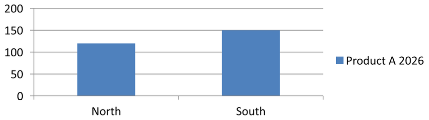

## **Przegląd**

Wykres może przechowywać swoje rysowane wartości w komórkach skoroszytu lub bezpośrednio jako literały liczbowe. [ChartSeries](https://reference.aspose.com/slides/php-java/aspose.slides/chartseries/) reprezentuje jeden zestaw powiązanych wartości, a każdy [ChartDataPoint](https://reference.aspose.com/slides/php-java/aspose.slides/chartdatapoint/) reprezentuje punkt w tej serii. Obiekty [ChartCategory](https://reference.aspose.com/slides/php-java/aspose.slides/chartcategory/) dostarczają etykiety lub wartości grupujące współdzielone przez serie. W wykresach tworzonych z danymi domyślnymi, nazwy serii, kategorie i wartości punktów używają obiektów [ChartDataCell](https://reference.aspose.com/slides/php-java/aspose.slides/chartdatacell/) z skoroszytu wykresu.

Dla typowego wykresu kategoriowego domyślny skoroszyt używa wiersza 0 dla nazw serii, kolumny 0 dla nazw kategorii oraz pozostałych komórek dla wartości serii. Indeksy arkusza, wiersza i kolumny przekazywane do [ChartDataWorkbook::getCell](https://reference.aspose.com/slides/php-java/aspose.slides/chartdataworkbook/getcell/) są zerowe. Ten układ jest przydatny, gdy tworzysz wykres z danymi domyślnymi, ale nie zakładaj, że każdy istniejący wykres go używa. Dla załadowanej prezentacji sprawdź komórki odwoływane przez serie, kategorie i punkty danych przed zmianą wartości w skoroszycie.

Ustawienia wykresu mają trzy różne zakresy:

- Ustawienia na poziomie serii, takie jak [ChartSeries::getFormat](https://reference.aspose.com/slides/php-java/aspose.slides/chartseries/getformat/), określają domyślny wygląd wszystkich punktów w jednej serii.  
- Ustawienia punktu danych, takie jak [ChartDataPoint::getFormat](https://reference.aspose.com/slides/php-java/aspose.slides/chartdatapoint/getformat/), zastępują wygląd serii dla jednego punktu.  
- Ustawienia grupy mają zastosowanie do kompatybilnych serii należących do tej samej [ChartSeriesGroup](https://reference.aspose.com/slides/php-java/aspose.slides/chartseriesgroup/). Uzyskaj dostęp do grupy przez [ChartSeries::getParentSeriesGroup](https://reference.aspose.com/slides/php-java/aspose.slides/chartseries/getparentseriesgroup/), gdy musisz ustawić opcje takie jak nachodzenie lub szerokość przerwy.

Gdy nie zostanie ustawione wyraźne wypełnienie punktu ani serii, styl i motyw wykresu określają automatyczny wygląd. Gdy istnieją zarówno formatowanie serii, jak i punktu, to formatowanie punktu ma pierwszeństwo dla tego punktu.


W przypadku wykresu skumulowanego cylindrycznego zobacz, jak [changing the 3D series type or bar shape](/slides/pl/php-java/3d-chart/#change-the-3d-series-type-and-bar-shape) wpływa na pierwszą serię.

## **Ustaw wartości serii przy użyciu literałów liczbowych**

Używaj literałów liczbowych, gdy wartości serii pochodzą z danych aplikacji lub obliczeń i nie wymagają odwołań do komórek arkusza. Wywołaj [setDataSourceTypeForValues](https://reference.aspose.com/slides/php-java/aspose.slides/chartdatapointcollection/setdatasourcetypeforvalues/) z [DataSourceType::DoubleLiterals](https://reference.aspose.com/slides/php-java/aspose.slides/datasourcetype/) przed przypisaniem wyniku [getValue](https://reference.aspose.com/slides/php-java/aspose.slides/chartdatapoint/getvalue/) każdego punktu poprzez [setAsLiteralDouble](https://reference.aspose.com/slides/php-java/aspose.slides/doublechartvalue/setasliteraldouble/).

Ustawienie kolekcji określa typ źródła wszystkich wartości punktów w tej serii. Metoda [getDataSourceType](https://reference.aspose.com/slides/php-java/aspose.slides/basechartvalue/) każdego punktu zwraca wybrany typ; zmień go poprzez ustawienie kolekcji. W przypadku `Worksheet` użyj [getAsCell](https://reference.aspose.com/slides/php-java/aspose.slides/doublechartvalue/getascell/) aby uzyskać dostęp do odwołanej komórki. W przypadku `DoubleLiterals` użyj [getAsLiteralDouble](https://reference.aspose.com/slides/php-java/aspose.slides/doublechartvalue/getasliteraldouble/) lub `setAsLiteralDouble`, aby odczytać lub zapisać liczbę bezpośrednio.

Poniższy przykład tworzy wykres kolumnowy z domyślnymi seriami i kategoriami, a następnie przypisuje obliczone wartości 10, 20, itd. do istniejących punktów pierwszej serii. Zapisuje prezentację, otwiera ją ponownie i wyświetla zapisane wartości.

```php
use aspose\slides\ChartType;
use aspose\slides\DataSourceType;
use aspose\slides\Presentation;
use aspose\slides\SaveFormat;

$presentation = new Presentation();
try {
    $slide = $presentation->getSlides()->get_Item(0);

    $chart = $slide->getShapes()->addChart(ChartType::ClusteredColumn, 20, 20, 500, 300);
    $series = $chart->getChartData()->getSeries()->get_Item(0);

    $series->getDataPoints()->setDataSourceTypeForValues(DataSourceType::DoubleLiterals);
    $pointCount = java_values($series->getDataPoints()->size());
    for ($i = 0; $i < $pointCount; $i++) {
        $series->getDataPoints()->get_Item($i)->getValue()->setAsLiteralDouble(($i + 1) * 10);
    }

    $presentation->save("numeric_literals.pptx", SaveFormat::Pptx);
} finally {
    $presentation->dispose();
}

$reopenedPresentation = new Presentation("numeric_literals.pptx");
try {
    $reopenedSlide = $reopenedPresentation->getSlides()->get_Item(0);
    $reopenedChart = $reopenedSlide->getShapes()->get_Item(0);
    $reopenedSeries = $reopenedChart->getChartData()->getSeries()->get_Item(0);
    $pointCount = java_values($reopenedSeries->getDataPoints()->size());
    for ($i = 0; $i < $pointCount; $i++) {
        $point = $reopenedSeries->getDataPoints()->get_Item($i);
        echo java_values($point->getValue()->getAsLiteralDouble()), PHP_EOL;
    }
} finally {
    $reopenedPresentation->dispose();
}
```

Typ źródła wartości punktu jest oddzielny od [ChartData::getDataSourceType](https://reference.aspose.com/slides/php-java/aspose.slides/chartdata/getdatasourcetype/), który identyfikuje konfigurację wewnętrznego lub zewnętrznego skoroszytu wykresu. Użycie literałów liczbowych nie usuwa samego wbudowanego skoroszytu. W tym przykładzie skoroszyt pozostaje dostępny dla etykiet kategorii, nazw serii i pozostałych serii. Zobacz [Chart Workbook](/slides/pl/php-java/chart-workbook/) po informacje o zarządzaniu skoroszytem.

Dla wykresów punktowych i bąbelkowych użyj [setDataSourceTypeForXValues](https://reference.aspose.com/slides/php-java/aspose.slides/chartdatapointcollection/setdatasourcetypeforxvalues/) oraz [setDataSourceTypeForYValues](https://reference.aspose.com/slides/php-java/aspose.slides/chartdatapointcollection/setdatasourcetypeforyvalues/), aby wybrać źródła dla [getXValue](https://reference.aspose.com/slides/php-java/aspose.slides/chartdatapoint/getxvalue/) i [getYValue](https://reference.aspose.com/slides/php-java/aspose.slides/chartdatapoint/getyvalue/). Wykresy bąbelkowe używają także [setDataSourceTypeForBubbleSizes](https://reference.aspose.com/slides/php-java/aspose.slides/chartdatapointcollection/setdatasourcetypeforbubblesizes/) dla [getBubbleSize](https://reference.aspose.com/slides/php-java/aspose.slides/chartdatapoint/getbubblesize/). Ustaw każdy odpowiedni typ źródła na `DoubleLiterals` przed przypisaniem liczb poprzez metodę `setAsLiteralDouble` tego wartości.

## **Ustaw nachodzenie serii wykresu**

[ChartSeries::getOverlap](https://reference.aspose.com/slides/php-java/aspose.slides/chartseries/getoverlap/) informuje, jak bardzo paski lub kolumny nachodzą na siebie w wykresie 2‑D, w przedziale od –100 do 100 proc. Jest to jedynie odczytywany podgląd ustawienia w grupie nadrzędnej serii. Użyj [ChartSeriesGroup::setOverlap](https://reference.aspose.com/slides/php-java/aspose.slides/chartseriesgroup/setoverlap/), aby zaktualizować wszystkie kompatybilne serie w tej grupie. Opcja ma zastosowanie do typów wykresów wyświetlających pogrupowane paski lub kolumny; nie wpływa na niepowiązane grupy serii w wykresie złożonym.

Poniższy przykład ustawia nachodzenie dla grupy zawierającej pierwszą serię:

```php
$firstSlideIndex = 0;
$firstSeriesIndex = 0;
$overlapPercent = 30;

$presentation = new Presentation();
try {
    $slide = $presentation->getSlides()->get_Item($firstSlideIndex);

    // Nowy wykres zawiera przykładowe serie, kategorie i wartości.
    $chart = $slide->getShapes()->addChart(ChartType::ClusteredColumn, 20, 20, 500, 200);

    $series = $chart->getChartData()->getSeries()->get_Item($firstSeriesIndex);
    $series->getParentSeriesGroup()->setOverlap($overlapPercent);

    $presentation->save("series_overlap.pptx", SaveFormat::Pptx);
} finally {
    if (!java_is_null($presentation)) {
        $presentation->dispose();
    }
}
```

Wynik:


## **Zmień kolor wypełnienia serii**

Użyj [ChartSeries::getFormat](https://reference.aspose.com/slides/php-java/aspose.slides/chartseries/getformat/), aby ustawić domyślne wypełnienie całej serii. Jeśli punkt ma już wyraźne wypełnienie, jego ustawienie [ChartDataPoint::getFormat](https://reference.aspose.com/slides/php-java/aspose.slides/chartdatapoint/getformat/) zastępuje wypełnienie serii dla tego punktu.

Poniższy przykład stosuje jednolite niebieskie wypełnienie do pierwszej serii:

```php
$firstSlideIndex = 0;
$firstSeriesIndex = 0;
$blueColor = java("java.awt.Color")->BLUE;

$presentation = new Presentation();
try {
    $slide = $presentation->getSlides()->get_Item($firstSlideIndex);

    $chart = $slide->getShapes()->addChart(ChartType::ClusteredColumn, 20, 20, 500, 200);

    $series = $chart->getChartData()->getSeries()->get_Item($firstSeriesIndex);
    $series->getFormat()->getFill()->setFillType(FillType::Solid);
    $series->getFormat()->getFill()->getSolidFillColor()->setColor($blueColor);

    $presentation->save("series_color.pptx", SaveFormat::Pptx);
} finally {
    if (!java_is_null($presentation)) {
        $presentation->dispose();
    }
}
```

Wynik:


## **Zmień nazwę serii**

Nazwa serii jest przechowywana w skoroszycie danych wykresu i zwykle wyświetlana w legendzie. W domyślnym skoroszycie utworzonym dla wykresu słupkowego skumulowanego komórka B1 znajduje się w wierszu 0, kolumnie 1 i zawiera nazwę pierwszej serii. Zmienna w poniższym przykładzie wyraźnie odzwierciedla tę strukturę:

```php
$firstSlideIndex = 0;
$worksheetIndex = 0;
$seriesNameRowIndex = 0;
$firstSeriesColumnIndex = 1;

$presentation = new Presentation();
try {
    $slide = $presentation->getSlides()->get_Item($firstSlideIndex);

    $chart = $slide->getShapes()->addChart(ChartType::ClusteredColumn, 20, 20, 500, 200);

    $workbook = $chart->getChartData()->getChartDataWorkbook();
    $seriesNameCell = $workbook->getCell($worksheetIndex, $seriesNameRowIndex, $firstSeriesColumnIndex);
    $seriesNameCell->setValue("Revenue");

    $presentation->save("series_name.pptx", SaveFormat::Pptx);
} finally {
    if (!java_is_null($presentation)) {
        $presentation->dispose();
    }
}
```

Możesz także zaktualizować komórkę już odwoływaną przez [ChartSeries::getName](https://reference.aspose.com/slides/php-java/aspose.slides/chartseries/getname/). To podejście unika zakładania konkretnego wiersza i kolumny w istniejącym wykresie:

```php
$firstSlideIndex = 0;
$firstSeriesIndex = 0;
$firstNameCellIndex = 0;

$presentation = new Presentation();
try {
    $slide = $presentation->getSlides()->get_Item($firstSlideIndex);

    $chart = $slide->getShapes()->addChart(ChartType::ClusteredColumn, 20, 20, 500, 200);

    $series = $chart->getChartData()->getSeries()->get_Item($firstSeriesIndex);
    $seriesNameCell = $series->getName()->getAsCells()->get_Item($firstNameCellIndex);
    $seriesNameCell->setValue("Revenue");

    $presentation->save("series_name.pptx", SaveFormat::Pptx);
} finally {
    if (!java_is_null($presentation)) {
        $presentation->dispose();
    }
}
```

Wynik:


### **Utwórz serię z nazwą z wielu komórek**

Złożona nazwa serii jest przydatna, gdy nazwa produktu i okres raportowania są przechowywane w oddzielnych komórkach skoroszytu. Na przykład możesz połączyć `Product A` w B1 i `2026` w C1 w jedną nazwę serii, zachowując oba elementy powiązane ze źródłowymi komórkami.

Użyj [ChartDataWorkbook::getCellCollection](https://reference.aspose.com/slides/php-java/aspose.slides/chartdataworkbook/getcellcollection/), aby pobrać zakres nazw, a następnie przekaż tę kolekcję do [ChartSeriesCollection::add](https://reference.aspose.com/slides/php-java/aspose.slides/chartseriescollection/add/). Argument `skipHiddenCells` steruje, czy ukryte komórki są uwzględniane: `true` je pomija, `false` uwzględnia. W tym przykładzie użyto `false`, aby włączyć wszystkie komórki w zakresie nazw.

Poniższy przykład tworzy prezentację z jedną serią i dwoma punktami danych. Komórki B1:C1 dostarczają wyłącznie nazwę serii; A2:A3 dostarczają etykiety kategorii, a B2:B3 wartości liczbowe.

```php
use aspose\slides\ChartType;
use aspose\slides\Presentation;
use aspose\slides\SaveFormat;

$presentation = new Presentation();
try {
    $slide = $presentation->getSlides()->get_Item(0);

    $chart = $slide->getShapes()->addChart(ChartType::ClusteredColumn, 50, 50, 620, 180);

    $chart->getChartData()->getSeries()->clear();
    $chart->getChartData()->getCategories()->clear();
    $chart->setLegend(true);

    $workbook = $chart->getChartData()->getChartDataWorkbook();
    $workbook->clear(0);

    // Te dwie komórki dostarczają nazwę serii.
    $workbook->getCell(0, 0, 1, "Product A");
    $workbook->getCell(0, 0, 2, "2026");
    $nameCells = $workbook->getCellCollection('Sheet1!$B$1:$C$1', false);
    $series = $chart->getChartData()->getSeries()->add($nameCells, ChartType::ClusteredColumn);

    // Oddzielne komórki dostarczają kategorie i numeryczne punkty danych.
    $northCategory = $workbook->getCell(0, 1, 0, "North");
    $southCategory = $workbook->getCell(0, 2, 0, "South");
    $chart->getChartData()->getCategories()->add($northCategory);
    $chart->getChartData()->getCategories()->add($southCategory);
    $northValue = $workbook->getCell(0, 1, 1, 120);
    $southValue = $workbook->getCell(0, 2, 1, 150);
    $series->getDataPoints()->addDataPointForBarSeries($northValue);
    $series->getDataPoints()->addDataPointForBarSeries($southValue);

    $presentation->save("composite_series_name.pptx", SaveFormat::Pptx);
} finally {
    $presentation->dispose();
}
```

Wynikowa nazwa serii to `Product A 2026`, ze spacją pomiędzy dwoma wartościami komórek. Legenda wyświetla to jako jedną pozycję dla obu kolumn. Poniższy obraz ilustruje efekt:



## **Pobierz automatyczny kolor wypełnienia serii**

[ChartSeries::getAutomaticSeriesColor](https://reference.aspose.com/slides/php-java/aspose.slides/chartseries/getautomaticseriescolor/) zwraca kolor obliczony na podstawie indeksu serii i stylu wykresu. Jest to kolor używany, gdy wypełnienie serii nie zostało jawnie określone. Wywołanie metody odczytuje obliczony kolor; nie przypisuje nowego wypełnienia.

Poniższy przykład drukuje automatyczny kolor każdej domyślnej serii:

```php
$firstSlideIndex = 0;

$presentation = new Presentation();
try {
    $slide = $presentation->getSlides()->get_Item($firstSlideIndex);

    $chart = $slide->getShapes()->addChart(ChartType::ClusteredColumn, 20, 20, 500, 200);

    $seriesCount = java_values($chart->getChartData()->getSeries()->size());
    for ($seriesIndex = 0; $seriesIndex < $seriesCount; $seriesIndex++) {
        $series = $chart->getChartData()->getSeries()->get_Item($seriesIndex);
        $automaticColor = $series->getAutomaticSeriesColor();
        $red = java_values($automaticColor->getRed());
        $green = java_values($automaticColor->getGreen());
        $blue = java_values($automaticColor->getBlue());
        echo "Series " . $seriesIndex . ": java.awt.Color[r=" . $red . ",g=" . $green . ",b=" . $blue . "]" . PHP_EOL;
    }
} finally {
    if (!java_is_null($presentation)) {
        $presentation->dispose();
    }
}
```

Przykładowe wyjście dla domyślnego stylu wykresu:

```text
Series 0: java.awt.Color[r=79,g=129,b=189]
Series 1: java.awt.Color[r=192,g=80,b=77]
Series 2: java.awt.Color[r=155,g=187,b=89]
```

Dokładne kolory zależą od stylu i motywu wykresu.

## **Ustaw odwrócony kolor wypełnienia dla serii wykresu**

Dla serii słupkowych, kolumnowych i bąbelkowych [ChartSeries::setInvertIfNegative](https://reference.aspose.com/slides/php-java/aspose.slides/chartseries/setinvertifnegative/) może wyświetlać wartości ujemne innym wypełnieniem. Ustaw regularne wypełnienie serii na jednolite, włącz odwracanie i przypisz kolor dla wartości ujemnych poprzez [ChartSeries::getInvertedSolidFillColor](https://reference.aspose.com/slides/php-java/aspose.slides/chartseries/getinvertedsolidfillcolor/). Ujemne liczby pozostają niezmienione w skoroszycie; zmienia się tylko ich kolor wyświetlania.

Poniższy przykład zastępuje domyślne dane wykresu jedną serią. Wiersz 0 arkusza zawiera nazwę serii, kolumna 0 nazwy kategorii, a kolumna 1 wartości:

```php
$firstSlideIndex = 0;
$worksheetIndex = 0;
$headerRowIndex = 0;
$categoryColumnIndex = 0;
$firstSeriesColumnIndex = 1;
$firstDataRowIndex = 1;

$categoryNames = ["Category 1", "Category 2", "Category 3"];
$seriesValues = [-20, 50, -30];
$redColor = java("java.awt.Color")->RED;

$presentation = new Presentation();
try {
    $slide = $presentation->getSlides()->get_Item($firstSlideIndex);

    $chart = $slide->getShapes()->addChart(ChartType::ClusteredColumn, 20, 20, 500, 200);
    $chartData = $chart->getChartData();
    $workbook = $chartData->getChartDataWorkbook();

    $chartData->getSeries()->clear();
    $chartData->getCategories()->clear();

    $seriesNameCell = $workbook->getCell($worksheetIndex, $headerRowIndex, $firstSeriesColumnIndex, "Series 1");
    $chartType = $chart->getType();
    $series = $chartData->getSeries()->add($seriesNameCell, $chartType);

    $categoryCount = count($categoryNames);
    for ($categoryIndex = 0; $categoryIndex < $categoryCount; $categoryIndex++) {
        $dataRowIndex = $firstDataRowIndex + $categoryIndex;
        $categoryName = $categoryNames[$categoryIndex];
        $seriesValue = $seriesValues[$categoryIndex];

        $categoryCell = $workbook->getCell($worksheetIndex, $dataRowIndex, $categoryColumnIndex, $categoryName);
        $chartData->getCategories()->add($categoryCell);

        $valueCell = $workbook->getCell($worksheetIndex, $dataRowIndex, $firstSeriesColumnIndex, $seriesValue);
        $series->getDataPoints()->addDataPointForBarSeries($valueCell);
    }

    $automaticSeriesColor = $series->getAutomaticSeriesColor();
    $series->getFormat()->getFill()->setFillType(FillType::Solid);
    $series->getFormat()->getFill()->getSolidFillColor()->setColor($automaticSeriesColor);
    $series->setInvertIfNegative(true);
    $series->getInvertedSolidFillColor()->setColor($redColor);

    $presentation->save("inverted_solid_fill_color.pptx", SaveFormat::Pptx);
} finally {
    if (!java_is_null($presentation)) {
        $presentation->dispose();
    }
}
```

Wynik:


Możesz włączyć odwrócenie dla jednego punktu przez [ChartDataPoint::setInvertIfNegative](https://reference.aspose.com/slides/php-java/aspose.slides/chartdatapoint/setinvertifnegative/). W poniższym przykładzie odwrócenie jest wyłączone dla serii i włączone tylko dla wybranego punktu. Punktowi przypisano również wartość ujemną, aby efekt był widoczny:

```php
$firstSlideIndex = 0;
$firstSeriesIndex = 0;
$targetDataPointIndex = 2;
$negativeValue = -30;
$redColor = java("java.awt.Color")->RED;

$presentation = new Presentation();
try {
    $slide = $presentation->getSlides()->get_Item($firstSlideIndex);

    $chart = $slide->getShapes()->addChart(ChartType::ClusteredColumn, 20, 20, 500, 200);

    $series = $chart->getChartData()->getSeries()->get_Item($firstSeriesIndex);
    $automaticSeriesColor = $series->getAutomaticSeriesColor();
    $series->getFormat()->getFill()->setFillType(FillType::Solid);
    $series->getFormat()->getFill()->getSolidFillColor()->setColor($automaticSeriesColor);
    $series->getInvertedSolidFillColor()->setColor($redColor);
    $series->setInvertIfNegative(false);

    $dataPoint = $series->getDataPoints()->get_Item($targetDataPointIndex);
    $dataPoint->getValue()->getAsCell()->setValue($negativeValue);
    $dataPoint->setInvertIfNegative(true);

    $presentation->save("data_point_invert_color_if_negative.pptx", SaveFormat::Pptx);
} finally {
    if (!java_is_null($presentation)) {
        $presentation->dispose();
    }
}
```

## **Wyczyść konkretną wartość punktu danych**

Aby uczynić jeden punkt pustym bez usuwania pozostałych, ustaw jego komórkę w skoroszycie na `null`. Dla wykresu kolumnowego rysowana wartość jest dostępna przez [ChartDataPoint::getValue](https://reference.aspose.com/slides/php-java/aspose.slides/chartdatapoint/getvalue/). Punkt pozostaje na tym samym miejscu kategorii, ale wykres traktuje jego wartość jako pustą zgodnie z ustawieniami pustych wartości wykresu.

Poniższy przykład czyści tylko drugi punkt w pierwszej serii:

```php
$firstSlideIndex = 0;
$firstSeriesIndex = 0;
$targetDataPointIndex = 1;

$presentation = new Presentation();
try {
    $slide = $presentation->getSlides()->get_Item($firstSlideIndex);

    $chart = $slide->getShapes()->addChart(ChartType::ClusteredColumn, 20, 20, 500, 200);

    $series = $chart->getChartData()->getSeries()->get_Item($firstSeriesIndex);
    $dataPoint = $series->getDataPoints()->get_Item($targetDataPointIndex);
    $dataPoint->getValue()->getAsCell()->setValue(null);

    $presentation->save("clear_data_point_value.pptx", SaveFormat::Pptx);
} finally {
    if (!java_is_null($presentation)) {
        $presentation->dispose();
    }
}
```

Wykresy punktowe używają oddzielnych komórek X i Y, a wykresy bąbelkowe także komórki rozmiaru. Czyść tylko tę komórkę, którą chcesz usunąć. Nie wywołuj [ChartDataPointCollection::clear](https://reference.aspose.com/slides/php-java/aspose.slides/chartdatapointcollection/clear/) gdy chcesz zachować pozostałe punkty, ponieważ metoda ta usuwa wszystkie punkty z kolekcji.

## **Kontroluj wyświetlanie pustych komórek**

Ukryte komórki zawierające wartości stanowią odrębny przypadek od pustych komórek. Aby włączać lub wyłączać dane z ukrytych wierszy i kolumn arkusza, zobacz [Include Data from Hidden Rows and Columns](/slides/pl/php-java/chart-workbook/#include-data-from-hidden-rows-and-columns).

Pusta komórka skoroszytu oznacza brak danych; komórka zawierająca `0` oznacza znaną wartość liczbową. Wywołaj [ChartDataCell::setValue](https://reference.aspose.com/slides/php-java/aspose.slides/chartdatacell/setvalue/) z `null`, aby uczynić komórkę pustą. Liczbowa zero pozostaje zerem niezależnie od ustawienia pustej komórki.

Użyj [Chart::setDisplayBlanksAs](https://reference.aspose.com/slides/php-java/aspose.slides/chart/setdisplayblanksas/), aby wybrać sposób wyświetlania pustych komórek. To ustawienie ma zastosowanie do całego wykresu. Zmienia sposób rysowania przerw, nie wypełniając pustej komórki wartością zero ani interpolowaną wartością.

Poniższy samodzielny przykład tworzy wykres liniowy z jedną serią, czyści wartość dla Dnia 3 i zapisuje ten sam wykres w każdym trybie. Nie wymaga pliku wejściowego. [ChartDataWorkbook](https://reference.aspose.com/slides/php-java/aspose.slides/chartdataworkbook/) używa arkusza 0, kolumny 0 dla etykiet kategorii i kolumny 1 dla wartości; wiersz 0 przechowuje nazwę serii. Końcowe dane: `10, 20, empty, 30, 40`.

```php
use aspose\slides\ChartType;
use aspose\slides\DisplayBlanksAsType;
use aspose\slides\Presentation;
use aspose\slides\SaveFormat;

$presentation = new Presentation();
try {
    $slide = $presentation->getSlides()->get_Item(0);

    $chart = $slide->getShapes()->addChart(ChartType::LineWithMarkers, 40, 40, 640, 400);
    $chartData = $chart->getChartData();
    $workbook = $chartData->getChartDataWorkbook();

    $chartData->getSeries()->clear();
    $chartData->getCategories()->clear();

    $seriesNameCell = $workbook->getCell(0, 0, 1, "Measurements");
    $series = $chartData->getSeries()->add($seriesNameCell, $chart->getType());
    $values = [10, 20, 25, 30, 40];

    for ($i = 0; $i < count($values); $i++) {
        $categoryCell = $workbook->getCell(0, $i + 1, 0, "Day " . ($i + 1));
        $chartData->getCategories()->add($categoryCell);
        $valueCell = $workbook->getCell(0, $i + 1, 1, $values[$i]);
        $series->getDataPoints()->addDataPointForLineSeries($valueCell);
    }

    // Pozostaw Dzień 3 naprawdę pusty, zachowując jego kategorię i punkt danych.
    $workbook->getCell(0, 3, 1)->setValue(null);

    $modes = [DisplayBlanksAsType::Gap, DisplayBlanksAsType::Zero, DisplayBlanksAsType::Span];
    $modeNames = ["Gap", "Zero", "Span"];
    for ($i = 0; $i < count($modes); $i++) {
        $chart->setDisplayBlanksAs($modes[$i]);
        $presentation->save("empty_cells_" . $modeNames[$i] . ".pptx", SaveFormat::Pptx);
    }
} finally {
    $presentation->dispose();
}
```

Każdy plik wyjściowy przechowuje tryb przypisany przed zapisem: `empty_cells_Gap.pptx`, `empty_cells_Zero.pptx` oraz `empty_cells_Span.pptx`. Aby zapisać tylko jedną wersję, ustaw pożądany tryb i zapisz prezentację raz zamiast iterować po trybach.

Poniższe porównanie pokazuje te same dane we wszystkich trzech plikach. Dzień 3 jest pusty w skoroszycie w każdym przypadku:


Widoczny efekt zależy od typu wykresu. Wykres liniowy ułatwia porównanie wszystkich trzech trybów. Wykresy słupkowe i kolumnowe nie mają linii łączącej brakującą kategorię, więc `Span` nie może wygenerować segmentu połączenia pokazanego powyżej; brakująca kolumna i kolumna o zerowej wysokości mogą wyglądać podobnie. Podobnie wykres punktowy z samymi znacznikami nie ma linii łączącej. Nie oczekuj trzech odrębnych wyników dla każdego typu wykresu; sprawdź wynik dla używanego typu.

## **Ustaw szerokość przerwy między seriami**

Szerokość przerwy to odstęp między sąsiadującymi skupiskami słupków lub kolumn, wyrażony jako procent szerokości słupka lub kolumny. Podobnie jak nachodzenie, należy do grupy nadrzędnej serii, a nie do jednej serii. Wywołaj [ChartSeriesGroup::setGapWidth](https://reference.aspose.com/slides/php-java/aspose.slides/chartseriesgroup/setgapwidth/) raz dla grupy. Większa wartość tworzy więcej przestrzeni między grupami; mniejsza – gęstsze ułożenie.

Poniższy przykład zmienia szerokość przerwy i zapisuje tylko końcową prezentację:

```php
$firstSlideIndex = 0;
$firstSeriesIndex = 0;
$gapWidthPercent = 30;

$presentation = new Presentation();
try {
    $slide = $presentation->getSlides()->get_Item($firstSlideIndex);

    $chart = $slide->getShapes()->addChart(ChartType::StackedColumn, 20, 20, 500, 200);

    $series = $chart->getChartData()->getSeries()->get_Item($firstSeriesIndex);
    $series->getParentSeriesGroup()->setGapWidth($gapWidthPercent);

    $presentation->save("gap_width_30.pptx", SaveFormat::Pptx);
} finally {
    if (!java_is_null($presentation)) {
        $presentation->dispose();
    }
}
```

Wynik:


## **Pokaż lub ukryj linie serii**

Linie serii wizualnie łączą powiązane części wykresu. Użyj [ChartSeriesGroup::setSeriesLines](https://reference.aspose.com/slides/php-java/aspose.slides/chartseriesgroup/setserieslines/), aby je pokazać lub ukryć w obsługiwanych wykresach słupkowych i kołowych typu OfPie. W dwuwymiarowych wykresach słupkowych i kolumnowych nakładają się na odpowiednie granice stosów między kategoriami. W wykresach Pie of Pie i Bar of Pie łączą główny wykres z wykresem pomocniczym. To ustawienie nie jest uniwersalnym łącznikiem dla innych typów wykresów.

Uzyskaj dostęp do grupy przez [ChartSeries::getParentSeriesGroup](https://reference.aspose.com/slides/php-java/aspose.slides/chartseries/getparentseriesgroup/). Ustawienie ma zastosowanie do każdej serii w tej grupie. [ChartSeries::hasSeriesLines](https://reference.aspose.com/slides/php-java/aspose.slides/chartseries/hasserieslines/) jest tylko do odczytu i odzwierciedla ustawienie grupy nadrzędnej; wywołaj setter grupy, aby je zaktualizować.

Poniższy przykład tworzy jeden wykres [ChartType::PieOfPie](https://reference.aspose.com/slides/php-java/aspose.slides/charttype/) z domyślnymi danymi. Zapisuje ten sam wykres z włączonymi liniami serii, a następnie z wyłączonymi, tworząc dwie prezentacje do porównania.

```php
use aspose\slides\ChartType;
use aspose\slides\Presentation;
use aspose\slides\SaveFormat;

$presentation = new Presentation();
try {
    $slide = $presentation->getSlides()->get_Item(0);

    $chart = $slide->getShapes()->addChart(ChartType::PieOfPie, 50, 50, 600, 400);
    $series = $chart->getChartData()->getSeries()->get_Item(0);
    $seriesGroup = $series->getParentSeriesGroup();

    $seriesGroup->setSeriesLines(true);
    $presentation->save("series_lines_enabled.pptx", SaveFormat::Pptx);

    $seriesGroup->setSeriesLines(false);
    $presentation->save("series_lines_disabled.pptx", SaveFormat::Pptx);
} finally {
    $presentation->dispose();
}
```

| **Liniie serii włączone** | **Liniie serii wyłączone** |
| --- | --- |
|  |  |
| Dwie linie łączą główne koło z kołem pomocniczym. | Oba koła pozostają widoczne, ale linie łączące są ukryte. |

Linie serii różnią się od linii prowadzących etykiety danych, które łączą etykiety z ich punktami danych; od linii siatki, które oznaczają przedziały na osiach wykresu; oraz od linii wykresu liniowego, które przedstawiają wartości danych. To ustawienie nie steruje tymi elementami.

## **FAQ**

**Jakie typy wykresów obsługują serie danych?**

Wszystkie typy wykresów reprezentowane przez wyliczenie [ChartType](https://reference.aspose.com/slides/php-java/aspose.slides/charttype/) używają danych wykresu, ale ich serie nie zawsze mają taką samą strukturę wartości lub ustawienia. Na przykład wykresy kategorialne używają kategorii i wartości, wykresy punktowe używają wartości X i Y, a wykresy bąbelkowe dodatkowo rozmiary bąbelków. Używaj metody tworzenia punktu danych odpowiedniej dla typu serii. Opcje takie jak nachodzenie i szerokość przerwy mają zastosowanie wyłącznie do kompatybilnych grup słupków lub kolumn.

**Czym jest grupa serii wykresu?**

[ChartSeriesGroup](https://reference.aspose.com/slides/php-java/aspose.slides/chartseriesgroup/) zawiera kompatybilne serie, które współdzielą ustawienia wykreślania na poziomie grupy. Wykres złożony może zawierać więcej niż jedną grupę, więc zmiana grupy uzyskanej przez jedną serię niekoniecznie zmieni wszystkie serie w wykresie.

**Czy nowo utworzony wykres zawiera domyślne dane?**

Tak. Domyślnie [ShapeCollection::addChart](https://reference.aspose.com/slides/php-java/aspose.slides/shapecollection/addchart/) tworzy przykładowe serie, kategorie i wartości. Możesz edytować te komórki lub wyczyścić zarówno kolekcje serii, jak i kategorii przed dodaniem całkowicie własnego zestawu danych. Przeciążenie może także utworzyć wykres bez danych domyślnych.

**Jak obiekty wykresu są połączone z komórkami skoroszytu?**

Nazwy serii, etykiety kategorii i wartości punktów danych odwołują się do komórek w [ChartDataWorkbook](https://reference.aspose.com/slides/php-java/aspose.slides/chartdataworkbook/). Zmiana odwołanej komórki aktualizuje odpowiadający element wykresu. Tworząc własne dane, utrzymuj wiersze kategorii i wiersze wartości serii wyrównane, aby każdy punkt był wykreślony pod właściwą kategorią.

**Jak wyczyścić jeden punkt zamiast całej serii?**

Ustaw odpowiednią komórkę wartości na `null`, aby zachować pozycję kategorii punktu jako pusty punkt. Używaj [ChartDataPointCollection::clear](https://reference.aspose.com/slides/php-java/aspose.slides/chartdatapointcollection/clear/) tylko wtedy, gdy chcesz usunąć wszystkie punkty z tej serii. Jeśli usuwasz także kategorie, zaktualizuj każdą serię, aby ich wartości pozostały wyrównane z kolekcją kategorii.

**Jak wyświetlane są puste punkty?**

Wynik zależy od typu wykresu i wartości skonfigurowanej przez [Chart::setDisplayBlanksAs](https://reference.aspose.com/slides/php-java/aspose.slides/chart/setdisplayblanksas/). Obsługiwane wykresy mogą wyświetlać przerwy, zero lub łączyć sąsiadujące punkty. Wybierz ustawienie odpowiadające znaczeniu brakujących danych w Twojej prezentacji. Zobacz [Control the Display of Empty Cells](#control-the-display-of-empty-cells) po pełny przykład i porównanie wizualne.

**Jak formatowane są wartości ujemne?**

Dla obsługiwanych serii słupkowych, kolumnowych i bąbelkowych wywołaj [ChartSeries::setInvertIfNegative](https://reference.aspose.com/slides/php-java/aspose.slides/chartseries/setinvertifnegative/) i ustaw kolor zwracany przez [ChartSeries::getInvertedSolidFillColor](https://reference.aspose.com/slides/php-java/aspose.slides/chartseries/getinvertedsolidfillcolor/). Możesz nadpisać zachowanie dla pojedynczego punktu za pomocą [ChartDataPoint::setInvertIfNegative](https://reference.aspose.com/slides/php-java/aspose.slides/chartdatapoint/setinvertifnegative/). Te metody wpływają na formatowanie, nie na zapisane wartości liczbowe.

**Które formatowanie ma pierwszeństwo, gdy zarówno seria, jak i punkt są sformatowane?**

Jawne formatowanie punktu danych ma pierwszeństwo dla tego punktu. Inne punkty nadal korzystają z jawnego formatu serii lub, gdy format serii nie jest określony, z automatycznego stylu i motywu wykresu. Ustawienia grupy, takie jak nachodzenie i szerokość przerwy, kontrolują układ i nie są nadpisaniami formatu na poziomie punktu.

**Czy istnieje limit liczby serii, które wykres może zawierać?**

Aspose.Slides nie narzuca osobnego stałego limitu liczby serii. W praktyce ograniczenia wynikają z ograniczeń pliku prezentacji, dostępnej pamięci, czasu renderowania oraz czytelności wykresu.

**Co zmienić, gdy kolumny są za blisko siebie lub za daleko od siebie?**

Wywołaj [ChartSeriesGroup::setGapWidth](https://reference.aspose.com/slides/php-java/aspose.slides/chartseriesgroup/setgapwidth/) na odpowiedniej grupie nadrzędnej serii. Zwiększ wartość, aby poszerzyć odstęp między grupami, lub zmniejsz, aby przybliżyć je do siebie.