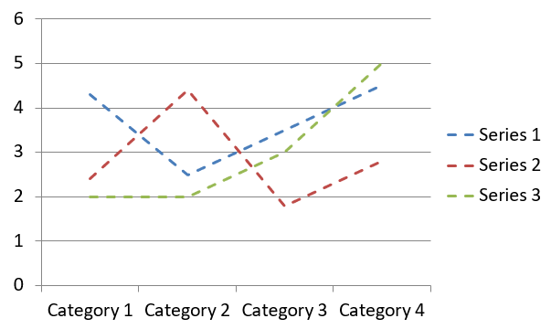

## **Przegląd**

Ten artykuł zawiera kompleksowy przewodnik, jak tworzyć i dostosowywać wykresy przy użyciu Aspose.Slides for Python via Java. Nauczysz się, jak programowo dodać wykres do slajdu, wypełnić go danymi oraz zastosować różne opcje formatowania, aby spełnić określone wymagania projektowe. W całym artykule szczegółowe przykłady kodu ilustrują każdy krok, od inicjalizacji prezentacji i obiektu wykresu po konfigurację serii, osi i legend. Postępując zgodnie z tym przewodnikiem, zdobędziesz solidną wiedzę, jak integrować dynamiczne generowanie wykresów w aplikacjach Pythona, usprawniając proces tworzenia prezentacji opartych na danych.

## **Utworzenie wykresu**

Wykresy pomagają szybko wizualizować dane i wyciągać wnioski, które nie są od razu widoczne w tabeli lub arkuszu kalkulacyjnym.

**Dlaczego tworzyć wykresy?**

Korzystając z wykresów, możesz:

* agregować, zagęszczać lub podsumowywać duże ilości danych na jednym slajdzie prezentacji;
* uwidaczniać wzorce i trendy w danych;
* wywnioskować kierunek i dynamikę danych w czasie lub względem określonej jednostki miary;
* wykrywać wartości odstające, aberracje, odchylenia, błędy i dane bezsensowne;
* przekazywać lub prezentować złożone dane.

W programie PowerPoint wykresy tworzy się za pomocą funkcji *Insert*, która oferuje szablony do projektowania wielu typów wykresów. Korzystając z Aspose.Slides, możesz tworzyć zarówno standardowe wykresy (oparte na popularnych typach), jak i wykresy niestandardowe.

{}

Użyj wyliczenia [ChartType](https://reference.aspose.com/slides/python-java/aspose.slides/charttype/) w pakiecie [asposeslides.api](https://reference.aspose.com/slides/python-java/aspose.slides/). Wartości w tym wyliczeniu odpowiadają różnym typom wykresów.

{}

### **Utworzenie wykresu kolumnowego grupowanego**

Ten przykład używa [addChart](https://reference.aspose.com/slides/python-java/aspose.slides/shapecollection/#addChart) do utworzenia wykresu kolumnowego grupowanego, który porównuje dwie serie w trzech kategoriach. Serie używają wypełnień czerwonego i zielonego, a indywidualne etykiety pokazują nazwy kategorii, nazwy serii oraz wartości. Indeks arkusza 0 odnosi się do pierwszego arkusza w osadzonym skoroszycie wykresu.

```python
import jpype
import asposeslides

if not jpype.isJVMStarted():
    jpype.startJVM()

from asposeslides.api import ChartType, FillType, NullableBool, Presentation, SaveFormat

Color = jpype.JClass("java.awt.Color")

presentation = Presentation()
try:
    slide = presentation.getSlides().get_Item(0)

    chart = slide.getShapes().addChart(ChartType.ClusteredColumn, 20, 20, 500, 300)

    chart.getChartTitle().addTextFrameForOverriding("Sample Title")
    chart.getChartTitle().getTextFrameForOverriding().getTextFrameFormat().setCenterText(NullableBool.True_)
    chart.getChartTitle().setHeight(20)
    chart.setTitle(True)

    workbook = chart.getChartData().getChartDataWorkbook()
    worksheet_index = 0

    chart.getChartData().getSeries().clear()
    chart.getChartData().getCategories().clear()

    series_name_cell = workbook.getCell(worksheet_index, 0, 1, "Series 1")
    chart.getChartData().getSeries().add(series_name_cell, chart.getType())
    series_name_cell = workbook.getCell(worksheet_index, 0, 2, "Series 2")
    chart.getChartData().getSeries().add(series_name_cell, chart.getType())

    category_cell = workbook.getCell(worksheet_index, 1, 0, "Category 1")
    chart.getChartData().getCategories().add(category_cell)
    category_cell = workbook.getCell(worksheet_index, 2, 0, "Category 2")
    chart.getChartData().getCategories().add(category_cell)
    category_cell = workbook.getCell(worksheet_index, 3, 0, "Category 3")
    chart.getChartData().getCategories().add(category_cell)

    series = chart.getChartData().getSeries().get_Item(0)

    value_cell = workbook.getCell(worksheet_index, 1, 1, 20)
    series.getDataPoints().addDataPointForBarSeries(value_cell)
    value_cell = workbook.getCell(worksheet_index, 2, 1, 50)
    series.getDataPoints().addDataPointForBarSeries(value_cell)
    value_cell = workbook.getCell(worksheet_index, 3, 1, 30)
    series.getDataPoints().addDataPointForBarSeries(value_cell)

    series.getFormat().getFill().setFillType(FillType.Solid)
    series.getFormat().getFill().getSolidFillColor().setColor(Color.RED)

    series = chart.getChartData().getSeries().get_Item(1)

    value_cell = workbook.getCell(worksheet_index, 1, 2, 30)
    series.getDataPoints().addDataPointForBarSeries(value_cell)
    value_cell = workbook.getCell(worksheet_index, 2, 2, 10)
    series.getDataPoints().addDataPointForBarSeries(value_cell)
    value_cell = workbook.getCell(worksheet_index, 3, 2, 60)
    series.getDataPoints().addDataPointForBarSeries(value_cell)

    series.getFormat().getFill().setFillType(FillType.Solid)
    color = Color(0, 128, 0)
    series.getFormat().getFill().getSolidFillColor().setColor(color)

    label = series.getDataPoints().get_Item(0).getLabel()
    label.getDataLabelFormat().setShowCategoryName(True)

    label = series.getDataPoints().get_Item(1).getLabel()
    label.getDataLabelFormat().setShowSeriesName(True)

    label = series.getDataPoints().get_Item(2).getLabel()
    label.getDataLabelFormat().setShowValue(True)
    label.getDataLabelFormat().setShowSeriesName(True)
    label.getDataLabelFormat().setSeparator("/")

    presentation.save("AsposeChart.pptx", SaveFormat.Pptx)
finally:
    presentation.dispose()
```

Wynik:


### **Utworzenie wykresu punktowego**

Wykresy punktowe (znane również jako wykresy rozproszenia lub wykresy x‑y) są często używane do sprawdzania wzorców lub wykazywania korelacji między dwiema zmiennymi.

Użyj wykresu punktowego, gdy:

* Masz sparowane dane liczbowe;
* Masz dwie zmienne, które dobrze ze sobą współgrają;
* Chcesz określić, czy dwie zmienne są ze sobą powiązane;
* Masz zmienną niezależną, która ma wiele wartości dla zmiennej zależnej.

Ten przykład rysuje dwie serie wartości x‑y. Pierwsza seria używa prostych linii z markerami‑gwiazdkami, druga – wygładzonych linii z markerami‑kółkami; obie serie mają rozmiar markera równy 10, skonfigurowany przy pomocy [setSize](https://reference.aspose.com/slides/python-java/aspose.slides/marker/#setSize). Metoda [setSymbol](https://reference.aspose.com/slides/python-java/aspose.slides/marker/#setSymbol) kontroluje kształt markera.

```python
import jpype
import asposeslides

if not jpype.isJVMStarted():
    jpype.startJVM()

from asposeslides.api import ChartType, MarkerStyleType, Presentation, SaveFormat

presentation = Presentation()
try:
    slide = presentation.getSlides().get_Item(0)

    chart = slide.getShapes().addChart(ChartType.ScatterWithSmoothLines, 20, 20, 500, 300)

    workbook = chart.getChartData().getChartDataWorkbook()
    worksheet_index = 0

    chart.getChartData().getSeries().clear()

    series_name_cell = workbook.getCell(worksheet_index, 1, 1, "Series 1")
    chart.getChartData().getSeries().add(series_name_cell, chart.getType())
    series_name_cell = workbook.getCell(worksheet_index, 1, 3, "Series 2")
    chart.getChartData().getSeries().add(series_name_cell, chart.getType())

    series = chart.getChartData().getSeries().get_Item(0)

    x_value_cell = workbook.getCell(worksheet_index, 2, 1, 1)
    y_value_cell = workbook.getCell(worksheet_index, 2, 2, 3)
    series.getDataPoints().addDataPointForScatterSeries(x_value_cell, y_value_cell)

    x_value_cell = workbook.getCell(worksheet_index, 3, 1, 2)
    y_value_cell = workbook.getCell(worksheet_index, 3, 2, 10)
    series.getDataPoints().addDataPointForScatterSeries(x_value_cell, y_value_cell)

    series.setType(ChartType.ScatterWithStraightLinesAndMarkers)

    series.getMarker().setSize(10)
    series.getMarker().setSymbol(MarkerStyleType.Star)

    series = chart.getChartData().getSeries().get_Item(1)

    x_value_cell = workbook.getCell(worksheet_index, 2, 3, 5)
    y_value_cell = workbook.getCell(worksheet_index, 2, 4, 2)
    series.getDataPoints().addDataPointForScatterSeries(x_value_cell, y_value_cell)

    x_value_cell = workbook.getCell(worksheet_index, 3, 3, 3)
    y_value_cell = workbook.getCell(worksheet_index, 3, 4, 1)
    series.getDataPoints().addDataPointForScatterSeries(x_value_cell, y_value_cell)

    x_value_cell = workbook.getCell(worksheet_index, 4, 3, 2)
    y_value_cell = workbook.getCell(worksheet_index, 4, 4, 2)
    series.getDataPoints().addDataPointForScatterSeries(x_value_cell, y_value_cell)

    x_value_cell = workbook.getCell(worksheet_index, 5, 3, 5)
    y_value_cell = workbook.getCell(worksheet_index, 5, 4, 1)
    series.getDataPoints().addDataPointForScatterSeries(x_value_cell, y_value_cell)

    series.getMarker().setSize(10)
    series.getMarker().setSymbol(MarkerStyleType.Circle)

    presentation.save("AsposeChart.pptx", SaveFormat.Pptx)
finally:
    presentation.dispose()
```

Wynik:


### **Utworzenie wykresu kołowego**

Wykresy kołowe najlepiej służą do prezentacji zależności części‑do‑całości w danych, szczególnie gdy dane zawierają kategorie z wartościami liczbowymi. Jeśli jednak Twoje dane zawierają wiele części lub etykiet, rozważ użycie wykresu słupkowego.

Ten przykład tworzy wykres kołowy z trzema wartościami kwartalnymi. Każdy wycinek ma niestandardowe wypełnienie i obramowanie, a etykiety wyświetlają różne kombinacje wartości, procentów i informacji o serii. Metoda [setFirstSliceAngle](https://reference.aspose.com/slides/python-java/aspose.slides/chartseriesgroup/#setFirstSliceAngle) ustawia pierwszy wycinek na start pod kątem 180 stopni.

```python
import jpype
import asposeslides

if not jpype.isJVMStarted():
    jpype.startJVM()

from asposeslides.api import ChartType, FillType, LineDashStyle, LineStyle, NullableBool, Presentation, SaveFormat

Color = jpype.JClass("java.awt.Color")

presentation = Presentation()
try:
    slide = presentation.getSlides().get_Item(0)

    chart = slide.getShapes().addChart(ChartType.Pie, 20, 20, 500, 300)

    chart.getChartTitle().addTextFrameForOverriding("Sample Title")
    chart.getChartTitle().getTextFrameForOverriding().getTextFrameFormat().setCenterText(NullableBool.True_)
    chart.getChartTitle().setHeight(20)
    chart.setTitle(True)

    chart.getChartData().getSeries().get_Item(0).getLabels().getDefaultDataLabelFormat().setShowValue(True)

    workbook = chart.getChartData().getChartDataWorkbook()
    worksheet_index = 0

    chart.getChartData().getSeries().clear()
    chart.getChartData().getCategories().clear()

    category_cell = workbook.getCell(0, 1, 0, "1st Qtr")
    chart.getChartData().getCategories().add(category_cell)
    category_cell = workbook.getCell(0, 2, 0, "2nd Qtr")
    chart.getChartData().getCategories().add(category_cell)
    category_cell = workbook.getCell(0, 3, 0, "3rd Qtr")
    chart.getChartData().getCategories().add(category_cell)

    series_name_cell = workbook.getCell(0, 0, 1, "Series 1")
    series = chart.getChartData().getSeries().add(series_name_cell, chart.getType())

    value_cell = workbook.getCell(worksheet_index, 1, 1, 20)
    series.getDataPoints().addDataPointForPieSeries(value_cell)
    value_cell = workbook.getCell(worksheet_index, 2, 1, 50)
    series.getDataPoints().addDataPointForPieSeries(value_cell)
    value_cell = workbook.getCell(worksheet_index, 3, 1, 30)
    series.getDataPoints().addDataPointForPieSeries(value_cell)

    chart.getChartData().getSeriesGroups().get_Item(0).setColorVaried(True)

    first_slice = series.getDataPoints().get_Item(0)
    first_slice.getFormat().getFill().setFillType(FillType.Solid)
    first_slice.getFormat().getFill().getSolidFillColor().setColor(Color.CYAN)

    first_slice.getFormat().getLine().getFillFormat().setFillType(FillType.Solid)
    first_slice.getFormat().getLine().getFillFormat().getSolidFillColor().setColor(Color.GRAY)
    first_slice.getFormat().getLine().setWidth(3.0)
    first_slice.getFormat().getLine().setStyle(LineStyle.ThinThick)
    first_slice.getFormat().getLine().setDashStyle(LineDashStyle.LargeDash)

    second_slice = series.getDataPoints().get_Item(1)
    second_slice.getFormat().setFillType(FillType.Solid)
    color = Color(165, 42, 42)
    second_slice.getFormat().getFill().getSolidFillColor().setColor(color)

    second_slice.getFormat().getLine().getFillFormat().setFillType(FillType.Solid)
    second_slice.getFormat().getLine().getFillFormat().getSolidFillColor().setColor(Color.BLUE)
    second_slice.getFormat().getLine().setWidth(3.0)
    second_slice.getFormat().getLine().setStyle(LineStyle.Single)
    second_slice.getFormat().getLine().setDashStyle(LineDashStyle.LargeDashDot)

    third_slice = series.getDataPoints().get_Item(2)
    third_slice.getFormat().getFill().setFillType(FillType.Solid)
    color = Color(255, 127, 80)
    third_slice.getFormat().getFill().getSolidFillColor().setColor(color)

    third_slice.getFormat().getLine().getFillFormat().setFillType(FillType.Solid)
    third_slice.getFormat().getLine().getFillFormat().getSolidFillColor().setColor(Color.RED)
    third_slice.getFormat().getLine().setWidth(2.0)
    third_slice.getFormat().getLine().setStyle(LineStyle.ThinThin)
    third_slice.getFormat().getLine().setDashStyle(LineDashStyle.LargeDashDotDot)

    first_label = series.getDataPoints().get_Item(0).getLabel()
    first_label.getDataLabelFormat().setShowValue(True)

    second_label = series.getDataPoints().get_Item(1).getLabel()
    second_label.getDataLabelFormat().setShowValue(True)
    second_label.getDataLabelFormat().setShowLegendKey(True)
    second_label.getDataLabelFormat().setShowPercentage(True)

    third_label = series.getDataPoints().get_Item(2).getLabel()
    third_label.getDataLabelFormat().setShowSeriesName(True)
    third_label.getDataLabelFormat().setShowPercentage(True)

    series.getLabels().getDefaultDataLabelFormat().setShowLeaderLines(True)

    chart.getChartData().getSeriesGroups().get_Item(0).setFirstSliceAngle(180)

    presentation.save("PieChart.pptx", SaveFormat.Pptx)
finally:
    presentation.dispose()
```

Wynik:


Aby poprawić czytelność etykiet znajdujących się poza kołem, zobacz [Format Leader Lines](/slides/pl/python-java/chart-data-label/#format-leader-lines) – przykład, w którym pozycjonuje się etykiety i dostosowuje kolor, szerokość, przejrzystość oraz styl kreski linii prowadzących.

### **Utworzenie wykresu liniowego**

Wykresy liniowe (zwane także wykresami liniowymi) są najlepsze w sytuacjach, gdy chcesz pokazać zmiany wartości w czasie. Dzięki wykresowi liniowemu możesz jednocześnie porównać dużą ilość danych, śledzić zmiany i trendy w czasie, podkreślać anomalie w seriach danych i nie tylko.

Ten przykład używa [addChart](https://reference.aspose.com/slides/python-java/aspose.slides/shapecollection/#addChart) do utworzenia wykresu liniowego z domyślnymi seriami i kategoriami, a następnie zapisuje prezentację jako PPTX.

```python
import jpype
import asposeslides

if not jpype.isJVMStarted():
    jpype.startJVM()

from asposeslides.api import ChartType, Presentation, SaveFormat

presentation = Presentation()
try:
    slide = presentation.getSlides().get_Item(0)

    line_chart = slide.getShapes().addChart(ChartType.Line, 20, 20, 500, 300)

    presentation.save("line_chart.pptx", SaveFormat.Pptx)
finally:
    presentation.dispose()
```

Domyślnie punkty na wykresie liniowym są połączone prostymi, ciągłymi liniami. Jeśli chcesz, aby punkty były połączone kreskami, wywołaj [setDashStyle](https://reference.aspose.com/slides/python-java/aspose.slides/lineformat/#setDashStyle) z wartością z [LineDashStyle](https://reference.aspose.com/slides/python-java/aspose.slides/linedashstyle/):

```python
import jpype
import asposeslides

if not jpype.isJVMStarted():
    jpype.startJVM()

from asposeslides.api import ChartType, LineDashStyle, Presentation

presentation = Presentation()
try:
    slide = presentation.getSlides().get_Item(0)

    line_chart = slide.getShapes().addChart(ChartType.Line, 20, 20, 500, 300)

    for series in line_chart.getChartData().getSeries():
        series.getFormat().getLine().setDashStyle(LineDashStyle.Dash)
finally:
    presentation.dispose()
```

Wynik:



### **Utworzenie wykresu mapy drzewa**

Wykresy mapy drzewa są najlepsze dla danych sprzedażowych, gdy chcesz pokazać względny rozmiar kategorii danych i szybko zwrócić uwagę na elementy, które stanowią duży wkład w każdej kategorii.

Ten przykład tworzy mapę drzewa z ośmioma liśćmi pogrupowanymi w cztery pędy i dwie gałęzie. Metoda [setGroupingItem](https://reference.aspose.com/slides/python-java/aspose.slides/chartcategorylevelsmanager/#setGroupingItem) przypisuje pędy na poziomie grupowania 1 oraz gałęzie na poziomie 2. Wartości określają względne rozmiary prostokątów, a etykiety kategorii i nakładające się etykiety nadrzędne identyfikują hierarchię.

```python
import jpype
import asposeslides

if not jpype.isJVMStarted():
    jpage.startJVM()

from asposeslides.api import ChartType, ParentLabelLayoutType, Presentation, SaveFormat

presentation = Presentation()
try:
    slide = presentation.getSlides().get_Item(0)

    chart = slide.getShapes().addChart(ChartType.Treemap, 20, 20, 500, 300)

    chart.getChartData().getCategories().clear()
    chart.getChartData().getSeries().clear()

    workbook = chart.getChartData().getChartDataWorkbook()
    workbook.clear(0)

    # Gałąź 1
    category_cell = workbook.getCell(0, "C1", "Leaf1")
    leaf = chart.getChartData().getCategories().add(category_cell)
    leaf.getGroupingLevels().setGroupingItem(1, "Stem1")
    leaf.getGroupingLevels().setGroupingItem(2, "Branch1")

    category_cell = workbook.getCell(0, "C2", "Leaf2")
    chart.getChartData().getCategories().add(category_cell)

    category_cell = workbook.getCell(0, "C3", "Leaf3")
    leaf = chart.getChartData().getCategories().add(category_cell)
    leaf.getGroupingLevels().setGroupingItem(1, "Stem2")

    category_cell = workbook.getCell(0, "C4", "Leaf4")
    chart.getChartData().getCategories().add(category_cell)

    # Gałąź 2
    category_cell = workbook.getCell(0, "C5", "Leaf5")
    leaf = chart.getChartData().getCategories().add(category_cell)
    leaf.getGroupingLevels().setGroupingItem(1, "Stem3")
    leaf.getGroupingLevels().setGroupingItem(2, "Branch2")

    category_cell = workbook.getCell(0, "C6", "Leaf6")
    chart.getChartData().getCategories().add(category_cell)

    category_cell = workbook.getCell(0, "C7", "Leaf7")
    leaf = chart.getChartData().getCategories().add(category_cell)
    leaf.getGroupingLevels().setGroupingItem(1, "Stem4")

    category_cell = workbook.getCell(0, "C8", "Leaf8")
    chart.getChartData().getCategories().add(category_cell)

    series = chart.getChartData().getSeries().add(ChartType.Treemap)
    series.getLabels().getDefaultDataLabelFormat().setShowCategoryName(True)
    value_cell = workbook.getCell(0, "D1", 4)
    series.getDataPoints().addDataPointForTreemapSeries(value_cell)
    value_cell = workbook.getCell(0, "D2", 5)
    series.getDataPoints().addDataPointForTreemapSeries(value_cell)
    value_cell = workbook.getCell(0, "D3", 3)
    series.getDataPoints().addDataPointForTreemapSeries(value_cell)
    value_cell = workbook.getCell(0, "D4", 6)
    series.getDataPoints().addDataPointForTreemapSeries(value_cell)
    value_cell = workbook.getCell(0, "D5", 9)
    series.getDataPoints().addDataPointForTreemapSeries(value_cell)
    value_cell = workbook.getCell(0, "D6", 9)
    series.getDataPoints().addDataPointForTreemapSeries(value_cell)
    value_cell = workbook.getCell(0, "D7", 4)
    series.getDataPoints().addDataPointForTreemapSeries(value_cell)
    value_cell = workbook.getCell(0, "D8", 3)
    series.getDataPoints().addDataPointForTreemapSeries(value_cell)

    series.setParentLabelLayout(ParentLabelLayoutType.Overlapping)

    presentation.save("Treemap.pptx", SaveFormat.Pptx)
finally:
    presentation.dispose()
```

Wynik:


### **Utworzenie wykresu wodospadowego**

Wykres wodospadowy pokazuje, jak dodatnie i ujemne zmiany przyczyniają się do ostatecznej wartości. Na przykład rozbiórka zysku może zaczynać się od przychodu, odejmować koszty i dodawać inne przychody. Kolumny zmian „pływają” pomiędzy poprzednią a nową wartością bieżącą, a kolumny sumy rozciągają się od zera do wartości skumulowanej.

Poniższy przykład używa kwot w tysiącach dolarów amerykańskich:

| Kategoria | Wartość w skoroszycie | Typ kolumny |
| --- | ---: | --- |
| Przychód | 1000 | Wzrost |
| Koszt sprzedanych towarów | -400 | Spadek |
| Zysk brutto | 600 | Pośrednia suma |
| Koszty operacyjne | -200 | Spadek |
| Inne przychody | 50 | Wzrost |
| Zysk netto | 450 | Końcowa suma |

Aby oznaczyć punkt jako sumę pośrednią lub końcową, wywołaj jego metodę [setSetAsTotal](https://reference.aspose.com/slides/python-java/aspose.slides/chartdatapoint/#setSetAsTotal) z argumentem `True`. Podaj rzeczywistą skumulowaną kwotę w komórce skoroszytu tego punktu: `600` dla zysku brutto (`1000 - 400`) oraz `450` dla zysku netto (`600 - 200 + 50`). Metoda oznacza kolumnę jako sumę; nie oblicza ani nie wypełnia wartości komórki. Nie używaj zera jako symbolu zastępczego ani nie podawaj innej zmiany dla punktu sumy. Kolumna sumy wyświetla wartość skumulowaną bez ponownego dodawania jej do wartości bieżącej.

Ten kompletny przykład w języku Python tworzy wykres przy użyciu członu `Waterfall` z [ChartType](https://reference.aspose.com/slides/python-java/aspose.slides/charttype/), usuwa domyślne dane i wypełnia osadzony skoroszyt. Indeks arkusza `0` wybiera pierwszy arkusz; kolumna A zawiera nazwy kategorii, a kolumna B – wartości. Każda komórka wartości jest dodawana przy pomocy [addDataPointForWaterfallSeries](https://reference.aspose.com/slides/python-java/aspose.slides/chartdatapointcollection/#addDataPointForWaterfallSeries). Indeksy punktów zerowych `2` i `5` identyfikują sumy pośrednie i końcowe. Wywołanie [setShowValue](https://reference.aspose.com/slides/python-java/aspose.slides/datalabelformat/#setShowValue) z `True` wyświetla kwoty na kolumnach. Nie jest wymagana żadna wejściowa prezentacja ani skoroszyt.

```python
import jpype
import asposeslides

if not jpype.isJVMStarted():
    jpype.startJVM()

from asposeslides.api import ChartType, Presentation, SaveFormat

presentation = Presentation()
try:
    slide = presentation.getSlides().get_Item(0)

    chart = slide.getShapes().addChart(ChartType.Waterfall, 20, 20, 680, 200)

    chart.setTitle(True)
    chart.getChartTitle().addTextFrameForOverriding("Profit breakdown (USD thousands)")
    chart.getChartTitle().setOverlay(False)
    chart.setLegend(False)

    chart.getChartData().getSeries().clear()
    chart.getChartData().getCategories().clear()

    workbook = chart.getChartData().getChartDataWorkbook()
    worksheet_index = 0

    workbook.clear(worksheet_index)

    series_name_cell = workbook.getCell(worksheet_index, 0, 1, "Profit")
    series = chart.getChartData().getSeries().add(series_name_cell, ChartType.Waterfall)
    categories = ["Revenue", "Cost of sales", "Gross profit", "Operating expenses", "Other income", "Net profit"]
    values = [1000, -400, 600, -200, 50, 450]

    for i in range(len(categories)):
        category_cell = workbook.getCell(worksheet_index, i + 1, 0, categories[i])
        chart.getChartData().getCategories().add(category_cell)
        value_cell = workbook.getCell(worksheet_index, i + 1, 1, values[i])
        series.getDataPoints().addDataPointForWaterfallSeries(value_cell)

    # Trzeci i szósty punkt reprezentują sumy, a nie dodatkowe zmiany.
    series.getDataPoints().get_Item(2).setSetAsTotal(True)
    series.getDataPoints().get_Item(5).setSetAsTotal(True)
    series.setShowConnectorLines(True)
    series.getLabels().getDefaultDataLabelFormat().setShowValue(True)

    presentation.save("WaterfallChart.pptx", SaveFormat.Pptx)
finally:
    presentation.dispose()
```

Wywołaj metodę na poziomie serii [setShowConnectorLines](https://reference.aspose.com/slides/python-java/aspose.slides/chartseries/#setShowConnectorLines) z `True`, aby pokazać linie łączące kolejne kolumny i ułatwić śledzenie wartości bieżącej. Aby ukryć te linie, zamień wywołanie metody w przykładzie na `series.setShowConnectorLines(False)` przed zapisem. Zmienia to tylko widoczność linii, a nie dane ani sumy.

Zapisana prezentacja pokazuje zysk brutto 600 oraz zysk netto 450, przy czym obie sumy zaczynają się od zera:


### **Utworzenie wykresów giełdowych**

Wykresy giełdowe służą do wyświetlania danych finansowych, takich jak ceny otwarcia, maksimum, minimum i zamknięcia, pomagając analizować trendy rynkowe i zmienność. Dostarczają kluczowych informacji o wynikach akcji, wspierając inwestorów i analityków w podejmowaniu świadomych decyzji.

Ten przykład tworzy wykres typu otwarcie‑maksimum‑minimum‑zamknięcie (OHLC) z czterema seriami w podanej kolejności oraz trzema kategoriami. Metoda [setUpDownBars](https://reference.aspose.com/slides/python-java/aspose.slides/updownbarsmanager/#setUpDownBars) włącza słupki w górę/w dół, a [getHiLowLinesFormat](https://reference.aspose.com/slides/python-java/aspose.slides/chartseriesgroup/#getHiLowLinesFormat) kontroluje linie wysokie‑niskie, które pokazują zakresy cen, przy czym linie serii i drobne linie siatki poziome są ukryte.

Menadżer zwrócony przez [getUpDownBars](https://reference.aspose.com/slides/python-java/aspose.slides/chartseriesgroup/#getUpDownBars) udostępnia osobne obiekty formatowania poprzez [getUpBarsFormat](https://reference.aspose.com/slides/python-java/aspose.slides/updownbarsmanager/#getUpBarsFormat) i [getDownBarsFormat](https://reference.aspose.com/slides/python-java/aspose.slides/updownbarsmanager/#getDownBarsFormat). Użyj metod [getFill](https://reference.aspose.com/slides/python-java/aspose.slides/format/#getFill) i [getLine](https://reference.aspose.com/slides/python-java/aspose.slides/format/#getLine) każdego obiektu, aby niezależnie ustawić wypełnienie i obramowanie. Ten przykład używa zielonych słupków z ciemno‑zielonymi obramowaniami dla rosnących interwałów oraz pomarańczowo‑czerwonych słupków z ciemno‑czerwonymi obramowaniami dla spadających interwałów.

Podaj wartości liczbowe dla wszystkich czterech serii w każdej kategorii, przy czym wysokie i niskie otaczają otwarcie i zamknięcie. Słupki porównują zamknięcie z otwarciem **w tej samej kategorii**, a nie z poprzednią kategorią: A spada z 72 do 25, B rośnie z 25 do 38, a C rośnie z 38 do 50. Równe wartości otwarcia i zamknięcia nie tworzą widocznego wypełnionego interwału. Słupki w górę/w dół obejmują zakres Otwarcie–Zamknięcie; linie wysokie‑niskie obejmują zakres Niskie‑Wysokie. Te słupki należą do grupy serii i nie są zwykłymi seriami wykresu słupkowego.

To formatowanie działa także z wykresami [Line and LineWithMarkers](https://reference.aspose.com/slides/python-java/aspose.slides/charttype/), które zawierają co najmniej dwie serie w tej samej grupie i odpowiednie wartości liczbowe dla każdej kategorii. Dla tych niewyłożonych wykresów liniowych, słupki w górę/w dół porównują pierwszą i ostatnią serię: wyższa ostatnia wartość generuje słupek w górę, niższa – w dół. Odwrócenie serii odwraca klasyfikację. Poniższy przykład używa [OpenHighLowClose](https://reference.aspose.com/slides/python-java/aspose.slides/charttype/); nie zakładaj, że inne warianty giełdowe, wyłożone‑liniowe czy 3D używają tej samej struktury danych ani interpretacji interwału.

```python
import jpype
import asposeslides

if not jpype.isJVMStarted():
    jpype.startJVM()

from asposeslides.api import ChartType, FillType, Presentation, SaveFormat

Color = jpype.JClass("java.awt.Color")

presentation = Presentation()
try:
    slide = presentation.getSlides().get_Item(0)

    chart = slide.getShapes().addChart(ChartType.OpenHighLowClose, 20, 20, 500, 150, False)

    workbook = chart.getChartData().getChartDataWorkbook()

    category_cell = workbook.getCell(0, 1, 0, "A")
    chart.getChartData().getCategories().add(category_cell)
    category_cell = workbook.getCell(0, 2, 0, "B")
    chart.getChartData().getCategories().add(category_cell)
    category_cell = workbook.getCell(0, 3, 0, "C")
    chart.getChartData().getCategories().add(category_cell)

    series_name_cell = workbook.getCell(0, 0, 1, "Open")
    chart.getChartData().getSeries().add(series_name_cell, ChartType.OpenHighLowClose)
    series_name_cell = workbook.getCell(0, 0, 2, "High")
    chart.getChartData().getSeries().add(series_name_cell, ChartType.OpenHighLowClose)
    series_name_cell = workbook.getCell(0, 0, 3, "Low")
    chart.getChartData().getSeries().add(series_name_cell, ChartType.OpenHighLowClose)
    series_name_cell = workbook.getCell(0, 0, 4, "Close")
    chart.getChartData().getSeries().add(series_name_cell, ChartType.OpenHighLowClose)

    series = chart.getChartData().getSeries().get_Item(0)
    value_cell = workbook.getCell(0, 1, 1, 72)
    series.getDataPoints().addDataPointForStockSeries(value_cell)
    value_cell = workbook.getCell(0, 2, 1, 25)
    series.getDataPoints().addDataPointForStockSeries(value_cell)
    value_cell = workbook.getCell(0, 3, 1, 38)
    series.getDataPoints().addDataPointForStockSeries(value_cell)

    series = chart.getChartData().getSeries().get_Item(1)
    value_cell = workbook.getCell(0, 1, 2, 172)
    series.getDataPoints().addDataPointForStockSeries(value_cell)
    value_cell = workbook.getCell(0, 2, 2, 57)
    series.getDataPoints().addDataPointForStockSeries(value_cell)
    value_cell = workbook.getCell(0, 3, 2, 57)
    series.getDataPoints().addDataPointForStockSeries(value_cell)

    series = chart.getChartData().getSeries().get_Item(2)
    value_cell = workbook.getCell(0, 1, 3, 12)
    series.getDataPoints().addDataPointForStockSeries(value_cell)
    value_cell = workbook.getCell(0, 2, 3, 12)
    series.getDataPoints().addDataPointForStockSeries(value_cell)
    value_cell = workbook.getCell(0, 3, 3, 13)
    series.getDataPoints().addDataPointForStockSeries(value_cell)

    series = chart.getChartData().getSeries().get_Item(3)
    value_cell = workbook.getCell(0, 1, 4, 25)
    series.getDataPoints().addDataPointForStockSeries(value_cell)
    value_cell = workbook.getCell(0, 2, 4, 38)
    series.getDataPoints().addDataPointForStockSeries(value_cell)
    value_cell = workbook.getCell(0, 3, 4, 50)
    series.getDataPoints().addDataPointForStockSeries(value_cell)

    up_down_bars = chart.getChartData().getSeriesGroups().get_Item(0).getUpDownBars()
    up_down_bars.setUpDownBars(True)

    up_down_bars.getUpBarsFormat().getFill().setFillType(FillType.Solid)
    up_fill_color = Color(50, 205, 50)
    up_down_bars.getUpBarsFormat().getFill().getSolidFillColor().setColor(up_fill_color)
    up_down_bars.getUpBarsFormat().getLine().getFillFormat().setFillType(FillType.Solid)
    up_line_color = Color(0, 100, 0)
    up_down_bars.getUpBarsFormat().getLine().getFillFormat().getSolidFillColor().setColor(up_line_color)
    up_down_bars.getUpBarsFormat().getLine().setWidth(2)

    up_down_bars.getDownBarsFormat().getFill().setFillType(FillType.Solid)
    down_fill_color = Color(255, 69, 0)
    up_down_bars.getDownBarsFormat().getFill().getSolidFillColor().setColor(down_fill_color)
    up_down_bars.getDownBarsFormat().getLine().getFillFormat().setFillType(FillType.Solid)
    down_line_color = Color(139, 0, 0)
    up_down_bars.getDownBarsFormat().getLine().getFillFormat().getSolidFillColor().setColor(down_line_color)
    up_down_bars.getDownBarsFormat().getLine().setWidth(2)
    chart.getChartData().getSeriesGroups().get_Item(0).getHiLowLinesFormat().getLine().getFillFormat().setFillType(FillType.Solid)

    for stock_series in chart.getChartData().getSeries():
        stock_series.getFormat().getLine().getFillFormat().setFillType(FillType.NoFill)

    chart.getAxes().getVerticalAxis().getMinorGridLinesFormat().getLine().getFillFormat().setFillType(FillType.NoFill)

    presentation.save("Stock-chart.pptx", SaveFormat.Pptx)
finally:
    presentation.dispose()
```

Wynik, wyeksportowany z PowerPoint:


### **Utworzenie wykresów pudełko‑wąsy**

Wykresy pudełko‑wąsy służą do prezentacji rozkładu danych poprzez podsumowanie kluczowych miar statystycznych, takich jak mediana, kwartyle i potencjalne wartości odstające. Są szczególnie przydatne w analizie wstępnej i badaniach statystycznych, umożliwiając szybkie zrozumienie zmienności danych i identyfikację anomalii.

Ten przykład tworzy wykres pudełko‑wąsy z sześciu wartości. Metoda [setQuartileMethod](https://reference.aspose.com/slides/python-java/aspose.slides/chartseries/#setQuartileMethod) wybiera wyłączny sposób obliczania kwartylów. Przykład dodatkowo włącza linie średniej, markery średniej, wewnętrzne punkty i punkty odstające.

```python
import jpype
import asposeslides

if not jpype.isJVMStarted():
    jpype.startJVM()

from asposeslides.api import ChartType, Presentation, QuartileMethodType, SaveFormat

presentation = Presentation()
try:
    slide = presentation.getSlides().get_Item(0)

    chart = slide.getShapes().addChart(ChartType.BoxAndWhisker, 20, 20, 500, 300)

    chart.getChartData().getCategories().clear()
    chart.getChartData().getSeries().clear()

    workbook = chart.getChartData().getChartDataWorkbook()
    workbook.clear(0)

    category_cell = workbook.getCell(0, "A1", "Category 1")
    chart.getChartData().getCategories().add(category_cell)
    category_cell = workbook.getCell(0, "A2", "Category 2")
    chart.getChartData().getCategories().add(category_cell)
    category_cell = workbook.getCell(0, "A3", "Category 3")
    chart.getChartData().getCategories().add(category_cell)
    category_cell = workbook.getCell(0, "A4", "Category 4")
    chart.getChartData().getCategories().add(category_cell)
    category_cell = workbook.getCell(0, "A5", "Category 5")
    chart.getChartData().getCategories().add(category_cell)
    category_cell = workbook.getCell(0, "A6", "Category 6")
    chart.getChartData().getCategories().add(category_cell)

    series = chart.getChartData().getSeries().add(ChartType.BoxAndWhisker)

    series.setQuartileMethod(QuartileMethodType.Exclusive)
    series.setShowMeanLine(True)
    series.setShowMeanMarkers(True)
    series.setShowInnerPoints(True)
    series.setShowOutlierPoints(True)

    value_cell = workbook.getCell(0, "B1", 15)
    series.getDataPoints().addDataPointForBoxAndWhiskerSeries(value_cell)
    value_cell = workbook.getCell(0, "B2", 41)
    series.getDataPoints().addDataPointForBoxAndWhiskerSeries(value_cell)
    value_cell = workbook.getCell(0, "B3", 16)
    series.getDataPoints().addDataPointForBoxAndWhiskerSeries(value_cell)
    value_cell = workbook.getCell(0, "B4", 10)
    series.getDataPoints().addDataPointForBoxAndWhiskerSeries(value_cell)
    value_cell = workbook.getCell(0, "B5", 23)
    series.getDataPoints().addDataPointForBoxAndWhiskerSeries(value_cell)
    value_cell = workbook.getCell(0, "B6", 16)
    series.getDataPoints().addDataPointForBoxAndWhiskerSeries(value_cell)

    presentation.save("BoxAndWhisker.pptx", SaveFormat.Pptx)
finally:
    presentation.dispose()
```

### **Utworzenie wykresów lejkowych**

Wykresy lejkowe służą do wizualizacji procesów, które obejmują kolejne etapy, przy czym wolumen danych maleje w miarę postępu od jednego kroku do następnego. Są szczególnie pomocne przy analizie wskaźników konwersji, identyfikacji wąskich gardeł i śledzeniu efektywności procesów sprzedaży lub marketingu.

Ten przykład używa [addChart](https://reference.aspose.com/slides/python-java/aspose.slides/shapecollection/#addChart) do dodania wykresu lejkowego do pierwszego slajdu istniejącej prezentacji. Zastępuje on domyślne dane sześcioma kategoriami i wartościami od 50 do 500, po czym zapisuje zaktualizowaną prezentację. Wejściowa prezentacja musi zawierać co najmniej jeden slajd.

```python
import jpype
import asposeslides

if not jpype.isJVMStarted():
    jpype.startJVM()

from asposeslides.api import ChartType, Presentation, SaveFormat

presentation = Presentation("test.pptx")
try:
    slide = presentation.getSlides().get_Item(0)

    chart = slide.getShapes().addChart(ChartType.Funnel, 50, 50, 500, 400)

    chart.getChartData().getCategories().clear()
    chart.getChartData().getSeries().clear()

    workbook = chart.getChartData().getChartDataWorkbook()
    workbook.clear(0)

    category_cell = workbook.getCell(0, "A1", "Category 1")
    chart.getChartData().getCategories().add(category_cell)
    category_cell = workbook.getCell(0, "A2", "Category 2")
    chart.getChartData().getCategories().add(category_cell)
    category_cell = workbook.getCell(0, "A3", "Category 3")
    chart.getChartData().getCategories().add(category_cell)
    category_cell = workbook.getCell(0, "A4", "Category 4")
    chart.getChartData().getCategories().add(category_cell)
    category_cell = workbook.getCell(0, "A5", "Category 5")
    chart.getChartData().getCategories().add(category_cell)
    category_cell = workbook.getCell(0, "A6", "Category 6")
    chart.getChartData().getCategories().add(category_cell)

    series = chart.getChartData().getSeries().add(ChartType.Funnel)

    value_cell = workbook.getCell(0, "B1", 50)
    series.getDataPoints().addDataPointForFunnelSeries(value_cell)
    value_cell = workbook.getCell(0, "B2", 100)
    series.getDataPoints().addDataPointForFunnelSeries(value_cell)
    value_cell = workbook.getCell(0, "B3", 200)
    series.getDataPoints().addDataPointForFunnelSeries(value_cell)
    value_cell = workbook.getCell(0, "B4", 300)
    series.getDataPoints().addDataPointForFunnelSeries(value_cell)
    value_cell = workbook.getCell(0, "B5", 400)
    series.getDataPoints().addDataPointForFunnelSeries(value_cell)
    value_cell = workbook.getCell(0, "B6", 500)
    series.getDataPoints().addDataPointForFunnelSeries(value_cell)

    presentation.save("Funnel.pptx", SaveFormat.Pptx)
finally:
    presentation.dispose()
```

Wynik:


### **Utworzenie wykresów promieniowych**

Wykresy promieniowe służą do wizualizacji danych hierarchicznych, wyświetlając poziomy jako koncentryczne pierścienie. Pomagają zobrazować zależności części‑do‑całości i są idealne do reprezentowania zagnieżdżonych kategorii i podkategorii w przejrzystym, zwartym formacie.

Ten przykład tworzy wykres promieniowy z ośmioma liśćmi pogrupowanymi w cztery pędy i dwie gałęzie. Metoda [setGroupingItem](https://reference.aspose.com/slides/python-java/aspose.slides/chartcategorylevelsmanager/#setGroupingItem) przypisuje pędy na poziomie grupowania 1 oraz gałęzie na poziomie 2. Etykiety kategorii identyfikują segmenty, a wartości określają ich względne rozmiary.

```python
import jpype
import asposeslides

if not jpype.isJVMStarted():
    jpime.startJVM()

from asposeslides.api import ChartType, Presentation, SaveFormat

presentation = Presentation()
try:
    slide = presentation.getSlides().get_Item(0)

    chart = slide.getShapes().addChart(ChartType.Sunburst, 20, 20, 500, 300)

    chart.getChartData().getCategories().clear()
    chart.getChartData().getSeries().clear()

    workbook = chart.getChartData().getChartDataWorkbook()
    workbook.clear(0)

    # Gałąź 1
    category_cell = workbook.getCell(0, "C1", "Leaf1")
    leaf = chart.getChartData().getCategories().add(category_cell)
    leaf.getGroupingLevels().setGroupingItem(1, "Stem1")
    leaf.getGroupingLevels().setGroupingItem(2, "Branch1")

    category_cell = workbook.getCell(0, "C2", "Leaf2")
    chart.getChartData().getCategories().add(category_cell)

    category_cell = workbook.getCell(0, "C3", "Leaf3")
    leaf = chart.getChartData().getCategories().add(category_cell)
    leaf.getGroupingLevels().setGroupingItem(1, "Stem2")

    category_cell = workbook.getCell(0, "C4", "Leaf4")
    chart.getChartData().getCategories().add(category_cell)

    # Gałąź 2
    category_cell = workbook.getCell(0, "C5", "Leaf5")
    leaf = chart.getChartData().getCategories().add(category_cell)
    leaf.getGroupingLevels().setGroupingItem(1, "Stem3")
    leaf.getGroupingLevels().setGroupingItem(2, "Branch2")

    category_cell = workbook.getCell(0, "C6", "Leaf6")
    chart.getChartData().getCategories().add(category_cell)

    category_cell = workbook.getCell(0, "C7", "Leaf7")
    leaf = chart.getChartData().getCategories().add(category_cell)
    leaf.getGroupingLevels().setGroupingItem(1, "Stem4")

    category_cell = workbook.getCell(0, "C8", "Leaf8")
    chart.getChartData().getCategories().add(category_cell)

    series = chart.getChartData().getSeries().add(ChartType.Sunburst)
    series.getLabels().getDefaultDataLabelFormat().setShowCategoryName(True)
    value_cell = workbook.getCell(0, "D1", 4)
    series.getDataPoints().addDataPointForSunburstSeries(value_cell)
    value_cell = workbook.getCell(0, "D2", 5)
    series.getDataPoints().addDataPointForSunburstSeries(value_cell)
    value_cell = workbook.getCell(0, "D3", 3)
    series.getDataPoints().addDataPointForSunburstSeries(value_cell)
    value_cell = workbook.getCell(0, "D4", 6)
    series.getDataPoints().addDataPointForSunburstSeries(value_cell)
    value_cell = workbook.getCell(0, "D5", 9)
    series.getDataPoints().addDataPointForSunburstSeries(value_cell)
    value_cell = workbook.getCell(0, "D6", 9)
    series.getDataPoints().addDataPointForSunburstSeries(value_cell)
    value_cell = workbook.getCell(0, "D7", 4)
    series.getDataPoints().addDataPointForSunburstSeries(value_cell)
    value_cell = workbook.getCell(0, "D8", 3)
    series.getDataPoints().addDataPointForSunburstSeries(value_cell)

    presentation.save("Sunburst.pptx", SaveFormat.Pptx)
finally:
    presentation.dispose()
```

Wynik:


### **Utworzenie wykresów histogramu**

Wykresy histogramu pokazują, jak wartości liczbowe są rozmieszczone w przedziałach (koszach). Dla comiesięcznych raportów dotyczących czasów przetwarzania zamówień używaj tej samej szerokości kosza i progów, aby zachować spójność przedziałów i ułatwić porównywanie rozkładów.

Wywołaj [setAggregationType](https://reference.aspose.com/slides/python-java/aspose.slides/axis/#setAggregationType) na osi poziomej z trybem z [AxisAggregationType](https://reference.aspose.com/slides/python-java/aspose.slides/axisaggregationtype/). [setBinWidth](https://reference.aspose.com/slides/python-java/aspose.slides/axis/#setBinWidth) ma zastosowanie tylko do `ByBinWidth`; [setNumberOfBins](https://reference.aspose.com/slides/python-java/aspose.slides/axis/#setNumberOfBins) – tylko do `ByNumberOfBins`. Użyj `Automatic`, aby pozwolić wykresowi samodzielnie dobrać kosze.

#### **Użycie stałej szerokości kosza**

Ten przykład grupuje czasy przetwarzania w przedziały 10‑minutowe, z osobnymi koszami dla czasów ≤ 10 min i > 40 min. Włącz te kosze przy pomocy [setUnderflowBin](https://reference.aspose.com/slides/python-java/aspose.slides/axis/#setUnderflowBin) oraz [setOverflowBin](https://reference.aspose.com/slides/python-java/aspose.slides/axis/#setOverflowBin). Podczas podawania explicite progów poprzez [setUnderflowBin](https://reference.aspose.com/slides/python-java/aspose.slides/axis/#setUnderflowBin) i [setOverflowBin](https://reference.aspose.com/slides/python-java/aspose.slides/axis/#setOverflowBin), wywołaj [setAutomaticUnderflowBin](https://reference.aspose.com/slides/python-java/aspose.slides/axis/#setAutomaticUnderflowBin) oraz [setAutomaticOverflowBin](https://reference.aspose.com/slides/python-java/aspose.slides/axis/#setAutomaticOverflowBin) z wartością `False`.

```python
import jpype
import asposeslides

if not jpype.isJVMStarted():
    jpype.startJVM()

from asposeslides.api import AxisAggregationType, ChartType, Presentation, SaveFormat

presentation = Presentation()
try:
    slide = presentation.getSlides().get_Item(0)

    chart = slide.getShapes().addChart(ChartType.Histogram, 20, 20, 680, 200)

    chart.setLegend(False)
    chart.setTitle(False)

    chart.getChartData().getCategories().clear()
    chart.getChartData().getSeries().clear()

    workbook = chart.getChartData().getChartDataWorkbook()
    workbook.clear(0)

    series = chart.getChartData().getSeries().add(ChartType.Histogram)
    values = [5, 10, 10, 11, 15, 20, 20, 21, 25, 30, 30, 31, 35, 40, 40, 41, 50]
    for i, value in enumerate(values):
        value_cell = workbook.getCell(0, i, 0, float(value))
        series.getDataPoints().addDataPointForHistogramSeries(value_cell)

    axis = chart.getAxes().getHorizontalAxis()
    axis.setAggregationType(AxisAggregationType.ByBinWidth)
    axis.setBinWidth(10.0)
    axis.setUnderflowBin(True)
    axis.setAutomaticUnderflowBin(False)
    axis.setUnderflowBin(10.0)
    axis.setOverflowBin(True)
    axis.setAutomaticOverflowBin(False)
    axis.setOverflowBin(40.0)

    presentation.save("Histogram-bin-width.pptx", SaveFormat.Pptx)
finally:
    presentation.dispose()
```

Prezentacja wyświetlana w PowerPoint pokazuje liczby elementów w koszach **3, 4, 4, 4 i 2**. Kosz podprzepływu (underflow) zawiera `5, 10, 10`, więc jego próg jest inkluzywny. Kosz przepełnienia (overflow) zawiera jedynie `41, 50`, więc jego próg jest ekskluzywny; wartości równe `40` pozostają w poprzednim przedziale. Kosze wewnętrzne zawierają wartości większe od ich dolnej granicy i mniejsze lub równe górnej granicy.


#### **Określenie liczby koszy**

Dla stałego poziomu szczegółowości zamiast stałych przedziałów, poproś o pięć koszy dla tych samych danych. Ten przykład wyłącza kosze podprzepływu i przepełnienia. Wykres sam określa szerokość na podstawie zakresu danych, więc granice mogą się zmieniać między raportami.

```python
import jpype
import asposeslides

if not jpype.isJVMStarted():
    jpype.startJVM()

from asposeslides.api import AxisAggregationType, ChartType, Presentation, SaveFormat

presentation = Presentation()
try:
    slide = presentation.getSlides().get_Item(0)

    chart = slide.getShapes().addChart(ChartType.Histogram, 20, 20, 680, 200)

    chart.setLegend(False)
    chart.setTitle(False)

    chart.getChartData().getCategories().clear()
    chart.getChartData().getSeries().clear()

    workbook = chart.getChartData().getChartDataWorkbook()
    workbook.clear(0)

    series = chart.getChartData().getSeries().add(ChartType.Histogram)
    values = [5, 10, 10, 11, 15, 20, 20, 21, 25, 30, 30, 31, 35, 40, 40, 41, 50]
    for i, value in enumerate(values):
        value_cell = workbook.getCell(0, i, 0, float(value))
        series.getDataPoints().addDataPointForHistogramSeries(value_cell)

    axis = chart.getAxes().getHorizontalAxis()
    axis.setAggregationType(AxisAggregationType.ByNumberOfBins)
    axis.setNumberOfBins(5)

    presentation.save("Histogram-bin-count.pptx", SaveFormat.Pptx)
finally:
    presentation.dispose()
```

Pięć koszy ma liczby elementów **4, 4, 4, 4 i 1**. Porównaj ten rozkład z wynikiem przy stałej szerokości powyżej: wartości wejściowe są identyczne, ale granice się różnią.


### **Utworzenie wykresów radarowych**

Wykresy radarowe służą do prezentacji danych wielowymiarowych w dwuwymiarowym formacie, umożliwiając łatwe porównanie kilku zmiennych jednocześnie. Są szczególnie przydatne do identyfikacji wzorców, mocnych i słabych stron w różnych miarach wydajności lub atrybutach.

Ten przykład używa [addChart](https://reference.aspose.com/slides/python-java/aspose.slides/shapecollection/#addChart) do utworzenia wykresu radarowego z domyślnymi seriami i kategoriami, po czym zapisuje prezentację jako PPTX.

```python
import jpype
import asposeslides

if not jpype.isJVMStarted():
    jpype.startJVM()

from asposeslides.api import ChartType, Presentation, SaveFormat

presentation = Presentation()
try:
    slide = presentation.getSlides().get_Item(0)

    slide.getShapes().addChart(ChartType.Radar, 20, 20, 500, 300)

    presentation.save("Radar-chart.pptx", SaveFormat.Pptx)
finally:
    presentation.dispose()
```

Wynik:


### **Utworzenie wykresów wielokategorii**

Wykresy wielokategorii służą do prezentacji danych, które obejmują więcej niż jedną grupę kategorialną, umożliwiając porównywanie wartości w wielu wymiarach jednocześnie. Są szczególnie pomocne, gdy trzeba analizować trendy i zależności w złożonych, wielowarstwowych zestawach danych.

Ten przykład tworzy wykres kolumnowy grupowany z ośmioma kategoriami rozmieszczonymi w czterech parach. Metoda [setGroupingItem](https://reference.aspose.com/slides/python-java/aspose.slides/chartcategorylevelsmanager/#setGroupingItem) nadaje każdej parze wspólną etykietę na poziomie grupowania 1, tworząc oś kategorii z indywidualnymi i grupowymi etykietami.

```python
import jpype
import asposeslides

if not jpype.isJVMStarted():
    jpype.startJVM()

from asposeslides.api import ChartType, Presentation, SaveFormat

presentation = Presentation()
try:
    slide = presentation.getSlides().get_Item(0)

    chart = slide.getShapes().addChart(ChartType.ClusteredColumn, 20, 20, 500, 300)

    chart.getChartData().getSeries().clear()
    chart.getChartData().getCategories().clear()

    workbook = chart.getChartData().getChartDataWorkbook()
    workbook.clear(0)

    worksheet_index = 0

    category_cell = workbook.getCell(0, "c2", "A")
    category = chart.getChartData().getCategories().add(category_cell)
    category.getGroupingLevels().setGroupingItem(1, "Group1")
    category_cell = workbook.getCell(0, "c3", "B")
    category = chart.getChartData().getCategories().add(category_cell)

    category_cell = workbook.getCell(0, "c4", "C")
    category = chart.getChartData().getCategories().add(category_cell)
    category.getGroupingLevels().setGroupingItem(1, "Group2")
    category_cell = workbook.getCell(0, "c5", "D")
    category = chart.getChartData().getCategories().add(category_cell)

    category_cell = workbook.getCell(0, "c6", "E")
    category = chart.getChartData().getCategories().add(category_cell)
    category.getGroupingLevels().setGroupingItem(1, "Group3")
    category_cell = workbook.getCell(0, "c7", "F")
    category = chart.getChartData().getCategories().add(category_cell)

    category_cell = workbook.getCell(0, "c8", "G")
    category = chart.getChartData().getCategories().add(category_cell)
    category.getGroupingLevels().setGroupingItem(1, "Group4")
    category_cell = workbook.getCell(0, "c9", "H")
    category = chart.getChartData().getCategories().add(category_cell)

    series_name_cell = workbook.getCell(0, "D1", "Series 1")
    series = chart.getChartData().getSeries().add(series_name_cell, ChartType.ClusteredColumn)

    value_cell = workbook.getCell(worksheet_index, "D2", 10)
    series.getDataPoints().addDataPointForBarSeries(value_cell)
    value_cell = workbook.getCell(worksheet_index, "D3", 20)
    series.getDataPoints().addDataPointForBarSeries(value_cell)
    value_cell = workbook.getCell(worksheet_index, "D4", 30)
    series.getDataPoints().addDataPointForBarSeries(value_cell)
    value_cell = workbook.getCell(worksheet_index, "D5", 40)
    series.getDataPoints().addDataPointForBarSeries(value_cell)
    value_cell = workbook.getCell(worksheet_index, "D6", 50)
    series.getDataPoints().addDataPointForBarSeries(value_cell)
    value_cell = workbook.getCell(worksheet_index, "D7", 60)
    series.getDataPoints().addDataPointForBarSeries(value_cell)
    value_cell = workbook.getCell(worksheet_index, "D8", 70)
    series.getDataPoints().addDataPointForBarSeries(value_cell)
    value_cell = workbook.getCell(worksheet_index, "D9", 80)
    series.getDataPoints().addDataPointForBarSeries(value_cell)

    presentation.save("AsposeChart.pptx", SaveFormat.Pptx)
finally:
    presentation.dispose()
```

Wynik:


#### **Usunięcie etykiety kwartału**

Pobierz plik [quarters.pptx](quarters.pptx) i umieść go w katalogu roboczym. Jego wykres pokazuje dziewięć miesięcy i jedną serię sprzedaży z wartościami od 10 do 18. Na osi kategorii Q1 obejmuje styczeń‑marzec, Q2 – kwiecień‑czerwiec, a Q3 – lipiec‑wrzesień.

Kwiecień jest czwartą kategorią (indeks 3) i zawiera etykietę Q2. Użyj [getGroupingLevels](https://reference.aspose.com/slides/python-java/aspose.slides/chartcategory/#getGroupingLevels), aby uzyskać poziomy grupowania kwietnia, a następnie wywołaj [deleteGroupingItem](https://reference.aspose.com/slides/python-java/aspose.slides/chartcategorylevelsmanager/#deleteGroupingItem) z poziomem 1, aby usunąć jego etykietę kwartału. Poziom 0 reprezentuje sam miesiąc i nie może być usunięty tą metodą.

```python
import jpype
import asposeslides

if not jpype.isJVMStarted():
    jpype.startJVM()

from asposeslides.api import Presentation, SaveFormat

presentation = Presentation("quarters.pptx")
try:
    chart = presentation.getSlides().get_Item(0).getShapes().get_Item(0)
    april = chart.getChartData().getCategories().get_Item(3)
    april.getGroupingLevels().deleteGroupingItem(1)

    presentation.save("quarters-updated.pptx", SaveFormat.Pptx)
finally:
    presentation.dispose()

reopened = Presentation("quarters-updated.pptx")
try:
    chart = reopened.getSlides().get_Item(0).getShapes().get_Item(0)
    data = chart.getChartData()
    
    points = data.getSeries().get_Item(0).getDataPoints()
    print(", ".join(str(month.getAsCell().getValue()) for month in data.getCategories()))
    print(", ".join(str(point.getValue().getData()) for point in points))
finally:
    reopened.dispose()
```

Po ponownym otwarciu wykresu przykład wypisuje oryginalne miesiące (`Jan, Feb, Mar, Apr, May, Jun, Jul, Aug, Sep`) oraz wartości sprzedaży (`10.0, 11.0, 12.0, 13.0, 14.0, 15.0, 16.0, 17.0, 18.0`) w tej samej kolejności. Otwórz `quarters-updated.pptx` w PowerPoint, aby porównać etykiety osi. Etykieta Q2 oraz granica grupy przed kwietniem znikają, więc Q1 obejmuje styczeń‑czerwiec. Q3 nadal zaczyna się w lipcu.


### **Utworzenie wykresów mapowych**

Wykresy mapowe służą do wizualizacji danych geograficznych poprzez mapowanie informacji na konkretne lokalizacje, takie jak kraje, stany czy miasta. Są szczególnie przydatne do analizowania trendów regionalnych, danych demograficznych i rozmieszczenia przestrzennego w przejrzysty i atrakcyjny wizualnie sposób.

Ten przykład używa [addChart](https://reference.aspose.com/slides/python-java/aspose.slides/shapecollection/#addChart) do utworzenia wykresu mapowego z domyślnymi danymi geograficznymi i zapisuje go do przeglądania w PowerPoint.

```python
import jpype
import asposeslides

if not jpype.isJVMStarted():
    jpype.startJVM()

from asposeslides.api import ChartType, Presentation, SaveFormat

presentation = Presentation()
try:
    slide = presentation.getSlides().get_Item(0)

    chart = slide.getShapes().addChart(ChartType.Map, 20, 20, 500, 300)

    presentation.save("mapChart.pptx", SaveFormat.Pptx)
finally:
    presentation.dispose()
```

Wynik:


{}

Powyższy obrazek przedstawia zapisany prezentację otwartą w PowerPoint. Aspose.Slides prawidłowo zapisuje wykres mapowy i jego dane, ale sam nie renderuje wykresów mapowych: gdy slajd zawierający taki wykres jest renderowany do obrazu lub konwertowany na PDF lub SVG, obszar wykresu jest pusty. Inne kształty na tym samym slajdzie pozostają nienaruszone.

{}

### **Utworzenie wykresów kombinowanych**

Wykres kombinowany (lub wykres combo) łączy dwa lub więcej typów wykresów w jednym diagramie. Ten wykres umożliwia podkreślenie, porównanie lub zbadanie różnic między dwoma lub więcej zestawami danych, pomagając zidentyfikować zależności pomiędzy nimi.


Ten przykład łączy dwie serie kolumn grupowanych z serią liniową w czterech kategoriach. Kolumny używają głównej osi pionowej, podczas gdy [setPlotOnSecondAxis](https://reference.aspose.com/slides/python-java/aspose.slides/chartseries/#setPlotOnSecondAxis) umieszcza linię na drugorzędnej osi pionowej po prawej stronie. Funkcje pomocnicze konfigurują tytuł, legendę, etykiety osi i linie siatki.

```python
import jpype
import asposeslides

if not jpype.isJVMStarted():
    jpype.startJVM()

from asposeslides.api import AxisPositionType, ChartType, CrossesType, FillType, LegendPositionType, NullableBool, Presentation, SaveFormat

Color = jpype.JClass("java.awt.Color")

def create_combo_chart():
    presentation = Presentation()
    slide = presentation.getSlides().get_Item(0)
    try:
        chart = create_chart_with_first_series(slide)

        add_second_series_to_chart(chart)
        add_third_series_to_chart(chart)

        set_primary_axes_format(chart)
        set_secondary_axes_format(chart)

        presentation.save("combo-chart.pptx", SaveFormat.Pptx)
    finally:
        presentation.dispose()

def create_chart_with_first_series(slide):
    chart = slide.getShapes().addChart(ChartType.ClusteredColumn, 50, 50, 600, 400)

    # Ustaw tytuł wykresu.
    chart.setTitle(True)
    chart.getChartTitle().addTextFrameForOverriding("Chart Title")
    chart.getChartTitle().setOverlay(False)
    title_paragraph = chart.getChartTitle().getTextFrameForOverriding().getParagraphs().get_Item(0)
    title_format = title_paragraph.getParagraphFormat().getDefaultPortionFormat()
    title_format.setFontBold(NullableBool.False_)
    title_format.setFontHeight(18.0)

    # Ustaw legendę wykresu.
    chart.getLegend().setPosition(LegendPositionType.Bottom)
    chart.getLegend().getTextFormat().getPortionFormat().setFontHeight(12.0)

    # Usuń domyślnie wygenerowane serie i kategorie.
    chart.getChartData().getSeries().clear()
    chart.getChartData().getCategories().clear()

    worksheet_index = 0
    workbook = chart.getChartData().getChartDataWorkbook()

    # Dodaj nowe kategorie.
    cell = workbook.getCell(worksheet_index, 1, 0, "Category 1")
    chart.getChartData().getCategories().add(cell)
    cell = workbook.getCell(worksheet_index, 2, 0, "Category 2")
    chart.getChartData().getCategories().add(cell)
    cell = workbook.getCell(worksheet_index, 3, 0, "Category 3")
    chart.getChartData().getCategories().add(cell)
    cell = workbook.getCell(worksheet_index, 4, 0, "Category 4")
    chart.getChartData().getCategories().add(cell)

    # Dodaj pierwszą serię.
    series_name_cell = workbook.getCell(worksheet_index, 0, 1, "Series 1")
    series = chart.getChartData().getSeries().add(series_name_cell, chart.getType())

    series.getParentSeriesGroup().setOverlap(jpype.JByte(-25))
    series.getParentSeriesGroup().setGapWidth(220)

    cell = workbook.getCell(worksheet_index, 1, 1, 4.3)
    series.getDataPoints().addDataPointForBarSeries(cell)
    cell = workbook.getCell(worksheet_index, 2, 1, 2.5)
    series.getDataPoints().addDataPointForBarSeries(cell)
    cell = workbook.getCell(worksheet_index, 3, 1, 3.5)
    series.getDataPoints().addDataPointForBarSeries(cell)
    cell = workbook.getCell(worksheet_index, 4, 1, 4.5)
    series.getDataPoints().addDataPointForBarSeries(cell)

    return chart

def add_second_series_to_chart(chart):
    workbook = chart.getChartData().getChartDataWorkbook()
    worksheet_index = 0

    series_name_cell = workbook.getCell(worksheet_index, 0, 2, "Series 2")
    series = chart.getChartData().getSeries().add(series_name_cell, ChartType.ClusteredColumn)

    series.getParentSeriesGroup().setOverlap(jpype.JByte(-25))
    series.getParentSeriesGroup().setGapWidth(220)

    cell = workbook.getCell(worksheet_index, 1, 2, 2.4)
    series.getDataPoints().addDataPointForBarSeries(cell)
    cell = workbook.getCell(worksheet_index, 2, 2, 4.4)
    series.getDataPoints().addDataPointForBarSeries(cell)
    cell = workbook.getCell(worksheet_index, 3, 2, 1.8)
    series.getDataPoints().addDataPointForBarSeries(cell)
    cell = workbook.getCell(worksheet_index, 4, 2, 2.8)
    series.getDataPoints().addDataPointForBarSeries(cell)

def add_third_series_to_chart(chart):
    workbook = chart.getChartData().getChartDataWorkbook()
    worksheet_index = 0

    series_name_cell = workbook.getCell(worksheet_index, 0, 3, "Series 3")
    series = chart.getChartData().getSeries().add(series_name_cell, ChartType.Line)

    cell = workbook.getCell(worksheet_index, 1, 3, 2.0)
    series.getDataPoints().addDataPointForLineSeries(cell)
    cell = workbook.getCell(worksheet_index, 2, 3, 2.0)
    series.getDataPoints().addDataPointForLineSeries(cell)
    cell = workbook.getCell(worksheet_index, 3, 3, 3.0)
    series.getDataPoints().addDataPointForLineSeries(cell)
    cell = workbook.getCell(worksheet_index, 4, 3, 5.0)
    series.getDataPoints().addDataPointForLineSeries(cell)

    series.setPlotOnSecondAxis(True)

def set_primary_axes_format(chart):
    # Ustaw oś poziomą.
    horizontal_axis = chart.getAxes().getHorizontalAxis()
    horizontal_axis.getTextFormat().getPortionFormat().setFontHeight(12.0)
    horizontal_axis.getFormat().getLine().getFillFormat().setFillType(FillType.NoFill)

    set_axis_title(horizontal_axis, "X Axis")

    # Ustaw oś pionową.
    vertical_axis = chart.getAxes().getVerticalAxis()
    vertical_axis.getTextFormat().getPortionFormat().setFontHeight(12.0)
    vertical_axis.getFormat().getLine().getFillFormat().setFillType(FillType.NoFill)

    set_axis_title(vertical_axis, "Y Axis 1")

    # Ustaw kolor głównych linii siatki pionowej.
    major_grid_lines_format = vertical_axis.getMajorGridLinesFormat().getLine().getFillFormat()
    major_grid_lines_format.setFillType(FillType.Solid)
    color = Color(217, 217, 217)
    major_grid_lines_format.getSolidFillColor().setColor(color)

def set_secondary_axes_format(chart):
    # Ustaw drugorzędną oś poziomą.
    secondary_horizontal_axis = chart.getAxes().getSecondaryHorizontalAxis()
    secondary_horizontal_axis.setPosition(AxisPositionType.Bottom)
    secondary_horizontal_axis.setCrossType(CrossesType.Maximum)
    secondary_horizontal_axis.setVisible(False)
    secondary_horizontal_axis.getMajorGridLinesFormat().getLine().getFillFormat().setFillType(FillType.NoFill)
    secondary_horizontal_axis.getMinorGridLinesFormat().getLine().getFillFormat().setFillType(FillType.NoFill)

    # Ustaw drugorzędną oś pionową.
    secondary_vertical_axis = chart.getAxes().getSecondaryVerticalAxis()
    secondary_vertical_axis.setPosition(AxisPositionType.Right)
    secondary_vertical_axis.getTextFormat().getPortionFormat().setFontHeight(12.0)
    secondary_vertical_axis.getFormat().getLine().getFillFormat().setFillType(FillType.NoFill)
    secondary_vertical_axis.getMajorGridLinesFormat().getLine().getFillFormat().setFillType(FillType.NoFill)
    secondary_vertical_axis.getMinorGridLinesFormat().getLine().getFillFormat().setFillType(FillType.NoFill)

    set_axis_title(secondary_vertical_axis, "Y Axis 2")

def set_axis_title(axis, axis_title):
    axis.setTitle(True)
    axis.getTitle().setOverlay(False)
    title_paragraph = axis.getTitle().addTextFrameForOverriding(axis_title).getParagraphs().get_Item(0)
    title_format = title_paragraph.getParagraphFormat().getDefaultPortionFormat()
    title_format.setFontBold(NullableBool.False_)
    title_format.setFontHeight(12.0)

create_combo_chart()
```

## **Aktualizacja wykresów**

Aspose.Slides for Python via Java umożliwia aktualizację wykresów PowerPoint poprzez modyfikację danych, formatowania i stylów wykresu. Funkcjonalność ta upraszcza proces utrzymywania prezentacji na bieżąco z dynamiczną treścią i zapewnia, że wykresy dokładnie odzwierciedlają aktualne dane oraz standardy wizualne.

Ten przykład aktualizuje wykres o nazwie "My chart" na pierwszym slajdzie istniejącej prezentacji. Wymaga dwóch serii kolumnowych po trzy punkty danych każda, przy czym etykiety kategorii znajdują się w kolumnie A, a nazwy serii w pierwszym wierszu pierwszego arkusza. Przykład używa [getCell](https://reference.aspose.com/slides/python-java/aspose.slides/chartdataworkbook/#getCell) do zmiany komórek skoroszytu, aktualizuje wartości serii, dodaje trzecią serię oraz zmienia wykres na cylindry grupowane przy pomocy [setType](https://reference.aspose.com/slides/python-java/aspose.slides/chart/#setType).

```python
import jpype
import asposeslides

if not jpype.isJVMStarted():
    jpype.startJVM()

from asposeslides.api import Chart, ChartType, Presentation, SaveFormat

chart_name = "My chart"

presentation = Presentation("ExistingChart.pptx")
try:
    slide = presentation.getSlides().get_Item(0)

    for shape in slide.getShapes():
        if isinstance(shape, Chart) and chart_name == shape.getName():
            chart = shape
            worksheet_index = 0

            workbook = chart.getChartData().getChartDataWorkbook()

            workbook.getCell(worksheet_index, 1, 0, "Modified Category 1")
            workbook.getCell(worksheet_index, 2, 0, "Modified Category 2")

            series = chart.getChartData().getSeries().get_Item(0)

            workbook.getCell(worksheet_index, 0, 1, "New_Series 1")
            series.getDataPoints().get_Item(0).getValue().setData(90)
            series.getDataPoints().get_Item(1).getValue().setData(123)
            series.getDataPoints().get_Item(2).getValue().setData(44)

            series = chart.getChartData().getSeries().get_Item(1)

            workbook.getCell(worksheet_index, 0, 2, "New_Series 2")
            series.getDataPoints().get_Item(0).getValue().setData(23)
            series.getDataPoints().get_Item(1).getValue().setData(67)
            series.getDataPoints().get_Item(2).getValue().setData(99)

            series_name_cell = workbook.getCell(worksheet_index, 0, 3, "Series 3")
            series = chart.getChartData().getSeries().add(series_name_cell, chart.getType())

            value_cell = workbook.getCell(worksheet_index, 1, 3, 20)
            series.getDataPoints().addDataPointForBarSeries(value_cell)
            value_cell = workbook.getCell(worksheet_index, 2, 3, 50)
            series.getDataPoints().addDataPointForBarSeries(value_cell)
            value_cell = workbook.getCell(worksheet_index, 3, 3, 30)
            series.getDataPoints().addDataPointForBarSeries(value_cell)

            chart.setType(ChartType.ClusteredCylinder)

    presentation.save("AsposeChartModified.pptx", SaveFormat.Pptx)
finally:
    presentation.dispose()
```

## **Ustawienie zakresu danych dla wykresu**

Aby sprawdzić zakres już używany przez istniejący wykres, zobacz [Retrieve a Chart's Data Range](/slides/pl/python-java/chart-workbook/#retrieve-a-charts-data-range).

Aspose.Slides for Python via Java zapewnia elastyczność definiowania konkretnego zakresu danych z arkusza jako źródła danych wykresu. Oznacza to, że możesz bezpośrednio mapować fragment swojego arkusza na wykres, kontrolując, które komórki przyczyniają się do serii i kategorii wykresu. W rezultacie możesz łatwo aktualizować i synchronizować wykresy z najnowszymi zmianami danych w arkuszu, zapewniając, że Twoje prezentacje PowerPoint odzwierciedlają aktualne i dokładne informacje.

Ten przykład używa [setRange](https://reference.aspose.com/slides/python-java/aspose.slides/chartdata/#setRange) do ustawienia źródła danych wykresu o nazwie "My chart" na pierwszym slajdzie istniejącej prezentacji na `Sheet1!A1:B4`. Skoroszyt wykresu musi zawierać ten arkusz i wypełniony zakres z nagłówkiem serii w pierwszym wierszu, etykietami kategorii w kolumnie A oraz trzema wartościami w kolumnie B.

```python
import jpype
import asposeslides

if not jpype.isJVMStarted():
    jpype.startJVM()

from asposeslides.api import Chart, Presentation, SaveFormat

chart_name = "My chart"

presentation = Presentation("ExistingChart.pptx")
try:
    slide = presentation.getSlides().get_Item(0)

    for shape in slide.getShapes():
        if isinstance(shape, Chart) and chart_name == shape.getName():
            chart = shape
            chart.getChartData().setRange("Sheet1!A1:B4")

    presentation.save("SetDataRange.pptx", SaveFormat.Pptx)
finally:
    presentation.dispose()
```

## **Użycie domyślnych markerów w wykresach**

Gdy używasz domyślnych markerów w wykresach, każda seria wykresu automatycznie otrzymuje inny domyślny symbol markera.

Ten przykład używa [addChart](https://reference.aspose.com/slides/python-java/aspose.slides/shapecollection/#addChart) do utworzenia wykresu z dwiema seriami liniowymi i legendą. Ustawienia markerów dostępne przez [getMarker](https://reference.aspose.com/slides/python-java/aspose.slides/chartseries/#getMarker) zachowują automatycznie przypisane symbole markerów. Pierwsza seria zawiera wartość ujemną i brakującą wartość, reprezentowaną przez `None`, natomiast druga ma wartość dla każdej kategorii.

```python
import jpype
import asposeslides

if not jpype.isJVMStarted():
    jpype.startJVM()

from asposeslides.api import ChartType, Presentation, SaveFormat

presentation = Presentation()
try:
    slide = presentation.getSlides().get_Item(0)

    chart = slide.getShapes().addChart(ChartType.LineWithMarkers, 10, 10, 400, 400)

    chart.getChartData().getSeries().clear()
    chart.getChartData().getCategories().clear()

    workbook = chart.getChartData().getChartDataWorkbook()

    series_name_cell = workbook.getCell(0, 0, 1, "Series 1")
    series = chart.getChartData().getSeries().add(series_name_cell, chart.getType())

    category_cell = workbook.getCell(0, 1, 0, "C1")
    chart.getChartData().getCategories().add(category_cell)
    value_cell = workbook.getCell(0, 1, 1, 24)
    series.getDataPoints().addDataPointForLineSeries(value_cell)

    category_cell = workbook.getCell(0, 2, 0, "C2")
    chart.getChartData().getCategories().add(category_cell)
    value_cell = workbook.getCell(0, 2, 1, 23)
    series.getDataPoints().addDataPointForLineSeries(value_cell)

    category_cell = workbook.getCell(0, 3, 0, "C3")
    chart.getChartData().getCategories().add(category_cell)
    value_cell = workbook.getCell(0, 3, 1, -10)
    series.getDataPoints().addDataPointForLineSeries(value_cell)

    category_cell = workbook.getCell(0, 4, 0, "C4")
    chart.getChartData().getCategories().add(category_cell)
    value_cell = workbook.getCell(0, 4, 1, None)
    series.getDataPoints().addDataPointForLineSeries(value_cell)

    series_name_cell = workbook.getCell(0, 0, 2, "Series 2")
    second_series = chart.getChartData().getSeries().add(series_name_cell, chart.getType())

    value_cell = workbook.getCell(0, 1, 2, 30)
    second_series.getDataPoints().addDataPointForLineSeries(value_cell)
    value_cell = workbook.getCell(0, 2, 2, 10)
    second_series.getDataPoints().addDataPointForLineSeries(value_cell)
    value_cell = workbook.getCell(0, 3, 2, 60)
    second_series.getDataPoints().addDataPointForLineSeries(value_cell)
    value_cell = workbook.getCell(0, 4, 2, 40)
    second_series.getDataPoints().addDataPointForLineSeries(value_cell)

    chart.setLegend(True)
    chart.getLegend().setOverlay(False)

    presentation.save("DefaultMarkersInChart.pptx", SaveFormat.Pptx)
finally:
    presentation.dispose()
```

## **FAQ**

**Jakie typy wykresów są obsługiwane przez Aspose.Slides for Python via Java?**

Aspose.Slides for Python via Java obsługuje szeroką gamę typów wykresów, w tym słupkowe, liniowe, kołowe, powierzchniowe, punktowe, histogramy, radarowe i wiele innych. Ta elastyczność pozwala wybrać najodpowiedniejszy typ wykresu do potrzeb wizualizacji danych.

**Jak dodać nowy wykres do slajdu?**

Aby dodać wykres, najpierw tworzysz instancję klasy [Presentation](https://reference.aspose.com/slides/python-java/aspose.slides/presentation/), pobierasz żądany slajd przy użyciu jego indeksu, a następnie wywołujesz metodę dodającą wykres, określając typ wykresu oraz początkowe dane. Proces ten integruje wykres bezpośrednio w Twojej prezentacji.

**W jaki sposób mogę zaktualizować dane wyświetlane w wykresie?**

Możesz zaktualizować dane wykresu, uzyskując dostęp do jego skoroszytu danych ([ChartDataWorkbook](https://reference.aspose.com/slides/python-java/aspose.slides/chartdataworkbook/)), usuwając domyślne serie i kategorie, a następnie dodając własne dane. Pozwala to programowo odświeżać wykres, aby odzwierciedlał najnowsze informacje.

**Czy można dostosować wygląd wykresu?**

Tak, Aspose.Slides for Python via Java zapewnia rozbudowane opcje dostosowywania. Możesz modyfikować kolory, czcionki, etykiety, legendy oraz inne elementy formatowania, aby dopasować wygląd wykresu do konkretnych wymagań projektowych.