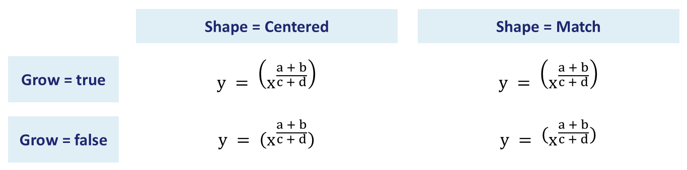

## **Przegląd**

PowerPoint przechowuje równania jako Office Math Markup Language (OMML). Korzystając z Aspose.Slides for Python via Java, możesz programowo tworzyć tego samego rodzaju treść matematyczną: ułamki, pierwiastki, funkcje, granice, operatory N-ary, macierze, tablice i sformatowane bloki matematyczne.

W programie PowerPoint użytkownicy zazwyczaj dodają równania z **Insert > Equation**:


Wynikiem jest edytowalny tekst matematyczny na slajdzie:


Aspose.Slides tworzy ten tekst matematyczny przy użyciu trzech głównych obiektów:

- Kształt matematyczny, tworzony za pomocą [addMathShape](https://reference.aspose.com/slides/python-java/aspose.slides/shapecollection/#addMathShape), jest kształtem zawierającym równanie.
- [MathPortion](https://reference.aspose.com/slides/python-java/aspose.slides/mathportion/) przechowuje treść matematyczną wewnątrz ramki tekstowej kształtu.
- [MathParagraph](https://reference.aspose.com/slides/python-java/aspose.slides/mathparagraph/) zawiera jeden lub więcej obiektów [MathBlock](https://reference.aspose.com/slides/python-java/aspose.slides/mathblock/).

Większość poniższych przykładów używa [MathematicalText](https://reference.aspose.com/slides/python-java/aspose.slides/mathematicaltext/) oraz płynnych metod z [MathElementBase](https://reference.aspose.com/slides/python-java/aspose.slides/mathelementbase/), aby kod był krótki i czytelny.

W scenariuszach eksportu MathML zobacz [Eksportowanie równań matematycznych z prezentacji w Pythonie](/slides/pl/python-java/exporting-math-equations/).

## **Utwórz równanie**

Ten przykład używa [addMathShape](https://reference.aspose.com/slides/python-java/aspose.slides/shapecollection/#addMathShape) do utworzenia kształtu matematycznego i dodaje twierdzenie Pitagorasa:


```python
import jpype
import asposeslides

if not jpype.isJVMStarted():
    jpype.startJVM()

from asposeslides.api import MathematicalText, Presentation, SaveFormat

presentation = Presentation()
try:
    slide = presentation.getSlides().get_Item(0)

    math_shape = slide.getShapes().addMathShape(20, 20, 700, 120)
    math_paragraph = math_shape.getTextFrame().getParagraphs().get_Item(0).getPortions().get_Item(0).getMathParagraph()

    a_squared = MathematicalText("a").setSuperscript("2")
    b_squared = MathematicalText("b").setSuperscript("2")
    equation = MathematicalText("c").setSuperscript("2").join("=").join(a_squared).join("+").join(b_squared)

    math_paragraph.add(equation)

    presentation.save("pythagorean-theorem.pptx", SaveFormat.Pptx)
finally:
    presentation.dispose()
```

{}
[addMathShape](https://reference.aspose.com/slides/python-java/aspose.slides/shapecollection/#addMathShape) tworzy kształt, który już zawiera akapit matematyczny. Uzyskaj dostęp do pierwszego [MathPortion](https://reference.aspose.com/slides/python-java/aspose.slides/mathportion/), wywołaj [getMathParagraph](https://reference.aspose.com/slides/python-java/aspose.slides/mathportion/#getMathParagraph), i dodaj bloki matematyczne lub elementy matematyczne.
{}

## **Dodaj ułamki**

Użyj [divide](https://reference.aspose.com/slides/python-java/aspose.slides/mathelementbase/#divide), aby utworzyć ułamek. Możesz wybrać styl ułamka przy pomocy [MathFractionTypes](https://reference.aspose.com/slides/python-java/aspose.slides/mathfractiontypes/).


```python
import jpype
import asposeslides

if not jpype.isJVMStarted():
    jpype.startJVM()

from asposeslides.api import MathBlock, MathFractionTypes, MathematicalText, Presentation, SaveFormat

presentation = Presentation()
try:
    slide = presentation.getSlides().get_Item(0)

    math_shape = slide.getShapes().addMathShape(20, 20, 700, 100)
    math_paragraph = math_shape.getTextFrame().getParagraphs().get_Item(0).getPortions().get_Item(0).getMathParagraph()

    fraction = MathematicalText("1").divide("x", MathFractionTypes.Skewed)

    math_block = MathBlock(fraction)
    math_paragraph.add(math_block)

    presentation.save("fraction.pptx", SaveFormat.Pptx)
finally:
    presentation.dispose()
```

Aby uzyskać ułamek stosowany, użyj [MathFractionTypes.Bar](https://reference.aspose.com/slides/python-java/aspose.slides/mathfractiontypes/#Bar):

```python
import jpype
import asposeslides

if not jpype.isJVMStarted():
    jpype.startJVM()

from asposeslides.api import MathFractionTypes, MathematicalText

stacked_fraction = MathematicalText("x + 1").divide("y - 1", MathFractionTypes.Bar)
```

## **Dodaj pierwiastki**

Użyj [radical](https://reference.aspose.com/slides/python-java/aspose.slides/mathelementbase/#radical), aby utworzyć pierwiastek kwadratowy, sześcienny lub inny. Obecny element staje się podstawą, a argument staje się stopniem.


```python
import jpype
import asposeslides

if not jpype.isJVMStarted():
    jpype.startJVM()

from asposeslides.api import MathBlock, MathematicalText, Presentation, SaveFormat

presentation = Presentation()
try:
    slide = presentation.getSlides().get_Item(0)

    math_shape = slide.getShapes().addMathShape(20, 20, 700, 100)
    math_paragraph = math_shape.getTextFrame().getParagraphs().get_Item(0).getPortions().get_Item(0).getMathParagraph()

    radical = MathematicalText("x").radical("n")

    math_block = MathBlock(radical)
    math_paragraph.add(math_block)

    presentation.save("radical.pptx", SaveFormat.Pptx)
finally:
    presentation.dispose()
```

## **Dodaj funkcje i granice**

Użyj [asArgumentOfFunction](https://reference.aspose.com/slides/python-java/aspose.slides/mathelementbase/#asArgumentOfFunction) lub [function](https://reference.aspose.com/slides/python-java/aspose.slides/mathelementbase/#function), aby dodać funkcje takie jak `sin(x)`, `log(x)` lub własne nazwy funkcji. W przypadku granic, umieść `lim` w [MathLimit](https://reference.aspose.com/slides/python-java/aspose.slides/mathlimit/) lub użyj [setLowerLimit](https://reference.aspose.com/slides/python-java/aspose.slides/mathelementbase/#setLowerLimit).


```python
import jpype
import asposeslides

if not jpype.isJVMStarted():
    jpype.startJVM()

from asposeslides.api import MathBlock, MathematicalText, Presentation, SaveFormat

presentation = Presentation()
try:
    slide = presentation.getSlides().get_Item(0)

    math_shape = slide.getShapes().addMathShape(20, 20, 700, 100)
    math_paragraph = math_shape.getTextFrame().getParagraphs().get_Item(0).getPortions().get_Item(0).getMathParagraph()

    limit = MathematicalText("lim").setLowerLimit("x\u2192\u221E").function("x")

    math_block = MathBlock(limit)
    math_paragraph.add(math_block)

    presentation.save("functions-and-limits.pptx", SaveFormat.Pptx)
finally:
    presentation.dispose()
```

Aby użyć własnej nazwy funkcji, ustaw nazwę funkcji jako bieżący element i wywołaj [function](https://reference.aspose.com/slides/python-java/aspose.slides/mathelementbase/#function) z jej argumentem:

```python
import jpype
import asposeslides

if not jpype.isJVMStarted():
    jpype.startJVM()

from asposeslides.api import MathematicalText

custom_function = MathematicalText("f").function("x + 1")
```

## **Dodaj operatory N-ary i całki**

Użyj [nary](https://reference.aspose.com/slides/python-java/aspose.slides/mathelementbase/#nary), aby dodać sumowanie, sumy, przecięcia i inne duże operatory. Użyj [integral](https://reference.aspose.com/slides/python-java/aspose.slides/mathelementbase/#integral), aby dodać całki. Obie metody pozwalają ustawić dolne i górne granice.


```python
import jpype
import asposeslides

if not jpype.isJVMStarted():
    jpype.startJVM()

from asposeslides.api import MathBlock, MathNaryOperatorTypes, MathematicalText, Presentation, SaveFormat

presentation = Presentation()
try:
    slide = presentation.getSlides().get_Item(0)

    math_shape = slide.getShapes().addMathShape(20, 20, 700, 120)
    math_paragraph = math_shape.getTextFrame().getParagraphs().get_Item(0).getPortions().get_Item(0).getMathParagraph()

    a_power = MathematicalText("a").setSuperscript("n-k")
    summation_base = MathematicalText("x").setSuperscript("k").join(a_power)

    summation = summation_base.nary(MathNaryOperatorTypes.Summation, "k=0", "n")

    math_block = MathBlock(summation)
    math_paragraph.add(math_block)

    presentation.save("nary-operators.pptx", SaveFormat.Pptx)
finally:
    presentation.dispose()
```

Operatory N-ary służą do dużych operatorów z opcjonalnymi granicami. Proste operatory takie jak `+`, `-` i `=` są zwykle dodawane jako [MathematicalText](https://reference.aspose.com/slides/python-java/aspose.slides/mathematicaltext/) i łączone w wyrażenie.

Aby dodać całkę, użyj [integral](https://reference.aspose.com/slides/python-java/aspose.slides/mathelementbase/#integral):

```python
import jpype
import asposeslides

if not jpype.isJVMStarted():
    jpype.startJVM()

from asposeslides.api import MathIntegralTypes, MathematicalText

differential = MathematicalText("dx").toBox()
integral_base = MathematicalText("x").join(differential)
integral = integral_base.integral(MathIntegralTypes.Simple, "0", "1")
```

## **Dodaj macierze**

Użyj [MathMatrix](https://reference.aspose.com/slides/python-java/aspose.slides/mathmatrix/), aby określić wiersze i kolumny. Macierze domyślnie nie zawierają nawiasów, więc otocz macierz, gdy potrzebujesz nawiasów okrągłych, kwadratowych lub klamrowych.


```python
import jpype
import asposeslides

if not jpype.isJVMStarted():
    jpime.startJVM()

from asposeslides.api import MathBlock, MathMatrix, MathematicalText, Presentation, SaveFormat

presentation = Presentation()
try:
    slide = presentation.getSlides().get_Item(0)

    math_shape = slide.getShapes().addMathShape(20, 20, 700, 120)
    math_paragraph = math_shape.getTextFrame().getParagraphs().get_Item(0).getPortions().get_Item(0).getMathParagraph()

    matrix = MathMatrix(2, 3)
    cell_0_0 = MathematicalText("1")
    matrix.set_Item(0, 0, cell_0_0)
    cell_0_1 = MathematicalText("x")
    matrix.set_Item(0, 1, cell_0_1)
    cell_1_0 = MathematicalText("x")
    matrix.set_Item(1, 0, cell_1_0)
    cell_1_1 = MathematicalText("2")
    matrix.set_Item(1, 1, cell_1_1)
    cell_1_2 = MathematicalText("y")
    matrix.set_Item(1, 2, cell_1_2)

    math_block = MathBlock(matrix)
    math_paragraph.add(math_block)

    presentation.save("matrix.pptx", SaveFormat.Pptx)
finally:
    presentation.dispose()
```

## **Dodaj tablice równań**

Użyj [toMathArray](https://reference.aspose.com/slides/python-java/aspose.slides/mathelementbase/#toMathArray), gdy potrzebujesz wyrównanych równań lub pionowego stosu wyrażeń.


```python
import jpype
import asposeslides

if not jpype.isJVMStarted():
    jpype.startJVM()

from asposeslides.api import MathBlock, MathematicalText, Presentation, SaveFormat

presentation = Presentation()
try:
    slide = presentation.getSlides().get_Item(0)

    math_shape = slide.getShapes().addMathShape(20, 20, 700, 140)
    math_paragraph = math_shape.getTextFrame().getParagraphs().get_Item(0).getPortions().get_Item(0).getMathParagraph()

    equation_array = MathematicalText("x").join("y").toMathArray()

    math_block = MathBlock(equation_array)
    math_paragraph.add(math_block)

    presentation.save("equation-array.pptx", SaveFormat.Pptx)
finally:
    presentation.dispose()
```

## **Dodaj funkcje trygonometryczne**

Użyj [asArgumentOfFunction](https://reference.aspose.com/slides/python-java/aspose.slides/mathelementbase/#asArgumentOfFunction), gdy argument jest bieżącym elementem, a nazwa funkcji jest znana.


```python
import jpime
import asposeslides

if not jpime.isJVMStarted():
    jpime.startJVM()

from asposeslides.api import MathBlock, MathFunctionsOfOneArgument, MathematicalText, Presentation, SaveFormat

presentation = Presentation()
try:
    slide = presentation.getSlides().get_Item(0)

    math_shape = slide.getShapes().addMathShape(20, 20, 700, 100)
    math_paragraph = math_shape.getTextFrame().getParagraphs().get_Item(0).getPortions().get_Item(0).getMathParagraph()

    cosine = MathematicalText("2x").asArgumentOfFunction(MathFunctionsOfOneArgument.Cos)

    math_block = MathBlock(cosine)
    math_paragraph.add(math_block)

    presentation.save("trigonometric-function.pptx", SaveFormat.Pptx)
finally:
    presentation.dispose()
```

## **Dodaj indeksy dolne i górne**

Użyj pomocników indeksów dolnych i górnych dla indeksów i potęg. Gdy indeksy mają pojawiać się po lewej stronie podstawy, użyj [setSubSuperscriptOnTheLeft](https://reference.aspose.com/slides/python-java/aspose.slides/mathelementbase/#setSubSuperscriptOnTheLeft).


```python
import jpype
import asposeslides

if not jpype.isJVMStarted():
    jpype.startJVM()

from asposeslides.api import MathBlock, MathematicalText, Presentation, SaveFormat

presentation = Presentation()
try:
    slide = presentation.getSlides().get_Item(0)

    math_shape = slide.getShapes().addMathShape(20, 20, 700, 100)
    math_paragraph = math_shape.getTextFrame().getParagraphs().get_Item(0).getPortions().get_Item(0).getMathParagraph()

    scripts = MathematicalText("Y").setSubSuperscriptOnTheLeft("1", "n")

    math_block = MathBlock(scripts)
    math_paragraph.add(math_block)

    presentation.save("subscript-superscript.pptx", SaveFormat.Pptx)
finally:
    presentation.dispose()
```

## **Dodaj delimitery**

Użyj [enclose](https://reference.aspose.com/slides/python-java/aspose.slides/mathelementbase/#enclose), aby umieścić wyrażenie wewnątrz delimiterów. Możesz także ustawić znak separatora dla wyrażeń delimiterowych zawierających kilka elementów.


```python
import jpype
import asposeslides

if not jpype.isJVMStarted():
    jpype.startJVM()

from asposeslides.api import MathBlock, MathematicalText, Presentation, SaveFormat

presentation = Presentation()
try:
    slide = presentation.getSlides().get_Item(0)

    math_shape = slide.getShapes().addMathShape(20, 20, 700, 100)
    math_paragraph = math_shape.getTextFrame().getParagraphs().get_Item(0).getPortions().get_Item(0).getMathParagraph()

    delimiter = MathematicalText("x").join("y").join("z").enclose('<', '>')
    delimiter.setSeparatorCharacter('|')

    math_block = MathBlock(delimiter)
    math_paragraph.add(math_block)

    presentation.save("delimiters.pptx", SaveFormat.Pptx)
finally:
    presentation.dispose()
```

### **Rozmiar i wyrównanie delimiterów**

Przekaż `True` do [setGrowToMatchOperandHeight](https://reference.aspose.com/slides/python-java/aspose.slides/mathdelimiter/#setGrowToMatchOperandHeight), aby nawiasy rosły wokół wysokiego operandu, lub przekaż `False`, aby zachować ich normalny rozmiar. Użyj [setDelimiterShape](https://reference.aspose.com/slides/python-java/aspose.slides/mathdelimiter/#setDelimiterShape) z jedną z dwóch wartości [MathDelimiterShape](https://reference.aspose.com/slides/python-java/aspose.slides/mathdelimitershape/). `Centered` centrować będzie nawiasy względem osi matematycznej, która przebiega przez środek znaku równości. `Match` wyrówna je do zawartości. Oba ustawienia wpływają tylko na delimitery. Wyrażenie wewnątrz pozostaje niezmienione.

Przykład umieszcza ułamek w wykładniku `x`, więc wyrażenie rozciąga się wyżej powyżej linii bazowej niż poniżej. Wszystkie cztery równania używają tych samych nawiasów i ustawień czcionki.

```python
import jpype
import asposeslides

if not jpype.isJVMStarted():
    jpype.startJVM()

from asposeslides.api import MathDelimiterShape, MathematicalText, Presentation, SaveFormat

presentation = Presentation()
try:
    slide = presentation.getSlides().get_Item(0)
    for row, grow in enumerate((True, False)):
        for column, shape in enumerate((MathDelimiterShape.Centered, MathDelimiterShape.Match)):
            fraction = MathematicalText("a + b").divide("c + d")
            power = MathematicalText("x").setSuperscript(fraction)
            delimiter = power.enclose("(", ")")
            delimiter.setGrowToMatchOperandHeight(grow)
            delimiter.setDelimiterShape(shape)

            math_shape = slide.getShapes().addMathShape(20 + 330 * column, 20 + 120 * row, 300, 100)
            portion = math_shape.getTextFrame().getParagraphs().get_Item(0).getPortions().get_Item(0)
            portion.getPortionFormat().setFontHeight(32)
            equation = MathematicalText("y = ").join(delimiter)
            portion.getMathParagraph().add(equation)

    presentation.save("delimiter-sizing.pptx", SaveFormat.Pptx)
finally:
    presentation.dispose()
```

W PowerPoint porównaj wiersze, aby zobaczyć efekt rozrostu. W górnym wierszu nawiasy rosną, aby objąć wykładnik i wyglądają tak samo dla obu kształtów. W dolnym wierszu rozrost jest wyłączony. Mniejsze nawiasy po lewej (`Centered`) wyrównują się ze znakiem równości, natomiast po prawej (`Match`) znajdują się wyżej wokół wyrażenia.



## **Dodaj ramkę obramowania**

Wywołaj [toBorderBox](https://reference.aspose.com/slides/python-java/aspose.slides/mathelementbase/#toBorderBox) na ułamku, aby otoczyć całe wyrażenie ramką. Zwrócony [MathBorderBox](https://reference.aspose.com/slides/python-java/aspose.slides/mathborderbox/) domyślnie pokazuje wszystkie cztery strony. Użyj [setHideTop](https://reference.aspose.com/slides/python-java/aspose.slides/mathborderbox/#setHideTop), [setHideBottom](https://reference.aspose.com/slides/python-java/aspose.slides/mathborderbox/#setHideBottom), [setHideLeft](https://reference.aspose.com/slides/python-java/aspose.slides/mathborderbox/#setHideLeft) i [setHideRight](https://reference.aspose.com/slides/python-java/aspose.slides/mathborderbox/#setHideRight), aby usunąć poszczególne strony.

Przykład umieszcza sześć kopii tego samego ułamka na jednym slajdzie. Aby pokazać przekreślenie, ukryj wszystkie cztery strony i przekaż `True` do [setStrikethroughBottomLeftToTopRight](https://reference.aspose.com/slides/python-java/aspose.slides/mathborderbox/#setStrikethroughBottomLeftToTopRight), aby uzyskać rosnącą przekątną (↗) lub do [setStrikethroughTopLeftToBottomRight](https://reference.aspose.com/slides/python-java/aspose.slides/mathborderbox/#setStrikethroughTopLeftToBottomRight), aby uzyskać opadającą przekątną (↘). Możesz także użyć [setStrikethroughHorizontal](https://reference.aspose.com/slides/python-java/aspose.slides/mathborderbox/#setStrikethroughHorizontal) lub [setStrikethroughVertical](https://reference.aspose.com/slides/python-java/aspose.slides/mathborderbox/#setStrikethroughVertical), z dowolną kombinacją widocznych stron.

```python
import jpype
import asposeslides

if not jpype.isJVMStarted():
    jpype.startJVM()

from asposeslides.api import MathBlock, MathematicalText, Presentation, SaveFormat, SlideSizeScaleType

presentation = Presentation()
try:
    presentation.getSlideSize().setSize(540, 220, SlideSizeScaleType.DoNotScale)
    slide = presentation.getSlides().get_Item(0)

    def add_fraction(x, y, hide_border):
        fraction = MathematicalText("x+1").divide("y+2")
        box = fraction.toBorderBox()
        box.setHideTop(hide_border)
        box.setHideBottom(hide_border)
        box.setHideLeft(hide_border)
        box.setHideRight(hide_border)

        shape = slide.getShapes().addMathShape(x, y, 160, 90)
        portion = shape.getTextFrame().getParagraphs().get_Item(0).getPortions().get_Item(0)
        portion.getPortionFormat().setFontHeight(28)
        math_block = MathBlock(box)
        portion.getMathParagraph().add(math_block)
        return box

    add_fraction(10, 10, False)

    partial = add_fraction(190, 10, False)
    partial.setHideTop(True)
    partial.setHideRight(True)

    add_fraction(370, 10, True).setStrikethroughBottomLeftToTopRight(True)
    add_fraction(10, 120, True).setStrikethroughTopLeftToBottomRight(True)
    add_fraction(190, 120, True).setStrikethroughHorizontal(True)
    add_fraction(370, 120, False).setStrikethroughVertical(True)

    presentation.save("border-box.pptx", SaveFormat.Pptx)
finally:
    presentation.dispose()
```


W tym ułamku poziome przekreślenie zachodzi na kreskę ułamkową. Pionowe przekreślenie przecina zarówno licznik, jak i mianownik, podczas gdy otaczająca ramka pozostaje widoczna. Te linie ozdabiają całe wyrażenie. Zwykłe przekreślenie tekstu dotyczy znaków w ciągu tekstowym. Po ponownym otwarciu prezentacji w PowerPoint nadal możesz edytować licznik i mianownik niezależnie.

## **Grupuj wyrażenia**

Użyj [group](https://reference.aspose.com/slides/python-java/aspose.slides/mathelementbase/#group), aby umieścić znak grupujący nad lub pod wyrażeniem. Dodaj granicę, aby oznaczyć pogrupowane wyrażenia.


```python
import jpype
import asposeslides

if not jpype.isJVMStarted():
    jpype.startJVM()

from asposeslides.api import MathBlock, MathTopBotPositions, MathematicalText, Presentation, SaveFormat

presentation = Presentation()
try:
    slide = presentation.getSlides().get_Item(0)

    math_shape = slide.getShapes().addMathShape(20, 20, 700, 120)
    math_paragraph = math_shape.getTextFrame().getParagraphs().get_Item(0).getPortions().get_Item(0).getMathParagraph()

    grouped = MathematicalText("x + y").group('\u23DF', MathTopBotPositions.Bottom, MathTopBotPositions.Top).setLowerLimit("any text")

    math_block = MathBlock(grouped)
    math_paragraph.add(math_block)

    presentation.save("grouped-terms.pptx", SaveFormat.Pptx)
finally:
    presentation.dispose()
```

## **Formatuj elementy matematyczne**

Używaj pomocników formatowania tylko tam, gdzie wyjaśniają formułę. Na przykład, [overbar](https://reference.aspose.com/slides/python-java/aspose.slides/mathelementbase/#overbar) umieszcza pasek nad elementem matematycznym.


```python
import jpype
import asposeslides

if not jpype.isJVMStarted():
    jpype.startJVM()

from asposeslides.api import MathBlock, MathematicalText, Presentation, SaveFormat

presentation = Presentation()
try:
    slide = presentation.getSlides().get_Item(0)

    math_shape = slide.getShapes().addMathShape(20, 20, 700, 100)
    math_paragraph = math_shape.getTextFrame().getParagraphs().get_Item(0).getPortions().get_Item(0).getMathParagraph()

    overbar = MathematicalText("ABC").overbar()

    math_block = MathBlock(overbar)
    math_paragraph.add(math_block)

    presentation.save("overbar.pptx", SaveFormat.Pptx)
finally:
    presentation.dispose()
```

### **Formatuj tekst w istniejącym równaniu**

Aby sformatować tekst w całym istniejącym równaniu, przeglądaj drzewo elementów każdego bloku matematycznego. [MathElementBase.getChildren](https://reference.aspose.com/slides/python-java/aspose.slides/mathelementbase/#getChildren) zwraca tylko bezpośrednie dzieci, więc wywołaj je rekurencyjnie, aby dotrzeć do tekstu wewnątrz ułamków, skryptów, pierwiastków i innych zagnieżdżonych struktur. Sprawdź bieżący element oraz jego dzieci, aby uwzględnić element początkowy, gdy jest to [MathematicalText](https://reference.aspose.com/slides/python-java/aspose.slides/mathematicaltext/).

Ten przykład zakłada, że `input.pptx` zawiera równanie takie jak `z = xᵢ / ∛y`, z ułamkiem zawierającym indeks dolny w liczniku i pierwiastek w mianowniku. Przetwarzanie tylko elementów najwyższego poziomu bloku pominęłoby tekst wewnątrz ułamka. Przykład znajduje matematyczne części w ramkach tekstowych slajdów, uzyskuje dostęp do ich bloków przez [MathPortion.getMathParagraph](https://reference.aspose.com/slides/python-java/aspose.slides/mathportion/#getMathParagraph), i używa [setFontHeight](https://reference.aspose.com/slides/python-java/aspose.slides/baseportionformat/#setFontHeight), aby ustawić rozmiar czcionki na 28 punktów dla każdego elementu tekstowego metodą [getFormat](https://reference.aspose.com/slides/python-java/aspose.slides/mathematicaltext/#getFormat).

```python
import jpype
import asposeslides

if not jpype.isJVMStarted():
    jpype.startJVM()

from asposeslides.api import AutoShape, MathematicalText, MathPortion, Presentation, SaveFormat


def format_math_text(element):
    if isinstance(element, MathematicalText):
        element.getFormat().setFontHeight(28)

    for child in element.getChildren():
        format_math_text(child)


presentation = Presentation("input.pptx")
try:
    for slide in presentation.getSlides():
        for shape in slide.getShapes():
            if not isinstance(shape, AutoShape):
                continue

            if shape.getTextFrame() is None:
                continue

            for paragraph in shape.getTextFrame().getParagraphs():
                for portion in paragraph.getPortions():
                    if isinstance(portion, MathPortion):
                        for block in portion.getMathParagraph():
                            format_math_text(block)

    presentation.save("formatted-equations.pptx", SaveFormat.Pptx)
finally:
    presentation.dispose()
```

Zapisana prezentacja zawiera zaktualizowane formatowanie tekstu na każdym poziomie każdego przetworzonego równania, zachowując jednocześnie jego treść i strukturę matematyczną.

## **Szybkie odniesienie**

| Zadanie | Główne API |
| --- | --- |
| Utwórz tekst matematyczny | [MathematicalText](https://reference.aspose.com/slides/python-java/aspose.slides/mathematicaltext/) |
| Połącz elementy | [MathElementBase.join](https://reference.aspose.com/slides/python-java/aspose.slides/mathelementbase/#join) |
| Utwórz ułamki | [MathElementBase.divide](https://reference.aspose.com/slides/python-java/aspose.slides/mathelementbase/#divide) |
| Dodaj indeks górny lub dolny | [setSuperscript](https://reference.aspose.com/slides/python-java/aspose.slides/mathelementbase/#setSuperscript), [setSubscript](https://reference.aspose.com/slides/python-java/aspose.slides/mathelementbase/#setSubscript) |
| Dodaj funkcje | [function](https://reference.aspose.com/slides/python-java/aspose.slides/mathelementbase/#function), [asArgumentOfFunction](https://reference.aspose.com/slides/python-java/aspose.slides/mathelementbase/#asArgumentOfFunction) |
| Dodaj pierwiastki | [MathElementBase.radical](https://reference.aspose.com/slides/python-java/aspose.slides/mathelementbase/#radical) |
| Dodaj granice | [setLowerLimit](https://reference.aspose.com/slides/python-java/aspose.slides/mathelementbase/#setLowerLimit), [setUpperLimit](https://reference.aspose.com/slides/python-java/aspose.slides/mathelementbase/#setUpperLimit) |
| Dodaj skrypty po lewej stronie | [setSubSuperscriptOnTheLeft](https://reference.aspose.com/slides/python-java/aspose.slides/mathelementbase/#setSubSuperscriptOnTheLeft) |
| Dodaj sumowania i całki | [nary](https://reference.aspose.com/slides/python-java/aspose.slides/mathelementbase/#nary), [integral](https://reference.aspose.com/slides/python-java/aspose.slides/mathelementbase/#integral) |
| Dodaj macierze | [MathMatrix](https://reference.aspose.com/slides/python-java/aspose.slides/mathmatrix/) |
| Dodaj tablice równań | [toMathArray](https://reference.aspose.com/slides/python-java/aspose.slides/mathelementbase/#toMathArray) |
| Dodaj delimitery | [enclose](https://reference.aspose.com/slides/python-java/aspose.slides/mathelementbase/#enclose) |
| Dodaj paski i obramowania | [overbar](https://reference.aspose.com/slides/python-java/aspose.slides/mathelementbase/#overbar), [toBorderBox](https://reference.aspose.com/slides/python-java/aspose.slides/mathelementbase/#toBorderBox) |
| Grupuj wyrażenia | [group](https://reference.aspose.com/slides/python-java/aspose.slides/mathelementbase/#group) |

## **FAQ**

**Czy mogę edytować istniejące równanie PowerPoint?**

Tak. Otwórz prezentację, znajdź kształt zawierający [MathPortion](https://reference.aspose.com/slides/python-java/aspose.slides/mathportion/), wywołaj [getMathParagraph](https://reference.aspose.com/slides/python-java/aspose.slides/mathportion/#getMathParagraph), i zaktualizuj bloki matematyczne w tym akapicie.

**Czy równania są zapisywane jako edytowalna matematyka PowerPoint?**

Tak. Podczas zapisywania do PPTX, Aspose.Slides zapisuje równanie jako edytowalną treść Office math.

**Czy mogę wyeksportować równania do LaTeX?**

Tak. Pobierz [MathParagraph](https://reference.aspose.com/slides/python-java/aspose.slides/mathparagraph/) równania z jego [MathPortion](https://reference.aspose.com/slides/python-java/aspose.slides/mathportion/), i wywołaj [MathParagraph.toLatex](https://reference.aspose.com/slides/python-java/aspose.slides/mathparagraph/#toLatex), aby wyeksportować go bezpośrednio. Pełny przykład znajdziesz w [Eksportowanie równań matematycznych z prezentacji w Pythonie](/slides/pl/python-java/exporting-math-equations/#export-math-equations-to-latex).