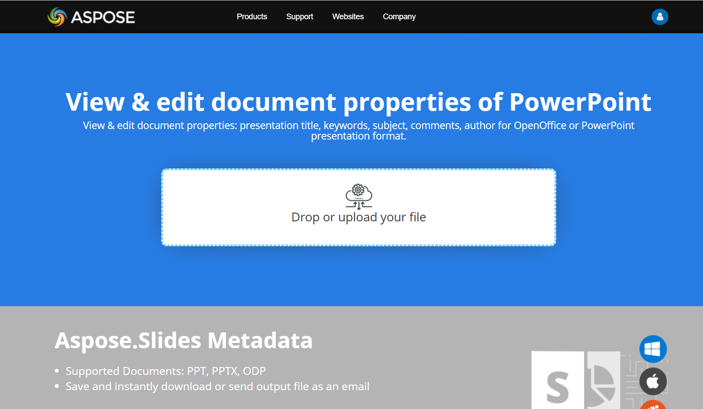

## **Wprowadzenie**

Aspose.Slides for Python via .NET obsługuje **wbudowane** i **niestandardowe** właściwości dokumentu. Użyj tych właściwości, aby odczytywać i aktualizować metadane prezentacji, takie jak autor, tytuł oraz wartości definiowane przez użytkownika.

Aspose.Slides umożliwia pracę z właściwościami dokumentu prezentacji za pośrednictwem klasy [DocumentProperties](https://reference.aspose.com/slides/python-net/aspose.slides/documentproperties/) . Instancja tej klasy jest zwracana przez [Presentation.document_properties](https://reference.aspose.com/slides/python-net/aspose.slides/presentation/document_properties/). Poniższe przykłady pokazują, jak odczytywać, modyfikować i zarządzać tymi właściwościami.

{}
Aspose.Slides zarządza metadanymi aplikacji i producenta podczas zapisywania prezentacji; pola te identyfikują oprogramowanie, które stworzyło wynik.
{}

## **Zarządzanie właściwościami prezentacji**

Właściwości dokumentu przechowują opisowe informacje wraz z treścią prezentacji. Dzielą się na dwie kategorie:

- **Wbudowane właściwości** zawierają standardowe metadane, takie jak tytuł, autor i statystyki dokumentu.
- **Niestandardowe właściwości** przechowują pary nazw/wartości definiowane przez użytkownika.

Aspose.Slides for Python via .NET zapewnia dostęp do obu kategorii. w programie PowerPoint wybierz **Plik → Informacje → Właściwości → Zaawansowane właściwości**, aby przejrzeć metadane dokumentu. Okno dialogowe grupuje informacje w zakładki, takie jak **Podsumowanie**, **Statystyki**, **Zawartość** i **Niestandardowe**. Użyj zakładki **Niestandardowe**, aby zarządzać właściwościami definiowanymi przez użytkownika.

## **Odczyt publicznych właściwości z zaszyfrowanej prezentacji**

Hasło otwierające zazwyczaj chroni zarówno treść prezentacji, jak i właściwości dokumentu. Gdy prezentacja jest szyfrowana przy użyciu [ProtectionManager.encrypt_document_properties](https://reference.aspose.com/slides/python-net/aspose.slides/protectionmanager/encrypt_document_properties/) ustawionego na `False`, jej właściwości dokumentu pozostają publiczne. Aplikacja może wtedy ustawić [LoadOptions.only_load_document_properties](https://reference.aspose.com/slides/python-net/aspose.slides/loadoptions/only_load_document_properties/) na `True` i odczytać publiczne metadane bez podawania hasła otwierającego.

[LoadOptions.only_load_document_properties](https://reference.aspose.com/slides/python-net/aspose.slides/loadoptions/only_load_document_properties/) kontroluje, co Aspose.Slides ładuje; nie wykonuje żadnego odszyfrowywania. Jeśli właściwości zostały uwzględnione w szyfrowaniu, ich ładowanie bez hasła kończy się niepowodzeniem. Jeśli prezentacja nie jest szyfrowana, opcja jest ignorowana i ładowana jest pełna prezentacja.

Przykład wymaga zaszyfrowanej prezentacji, której właściwości dokumentu pozostają publiczne. Weryfikuje tryb ładowania za pomocą [ProtectionManager.is_only_document_properties_loaded](https://reference.aspose.com/slides/python-net/aspose.slides/protectionmanager/is_only_document_properties_loaded/), a następnie odczytuje wbudowane właściwości poprzez [Presentation.document_properties](https://reference.aspose.com/slides/python-net/aspose.slides/presentation/document_properties/):

```python
import aspose.slides as slides

load_options = slides.LoadOptions()
load_options.only_load_document_properties = True

with slides.Presentation("public-properties-encrypted.pptx", load_options) as presentation:
    if presentation.protection_manager.is_only_document_properties_loaded:
        document_properties = presentation.document_properties

        print("Author: " + document_properties.author)
        print("Title: " + document_properties.title)
        print("Keywords: " + document_properties.keywords)
    else:
        print("The presentation was not loaded in document-properties-only mode.")
```

W tym trybie zawartość slajdów nie jest ładowana. Slajdy, wzorce, układy, kształty, multimedia i inne obiekty prezentacji są niedostępne. Aplikacje powinny zawsze sprawdzać [ProtectionManager.is_only_document_properties_loaded](https://reference.aspose.com/slides/python-net/aspose.slides/protectionmanager/is_only_document_properties_loaded/) przed wykonaniem operacji wymagającej pełnego modelu obiektowego prezentacji.

{}
Publiczne metadane mogą ujawniać nazwiska autorów, tytuły, tematy, słowa kluczowe, informacje o firmie, komentarze oraz wartości niestandardowe. Szyfruj wrażliwe właściwości razem z prezentacją. Pozostaw je publiczne tylko wtedy, gdy systemy indeksowania, klasyfikacji, wyszukiwania lub zarządzania dokumentami mają konkretny wymóg dostępu do nich bez hasła.
{}

## **Aktualizacja właściwości zaszyfrowanej prezentacji**

Dla zaszyfrowanego pliku PPTX prezentacja załadowana przy użyciu [LoadOptions.only_load_document_properties](https://reference.aspose.com/slides/python-net/aspose.slides/loadoptions/only_load_document_properties/) służy do odczytu publicznych metadanych. Aspose.Slides nie może zapisać zmienionych właściwości z tego obiektu zawierającego jedynie metadane, ponieważ publiczne właściwości muszą pozostać zgodne z odpowiadającymi danymi w zaszyfrowanej prezentacji. Dlatego ich aktualizacja wymaga prawidłowego hasła otwierającego i pełnego załadowania.

Przykład wymaga zaszyfrowanej prezentacji PPTX z publicznymi właściwościami dokumentu oraz znanym hasłem otwierającym. Otwiera pełną prezentację przy użyciu [LoadOptions.password](https://reference.aspose.com/slides/python-net/aspose.slides/loadoptions/password/), aktualizuje publiczne wbudowane właściwości i zapisuje wynik. Następnie używa [PresentationInfo.is_encrypted](https://reference.aspose.com/slides/python-net/aspose.slides/presentationinfo/is_encrypted/) , aby zweryfikować, że szyfrowanie zostało zachowane, oraz ponownie otwiera publiczne metadane bez hasła, aby sprawdzić nowe wartości:

```python
import aspose.slides as slides

input_path = "public-properties-encrypted.pptx"
output_path = "updated-public-properties-encrypted.pptx"

load_options = slides.LoadOptions()
load_options.password = "open_password"

with slides.Presentation(input_path, load_options) as presentation:
    document_properties = presentation.document_properties
    document_properties.title = "Updated Product Roadmap"
    document_properties.keywords = "roadmap, planning, indexed"
    
    presentation.save(output_path, slides.export.SaveFormat.PPTX)

presentation_info = slides.PresentationFactory.instance.get_presentation_info(output_path)
print("The presentation is encrypted: " + str(presentation_info.is_encrypted))

metadata_load_options = slides.LoadOptions()
metadata_load_options.only_load_document_properties = True

with slides.Presentation(output_path, metadata_load_options) as metadata_presentation:
    if metadata_presentation.protection_manager.is_only_document_properties_loaded:
        print("Title: " + metadata_presentation.document_properties.title)
        print("Keywords: " + metadata_presentation.document_properties.keywords)
    else:
        print("The presentation was not loaded in document-properties-only mode.")
```

Jeśli aplikacja nie ma uprawnień do odszyfrowania lub załadowania treści prezentacji, musi traktować publiczne właściwości zaszyfrowanego pliku PPTX jako tylko do odczytu.

## **Dostęp do wbudowanych właściwości**

Klasa [DocumentProperties](https://reference.aspose.com/slides/python-net/aspose.slides/documentproperties/) udostępnia wbudowane metadane za pośrednictwem typowanych właściwości, w tym [DocumentProperties.author](https://reference.aspose.com/slides/python-net/aspose.slides/documentproperties/author/), [DocumentProperties.title](https://reference.aspose.com/slides/python-net/aspose.slides/documentproperties/title/), oraz [DocumentProperties.created_time](https://reference.aspose.com/slides/python-net/aspose.slides/documentproperties/created_time/). Ten przykład otwiera istniejącą prezentację i wypisuje jej zapisane metadane w konsoli. Wartości zależą od wejściowej prezentacji; niektóre pola mogą być puste.

```python
import aspose.slides as slides

with slides.Presentation("AccessBuiltInProperties.pptx") as presentation:
    document_properties = presentation.document_properties

    print("Category:", document_properties.category)
    print("Content status:", document_properties.content_status)
    print("Creation date:", document_properties.created_time)
    print("Author:", document_properties.author)
    print("Comments:", document_properties.comments)
    print("Keywords:", document_properties.keywords)
    print("Last modified by:", document_properties.last_saved_by)
    print("Manager:", document_properties.manager)
    print("Modified date:", document_properties.last_saved_time)
    print("Presentation format:", document_properties.presentation_format)
    print("Last print date:", document_properties.last_printed)
    print("Is shared between producers:", document_properties.shared_doc)
    print("Subject:", document_properties.subject)
    print("Title:", document_properties.title)
```

### **Raport numeru wersji i czasu edycji**

Aby raportować numer wersji i całkowity czas edycji dla każdego pliku PPTX w folderze `presentations`, użyj [PresentationInfo.read_document_properties](https://reference.aspose.com/slides/python-net/aspose.slides/presentationinfo/read_document_properties/) , aby pobrać jego [DocumentProperties](https://reference.aspose.com/slides/python-net/aspose.slides/documentproperties/) bez ładowania slajdów do edycji. Python wyświetla czas trwania jako `timedelta`, uwzględniając liczbę dni, gdy zarejestrowany czas przekracza 24 godziny.

```python
from pathlib import Path

import aspose.slides as slides

print("File | RevisionNumber | TotalEditingTime")
for path in Path("presentations").glob("*.pptx"):
    if path.is_file():
        info = slides.PresentationFactory.instance.get_presentation_info(str(path))
        properties = info.read_document_properties()
        print(f"{path.name} | {properties.revision_number} | {properties.total_editing_time}")
```

Dla prezentacji z 1 dniem, 2 godzinami i 5 minutami zarejestrowanego czasu edycji raport zawiera następujący wiersz.

```text
File | RevisionNumber | TotalEditingTime
long.pptx | 17 | 1 day, 2:05:00
```

[DocumentProperties.revision_number](https://reference.aspose.com/slides/python-net/aspose.slides/documentproperties/revision_number/) jest zapisywalnym metadanymi. Jego wartość sama w sobie nie pozwala ustalić, ile razy prezentacja była zapisywana ani odtworzyć historię wersji.

[DocumentProperties.total_editing_time](https://reference.aspose.com/slides/python-net/aspose.slides/documentproperties/total_editing_time/) zgłasza czas edycji zapisany w pliku. Wartość `0:00:00` oznacza, że zarejestrowany czas jest zerowy, nawet jeśli ktoś edytował prezentację.

## **Modyfikacja wbudowanych właściwości**

Aby zaktualizować wbudowane metadane, przypisz wartości do zapisywalnych właściwości udostępnionych przez [Presentation.document_properties](https://reference.aspose.com/slides/python-net/aspose.slides/presentation/document_properties/). Ten przykład otwiera istniejącą prezentację, ustawia [DocumentProperties.author](https://reference.aspose.com/slides/python-net/aspose.slides/documentproperties/author/), [DocumentProperties.title](https://reference.aspose.com/slides/python-net/aspose.slides/documentproperties/title/), [DocumentProperties.subject](https://reference.aspose.com/slides/python-net/aspose.slides/documentproperties/subject/), [DocumentProperties.comments](https://reference.aspose.com/slides/python-net/aspose.slides/documentproperties/comments/), oraz [DocumentProperties.manager](https://reference.aspose.com/slides/python-net/aspose.slides/documentproperties/manager/), a następnie zapisuje zaktualizowaną prezentację przy użyciu [Presentation.save](https://reference.aspose.com/slides/python-net/aspose.slides/presentation/save/). Zapisany plik PPTX zawiera nowe metadane.

```python
import aspose.slides as slides

with slides.Presentation("ModifyBuiltInProperties.pptx") as presentation:
    document_properties = presentation.document_properties

    document_properties.author = "Aspose.Slides for Python via .NET"
    document_properties.title = "Manage PowerPoint Presentation Properties"
    document_properties.subject = "Modify Built-in Properties"
    document_properties.comments = "Aspose description"
    document_properties.manager = "Aspose manager"

    presentation.save("DocumentProperties_output.pptx", slides.export.SaveFormat.PPTX)
```

## **Zarządzanie podstawą hiperłącza**

[DocumentProperties.hyperlink_base](https://reference.aspose.com/slides/python-net/aspose.slides/documentproperties/hyperlink_base/) przechowuje poziom dokumentu bazowy dla względnych hiperłączy. Jest to przydatne przy przenoszeniu prezentacji i jej powiązanych plików do innej lokalizacji. Jest to oddzielne od indywidualnego [Hyperlink.external_url](https://reference.aspose.com/slides/python-net/aspose.slides/hyperlink/external_url/): zmiana bazy nie przepisuje zapisanych adresów linków ani nie zmienia docelowych ścieżek bezwzględnych.

Przykład wymaga prezentacji zawierającej zarówno względny link, np. `target.html`, jak i bezwzględny link do pliku lub witryny. Odczytuje istniejącą bazę, przypisuje nowy adres bazy, zapisuje i ponownie otwiera prezentację, aby sprawdzić wartość. Następnie czyści bazę przy użyciu `""` i weryfikuje pustą wartość w osobnym zapisanym pliku. Zastąp przykładowy adres bazy lokalizacją swoich powiązanych plików.

```python
import aspose.slides as slides

with slides.Presentation("hyperlinks.pptx") as presentation:
    print("Original base:", presentation.document_properties.hyperlink_base)

    new_base = "https://example.com/new/"
    presentation.document_properties.hyperlink_base = new_base
    presentation.save("hyperlinks-updated.pptx", slides.export.SaveFormat.PPTX)

with slides.Presentation("hyperlinks-updated.pptx") as updated_presentation:
    print("Base preserved:", updated_presentation.document_properties.hyperlink_base == new_base)

    updated_presentation.document_properties.hyperlink_base = ""
    updated_presentation.save("hyperlinks-cleared.pptx", slides.export.SaveFormat.PPTX)

with slides.Presentation("hyperlinks-cleared.pptx") as cleared_presentation:
    print("Base cleared:", cleared_presentation.document_properties.hyperlink_base == "")
```

Oba komunikaty weryfikacyjne powinny wypisać `True`. Czyszczenie bazy pozostawia niezmienione adresy poszczególnych hiperłączy.

Względny link do `target.pptx` otwierał `old/target.pptx`, gdy baza wskazywała folder `old`. Po zmianie bazy na folder `new`, zapisaniu i ponownym otwarciu prezentacji ten sam link otwierał `new/target.pptx`. Link bezwzględny nadal otwierał ten sam plik. Przetestuj swoje względne linki w programie PowerPoint przed i po przeniesieniu prezentacji lub zmianie jej bazy.

## **Dodawanie niestandardowych właściwości prezentacji**

Niestandardowe właściwości przechowują metadane, które nie mają odpowiadającego im wbudowanego pola. Metoda [DocumentProperties.set_custom_property_value](https://reference.aspose.com/slides/python-net/aspose.slides/documentproperties/set_custom_property_value/) pozwala przypisać wartość na podstawie nazwy właściwości. Ten przykład tworzy prezentację, dodaje dwa wartości tekstowe i wartość wersji całkowitej, a następnie zapisuje prezentację przy użyciu [Presentation.save](https://reference.aspose.com/slides/python-net/aspose.slides/presentation/save/). Przypisanie wartości do istniejącej nazwy zastępuje wartość tej właściwości.

```python
import aspose.slides as slides

with slides.Presentation() as presentation:
    document_properties = presentation.document_properties

    document_properties.set_custom_property_value("Reviewed by", "John Smith")
    document_properties.set_custom_property_value("Confidentiality level", "Internal")
    document_properties.set_custom_property_value("Document version", 2)

    presentation.save("CustomDocumentProperties_output.pptx", slides.export.SaveFormat.PPTX)
```

## **Dostęp i modyfikacja niestandardowych właściwości**

Ten przykład otwiera prezentację zawierającą niestandardowe właściwości i używa [DocumentProperties.count_of_custom_properties](https://reference.aspose.com/slides/python-net/aspose.slides/documentproperties/count_of_custom_properties/) , aby iterować po nich. [DocumentProperties.get_custom_property_name](https://reference.aspose.com/slides/python-net/aspose.slides/documentproperties/get_custom_property_name/) przyjmuje indeks zaczynający się od zera i zwraca nazwę używaną przez [DocumentProperties.set_custom_property_value](https://reference.aspose.com/slides/python-net/aspose.slides/documentproperties/set_custom_property_value/). Przykład wymaga prezentacji, której wszystkie niestandardowe właściwości są łańcuchami znaków. Wypisuje każdą pierwotną nazwę i wartość, zastępuje każdą wartość numerowanym łańcuchem i zapisuje zmiany. Jeśli nie ma niestandardowych właściwości, pętla nie wprowadza zmian.

```python
import aspose.slides as slides

with slides.Presentation("AccessAndModifyProperties.pptx") as presentation:
    document_properties = presentation.document_properties

    for i in range(document_properties.count_of_custom_properties):
        property_name = document_properties.get_custom_property_name(i)
        property_value = [""]
        document_properties.get_custom_property_value(property_name, property_value)

        print("Custom property name:", property_name)
        print("Custom property value:", property_value[0])

        document_properties.set_custom_property_value(property_name, "New Value " + str(i + 1))

    presentation.save("CustomProperties_output.pptx", slides.export.SaveFormat.PPTX)
```

[DocumentProperties.get_custom_property_value](https://reference.aspose.com/slides/python-net/aspose.slides/documentproperties/get_custom_property_value/) zwraca wartość poprzez jednoczynnikową listę przekazaną jako drugi argument. Symbol zastępczy musi pasować do typu przechowywanej właściwości: użyj `[""]` dla łańcucha znaków lub `[0]` dla liczby całkowitej. Niezgodny typ generuje `InvalidCastException`; wybierz symbol zastępczy zgodnie ze schematem swoich niestandardowych właściwości.

## **Przykład na żywo**

Wypróbuj aplikację online [**Wyświetl i edytuj metadane PowerPoint**](https://products.aspose.app/slides/metadata), aby zobaczyć, jak pracować z właściwościami dokumentu przy użyciu API Aspose.Slides:

[](https://products.aspose.app/slides/metadata)

## **FAQ**

**Jak mogę usunąć wbudowaną właściwość z prezentacji?**

Wbudowane właściwości są integralną częścią prezentacji i nie mogą być całkowicie usunięte. Można je jednak zmienić lub ustawić na pustą wartość, o ile pozwala na to konkretna właściwość.

**Co się stanie, jeśli dodam niestandardową właściwość, która już istnieje?**

Jeśli dodasz niestandardową właściwość, która już istnieje, jej bieżąca wartość zostanie nadpisana nową. Nie musisz usuwać ani sprawdzać właściwości wcześniej, ponieważ Aspose.Slides automatycznie aktualizuje wartość właściwości.

**Czy mogę uzyskać dostęp do właściwości prezentacji bez pełnego ładowania prezentacji?**

Tak. Użyj [PresentationFactory.get_presentation_info](https://reference.aspose.com/slides/python-net/aspose.slides/presentationfactory/get_presentation_info/) , a następnie [PresentationInfo.read_document_properties](https://reference.aspose.com/slides/python-net/aspose.slides/presentationinfo/read_document_properties/) , aby odczytać zapisane metadane dokumentu bez tworzenia instancji [Presentation](https://reference.aspose.com/slides/python-net/aspose.slides/presentation/). Zobacz [Zbuduj lekki inwentaryzator prezentacji](/slides/pl/python-net/examine-presentation/) po pełny przykład raportowania i ograniczenia specyficzne dla formatu.

**Czy mogę odczytać publiczne właściwości zaszyfrowanej prezentacji bez jej hasła otwierającego?**

Tak. Prezentacja musi być zaszyfrowana przy użyciu [ProtectionManager.encrypt_document_properties](https://reference.aspose.com/slides/python-net/aspose.slides/protectionmanager/encrypt_document_properties/) ustawionego na `False` i musi być załadowana z [LoadOptions.only_load_document_properties](https://reference.aspose.com/slides/python-net/aspose.slides/loadoptions/only_load_document_properties/) ustawionym na `True`.

**Czy mogę zaktualizować zaszyfrowany plik PPTX w trybie tylko-właściwości-dokumentu?**

Nie. Publiczne i zaszyfrowane dane właściwości muszą pozostać zgodne, dlatego aktualizacja zaszyfrowanego pliku PPTX wymaga pełnego załadowania prezentacji przy użyciu właściwego hasła otwierającego.