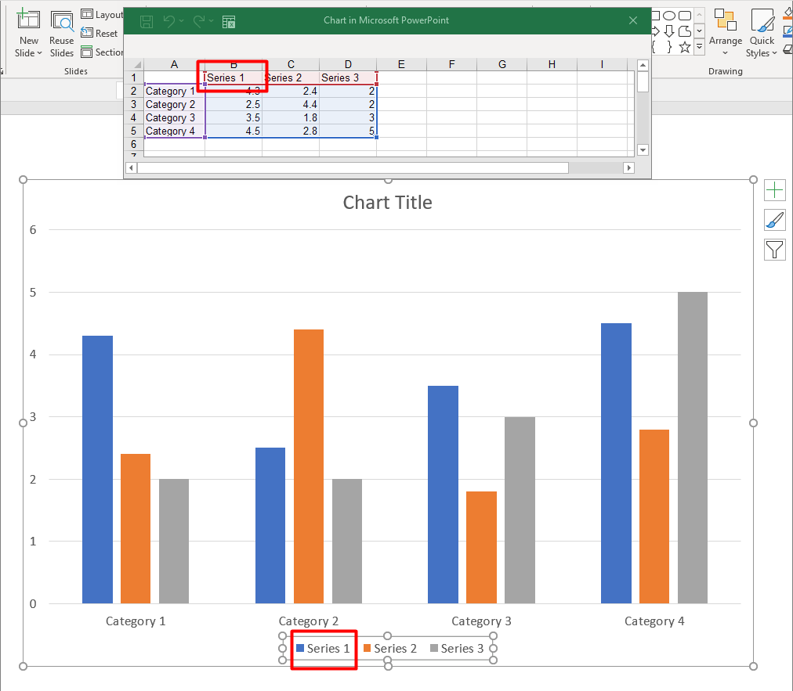

## **Visão geral**

Um gráfico pode armazenar seus valores plotados em células da pasta de trabalho ou diretamente como literais numéricos. Um [IChartSeries](https://reference.aspose.com/slides/androidjava/com.aspose.slides/ichartseries/) representa um conjunto de valores relacionados, e cada [IChartDataPoint](https://reference.aspose.com/slides/androidjava/com.aspose.slides/ichartdatapoint/) representa um ponto naquela série. Objetos [IChartCategory](https://reference.aspose.com/slides/androidjava/com.aspose.slides/ichartcategory/) fornecem os rótulos ou valores de agrupamento compartilhados pelas séries. Em gráficos criados com dados padrão, nomes de séries, categorias e valores dos pontos utilizam objetos [IChartDataCell](https://reference.aspose.com/slides/androidjava/com.aspose.slides/ichartdatacell/) da pasta de trabalho do gráfico.

Para um gráfico de categorias típico, a pasta de trabalho padrão usa a linha 0 para nomes de séries, a coluna 0 para nomes de categorias e as células restantes para valores das séries. Os índices de planilha, linha e coluna passados para [IChartDataWorkbook.getCell](https://reference.aspose.com/slides/androidjava/com.aspose.slides/ichartdataworkbook/#getCell-int-int-int-) são baseados em zero. Esse layout é útil quando você cria um gráfico com dados padrão, mas não presuma que todo gráfico existente o utilize. Para uma apresentação carregada, inspecione as células referenciadas pelas séries, categorias e pontos de dados antes de alterar os valores da pasta de trabalho.

As configurações de gráfico têm três escopos diferentes:

- Configurações ao nível da série, como [IChartSeries.getFormat](https://reference.aspose.com/slides/androidjava/com.aspose.slides/ichartseries/#getFormat--), fornecem a aparência padrão para todos os pontos de uma série.
- Configurações de ponto de dados, como [IChartDataPoint.getFormat](https://reference.aspose.com/slides/androidjava/com.aspose.slides/ichartdatapoint/#getFormat--), substituem a aparência da série para um ponto.
- Configurações de grupo aplicam‑se a séries compatíveis que pertencem ao mesmo [IChartSeriesGroup](https://reference.aspose.com/slides/androidjava/com.aspose.slides/ichartseriesgroup/). Acesse o grupo através de [IChartSeries.getParentSeriesGroup](https://reference.aspose.com/slides/androidjava/com.aspose.slides/ichartseries/#getParentSeriesGroup--) quando precisar definir opções como sobreposição ou largura do intervalo.

Quando nenhum preenchimento explícito de ponto ou série é definido, o estilo e o tema do gráfico determinam a aparência automática. Quando há formatação de série e de ponto, a formatação do ponto tem precedência para esse ponto.



## **Definir valores da série usando literais numéricos**

Use literais numéricos quando os valores da série provêm de dados ou cálculos da aplicação e não precisam de referências a células da planilha. Chame [setDataSourceTypeForValues](https://reference.aspose.com/slides/androidjava/com.aspose.slides/ichartdatapointcollection/#setDataSourceTypeForValues-int-) com [DataSourceType.DoubleLiterals](https://reference.aspose.com/slides/androidjava/com.aspose.slides/datasourcetype/#DoubleLiterals) antes de atribuir o resultado de [getValue](https://reference.aspose.com/slides/androidjava/com.aspose.slides/ichartdatapoint/#getValue--) de cada ponto por meio de [setAsLiteralDouble](https://reference.aspose.com/slides/androidjava/com.aspose.slides/idoublechartvalue/#setAsLiteralDouble-double-).

A configuração da coleção controla o tipo de origem de todos os valores dos pontos nessa série. O método [getDataSourceType](https://reference.aspose.com/slides/androidjava/com.aspose.slides/ibasechartvalue/#getDataSourceType--) de cada valor de ponto relata o tipo selecionado; altere‑o através da configuração da coleção. Com `Worksheet`, use [getAsCell](https://reference.aspose.com/slides/androidjava/com.aspose.slides/isinglecellchartvalue/#getAsCell--) para acessar a célula referenciada. Com `DoubleLiterals`, use [getAsLiteralDouble](https://reference.aspose.com/slides/androidjava/com.aspose.slides/idoublechartvalue/#getAsLiteralDouble--) ou `setAsLiteralDouble` para ler ou gravar o número diretamente.

O exemplo a seguir cria um gráfico de colunas com séries e categorias padrão, depois atribui valores calculados de 10, 20 e assim por diante aos pontos existentes da sua primeira série. Ele salva a apresentação, reabre‑a e imprime os valores armazenados.

```java
import com.aspose.slides.*;

Presentation presentation = new Presentation();
try {
    ISlide slide = presentation.getSlides().get_Item(0);

    IChart chart = slide.getShapes().addChart(ChartType.ClusteredColumn, 20, 20, 500, 300);
    IChartSeries series = chart.getChartData().getSeries().get_Item(0);

    series.getDataPoints().setDataSourceTypeForValues(DataSourceType.DoubleLiterals);
    for (int i = 0; i < series.getDataPoints().size(); i++) {
        series.getDataPoints().get_Item(i).getValue().setAsLiteralDouble((i + 1) * 10);
    }

    presentation.save("numeric_literals.pptx", SaveFormat.Pptx);
} finally {
    presentation.dispose();
}

Presentation reopenedPresentation = new Presentation("numeric_literals.pptx");
try {
    ISlide reopenedSlide = reopenedPresentation.getSlides().get_Item(0);
    IChart reopenedChart = (IChart) reopenedSlide.getShapes().get_Item(0);
    IChartSeries reopenedSeries = reopenedChart.getChartData().getSeries().get_Item(0);
    for (IChartDataPoint point : reopenedSeries.getDataPoints()) {
        System.out.println(point.getValue().getAsLiteralDouble());
    }
} finally {
    reopenedPresentation.dispose();
}
```

O tipo de origem do valor do ponto é independente de [IChartData.getDataSourceType](https://reference.aspose.com/slides/androidjava/com.aspose.slides/ichartdata/#getDataSourceType--), que identifica a configuração interna ou externa da pasta de trabalho do gráfico. Usar literais numéricos não remove, por si só, a pasta de trabalho embutida. Neste exemplo, a pasta de trabalho permanece disponível para rótulos de categoria, nomes de séries e as demais séries. Consulte [Chart Workbook](/slides/pt/androidjava/chart-workbook/) para gerenciamento da pasta de trabalho.

Para gráficos de dispersão e bolha, use [setDataSourceTypeForXValues](https://reference.aspose.com/slides/androidjava/com.aspose.slides/ichartdatapointcollection/#setDataSourceTypeForXValues-int-) e [setDataSourceTypeForYValues](https://reference.aspose.com/slides/androidjava/com.aspose.slides/ichartdatapointcollection/#setDataSourceTypeForYValues-int-) para escolher as fontes de [getXValue](https://reference.aspose.com/slides/androidjava/com.aspose.slides/ichartdatapoint/#getXValue--) e [getYValue](https://reference.aspose.com/slides/androidjava/com.aspose.slides/ichartdatapoint/#getYValue--). Gráficos de bolha também usam [setDataSourceTypeForBubbleSizes](https://reference.aspose.com/slides/androidjava/com.aspose.slides/ichartdatapointcollection/#setDataSourceTypeForBubbleSizes-int-) para [getBubbleSize](https://reference.aspose.com/slides/androidjava/com.aspose.slides/ichartdatapoint/#getBubbleSize--). Defina cada fonte aplicável como `DoubleLiterals` antes de atribuir números por meio do método `setAsLiteralDouble` desse valor.

## **Definir a sobreposição da série do gráfico**

[IChartSeries.getOverlap](https://reference.aspose.com/slides/androidjava/com.aspose.slides/ichartseries/#getOverlap--) relata o quanto barras ou colunas se sobrepõem em um gráfico 2D, de -100 a 100 porcento. É uma projeção somente leitura da configuração no grupo de séries pai. Use [IChartSeriesGroup.setOverlap](https://reference.aspose.com/slides/androidjava/com.aspose.slides/ichartseriesgroup/#setOverlap-byte-) para atualizar todas as séries compatíveis naquele grupo. Esta opção aplica‑se a tipos de gráfico que exibem barras ou colunas agrupadas; não afeta grupos de séries não relacionados em um gráfico de combinação.

O exemplo a seguir define a sobreposição para o grupo que contém a primeira série:

```java
import com.aspose.slides.*;

final int firstSlideIndex = 0;
final int firstSeriesIndex = 0;
final byte overlapPercent = 30;

Presentation presentation = new Presentation();
try {
    ISlide slide = presentation.getSlides().get_Item(firstSlideIndex);

    // O novo gráfico contém séries de exemplo, categorias e valores.
    IChart chart = slide.getShapes().addChart(ChartType.ClusteredColumn, 20, 20, 500, 200);

    IChartSeries series = chart.getChartData().getSeries().get_Item(firstSeriesIndex);
    series.getParentSeriesGroup().setOverlap(overlapPercent);

    presentation.save("series_overlap.pptx", SaveFormat.Pptx);
} finally {
    presentation.dispose();
}
```


## **Alterar a cor de preenchimento da série**

Use [IChartSeries.getFormat](https://reference.aspose.com/slides/androidjava/com.aspose.slides/ichartseries/#getFormat--) para definir o preenchimento padrão de uma série inteira. Se um ponto já tiver um preenchimento explícito, sua configuração [IChartDataPoint.getFormat](https://reference.aspose.com/slides/androidjava/com.aspose.slides/ichartdatapoint/#getFormat--) sobrescreve o preenchimento da série para esse ponto.

O exemplo a seguir aplica um preenchimento sólido azul à primeira série:

```java
import com.aspose.slides.*;
import android.graphics.Color;

final int firstSlideIndex = 0;
final int firstSeriesIndex = 0;

Presentation presentation = new Presentation();
try {
    ISlide slide = presentation.getSlides().get_Item(firstSlideIndex);

    IChart chart = slide.getShapes().addChart(ChartType.ClusteredColumn, 20, 20, 500, 200);

    IChartSeries series = chart.getChartData().getSeries().get_Item(firstSeriesIndex);
    series.getFormat().getFill().setFillType(FillType.Solid);
    series.getFormat().getFill().getSolidFillColor().setColor(Color.BLUE);

    presentation.save("series_color.pptx", SaveFormat.Pptx);
} finally {
    presentation.dispose();
}
```


## **Alterar o nome da série**

Um nome de série é armazenado na pasta de trabalho de dados do gráfico e normalmente é exibido na legenda. Na pasta de trabalho padrão criada para um gráfico de colunas agrupadas, a célula B1 está na linha 0, coluna 1 e contém o nome da primeira série. As constantes nomeadas no exemplo a seguir tornam essa estrutura explícita:

```java
import com.aspose.slides.*;

final int firstSlideIndex = 0;
final int worksheetIndex = 0;
final int seriesNameRowIndex = 0;
final int firstSeriesColumnIndex = 1;

Presentation presentation = new Presentation();
try {
    ISlide slide = presentation.getSlides().get_Item(firstSlideIndex);

    IChart chart = slide.getShapes().addChart(ChartType.ClusteredColumn, 20, 20, 500, 200);

    IChartDataWorkbook workbook = chart.getChartData().getChartDataWorkbook();
    IChartDataCell seriesNameCell = workbook.getCell(worksheetIndex, seriesNameRowIndex, firstSeriesColumnIndex);
    seriesNameCell.setValue("Revenue");

    presentation.save("series_name.pptx", SaveFormat.Pptx);
} finally {
    presentation.dispose();
}
```

Você também pode atualizar a célula já referenciada por [IChartSeries.getName](https://reference.aspose.com/slides/androidjava/com.aspose.slides/ichartseries/#getName--). Essa abordagem evita assumir uma linha e coluna específicas em um gráfico existente:

```java
import com.aspose.slides.*;

final int firstSlideIndex = 0;
final int firstSeriesIndex = 0;
final int firstNameCellIndex = 0;

Presentation presentation = new Presentation();
try {
    ISlide slide = presentation.getSlides().get_Item(firstSlideIndex);

    IChart chart = slide.getShapes().addChart(ChartType.ClusteredColumn, 20, 20, 500, 200);

    IChartSeries series = chart.getChartData().getSeries().get_Item(firstSeriesIndex);
    IChartDataCell seriesNameCell = series.getName().getAsCells().get_Item(firstNameCellIndex);
    seriesNameCell.setValue("Revenue");

    presentation.save("series_name.pptx", SaveFormat.Pptx);
} finally {
    presentation.dispose();
}
```


### **Criar uma série com um nome a partir de várias células**

Um nome de série composto é útil quando o nome do produto e o período de relatório estão armazenados em células de pasta de trabalho distintas. Por exemplo, você pode combinar `Product A` em B1 e `2026` em C1 em um único nome de série mantendo ambas as partes vinculadas às suas células de origem.

Use [IChartDataWorkbook.getCellCollection](https://reference.aspose.com/slides/androidjava/com.aspose.slides/ichartdataworkbook/#getCellCollection-java.lang.String-boolean-) para recuperar o intervalo de nomes, depois passe essa coleção para [IChartSeriesCollection.add](https://reference.aspose.com/slides/androidjava/com.aspose.slides/ichartseriescollection/#add-com.aspose.slides.IChartCellCollection-int-). O argumento `skipHiddenCells` controla se células ocultas são incluídas: `true` as exclui, `false` as inclui. Este exemplo usa `false` para incluir todas as células no intervalo de nomes.

O exemplo a seguir cria uma apresentação com uma série e dois pontos de dados. As células B1:C1 fornecem apenas o nome da série; A2:A3 fornecem os rótulos de categoria, e B2:B3 fornecem os valores numéricos.

```java
import com.aspose.slides.*;

Presentation presentation = new Presentation();
try {
    ISlide slide = presentation.getSlides().get_Item(0);

    IChart chart = slide.getShapes().addChart(ChartType.ClusteredColumn, 50, 50, 620, 180);

    chart.getChartData().getSeries().clear();
    chart.getChartData().getCategories().clear();
    chart.setLegend(true);

    IChartDataWorkbook workbook = chart.getChartData().getChartDataWorkbook();
    workbook.clear(0);

    // Estas duas células fornecem o nome da série.
    workbook.getCell(0, 0, 1, "Product A");
    workbook.getCell(0, 0, 2, "2026");
    IChartCellCollection nameCells = workbook.getCellCollection("Sheet1!$B$1:$C$1", false);
    IChartSeries series = chart.getChartData().getSeries().add(nameCells, ChartType.ClusteredColumn);

    // Células separadas fornecem as categorias e os pontos de dados numéricos.
    IChartDataCell northCategory = workbook.getCell(0, 1, 0, "North");
    IChartDataCell southCategory = workbook.getCell(0, 2, 0, "South");
    chart.getChartData().getCategories().add(northCategory);
    chart.getChartData().getCategories().add(southCategory);
    IChartDataCell northValue = workbook.getCell(0, 1, 1, 120);
    IChartDataCell southValue = workbook.getCell(0, 2, 1, 150);
    series.getDataPoints().addDataPointForBarSeries(northValue);
    series.getDataPoints().addDataPointForBarSeries(southValue);

    presentation.save("composite_series_name.pptx", SaveFormat.Pptx);
} finally {
    presentation.dispose();
}
```

O nome da série resultante é `Product A 2026`, com um espaço entre os dois valores de célula. A legenda o exibe como uma única entrada para ambas as colunas. A imagem abaixo ilustra o resultado:


## **Obter a cor de preenchimento automática da série**

[IChartSeries.getAutomaticSeriesColor](https://reference.aspose.com/slides/androidjava/com.aspose.slides/ichartseries/#getAutomaticSeriesColor--) devolve a cor calculada a partir do índice da série e do estilo do gráfico como um inteiro de cor ARGB Android. Essa é a cor usada quando o preenchimento da série não foi definido explicitamente. Chamar o método lê a cor calculada; não atribui um novo preenchimento.

O exemplo a seguir imprime o inteiro de cor automática de cada série padrão:

```java
import com.aspose.slides.*;

final int firstSlideIndex = 0;

Presentation presentation = new Presentation();
try {
    ISlide slide = presentation.getSlides().get_Item(firstSlideIndex);

    IChart chart = slide.getShapes().addChart(ChartType.ClusteredColumn, 20, 20, 500, 200);

    int seriesCount = chart.getChartData().getSeries().size();
    for (int seriesIndex = 0; seriesIndex < seriesCount; seriesIndex++) {
        IChartSeries series = chart.getChartData().getSeries().get_Item(seriesIndex);
        int automaticColor = series.getAutomaticSeriesColor();
        System.out.println("Series " + seriesIndex + ": " + automaticColor);
    }
} finally {
    presentation.dispose();
}
```

## **Definir cor de preenchimento invertida para uma série de gráfico**

Para séries de barra, coluna e bolha, [IChartSeries.setInvertIfNegative](https://reference.aspose.com/slides/androidjava/com.aspose.slides/ichartseries/#setInvertIfNegative-boolean-) pode exibir valores negativos com um preenchimento diferente. Defina o preenchimento regular da série como sólido, habilite a inversão e atribua a cor do valor negativo por meio de [IChartSeries.getInvertedSolidFillColor](https://reference.aspose.com/slides/androidjava/com.aspose.slides/ichartseries/#getInvertedSolidFillColor--). Números negativos permanecem inalterados na pasta de trabalho; apenas a cor de exibição muda.

O exemplo a seguir substitui os dados padrão do gráfico por uma série. A linha 0 da planilha contém o nome da série, a coluna 0 contém nomes de categorias e a coluna 1 contém os valores:

```java
import com.aspose.slides.*;
import android.graphics.Color;

final int firstSlideIndex = 0;
final int worksheetIndex = 0;
final int headerRowIndex = 0;
final int categoryColumnIndex = 0;
final int firstSeriesColumnIndex = 1;
final int firstDataRowIndex = 1;

String[] categoryNames = { "Category 1", "Category 2", "Category 3" };
int[] seriesValues = { -20, 50, -30 };

Presentation presentation = new Presentation();
try {
    ISlide slide = presentation.getSlides().get_Item(firstSlideIndex);

    IChart chart = slide.getShapes().addChart(ChartType.ClusteredColumn, 20, 20, 500, 200);
    IChartData chartData = chart.getChartData();
    IChartDataWorkbook workbook = chartData.getChartDataWorkbook();

    chartData.getSeries().clear();
    chartData.getCategories().clear();

    IChartDataCell seriesNameCell = workbook.getCell(worksheetIndex, headerRowIndex, firstSeriesColumnIndex, "Series 1");
    int chartType = chart.getType();
    IChartSeries series = chartData.getSeries().add(seriesNameCell, chartType);

    for (int categoryIndex = 0; categoryIndex < categoryNames.length; categoryIndex++) {
        int dataRowIndex = firstDataRowIndex + categoryIndex;
        String categoryName = categoryNames[categoryIndex];
        int seriesValue = seriesValues[categoryIndex];

        IChartDataCell categoryCell = workbook.getCell(worksheetIndex, dataRowIndex, categoryColumnIndex, categoryName);
        chartData.getCategories().add(categoryCell);

        IChartDataCell valueCell = workbook.getCell(worksheetIndex, dataRowIndex, firstSeriesColumnIndex, seriesValue);
        series.getDataPoints().addDataPointForBarSeries(valueCell);
    }

    int automaticSeriesColor = series.getAutomaticSeriesColor();
    series.getFormat().getFill().setFillType(FillType.Solid);
    series.getFormat().getFill().getSolidFillColor().setColor(automaticSeriesColor);
    series.setInvertIfNegative(true);
    series.getInvertedSolidFillColor().setColor(Color.RED);

    presentation.save("inverted_solid_fill_color.pptx", SaveFormat.Pptx);
} finally {
    presentation.dispose();
}
```


Você pode habilitar a inversão para um ponto através de [IChartDataPoint.setInvertIfNegative](https://reference.aspose.com/slides/androidjava/com.aspose.slides/ichartdatapoint/#setInvertIfNegative-boolean-). No exemplo a seguir, a inversão é desativada para a série e ativada apenas para o ponto selecionado. O ponto também recebe um valor negativo para que o efeito seja visível:

```java
import com.aspose.slides.*;
import android.graphics.Color;

final int firstSlideIndex = 0;
final int firstSeriesIndex = 0;
final int targetDataPointIndex = 2;
final int negativeValue = -30;

Presentation presentation = new Presentation();
try {
    ISlide slide = presentation.getSlides().get_Item(firstSlideIndex);

    IChart chart = slide.getShapes().addChart(ChartType.ClusteredColumn, 20, 20, 500, 200);

    IChartSeries series = chart.getChartData().getSeries().get_Item(firstSeriesIndex);
    int automaticSeriesColor = series.getAutomaticSeriesColor();
    series.getFormat().getFill().setFillType(FillType.Solid);
    series.getFormat().getFill().getSolidFillColor().setColor(automaticSeriesColor);
    series.getInvertedSolidFillColor().setColor(Color.RED);
    series.setInvertIfNegative(false);

    IChartDataPoint dataPoint = series.getDataPoints().get_Item(targetDataPointIndex);
    dataPoint.getValue().getAsCell().setValue(negativeValue);
    dataPoint.setInvertIfNegative(true);

    presentation.save("data_point_invert_color_if_negative.pptx", SaveFormat.Pptx);
} finally {
    presentation.dispose();
}
```

## **Limpar o valor de um ponto de dados específico**

Para deixar um ponto vazio sem remover os demais pontos, defina sua célula de pasta de trabalho subjacente como `null`. Para um gráfico de colunas, o valor plotado está disponível por meio de [IChartDataPoint.getValue](https://reference.aspose.com/slides/androidjava/com.aspose.slides/ichartdatapoint/#getValue--). O ponto de dados permanece na mesma posição de categoria, mas o gráfico trata seu valor como em branco de acordo com as configurações de valor em branco do gráfico.

O exemplo a seguir limpa apenas o segundo ponto da primeira série:

```java
import com.aspose.slides.*;

final int firstSlideIndex = 0;
final int firstSeriesIndex = 0;
final int targetDataPointIndex = 1;

Presentation presentation = new Presentation();
try {
    ISlide slide = presentation.getSlides().get_Item(firstSlideIndex);

    IChart chart = slide.getShapes().addChart(ChartType.ClusteredColumn, 20, 20, 500, 200);

    IChartSeries series = chart.getChartData().getSeries().get_Item(firstSeriesIndex);
    IChartDataPoint dataPoint = series.getDataPoints().get_Item(targetDataPointIndex);
    dataPoint.getValue().getAsCell().setValue(null);

    presentation.save("clear_data_point_value.pptx", SaveFormat.Pptx);
} finally {
    presentation.dispose();
}
```

Gráficos de dispersão utilizam células X e Y separadas, e gráficos de bolha também usam uma célula de tamanho. Limpe apenas a célula que representa o valor que pretende remover. Não chame [IChartDataPointCollection.clear](https://reference.aspose.com/slides/androidjava/com.aspose.slides/ichartdatapointcollection/#clear--) quando quiser manter os demais pontos, pois esse método remove todos os pontos de dados da coleção.

## **Controlar a exibição de células vazias**

Células ocultas que contêm valores são um caso distinto de células vazias. Para incluir ou excluir dados de linhas e colunas ocultas da planilha, veja [Include Data from Hidden Rows and Columns](/slides/pt/androidjava/chart-workbook/#include-data-from-hidden-rows-and-columns).

Uma célula vazia da pasta de trabalho representa dados ausentes; uma célula contendo `0` representa um valor numérico conhecido. Chame [IChartDataCell.setValue](https://reference.aspose.com/slides/androidjava/com.aspose.slides/ichartdatacell/#setValue-java.lang.Object-) com `null` para tornar uma célula vazia. Um zero numérico continua sendo zero independentemente da configuração de célula em branco.

Use [IChart.setDisplayBlanksAs](https://reference.aspose.com/slides/androidjava/com.aspose.slides/ichart/#setDisplayBlanksAs-int-) para escolher como o gráfico exibe células vazias. Essa configuração aplica‑se ao gráfico inteiro. Ela altera a forma como os vazios são plotados, sem preencher a célula vazia da pasta de trabalho com zero ou um valor interpolado.

O exemplo autocontido a seguir cria um gráfico de linhas com uma série, limpa o valor do Dia 3 e salva o mesmo gráfico em cada modo. Nenhum arquivo de entrada é necessário. O [IChartDataWorkbook](https://reference.aspose.com/slides/androidjava/com.aspose.slides/ichartdataworkbook/) usa a planilha 0, a coluna 0 para rótulos de categoria e a coluna 1 para valores; a linha 0 contém o nome da série. Os dados finais são `10, 20, empty, 30, 40`.

```java
import com.aspose.slides.*;

Presentation presentation = new Presentation();
try {
    ISlide slide = presentation.getSlides().get_Item(0);

    IChart chart = slide.getShapes().addChart(ChartType.LineWithMarkers, 40, 40, 640, 400);
    IChartData chartData = chart.getChartData();
    IChartDataWorkbook workbook = chartData.getChartDataWorkbook();

    chartData.getSeries().clear();
    chartData.getCategories().clear();

    IChartDataCell seriesNameCell = workbook.getCell(0, 0, 1, "Measurements");
    IChartSeries series = chartData.getSeries().add(seriesNameCell, chart.getType());
    int[] values = { 10, 20, 25, 30, 40 };

    for (int i = 0; i < values.length; i++) {
        IChartDataCell categoryCell = workbook.getCell(0, i + 1, 0, "Day " + (i + 1));
        chartData.getCategories().add(categoryCell);
        IChartDataCell valueCell = workbook.getCell(0, i + 1, 1, values[i]);
        series.getDataPoints().addDataPointForLineSeries(valueCell);
    }

    // Deixe o Dia 3 realmente vazio, mantendo sua categoria e ponto de dados.
    workbook.getCell(0, 3, 1).setValue(null);

    int[] modes = { DisplayBlanksAsType.Gap, DisplayBlanksAsType.Zero, DisplayBlanksAsType.Span };
    String[] modeNames = { "Gap", "Zero", "Span" };
    for (int i = 0; i < modes.length; i++) {
        chart.setDisplayBlanksAs(modes[i]);
        presentation.save("empty_cells_" + modeNames[i] + ".pptx", SaveFormat.Pptx);
    }
} finally {
    presentation.dispose();
}
```

Cada arquivo de saída armazena o modo atribuído antes da gravação: `empty_cells_Gap.pptx`, `empty_cells_Zero.pptx` e `empty_cells_Span.pptx`. Para salvar apenas uma versão, atribua o modo desejado e salve a apresentação uma única vez em vez de iterar pelos modos.

A comparação abaixo mostra os mesmos dados nos três arquivos. O Dia 3 está vazio na pasta de trabalho em todos os casos:


O efeito visível depende do tipo de gráfico. Um gráfico de linhas facilita a comparação dos três modos. Gráficos de barras e colunas não têm linha para conectar entre categorias ausentes, portanto `Span` não pode produzir o segmento de conexão mostrado acima; uma coluna ausente e uma coluna de altura zero podem parecer semelhantes. Da mesma forma, um gráfico de dispersão apenas com marcadores não tem linha de conexão. Não espere três resultados distintos para todo tipo de gráfico; verifique a saída para o tipo que você usa.

## **Definir a largura do intervalo da série**

A largura do intervalo é o espaço entre clusters adjacentes de barras ou colunas, expressa como porcentagem da largura da barra ou coluna. Assim como a sobreposição, pertence ao grupo de séries pai e não a uma única série. Chame [IChartSeriesGroup.setGapWidth](https://reference.aspose.com/slides/androidjava/com.aspose.slides/ichartseriesgroup/#setGapWidth-int-) uma vez para o grupo. Um valor maior cria mais espaço entre os clusters; um valor menor os torna mais densos.

O exemplo a seguir altera a largura do intervalo e salva apenas a apresentação final:

```java
import com.aspose.slides.*;

final int firstSlideIndex = 0;
final int firstSeriesIndex = 0;
final int gapWidthPercent = 30;

Presentation presentation = new Presentation();
try {
    ISlide slide = presentation.getSlides().get_Item(firstSlideIndex);

    IChart chart = slide.getShapes().addChart(ChartType.StackedColumn, 20, 20, 500, 200);

    IChartSeries series = chart.getChartData().getSeries().get_Item(firstSeriesIndex);
    series.getParentSeriesGroup().setGapWidth(gapWidthPercent);

    presentation.save("gap_width_30.pptx", SaveFormat.Pptx);
} finally {
    presentation.dispose();
}
```


## **Perguntas frequentes**

**Quais tipos de gráfico suportam séries de dados?**

Todos os tipos de gráfico representados pela enumeração [ChartType](https://reference.aspose.com/slides/androidjava/com.aspose.slides/charttype/) utilizam dados de gráfico, mas suas séries não têm todas a mesma estrutura de valores ou configurações. Por exemplo, gráficos de categorias usam categorias e valores, gráficos de dispersão usam valores X e Y, e gráficos de bolha adicionam tamanhos de bolha. Use o método de criação de ponto de dados que corresponde ao tipo de série. Opções como sobreposição e largura do intervalo aplicam‑se apenas a grupos de barras ou colunas compatíveis.

**O que é um grupo de séries de gráfico?**

Um [IChartSeriesGroup](https://reference.aspose.com/slides/androidjava/com.aspose.slides/ichartseriesgroup/) contém séries compatíveis que compartilham configurações de plotagem ao nível do grupo. Um gráfico de combinação pode conter mais de um grupo, de modo que alterar o grupo alcançado através de uma série não altera necessariamente todas as séries do gráfico.

**Um gráfico recém‑criado contém dados padrão?**

Sim. Por padrão, [IShapeCollection.addChart](https://reference.aspose.com/slides/androidjava/com.aspose.slides/ishapecollection/#addChart-int-float-float-float-float-) cria séries, categorias e valores de exemplo. Você pode editar essas células ou limpar tanto as coleções de séries quanto as de categorias antes de adicionar um conjunto de dados totalmente personalizado. Uma sobrecarga também pode criar um gráfico sem dados padrão.

**Como os objetos de gráfico estão conectados às células da pasta de trabalho?**

Nomes de séries, rótulos de categorias e valores de pontos de dados referenciam células em um [IChartDataWorkbook](https://reference.aspose.com/slides/androidjava/com.aspose.slides/ichartdataworkbook/). Alterar uma célula referenciada atualiza o elemento correspondente do gráfico. Ao criar dados personalizados, mantenha as linhas de categoria e as linhas de valores das séries alinhadas para que cada ponto seja plotado sob a categoria pretendida.

**Como limpar um ponto em vez de toda a série?**

Defina a célula de valor relevante como `null` para manter a posição de categoria do ponto como um ponto vazio. Use [IChartDataPointCollection.clear](https://reference.aspose.com/slides/androidjava/com.aspose.slides/ichartdatapointcollection/#clear--) somente quando pretender remover todos os pontos dessa série. Se também remover categorias, atualize todas as séries para que seus valores permaneçam alinhados com a coleção de categorias.

**Como os pontos vazios são exibidos?**

O resultado depende do tipo de gráfico e do valor configurado por meio de [IChart.setDisplayBlanksAs](https://reference.aspose.com/slides/androidjava/com.aspose.slides/ichart/#setDisplayBlanksAs-int-). Gráficos compatíveis podem exibir vazios como intervalos, como valores zero ou conectando pontos vizinhos. Escolha a configuração que corresponda ao significado dos dados ausentes em sua apresentação. Consulte [Controlar a exibição de células vazias](#controlar-a-exibição-de-células-vazias) para um exemplo completo e comparação visual.

**Como os valores negativos são formatados?**

Para séries de barra, coluna e bolha compatíveis, chame [IChartSeries.setInvertIfNegative](https://reference.aspose.com/slides/androidjava/com.aspose.slides/ichartseries/#setInvertIfNegative-boolean-) e defina a cor devolvida por [IChartSeries.getInvertedSolidFillColor](https://reference.aspose.com/slides/androidjava/com.aspose.slides/ichartseries/#getInvertedSolidFillColor--). Você pode sobrescrever o comportamento para um ponto individual com [IChartDataPoint.setInvertIfNegative](https://reference.aspose.com/slides/androidjava/com.aspose.slides/ichartdatapoint/#setInvertIfNegative-boolean-). Esses métodos afetam a formatação, não os valores numéricos armazenados.

**Qual formatação prevalece quando tanto a série quanto o ponto são formatados?**

A formatação explícita de ponto de dados tem precedência para esse ponto. Os demais pontos continuam usando a formatação explícita da série ou, quando a formatação da série não está definida, o estilo e tema automáticos do gráfico. Configurações de grupo como sobreposição e largura do intervalo controlam o layout e não são sobrescritas por formatação de ponto.

**Existe um limite para quantas séries um gráfico pode conter?**

Aspose.Slides não impõe um limite fixo separado de contagem de séries. Na prática, as restrições do arquivo de apresentação, memória disponível, tempo de renderização e legibilidade do gráfico determinam um limite útil.

**O que devo alterar quando as colunas estão muito próximas ou muito afastadas?**

Chame [IChartSeriesGroup.setGapWidth](https://reference.aspose.com/slides/androidjava/com.aspose.slides/ichartseriesgroup/#setGapWidth-int-) no grupo de séries pai apropriado. Aumente o valor para ampliar o espaço entre os clusters ou diminua‑o para aproximar os clusters.