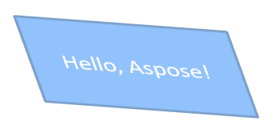

## **Introdução**

No PowerPoint, você pode adicionar formas a slides. Como as formas são compostas por linhas, você pode formatá‑las modificando ou aplicando efeitos aos seus contornos. Além disso, você pode formatar formas especificando configurações que controlam como seus interiores são preenchidos.


Aspose.Slides for C++ fornece interfaces e métodos que permitem formatar formas usando as mesmas opções disponíveis no PowerPoint.

## **Formatar Linhas**

Usando Aspose.Slides, você pode especificar um estilo de linha personalizado para uma forma. Os passos a seguir descrevem o procedimento:

1. Crie uma instância da classe [Presentation](https://reference.aspose.com/slides/cpp/aspose.slides/presentation/).
1. Obtenha uma referência a um slide pelo seu índice.
1. Adicione um [IAutoShape](https://reference.aspose.com/slides/cpp/aspose.slides/iautoshape/) ao slide.
1. Defina o [line style](https://reference.aspose.com/slides/cpp/aspose.slides/linestyle/) da forma.
1. Defina a largura da linha.
1. Defina o [dash style](https://reference.aspose.com/slides/cpp/aspose.slides/linedashstyle/) da linha.
1. Defina a cor da linha para a forma.
1. Salve a apresentação modificada como um arquivo PPTX.

O código a seguir demonstra como formatar um `AutoShape` retangular:

```cpp
#include <DOM/FillType.h>
#include <DOM/IAutoShape.h>
#include <DOM/IColorFormat.h>
#include <DOM/IFillFormat.h>
#include <DOM/ILineFillFormat.h>
#include <DOM/ILineFormat.h>
#include <DOM/IShapeCollection.h>
#include <DOM/ISlide.h>
#include <DOM/LineDashStyle.h>
#include <DOM/LineStyle.h>
#include <DOM/Presentation.h>
#include <DOM/ShapeType.h>
#include <Export/SaveFormat.h>
#include <drawing/color.h>
#include <system/smart_ptr.h>
using namespace Aspose::Slides;
using namespace Aspose::Slides::Export;
using namespace System;
using namespace System::Drawing;

// Instanciar a classe Presentation que representa um arquivo de apresentação.
auto presentation = MakeObject<Presentation>();

// Obter o primeiro slide.
auto slide = presentation->get_Slide(0);

// Adicionar uma forma automática do tipo Retângulo.
auto shape = slide->get_Shapes()->AddAutoShape(ShapeType::Rectangle, 50, 150, 150, 75);

// Definir a cor de preenchimento para a forma retângulo.
shape->get_FillFormat()->set_FillType(FillType::NoFill);

// Aplicar formatação às linhas do retângulo.
shape->get_LineFormat()->set_Style(LineStyle::ThickThin);
shape->get_LineFormat()->set_Width(7);
shape->get_LineFormat()->set_DashStyle(LineDashStyle::Dash);

// Definir a cor da linha do retângulo.
shape->get_LineFormat()->get_FillFormat()->set_FillType(FillType::Solid);
shape->get_LineFormat()->get_FillFormat()->get_SolidFillColor()->set_Color(Color::get_Blue());

// Salvar o arquivo PPTX no disco.
presentation->Save(u"formatted_lines.pptx", SaveFormat::Pptx);
presentation->Dispose();
```

O resultado:


## **Aplicar Efeitos de Esboço às Linhas de Forma**

Um efeito de esboço faz com que a linha de uma forma pareça desenhada à mão. Use [IShape::get_LineFormat](https://reference.aspose.com/slides/cpp/aspose.slides/ishape/get_lineformat/) para acessar as configurações da linha, [ILineFormat::get_SketchFormat](https://reference.aspose.com/slides/cpp/aspose.slides/ilineformat/get_sketchformat/) para acessar as configurações de esboço e [ISketchFormat::set_SketchType](https://reference.aspose.com/slides/cpp/aspose.slides/isketchformat/set_sketchtype/) para selecionar um valor da enumeração [LineSketchType](https://reference.aspose.com/slides/cpp/aspose.slides/linesketchtype/).

O código C++ a seguir mostra como aplicar o efeito [LineSketchType::Curved](https://reference.aspose.com/slides/cpp/aspose.slides/linesketchtype/) , ler o valor atribuído explicitamente e remover o efeito com [LineSketchType::None](https://reference.aspose.com/slides/cpp/aspose.slides/linesketchtype/):

```cpp
auto presentation = MakeObject<Presentation>();

auto slide = presentation->get_Slide(0);
auto shape = slide->get_Shapes()->AddAutoShape(ShapeType::Rectangle, 50, 50, 200, 100);

// Access the shape's line format and its sketch format.
auto sketchFormat = shape->get_LineFormat()->get_SketchFormat();

// Apply a sketch effect.
sketchFormat->set_SketchType(LineSketchType::Curved);

// Read the sketch effect assigned directly to the shape.
auto explicitSketchType = sketchFormat->get_SketchType();
Console::WriteLine(u"Explicit sketch type: {0}", explicitSketchType);

// Remove the sketch effect.
sketchFormat->set_SketchType(LineSketchType::None);

presentation->Dispose();
```

O valor retornado por [ISketchFormat::get_SketchType](https://reference.aspose.com/slides/cpp/aspose.slides/isketchformat/get_sketchtype/) representa a configuração atribuída diretamente à forma. Se a formatação da linha pode ser herdada de um tema, slide mestre ou slide de layout, use [ILineFormat::GetEffective](https://reference.aspose.com/slides/cpp/aspose.slides/ilineformat/geteffective/), acesse [ILineFormatEffectiveData::get_SketchFormat](https://reference.aspose.com/slides/cpp/aspose.slides/ilineformateffectivedata/get_sketchformat/), e leia [ISketchFormatEffectiveData::get_SketchType](https://reference.aspose.com/slides/cpp/aspose.slides/isketchformateffectivedata/get_sketchtype/). O valor efetivo reflete a formatação que realmente é aplicada após a herança ser resolvida:

```cpp
auto presentation = MakeObject<Presentation>(u"presentation.pptx");

auto shape = presentation->get_Slide(0)->get_Shape(0);
auto lineFormat = shape->get_LineFormat();

auto explicitSketchType = lineFormat->get_SketchFormat()->get_SketchType();
auto effectiveLineFormat = lineFormat->GetEffective();
auto effectiveSketchType = effectiveLineFormat->get_SketchFormat()->get_SketchType();

Console::WriteLine(u"Explicit sketch type: {0}", explicitSketchType);
Console::WriteLine(u"Effective sketch type: {0}", effectiveSketchType);

presentation->Dispose();
```

## **Formatar Estilos de Junção**

Aqui estão as três opções de tipo de junção:

* Round
* Miter
* Bevel

Por padrão, quando o PowerPoint une duas linhas em um ângulo (como no canto de uma forma), ele usa a configuração **Round**. No entanto, se você estiver desenhando uma forma com ângulos agudos, pode preferir a opção **Miter**.


O código C++ a seguir demonstra como três retângulos (conforme mostrado na imagem acima) foram criados usando as configurações de tipo de junção Miter, Bevel e Round:

```cpp
#include <DOM/FillType.h>
#include <DOM/IAutoShape.h>
#include <DOM/IColorFormat.h>
#include <DOM/IFillFormat.h>
#include <DOM/ILineFillFormat.h>
#include <DOM/ILineFormat.h>
#include <DOM/IShapeCollection.h>
#include <DOM/ISlide.h>
#include <DOM/ITextFrame.h>
#include <DOM/LineJoinStyle.h>
#include <DOM/Presentation.h>
#include <DOM/ShapeType.h>
#include <Export/SaveFormat.h>
#include <drawing/color.h>
#include <system/smart_ptr.h>
using namespace Aspose::Slides;
using namespace Aspose::Slides::Export;
using namespace System;
using namespace System::Drawing;

// Instanciar a classe Presentation que representa um arquivo de apresentação.
auto presentation = MakeObject<Presentation>();

// Obter o primeiro slide.
auto slide = presentation->get_Slide(0);

// Adicionar três formas automáticas do tipo Retângulo.
auto shape1 = slide->get_Shapes()->AddAutoShape(ShapeType::Rectangle, 20, 20, 150, 75);
auto shape2 = slide->get_Shapes()->AddAutoShape(ShapeType::Rectangle, 210, 20, 150, 75);
auto shape3 = slide->get_Shapes()->AddAutoShape(ShapeType::Rectangle, 20, 135, 150, 75);

// Definir a cor de preenchimento para cada forma retângulo.
shape1->get_FillFormat()->set_FillType(FillType::Solid);
shape1->get_FillFormat()->get_SolidFillColor()->set_Color(Color::get_Black());
shape2->get_FillFormat()->set_FillType(FillType::Solid);
shape2->get_FillFormat()->get_SolidFillColor()->set_Color(Color::get_Black());
shape3->get_FillFormat()->set_FillType(FillType::Solid);
shape3->get_FillFormat()->get_SolidFillColor()->set_Color(Color::get_Black());

// Definir a largura da linha.
shape1->get_LineFormat()->set_Width(15);
shape2->get_LineFormat()->set_Width(15);
shape3->get_LineFormat()->set_Width(15);

// Definir a cor da linha de cada retângulo.
shape1->get_LineFormat()->get_FillFormat()->set_FillType(FillType::Solid);
shape1->get_LineFormat()->get_FillFormat()->get_SolidFillColor()->set_Color(Color::get_Blue());
shape2->get_LineFormat()->get_FillFormat()->set_FillType(FillType::Solid);
shape2->get_LineFormat()->get_FillFormat()->get_SolidFillColor()->set_Color(Color::get_Blue());
shape3->get_LineFormat()->get_FillFormat()->set_FillType(FillType::Solid);
shape3->get_LineFormat()->get_FillFormat()->get_SolidFillColor()->set_Color(Color::get_Blue());

// Definir o estilo de junção.
shape1->get_LineFormat()->set_JoinStyle(LineJoinStyle::Miter);
shape2->get_LineFormat()->set_JoinStyle(LineJoinStyle::Bevel);
shape3->get_LineFormat()->set_JoinStyle(LineJoinStyle::Round);

// Adicionar texto a cada retângulo.
shape1->get_TextFrame()->set_Text(u"Miter Join Style");
shape2->get_TextFrame()->set_Text(u"Bevel Join Style");
shape3->get_TextFrame()->set_Text(u"Round Join Style");

// Salvar o arquivo PPTX no disco.
presentation->Save(u"join_styles.pptx", SaveFormat::Pptx);
presentation->Dispose();
```

## **Preenchimento Gradiente**

No PowerPoint, Preenchimento Gradiente é uma opção de formatação que permite aplicar uma transição contínua de cores a uma forma. Por exemplo, você pode aplicar duas ou mais cores de forma que uma desfasse gradualmente na outra.

Eis como aplicar um preenchimento gradiente a uma forma usando Aspose.Slides:

1. Crie uma instância da classe [Presentation](https://reference.aspose.com/slides/cpp/aspose.slides/presentation/).
1. Obtenha uma referência a um slide pelo seu índice.
1. Adicione um [IAutoShape](https://reference.aspose.com/slides/cpp/aspose.slides/iautoshape/) ao slide.
1. Defina o [FillType](https://reference.aspose.com/slides/cpp/aspose.slides/filltype/) da forma como `Gradient`.
1. Adicione suas duas cores preferidas com posições definidas usando os métodos `Add` da coleção de paradas de gradiente exposta pela interface [IGradientFormat](https://reference.aspose.com/slides/cpp/aspose.slides/igradientformat/).
1. Salve a apresentação modificada como um arquivo PPTX.

```cpp
#include <DOM/FillType.h>
#include <DOM/GradientDirection.h>
#include <DOM/GradientShape.h>
#include <DOM/IAutoShape.h>
#include <DOM/IFillFormat.h>
#include <DOM/IGradientFormat.h>
#include <DOM/IGradientStopCollection.h>
#include <DOM/IShapeCollection.h>
#include <DOM/ISlide.h>
#include <DOM/Presentation.h>
#include <DOM/PresetColor.h>
#include <DOM/ShapeType.h>
#include <Export/SaveFormat.h>
#include <system/smart_ptr.h>
using namespace Aspose::Slides;
using namespace Aspose::Slides::Export;
using namespace System;

// Instanciar a classe Presentation que representa um arquivo de apresentação.
auto presentation = MakeObject<Presentation>();

// Obter o primeiro slide.
auto slide = presentation->get_Slide(0);

// Adicionar uma forma automática do tipo Ellipse.
auto shape = slide->get_Shapes()->AddAutoShape(ShapeType::Ellipse, 50, 50, 150, 75);

// Aplicar formatação de gradiente à elipse.
shape->get_FillFormat()->set_FillType(FillType::Gradient);
shape->get_FillFormat()->get_GradientFormat()->set_GradientShape(GradientShape::Linear);

// Definir a direção do gradiente.
shape->get_FillFormat()->get_GradientFormat()->set_GradientDirection(GradientDirection::FromCorner2);

// Adicionar duas paradas de gradiente.
shape->get_FillFormat()->get_GradientFormat()->get_GradientStops()->Add(1.0f, PresetColor::Purple);
shape->get_FillFormat()->get_GradientFormat()->get_GradientStops()->Add(0.0f, PresetColor::Red);

// Salvar o arquivo PPTX no disco.
presentation->Save(u"gradient_fill.pptx", SaveFormat::Pptx);
presentation->Dispose();
```


Se um gradiente parecer diferente em uma imagem exportada em comparação com o PowerPoint, consulte [Choose a Gradient Rendering Style](/slides/pt/cpp/convert-powerpoint-to-png/#choose-a-gradient-rendering-style). Você pode selecionar um estilo de renderização sem alterar o preenchimento gradiente armazenado na apresentação.

## **Preenchimento de Padrão**

No PowerPoint, Preenchimento de Padrão é uma opção de formatação que permite aplicar um design de duas cores — como pontos, listras, cruzamentos ou quadriculado — a uma forma. Você pode escolher cores personalizadas para o primeiro plano e plano de fundo do padrão.

Aspose.Slides fornece mais de 45 estilos de padrão predefinidos que você pode aplicar a formas para melhorar o apelo visual de suas apresentações. Mesmo após selecionar um padrão predefinido, ainda é possível especificar as cores exatas que ele deve usar.

Veja como aplicar um preenchimento de padrão a uma forma usando Aspose.Slides:

1. Crie uma instância da classe [Presentation](https://reference.aspose.com/slides/cpp/aspose.slides/presentation/).
1. Obtenha uma referência a um slide pelo seu índice.
1. Adicione um [IAutoShape](https://reference.aspose.com/slides/cpp/aspose.slides/iautoshape/) ao slide.
1. Defina o [FillType](https://reference.aspose.com/slides/cpp/aspose.slides/filltype/) da forma como `Pattern`.
1. Escolha um estilo de padrão dentre as opções predefinidas.
1. Defina a [Background Color](https://reference.aspose.com/slides/cpp/aspose.slides/ipatternformat/get_backcolor/) do padrão.
1. Defina a [Foreground Color](https://reference.aspose.com/slides/cpp/aspose.slides/ipatternformat/get_forecolor/) do padrão.
1. Salve a apresentação modificada como um arquivo PPTX.

```cpp
#include <DOM/FillType.h>
#include <DOM/IAutoShape.h>
#include <DOM/IColorFormat.h>
#include <DOM/IFillFormat.h>
#include <DOM/IPatternFormat.h>
#include <DOM/IShapeCollection.h>
#include <DOM/ISlide.h>
#include <DOM/PatternStyle.h>
#include <DOM/Presentation.h>
#include <DOM/ShapeType.h>
#include <Export/SaveFormat.h>
#include <drawing/color.h>
#include <system/smart_ptr.h>
using namespace Aspose::Slides;
using namespace Aspose::Slides::Export;
using namespace System;
using namespace System::Drawing;

// Instanciar a classe Presentation que representa um arquivo de apresentação.
auto presentation = MakeObject<Presentation>();

// Obter o primeiro slide.
auto slide = presentation->get_Slide(0);

// Adicionar uma forma automática do tipo Rectangle.
auto shape = slide->get_Shapes()->AddAutoShape(ShapeType::Rectangle, 50, 50, 150, 75);

// Definir o tipo de preenchimento como Pattern.
shape->get_FillFormat()->set_FillType(FillType::Pattern);

// Definir o estilo de padrão.
shape->get_FillFormat()->get_PatternFormat()->set_PatternStyle(PatternStyle::Trellis);

// Definir as cores de fundo e de primeiro plano do padrão.
shape->get_FillFormat()->get_PatternFormat()->get_BackColor()->set_Color(Color::get_LightGray());
shape->get_FillFormat()->get_PatternFormat()->get_ForeColor()->set_Color(Color::get_Yellow());

// Salvar o arquivo PPTX no disco.
presentation->Save(u"pattern_fill.pptx", SaveFormat::Pptx);
presentation->Dispose();
```


## **Preenchimento de Imagem**

No PowerPoint, Preenchimento de Imagem é uma opção de formatação que permite inserir uma imagem dentro de uma forma — efetivamente usando a imagem como fundo da forma.

Eis como usar Aspose.Slides para aplicar um preenchimento de imagem a uma forma:

1. Crie uma instância da classe [Presentation](https://reference.aspose.com/slides/cpp/aspose.slides/presentation/).
1. Obtenha uma referência a um slide pelo seu índice.
1. Adicione um [IAutoShape](https://reference.aspose.com/slides/cpp/aspose.slides/iautoshape/) ao slide.
1. Defina o [FillType](https://reference.aspose.com/slides/cpp/aspose.slides/filltype/) da forma como `Picture`.
1. Defina o modo de preenchimento da imagem para `Tile` (ou outro modo preferido).
1. Crie um objeto [IPPImage](https://reference.aspose.com/slides/cpp/aspose.slides/ippimage/) a partir da imagem que você deseja usar.
1. Passe a imagem para o método `ISlidesPicture.set_Image`.
1. Salve a apresentação modificada como um arquivo PPTX.

Vamos supor que temos um arquivo "lotus.png" com a imagem a seguir:


```cpp
#include <DOM/FillType.h>
#include <DOM/IAutoShape.h>
#include <DOM/IFillFormat.h>
#include <DOM/IImageCollection.h>
#include <DOM/IPictureFillFormat.h>
#include <DOM/IShapeCollection.h>
#include <DOM/ISlide.h>
#include <DOM/ISlidesPicture.h>
#include <DOM/PictureFillMode.h>
#include <DOM/Presentation.h>
#include <DOM/ShapeType.h>
#include <Export/SaveFormat.h>
#include <IImage.h>
#include <Util/Images.h>
#include <system/smart_ptr.h>
using namespace Aspose::Slides;
using namespace Aspose::Slides::Export;
using namespace System;

// Instanciar a classe Presentation que representa um arquivo de apresentação.
auto presentation = MakeObject<Presentation>();

// Obter o primeiro slide.
auto slide = presentation->get_Slide(0);

// Adicionar uma forma automática do tipo Rectangle.
auto shape = slide->get_Shapes()->AddAutoShape(ShapeType::Rectangle, 50, 50, 255, 130);

// Definir o tipo de preenchimento como Picture.
shape->get_FillFormat()->set_FillType(FillType::Picture);

// Definir o modo de preenchimento da imagem.
shape->get_FillFormat()->get_PictureFillFormat()->set_PictureFillMode(PictureFillMode::Tile);

// Carregar uma imagem e adicioná‑la aos recursos da apresentação.
auto image = Images::FromFile(u"lotus.png");
auto picture = presentation->get_Images()->AddImage(image);
image->Dispose();

// Definir a imagem.
shape->get_FillFormat()->get_PictureFillFormat()->get_Picture()->set_Image(picture);

// Salvar o arquivo PPTX no disco.
presentation->Save(u"picture_fill.pptx", SaveFormat::Pptx);
presentation->Dispose();
```


### **Azulejar Imagem Como Textura**

Se você quiser definir uma imagem em mosaico como textura e personalizar o comportamento do mosaico, pode usar os seguintes métodos da interface [IPictureFillFormat](https://reference.aspose.com/slides/cpp/aspose.slides/ipicturefillformat/) e da classe [PictureFillFormat](https://reference.aspose.com/slides/cpp/aspose.slides/picturefillformat/):

- [set_PictureFillMode](https://reference.aspose.com/slides/cpp/aspose.slides/ipicturefillformat/set_picturefillmode/): Define o modo de preenchimento da imagem — `Tile` ou `Stretch`.
- [set_TileAlignment](https://reference.aspose.com/slides/cpp/aspose.slides/ipicturefillformat/set_tilealignment/): Especifica o alinhamento dos ladrilhos dentro da forma.
- [set_TileFlip](https://reference.aspose.com/slides/cpp/aspose.slides/ipicturefillformat/set_tileflip/): Controla se o ladrilho é invertido horizontalmente, verticalmente ou ambos.
- [set_TileOffsetX](https://reference.aspose.com/slides/cpp/aspose.slides/ipicturefillformat/set_tileoffsetx/): Define o deslocamento horizontal do ladrilho (em pontos) a partir da origem da forma.
- [set_TileOffsetY](https://reference.aspose.com/slides/cpp/aspose.slides/ipicturefillformat/set_tileoffsety/): Define o deslocamento vertical do ladrilho (em pontos) a partir da origem da forma.
- [set_TileScaleX](https://reference.aspose.com/slides/cpp/aspose.slides/ipicturefillformat/set_tilescalex/): Define a escala horizontal do ladrilho como porcentagem.
- [set_TileScaleY](https://reference.aspose.com/slides/cpp/aspose.slides/ipicturefillformat/set_tilescaley/): Define a escala vertical do ladrilho como porcentagem.

O exemplo de código a seguir mostra como adicionar uma forma retangular com preenchimento de imagem em mosaico e configurar as opções de ladrilho:

```cpp
#include <DOM/FillType.h>
#include <DOM/IAutoShape.h>
#include <DOM/IFillFormat.h>
#include <DOM/IImageCollection.h>
#include <DOM/IPictureFillFormat.h>
#include <DOM/IShapeCollection.h>
#include <DOM/ISlide.h>
#include <DOM/ISlidesPicture.h>
#include <DOM/PictureFillMode.h>
#include <DOM/Presentation.h>
#include <DOM/RectangleAlignment.h>
#include <DOM/ShapeType.h>
#include <DOM/TileFlip.h>
#include <Export/SaveFormat.h>
#include <IImage.h>
#include <Util/Images.h>
#include <system/smart_ptr.h>
using namespace Aspose::Slides;
using namespace Aspose::Slides::Export;
using namespace System;

// Instanciar a classe Presentation que representa um arquivo de apresentação.
auto presentation = MakeObject<Presentation>();

// Obter o primeiro slide.
auto firstSlide = presentation->get_Slide(0);

// Adicionar uma forma automática retangular.
auto shape = firstSlide->get_Shapes()->AddAutoShape(ShapeType::Rectangle, 50, 50, 190, 95);

// Definir o tipo de preenchimento da forma como Picture.
shape->get_FillFormat()->set_FillType(FillType::Picture);

// Carregar a imagem e adicioná-la aos recursos da apresentação.
auto sourceImage = Images::FromFile(u"lotus.png");
auto presentationImage = presentation->get_Images()->AddImage(sourceImage);
sourceImage->Dispose();

// Atribuir a imagem à forma.
auto pictureFillFormat = shape->get_FillFormat()->get_PictureFillFormat();
pictureFillFormat->get_Picture()->set_Image(presentationImage);

// Configurar o modo de preenchimento da imagem e as propriedades de ladrilhamento.
pictureFillFormat->set_PictureFillMode(PictureFillMode::Tile);
pictureFillFormat->set_TileOffsetX(-32);
pictureFillFormat->set_TileOffsetY(-32);
pictureFillFormat->set_TileScaleX(50);
pictureFillFormat->set_TileScaleY(50);
pictureFillFormat->set_TileAlignment(RectangleAlignment::BottomRight);
pictureFillFormat->set_TileFlip(TileFlip::FlipBoth);

// Salvar o arquivo PPTX no disco.
presentation->Save(u"tile.pptx", SaveFormat::Pptx);
presentation->Dispose();
```


## **Preenchimento de Cor Sólida**

No PowerPoint, Preenchimento de Cor Sólida é uma opção de formatação que preenche uma forma com uma única cor uniforme. Essa cor de fundo simples é aplicada sem gradientes, texturas ou padrões.

Para aplicar um preenchimento de cor sólida a uma forma usando Aspose.Slides, siga estas etapas:

1. Crie uma instância da classe [Presentation](https://reference.aspose.com/slides/cpp/aspose.slides/presentation/).
1. Obtenha uma referência a um slide pelo seu índice.
1. Adicione um [IAutoShape](https://reference.aspose.com/slides/cpp/aspose.slides/iautoshape/) ao slide.
1. Defina o [FillType](https://reference.aspose.com/slides/cpp/aspose.slides/filltype/) da forma como `Solid`.
1. Atribua a cor de preenchimento desejada à forma.
1. Salve a apresentação modificada como um arquivo PPTX.

```cpp
#include <DOM/FillType.h>
#include <DOM/IAutoShape.h>
#include <DOM/IColorFormat.h>
#include <DOM/IFillFormat.h>
#include <DOM/IShapeCollection.h>
#include <DOM/ISlide.h>
#include <DOM/Presentation.h>
#include <DOM/ShapeType.h>
#include <Export/SaveFormat.h>
#include <drawing/color.h>
#include <system/smart_ptr.h>
using namespace Aspose::Slides;
using namespace Aspose::Slides::Export;
using namespace System;
using namespace System::Drawing;

// Instanciar a classe Presentation que representa um arquivo de apresentação.
auto presentation = MakeObject<Presentation>();

// Obter o primeiro slide.
auto slide = presentation->get_Slide(0);

// Adicionar uma forma automática do tipo Rectangle.
auto shape = slide->get_Shapes()->AddAutoShape(ShapeType::Rectangle, 50, 50, 150, 75);

// Definir o tipo de preenchimento como Solid.
shape->get_FillFormat()->set_FillType(FillType::Solid);

// Definir a cor de preenchimento.
shape->get_FillFormat()->get_SolidFillColor()->set_Color(Color::get_Yellow());

// Salvar o arquivo PPTX no disco.
presentation->Save(u"solid_color_fill.pptx", SaveFormat::Pptx);
presentation->Dispose();
```


## **Definir Transparência**

No PowerPoint, ao aplicar um preenchimento sólido, gradiente, imagem ou textura a formas, você também pode definir um nível de transparência para controlar a opacidade do preenchimento. Um valor de transparência maior torna a forma mais transparente, permitindo que o plano de fundo ou objetos subjacentes fiquem parcialmente visíveis.

Aspose.Slides permite definir o nível de transparência ajustando o valor alfa na cor usada para o preenchimento. Veja como fazer isso:

1. Crie uma instância da classe [Presentation](https://reference.aspose.com/slides/cpp/aspose.slides/presentation/).
1. Obtenha uma referência a um slide pelo seu índice.
1. Adicione um [IAutoShape](https://reference.aspose.com/slides/cpp/aspose.slides/iautoshape/) ao slide.
1. Defina o [FillType](https://reference.aspose.com/slides/cpp/aspose.slides/filltype/) como `Solid`.
1. Use `Color` para definir uma cor com transparência (o componente `alpha` controla a transparência).
1. Salve a apresentação.

```cpp
#include <DOM/FillType.h>
#include <DOM/IAutoShape.h>
#include <DOM/IColorFormat.h>
#include <DOM/IFillFormat.h>
#include <DOM/IShapeCollection.h>
#include <DOM/ISlide.h>
#include <DOM/Presentation.h>
#include <DOM/ShapeType.h>
#include <Export/SaveFormat.h>
#include <drawing/color.h>
#include <system/smart_ptr.h>
using namespace Aspose::Slides;
using namespace Aspose::Slides::Export;
using namespace System;
using namespace System::Drawing;

// Instanciar a classe Presentation que representa um arquivo de apresentação.
auto presentation = MakeObject<Presentation>();

// Obter o primeiro slide.
auto slide = presentation->get_Slide(0);

// Adicionar uma forma automática retangular sólida.
auto solidShape = slide->get_Shapes()->AddAutoShape(ShapeType::Rectangle, 50, 50, 150, 75);

// Adicionar uma forma automática retangular transparente sobre a forma sólida.
auto transparentShape = slide->get_Shapes()->AddAutoShape(ShapeType::Rectangle, 80, 80, 150, 75);
transparentShape->get_FillFormat()->set_FillType(FillType::Solid);
transparentShape->get_FillFormat()->get_SolidFillColor()->set_Color(Color::FromArgb(204, 255, 255, 0));

// Salvar o arquivo PPTX no disco.
presentation->Save(u"shape_transparency.pptx", SaveFormat::Pptx);
presentation->Dispose();
```


## **Rotacionar Formas**

Aspose.Slides permite girar formas em apresentações do PowerPoint. Isso pode ser útil ao posicionar elementos visuais com necessidades específicas de alinhamento ou design.

Para girar uma forma em um slide, siga estas etapas:

1. Crie uma instância da classe [Presentation](https://reference.aspose.com/slides/cpp/aspose.slides/presentation/).
1. Obtenha uma referência a um slide pelo seu índice.
1. Adicione um [IAutoShape](https://reference.aspose.com/slides/cpp/aspose.slides/iautoshape/) ao slide.
1. Defina a propriedade de rotação da forma para o ângulo desejado.
1. Salve a apresentação.

```cpp
#include <DOM/IAutoShape.h>
#include <DOM/IShapeCollection.h>
#include <DOM/ISlide.h>
#include <DOM/Presentation.h>
#include <DOM/ShapeType.h>
#include <Export/SaveFormat.h>
#include <system/smart_ptr.h>
using namespace Aspose::Slides;
using namespace Aspose::Slides::Export;
using namespace System;

// Instanciar a classe Presentation que representa um arquivo de apresentação.
auto presentation = MakeObject<Presentation>();

// Obter o primeiro slide.
auto slide = presentation->get_Slide(0);

// Adicionar uma forma automática do tipo Rectangle.
auto shape = slide->get_Shapes()->AddAutoShape(ShapeType::Rectangle, 50, 50, 150, 75);

// Rotacionar a forma em 5 graus.
shape->set_Rotation(5);

// Salvar o arquivo PPTX no disco.
presentation->Save(u"shape_rotation.pptx", SaveFormat::Pptx);
presentation->Dispose();
```


## **Adicionar Efeitos de Bisel 3D**

Aspose.Slides permite aplicar efeitos de bisel 3D a formas configurando suas propriedades [ThreeDFormat](https://reference.aspose.com/slides/cpp/aspose.slides/threedformat/).

Para adicionar efeitos de bisel 3D a uma forma, siga estas etapas:

1. Instancie a classe [Presentation](https://reference.aspose.com/slides/cpp/aspose.slides/presentation/).
1. Obtenha uma referência a um slide pelo seu índice.
1. Adicione um [IAutoShape](https://reference.aspose.com/slides/cpp/aspose.slides/iautoshape/) ao slide.
1. Configure o [ThreeDFormat](https://reference.aspose.com/slides/cpp/aspose.slides/threedformat/) da forma para definir as configurações de bisel.
1. Salve a apresentação.

```cpp
#include <DOM/BevelPresetType.h>
#include <DOM/CameraPresetType.h>
#include <DOM/FillType.h>
#include <DOM/IAutoShape.h>
#include <DOM/ICamera.h>
#include <DOM/IColorFormat.h>
#include <DOM/IFillFormat.h>
#include <DOM/ILightRig.h>
#include <DOM/ILineFillFormat.h>
#include <DOM/ILineFormat.h>
#include <DOM/IShapeBevel.h>
#include <DOM/IShapeCollection.h>
#include <DOM/ISlide.h>
#include <DOM/IThreeDFormat.h>
#include <DOM/LightRigPresetType.h>
#include <DOM/LightingDirection.h>
#include <DOM/Presentation.h>
#include <DOM/ShapeType.h>
#include <Export/SaveFormat.h>
#include <drawing/color.h>
#include <system/smart_ptr.h>
using namespace Aspose::Slides;
using namespace Aspose::Slides::Export;
using namespace System;
using namespace System::Drawing;

// Criar uma instância da classe Presentation.
auto presentation = MakeObject<Presentation>();

auto slide = presentation->get_Slide(0);

// Adicionar uma forma ao slide.
auto shape = slide->get_Shapes()->AddAutoShape(ShapeType::Ellipse, 50, 50, 100, 100);
shape->get_FillFormat()->set_FillType(FillType::Solid);
shape->get_FillFormat()->get_SolidFillColor()->set_Color(Color::get_Green());
shape->get_LineFormat()->get_FillFormat()->set_FillType(FillType::Solid);
shape->get_LineFormat()->get_FillFormat()->get_SolidFillColor()->set_Color(Color::get_Orange());
shape->get_LineFormat()->set_Width(2.0);

// Definir as propriedades ThreeDFormat da forma.
shape->get_ThreeDFormat()->set_Depth(4.0);
shape->get_ThreeDFormat()->get_BevelTop()->set_BevelType(BevelPresetType::Circle);
shape->get_ThreeDFormat()->get_BevelTop()->set_Height(6);
shape->get_ThreeDFormat()->get_BevelTop()->set_Width(6);
shape->get_ThreeDFormat()->get_Camera()->set_CameraType(CameraPresetType::OrthographicFront);
shape->get_ThreeDFormat()->get_LightRig()->set_LightType(LightRigPresetType::ThreePt);
shape->get_ThreeDFormat()->get_LightRig()->set_Direction(LightingDirection::Top);

// Salvar a apresentação como um arquivo PPTX.
presentation->Save(u"3D_bevel_effect.pptx", SaveFormat::Pptx);
presentation->Dispose();
```


## **Adicionar Efeitos de Rotação 3D**

Aspose.Slides permite aplicar efeitos de rotação 3D a formas configurando suas propriedades [ThreeDFormat](https://reference.aspose.com/slides/cpp/aspose.slides/threedformat/).

Para aplicar rotação 3D a uma forma:

1. Crie uma instância da classe [Presentation](https://reference.aspose.com/slides/cpp/aspose.slides/presentation/).
1. Obtenha uma referência a um slide pelo seu índice.
1. Adicione um [IAutoShape](https://reference.aspose.com/slides/cpp/aspose.slides/iautoshape/) ao slide.
1. Use [set_CameraType](https://reference.aspose.com/slides/cpp/aspose.slides/icamera/set_cameratype/) e [set_LightType](https://reference.aspose.com/slides/cpp/aspose.slides/ilightrig/set_lighttype/) para definir a rotação 3D.
1. Salve a apresentação.

```cpp
#include <DOM/CameraPresetType.h>
#include <DOM/IAutoShape.h>
#include <DOM/ICamera.h>
#include <DOM/ILightRig.h>
#include <DOM/IShapeCollection.h>
#include <DOM/ISlide.h>
#include <DOM/ITextFrame.h>
#include <DOM/IThreeDFormat.h>
#include <DOM/LightRigPresetType.h>
#include <DOM/Presentation.h>
#include <DOM/ShapeType.h>
#include <Export/SaveFormat.h>
#include <system/smart_ptr.h>
using namespace Aspose::Slides;
using namespace Aspose::Slides::Export;
using namespace System;

// Criar uma instância da classe Presentation.
auto presentation = MakeObject<Presentation>();

auto slide = presentation->get_Slide(0);

auto shape = slide->get_Shapes()->AddAutoShape(ShapeType::Rectangle, 50, 50, 150, 75);
shape->get_TextFrame()->set_Text(u"Hello, Aspose!");

shape->get_ThreeDFormat()->set_Depth(6);
shape->get_ThreeDFormat()->get_Camera()->SetRotation(40, 35, 20);
shape->get_ThreeDFormat()->get_Camera()->set_CameraType(CameraPresetType::IsometricLeftUp);
shape->get_ThreeDFormat()->get_LightRig()->set_LightType(LightRigPresetType::Balanced);

// Salvar a apresentação como um arquivo PPTX.
presentation->Save(u"3D_rotation_effect.pptx", SaveFormat::Pptx);
presentation->Dispose();
```



## **Controlar Renderização em Preto-e-Branco para Formas**

O método [IShape::set_BlackWhiteMode](https://reference.aspose.com/slides/cpp/aspose.slides/ishape/set_blackwhitemode/) especifica como uma forma individual é renderizada quando uma apresentação é visualizada ou processada em modo preto‑e‑branco. Ele não habilita a exibição em preto‑e‑branco por si só, nem altera o preenchimento, a linha ou outras formatações da forma no modo de cor normal.

Use um valor da enumeração [BlackWhiteMode](https://reference.aspose.com/slides/cpp/aspose.slides/blackwhitemode/) para selecionar o comportamento desejado. Por exemplo, `Automatic` permite que o aplicativo de renderização escolha a conversão, `Gray` e `LightGray` utilizam coloração em tons de cinza, `BlackWhite` usa apenas preto e branco, `Black` e `White` forçam uma cor única, `Color` preserva a coloração normal e `Hidden` omite a forma no modo preto‑e‑branco. `NotDefined` indica que nenhum modo de forma foi atribuído.

O código C++ a seguir cria uma forma colorida e faz com que ela apareça cinza no modo de exibição preto‑e‑branco:

```cpp
#include <DOM/BlackWhiteMode.h>
#include <DOM/FillType.h>
#include <DOM/IAutoShape.h>
#include <DOM/IFillFormat.h>
#include <DOM/IShapeCollection.h>
#include <DOM/ISlide.h>
#include <DOM/Presentation.h>
#include <DOM/ShapeType.h>
#include <Export/SaveFormat.h>
#include <drawing/color.h>
#include <system/smart_ptr.h>

using namespace Aspose::Slides;
using namespace Aspose::Slides::Export;
using namespace System;
using namespace System::Drawing;

auto presentation = MakeObject<Presentation>();
auto slide = presentation->get_Slide(0);

auto shape = slide->get_Shapes()->AddAutoShape(ShapeType::Rectangle, 50, 50, 200, 100);
shape->get_FillFormat()->set_FillType(FillType::Solid);
shape->get_FillFormat()->get_SolidFillColor()->set_Color(Color::get_Orange());

// Manter o preenchimento laranja no modo de cor, mas renderizar a forma com coloração cinza no modo preto-e-branco.
shape->set_BlackWhiteMode(BlackWhiteMode::Gray);

presentation->Save(u"shape_black_white_mode.pptx", SaveFormat::Pptx);
presentation->Dispose();
```

No modo de cor normal, o retângulo mantém seu preenchimento laranja. Em um fluxo de trabalho de exibição preto‑e‑branco, ele usa coloração cinza porque seu modo está definido como `Gray`. Isso permite preservar um slide em cores completas enquanto define uma aparência distinta para impressão, visualização ou outros fluxos que respeitam as configurações de exibição preto‑e‑branco da apresentação.

## **Redefinir Formatação**

O código C++ a seguir mostra como redefinir a formatação de um slide e reverter a posição, tamanho e formatação de todas as formas com marcadores de posição no [LayoutSlide](https://reference.aspose.com/slides/cpp/aspose.slides/layoutslide/) para as configurações padrão:

```cpp
#include <DOM/ISlide.h>
#include <DOM/ISlideCollection.h>
#include <DOM/Presentation.h>
#include <Export/SaveFormat.h>
#include <system/enumerator_adapter.h>
#include <system/smart_ptr.h>
using namespace Aspose::Slides;
using namespace Aspose::Slides::Export;
using namespace System;

auto presentation = MakeObject<Presentation>(u"sample.pptx");

for (auto&& slide : System::IterateOver(presentation->get_Slides()))
{
    // Redefinir cada forma no slide que possui um placeholder no layout.
    slide->Reset();
}

presentation->Save(u"reset_formatting.pptx", SaveFormat::Pptx);
presentation->Dispose();
```

## **FAQ**

**A formatação de formas afeta o tamanho final do arquivo da apresentação?**

Apenas minimamente. Imagens e mídias incorporadas ocupam a maior parte do espaço do arquivo, enquanto parâmetros de forma como cores, efeitos e gradientes são armazenados como metadados e praticamente não adicionam tamanho extra.

**Como posso detectar formas em um slide que compartilham formatação idêntica para que eu possa agrupá‑las?**

Compare as principais propriedades de formatação de cada forma — preenchimento, linha e configurações de efeito. Se todos os valores correspondentes coincidirem, trate seus estilos como idênticos e agrupe logicamente essas formas, simplificando o gerenciamento de estilos posterior.

**Posso salvar um conjunto de estilos de forma personalizados em um arquivo separado para reutilizar em outras apresentações?**

Sim. Armazene formas de exemplo com os estilos desejados em um slide‑modelo ou em um arquivo de modelo .POTX. Ao criar uma nova apresentação, abra o modelo, clone as formas estilizadas que precisar e reaplique sua formatação onde for necessário.