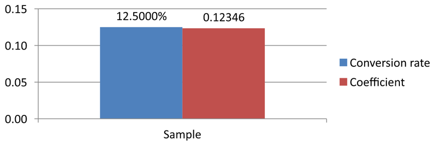

## **Visão geral**

Este artigo explica como trabalhar com pastas de trabalho de gráficos no Aspose.Slides. Ele mostra como ler e gravar dados de gráficos por meio de fluxos de pastas de trabalho, usar células da pasta de trabalho como rótulos de dados de gráficos, acessar coleções de planilhas e especificar o tipo de origem de dados para os valores do gráfico.

Também aborda o trabalho com pastas de trabalho externas como fontes de dados de gráficos. Os exemplos demonstram como criar e atribuir uma pasta de trabalho externa, recuperar o caminho de uma pasta de trabalho externa vinculada a um gráfico e editar os dados do gráfico quando a pasta de trabalho está disponível.

Para células da pasta de trabalho que representam dados ausentes, consulte [Controlar a Exibição de Células Vazias](/slides/pt/net/chart-series/) para a diferença entre uma célula vazia e zero, e uma comparação de gráfico de linhas dos modos de exibição disponíveis.

## **Incluir Dados de Linhas e Colunas Ocultas**

Use [IChart.PlotVisibleCellsOnly](https://reference.aspose.com/slides/net/aspose.slides.charts/ichart/plotvisiblecellsonly/) para controlar se um gráfico traça dados de linhas e colunas de planilha ocultas. Defina como `true` para traçar apenas células visíveis, ou `false` para incluir tanto células visíveis quanto ocultas. Esta configuração controla a plotagem do gráfico; não oculta nem revela linhas ou colunas da planilha.

A [apresentação de exemplo](hidden-source-data.pptx) contém um gráfico de colunas como a primeira forma no seu primeiro slide. A planilha incorporada, `Sheet1`, contém o intervalo de origem seguinte, `A1:C4`. A linha 3 e a coluna C estão ocultas, mas suas células ainda contêm valores.

| Linha da planilha | A: Mês | B: Varejo | C: Atacado (coluna oculta) |
| --- | --- | --- | --- |
| 2 | Janeiro | 10 | 30 |
| 3 (linha oculta) | Fevereiro | 40 | 60 |
| 4 | Março | 20 | 50 |

Acesse as células de origem através de [IChartData.ChartDataWorkbook](https://reference.aspose.com/slides/net/aspose.slides.charts/ichartdata/chartdataworkbook/) e leia [IChartDataCell.IsHidden](https://reference.aspose.com/slides/net/aspose.slides.charts/ichartdatacell/ishidden/) para inspeccionar seu status de ocultação. Esta propriedade é somente leitura. Neste arquivo, B2 está visível, B3 pertence à linha oculta e C2 pertence à coluna oculta; o exemplo imprime `False`, `True` e `True`, respectivamente.

Para este exemplo, atualize os dados do gráfico após alterar a configuração de plotagem: retenha a pasta de trabalho incorporada com [ReadWorkbookStream](https://reference.aspose.com/slides/net/aspose.slides.charts/ichartdata/readworkbookstream/) e recarregue-a com [WriteWorkbookStream](https://reference.aspose.com/slides/net/aspose.slides.charts/ichartdata/writeworkbookstream/). Ao incluir todas as células, use também [SetRange](https://reference.aspose.com/slides/net/aspose.slides.charts/ichartdata/setrange/) para restaurar o intervalo completo, incluindo a categoria de Fevereiro oculta. Simplesmente mudar a flag não é suficiente para atualizar os dados em cache deste exemplo e os rótulos de categoria.

```csharp
using System;
using Aspose.Slides;
using Aspose.Slides.Charts;
using Aspose.Slides.Export;

using var presentation = new Presentation("hidden-source-data.pptx");
var slide = presentation.Slides[0];

if (slide.Shapes[0] is IChart chart)
{
    var workbook = chart.ChartData.ChartDataWorkbook;
    Console.WriteLine($"B2 hidden: {workbook.GetCell(0, "B2").IsHidden}");
    Console.WriteLine($"B3 hidden: {workbook.GetCell(0, "B3").IsHidden}");
    Console.WriteLine($"C2 hidden: {workbook.GetCell(0, "C2").IsHidden}");

    using var workbookStream = chart.ChartData.ReadWorkbookStream();
    foreach (var visibleOnly in new[] { true, false })
    {
        chart.PlotVisibleCellsOnly = visibleOnly;

        // Atualize os dados do gráfico a partir da pasta de trabalho incorporada.
        workbookStream.Position = 0;
        chart.ChartData.WriteWorkbookStream(workbookStream);
        if (!visibleOnly)
        {
            // Restaurar o intervalo de origem completo, incluindo categorias ocultas.
            chart.ChartData.SetRange("Sheet1!$A$1:$C$4");
        }

        presentation.Save($"hidden_cells_{visibleOnly}.pptx", SaveFormat.Pptx);
    }
}
else
{
    Console.WriteLine("The first shape is not a chart.");
}
```

O exemplo salva duas versões da apresentação: uma com apenas os valores de Varejo visíveis (10 e 20), e outra com todos os seis valores. As imagens abaixo foram renderizadas a partir das apresentações salvas depois de reabri‑las; ambos os arquivos preservam sua configuração de plotagem atribuída. A linha 3 e a coluna C permanecem ocultas em ambas as pastas de trabalho incorporadas.

| Apenas células visíveis (`true`) | Todas as células (`false`) |
| --- | --- |
|  |  |

Uma célula oculta que contém um valor difere de uma célula vazia. [IChart.DisplayBlanksAs](https://reference.aspose.com/slides/net/aspose.slides.charts/ichart/displayblanksas/) controla como valores ausentes são exibidos; não inclui nem exclui dados de origem ocultos. Consulte [Controlar a Exibição de Células Vazias](/slides/pt/net/chart-series/#control-the-display-of-empty-cells) para um exemplo.

## **Recuperar o Intervalo de Dados de um Gráfico**

Antes de atualizar os dados da pasta de trabalho em uma apresentação existente, inspeccione os intervalos de origem para identificar quais células da planilha cada gráfico usa. O método [IChartData.GetRange](https://reference.aspose.com/slides/net/aspose.slides.charts/ichartdata/getrange/) devolve o intervalo de dados atual como uma fórmula qualificada da planilha, como `Sheet1!$A$1:$D$5`. Aqui, `Sheet1` é o nome da planilha, `!` separa‑o do intervalo de células, e `$A$1:$D$5` identifica as células de A1 a D5, inclusive. Os sinais de dólar indicam referências absolutas de linha e coluna.

O método lê o intervalo atual sem alterar o gráfico ou sua pasta de trabalho. Se o gráfico não usar uma pasta de trabalho como origem de dados, ele lança [InvalidOperationException](https://learn.microsoft.com/en-us/dotnet/api/system.invalidoperationexception). Para mais informações, veja a [Referência da API ChartData](https://reference.aspose.com/slides/net/aspose.slides.charts/chartdata/).

Este exemplo abre uma apresentação e verifica as formas diretamente em cada slide para encontrar gráficos. Ele imprime o nome de cada gráfico e seu intervalo de origem. Se um gráfico não usar uma pasta de trabalho, ele imprime uma mensagem e continua para o próximo gráfico.

```csharp
using System;
using Aspose.Slides;
using Aspose.Slides.Charts;

using var presentation = new Presentation("presentation.pptx");

foreach (var slide in presentation.Slides)
{
    foreach (var shape in slide.Shapes)
    {
        if (shape is IChart chart)
        {
            try
            {
                var range = chart.ChartData.GetRange();
                Console.WriteLine($"{chart.Name}: {range}");
            }
            catch (InvalidOperationException)
            {
                Console.WriteLine($"{chart.Name}: The chart does not use a workbook as its data source.");
            }
        }
    }
}
```

## **Ler e Gravar Dados de Gráficos a partir de uma Pasta de Trabalho**

Aspose.Slides for .NET fornece os métodos [ReadWorkbookStream](https://reference.aspose.com/slides/net/aspose.slides.charts/ichartdata/readworkbookstream/) e [WriteWorkbookStream](https://reference.aspose.com/slides/net/aspose.slides.charts/ichartdata/writeworkbookstream/) que permitem ler e gravar pastas de trabalho de dados de gráficos (contendo dados de gráfico editados com Aspose.Cells). **Observação**: os dados do gráfico precisam estar organizados da mesma forma ou ter uma estrutura semelhante à origem.

Este exemplo usa uma apresentação com um gráfico como a primeira forma no seu primeiro slide. Ele lê a pasta de trabalho incorporada para um fluxo, limpa as séries e categorias existentes e grava a mesma pasta de trabalho de volta. As alterações permanecem em memória; o exemplo não salva a apresentação.

```csharp
using System;
using Aspose.Slides;
using Aspose.Slides.Charts;

using var presentation = new Presentation("chart.pptx");
var slide = presentation.Slides[0];

var shapeCount = slide.Shapes.Count;
if (shapeCount > 0 && slide.Shapes[0] is IChart chart)
{
    var chartData = chart.ChartData;
    using var workbookStream = chartData.ReadWorkbookStream();

    chartData.Series.Clear();
    chartData.Categories.Clear();

    workbookStream.Position = 0;
    chartData.WriteWorkbookStream(workbookStream);
}
else
{
    Console.WriteLine("The first shape is not a chart.");
}
```

### **Validar o Layout do Gráfico após Modificação da Pasta de Trabalho**

Quando você substitui uma pasta de trabalho incorporada por uma modificada, o gráfico mantém as coleções de séries e categorias originais. Essa incompatibilidade pode fazer com que [IChart.ValidateChartLayout](https://reference.aspose.com/slides/net/aspose.slides.charts/ichart/validatechartlayout/) falhe com um erro de índice fora do intervalo. Limpe as séries e categorias existentes antes de gravar a pasta de trabalho atualizada de volta no gráfico. Este exemplo usa um gráfico que é a primeira forma no primeiro slide. O comentário indica onde a edição da pasta de trabalho ocorreria; o exemplo executável grava a pasta de trabalho original de volta e valida o layout na memória.

```csharp
using System;
using Aspose.Slides;
using Aspose.Slides.Charts;

using var presentation = new Presentation("chart.pptx");
var slide = presentation.Slides[0];

var shapeCount = slide.Shapes.Count;
if (shapeCount > 0 && slide.Shapes[0] is IChart chart)
{
    var chartData = chart.ChartData;
    using var workbookStream = chartData.ReadWorkbookStream();

    // Modifique o fluxo da pasta de trabalho aqui, por exemplo, usando Aspose.Cells.

    chartData.Series.Clear();
    chartData.Categories.Clear();

    workbookStream.Position = 0;
    chartData.WriteWorkbookStream(workbookStream);
    chart.ValidateChartLayout();
}
else
{
    Console.WriteLine("The first shape is not a chart.");
}
```

Limpar as coleções remove referências a dados obsoletos antes que a pasta de trabalho seja gravada. Reconstrua quaisquer mapeamentos de séries e categorias necessários para a pasta de trabalho atualizada antes de usar o gráfico.

## **Escolher Como Armazenar Rótulos de Categoria**

Defina [IChartCategoryCollection.UseCells](https://reference.aspose.com/slides/net/aspose.slides.charts/ichartcategorycollection/usecells/) na coleção de categoria vazia antes de adicionar rótulos. Use células da planilha para rótulos que fazem referência a dados da pasta de trabalho ou formam uma hierarquia, como trimestres agrupados por ano. Use literais de string para um único nível de rótulos que não necessita de referências a células. Esta configuração se aplica apenas a categorias. Ambos os gráficos abaixo usam células da planilha para os valores das séries numéricas.

O exemplo cria dois gráficos de colunas e imprime `Q1 Q2 Q3 Q4` para cada um, junto com seu modo de armazenamento. Para rótulos baseados em planilha, [IChartCategory.AsCell](https://reference.aspose.com/slides/net/aspose.slides.charts/ichartcategory/ascell/) fornece acesso à célula subjacente e [IChartDataCell.Value](https://reference.aspose.com/slides/net/aspose.slides.charts/ichartdatacell/value/) devolve seu rótulo. Para rótulos literais, leia a string diretamente de [IChartCategory.Value](https://reference.aspose.com/slides/net/aspose.slides.charts/ichartcategory/value/).

```csharp
using System;
using Aspose.Slides;
using Aspose.Slides.Charts;
using Aspose.Slides.Export;

using var presentation = new Presentation();
var shapes = presentation.Slides[0].Shapes;

foreach (var useCells in new[] { true, false })
{
    var x = useCells ? 20 : 360;
    var chart = shapes.AddChart(ChartType.ClusteredColumn, x, 20, 320, 250);
    var data = chart.ChartData;
    data.Series.Clear();
    data.Categories.Clear();
    data.Categories.UseCells = useCells;

    var workbook = data.ChartDataWorkbook;
    var seriesName = workbook.GetCell(0, 0, 1, "Sales");
    var series = data.Series.Add(seriesName, chart.Type);
    for (var row = 1; row <= 4; row++)
    {
        var label = $"Q{row}";
        if (useCells)
        {
            var labelCell = workbook.GetCell(0, row, 0, label);
            data.Categories.Add(labelCell);
        }
        else
        {
            data.Categories.Add(label);
        }

        var valueCell = workbook.GetCell(0, row, 1, row * 10);
        series.DataPoints.AddDataPointForBarSeries(valueCell);
    }

    Console.Write($"UseCells = {data.Categories.UseCells}:");
    foreach (var category in data.Categories)
    {
        var label = data.Categories.UseCells ? category.AsCell.Value : category.Value;
        Console.Write($" {label}");
    }
    Console.WriteLine();
}

presentation.Save("category-labels.pptx", SaveFormat.Pptx);
```

## **Definir Formatos Numéricos Personalizados para Células da Pasta de Trabalho**

Use [ChartDataCell.CustomNumberFormat](https://reference.aspose.com/slides/net/aspose.slides.charts/chartdatacell/customnumberformat/) para controlar como valores numéricos aparecem na pasta de trabalho incorporada de um gráfico. Por exemplo, um relatório pode precisar exibir uma taxa de conversão como porcentagem com quatro casas decimais e um coeficiente com cinco casas decimais. Mantenha ambos os valores numéricos para que continuem disponíveis para cálculos e plotagem do gráfico.

Um formato numérico altera a exibição, não o valor armazenado. O formato `0.0000%` exibe `0.125` como `12.5000%`; não substitui o número armazenado por `12.5`. Da mesma forma, `0.00000` exibe `0.1234567` como `0.12346` sem arredondar o valor armazenado. Se o formato personalizado for uma string vazia (`""`), será usado [PresetNumberFormat](https://reference.aspose.com/slides/net/aspose.slides.charts/chartdatacell/presetnumberformat/).

O exemplo a seguir cria um gráfico de colunas e acessa suas células através de [ChartDataWorkbook](https://reference.aspose.com/slides/net/aspose.slides.charts/ichartdata/chartdataworkbook/). Na planilha 0, B2 contém a taxa de conversão e C2 contém o coeficiente. Ambas as células fornecem valores ao gráfico. O exemplo também habilita rótulos de valor vinculados aos formatos de origem.

```csharp
using Aspose.Slides;
using Aspose.Slides.Charts;
using Aspose.Slides.Export;

using var presentation = new Presentation();
presentation.SlideSize.SetSize(720, 270, SlideSizeScaleType.DoNotScale);
var slide = presentation.Slides[0];

var chart = slide.Shapes.AddChart(ChartType.ClusteredColumn, 50, 20, 620, 210);
chart.HasTitle = false;

chart.Axes.VerticalAxis.IsNumberFormatLinkedToSource = false;
chart.Axes.VerticalAxis.NumberFormat = "0.00";
chart.Axes.VerticalAxis.IsAutomaticMinValue = false;
chart.Axes.VerticalAxis.MinValue = 0;

chart.ChartData.Series.Clear();
chart.ChartData.Categories.Clear();

var workbook = chart.ChartData.ChartDataWorkbook;
workbook.Clear(0);

var categoryCell = workbook.GetCell(0, "A2", "Sample");
chart.ChartData.Categories.Add(categoryCell);

var percentageCell = workbook.GetCell(0, "B2", 0.125);
percentageCell.CustomNumberFormat = "0.0000%";
var percentageName = workbook.GetCell(0, "B1", "Conversion rate");
var percentageSeries = chart.ChartData.Series.Add(percentageName, chart.Type);
percentageSeries.DataPoints.AddDataPointForBarSeries(percentageCell);

var precisionCell = workbook.GetCell(0, "C2", 0.1234567);
precisionCell.CustomNumberFormat = "0.00000";
var precisionName = workbook.GetCell(0, "C1", "Coefficient");
var precisionSeries = chart.ChartData.Series.Add(precisionName, chart.Type);
precisionSeries.DataPoints.AddDataPointForBarSeries(precisionCell);

foreach (var series in chart.ChartData.Series)
{
    var labelFormat = series.DataPoints[0].Label.DataLabelFormat;
    labelFormat.ShowValue = true;
    labelFormat.IsNumberFormatLinkedToSource = true;
}

presentation.Save("CustomCellFormats.pptx", SaveFormat.Pptx);
```

Os formatos de célula da pasta de trabalho são independentes dos formatos definidos diretamente nos eixos do gráfico ou nos rótulos de dados. Neste exemplo, cada rótulo exibe o valor da célula de origem porque [ShowValue](https://reference.aspose.com/slides/net/aspose.slides.charts/idatalabelformat/showvalue/) está habilitado, e segue o formato numérico da origem porque [IsNumberFormatLinkedToSource](https://reference.aspose.com/slides/net/aspose.slides.charts/idatalabelformat/isnumberformatlinkedtosource/) está `true`. Após salvar e reabrir a apresentação, os rótulos exibem `12.5000%` e `0.12346`, como mostrado abaixo. O eixo vertical usa seu próprio [NumberFormat](https://reference.aspose.com/slides/net/aspose.slides.charts/iaxis/numberformat/) de `0.00`, com [IsNumberFormatLinkedToSource](https://reference.aspose.com/slides/net/aspose.slides.charts/iaxis/isnumberformatlinkedtosource/) definido como `false`.

Para formatar um rótulo de dado independentemente, defina seu flag de link de origem como `false` e atribua um [NumberFormat](https://reference.aspose.com/slides/net/aspose.slides.charts/idatalabelformat/numberformat/). Isso não altera o formato da célula da pasta de trabalho. Por exemplo, um formato de rótulo independente de `0.00` exibe o primeiro valor como `0.13`, enquanto B2 ainda exibe `12.5000%`. Consulte [Rótulos de Dados de Gráficos](/slides/pt/net/chart-data-label/#set-percentage-sign-with-chart-data-labels) para formatação direta de rótulos.

A imagem abaixo foi renderizada a partir da apresentação salva depois de reabri‑la:



## **Definir uma Célula da Pasta de Trabalho como Rótulo de Dados do Gráfico**

Você pode usar texto de células da pasta de trabalho como rótulos de dados do gráfico.

Este exemplo adiciona um gráfico de bolhas com dados padrão ao primeiro slide de uma apresentação existente. Ele usa as células A10:A12 na planilha 0 para os três primeiros rótulos da primeira série, habilita rótulos a partir de células e salva a apresentação atualizada.

```csharp
using Aspose.Slides;
using Aspose.Slides.Charts;
using Aspose.Slides.Export;

using var presentation = new Presentation("chart2.pptx");
var slide = presentation.Slides[0];

var chart = slide.Shapes.AddChart(ChartType.Bubble, 50, 50, 600, 400, true);
var series = chart.ChartData.Series[0];
var workbook = chart.ChartData.ChartDataWorkbook;

series.Labels.DefaultDataLabelFormat.ShowLabelValueFromCell = true;
series.Labels[0].ValueFromCell = workbook.GetCell(0, "A10", "Label 0 cell value");
series.Labels[1].ValueFromCell = workbook.GetCell(0, "A11", "Label 1 cell value");
series.Labels[2].ValueFromCell = workbook.GetCell(0, "A12", "Label 2 cell value");

presentation.Save("resultchart.pptx", SaveFormat.Pptx);
```

## **Gerenciar Planilhas**

A propriedade [IChartDataWorkbook.Worksheets](https://reference.aspose.com/slides/net/aspose.slides.charts/ichartdataworkbook/worksheets/) fornece acesso às planilhas em uma pasta de trabalho de gráfico. Este exemplo cria um gráfico de pizza com dados padrão e imprime cada nome de planilha no console.

```csharp
using System;
using Aspose.Slides;
using Aspose.Slides.Charts;

using var presentation = new Presentation();
var slide = presentation.Slides[0];

var chart = slide.Shapes.AddChart(ChartType.Pie, 50, 50, 400, 500);
var workbook = chart.ChartData.ChartDataWorkbook;

for (var i = 0; i < workbook.Worksheets.Count; i++)
{
    Console.WriteLine(workbook.Worksheets[i].Name);
}
```

## **Especificar o Tipo de Fonte de Dados**

Os valores dos pontos de série também podem ser armazenados diretamente como literais numéricos. Consulte [Definir Valores de Série Usando Literais Numéricos](/slides/pt/net/chart-series/#set-series-values-using-numeric-literals) para um exemplo completo que os salva e os lê. O tipo de origem dos valores dos pontos é separado da configuração interna ou externa da pasta de trabalho do gráfico; usar literais numéricos não remove, por si só, a pasta de trabalho incorporada.

Este exemplo cria um gráfico de colunas 3D com dados padrão e define dois nomes de série usando fontes de dados diferentes. O primeiro nome usa um literal de string; o segundo usa a célula C1 na planilha 0. A enumeração [DataSourceType](https://reference.aspose.com/slides/net/aspose.slides.charts/datasourcetype/) seleciona a fonte para cada nome. O exemplo salva a apresentação com os nomes de série atualizados.

```csharp
using Aspose.Slides;
using Aspose.Slides.Charts;
using Aspose.Slides.Export;

using var presentation = new Presentation();
var slide = presentation.Slides[0];

var chart = slide.Shapes.AddChart(ChartType.Column3D, 50, 50, 600, 400, true);
var literalName = chart.ChartData.Series[0].Name;

literalName.DataSourceType = DataSourceType.StringLiterals;
literalName.Data = "LiteralString";

var cellName = chart.ChartData.Series[1].Name;
var nameCell = chart.ChartData.ChartDataWorkbook.GetCell(0, "C1", "NewCell");
cellName.DataSourceType = DataSourceType.Worksheet;
cellName.Data = nameCell;

presentation.Save("pres.pptx", SaveFormat.Pptx);
```

## **Detectar Formatos de Pasta de Trabalho Incorporada Não Suportados**

Aspose.Slides não suporta o formato de pasta de trabalho Excel binário (.xlsb) que pode ser incorporado em alguns gráficos. Você pode usar a propriedade [EmbeddedWorkbookType](https://reference.aspose.com/slides/net/aspose.slides.charts/ichartdata/embeddedworkbooktype/) em [IChartData](https://reference.aspose.com/slides/net/aspose.slides.charts/ichartdata/) juntamente com a enumeração [WorkbookType](https://reference.aspose.com/slides/net/aspose.slides.charts/workbooktype/) para detectar formatos não suportados e ignorar esses gráficos. Este exemplo inspeciona as formas no primeiro slide de uma apresentação existente, ignora formas que não sejam gráficos e imprime uma mensagem de diagnóstico para cada gráfico com uma pasta de trabalho .xlsb incorporada.

```csharp
using System;
using Aspose.Slides;
using Aspose.Slides.Charts;

using var presentation = new Presentation("sample.pptx");
var slide = presentation.Slides[0];

foreach (var shape in slide.Shapes)
{
    if (shape is not IChart chart)
    {
        continue;
    }

    var chartData = chart.ChartData;
    var isInternalWorkbook = chartData.DataSourceType == ChartDataSourceType.InternalWorkbook;
    var isBinaryMacro = chartData.EmbeddedWorkbookType == WorkbookType.WorkbookBinaryMacro;

    if (isInternalWorkbook && isBinaryMacro)
    {
        Console.WriteLine("Skipping a chart with an unsupported .xlsb workbook.");
        continue;
    }

    // Leia ou modifique os dados da pasta de trabalho do gráfico suportados aqui.
}
```

## **Pasta de Trabalho Externa**

Aspose.Slides oferece suporte ao uso de pastas de trabalho externas como fonte de dados para gráficos.

### **Criar uma Pasta de Trabalho Externa**

Use [ReadWorkbookStream](https://reference.aspose.com/slides/net/aspose.slides.charts/ichartdata/readworkbookstream/) e [SetExternalWorkbook](https://reference.aspose.com/slides/net/aspose.slides.charts/ichartdata/setexternalworkbook/) para exportar uma pasta de trabalho de gráfico incorporada para um arquivo e vincular o gráfico a essa pasta de trabalho externa.

Este exemplo cria um gráfico de pizza com dados padrão e exporta sua pasta de trabalho. Ele fecha o fluxo de saída antes de atribuir a pasta de trabalho externa como fonte de dados do gráfico, então salva a apresentação vinculada.

```csharp
using System.IO;
using Aspose.Slides;
using Aspose.Slides.Charts;
using Aspose.Slides.Export;

using var presentation = new Presentation();
var slide = presentation.Slides[0];

var chart = slide.Shapes.AddChart(ChartType.Pie, 50, 50, 400, 600);
var workbookPath = Path.GetFullPath("externalWorkbook1.xlsx");

using (var workbookStream = chart.ChartData.ReadWorkbookStream())
using (var fileStream = File.Create(workbookPath))
{
    workbookStream.CopyTo(fileStream);
}

chart.ChartData.SetExternalWorkbook(workbookPath);
presentation.Save("externalWorkbook.pptx", SaveFormat.Pptx);
```

### **Definir uma Pasta de Trabalho Externa**

Usando o método [SetExternalWorkbook](https://reference.aspose.com/slides/net/aspose.slides.charts/ichartdata/setexternalworkbook/), você pode atribuir uma pasta de trabalho externa a um gráfico como sua fonte de dados. Este método também pode ser usado para atualizar o caminho da pasta de trabalho externa (se esta foi movida).

Embora não seja possível editar os dados em pastas de trabalho armazenadas em locais remotos ou recursos, você ainda pode usar essas pastas como fonte externa de dados. Se for fornecido um caminho relativo para a pasta de trabalho externa, ele será convertido automaticamente para um caminho completo.

Este exemplo usa uma pasta de trabalho externa cuja planilha denominada `Sheet1` contém um nome de série em B1, nomes de categorias em A2:A4 e valores numéricos em B2:B4. O exemplo cria um gráfico de pizza, vincula a pasta de trabalho e usa [SetRange](https://reference.aspose.com/slides/net/aspose.slides.charts/ichartdata/setrange/) para mapear A1:B4 para uma série e três categorias. Ele salva a apresentação com o gráfico vinculado.

```csharp
using System.IO;
using Aspose.Slides;
using Aspose.Slides.Charts;
using Aspose.Slides.Export;

using var presentation = new Presentation();
var slide = presentation.Slides[0];

var chart = slide.Shapes.AddChart(ChartType.Pie, 50, 50, 400, 600, true);
var chartData = chart.ChartData;
var workbookPath = Path.GetFullPath("externalWorkbook.xlsx");

chartData.SetExternalWorkbook(workbookPath);
chartData.SetRange("Sheet1!$A$1:$B$4");

presentation.Save("Presentation_with_externalWorkbook.pptx", SaveFormat.Pptx);
```

O parâmetro `updateChartData` de [SetExternalWorkbook](https://reference.aspose.com/slides/net/aspose.slides.charts/ichartdata/setexternalworkbook/) controla se a pasta de trabalho será carregada.

* Quando `updateChartData` é `false`, apenas o caminho da pasta de trabalho é atualizado. Os dados do gráfico não são carregados nem atualizados a partir da pasta de trabalho de destino, portanto a pasta de trabalho pode estar indisponível.
* Quando `updateChartData` é `true`, os dados do gráfico são atualizados a partir da pasta de trabalho de destino.

O exemplo a seguir atribui uma URL de marcador de posição com `updateChartData` definido como `false`. Ele mantém os dados padrão do gráfico de pizza e salva a apresentação sem carregar a pasta de trabalho indisponível.

```csharp
using Aspose.Slides;
using Aspose.Slides.Charts;
using Aspose.Slides.Export;

using var presentation = new Presentation();
var slide = presentation.Slides[0];

var chart = slide.Shapes.AddChart(ChartType.Pie, 50, 50, 400, 600, true);

chart.ChartData.SetExternalWorkbook("https://example.com/unavailable-workbook.xlsx", false);
presentation.Save("SetExternalWorkbookWithUpdateChartData.pptx", SaveFormat.Pptx);
```

### **Obter o Caminho da Pasta de Trabalho Fonte de Dados Externa de um Gráfico**

Para identificar a pasta de trabalho vinculada a um gráfico, verifique se o gráfico usa uma fonte de dados externa e recupere seu caminho de pasta de trabalho.

Este exemplo inspeciona a primeira forma no primeiro slide de uma apresentação com uma pasta de trabalho externa vinculada. Se for um gráfico vinculado a uma pasta de trabalho externa, o exemplo imprime [ExternalWorkbookPath](https://reference.aspose.com/slides/net/aspose.slides.charts/ichartdata/externalworkbookpath/) no console. Em seguida, salva uma cópia da apresentação.

```csharp
using System;
using Aspose.Slides;
using Aspose.Slides.Charts;
using Aspose.Slides.Export;

using var presentation = new Presentation("externalWorkbook.pptx");
var slide = presentation.Slides[0];

var shapeCount = slide.Shapes.Count;
if (shapeCount > 0 && slide.Shapes[0] is IChart chart)
{
    var chartData = chart.ChartData;
    if (chartData.DataSourceType == ChartDataSourceType.ExternalWorkbook)
    {
        Console.WriteLine(chartData.ExternalWorkbookPath);
    }
    else
    {
        Console.WriteLine("The chart does not use an external workbook.");
    }
}
else
{
    Console.WriteLine("The first shape is not a chart.");
}

presentation.Save("Result.pptx", SaveFormat.Pptx);
```

### **Editar Dados do Gráfico**

Você pode editar os dados em pastas de trabalho externas da mesma forma que altera o conteúdo de pastas de trabalho internas. Quando uma pasta de trabalho externa não pode ser carregada, uma exceção é lançada.

Este exemplo usa um gráfico que é a primeira forma no primeiro slide e está vinculado a uma pasta de trabalho externa acessível. Ele define o valor baseado em célula do primeiro ponto de dados da primeira série como 100 e salva a apresentação atualizada. Editar valores de célula pode atualizar o arquivo XLSX externo vinculado, portanto use uma cópia se precisar preservar a pasta de trabalho original.

```csharp
using System;
using Aspose.Slides;
using Aspose.Slides.Charts;
using Aspose.Slides.Export;

using var presentation = new Presentation("presentation.pptx");
var slide = presentation.Slides[0];

var shapeCount = slide.Shapes.Count;
if (shapeCount > 0 && slide.Shapes[0] is IChart chart)
{
    var series = chart.ChartData.Series;
    if (series.Count > 0 && series[0].DataPoints.Count > 0)
    {
        var valueCell = series[0].DataPoints[0].Value.AsCell;
        if (valueCell != null)
        {
            valueCell.Value = 100;
            presentation.Save("presentation_out.pptx", SaveFormat.Pptx);
        }
        else
        {
            Console.WriteLine("The first data point is not linked to a workbook cell.");
        }
    }
    else
    {
        Console.WriteLine("The chart has no data points to edit.");
    }
}
else
{
    Console.WriteLine("The first shape is not a chart.");
}
```

## **Atualizar Dados do Gráfico a partir de Pastas de Trabalho de Origem**

Aspose.Slides for .NET 26.11 adiciona [IChartData.RefreshData](https://reference.aspose.com/slides/net/aspose.slides.charts/ichartdata/refreshdata/) para um gráfico e [IPresentation.RefreshChartsData](https://reference.aspose.com/slides/net/aspose.slides/ipresentation/refreshchartsdata/) para a apresentação. Use‑os após os valores da pasta de trabalho de origem serem alterados. Pastas de trabalho externas devem estar acessíveis e ser suportadas.

Com o [Aspose.Slides for .NET](/slides/pt/net/installation/) 26.11 ou posterior instalado, este exemplo atualiza o primeiro gráfico no primeiro slide de `charts.pptx`. Sua pasta de trabalho de origem deve estar disponível. Salve o resultado para manter os dados de gráfico atualizados.

```csharp
using System;
using System.Linq;
using Aspose.Slides;
using Aspose.Slides.Charts;
using Aspose.Slides.Export;

using var presentation = new Presentation("charts.pptx");
var chart = presentation.Slides[0].Shapes.OfType<IChart>().FirstOrDefault();
if (chart == null)
{
    Console.WriteLine("The first slide must contain a chart.");
    return;
}

chart.ChartData.RefreshData();
presentation.Save("refreshed-chart.pptx", SaveFormat.Pptx);
```

Para atualizar todos os gráficos, use uma instância de apresentação separada da seguinte forma. Passar `false` faz com que uma falha de atualização seja propagada ao chamador; não desfaz os gráficos já atualizados.

```csharp
using Aspose.Slides;
using Aspose.Slides.Export;

using var presentation = new Presentation("charts.pptx");
presentation.RefreshChartsData(skipFailedCharts: false);
presentation.Save("refreshed-charts.pptx", SaveFormat.Pptx);
```

O parâmetro padrão é `true`: [RefreshChartsData](https://reference.aspose.com/slides/net/aspose.slides/ipresentation/refreshchartsdata/) ignora um gráfico com falha e continua com os demais. Ele não devolve resultados por gráfico, portanto uma chamada concluída não prova que todos os gráficos foram atualizados. Use chamadas individuais de [RefreshData](https://reference.aspose.com/slides/net/aspose.slides.charts/ichartdata/refreshdata/) se precisar identificar cada gráfico com falha.

Atualizar recarrega os dados de origem. É independente do cálculo de fórmulas, validação de layout do gráfico e atualização de visualização OLE. Inspecione valores ao vivo baseados em célula para verificar uma atualização em memória. Um [CachedValue](https://reference.aspose.com/slides/net/aspose.slides.charts/ichartdatapoint/cachedvalue/) ainda pode descrever o gráfico salvo anteriormente até que você salve e reabra a apresentação.

### **Ler Valores de Gráfico em Cache sem uma Pasta de Trabalho**

No .NET 26.11, os acessores de valor em cache leem os valores armazenados com o gráfico sem abrir sua pasta de trabalho. Eles são úteis quando o arquivo vinculado está indisponível e você só precisa dos últimos dados armazenados do gráfico. Isso difere de reconstruir uma pasta de trabalho usando a opção de recuperação abaixo.

| Objeto | Acessor em cache |
| --- | --- |
| Ponto de série ordinário | [CachedValue](https://reference.aspose.com/slides/net/aspose.slides.charts/ichartdatapoint/cachedvalue/) |
| Ponto de dispersão ou bolha | [CachedXValue](https://reference.aspose.com/slides/net/aspose.slides.charts/ichartdatapoint/cachedxvalue/), [CachedYValue](https://reference.aspose.com/slides/net/aspose.slides.charts/ichartdatapoint/cachedyvalue/) |
| Ponto de bolha | [CachedBubbleSize](https://reference.aspose.com/slides/net/aspose.slides.charts/ichartdatapoint/cachedbubblesize/) |
| Categoria do gráfico | [CachedValue](https://reference.aspose.com/slides/net/aspose.slides.charts/ichartcategory/cachedvalue/) |

Cada acessor devolve [ICachedChartValue](https://reference.aspose.com/slides/net/aspose.slides.charts/icachedchartvalue/). [Data](https://reference.aspose.com/slides/net/aspose.slides.charts/icachedchartvalue/data/) expõe o objeto armazenado; [ToString](https://reference.aspose.com/slides/net/aspose.slides.charts/cachedchartvalue/tostring/) fornece texto; [ToDouble](https://reference.aspose.com/slides/net/aspose.slides.charts/icachedchartvalue/todouble/) devolve `NaN` para um valor ausente ou não numérico. Um cache pode estar ausente ou desatualizado, inclusive em um gráfico recém‑criado que ainda não foi salvo. Não presuma que todo campo exista ou contenha um número.

Este exemplo lê todos esses campos de `cached-chart.pptx`, uma apresentação salva contendo gráficos. Uma pasta de trabalho externa ausente é aceitável porque o código não acessa [ChartDataWorkbook](https://reference.aspose.com/slides/net/aspose.slides.charts/ichartdata/chartdataworkbook/) ou células de pasta de trabalho ao vivo.

```csharp
using System;
using Aspose.Slides;
using Aspose.Slides.Charts;

using var presentation = new Presentation("cached-chart.pptx");
foreach (var slide in presentation.Slides)
foreach (var shape in slide.Shapes)
{
    if (shape is not IChart chart)
        continue;

    foreach (var category in chart.ChartData.Categories)
        PrintCache("Category", category.CachedValue);

    foreach (var series in chart.ChartData.Series)
    foreach (var point in series.DataPoints)
    {
        PrintCache("Value", point.CachedValue);
        PrintCache("X", point.CachedXValue);
        PrintCache("Y", point.CachedYValue);
        PrintCache("Bubble size", point.CachedBubbleSize);
    }
}

static void PrintCache(string name, ICachedChartValue value)
{
    var number = value.ToDouble();
    if (value.Data == null)
        Console.WriteLine($"{name}: no cached value");
    else if (double.IsNaN(number))
        Console.WriteLine($"{name}: {value} (not numeric)");
    else
        Console.WriteLine($"{name}: {number}");
}
```

Use atualização quando precisar de dados de origem atuais; use leituras em cache quando a captura armazenada for suficiente. O cache não é uma cópia completa da pasta de trabalho e não pode fornecer alterações feitas após a última atualização.

### **Recuperar uma Pasta de Trabalho a partir do Cache do Gráfico**

Se um gráfico usa uma pasta de trabalho externa que está ausente ou indisponível, Aspose.Slides pode reconstruir a pasta de trabalho do gráfico a partir dos dados em cache na apresentação. Crie [LoadOptions](https://reference.aspose.com/slides/net/aspose.slides/loadoptions/), configure seu [SpreadsheetOptions](https://reference.aspose.com/slides/net/aspose.slides/loadoptions/spreadsheetoptions/), e defina [ISpreadsheetOptions.RecoverWorkbookFromChartCache](https://reference.aspose.com/slides/net/aspose.slides/ispreadsheetoptions/recoverworkbookfromchartcache/) como `true` antes de abrir a apresentação.

O exemplo C# a seguir recupera dados da pasta de trabalho para um gráfico que é a primeira forma no primeiro slide e referencia uma pasta de trabalho externa indisponível. Ele acessa os dados recuperados através de [IChart.ChartData](https://reference.aspose.com/slides/net/aspose.slides.charts/ichart/chartdata/) e [IChartData.ChartDataWorkbook](https://reference.aspose.com/slides/net/aspose.slides.charts/ichartdata/chartdataworkbook/):

```csharp
using System;
using Aspose.Slides;
using Aspose.Slides.Charts;

var spreadsheetOptions = new SpreadsheetOptions
{
    RecoverWorkbookFromChartCache = true
};
var loadOptions = new LoadOptions
{
    SpreadsheetOptions = spreadsheetOptions
};

using var presentation = new Presentation("presentation.pptx", loadOptions);
var slide = presentation.Slides[0];

var shapeCount = slide.Shapes.Count;
if (shapeCount > 0 && slide.Shapes[0] is IChart chart)
{
    var recoveredWorkbook = chart.ChartData.ChartDataWorkbook;

    // Leia ou modifique os dados da pasta de trabalho recuperada aqui.
}
else
{
    Console.WriteLine("The first shape is not a chart.");
}
```

Se o código acessar a pasta de trabalho externa enquanto ela está indisponível e a recuperação estiver desativada, Aspose.Slides lança um [InvalidOperationException](https://learn.microsoft.com/en-us/dotnet/api/system.invalidoperationexception). Habilite a recuperação somente quando usar os dados em cache do gráfico for uma alternativa aceitável, pois o cache pode não conter alterações feitas na pasta de trabalho externa após a última atualização da apresentação.

## **FAQ**

**Posso determinar se um gráfico específico está vinculado a uma pasta de trabalho externa ou incorporada?**

Sim. Um gráfico tem um [tipo de fonte de dados](https://reference.aspose.com/slides/net/aspose.slides.charts/chartdata/datasourcetype/) e um [caminho para uma pasta de trabalho externa](https://reference.aspose.com/slides/net/aspose.slides.charts/chartdata/externalworkbookpath/); se a origem for uma pasta de trabalho externa, você pode ler o caminho completo para garantir que um arquivo externo está sendo usado.

**Caminhos relativos para pastas de trabalho externas são suportados e como são armazenados?**

Sim. Se você especificar um caminho relativo, ele é convertido automaticamente em um caminho absoluto. A apresentação armazena o caminho absoluto no arquivo PPTX, portanto mover a pasta de trabalho pode exigir a atualização do link.

**Posso usar pastas de trabalho localizadas em recursos/redes compartilhadas?**

Sim, essas pastas podem ser usadas como fonte externa de dados. Contudo, editar pastas de trabalho remotas diretamente pelo Aspose.Slides não é suportado — elas podem ser usadas apenas como fonte.

**O Aspose.Slides sobrescreve o XLSX externo ao salvar a apresentação?**

A apresentação armazena um [link para o arquivo externo](https://reference.aspose.com/slides/net/aspose.slides.charts/chartdata/externalworkbookpath/). Editar dados de gráfico baseados em célula também pode atualizar o arquivo XLSX local vinculado. Use uma cópia da pasta de trabalho se o original precisar permanecer inalterado.

**O que fazer se o arquivo externo estiver protegido por senha?**

Aspose.Slides não aceita senha ao criar o vínculo. Uma abordagem comum é remover a proteção previamente ou preparar uma cópia descriptografada (por exemplo, usando [Aspose.Cells](https://reference.aspose.com/cells/net/)) e vincular a essa cópia.

**Posso ter vários gráficos referenciando a mesma pasta de trabalho externa?**

Sim. Cada gráfico armazena seu próprio link. Se todos apontarem para o mesmo arquivo, a atualização desse arquivo será refletida em cada gráfico na próxima vez que os dados forem carregados.