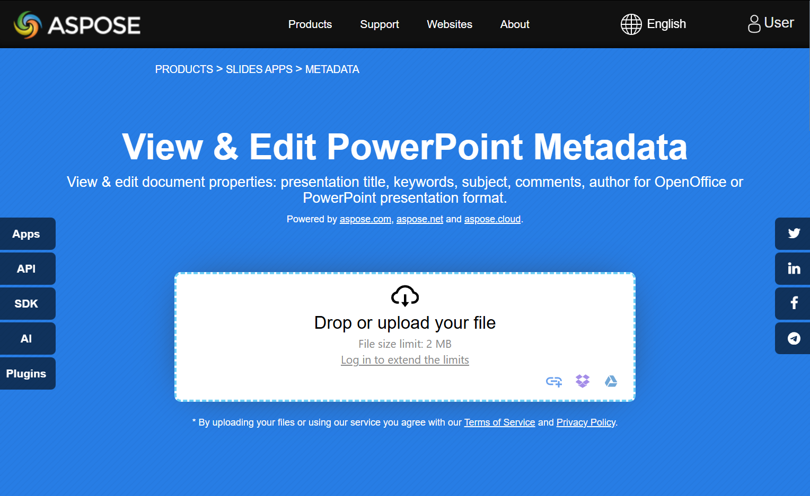

## **Introdução**

Aspose.Slides for .NET suporta **integradas** e **personalizadas** propriedades de documento. Use essas propriedades para ler e atualizar os metadados da apresentação, como o autor, título e valores definidos pelo usuário.

Aspose.Slides permite trabalhar com propriedades de documento de apresentação através da interface [IDocumentProperties](https://reference.aspose.com/slides/net/aspose.slides/idocumentproperties/) . Uma instância dessa interface é retornada por [IPresentation.DocumentProperties](https://reference.aspose.com/slides/net/aspose.slides/ipresentation/documentproperties/). Os exemplos a seguir mostram como ler, modificar e gerenciar essas propriedades.

{}
Aspose.Slides gerencia os metadados de aplicação e produtor ao salvar apresentações; esses campos identificam o software que criou a saída.
{}

## **Gerenciar Propriedades da Apresentação**

Propriedades de documento armazenam informações descritivas junto ao conteúdo da apresentação. Elas se dividem em duas categorias:

- **Propriedades integradas** contêm metadados padrão, como título, autor e estatísticas do documento.
- **Propriedades personalizadas** armazenam pares nome/valor definidos pelo usuário.

Aspose.Slides for .NET fornece acesso a ambas as categorias. No PowerPoint, selecione **File → Info → Properties → Advanced Properties** para inspecionar os metadados do documento. A caixa de diálogo agrupa as informações em guias como **Summary**, **Statistics**, **Contents** e **Custom**. Use a guia **Custom** para gerenciar propriedades definidas pelo usuário.

## **Ler Propriedades Públicas de uma Apresentação Criptografada**

Uma senha de abertura normalmente protege tanto o conteúdo da apresentação quanto as propriedades do documento. Quando uma apresentação é criptografada com [IProtectionManager.EncryptDocumentProperties](https://reference.aspose.com/slides/net/aspose.slides/iprotectionmanager/encryptdocumentproperties/) definido como `false`, suas propriedades de documento permanecem públicas. Uma aplicação pode então definir [LoadOptions.OnlyLoadDocumentProperties](https://reference.aspose.com/slides/net/aspose.slides/loadoptions/onlyloaddocumentproperties/) como `true` e ler os metadados públicos sem fornecer a senha de abertura.

[LoadOptions.OnlyLoadDocumentProperties](https://reference.aspose.com/slides/net/aspose.slides/loadoptions/onlyloaddocumentproperties/) controla o que o Aspose.Slides carrega; não descriptografa nada. Se as propriedades foram incluídas na criptografia, carregá‑las sem a senha falha. Se a apresentação não estiver criptografada, a opção é ignorada e a apresentação completa é carregada.

O exemplo requer uma apresentação criptografada cujas propriedades de documento foram deixadas públicas. Ele verifica o modo de carregamento através de [IProtectionManager.IsOnlyDocumentPropertiesLoaded](https://reference.aspose.com/slides/net/aspose.slides/iprotectionmanager/isonlydocumentpropertiesloaded/) e então lê as propriedades integradas via [IPresentation.DocumentProperties](https://reference.aspose.com/slides/net/aspose.slides/ipresentation/documentproperties/):

```csharp
using System;
using Aspose.Slides;

var loadOptions = new LoadOptions { OnlyLoadDocumentProperties = true };
using var presentation = new Presentation("public-properties-encrypted.pptx", loadOptions);

if (presentation.ProtectionManager.IsOnlyDocumentPropertiesLoaded)
{
    var documentProperties = presentation.DocumentProperties;

    Console.WriteLine("Author: " + documentProperties.Author);
    Console.WriteLine("Title: " + documentProperties.Title);
    Console.WriteLine("Keywords: " + documentProperties.Keywords);
}
else
{
    Console.WriteLine("The presentation was not loaded in document-properties-only mode.");
}
```

Nesse modo, o conteúdo dos slides não é carregado. Slides, mestres, layouts, formas, mídia e outros objetos da apresentação ficam indisponíveis. As aplicações devem sempre verificar [IProtectionManager.IsOnlyDocumentPropertiesLoaded](https://reference.aspose.com/slides/net/aspose.slides/iprotectionmanager/isonlydocumentpropertiesloaded/) antes de executar uma operação que requeira o modelo completo de objetos da apresentação.

{}
Metadados públicos podem expor nomes de autores, títulos, assuntos, palavras‑chave, informações da empresa, comentários e valores personalizados. Criptografe propriedades sensíveis juntamente com a apresentação. Deixe‑as públicas apenas quando sistemas de indexação, classificação, pesquisa ou gerenciamento de documentos tiverem um requisito específico para acessá‑las sem senha.
{}

## **Atualizar Propriedades de uma Apresentação Criptografada**

Para um arquivo PPTX criptografado, uma apresentação carregada com [LoadOptions.OnlyLoadDocumentProperties](https://reference.aspose.com/slides/net/aspose.slides/loadoptions/onlyloaddocumentproperties/) destina‑se a ler metadados públicos. O Aspose.Slides não pode salvar propriedades alteradas desse objeto somente‑metadata porque as propriedades públicas precisam permanecer consistentes com os dados correspondentes dentro da apresentação criptografada. Atualizá‑las, portanto, requer a senha de abertura correta e um carregamento completo.

O exemplo requer uma apresentação PPTX criptografada com propriedades de documento públicas e uma senha de abertura conhecida. Ele abre a apresentação completa com [LoadOptions.Password](https://reference.aspose.com/slides/net/aspose.slides/loadoptions/password/), atualiza as propriedades integradas públicas e salva o resultado. Em seguida, usa [IPresentationInfo.IsEncrypted](https://reference.aspose.com/slides/net/aspose.slides/ipresentationinfo/isencrypted/) para verificar se a criptografia foi preservada e reabre os metadados públicos sem senha para validar os novos valores:

```csharp
using System;
using Aspose.Slides;
using Aspose.Slides.Export;

const string inputPath = "public-properties-encrypted.pptx";
const string outputPath = "updated-public-properties-encrypted.pptx";

var loadOptions = new LoadOptions { Password = "open_password" };
using var presentation = new Presentation(inputPath, loadOptions);

var documentProperties = presentation.DocumentProperties;
documentProperties.Title = "Updated Product Roadmap";
documentProperties.Keywords = "roadmap, planning, indexed";

presentation.Save(outputPath, SaveFormat.Pptx);

var presentationInfo = PresentationFactory.Instance.GetPresentationInfo(outputPath);
Console.WriteLine("The presentation is encrypted: " + presentationInfo.IsEncrypted);

var metadataLoadOptions = new LoadOptions { OnlyLoadDocumentProperties = true };
using var metadataPresentation = new Presentation(outputPath, metadataLoadOptions);

if (metadataPresentation.ProtectionManager.IsOnlyDocumentPropertiesLoaded)
{
    Console.WriteLine("Title: " + metadataPresentation.DocumentProperties.Title);
    Console.WriteLine("Keywords: " + metadataPresentation.DocumentProperties.Keywords);
}
else
{
    Console.WriteLine("The presentation was not loaded in document-properties-only mode.");
}
```

Se uma aplicação não tem permissão para descriptografar ou carregar o conteúdo da apresentação, ela deve tratar as propriedades públicas de um arquivo PPTX criptografado como somente‑leitura.

## **Acessar Propriedades Integradas**

A interface [IDocumentProperties](https://reference.aspose.com/slides/net/aspose.slides/idocumentproperties/) expõe metadados integrados por meio de propriedades tipadas, incluindo [Author](https://reference.aspose.com/slides/net/aspose.slides/idocumentproperties/author/), [Title](https://reference.aspose.com/slides/net/aspose.slides/idocumentproperties/title/) e [CreatedTime](https://reference.aspose.com/slides/net/aspose.slides/idocumentproperties/createdtime/). Este exemplo abre uma apresentação existente e imprime seus metadados armazenados no console. Os valores dependem da apresentação de entrada; alguns campos podem estar vazios.

```csharp
using System;
using Aspose.Slides;

using var presentation = new Presentation("AccessBuiltInProperties.pptx");

var documentProperties = presentation.DocumentProperties;

Console.WriteLine("Category: " + documentProperties.Category);
Console.WriteLine("Content status: " + documentProperties.ContentStatus);
Console.WriteLine("Creation date: " + documentProperties.CreatedTime);
Console.WriteLine("Author: " + documentProperties.Author);
Console.WriteLine("Comments: " + documentProperties.Comments);
Console.WriteLine("Keywords: " + documentProperties.Keywords);
Console.WriteLine("Last modified by: " + documentProperties.LastSavedBy);
Console.WriteLine("Manager: " + documentProperties.Manager);
Console.WriteLine("Modified date: " + documentProperties.LastSavedTime);
Console.WriteLine("Presentation format: " + documentProperties.PresentationFormat);
Console.WriteLine("Last print date: " + documentProperties.LastPrinted);
Console.WriteLine("Is shared between producers: " + documentProperties.SharedDoc);
Console.WriteLine("Subject: " + documentProperties.Subject);
Console.WriteLine("Title: " + documentProperties.Title);
```

### **Relatar Número de Revisão e Tempo de Edição**

Para relatar uma linha para cada arquivo PPTX na pasta `presentations`, chame [ReadDocumentProperties](https://reference.aspose.com/slides/net/aspose.slides/ipresentationinfo/readdocumentproperties/) para recuperar seu [IDocumentProperties](https://reference.aspose.com/slides/net/aspose.slides/idocumentproperties/) sem carregar os slides para edição. O formato padrão `c` para `TimeSpan` inclui a contagem de dias quando a duração atinge 24 horas.

```csharp
using System;
using System.IO;
using Aspose.Slides;

Console.WriteLine("File | RevisionNumber | TotalEditingTime");
foreach (var path in Directory.EnumerateFiles("presentations", "*.pptx"))
{
    var info = PresentationFactory.Instance.GetPresentationInfo(path);
    var properties = info.ReadDocumentProperties();
    Console.WriteLine($"{Path.GetFileName(path)} | {properties.RevisionNumber} | {properties.TotalEditingTime:c}");
}
```

Exemplo de saída para uma apresentação com 1 dia, 2 horas e 5 minutos de tempo de edição registrado:

```text
File | RevisionNumber | TotalEditingTime
long.pptx | 17 | 1.02:05:00
```

[RevisionNumber](https://reference.aspose.com/slides/net/aspose.slides/idocumentproperties/revisionnumber/) é um metadado gravável. Seu valor isolado não pode determinar quantas vezes a apresentação foi salva nem reconstruir seu histórico de versões.

[TotalEditingTime](https://reference.aspose.com/slides/net/aspose.slides/idocumentproperties/totaleditingtime/) é a duração de edição registrada no arquivo. Um valor de `00:00:00` significa que a duração armazenada é zero. Não prova que ninguém editou a apresentação.

## **Modificar Propriedades Integradas**

Para atualizar metadados integrados, atribua valores às propriedades graváveis expostas por [IPresentation.DocumentProperties](https://reference.aspose.com/slides/net/aspose.slides/ipresentation/documentproperties/). Este exemplo abre uma apresentação existente, define [Author](https://reference.aspose.com/slides/net/aspose.slides/idocumentproperties/author/), [Title](https://reference.aspose.com/slides/net/aspose.slides/idocumentproperties/title/), [Subject](https://reference.aspose.com/slides/net/aspose.slides/idocumentproperties/subject/), [Comments](https://reference.aspose.com/slides/net/aspose.slides/idocumentproperties/comments/), e [Manager](https://reference.aspose.com/slides/net/aspose.slides/idocumentproperties/manager/), então salva a apresentação atualizada com [Presentation.Save](https://reference.aspose.com/slides/net/aspose.slides/presentation/save/). O PPTX salvo contém os novos metadados.

```csharp
using Aspose.Slides;
using Aspose.Slides.Export;

using var presentation = new Presentation("ModifyBuiltInProperties.pptx");

var documentProperties = presentation.DocumentProperties;

documentProperties.Author = "Aspose.Slides for .NET";
documentProperties.Title = "Manage PowerPoint Presentation Properties";
documentProperties.Subject = "Modify Built-in Properties";
documentProperties.Comments = "Aspose description";
documentProperties.Manager = "Aspose manager";

presentation.Save("DocumentProperties_output.pptx", SaveFormat.Pptx);
```

## **Gerenciar a Base de Hyperlink**

[IDocumentProperties.HyperlinkBase](https://reference.aspose.com/slides/net/aspose.slides/idocumentproperties/hyperlinkbase/) armazena a base a nível de documento para hyperlinks relativos. Isso é útil ao mover uma apresentação e seus arquivos vinculados para outro local. É independente do [IHyperlink.ExternalUrl](https://reference.aspose.com/slides/net/aspose.slides/ihyperlink/externalurl/) de um hyperlink individual: alterar a base não reescreve os endereços dos links armazenados nem altera destinos absolutos.

O exemplo requer uma apresentação contendo tanto um link relativo, como `target.html`, quanto um link absoluto, como `https://example.org/absolute.html`. Ele lê a base existente, atribui um novo endereço de base e salva e reabre a apresentação para verificar o valor. Em seguida, limpa a base com `string.Empty` e verifica o valor vazio em um arquivo salvo separado. Substitua o endereço de base de exemplo pela localização dos seus arquivos vinculados.

```csharp
using System;
using Aspose.Slides;
using Aspose.Slides.Export;

using var presentation = new Presentation("hyperlinks.pptx");
Console.WriteLine("Original base: " + presentation.DocumentProperties.HyperlinkBase);

const string newBase = "https://example.com/new/";
presentation.DocumentProperties.HyperlinkBase = newBase;
presentation.Save("hyperlinks-updated.pptx", SaveFormat.Pptx);

using var updatedPresentation = new Presentation("hyperlinks-updated.pptx");
Console.WriteLine("Base preserved: " + (updatedPresentation.DocumentProperties.HyperlinkBase == newBase));

updatedPresentation.DocumentProperties.HyperlinkBase = string.Empty;
updatedPresentation.Save("hyperlinks-cleared.pptx", SaveFormat.Pptx);

using var clearedPresentation = new Presentation("hyperlinks-cleared.pptx");
Console.WriteLine("Base cleared: " + (clearedPresentation.DocumentProperties.HyperlinkBase == string.Empty));
```

As duas mensagens de verificação devem imprimir `True`. Limpar a base deixa os endereços de hyperlink individuais intactos.

Um link relativo para `target.pptx` abriu `old/target.pptx` quando a base apontava para a pasta `old`. Após mudar a base para a pasta `new`, salvar e reabrir a apresentação, o mesmo link abriu `new/target.pptx`. Um link absoluto continuou a abrir o mesmo arquivo. Teste seus links relativos no PowerPoint antes e depois de mover a apresentação ou alterar sua base.

## **Adicionar Propriedades Personalizadas de Apresentação**

Propriedades personalizadas armazenam metadados que não têm um campo integrado correspondente. O indexador [IDocumentProperties](https://reference.aspose.com/slides/net/aspose.slides/idocumentproperties/item/) permite atribuir um valor por nome de propriedade. Este exemplo cria uma apresentação, adiciona dois valores de texto e um valor de versão inteiro, e salva a apresentação com [Presentation.Save](https://reference.aspose.com/slides/net/aspose.slides/presentation/save/). Atribuir um valor a um nome existente substitui o valor da propriedade.

```csharp
using Aspose.Slides;
using Aspose.Slides.Export;

using var presentation = new Presentation();

var documentProperties = presentation.DocumentProperties;

documentProperties["Reviewed by"] = "John Smith";
documentProperties["Confidentiality level"] = "Internal";
documentProperties["Document version"] = 2;

presentation.Save("CustomDocumentProperties_output.pptx", SaveFormat.Pptx);
```

## **Acessar e Modificar Propriedades Personalizadas**

Este exemplo abre uma apresentação contendo propriedades personalizadas e usa [CountOfCustomProperties](https://reference.aspose.com/slides/net/aspose.slides/idocumentproperties/countofcustomproperties/) para iterar sobre elas. [GetCustomPropertyName](https://reference.aspose.com/slides/net/aspose.slides/idocumentproperties/getcustompropertyname/) aceita um índice baseado em zero e retorna o nome usado pelo [indexador IDocumentProperties](https://reference.aspose.com/slides/net/aspose.slides/idocumentproperties/item/). O exemplo imprime cada nome e valor original, substitui cada valor por uma string numerada independentemente do tipo original, e salva as alterações. Se não houver propriedades personalizadas, o loop não faz alterações.

```csharp
using System;
using Aspose.Slides;
using Aspose.Slides.Export;

using var presentation = new Presentation("AccessAndModifyProperties.pptx");

var documentProperties = presentation.DocumentProperties;

for (var i = 0; i < documentProperties.CountOfCustomProperties; i++)
{
    var propertyName = documentProperties.GetCustomPropertyName(i);
    var propertyValue = documentProperties[propertyName];

    Console.WriteLine("Custom property name: " + propertyName);
    Console.WriteLine("Custom property value: " + propertyValue);

    documentProperties[propertyName] = "New Value " + (i + 1);
}

presentation.Save("CustomProperties_output.pptx", SaveFormat.Pptx);
```

## **Exemplo ao Vivo**

Experimente o aplicativo online [**View & Edit PowerPoint Metadata**](https://products.aspose.app/slides/metadata) para ver como trabalhar com propriedades de documento usando a API Aspose.Slides:

[](https://products.aspose.app/slides/metadata)

## **Perguntas Frequentes**

**Como posso remover uma propriedade integrada de uma apresentação?**

As propriedades integradas são parte integrante da apresentação e não podem ser removidas completamente. No entanto, você pode alterar seus valores ou defini‑‑las como vazias, se a propriedade específica permitir.

**O que acontece se eu adicionar uma propriedade personalizada que já existe?**

Se você adicionar uma propriedade personalizada que já existe, seu valor atual será sobrescrito com o novo. Não é necessário remover ou verificar a propriedade previamente, pois o Aspose.Slides atualiza automaticamente o valor da propriedade.

**Posso acessar propriedades da apresentação sem carregar totalmente a apresentação?**

Sim. Use [PresentationFactory.GetPresentationInfo](https://reference.aspose.com/slides/net/aspose.slides/presentationfactory/getpresentationinfo/) e depois [IPresentationInfo.ReadDocumentProperties](https://reference.aspose.com/slides/net/aspose.slides/ipresentationinfo/readdocumentproperties/) para ler os metadados de documento armazenados sem criar uma instância [Presentation](https://reference.aspose.com/slides/net/aspose.slides/presentation/). Veja [Build a Lightweight Presentation Inventory](/slides/pt/net/examine-presentation/) para um exemplo completo de relatório e limitações específicas de formato.

**Posso ler propriedades públicas de uma apresentação criptografada sem sua senha de abertura?**

Sim. A apresentação deve ter sido criptografada com [IProtectionManager.EncryptDocumentProperties](https://reference.aspose.com/slides/net/aspose.slides/iprotectionmanager/encryptdocumentproperties/) definido como `false`, e deve ser carregada com [LoadOptions.OnlyLoadDocumentProperties](https://reference.aspose.com/slides/net/aspose.slides/loadoptions/onlyloaddocumentproperties/) definido como `true`.

**Posso atualizar um arquivo PPTX criptografado no modo apenas‑propriedades‑de‑documento?**

Não. Dados de propriedades públicas e criptografadas devem permanecer consistentes, portanto atualizar um arquivo PPTX criptografado requer carregar a apresentação completa com a senha de abertura correta.