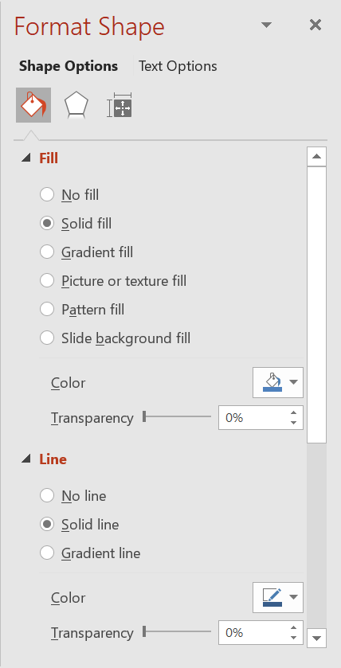

## **Introdução**

Formate formas no PowerPoint ajustando seus contornos, preenchimentos e efeitos. Aspose.Slides for Node.js via Java permite controlar essas configurações programaticamente, incluindo transparência, rotação e formatação 3D.



Aspose.Slides for Node.js via Java fornece classes e métodos que permitem formatar formas usando as mesmas opções disponíveis no PowerPoint.

## **Formatar Linhas**

Use [Shape.getLineFormat](https://reference.aspose.com/slides/nodejs-java/aspose.slides/shape/#getLineFormat) para controlar o contorno de uma forma. Este exemplo cria um retângulo sem preenchimento com um contorno azul tracejado. [LineFormat.setStyle](https://reference.aspose.com/slides/nodejs-java/aspose.slides/lineformat/#setStyle) seleciona uma linha composta grossa‑fina, enquanto [LineFormat.setWidth](https://reference.aspose.com/slides/nodejs-java/aspose.slides/lineformat/#setWidth) define sua largura para 7 pontos e [LineFormat.setDashStyle](https://reference.aspose.com/slides/nodejs-java/aspose.slides/lineformat/#setDashStyle) seleciona o padrão de traço.

```javascript
const aspose = { slides: require("aspose.slides.via.java") };
const java = require("java");

let presentation = new aspose.slides.Presentation();
try {
    let slide = presentation.getSlides().get_Item(0);

    let shape = slide.getShapes().addAutoShape(aspose.slides.ShapeType.Rectangle, 50, 50, 150, 75);
    shape.getFillFormat().setFillType(java.newByte(aspose.slides.FillType.NoFill));
    shape.getLineFormat().setStyle(java.newByte(aspose.slides.LineStyle.ThickThin));
    shape.getLineFormat().setWidth(7);
    shape.getLineFormat().setDashStyle(java.newByte(aspose.slides.LineDashStyle.Dash));
    shape.getLineFormat().getFillFormat().setFillType(java.newByte(aspose.slides.FillType.Solid));
    shape.getLineFormat().getFillFormat().getSolidFillColor().setColor(java.getStaticFieldValue("java.awt.Color", "BLUE"));

    presentation.save("formatted_lines.pptx", aspose.slides.SaveFormat.Pptx);
} finally {
    presentation.dispose();
}
```

O resultado:


### **Definir Padrões de Traço de Linha Personalizados**

Use [LineFormat.setCustomDashPattern](https://reference.aspose.com/slides/nodejs-java/aspose.slides/lineformat/#setCustomDashPattern) quando os estilos de linha predefinidos não fornecem os comprimentos de traço e espaço que você precisa, por exemplo para contornos de marca ou diagramas técnicos. Atribuir um padrão altera automaticamente o estilo de traço da linha para [LineDashStyle.Custom](https://reference.aspose.com/slides/nodejs-java/aspose.slides/linedashstyle/).

As entradas do array alternam entre comprimentos de traço e de espaço, começando com um traço. Cada valor é um múltiplo da largura da linha: `[4, 2]` com largura de 3 pontos produz um traço de 12 pontos seguido por um espaço de 6 pontos. Use pares de valores finitos e não‑negativos para definir segmentos completos de traço‑e‑espaço. O exemplo usa valores positivos para manter cada traço e espaço visíveis.

Este exemplo cria cinco linhas azuis com o mesmo comprimento e extremidades planas. As três primeiras comparam padrões com largura de 3 pontos. A quarta repete o primeiro padrão com o dobro da largura, dobrando tanto o traço quanto o espaço. A quinta troca de um padrão personalizado para uma linha sólida.

```javascript
const aspose = { slides: require("aspose.slides.via.java") };
const java = require("java");

let presentation = new aspose.slides.Presentation();
try {
    presentation.getSlideSize().setSize(600, 300, aspose.slides.SlideSizeScaleType.DoNotScale);
    let slide = presentation.getSlides().get_Item(0);

    let patterns = [
        [4, 2],
        [1, 2],
        [6, 2, 1, 2],
        [4, 2],
        [4, 2]
    ];

    for (let i = 0; i < patterns.length; i++) {
        let line = slide.getShapes().addAutoShape(aspose.slides.ShapeType.Line, 50, 50 + i * 50, 500, 0);
        line.getLineFormat().setWidth(i == 3 ? 6 : 3);
        line.getLineFormat().getFillFormat().setFillType(java.newByte(aspose.slides.FillType.Solid));
        line.getLineFormat().getFillFormat().getSolidFillColor().setColor(java.newInstanceSync("java.awt.Color", 0, 0, 139));
        line.getLineFormat().setCapStyle(java.newByte(aspose.slides.LineCapStyle.Flat));
        line.getLineFormat().setBeginArrowheadStyle(java.newByte(aspose.slides.LineArrowheadStyle.None));
        line.getLineFormat().setEndArrowheadStyle(java.newByte(aspose.slides.LineArrowheadStyle.None));
        let pattern = java.newArray("float", patterns[i]);
        line.getLineFormat().setCustomDashPattern(pattern);
    }

    // Retorne a última linha para um estilo sólido.
    slide.getShapes().get_Item(4).getLineFormat().setDashStyle(java.newByte(aspose.slides.LineDashStyle.Solid));

    presentation.save("custom_dash_patterns.pptx", aspose.slides.SaveFormat.Pptx);
} finally {
    presentation.dispose();
}
```

Para retornar a um estilo de linha tracejada predefinido, passe [LineDashStyle.Dash](https://reference.aspose.com/slides/nodejs-java/aspose.slides/linedashstyle/) para [LineFormat.setDashStyle](https://reference.aspose.com/slides/nodejs-java/aspose.slides/lineformat/#setDashStyle). O estilo selecionado controla a aparência da linha.

O resultado no PowerPoint, de cima para baixo: **{4, 2}, 3 pt**; **{1, 2}, 3 pt**; **{6, 2, 1, 2}, 3 pt**; **{4, 2}, 6 pt**; e **Solid, 3 pt**.


### **Definir Extremos de Linha**

Use [LineFormat.setCapStyle](https://reference.aspose.com/slides/nodejs-java/aspose.slides/lineformat/#setCapStyle) para definir as extremidades de uma linha aberta. A classe [LineCapStyle](https://reference.aspose.com/slides/nodejs-java/aspose.slides/linecapstyle/) fornece três estilos de extremidade explícitos:

- `Flat`: O traço termina no ponto final.
- `Round`: Uma extremidade semicircular estende‑se além do ponto final em metade da largura da linha.
- `Square`: Uma extremidade quadrada estende‑se além do ponto final em metade da largura da linha.

A classe também inclui `NotDefined`, que significa que nenhum estilo de extremidade foi atribuído explicitamente.

As extremidades são diferentes de pontas de seta, que adicionam símbolos às extremidades da linha, e de junções, que controlam cantos entre segmentos de linha. Este exemplo desabilita as pontas de seta através de [LineFormat.setBeginArrowheadStyle](https://reference.aspose.com/slides/nodejs-java/aspose.slides/lineformat/#setBeginArrowheadStyle) e [LineFormat.setEndArrowheadStyle](https://reference.aspose.com/slides/nodejs-java/aspose.slides/lineformat/#setEndArrowheadStyle) para que apenas as formas de extremidade sejam comparadas.

O exemplo a seguir cria três linhas horizontais, de outras formas idênticas, com 20 pontos de largura. De cima para baixo, elas usam extremidades flat, round e square. Seus pontos finais têm as mesmas coordenadas horizontais; as extremidades round e square estendem‑se 10 pontos além de cada ponto final.

```javascript
const aspose = { slides: require("aspose.slides.via.java") };
const java = require("java");

let presentation = new aspose.slides.Presentation();
try {
    presentation.getSlideSize().setSize(500, 240, aspose.slides.SlideSizeScaleType.DoNotScale);
    let slide = presentation.getSlides().get_Item(0);

    let capStyles = [aspose.slides.LineCapStyle.Flat, aspose.slides.LineCapStyle.Round, aspose.slides.LineCapStyle.Square];

    for (let i = 0; i < capStyles.length; i++) {
        let line = slide.getShapes().addAutoShape(aspose.slides.ShapeType.Line, 100, 50 + i * 70, 300, 0);
        line.getLineFormat().setWidth(20);
        line.getLineFormat().getFillFormat().setFillType(java.newByte(aspose.slides.FillType.Solid));
        line.getLineFormat().getFillFormat().getSolidFillColor().setColor(java.newInstanceSync("java.awt.Color", 0, 0, 139));
        line.getLineFormat().setDashStyle(java.newByte(aspose.slides.LineDashStyle.Solid));
        line.getLineFormat().setCapStyle(java.newByte(capStyles[i]));
        line.getLineFormat().setBeginArrowheadStyle(java.newByte(aspose.slides.LineArrowheadStyle.None));
        line.getLineFormat().setEndArrowheadStyle(java.newByte(aspose.slides.LineArrowheadStyle.None));
    }

    presentation.save("line_caps.pptx", aspose.slides.SaveFormat.Pptx);
} finally {
    presentation.dispose();
}
```

O resultado no PowerPoint, de cima para baixo: **Flat**, **Round** e **Square**.


## **Aplicar Efeitos de Esboço às Linhas de Forma**

Um efeito de esboço faz a linha de uma forma parecer desenhada à mão. Use [Shape.getLineFormat](https://reference.aspose.com/slides/nodejs-java/aspose.slides/shape/#getLineFormat) para acessar as configurações da linha, [LineFormat.getSketchFormat](https://reference.aspose.com/slides/nodejs-java/aspose.slides/lineformat/#getSketchFormat) para acessar as configurações de esboço e [SketchFormat.setSketchType](https://reference.aspose.com/slides/nodejs-java/aspose.slides/sketchformat/#setSketchType) para selecionar um valor da classe [LineSketchType](https://reference.aspose.com/slides/nodejs-java/aspose.slides/linesketchtype/).

O código JavaScript a seguir demonstra como aplicar o efeito [LineSketchType.Curved](https://reference.aspose.com/slides/nodejs-java/aspose.slides/linesketchtype/), ler o valor atribuído explicitamente e remover o efeito com [LineSketchType.None](https://reference.aspose.com/slides/nodejs-java/aspose.slides/linesketchtype/):

```javascript
const aspose = { slides: require("aspose.slides.via.java") };

let presentation = new aspose.slides.Presentation();
try {
    let slide = presentation.getSlides().get_Item(0);

    let shape = slide.getShapes().addAutoShape(aspose.slides.ShapeType.Rectangle, 50, 50, 200, 100);

    let sketchFormat = shape.getLineFormat().getSketchFormat();
    sketchFormat.setSketchType(aspose.slides.LineSketchType.Curved);
    let explicitSketchType = sketchFormat.getSketchType();
    console.log("Explicit sketch type: " + explicitSketchType);
    sketchFormat.setSketchType(aspose.slides.LineSketchType.None);
} finally {
    presentation.dispose();
}
```

O valor retornado por [SketchFormat.getSketchType](https://reference.aspose.com/slides/nodejs-java/aspose.slides/sketchformat/#getSketchType) representa a configuração atribuída diretamente à forma. Se a formatação da linha puder ser herdada de um tema, slide mestre ou slide de layout, use [LineFormat.getEffective](https://reference.aspose.com/slides/nodejs-java/aspose.slides/lineformat/#getEffective), chame `getSketchFormat` no objeto retornado e, em seguida, chame seu método `getSketchType`. O valor efetivo reflete a formatação realmente aplicada após a resolução da herança. Este exemplo requer uma apresentação existente com ao menos uma forma no primeiro slide e imprime ambos os valores:

```javascript
const aspose = { slides: require("aspose.slides.via.java") };

let presentation = new aspose.slides.Presentation("presentation.pptx");
try {
    let shape = presentation.getSlides().get_Item(0).getShapes().get_Item(0);

    let lineFormat = shape.getLineFormat();
    let explicitSketchType = lineFormat.getSketchFormat().getSketchType();
    let effectiveLineFormat = lineFormat.getEffective();
    let effectiveSketchType = effectiveLineFormat.getSketchFormat().getSketchType();

    console.log("Explicit sketch type: " + explicitSketchType);
    console.log("Effective sketch type: " + effectiveSketchType);
} finally {
    presentation.dispose();
}
```

## **Formatar Estilos de Junção**

Aqui estão as três opções de tipo de junção:

* Round
* Miter
* Bevel

O estilo de junção controla como dois segmentos de contorno se encontram em um canto. Use **Round** para cantos arredondados, **Miter** para cantos agudos ou **Bevel** para cantos chanfreados.


Este exemplo cria três retângulos pretos com contornos azuis de 15 pontos de largura. Ele usa [LineFormat.setJoinStyle](https://reference.aspose.com/slides/nodejs-java/aspose.slides/lineformat/#setJoinStyle) para aplicar, respectivamente, os valores miter, bevel e round da classe [LineJoinStyle](https://reference.aspose.com/slides/nodejs-java/aspose.slides/linejoinstyle/), a fim de comparar como os cantos são desenhados.

```javascript
const aspose = { slides: require("aspose.slides.via.java") };
const java = require("java");

let presentation = new aspose.slides.Presentation();
try {
    let slide = presentation.getSlides().get_Item(0);

    let miterShape = slide.getShapes().addAutoShape(aspose.slides.ShapeType.Rectangle, 20, 20, 150, 75);
    let bevelShape = slide.getShapes().addAutoShape(aspose.slides.ShapeType.Rectangle, 210, 20, 150, 75);
    let roundShape = slide.getShapes().addAutoShape(aspose.slides.ShapeType.Rectangle, 20, 135, 150, 75);

    miterShape.getFillFormat().setFillType(java.newByte(aspose.slides.FillType.Solid));
    miterShape.getFillFormat().getSolidFillColor().setColor(java.getStaticFieldValue("java.awt.Color", "BLACK"));
    bevelShape.getFillFormat().setFillType(java.newByte(aspose.slides.FillType.Solid));
    bevelShape.getFillFormat().getSolidFillColor().setColor(java.getStaticFieldValue("java.awt.Color", "BLACK"));
    roundShape.getFillFormat().setFillType(java.newByte(aspose.slides.FillType.Solid));
    roundShape.getFillFormat().getSolidFillColor().setColor(java.getStaticFieldValue("java.awt.Color", "BLACK"));

    miterShape.getLineFormat().setWidth(15);
    bevelShape.getLineFormat().setWidth(15);
    roundShape.getLineFormat().setWidth(15);

    miterShape.getLineFormat().getFillFormat().setFillType(java.newByte(aspose.slides.FillType.Solid));
    miterShape.getLineFormat().getFillFormat().getSolidFillColor().setColor(java.getStaticFieldValue("java.awt.Color", "BLUE"));
    bevelShape.getLineFormat().getFillFormat().setFillType(java.newByte(aspose.slides.FillType.Solid));
    bevelShape.getLineFormat().getFillFormat().getSolidFillColor().setColor(java.getStaticFieldValue("java.awt.Color", "BLUE"));
    roundShape.getLineFormat().getFillFormat().setFillType(java.newByte(aspose.slides.FillType.Solid));
    roundShape.getLineFormat().getFillFormat().getSolidFillColor().setColor(java.getStaticFieldValue("java.awt.Color", "BLUE"));

    miterShape.getLineFormat().setJoinStyle(java.newByte(aspose.slides.LineJoinStyle.Miter));
    bevelShape.getLineFormat().setJoinStyle(java.newByte(aspose.slides.LineJoinStyle.Bevel));
    roundShape.getLineFormat().setJoinStyle(java.newByte(aspose.slides.LineJoinStyle.Round));

    miterShape.getTextFrame().setText("Miter Join Style");
    bevelShape.getTextFrame().setText("Bevel Join Style");
    roundShape.getTextFrame().setText("Round Join Style");

    presentation.save("join_styles.pptx", aspose.slides.SaveFormat.Pptx);
} finally {
    presentation.dispose();
}
```

### **Limitar Junções Miter em Cantos Agudos**

Use [LineFormat.setMiterLimit](https://reference.aspose.com/slides/nodejs-java/aspose.slides/lineformat/#setMiterLimit) com [LineFormat.setJoinStyle](https://reference.aspose.com/slides/nodejs-java/aspose.slides/lineformat/#setJoinStyle) definido como [LineJoinStyle.Miter](https://reference.aspose.com/slides/nodejs-java/aspose.slides/linejoinstyle/) para limitar a extensão de um canto agudo.

O limite é uma razão entre a distância entre o canto interno e externo da junção e a largura da linha. Por exemplo, o valor `8` permite um comprimento de mitra de até oito vezes a largura da linha; não é uma medida em pontos. Se o canto exceder o limite, o PowerPoint usa uma junção chanfrada naquele ponto. Um limite maior permite pontas mais agudas. A configuração afeta apenas junções miter e não tem efeito visível quando o canto permanece dentro dos limites.

Este exemplo cria dois triângulos idênticos, sem preenchimento, com contornos de 20 pontos de largura. O triângulo esquerdo usa limite `2` e o direito usa `8`. Cada triângulo tem 80 pontos de largura e 160 pontos de altura, dando ao canto superior uma razão comprimento‑da‑mitra‑para‑largura‑da‑linha de aproximadamente `4.12`. Consequentemente, o PowerPoint chanfrar o ápice esquerdo e preserva o ápice direito.

```javascript
const aspose = { slides: require("aspose.slides.via.java") };
const java = require("java");

let presentation = new aspose.slides.Presentation();
try {
    presentation.getSlideSize().setSize(500, 320, aspose.slides.SlideSizeScaleType.DoNotScale);
    let slide = presentation.getSlides().get_Item(0);

    let miterLimits = [2, 8];

    for (let i = 0; i < miterLimits.length; i++) {
        let triangle = slide.getShapes().addAutoShape(aspose.slides.ShapeType.Triangle, 90 + i * 240, 110, 80, 160);
        triangle.getFillFormat().setFillType(java.newByte(aspose.slides.FillType.NoFill));
        triangle.getLineFormat().setWidth(20);
        triangle.getLineFormat().getFillFormat().setFillType(java.newByte(aspose.slides.FillType.Solid));
        triangle.getLineFormat().getFillFormat().getSolidFillColor().setColor(java.newInstanceSync("java.awt.Color", 0, 0, 139));
        triangle.getLineFormat().setJoinStyle(java.newByte(aspose.slides.LineJoinStyle.Miter));
        triangle.getLineFormat().setMiterLimit(java.newFloat(miterLimits[i]));
    }

    presentation.save("miter_limits.pptx", aspose.slides.SaveFormat.Pptx);
} finally {
    presentation.dispose();
}
```

O resultado no PowerPoint: **Miter limit 2** à esquerda e **miter limit 8** à direita.


## **Preenchimento em Degradê**

Um preenchimento em degradê mescla cores ao longo de uma forma. Este exemplo preenche uma elipse com um degradê linear em ângulo de 45 graus, do vermelho ao roxo, usando [FillFormat.getGradientFormat](https://reference.aspose.com/slides/nodejs-java/aspose.slides/fillformat/#getGradientFormat). O método [GradientStopCollection.addPresetColor](https://reference.aspose.com/slides/nodejs-java/aspose.slides/gradientstopcollection/#addPresetColor) coloca as paradas de cor em 0 e 1, início e fim do degradê. Limpar as paradas existentes garante que apenas essas duas cores sejam usadas.

```javascript
const aspose = { slides: require("aspose.slides.via.java") };
const java = require("java");

let presentation = new aspose.slides.Presentation();
try {
    let slide = presentation.getSlides().get_Item(0);

    let shape = slide.getShapes().addAutoShape(aspose.slides.ShapeType.Ellipse, 50, 50, 150, 75);
    shape.getFillFormat().setFillType(java.newByte(aspose.slides.FillType.Gradient));
    shape.getFillFormat().getGradientFormat().setGradientShape(java.newByte(aspose.slides.GradientShape.Linear));
    shape.getFillFormat().getGradientFormat().setLinearGradientAngle(45);
    shape.getFillFormat().getGradientFormat().getGradientStops().clear();
    shape.getFillFormat().getGradientFormat().getGradientStops().addPresetColor(1.0, aspose.slides.PresetColor.Purple);
    shape.getFillFormat().getGradientFormat().getGradientStops().addPresetColor(0.0, aspose.slides.PresetColor.Red);

    presentation.save("gradient_fill.pptx", aspose.slides.SaveFormat.Pptx);
} finally {
    presentation.dispose();
}
```

O resultado:


Se um degradê parecer diferente em uma imagem exportada comparado ao PowerPoint, veja [Choose a Gradient Rendering Style](/slides/pt/nodejs-java/convert-powerpoint-to-png/#choose-a-gradient-rendering-style). Você pode selecionar um estilo de renderização sem alterar o degradê armazenado na apresentação.

### **Definir oÂngulo do Degradê Linear**

Use [GradientFormat.setLinearGradientAngle](https://reference.aspose.com/slides/nodejs-java/aspose.slides/gradientformat/#setLinearGradientAngle) para controlar a orientação de um preenchimento [GradientShape.Linear](https://reference.aspose.com/slides/nodejs-java/aspose.slides/gradientshape/). O ângulo é medido em graus e aumenta no sentido horário: `0` vai da esquerda para a direita, `90` de cima para baixo, `180` da direita para a esquerda e `270` de baixo para cima. Ângulos fracionários são suportados. Ângulos finitos fora de `[0, 360)` são normalizados para uma revolução; por exemplo, `-45` torna‑se `315` e `360` torna‑se `0`.

Este exemplo cria seis retângulos com paradas de cor vermelha, verde e azul idênticas nas posições `0`, `0.5` e `1`. A escalonamento está desativado para que o ângulo possa ser comparado independentemente das proporções dos retângulos. Os ângulos, da esquerda para a direita, são `0`, `45` e `90` na primeira linha, e `135`, `180` e `270` na segunda linha.

```javascript
const aspose = { slides: require("aspose.slides.via.java") };
const java = require("java");

let presentation = new aspose.slides.Presentation();
try {
    presentation.getSlideSize().setSize(720, 400, aspose.slides.SlideSizeScaleType.DoNotScale);
    let slide = presentation.getSlides().get_Item(0);

    let angles = [0, 45, 90, 135, 180, 270];

    for (let i = 0; i < angles.length; i++) {
        let x = 30 + (i % 3) * 230;
        let y = 30 + Math.floor(i / 3) * 190;

        let shape = slide.getShapes().addAutoShape(aspose.slides.ShapeType.Rectangle, x, y, 200, 150);
        shape.getLineFormat().getFillFormat().setFillType(java.newByte(aspose.slides.FillType.NoFill));
        shape.getFillFormat().setFillType(java.newByte(aspose.slides.FillType.Gradient));

        let gradient = shape.getFillFormat().getGradientFormat();
        gradient.setGradientShape(java.newByte(aspose.slides.GradientShape.Linear));
        gradient.getGradientStops().clear();
        gradient.getGradientStops().add(0, java.getStaticFieldValue("java.awt.Color", "RED"));
        gradient.getGradientStops().add(java.newFloat(0.5), java.getStaticFieldValue("java.awt.Color", "GREEN"));
        gradient.getGradientStops().add(1, java.getStaticFieldValue("java.awt.Color", "BLUE"));
        gradient.setLinearGradientScaled(java.newByte(aspose.slides.NullableBool.False));
        gradient.setLinearGradientAngle(angles[i]);
    }

    presentation.save("linear_gradient_angles.pptx", aspose.slides.SaveFormat.Pptx);
} finally {
    presentation.dispose();
}
```

O resultado no PowerPoint:


### **Escalar um Degradê Linear com a Forma**

[GradientFormat.setLinearGradientScaled](https://reference.aspose.com/slides/nodejs-java/aspose.slides/gradientformat/#setLinearGradientScaled) aceita um valor [NullableBool](https://reference.aspose.com/slides/nodejs-java/aspose.slides/nullablebool/). Defina‑o explicitamente como `False` para manter o ângulo geométrico do degradê quando as proporções da forma mudarem, ou como `True` para escalar o degradê com a largura e altura da forma. Com a escalonamento habilitado, o ângulo visível pode diferir do ângulo atribuído em uma forma não quadrada.

O exemplo a seguir usa um ângulo de `45` graus e as mesmas paradas de cor da comparação de ângulos. A coluna da esquerda usa `False`; a da direita usa `True`. Cada coluna contém um retângulo largo acima de um retângulo alto. Ambos começam com as mesmas dimensões largas; mudar a largura e altura do segundo retângulo demonstra como o preenchimento responde ao redimensionamento sem alterar suas configurações de degradê.

```javascript
const aspose = { slides: require("aspose.slides.via.java") };
const java = require("java");

let presentation = new aspose.slides.Presentation();
try {
    presentation.getSlideSize().setSize(720, 460, aspose.slides.SlideSizeScaleType.DoNotScale);
    let slide = presentation.getSlides().get_Item(0);

    let scalingOptions = [aspose.slides.NullableBool.False, aspose.slides.NullableBool.True];

    for (let column = 0; column < scalingOptions.length; column++) {
        for (let row = 0; row < 2; row++) {
            let x = 30 + column * 360;
            let y = row == 0 ? 30 : 150;

            let shape = slide.getShapes().addAutoShape(aspose.slides.ShapeType.Rectangle, x, y, 300, 90);
            shape.getLineFormat().getFillFormat().setFillType(java.newByte(aspose.slides.FillType.NoFill));
            shape.getFillFormat().setFillType(java.newByte(aspose.slides.FillType.Gradient));

            let gradient = shape.getFillFormat().getGradientFormat();
            gradient.setGradientShape(java.newByte(aspose.slides.GradientShape.Linear));
            gradient.getGradientStops().clear();
            gradient.getGradientStops().add(0, java.getStaticFieldValue("java.awt.Color", "RED"));
            gradient.getGradientStops().add(java.newFloat(0.5), java.getStaticFieldValue("java.awt.Color", "GREEN"));
            gradient.getGradientStops().add(1, java.getStaticFieldValue("java.awt.Color", "BLUE"));
            gradient.setLinearGradientAngle(45);
            gradient.setLinearGradientScaled(java.newByte(scalingOptions[column]));

            if (row == 1) {
                shape.setWidth(90);
                shape.setHeight(280);
            }
        }
    }

    presentation.save("linear_gradient_scaling.pptx", aspose.slides.SaveFormat.Pptx);
} finally {
    presentation.dispose();
}
```

O resultado no PowerPoint, com escalonamento desativado à esquerda e ativado à direita:


Com o escalonamento desativado, as faixas de cor diagonais mantêm a mesma orientação em ambos os retângulos. Com o escalonamento ativado, as faixas se esticam com as proporções da forma. Isso ajuda a reproduzir o degradê de um modelo ao adaptar uma forma a um tamanho diferente. Em um quadrado, habilitar o escalonamento não altera a aparência deste degradê de `45` graus.

Tanto o ângulo quanto as configurações de escalonamento se aplicam a degradês lineares. Eles não controlam preenchimentos [GradientShape.Radial ou GradientShape.Rectangle](https://reference.aspose.com/slides/nodejs-java/aspose.slides/gradientshape/).

### **Combinar o Ângulo com a Direção do Degradê**

[GradientFormat.setGradientDirection](https://reference.aspose.com/slides/nodejs-java/aspose.slides/gradientformat/#setGradientDirection) seleciona um estilo de degradê da classe [GradientDirection](https://reference.aspose.com/slides/nodejs-java/aspose.slides/gradientdirection/); não substitui um ângulo numérico. Para um degradê linear, os estilos de canto podem mudar a área sobre a qual as cores são distribuídas sem mudar o ângulo atribuído via [setLinearGradientAngle](https://reference.aspose.com/slides/nodejs-java/aspose.slides/gradientformat/#setLinearGradientAngle). Mantenha a direção inalterada ao comparar ângulos ou escalonamento.

O exemplo a seguir aplica as mesmas configurações em ordem inversa. Os dois retângulos têm a mesma aparência: atribuir a direção antes ou depois do ângulo não altera o resultado.

```javascript
const aspose = { slides: require("aspose.slides.via.java") };
const java = require("java");

let presentation = new aspose.slides.Presentation();
try {
    let slide = presentation.getSlides().get_Item(0);

    for (let i = 0; i < 2; i++) {
        let shape = slide.getShapes().addAutoShape(aspose.slides.ShapeType.Rectangle, 30, 30 + i * 140, 320, 100);
        shape.getLineFormat().getFillFormat().setFillType(java.newByte(aspose.slides.FillType.NoFill));
        shape.getFillFormat().setFillType(java.newByte(aspose.slides.FillType.Gradient));

        let gradient = shape.getFillFormat().getGradientFormat();
        gradient.setGradientShape(java.newByte(aspose.slides.GradientShape.Linear));
        gradient.getGradientStops().clear();
        gradient.getGradientStops().add(0, java.getStaticFieldValue("java.awt.Color", "RED"));
        gradient.getGradientStops().add(java.newFloat(0.5), java.getStaticFieldValue("java.awt.Color", "GREEN"));
        gradient.getGradientStops().add(1, java.getStaticFieldValue("java.awt.Color", "BLUE"));
        gradient.setLinearGradientScaled(java.newByte(aspose.slides.NullableBool.True));

        if (i == 0) {
            gradient.setGradientDirection(aspose.slides.GradientDirection.FromCorner1);
            gradient.setLinearGradientAngle(30);
        } else {
            gradient.setLinearGradientAngle(30);
            gradient.setGradientDirection(aspose.slides.GradientDirection.FromCorner1);
        }
    }

    presentation.save("linear_gradient_direction.pptx", aspose.slides.SaveFormat.Pptx);
} finally {
    presentation.dispose();
}
```

## **Preenchimento de Padrão**

Um preenchimento de padrão aplica um desenho bicolor, como pontos, listras ou xadrez. Este exemplo usa [PatternFormat.setPatternStyle](https://reference.aspose.com/slides/nodejs-java/aspose.slides/patternformat/#setPatternStyle) para selecionar um padrão trellis. [PatternFormat.getBackColor](https://reference.aspose.com/slides/nodejs-java/aspose.slides/patternformat/#getBackColor) fornece o fundo cinza‑claro, e [PatternFormat.getForeColor](https://reference.aspose.com/slides/nodejs-java/aspose.slides/patternformat/#getForeColor) fornece a cor amarela do padrão.

```javascript
const aspose = { slides: require("aspose.slides.via.java") };
const java = require("java");

let presentation = new aspose.slides.Presentation();
try {
    let slide = presentation.getSlides().get_Item(0);

    let shape = slide.getShapes().addAutoShape(aspose.slides.ShapeType.Rectangle, 50, 50, 150, 75);
    shape.getFillFormat().setFillType(java.newByte(aspose.slides.FillType.Pattern));
    shape.getFillFormat().getPatternFormat().setPatternStyle(java.newByte(aspose.slides.PatternStyle.Trellis));
    shape.getFillFormat().getPatternFormat().getBackColor().setColor(java.getStaticFieldValue("java.awt.Color", "LIGHT_GRAY"));
    shape.getFillFormat().getPatternFormat().getForeColor().setColor(java.getStaticFieldValue("java.awt.Color", "YELLOW"));

    presentation.save("pattern_fill.pptx", aspose.slides.SaveFormat.Pptx);
} finally {
    presentation.dispose();
}
```

O resultado:


## **Preenchimento de Imagem**

Um preenchimento de imagem usa uma foto dentro de uma forma. Este exemplo requer uma imagem local e usa [Images.fromFile](https://reference.aspose.com/slides/nodejs-java/aspose.slides/images/#fromFile) para carregá‑la na coleção de imagens da apresentação. Definir [PictureFillFormat.setPictureFillMode](https://reference.aspose.com/slides/nodejs-java/aspose.slides/picturefillformat/#setPictureFillMode) para o modo tiled repete a imagem dentro do retângulo. A imagem de origem usada aqui é mostrada abaixo:


```javascript
const aspose = { slides: require("aspose.slides.via.java") };
const java = require("java");

let presentation = new aspose.slides.Presentation();
try {
    let slide = presentation.getSlides().get_Item(0);

    let shape = slide.getShapes().addAutoShape(aspose.slides.ShapeType.Rectangle, 50, 50, 255, 130);
    shape.getFillFormat().setFillType(java.newByte(aspose.slides.FillType.Picture));
    shape.getFillFormat().getPictureFillFormat().setPictureFillMode(aspose.slides.PictureFillMode.Tile);

    let image = aspose.slides.Images.fromFile("lotus.png");
    let picture;
    try {
        picture = presentation.getImages().addImage(image);
    } finally {
        image.dispose();
    }
    shape.getFillFormat().getPictureFillFormat().getPicture().setImage(picture);

    presentation.save("picture_fill.pptx", aspose.slides.SaveFormat.Pptx);
} finally {
    presentation.dispose();
}
```

O resultado:


### **Imagem em Tile Como Textura**

Se desejar definir uma imagem em tile como textura e personalizar o comportamento de tiling, você pode usar os seguintes métodos da classe [PictureFillFormat](https://reference.aspose.com/slides/nodejs-java/aspose.slides/picturefillformat/):

- [setPictureFillMode](https://reference.aspose.com/slides/nodejs-java/aspose.slides/picturefillformat/#setPictureFillMode): Define o modo de preenchimento de imagem — `Tile` ou `Stretch`.
- [setTileAlignment](https://reference.aspose.com/slides/nodejs-java/aspose.slides/picturefillformat/#setTileAlignment): Especifica o alinhamento dos tiles dentro da forma.
- [setTileFlip](https://reference.aspose.com/slides/nodejs-java/aspose.slides/picturefillformat/#setTileFlip): Controla se o tile é invertido horizontalmente, verticalmente ou em ambas as direções.
- [setTileOffsetX](https://reference.aspose.com/slides/nodejs-java/aspose.slides/picturefillformat/#setTileOffsetX): Define o deslocamento horizontal do tile (em pontos) a partir da origem da forma.
- [setTileOffsetY](https://reference.aspose.com/slides/nodejs-java/aspose.slides/picturefillformat/#setTileOffsetY): Define o deslocamento vertical do tile (em pontos) a partir da origem da forma.
- [setTileScaleX](https://reference.aspose.com/slides/nodejs-java/aspose.slides/picturefillformat/#setTileScaleX): Define a escala horizontal do tile como porcentagem.
- [setTileScaleY](https://reference.aspose.com/slides/nodejs-java/aspose.slides/picturefillformat/#setTileScaleY): Define a escala vertical do tile como porcentagem.

Este exemplo requer uma imagem local e configura [PictureFillFormat](https://reference.aspose.com/slides/nodejs-java/aspose.slides/picturefillformat/) para repeti‑la em 50 % do tamanho original. Deslocamentos de −32 pontos deslocam os tiles horizontal e verticalmente; o alinhamento bottom‑right e a inversão em ambas as direções determinam como a textura repetida é disposta.

```javascript
const aspose = { slides: require("aspose.slides.via.java") };
const java = require("java");

let presentation = new aspose.slides.Presentation();
try {
    let firstSlide = presentation.getSlides().get_Item(0);

    let shape = firstSlide.getShapes().addAutoShape(aspose.slides.ShapeType.Rectangle, 50, 50, 190, 95);
    shape.getFillFormat().setFillType(java.newByte(aspose.slides.FillType.Picture));

    let sourceImage = aspose.slides.Images.fromFile("lotus.png");
    let presentationImage;
    try {
        presentationImage = presentation.getImages().addImage(sourceImage);
    } finally {
        sourceImage.dispose();
    }

    let pictureFillFormat = shape.getFillFormat().getPictureFillFormat();
    pictureFillFormat.getPicture().setImage(presentationImage);
    pictureFillFormat.setPictureFillMode(aspose.slides.PictureFillMode.Tile);
    pictureFillFormat.setTileOffsetX(-32);
    pictureFillFormat.setTileOffsetY(-32);
    pictureFillFormat.setTileScaleX(50);
    pictureFillFormat.setTileScaleY(50);
    pictureFillFormat.setTileAlignment(java.newByte(aspose.slides.RectangleAlignment.BottomRight));
    pictureFillFormat.setTileFlip(aspose.slides.TileFlip.FlipBoth);

    presentation.save("tile.pptx", aspose.slides.SaveFormat.Pptx);
} finally {
    presentation.dispose();
}
```

O resultado:


## **Preenchimento de Cor Sólida**

Um preenchimento sólido dá à forma uma única cor uniforme. Este exemplo usa [FillFormat.setFillType](https://reference.aspose.com/slides/nodejs-java/aspose.slides/fillformat/#setFillType) para selecionar o modo de preenchimento sólido e atribui amarelo através de [FillFormat.getSolidFillColor](https://reference.aspose.com/slides/nodejs-java/aspose.slides/fillformat/#getSolidFillColor), depois salva o retângulo em uma apresentação.

```javascript
const aspose = { slides: require("aspose.slides.via.java") };
const java = require("java");

let presentation = new aspose.slides.Presentation();
try {
    let slide = presentation.getSlides().get_Item(0);

    let shape = slide.getShapes().addAutoShape(aspose.slides.ShapeType.Rectangle, 50, 50, 150, 75);
    shape.getFillFormat().setFillType(java.newByte(aspose.slides.FillType.Solid));
    shape.getFillFormat().getSolidFillColor().setColor(java.getStaticFieldValue("java.awt.Color", "YELLOW"));

    presentation.save("solid_color_fill.pptx", aspose.slides.SaveFormat.Pptx);
} finally {
    presentation.dispose();
}
```

O resultado:


## **Usar o Plano de Fundo do Slide como Preenchimento de Forma**

Use [AutoShape.setUseBackgroundFill](https://reference.aspose.com/slides/nodejs-java/aspose.slides/autoshape/#setUseBackgroundFill) quando uma forma deve combinar com o plano de fundo do slide, por exemplo em um modelo de apresentação. Use [FillFormat.setFillType](https://reference.aspose.com/slides/nodejs-java/aspose.slides/fillformat/#setFillType) para selecionar primeiro [FillType.NotDefined](https://reference.aspose.com/slides/nodejs-java/aspose.slides/filltype/) e remover qualquer preenchimento explícito. Com essa combinação, a forma usa o plano de fundo do slide em vez de seu preenchimento de estilo. Habilitar apenas a flag não remove um preenchimento explícito existente.

Isso difere de [FillType.NoFill](https://reference.aspose.com/slides/nodejs-java/aspose.slides/filltype/): preenchimento de fundo cobre objetos atrás da forma com a área correspondente do plano de fundo do slide, enquanto no fill‑none esses objetos permanecem visíveis. Um degradê permanece alinhado ao slide ao invés de reiniciar dentro de cada forma.

O exemplo a seguir cria um fundo mestre herdado pelo slide e coloca uma faixa magenta atrás de três retângulos. O retângulo da esquerda usa o fundo, o do meio não tem preenchimento e o da direita troca o preenchimento de fundo por um preenchimento laranja explícito.

```javascript
const aspose = { slides: require("aspose.slides.via.java") };
const java = require("java");

let presentation = new aspose.slides.Presentation();
try {
    presentation.getSlideSize().setSize(720, 400, aspose.slides.SlideSizeScaleType.DoNotScale);
    let slide = presentation.getSlides().get_Item(0);

    // Herda o degradê do mestre.
    slide.getBackground().setType(java.newByte(aspose.slides.BackgroundType.NotDefined));
    slide.getLayoutSlide().getBackground().setType(java.newByte(aspose.slides.BackgroundType.NotDefined));
    let background = slide.getLayoutSlide().getMasterSlide().getBackground();
    background.setType(java.newByte(aspose.slides.BackgroundType.OwnBackground));
    background.getFillFormat().setFillType(java.newByte(aspose.slides.FillType.Gradient));
    let gradient = background.getFillFormat().getGradientFormat();
    gradient.setGradientShape(java.newByte(aspose.slides.GradientShape.Linear));
    gradient.setLinearGradientAngle(0);
    gradient.getGradientStops().clear();
    gradient.getGradientStops().add(0, java.newInstanceSync("java.awt.Color", 0, 0, 139));
    gradient.getGradientStops().add(1, java.newInstanceSync("java.awt.Color", 135, 206, 250));

    // Adicione este objeto primeiro para que ele apareça atrás dos retângulos.
    let band = slide.getShapes().addAutoShape(aspose.slides.ShapeType.Rectangle, 25, 150, 670, 100);
    band.getFillFormat().setFillType(java.newByte(aspose.slides.FillType.Solid));
    band.getFillFormat().getSolidFillColor().setColor(java.getStaticFieldValue("java.awt.Color", "MAGENTA"));
    band.getLineFormat().getFillFormat().setFillType(java.newByte(aspose.slides.FillType.NoFill));

    let backgroundShape = slide.getShapes().addAutoShape(aspose.slides.ShapeType.Rectangle, 50, 100, 160, 200);
    backgroundShape.getFillFormat().setFillType(java.newByte(aspose.slides.FillType.NotDefined));
    backgroundShape.setUseBackgroundFill(true);

    let noFillShape = slide.getShapes().addAutoShape(aspose.slides.ShapeType.Rectangle, 280, 100, 160, 200);
    noFillShape.getFillFormat().setFillType(java.newByte(aspose.slides.FillType.NoFill));

    let explicitShape = slide.getShapes().addAutoShape(aspose.slides.ShapeType.Rectangle, 510, 100, 160, 200);
    explicitShape.getFillFormat().setFillType(java.newByte(aspose.slides.FillType.NotDefined));
    explicitShape.setUseBackgroundFill(true);

    // Desative o preenchimento de fundo antes de aplicar um preenchimento explícito.
    explicitShape.setUseBackgroundFill(false);
    explicitShape.getFillFormat().setFillType(java.newByte(aspose.slides.FillType.Solid));
    explicitShape.getFillFormat().getSolidFillColor().setColor(java.newInstanceSync("java.awt.Color", 255, 165, 0));

    presentation.save("background_fill.pptx", aspose.slides.SaveFormat.Pptx);
} finally {
    presentation.dispose();
}
```

O resultado, da esquerda para a direita: **preenchimento de fundo**, **sem preenchimento** e **preenchimento explícito**. A faixa magenta é ocultada pelos retângulos da esquerda e da direita, mas permanece visível através do retângulo do meio.


O mesmo comportamento se aplica a um plano de fundo definido diretamente no slide ou herdado de um layout. A forma usa o plano de fundo resolvido do slide; o exemplo deixa os planos de fundo do slide e do layout indefinidos para que o mestre o forneça.

## **Definir Transparência**

Para um preenchimento sólido, o componente alfa da cor controla a opacidade: 0 é totalmente transparente e 255 é totalmente opaco. Este exemplo usa um valor alfa de 128 para um retângulo amarelo, tornando‑o aproximadamente 50 % transparente para que o retângulo abaixo permaneça visível. A cor é atribuída através de [FillFormat.getSolidFillColor](https://reference.aspose.com/slides/nodejs-java/aspose.slides/fillformat/#getSolidFillColor).

```javascript
const aspose = { slides: require("aspose.slides.via.java") };
const java = require("java");

let presentation = new aspose.slides.Presentation();
try {
    let slide = presentation.getSlides().get_Item(0);

    let solidShape = slide.getShapes().addAutoShape(aspose.slides.ShapeType.Rectangle, 50, 50, 150, 75);

    let transparentShape = slide.getShapes().addAutoShape(aspose.slides.ShapeType.Rectangle, 80, 80, 150, 75);
    transparentShape.getFillFormat().setFillType(java.newByte(aspose.slides.FillType.Solid));
    transparentShape.getFillFormat().getSolidFillColor().setColor(java.newInstanceSync("java.awt.Color", 255, 255, 0, 128));

    presentation.save("shape_transparency.pptx", aspose.slides.SaveFormat.Pptx);
} finally {
    presentation.dispose();
}
```

O resultado:


## **Rotacionar Formas**

Use [Shape.setRotation](https://reference.aspose.com/slides/nodejs-java/aspose.slides/shape/#setRotation) para girar uma forma no plano do slide. O ângulo é medido em graus; este exemplo gira um retângulo 5 graus no sentido horário e salva a apresentação.

```javascript
const aspose = { slides: require("aspose.slides.via.java") };

let presentation = new aspose.slides.Presentation();
try {
    let slide = presentation.getSlides().get_Item(0);

    let shape = slide.getShapes().addAutoShape(aspose.slides.ShapeType.Rectangle, 50, 50, 150, 75);
    shape.setRotation(5);

    presentation.save("shape_rotation.pptx", aspose.slides.SaveFormat.Pptx);
} finally {
    presentation.dispose();
}
```

O resultado:


## **Adicionar Efeitos de Chanfro 3D**

Use [Shape.getThreeDFormat](https://reference.aspose.com/slides/nodejs-java/aspose.slides/shape/#getThreeDFormat) para dar profundidade a uma forma e bordas chanfradas. Este exemplo cria uma elipse verde com contorno laranja, usa [ThreeDFormat.setDepth](https://reference.aspose.com/slides/nodejs-java/aspose.slides/threedformat/#setDepth) para definir a profundidade em 4 pontos e aplica um chanfro superior circular com largura e altura de 6 pontos através de [ThreeDFormat.getBevelTop](https://reference.aspose.com/slides/nodejs-java/aspose.slides/threedformat/#getBevelTop). Uma câmera ortográfica frontal e iluminação de três pontos tornam o chanfro visível.

```javascript
const aspose = { slides: require("aspose.slides.via.java") };
const java = require("java");

let presentation = new aspose.slides.Presentation();
try {
    let slide = presentation.getSlides().get_Item(0);

    let shape = slide.getShapes().addAutoShape(aspose.slides.ShapeType.Ellipse, 50, 50, 100, 100);
    shape.getFillFormat().setFillType(java.newByte(aspose.slides.FillType.Solid));
    shape.getFillFormat().getSolidFillColor().setColor(java.newInstanceSync("java.awt.Color", 0, 128, 0));
    shape.getLineFormat().getFillFormat().setFillType(java.newByte(aspose.slides.FillType.Solid));
    shape.getLineFormat().getFillFormat().getSolidFillColor().setColor(java.newInstanceSync("java.awt.Color", 255, 165, 0));
    shape.getLineFormat().setWidth(2.0);
    shape.getThreeDFormat().setDepth(4);
    shape.getThreeDFormat().getBevelTop().setBevelType(aspose.slides.BevelPresetType.Circle);
    shape.getThreeDFormat().getBevelTop().setHeight(6);
    shape.getThreeDFormat().getBevelTop().setWidth(6);
    shape.getThreeDFormat().getCamera().setCameraType(aspose.slides.CameraPresetType.OrthographicFront);
    shape.getThreeDFormat().getLightRig().setLightType(aspose.slides.LightRigPresetType.ThreePt);
    shape.getThreeDFormat().getLightRig().setDirection(aspose.slides.LightingDirection.Top);

    presentation.save("3D_bevel_effect.pptx", aspose.slides.SaveFormat.Pptx);
} finally {
    presentation.dispose();
}
```

O resultado:


## **Adicionar Efeitos de Rotação 3D**

A visualização 3D de uma forma é controlada pelas configurações da câmera. Este exemplo usa [Camera.setRotation](https://reference.aspose.com/slides/nodejs-java/aspose.slides/camera/#setRotation) com ângulos de latitude, longitude e revolução de 40, 35 e 20 graus, respectivamente. Ele seleciona uma câmera isométrica através de [Camera.setCameraType](https://reference.aspose.com/slides/nodejs-java/aspose.slides/camera/#setCameraType) e iluminação balanceada através de [LightRig.setLightType](https://reference.aspose.com/slides/nodejs-java/aspose.slides/lightrig/#setLightType), depois salva o retângulo formatado.

```javascript
const aspose = { slides: require("aspose.slides.via.java") };

let presentation = new aspose.slides.Presentation();
try {
    let slide = presentation.getSlides().get_Item(0);

    let autoShape = slide.getShapes().addAutoShape(aspose.slides.ShapeType.Rectangle, 50, 50, 150, 75);
    autoShape.getTextFrame().setText("Hello, Aspose!");
    autoShape.getThreeDFormat().getCamera().setCameraType(aspose.slides.CameraPresetType.IsometricLeftUp);
    autoShape.getThreeDFormat().getCamera().setRotation(40, 35, 20);
    autoShape.getThreeDFormat().getLightRig().setLightType(aspose.slides.LightRigPresetType.Balanced);

    presentation.save("3D_rotation_effect.pptx", aspose.slides.SaveFormat.Pptx);
} finally {
    presentation.dispose();
}
```

O resultado:


## **Controlar Renderização em Preto e Branco para Formas**

O método [Shape.setBlackWhiteMode](https://reference.aspose.com/slides/nodejs-java/aspose.slides/shape/#setBlackWhiteMode) especifica como uma forma individual é renderizada quando uma apresentação é visualizada ou processada em modo preto e branco. Ele não habilita a exibição em preto e branco por si só, nem altera o preenchimento, linha ou outra formatação da forma no modo de cor normal.

Use um valor da classe [BlackWhiteMode](https://reference.aspose.com/slides/nodejs-java/aspose.slides/blackwhitemode/) para selecionar o comportamento desejado. Por exemplo, `Automatic` deixa o aplicativo de renderização escolher a conversão, `Gray` e `LightGray` usam coloração cinza, `BlackWhite` usa apenas preto e branco, `Black` e `White` forçam uma única cor, `Color` preserva a coloração normal, e `Hidden` omite a forma no modo preto e branco. `NotDefined` significa que nenhum modo de nível de forma foi atribuído.

Este exemplo cria um retângulo laranja e usa [Shape.setBlackWhiteMode](https://reference.aspose.com/slides/nodejs-java/aspose.slides/shape/#setBlackWhiteMode) para selecionar a coloração cinza. A forma salva mantém seu preenchimento laranja para exibição em cor normal e solicita coloração cinza de aplicativos que respeitam as configurações de exibição em preto e branco:

```javascript
const aspose = { slides: require("aspose.slides.via.java") };
const java = require("java");

let presentation = new aspose.slides.Presentation();
try {
    let slide = presentation.getSlides().get_Item(0);

    let shape = slide.getShapes().addAutoShape(aspose.slides.ShapeType.Rectangle, 50, 50, 200, 100);
    shape.getFillFormat().setFillType(java.newByte(aspose.slides.FillType.Solid));
    shape.getFillFormat().getSolidFillColor().setColor(java.newInstanceSync("java.awt.Color", 255, 165, 0));
    shape.setBlackWhiteMode(java.newByte(aspose.slides.BlackWhiteMode.Gray));

    presentation.save("shape_black_white_mode.pptx", aspose.slides.SaveFormat.Pptx);
} finally {
    presentation.dispose();
}
```

Em modo de cor normal, o retângulo mantém seu preenchimento laranja. Em um fluxo de trabalho de exibição em preto e branco, ele usa coloração cinza porque seu modo está definido como `Gray`. Isso permite preservar um slide em cores completas ao definir uma aparência distinta para impressão, visualização ou outros fluxos que considerem as configurações de exibição em preto e branco da apresentação.

## **Redefinir Formatação**

Use [Slide.reset](https://reference.aspose.com/slides/nodejs-java/aspose.slides/slide/#reset) para restaurar a posição, tamanho e formatação de marcadores de posição do slide a partir de seus marcadores de posição correspondentes no layout. Este exemplo requer uma apresentação existente com marcadores de posição vinculados ao layout e redefine cada slide antes de salvar. Formas sem marcadores de posição correspondentes no layout não são redefinidas.

```javascript
const aspose = { slides: require("aspose.slides.via.java") };

let presentation = new aspose.slides.Presentation("sample.pptx");
try {
    for (let i = 0; i < presentation.getSlides().size(); i++) {
        let slide = presentation.getSlides().get_Item(i);
        slide.reset();
    }

    presentation.save("reset_formatting.pptx", aspose.slides.SaveFormat.Pptx);
} finally {
    presentation.dispose();
}
```

## **FAQ**

**A formatação de forma afeta o tamanho final do arquivo da apresentação?**

Cores, estilos de linha e configurações de efeito geralmente adicionam poucos dados em comparação com imagens e mídias incorporadas. Preenchimentos de imagem podem aumentar o tamanho do arquivo porque suas imagens são armazenadas na apresentação.

**Como posso detectar formas em um slide que compartilham formatação idêntica para agrupá‑las?**

Compare as principais propriedades de formatação de cada forma — preenchimento, linha e configurações de efeito. Se todos os valores correspondentes coincidirem, trate seus estilos como idênticos e agrupe logicamente essas formas, o que simplifica a gestão de estilos posterior.

**Posso salvar um conjunto de estilos de forma personalizados em um arquivo separado para reutilização em outras apresentações?**

Sim. Armazene formas‑exemplo com os estilos desejados em um slide‑modelo ou em um arquivo de modelo .POTX. Ao criar uma nova apresentação, abra o modelo, clone as formas estilizadas que precisar e reaplique sua formatação onde for necessário.