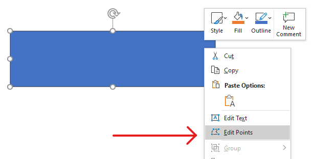

## **Visão geral**

Este artigo explica como personalizar formas de apresentações no Aspose.Slides editando a geometria da forma por meio de pontos de edição e caminhos de geometria. Ele mostra como trabalhar com [GeometryPath](https://reference.aspose.com/slides/python-net/aspose.slides/geometrypath/) para modificar formas existentes, realizar operações básicas de edição de caminho, adicionar ou remover pontos e aplicar a geometria atualizada de volta a uma forma.

Ele também demonstra como criar formas personalizadas e compostas, construir formas com cantos curvos, determinar se a geometria de uma forma está fechada e extrair elementos da forma para análise de contorno.

## **Alterar uma Forma Usando Pontos de Edição**

No PowerPoint, você pode usar **Edit Points** para modificar um quadrado:

* Mover um canto para dentro ou para fora.
* Ajustar a curvatura em um ponto.
* Adicionar novos pontos.

A edição de pontos permite modificar o contorno de uma forma ou usar uma forma existente como base para uma nova.

## **Dicas de Edição de Formas**



Ao editar formas no PowerPoint, mantenha esses conceitos em mente:

* Uma forma (ou seu caminho) pode ser fechada ou aberta.
* O caminho de uma forma consiste em pontos âncora conectados por segmentos.
* Um segmento pode ser reto ou curvo. Pontos âncora e alças de controle determinam sua forma.
* Pontos âncora existem como pontos de canto, pontos retos ou pontos suaves:
  * Em um ponto de canto, os segmentos adjacentes podem se encontrar em um ângulo.
  * Em um ponto suave, as duas alças de controle estão alinhadas e equidistantes do ponto âncora.
  * Em um ponto reto, as duas alças de controle estão alinhadas, mas podem ter distâncias diferentes do ponto âncora.
* Mover pontos âncora ou ajustar suas alças altera o contorno da forma.

Para editar formas do PowerPoint por meio de pontos de edição, **Aspose.Slides** fornece a classe [GeometryPath](https://reference.aspose.com/slides/python-net/aspose.slides/geometrypath/).

* Uma instância de [GeometryPath](https://reference.aspose.com/slides/python-net/aspose.slides/geometrypath/) representa um caminho de geometria do objeto [GeometryShape](https://reference.aspose.com/slides/python-net/aspose.slides/geometryshape/).
* Para obter o [GeometryPath](https://reference.aspose.com/slides/python-net/aspose.slides/geometrypath/) a partir da instância de [GeometryShape](https://reference.aspose.com/slides/python-net/aspose.slides/geometryshape/), você pode usar o método [GeometryShape.get_geometry_paths](https://reference.aspose.com/slides/python-net/aspose.slides/geometryshape/get_geometry_paths/).
* Para definir o [GeometryPath](https://reference.aspose.com/slides/python-net/aspose.slides/geometrypath/) de uma forma, você pode usar estes métodos: [GeometryShape.set_geometry_path](https://reference.aspose.com/slides/python-net/aspose.slides/geometryshape/set_geometry_path/) para formas com um único caminho e [GeometryShape.set_geometry_paths](https://reference.aspose.com/slides/python-net/aspose.slides/geometryshape/set_geometry_paths/) para formas com múltiplos caminhos.
* Para adicionar segmentos, você pode usar os métodos sob [GeometryPath](https://reference.aspose.com/slides/python-net/aspose.slides/geometrypath/).
* Usando as propriedades [GeometryPath.stroke](https://reference.aspose.com/slides/python-net/aspose.slides/geometrypath/stroke/) e [GeometryPath.fill_mode](https://reference.aspose.com/slides/python-net/aspose.slides/geometrypath/fill_mode/), você pode definir a aparência de um caminho de geometria.
* Usando a propriedade [GeometryPath.path_data](https://reference.aspose.com/slides/python-net/aspose.slides/geometrypath/path_data/), você pode recuperar o caminho de geometria de um [GeometryShape](https://reference.aspose.com/slides/python-net/aspose.slides/geometryshape/) como um array de segmentos de caminho.

## **Operações Simples de Edição**

Use os seguintes métodos para editar um caminho de geometria. Sobrecargas que aceitam um índice inserem um segmento naquela posição baseada em zero no array de segmentos do caminho.

| Operação | Método |
| --- | --- |
| Anexar ou inserir uma linha reta. | [GeometryPath.line_to](https://reference.aspose.com/slides/python-net/aspose.slides/geometrypath/line_to/) |
| Anexar ou inserir uma curva Bézier cúbica com dois pontos de controle e um ponto final. | [GeometryPath.cubic_bezier_to](https://reference.aspose.com/slides/python-net/aspose.slides/geometrypath/cubic_bezier_to/) |
| Anexar ou inserir uma curva Bézier quadrática com um ponto de controle e um ponto final. | [GeometryPath.quadratic_bezier_to](https://reference.aspose.com/slides/python-net/aspose.slides/geometrypath/quadratic_bezier_to/) |
| Anexar um arco elíptico com as dimensões e ângulos especificados em graus. | [GeometryPath.arc_to](https://reference.aspose.com/slides/python-net/aspose.slides/geometrypath/arc_to/) |
| Fechar a figura atual conectando seu ponto final ao ponto inicial. | [GeometryPath.close_figure](https://reference.aspose.com/slides/python-net/aspose.slides/geometrypath/close_figure/) |
| Definir o ponto inicial de uma figura. | [GeometryPath.move_to](https://reference.aspose.com/slides/python-net/aspose.slides/geometrypath/move_to/) |
| Remover um segmento em um índice baseado em zero. | [GeometryPath.remove_at](https://reference.aspose.com/slides/python-net/aspose.slides/geometrypath/remove_at/) |

## **Adicionar Pontos Personalizados a uma Forma**

Este exemplo insere dois pontos em uma forma retangular usando [GeometryPath.line_to](https://reference.aspose.com/slides/python-net/aspose.slides/geometrypath/line_to/) e aplica o caminho editado com [GeometryShape.set_geometry_path](https://reference.aspose.com/slides/python-net/aspose.slides/geometryshape/set_geometry_path/). As coordenadas são locais à forma: ambos os novos pontos estão em seu centro, a 100 pontos da esquerda e 50 pontos do topo. Os índices de segmento 1 e 4 os posicionam nas bordas superior e inferior, puxando essas bordas para dentro.

```python
import aspose.slides as slides

with slides.Presentation() as presentation:
    slide = presentation.slides[0]

    shape = slide.shapes.add_auto_shape(slides.ShapeType.RECTANGLE, 100, 100, 200, 100)

    geometry_path = shape.get_geometry_paths()[0]
    geometry_path.line_to(100, 50, 1)
    geometry_path.line_to(100, 50, 4)

    shape.set_geometry_path(geometry_path)
```


## **Remover Pontos de uma Forma**

Este exemplo altera o contorno de uma forma de coração removendo o segmento no índice baseado em zero 2 com [GeometryPath.remove_at](https://reference.aspose.com/slides/python-net/aspose.slides/geometrypath/remove_at/). Aplicar o caminho modificado com [GeometryShape.set_geometry_path](https://reference.aspose.com/slides/python-net/aspose.slides/geometryshape/set_geometry_path/) atualiza o contorno da forma.

```python
import aspose.slides as slides

with slides.Presentation() as presentation:
    slide = presentation.slides[0]

    shape = slide.shapes.add_auto_shape(slides.ShapeType.HEART, 100, 100, 300, 300)

    path = shape.get_geometry_paths()[0]
    path.remove_at(2)

    shape.set_geometry_path(path)
```


## **Criar uma Forma Personalizada**

Este exemplo cria uma estrela de cinco pontas com [GeometryPath](https://reference.aspose.com/slides/python-net/aspose.slides/geometrypath/). Raios externo e interno alternados de 100 e 50 pontos definem as pontas e as entalhes; um passo de 72 graus espaça uniformemente as cinco pontas. O caminho é fechado com [GeometryPath.close_figure](https://reference.aspose.com/slides/python-net/aspose.slides/geometrypath/close_figure/) e aplicado a uma forma retangular usando [GeometryShape.set_geometry_path](https://reference.aspose.com/slides/python-net/aspose.slides/geometryshape/set_geometry_path/), substituindo seu contorno.

```python
import aspose.slides as slides
import aspose.pydrawing as draw
import math

points = []

outer_radius = 100
inner_radius = 50
angle_step = 72

for angle in range(-90, 270, angle_step):
    radians = angle * (math.pi / 180)
    x = outer_radius * math.cos(radians)
    y = outer_radius * math.sin(radians)
    points.append(slides.PointF(x + outer_radius, y + outer_radius))

    radians = math.pi * (angle + angle_step / 2) / 180.0
    x = inner_radius * math.cos(radians)
    y = inner_radius * math.sin(radians)
    points.append(slides.PointF(x + outer_radius, y + outer_radius))

star_path = slides.GeometryPath()
star_path.move_to(points[0])

for i in range(1, len(points)):
    star_path.line_to(points[i])

star_path.close_figure()

with slides.Presentation() as presentation:
    slide = presentation.slides[0]

    shape = slide.shapes.add_auto_shape(slides.ShapeType.RECTANGLE, 100, 100, outer_radius * 2, outer_radius * 2)
    shape.set_geometry_path(star_path)
```


## **Criar uma Forma Personalizada Composta**

Este exemplo define dois objetos [GeometryPath](https://reference.aspose.com/slides/python-net/aspose.slides/geometrypath/) fechados para o terço superior e inferior de uma forma. Aplicar ambos os caminhos com [GeometryShape.set_geometry_paths](https://reference.aspose.com/slides/python-net/aspose.slides/geometryshape/set_geometry_paths/) cria uma única forma composta com uma lacuna através do seu terço central.

```python
import aspose.slides as slides

with slides.Presentation() as presentation:
    slide = presentation.slides[0]

    shape = slide.shapes.add_auto_shape(slides.ShapeType.RECTANGLE, 100, 100, 200, 100)

    top_path = slides.GeometryPath()
    top_path.move_to(0, 0)
    top_path.line_to(shape.width, 0)
    top_path.line_to(shape.width, shape.height / 3)
    top_path.line_to(0, shape.height / 3)
    top_path.close_figure()

    bottom_path = slides.GeometryPath()
    bottom_path.move_to(0, shape.height / 3 * 2)
    bottom_path.line_to(shape.width, shape.height / 3 * 2)
    bottom_path.line_to(shape.width, shape.height)
    bottom_path.line_to(0, shape.height)
    bottom_path.close_figure()

    shape.set_geometry_paths([top_path, bottom_path])
```


## **Criar uma Forma Personalizada com Cantos Curvos**

Este exemplo combina segmentos retos com [GeometryPath.arc_to](https://reference.aspose.com/slides/python-net/aspose.slides/geometrypath/arc_to/) para criar uma forma com cantos curvos para dentro. Cada tamanho de canto define a largura e altura do arco em pontos, e o arco de -90 graus desenha um quarto de elipse no sentido anti-horário. O caminho concluído é aplicado com [GeometryShape.set_geometry_path](https://reference.aspose.com/slides/python-net/aspose.slides/geometryshape/set_geometry_path/), e a apresentação é salva no formato PPTX.

```python
import aspose.slides as slides
import aspose.pydrawing as draw

shape_x = 20
shape_y = 20
shape_width = 300
shape_height = 200

left_top_size = 50
right_top_size = 20
right_bottom_size = 40
left_bottom_size = 10

with slides.Presentation() as presentation:
    slide = presentation.slides[0]

    shape = slide.shapes.add_auto_shape(slides.ShapeType.CUSTOM, shape_x, shape_y, shape_width, shape_height)

    top_left = slides.PointF(left_top_size, 0)
    top_right = slides.PointF(shape_width - right_top_size, 0)
    right_bottom = slides.PointF(shape_width, shape_height - right_bottom_size)
    bottom_left = slides.PointF(left_bottom_size, shape_height)
    left_top = slides.PointF(0, left_top_size)

    geometry_path = slides.GeometryPath()
    geometry_path.move_to(top_left)
    geometry_path.line_to(top_right)
    geometry_path.arc_to(right_top_size, right_top_size, 180, -90)
    geometry_path.line_to(right_bottom)
    geometry_path.arc_to(right_bottom_size, right_bottom_size, -90, -90)
    geometry_path.line_to(bottom_left)
    geometry_path.arc_to(left_bottom_size, left_bottom_size, 0, -90)
    geometry_path.line_to(left_top)
    geometry_path.arc_to(left_top_size, left_top_size, 90, -90)
    geometry_path.close_figure()

    shape.set_geometry_path(geometry_path)

    presentation.save("output.pptx", slides.export.SaveFormat.PPTX)
```

## **Descobrir se a Geometria de uma Forma Está Fechada**

O seguinte auxiliar verifica se cada caminho de geometria não vazio termina com um segmento de fechamento. Ele lê [GeometryPath.path_data](https://reference.aspose.com/slides/python-net/aspose.slides/geometrypath/path_data/) e compara o comando do segmento final [PathSegment.path_command](https://reference.aspose.com/slides/python-net/aspose.slides/pathsegment/path_command/) com [PathCommandType.CLOSE](https://reference.aspose.com/slides/python-net/aspose.slides/pathcommandtype/). Retorna false quando não há caminhos não vazios. Essa verificação analisa o comando final de cada caminho; não inspeciona cada subfigura dentro de um caminho. O exemplo imprime `True` para um retângulo.

```python
import aspose.slides as slides


def is_geometry_closed(geometry_shape):
    has_nonempty_path = False

    for geometry_path in geometry_shape.get_geometry_paths():
        segments = geometry_path.path_data
        if len(segments) == 0:
            continue

        has_nonempty_path = True
        last_segment = segments[len(segments) - 1]
        if last_segment.path_command != slides.PathCommandType.CLOSE:
            return False

    return has_nonempty_path


with slides.Presentation() as presentation:
    slide = presentation.slides[0]
    shape = slide.shapes.add_auto_shape(slides.ShapeType.RECTANGLE, 100, 100, 200, 100)
    print(is_geometry_closed(shape))
```

## **Extrair e Inspecionar Elementos da Forma**

Use [GeometryShape.create_shape_elements](https://reference.aspose.com/slides/python-net/aspose.slides/geometryshape/create_shape_elements/) para inspecionar uma forma existente como elementos que contêm pontos de caminho e tipos de ponto. Cada [ShapeElement](https://reference.aspose.com/slides/python-net/aspose.slides/shapeelement/) retornado expõe seus arrays [path_points](https://reference.aspose.com/slides/python-net/aspose.slides/shapeelement/path_points/) e [path_types](https://reference.aspose.com/slides/python-net/aspose.slides/shapeelement/path_types/). Essa representação é útil para análise de contorno ou para passar a geometria a ferramentas de desenho personalizadas.

O exemplo abre uma apresentação, encontra a primeira forma de geometria diretamente no primeiro slide e imprime seus segmentos de caminho. Use uma apresentação que contenha uma forma com segmentos retos e curvos para ver ambos os tipos de saída. Ele não procura dentro de grupos.

```python
import aspose.slides as slides

with slides.Presentation("input.pptx") as presentation:
    slide = presentation.slides[0]
    shape = next((item for item in slide.shapes if isinstance(item, slides.GeometryShape)), None)

    if shape is None:
        print("No geometry shape found on the first slide.")
    else:
        for element in shape.create_shape_elements():
            points = element.path_points
            types = element.path_types
            print("Shape element:")

            i = 0
            while i < len(points):
                point_type = types[i] & 0x07  # Keep the segment type, excluding flags.
                if point_type == 0:
                    print(f"Start figure at {points[i]}")
                elif point_type == 1:
                    print(f"Line to {points[i]}")
                elif point_type == 3:
                    print(f"Cubic Bezier: controls {points[i]}, {points[i + 1]}; end {points[i + 2]}")
                    i += 2  # Consume both control points and the endpoint.

                if (types[i] & 0x80) != 0:
                    print("Close subpath back to its starting point.")
                i += 1
```

Os arrays correspondem por índice: `points[i]` é um ponto e `types[i]` descreve sua função. O tipo `0` inicia uma figura, e o tipo `1` desenha uma linha do ponto anterior ao ponto atual. Um segmento Bézier cúbico inicia no ponto final anterior e usa três entradas consecutivas do tipo `3`: dois pontos de controle seguidos pelo novo ponto final. O loop consome essas três entradas juntas e verifica o ponto final para fechamento.

Os tipos de ponto também contêm flags. Mascarar com `0x07` para identificar o tipo de segmento, e testar `0x80` separadamente para detectar um subcaminho fechado. Por exemplo, `129` (`0x81`) significa um ponto final de linha que fecha um subcaminho, e `131` (`0x83`) significa um ponto final de Bézier que fecha um. Comparar o valor bruto apenas com `1` ou `3` perderia esses casos. Outras flags, como traço (`0x10`) e marcador (`0x20`), não alteram o tipo base do segmento.

**Coordenadas e transformações.** Os pontos são medidos em points (1/72 polegada), com X aumentando para a direita e Y aumentando para baixo. Para uma forma não agrupada, as coordenadas extraídas já incluem sua posição [x](https://reference.aspose.com/slides/python-net/aspose.slides/shape/x/) e [y](https://reference.aspose.com/slides/python-net/aspose.slides/shape/y/) e refletem sua largura e altura atuais. Por exemplo, um retângulo não rotacionado em `(100, 200)` com tamanho `120 × 80` tem limites de contorno `(100, 200)`–`(220, 280)`. Não adicione a posição da forma novamente. Subtraia seu X e Y para obter coordenadas relativas ao seu quadro não rotacionado.

Os pontos extraídos não aplicam a [rotation](https://reference.aspose.com/slides/python-net/aspose.slides/shape/rotation/) da forma nem as inversões horizontal e vertical. Para reproduzir o contorno exibido, aplique essas transformações ao redor do centro da forma. Para formas agrupadas, também leve em conta o mapeamento de coordenadas do grupo e as transformações; não presuma que os pontos extraídos são as coordenadas finais renderizadas no slide ou aplique uma translação ou escala duas vezes se já estiver refletida na moldura do filho.

**Inspeção versus edição.** Os arrays extraídos descrevem o contorno; alterá‑los não atualiza a forma original. Escolha esta abordagem quando sua análise ou código de desenho precisar de arrays ponto/tipo. Use [get_geometry_paths](https://reference.aspose.com/slides/python-net/aspose.slides/geometryshape/get_geometry_paths/) quando precisar de comandos de geometria no sistema de coordenadas local da forma ou quiser editar sua geometria. Aplique caminhos editados através de [set_geometry_path](https://reference.aspose.com/slides/python-net/aspose.slides/geometryshape/set_geometry_path/) ou [set_geometry_paths](https://reference.aspose.com/slides/python-net/aspose.slides/geometryshape/set_geometry_paths/).

## **FAQ**

**O que acontecerá ao preenchimento e ao contorno após substituir a geometria?**

O estilo permanece na forma; apenas o contorno muda. O preenchimento e o contorno são aplicados automaticamente à nova geometria.

**Como rotacionar corretamente uma forma personalizada junto com sua geometria?**

Use a propriedade [rotation](https://reference.aspose.com/slides/python-net/aspose.slides/shape/rotation/) da forma; a geometria gira com a forma porque está vinculada ao próprio sistema de coordenadas da forma.

**Posso converter uma forma personalizada em uma imagem para "travar" o resultado?**

Sim. Exporte a área de [slide](/slides/pt/python-net/convert-powerpoint-to-png/) necessária ou a própria [shape](/slides/pt/python-net/create-shape-thumbnails/) para um formato raster; isso simplifica o trabalho posterior com geometrias complexas.