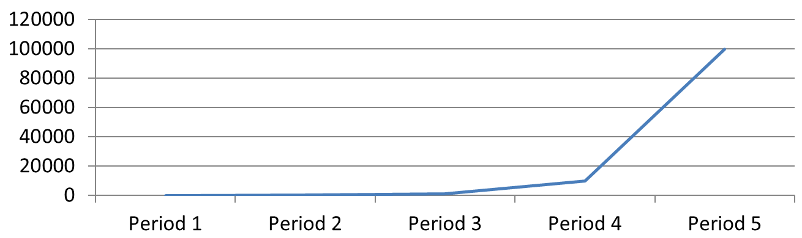

## **Обзор**

В этой статье объясняется, как настраивать оси диаграмм с помощью Aspose.Slides для Android через Java. Охватываются вычисленные значения осей, переключение строк и столбцов диаграммы, видимость осей, интервалы меток категорий и делений, датированные категории и их форматирование, поворот заголовка, позиционирование осей, единицы отображения и логарифмическое масштабирование.

## **Получить максимальные значения на вертикальной оси диаграмм**

Создайте [Презентацию](https://reference.aspose.com/slides/androidjava/com.aspose.slides/presentation/) и добавьте областную диаграмму с данными по умолчанию. Вызовите [validateChartLayout](https://reference.aspose.com/slides/androidjava/com.aspose.slides/chart/#validateChartLayout--) перед чтением вычисленных значений осей, чтобы макет диаграммы был актуален.

Считайте [getActualMaxValue](https://reference.aspose.com/slides/androidjava/com.aspose.slides/axis/#getActualMaxValue--) и [getActualMinValue](https://reference.aspose.com/slides/androidjava/com.aspose.slides/axis/#getActualMinValue--) для пределов оси, а также [getActualMajorUnit](https://reference.aspose.com/slides/androidjava/com.aspose.slides/axis/#getActualMajorUnit--) и [getActualMinorUnit](https://reference.aspose.com/slides/androidjava/com.aspose.slides/axis/#getActualMinorUnit--) для интервалов делений. [getActualMajorUnitScale](https://reference.aspose.com/slides/androidjava/com.aspose.slides/axis/#getActualMajorUnitScale--) и [getActualMinorUnitScale](https://reference.aspose.com/slides/androidjava/com.aspose.slides/axis/#getActualMinorUnitScale--) предоставляют масштабы единиц времени, которые актуальны для датированных осей. Пример сохраняет эти значения в локальные переменные и сохраняет диаграмму.

```java
import com.aspose.slides.*;

Presentation presentation = new Presentation();
try {
    ISlide slide = presentation.getSlides().get_Item(0);

    IChart chart = slide.getShapes().addChart(ChartType.Area, 100, 100, 500, 350);
    chart.validateChartLayout();

    double maxValue = chart.getAxes().getVerticalAxis().getActualMaxValue();
    double minValue = chart.getAxes().getVerticalAxis().getActualMinValue();

    double majorUnit = chart.getAxes().getVerticalAxis().getActualMajorUnit();
    double minorUnit = chart.getAxes().getVerticalAxis().getActualMinorUnit();

    int majorUnitScale = chart.getAxes().getVerticalAxis().getActualMajorUnitScale();
    int minorUnitScale = chart.getAxes().getVerticalAxis().getActualMinorUnitScale();

    presentation.save("AxisValues_out.pptx", SaveFormat.Pptx);
} finally {
    presentation.dispose();
}
```

## **Поменять данные между осями**

Используйте [switchRowColumn](https://reference.aspose.com/slides/androidjava/com.aspose.slides/chartdata/#switchRowColumn--) для обмена ролями рядов и категорий в данных диаграммы. Каждая прежняя категория становится рядом, а каждый прежний ряд — категорией. Это меняет способ группировки данных; оси горизонтальная и вертикальная не меняются местами. В примере используется [setRange](https://reference.aspose.com/slides/androidjava/com.aspose.slides/chartdata/#setRange-java.lang.String-) для привязки данных по умолчанию к `Sheet1!A1:D5`, включая строку заголовка и столбец категорий, перед переключением строк и столбцов. Сохраняется диаграмма с четырьмя рядами и тремя категориями.

```java
import com.aspose.slides.*;

Presentation presentation = new Presentation();
try {
    ISlide slide = presentation.getSlides().get_Item(0);

    IChart chart = slide.getShapes().addChart(ChartType.ClusteredColumn, 100, 100, 400, 300);
    chart.getChartData().setRange("Sheet1!A1:D5");
    chart.getChartData().switchRowColumn();

    presentation.save("SwitchChartRowColumns_out.pptx", SaveFormat.Pptx);
} finally {
    presentation.dispose();
}
```

## **Изменить порядок построения оси в обратном направлении**

Используйте [setPlotOrderReversed](https://reference.aspose.com/slides/androidjava/com.aspose.slides/axis/#setPlotOrderReversed-boolean-) для обратного порядка построения категориальной или значимой оси. Например, в горизонтальной столбчатой диаграмме можно отобразить стадии проекта сверху вниз в том же порядке, что и в таблице: Планирование, Разработка, Тестирование. Обратный порядок меняет направление построения; он не сортирует и не переставляет данные листа. Для сравнения, [switchRowColumn](https://reference.aspose.com/slides/androidjava/com.aspose.slides/chartdata/#switchRowColumn--) меняет роли рядов и категорий.

В следующем примере создаётся горизонтальная столбчатая диаграмма с тремя стадиями и одним рядом. Сохраняется презентация из трёх слайдов: обычный порядок, обратные категории и обратные значения. Каждая копия использует тот же набор данных, и только одна ось в каждой копии обратна.

```java
import com.aspose.slides.*;

Presentation presentation = new Presentation();
try {
    ISlide slide = presentation.getSlides().get_Item(0);

    IChart chart = slide.getShapes().addChart(ChartType.ClusteredBar, 50, 40, 620, 320);
    chart.setLegend(false);

    chart.getChartData().getCategories().clear();
    chart.getChartData().getSeries().clear();

    IChartDataWorkbook workbook = chart.getChartData().getChartDataWorkbook();
    workbook.clear(0);

    IChartSeries series = chart.getChartData().getSeries().add(ChartType.ClusteredBar);
    String[] stages = { "Planning", "Development", "Testing" };
    int[] values = { 10, 30, 20 };
    for (int i = 0; i < stages.length; i++) {
        IChartDataCell categoryCell = workbook.getCell(0, i + 1, 0, stages[i]);
        chart.getChartData().getCategories().add(categoryCell);
        IChartDataCell valueCell = workbook.getCell(0, i + 1, 1, values[i]);
        series.getDataPoints().addDataPointForBarSeries(valueCell);
    }

    // Слайд 2: отобразить первую категорию вверху.
    ISlide categorySlide = presentation.getSlides().addClone(slide);
    IChart categoryChart = (IChart)categorySlide.getShapes().get_Item(0);
    categoryChart.getAxes().getVerticalAxis().setPlotOrderReversed(true);
    // Сохранить горизонтальную ось значений внизу.
    categoryChart.getAxes().getVerticalAxis().setCrossType(CrossesType.Maximum);

    // Слайд 3: обратить только горизонтальную числовую шкалу.
    ISlide valueSlide = presentation.getSlides().addClone(slide);
    IChart valueChart = (IChart)valueSlide.getShapes().get_Item(0);
    valueChart.getAxes().getHorizontalAxis().setPlotOrderReversed(true);

    presentation.save("ReversedAxes.pptx", SaveFormat.Pptx);
} finally {
    presentation.dispose();
}
```

Обратное построение оси может также переместить перпендикулярную ось на противоположную сторону графика. [setCrossType](https://reference.aspose.com/slides/androidjava/com.aspose.slides/axis/#setCrossType-int-) управляет тем, где другая ось пересекает настраиваемую ось. На слайде 2 вызов с параметром `CrossesType.Maximum` для обратной категориальной оси оставляет горизонтальную ось значений в нижней части. Для указания конкретной точки пересечения используйте [setCrossAt](https://reference.aspose.com/slides/androidjava/com.aspose.slides/axis/#setCrossAt-float-). Проверьте настройки пересечения при изменении направления, особенно если диаграмма уже имеет пользовательскую точку пересечения. Вызов `setPlotOrderReversed` с `false` восстанавливает обычное направление построения; настройки пересечения остаются отдельными.

| Обычный порядок (слайд 1) | Обратные категории (слайд 2) | Обратные значения (слайд 3) |
| --- | --- | --- |
|  |  |  |
| Категории идут снизу вверх; значения растут слева направо. | Этапы Планирование, Разработка и Тестирование идут сверху вниз. Значения и порядок строк листа остаются без изменений. | Категории сохраняют обычный порядок; значения растут справа налево. Ось категорий пересекается с нулём справа. |

## **Отключить вертикальную ось для линейных диаграмм**

Вызовите [setVisible](https://reference.aspose.com/slides/androidjava/com.aspose.slides/axis/#setVisible-boolean-) с `false` для вертикальной оси, чтобы скрыть её. В примере создаётся линейная диаграмма с данными по умолчанию и сохраняется с скрытой вертикальной осью.

```java
import com.aspose.slides.*;

Presentation presentation = new Presentation();
try {
    ISlide slide = presentation.getSlides().get_Item(0);

    IChart chart = slide.getShapes().addChart(ChartType.Line, 100, 100, 400, 300);
    chart.getAxes().getVerticalAxis().setVisible(false);

    presentation.save("HiddenVerticalAxis.pptx", SaveFormat.Pptx);
} finally {
    presentation.dispose();
}
```

## **Отключить горизонтальную ось для линейных диаграмм**

Вызовите [setVisible](https://reference.aspose.com/slides/androidjava/com.aspose.slides/axis/#setVisible-boolean-) с `false` для горизонтальной оси, чтобы скрыть её. В примере создаётся линейная диаграмма с данными по умолчанию и сохраняется с скрытой горизонтальной осью.

```java
import com.aspose.slides.*;

Presentation presentation = new Presentation();
try {
    ISlide slide = presentation.getSlides().get_Item(0);

    IChart chart = slide.getShapes().addChart(ChartType.Line, 100, 100, 400, 300);
    chart.getAxes().getHorizontalAxis().setVisible(false);

    presentation.save("HiddenHorizontalAxis.pptx", SaveFormat.Pptx);
} finally {
    presentation.dispose();
}
```

## **Показать или скрыть линии сетки диаграммы**

Вызовите [getShowMajorGridLines](https://reference.aspose.com/slides/androidjava/com.aspose.slides/iaxis/#getShowMajorGridLines--) и [getShowMinorGridLines](https://reference.aspose.com/slides/androidjava/com.aspose.slides/iaxis/#getShowMinorGridLines--) чтобы проверить, какие линии сетки отображает ось. Эти методы возвращают текущую видимость. Чтобы отобразить мелкие линии сетки, используйте [getMinorGridLinesFormat](https://reference.aspose.com/slides/androidjava/com.aspose.slides/iaxis/#getMinorGridLinesFormat--) и задайте её заливку сплошным, видимым цветом. Чтобы скрыть их, установите заливку в [FillType.NoFill](https://reference.aspose.com/slides/androidjava/com.aspose.slides/filltype/#NoFill). Для крупных линий используйте [getMajorGridLinesFormat](https://reference.aspose.com/slides/androidjava/com.aspose.slides/iaxis/#getMajorGridLinesFormat--) аналогичным образом. Изменение заливки сохраняет видимость оси и деления.

Вертикальная ось этой сгруппированной столбчатой диаграммы изначально отображает только крупные линии сетки. Пример отображает мелкие линии сетки тёмно‑оранжевым цветом, затем снова скрывает их перед сохранением презентации. На каждом этапе выводится состояние видимости линий сетки.

```java
import com.aspose.slides.*;
import android.graphics.Color;

Presentation presentation = new Presentation();
try {
    ISlide slide = presentation.getSlides().get_Item(0);

    IChart chart = slide.getShapes().addChart(ChartType.ClusteredColumn, 30, 30, 660, 230);
    IAxis axis = chart.getAxes().getVerticalAxis();
    System.out.printf("Initial: major=%b, minor=%b%n", axis.getShowMajorGridLines(), axis.getShowMinorGridLines());

    ILineFillFormat minorFill = axis.getMinorGridLinesFormat().getLine().getFillFormat();
    minorFill.setFillType(FillType.Solid);
    minorFill.getSolidFillColor().setColor(Color.rgb(255, 140, 0));
    System.out.printf("Enabled: minor=%b%n", axis.getShowMinorGridLines());

    minorFill.setFillType(FillType.NoFill);
    System.out.printf("Hidden: major=%b, minor=%b%n", axis.getShowMajorGridLines(), axis.getShowMinorGridLines());

    presentation.save("ChartGridlines.pptx", SaveFormat.Pptx);
} finally {
    presentation.dispose();
}
```

| Мелкие линии сетки включены | Мелкие линии сетки скрыты |
| --- | --- |
|  |  |

## **Изменить ось категорий**

Используйте [setCategoryAxisType](https://reference.aspose.com/slides/androidjava/com.aspose.slides/axis/#setCategoryAxisType-int-) для выбора датированной или текстовой оси категорий. Этот пример требует файл `ExistingChart.pptx`, в котором диаграмма является первой фигурой на первом слайде, а ячейки категорий содержат числовые даты Excel. Он меняет горизонтальную ось на датированную. Вызов [setAutomaticMajorUnit](https://reference.aspose.com/slides/androidjava/com.aspose.slides/axis/#setAutomaticMajorUnit-boolean-) с `false`, [setMajorUnit](https://reference.aspose.com/slides/androidjava/com.aspose.slides/axis/#setMajorUnit-double-) с `1` и [setMajorUnitScale](https://reference.aspose.com/slides/androidjava/com.aspose.slides/axis/#setMajorUnitScale-int-) с `TimeUnitType.Months` размещает крупные деления с интервалом в один месяц.

```java
import com.aspose.slides.*;

Presentation presentation = new Presentation("ExistingChart.pptx");
try {
    ISlide slide = presentation.getSlides().get_Item(0);

    IChart chart = (IChart) slide.getShapes().get_Item(0);
    chart.getAxes().getHorizontalAxis().setCategoryAxisType(CategoryAxisType.Date);
    chart.getAxes().getHorizontalAxis().setAutomaticMajorUnit(false);
    chart.getAxes().getHorizontalAxis().setMajorUnit(1);
    chart.getAxes().getHorizontalAxis().setMajorUnitScale(TimeUnitType.Months);

    presentation.save("ChangeChartCategoryAxis_out.pptx", SaveFormat.Pptx);
} finally {
    presentation.dispose();
}
```

### **Определить тип оси категорий по данным**

После заполнения категорий вызовите [setCategoryAxisTypeAutomatically](https://reference.aspose.com/slides/androidjava/com.aspose.slides/iaxis/#setCategoryAxisTypeAutomatically--) и затем прочитайте [getCategoryAxisType](https://reference.aspose.com/slides/androidjava/com.aspose.slides/iaxis/#getCategoryAxisType--) для проверки выбранного типа. Это удобно, когда одна и та же диаграмма может получать либо текстовые подписи, либо числовые датированные значения. Метод определяет тип при вызове; он не включает постоянный режим, переоценивающий последующие изменения данных. Вызовите его снова после замены категорий.

В примере создаётся диаграмма с текстовыми категориями и выводится `true`, когда выбран тип `CategoryAxisType.Text`. Затем значения ячеек категорий заменяются датами, метод вызывается вновь, и выводится `true`, когда выбран тип `CategoryAxisType.Date`. Даты хранятся как числовые значения OLE Automation, вычисляемые как количество дней, прошедших с 30‑го декабря 1899 г., а не как строки дат. Оба календаря используют UTC и очищаются перед установкой дат, чтобы переход на летнее время и текущий час суток не влияли на расчёт. [setCustomNumberFormat](https://reference.aspose.com/slides/androidjava/com.aspose.slides/ichartdatacell/#setCustomNumberFormat-java.lang.String-) управляет тем, как эти значения отображаются; он не преобразует текст в числовые даты. Подробнее о ячейках категорий см. в разделе [Chart Workbook](/slides/ru/androidjava/chart-workbook/).

Используйте автоматическое определение, когда входные данные известны как текстовые категории или числовые даты, как в этом примере. Для обычных числовых меток, смешанных категорий или пустых данных явно вызывайте [setCategoryAxisType](https://reference.aspose.com/slides/androidjava/com.aspose.slides/iaxis/#setCategoryAxisType-int-), чтобы задать требуемое значение. Одни только числовые значения не указывают, что категории представляют даты.

```java
import com.aspose.slides.*;
import java.util.Calendar;
import java.util.GregorianCalendar;
import java.util.TimeZone;

Presentation presentation = new Presentation();
try {
    ISlide slide = presentation.getSlides().get_Item(0);

    IChart chart = slide.getShapes().addChart(ChartType.ClusteredColumn, 30, 40, 660, 320);

    chart.getChartData().getCategories().clear();
    chart.getChartData().getSeries().clear();

    IChartDataWorkbook workbook = chart.getChartData().getChartDataWorkbook();
    workbook.clear(0);

    IChartDataCell seriesName = workbook.getCell(0, 0, 1, "Sales");
    IChartSeries series = chart.getChartData().getSeries().add(seriesName, chart.getType());
    String[] labels = { "First", "Second", "Third" };

    for (int i = 0; i < labels.length; i++) {
        IChartDataCell categoryCell = workbook.getCell(0, i + 1, 0, labels[i]);
        chart.getChartData().getCategories().add(categoryCell);

        IChartDataCell valueCell = workbook.getCell(0, i + 1, 1, (i + 1) * 10);
        series.getDataPoints().addDataPointForBarSeries(valueCell);
    }

    IAxis axis = chart.getAxes().getHorizontalAxis();
    axis.setCategoryAxisTypeAutomatically();
    System.out.println(axis.getCategoryAxisType() == CategoryAxisType.Text); // true

    TimeZone timeZone = TimeZone.getTimeZone("UTC");
    Calendar baseDate = new GregorianCalendar(timeZone);
    baseDate.clear();
    baseDate.set(1899, Calendar.DECEMBER, 30);
    int[][] dates = { { 2026, Calendar.JANUARY, 1 }, { 2026, Calendar.JANUARY, 2 }, { 2026, Calendar.FEBRUARY, 1 } };

    for (int i = 0; i < dates.length; i++) {
        IChartDataCell categoryCell = workbook.getCell(0, i + 1, 0);
        Calendar date = new GregorianCalendar(timeZone);
        date.clear();
        date.set(dates[i][0], dates[i][1], dates[i][2]);
        double serialDate = (date.getTimeInMillis() - baseDate.getTimeInMillis()) / 86400000.0;
        categoryCell.setValue(serialDate);
        categoryCell.setCustomNumberFormat("yyyy-mm-dd");
    }

    axis.setCategoryAxisTypeAutomatically();
    System.out.println(axis.getCategoryAxisType() == CategoryAxisType.Date); // true

    presentation.save("AutomaticCategoryAxis.pptx", SaveFormat.Pptx);
} finally {
    presentation.dispose();
}
```

## **Контролировать интервалы меток оси категорий**

Когда в диаграмме много категорий, уменьшите количество видимых меток оси, не удаляя категории и точки данных. Вызовите [setAutomaticTickLabelSpacing](https://reference.aspose.com/slides/androidjava/com.aspose.slides/iaxis/#setAutomaticTickLabelSpacing-boolean-) с `false`, затем передайте желаемый интервал категории в [setTickLabelSpacing](https://reference.aspose.com/slides/androidjava/com.aspose.slides/iaxis/#setTickLabelSpacing-long-). Для текстовых категорий в их обычном порядке подсчёт начинается с первой категории:

| Интервал | Отображаемые метки в примере |
| --- | --- |
| `1` | Категория 1, Категория 2, Категория 3, … Категория 24 |
| `2` | Категория 1, Категория 3, Категория 5, … Категория 23 |
| `3` | Категория 1, Категория 4, Категория 7, … Категория 22 |

Интервал `3` отображает каждую третью метку, оставляя две метки скрытыми между отображаемыми. Он не удаляет соответствующие столбцы. Автоматический выбор интервала основывается на доступном пространстве; он не обязателен отображать каждую метку.

Деления имеют отдельные параметры. Вызовите [setAutomaticTickMarksSpacing](https://reference.aspose.com/slides/androidjava/com.aspose.slides/iaxis/#setAutomaticTickMarksSpacing-boolean-) с `false` и используйте [setTickMarksSpacing](https://reference.aspose.com/slides/androidjava/com.aspose.slides/iaxis/#setTickMarksSpacing-long-) для задания их интервала. Например, `1` оставит деление на каждом интервале категории, в то время как метки будут показываться лишь каждые три категории. Используйте [setMajorTickMark](https://reference.aspose.com/slides/androidjava/com.aspose.slides/iaxis/#setMajorTickMark-int-) с видимым стилем, чтобы увидеть результат. Повторный вызов любого из автоматических сеттеров с `true` позволяет диаграмме снова подобрать интервалы автоматически.

В следующем самостоятельном примере создаются 24 категории и один ряд, затем сохраняются три слайда в файле `CategoryAxisIntervals.pptx`: автоматический интервал, ручной интервал меток с независимыми делениями и восстановление автоматического интервала. Две копии сохраняют исходные данные диаграммы. Входная презентация не требуется. Горизонтальный текст меток делает различие в плотности легко заметным.

```java
import com.aspose.slides.*;

Presentation presentation = new Presentation();
try {
    ISlide slide = presentation.getSlides().get_Item(0);

    IChart chart = slide.getShapes().addChart(ChartType.ClusteredColumn, 30, 40, 660, 320);

    chart.setLegend(false);
    chart.getChartData().getCategories().clear();
    chart.getChartData().getSeries().clear();

    IChartDataWorkbook workbook = chart.getChartData().getChartDataWorkbook();
    workbook.clear(0);

    IChartSeries series = chart.getChartData().getSeries().add(ChartType.ClusteredColumn);
    for (int i = 0; i < 24; i++) {
        IChartDataCell categoryCell = workbook.getCell(0, i + 1, 0, "Category " + (i + 1));
        chart.getChartData().getCategories().add(categoryCell);
        IChartDataCell valueCell = workbook.getCell(0, i + 1, 1, 10 + i % 6 * 5);
        series.getDataPoints().addDataPointForBarSeries(valueCell);
    }

    IAxis axis = chart.getAxes().getHorizontalAxis();
    axis.setCategoryAxisType(CategoryAxisType.Text);
    axis.getTextFormat().getTextBlockFormat().setRotationAngle(0);
    axis.getTextFormat().getPortionFormat().setFontHeight(12);
    axis.setMajorTickMark(TickMarkType.Outside);
    axis.setAutomaticTickLabelSpacing(true);
    axis.setAutomaticTickMarksSpacing(true);

    // Слайд 2: показывать каждую третью метку, но оставлять деление для каждой категории.
    ISlide manualSlide = presentation.getSlides().addClone(slide);
    IChart manualChart = (IChart)manualSlide.getShapes().get_Item(0);
    IAxis manualAxis = manualChart.getAxes().getHorizontalAxis();
    manualAxis.setAutomaticTickLabelSpacing(false);
    manualAxis.setTickLabelSpacing(3);
    manualAxis.setAutomaticTickMarksSpacing(false);
    manualAxis.setTickMarksSpacing(1);

    // Слайд 3: позволить диаграмме снова выбрать оба интервала.
    ISlide restoredSlide = presentation.getSlides().addClone(manualSlide);
    IChart restoredChart = (IChart)restoredSlide.getShapes().get_Item(0);
    restoredChart.getAxes().getHorizontalAxis().setAutomaticTickLabelSpacing(true);
    restoredChart.getAxes().getHorizontalAxis().setAutomaticTickMarksSpacing(true);

    presentation.save("CategoryAxisIntervals.pptx", SaveFormat.Pptx);
} finally {
    presentation.dispose();
}
```

**Автоматический интервал (слайд 1):** В этом отображении каждая вторая метка категории показывается и переносится на две строки. Автоматический результат может варьироваться в зависимости от размера диаграммы, шрифтов и рендерера.


**Ручной интервал (слайд 2):** Каждая третья метка отображается в одну строку, в то время как деления остаются на каждом интервале категории. Все 24 столбца, включая те, у которых нет меток, остаются видимыми со теми же значениями. Слайд 3 восстанавливает автоматический вид, показанный выше.


### **Выбрать правильную ось и интервал**

Используйте этот интервал количества категорий для текстовой оси категорий, например, оси категорий столбчатой, линейной, областной или горизонтальной диаграммы. В столбчатой диаграмме это горизонтальная ось. В горизонтальной столбчатой диаграмме ось категорий вертикальна, поэтому применяйте эти настройки к оси, возвращаемой [getVerticalAxis](https://reference.aspose.com/slides/androidjava/com.aspose.slides/iaxesmanager/#getVerticalAxis--). Интервал делений также применяется к оси рядов в диаграммах, где она присутствует.

Не используйте интервал меток категорий для задания числовой шкалы оси значений. На оси значений метод [setMajorUnit](https://reference.aspose.com/slides/androidjava/com.aspose.slides/iaxis/#setMajorUnit-double-) задаёт разницу в значениях: например, основной шаг `10` создаёт деления 0, 10, 20 и т.д., когда ось начинается с нуля. Интервал меток категорий `3` считает позиции категорий независимо от их значений. Диаграммы рассеяния и пузырьковые используют оси значений, а не текстовую ось категорий. Для датированной оси используйте временные основные единицы и масштабы, как описано в разделе [Изменить ось категорий](#изменить-ось‑категорий).

## **Установить формат даты для значений оси категорий**

Пример заменяет исходные данные диаграммы четырьмя годовыми значениями. Даты хранятся как числовые значения OLE Automation в первом листе (индекс `0`), вычисляемые как количество дней с 30‑го декабря 1899 г. Оба календаря используют UTC и очищаются перед установкой дат, чтобы переход на летнее время и текущий час суток не влияли на расчёт. Используйте [setCategoryAxisType](https://reference.aspose.com/slides/androidjava/com.aspose.slides/axis/#setCategoryAxisType-int-) с `CategoryAxisType.Date`, вызовите [setNumberFormatLinkedToSource](https://reference.aspose.com/slides/androidjava/com.aspose.slides/axis/#setNumberFormatLinkedToSource-boolean-) с `false` и передайте `yyyy` в [setNumberFormat](https://reference.aspose.com/slides/androidjava/com.aspose.slides/axis/#setNumberFormat-java.lang.String-), чтобы метки категорий отображали четырёхзначные годы независимо от форматирования ячеек.

```java
import com.aspose.slides.*;
import java.util.Calendar;
import java.util.GregorianCalendar;
import java.util.TimeZone;

Presentation presentation = new Presentation();
try {
    ISlide slide = presentation.getSlides().get_Item(0);

    IChart chart = slide.getShapes().addChart(ChartType.Line, 50, 50, 450, 300);

    chart.getChartData().getCategories().clear();
    chart.getChartData().getSeries().clear();

    IChartDataWorkbook workbook = chart.getChartData().getChartDataWorkbook();
    workbook.clear(0);

    TimeZone timeZone = TimeZone.getTimeZone("UTC");
    Calendar baseDate = new GregorianCalendar(timeZone);
    baseDate.clear();
    baseDate.set(1899, Calendar.DECEMBER, 30);

    IChartSeries series = chart.getChartData().getSeries().add(ChartType.Line);
    for (int i = 0; i < 4; i++) {
        Calendar date = new GregorianCalendar(timeZone);
        date.clear();
        date.set(2015 + i, Calendar.JANUARY, 1);
        double serialDate = (date.getTimeInMillis() - baseDate.getTimeInMillis()) / 86400000.0;
        IChartDataCell categoryCell = workbook.getCell(0, i + 1, 0, serialDate);
        chart.getChartData().getCategories().add(categoryCell);

        IChartDataCell valueCell = workbook.getCell(0, i + 1, 1, i + 1);
        series.getDataPoints().addDataPointForLineSeries(valueCell);
    }

    chart.getAxes().getHorizontalAxis().setCategoryAxisType(CategoryAxisType.Date);
    chart.getAxes().getHorizontalAxis().setNumberFormatLinkedToSource(false);
    chart.getAxes().getHorizontalAxis().setNumberFormat("yyyy");

    presentation.save("DateAxisFormat.pptx", SaveFormat.Pptx);
} finally {
    presentation.dispose();
}
```

## **Установить угол вращения заголовка оси диаграммы**

Вызовите [setTitle](https://reference.aspose.com/slides/androidjava/com.aspose.slides/axis/#setTitle-boolean-) с `true` для вертикальной оси, задайте текст заголовка и используйте [setRotationAngle](https://reference.aspose.com/slides/androidjava/com.aspose.slides/icharttextblockformat/#setRotationAngle-float-) для его вращения. Угол измеряется в градусах; пример сохраняет столбчатую диаграмму с заголовком оси значений, повернутым на 90 градусов.

```java
import com.aspose.slides.*;

Presentation presentation = new Presentation();
try {
    ISlide slide = presentation.getSlides().get_Item(0);

    IChart chart = slide.getShapes().addChart(ChartType.ClusteredColumn, 50, 50, 450, 300);
    chart.getAxes().getVerticalAxis().setTitle(true);
    chart.getAxes().getVerticalAxis().getTitle().addTextFrameForOverriding("Value");
    chart.getAxes().getVerticalAxis().getTitle().getTextFormat().getTextBlockFormat().setRotationAngle(90);

    presentation.save("RotatedAxisTitle.pptx", SaveFormat.Pptx);
} finally {
    presentation.dispose();
}
```

## **Установить позицию оси на оси категорий или значений**

Используйте [setAxisBetweenCategories](https://reference.aspose.com/slides/androidjava/com.aspose.slides/axis/#setAxisBetweenCategories-boolean-) для управления тем, будет ли ось значений пересекать ось категорий между категориями или на делениях категорий. Эта настройка относится к осям категорий. Пример устанавливает её в `true` для горизонтальной оси категорий столбчатой диаграммы и сохраняет результат.

```java
import com.aspose.slides.*;

Presentation presentation = new Presentation();
try {
    ISlide slide = presentation.getSlides().get_Item(0);

    IChart chart = slide.getShapes().addChart(ChartType.ClusteredColumn, 50, 50, 450, 300);
    chart.getAxes().getHorizontalAxis().setAxisBetweenCategories(true);

    presentation.save("AxisBetweenCategories.pptx", SaveFormat.Pptx);
} finally {
    presentation.dispose();
}
```

## **Установить единицу отображения на оси значений диаграммы**

Используйте [setDisplayUnit](https://reference.aspose.com/slides/androidjava/com.aspose.slides/axis/#setDisplayUnit-int-) для масштабирования меток оси значений без изменения исходных данных. При установке [DisplayUnitType](https://reference.aspose.com/slides/androidjava/com.aspose.slides/displayunittype/) в `Millions` значение 60 000 000 отображается как 60. Пример создаёт столбчатую диаграмму и применяет единицу отображения «миллионы» к её вертикальной оси.

```java
import com.aspose.slides.*;

Presentation presentation = new Presentation();
try {
    ISlide slide = presentation.getSlides().get_Item(0);

    IChart chart = slide.getShapes().addChart(ChartType.ClusteredColumn, 50, 50, 450, 300);
    chart.getAxes().getVerticalAxis().setDisplayUnit(DisplayUnitType.Millions);

    presentation.save("Result.pptx", SaveFormat.Pptx);
} finally {
    presentation.dispose();
}
```

## **Настроить логарифмическую ось значений**

Логарифмическая ось значений полезна, когда положительные значения охватывают несколько порядков величины. Например, сервис может получать 10, 100, 1 000, 10 000 и 100 000 запросов за пять периодов. При линейном масштабе меньшие значения группируются рядом с нулём. Логарифмический масштаб облегчает сравнение относительного роста: одинаковые расстояния представляют одинаковые отношения, а не одинаковые различия.

Вызовите [setLogarithmic](https://reference.aspose.com/slides/androidjava/com.aspose.slides/axis/#setLogarithmic-boolean-) с `true` для оси значений и используйте [setLogBase](https://reference.aspose.com/slides/androidjava/com.aspose.slides/axis/#setLogBase-double-) для выбора основания. Это меняет отображение существующих значений; данные и добавление логарифмической линии тренда не изменяются. Линия тренда представляет собой отдельную функцию, построенную по данным.

### **Выбрать ось значений и основание**

Для линейной или столбчатой диаграммы ось значений возвращается методом [getVerticalAxis](https://reference.aspose.com/slides/androidjava/com.aspose.slides/iaxesmanager/#getVerticalAxis--). Для горизонтальной столбчатой диаграммы — методом [getHorizontalAxis](https://reference.aspose.com/slides/androidjava/com.aspose.slides/iaxesmanager/#getHorizontalAxis--). В диаграммах рассеяния и пузырьковых присутствуют две оси значений, поэтому выбирайте горизонтальную ось для X‑значений, вертикальную — для Y‑значений, либо обе. Не применяйте логарифмическое масштабирование к оси категорий.

Основание логарифма по умолчанию = `10`. Для PPTX‑диаграмм допускаются основания от `2` до `1000` включительно; поддерживаются и дробные основания, такие как `2.5`. При основании `10` последовательные степени 10, 100, 1 000 и 10 000 равномерно распределены.

### **Сравнить линейное и логарифмическое масштабирование**

В следующем самостоятельном примере создаётся линейная диаграмма с пятью подсчётами запросов на первом слайде, затем этот слайд копируется и включается логарифмическая ось значений с основанием 10 на втором. Оба слайда сохраняют одни и те же данные.

```java
import com.aspose.slides.*;

Presentation presentation = new Presentation();
try {
    ISlide slide = presentation.getSlides().get_Item(0);

    IChart chart = slide.getShapes().addChart(ChartType.Line, 30, 40, 660, 200);

    chart.setLegend(false);

    chart.getChartData().getCategories().clear();
    chart.getChartData().getSeries().clear();

    IChartDataWorkbook workbook = chart.getChartData().getChartDataWorkbook();
    workbook.clear(0);

    IChartSeries series = chart.getChartData().getSeries().add(ChartType.Line);
    double[] values = { 10, 100, 1000, 10000, 100000 };

    for (int i = 0; i < values.length; i++) {
        IChartDataCell categoryCell = workbook.getCell(0, i + 1, 0, "Period " + (i + 1));
        chart.getChartData().getCategories().add(categoryCell);

        IChartDataCell valueCell = workbook.getCell(0, i + 1, 1, values[i]);
        series.getDataPoints().addDataPointForLineSeries(valueCell);
    }

    // Сохранить первый слайд линейным и изменить только масштаб оси значений копии.
    ISlide logarithmicSlide = presentation.getSlides().addClone(slide);
    IChart logarithmicChart = (IChart)logarithmicSlide.getShapes().get_Item(0);
    IAxis valueAxis = logarithmicChart.getAxes().getVerticalAxis();
    valueAxis.setLogarithmic(true);
    valueAxis.setLogBase(10);

    presentation.save("LogarithmicAxis.pptx", SaveFormat.Pptx);
} finally {
    presentation.dispose();
}
```

**Линейный масштаб (слайд 1):** Равные вертикальные расстояния представляют равные различия в числе запросов. Наибольшее значение доминирует, затрудняя различие меньших значений.



**Логарифмический масштаб (слайд 2):** Равные вертикальные расстояния представляют равные отношения. Каждый период имеет в 10 раз больше запросов, чем предыдущий, поэтому точки образуют прямую восходящую линию на шкале с основанием 10. Метки оси по‑прежнему отображают исходные количества запросов.


### **Обрабатывать нулевые и отрицательные значения**

Логарифмический масштаб может отображать только строго положительные значения. Проверьте данные перед включением. Если нулевые или отрицательные значения имеют смысл, оставьте линейный масштаб или показывайте их отдельно. Если их исключение оправдано, укажите причину. Не заменяйте их «тихо» небольшими положительными числами, так как это меняет смысл данных. Любой вручную установленный минимум или максимум для логарифмической оси также должен быть положительным.

## **Часто задаваемые вопросы**

**Как установить значение, при котором одна ось пересекает другую (пересечение осей)?**

Используйте [setCrossType](https://reference.aspose.com/slides/androidjava/com.aspose.slides/axis/#setCrossType-int-) для выбора поведения пересечения. Чтобы задать числовое значение пересечения, используйте [setCrossAt](https://reference.aspose.com/slides/androidjava/com.aspose.slides/axis/#setCrossAt-float-). Эти параметры позволяют переместить пересечение осей к подходящей базовой линии.

**Как расположить метки делений относительно оси?**

Вызовите [setTickLabelPosition](https://reference.aspose.com/slides/androidjava/com.aspose.slides/axis/#setTickLabelPosition-int-) с использованием [TickLabelPositionType](https://reference.aspose.com/slides/androidjava/com.aspose.slides/ticklabelpositiontype/): `Low`, `High`, `NextTo` или `None`. Чтобы управлять самими делениями, используйте [setMajorTickMark](https://reference.aspose.com/slides/androidjava/com.aspose.slides/axis/#setMajorTickMark-int-) или [setMinorTickMark](https://reference.aspose.com/slides/androidjava/com.aspose.slides/axis/#setMinorTickMark-int-); они независимы от позиционирования меток.