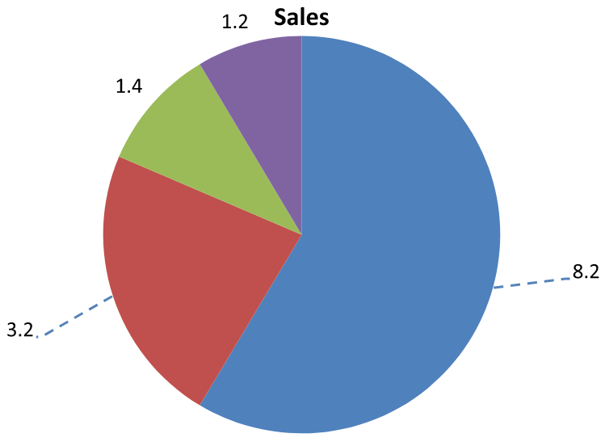

## **Введение**

Подписи данных отображают информацию о серии диаграммы и отдельных точках данных, помогая читателям определять значения и понимать диаграмму. В этой статье объясняется, как форматировать значения, отображать проценты, считывать текст подписи, управлять подписями за пределами максимального значения оси, регулировать расстояние между подписями категориальной оси и позиционировать подписи на круговой диаграмме.

## **Задание точности данных в подписьх диаграммы**

Используйте [setNumberFormatOfValues](https://reference.aspose.com/slides/java/com.aspose.slides/ichartseries/#setNumberFormatOfValues-java.lang.String-) для форматирования значений серии. В этом примере создается линейная диаграмма с данными по умолчанию, отображается её таблица данных и включаются подписи значений для первой серии. Формат `#,##0.00` выводит разделитель тысяч и два знака после запятой, не изменяя исходные значения.

```java
import com.aspose.slides.*;

Presentation presentation = new Presentation();
try {
    ISlide slide = presentation.getSlides().get_Item(0);

    IChart chart = slide.getShapes().addChart(ChartType.Line, 50, 50, 450, 300);
    chart.setDataTable(true);

    IChartSeries series = chart.getChartData().getSeries().get_Item(0);
    series.setNumberFormatOfValues("#,##0.00");
    series.getLabels().getDefaultDataLabelFormat().setShowValue(true);

    presentation.save("PrecisionOfDatalabels_out.pptx", SaveFormat.Pptx);
} finally {
    presentation.dispose();
}
```

Чтобы отформатировать числовые ячейки в встроенной рабочей книге диаграммы, см. [Установить пользовательские числовые форматы для ячеек рабочей книги](/slides/ru/java/chart-workbook/#set-custom-number-formats-for-workbook-cells). В этом примере также показано, как подписи значений наследуют форматы исходных ячеек, при этом сохраняются числовые значения.

## **Отображение процентов в подписьх**

Для составного столбчатого графика вычислите каждое значение как процент от общей суммы своей категории и присвойте текст текстовому фрейму, возвращаемому методом [getTextFrameForOverriding](https://reference.aspose.com/slides/java/com.aspose.slides/ioverridabletext/#getTextFrameForOverriding--). В этом примере используется набор данных диаграммы по умолчанию и отображаются проценты с двумя знаками после запятой шрифтом 8 пунктов. Категории с нулевой суммой пропускаются, чтобы избежать деления на ноль. При изменении данных диаграммы пересчитайте пользовательский текст подписи.

```java
import com.aspose.slides.*;
import java.util.Locale;

Presentation presentation = new Presentation();
try {
    ISlide slide = presentation.getSlides().get_Item(0);

    IChart chart = slide.getShapes().addChart(ChartType.StackedColumn, 20, 20, 400, 400);

    double[] categoryTotals = new double[chart.getChartData().getCategories().size()];
    for (int k = 0; k < chart.getChartData().getCategories().size(); k++) {
        for (int i = 0; i < chart.getChartData().getSeries().size(); i++) {
            IChartSeries series = chart.getChartData().getSeries().get_Item(i);
            Number pointValue = (Number) series.getDataPoints().get_Item(k).getValue().getData();
            categoryTotals[k] += pointValue.doubleValue();
        }
    }

    for (int x = 0; x < chart.getChartData().getSeries().size(); x++) {
        IChartSeries series = chart.getChartData().getSeries().get_Item(x);
        series.getLabels().getDefaultDataLabelFormat().setShowLegendKey(false);

        for (int j = 0; j < series.getDataPoints().size(); j++) {
            IDataLabel label = series.getDataPoints().get_Item(j).getLabel();
            if (categoryTotals[j] == 0) {
                continue;
            }

            Number pointValue = (Number) series.getDataPoints().get_Item(j).getValue().getData();
            double dataPointPercent = (pointValue.doubleValue() / categoryTotals[j]) * 100;

            IPortion portion = new Portion();
            portion.setText(String.format(Locale.US, "%.2f %%", dataPointPercent));
            portion.getPortionFormat().setFontHeight(8f);

            label.getTextFrameForOverriding().setText("");
            IParagraph paragraph = label.getTextFrameForOverriding().getParagraphs().get_Item(0);
            paragraph.getPortions().add(portion);

            label.getDataLabelFormat().setShowValue(true);
            label.getDataLabelFormat().setShowSeriesName(false);
            label.getDataLabelFormat().setShowPercentage(false);
            label.getDataLabelFormat().setShowLegendKey(false);
            label.getDataLabelFormat().setShowCategoryName(false);
            label.getDataLabelFormat().setShowBubbleSize(false);
        }
    }

    presentation.save("DisplayPercentageAsLabels_out.pptx", SaveFormat.Pptx);
} finally {
    presentation.dispose();
}
```

## **Установка знака процента в подписьх диаграммы**

Когда значения хранятся в виде дробей, используйте [setNumberFormat](https://reference.aspose.com/slides/java/com.aspose.slides/idatalabelformat/#setNumberFormat-java.lang.String-) для отображения процентов. Передайте `false` в [setNumberFormatLinkedToSource](https://reference.aspose.com/slides/java/com.aspose.slides/idatalabelformat/#setNumberFormatLinkedToSource-boolean-), чтобы применить формат подписи независимо от ячеек-источников.

В этом примере создаётся 100% составной столбчатый график с красными и синими сериями в четырёх категориях. Каждая пара значений в сумме даёт 1. Формат подписи `0.0%` отображает 0.30 как 30.0%, в то время как вертикальная ось использует два знака после запятой. Обе серии используют белый текст подписи размером 10 пунктов.

```java
import com.aspose.slides.*;
import java.awt.Color;

Presentation presentation = new Presentation();
try {
    ISlide slide = presentation.getSlides().get_Item(0);

    IChart chart = slide.getShapes().addChart(ChartType.PercentsStackedColumn, 20, 20, 500, 400);

    chart.getAxes().getVerticalAxis().setNumberFormatLinkedToSource(false);
    chart.getAxes().getVerticalAxis().setNumberFormat("0.00%");

    chart.getChartData().getSeries().clear();
    chart.getChartData().getCategories().clear();

    IChartDataWorkbook workbook = chart.getChartData().getChartDataWorkbook();
    int worksheetIndex = 0;
    for (int i = 0; i < 4; i++) {
        IChartDataCell categoryCell = workbook.getCell(worksheetIndex, i + 1, 0, "Category " + (i + 1));
        chart.getChartData().getCategories().add(categoryCell);
    }

    String[] seriesNames = { "Reds", "Blues" };
    Color[] seriesColors = { Color.RED, Color.BLUE };
    double[][] values = { { 0.30, 0.50, 0.80, 0.65 }, { 0.70, 0.50, 0.20, 0.35 } };

    for (int i = 0; i < seriesNames.length; i++) {
        IChartDataCell seriesCell = workbook.getCell(worksheetIndex, 0, i + 1, seriesNames[i]);
        IChartSeries series = chart.getChartData().getSeries().add(seriesCell, chart.getType());
        for (int j = 0; j < 4; j++) {
            IChartDataCell valueCell = workbook.getCell(worksheetIndex, j + 1, i + 1, values[i][j]);
            series.getDataPoints().addDataPointForBarSeries(valueCell);
        }

        series.getFormat().getFill().setFillType(FillType.Solid);
        series.getFormat().getFill().getSolidFillColor().setColor(seriesColors[i]);

        IDataLabelFormat labelFormat = series.getLabels().getDefaultDataLabelFormat();
        labelFormat.setShowValue(true);
        labelFormat.setNumberFormatLinkedToSource(false);
        labelFormat.setNumberFormat("0.0%");
        labelFormat.getTextFormat().getPortionFormat().setFontHeight(10);
        labelFormat.getTextFormat().getPortionFormat().getFillFormat().setFillType(FillType.Solid);
        labelFormat.getTextFormat().getPortionFormat().getFillFormat().getSolidFillColor().setColor(Color.WHITE);
    }

    presentation.save("SetDataLabelsPercentageSign_out.pptx", SaveFormat.Pptx);
} finally {
    presentation.dispose();
}
```

## **Чтение фактического текста подписи данных**

Используйте [getActualLabelText](https://reference.aspose.com/slides/java/com.aspose.slides/idatalabel/#getActualLabelText--) , чтобы получить текст, сформированный настройками подписи данных. Это полезно при извлечении подписей для отчётов, поиске содержимого презентаций или проверке сгенерированных диаграмм. В приведённом ниже примере формат подписи данных по умолчанию [формат подписи данных](https://reference.aspose.com/slides/java/com.aspose.slides/idatalabelformat/) объединяет имя каждой категории, имя серии и значение. Одна точка форматирует своё значение как процент, а другая использует пользовательский текст из [getTextFrameForOverriding](https://reference.aspose.com/slides/java/com.aspose.slides/ioverridabletext/#getTextFrameForOverriding--).

```java
import com.aspose.slides.*;

Presentation presentation = new Presentation();
try {
    ISlide slide = presentation.getSlides().get_Item(0);

    IChart chart = slide.getShapes().addChart(ChartType.ClusteredColumn, 20, 20, 500, 300);

    chart.getChartData().getSeries().clear();
    chart.getChartData().getCategories().clear();

    IChartDataWorkbook workbook = chart.getChartData().getChartDataWorkbook();
    IChartDataCell firstCategoryCell = workbook.getCell(0, 1, 0, "Q1");
    chart.getChartData().getCategories().add(firstCategoryCell);
    IChartDataCell secondCategoryCell = workbook.getCell(0, 2, 0, "Q2");
    chart.getChartData().getCategories().add(secondCategoryCell);

    IChartDataCell northSeriesCell = workbook.getCell(0, 0, 1, "North");
    IChartSeries north = chart.getChartData().getSeries().add(northSeriesCell, chart.getType());
    IChartDataCell northFirstValueCell = workbook.getCell(0, 1, 1, 0.25);
    north.getDataPoints().addDataPointForBarSeries(northFirstValueCell);
    IChartDataCell northSecondValueCell = workbook.getCell(0, 2, 1, 0.75);
    north.getDataPoints().addDataPointForBarSeries(northSecondValueCell);

    IChartDataCell southSeriesCell = workbook.getCell(0, 0, 2, "South");
    IChartSeries south = chart.getChartData().getSeries().add(southSeriesCell, chart.getType());
    IChartDataCell southFirstValueCell = workbook.getCell(0, 1, 2, 0.40);
    south.getDataPoints().addDataPointForBarSeries(southFirstValueCell);
    IChartDataCell southSecondValueCell = workbook.getCell(0, 2, 2, 0.60);
    south.getDataPoints().addDataPointForBarSeries(southSecondValueCell);

    for (IChartSeries series : chart.getChartData().getSeries()) {
        IDataLabelFormat format = series.getLabels().getDefaultDataLabelFormat();
        format.setShowCategoryName(true);
        format.setShowSeriesName(true);
        format.setShowValue(true);
    }

    north.getLabels().get_Item(1).getDataLabelFormat().setNumberFormatLinkedToSource(false);
    north.getLabels().get_Item(1).getDataLabelFormat().setNumberFormat("0%");
    south.getLabels().get_Item(0).getTextFrameForOverriding().setText("Reviewed");

    for (IChartSeries series : chart.getChartData().getSeries()) {
        for (IChartDataPoint point : series.getDataPoints()) {
            IDataLabel label = point.getLabel();
            if (!label.isVisible()) {
                continue;
            }

            System.out.println("Value: " + point.getValue().getData() + "; label: " + label.getActualLabelText());
        }
    }
} finally {
    presentation.dispose();
}
```

Число, хранящееся в точке данных, остаётся `0.75`, даже если её подпись отображает `75%` вместе с названиями категории и серии. Пользовательский текст заменяет сгенерированный текст подписи. [getActualLabelText](https://reference.aspose.com/slides/java/com.aspose.slides/idatalabel/#getActualLabelText--) возвращает полученную строку подписи в любом случае. При необходимости извлекать только видимые подписи, проверяйте [isVisible](https://reference.aspose.com/slides/java/com.aspose.slides/idatalabel/#isVisible--) отдельно, как показано выше.

## **Управление подписями за пределами максимального значения оси**

При ручном ограничении диапазона оси некоторые точки данных могут превышать её максимум. Используйте [setShowDataLabelsOverMaximum](https://reference.aspose.com/slides/java/com.aspose.slides/ichart/#setShowDataLabelsOverMaximum-boolean-) , чтобы контролировать отображение их подписей. Эта настройка изменяет видимость подписи; она не меняет диапазон оси и исходные значения данных.

В примере ниже создаётся 2‑D сгруппированная столбчатая диаграмма со значениями 60 и 120. Методу [setAutomaticMaxValue](https://reference.aspose.com/slides/java/com.aspose.slides/iaxis/#setAutomaticMaxValue-boolean-) передаётся `false`, и на вертикальной оси с помощью [setMaxValue](https://reference.aspose.com/slides/java/com.aspose.slides/iaxis/#setMaxValue-double-) устанавливается максимум 100. На первой слайде подписи за пределами максимума допускаются; копия этого слайда отключает их. Оба слайда сохраняются в файл `DataLabelsOverMaximum.pptx`.

Включите подписи значений с помощью [setShowValue](https://reference.aspose.com/slides/java/com.aspose.slides/idatalabelformat/#setShowValue-boolean-). Настройка уровня диаграммы не активирует отображение значений сама по себе и не переопределяет отключённый вывод значений для отдельной подписи. В этом примере включаются значения для всей серии и используется [setPosition](https://reference.aspose.com/slides/java/com.aspose.slides/idatalabelformat/#setPosition-int-) , чтобы разместить подписи в наружной части каждой колонки.

```java
import com.aspose.slides.*;

Presentation presentation = new Presentation();
try {
    ISlide slide = presentation.getSlides().get_Item(0);

    IChart chart = slide.getShapes().addChart(ChartType.ClusteredColumn, 50, 50, 600, 400);
    chart.setLegend(false);

    chart.getChartData().getSeries().clear();
    chart.getChartData().getCategories().clear();

    IChartDataWorkbook workbook = chart.getChartData().getChartDataWorkbook();

    IChartDataCell firstCategory = workbook.getCell(0, 1, 0, "Within range");
    IChartDataCell secondCategory = workbook.getCell(0, 2, 0, "Above maximum");

    chart.getChartData().getCategories().add(firstCategory);
    chart.getChartData().getCategories().add(secondCategory);

    IChartDataCell seriesName = workbook.getCell(0, 0, 1, "Values");
    IChartSeries series = chart.getChartData().getSeries().add(seriesName, chart.getType());

    IChartDataCell firstValue = workbook.getCell(0, 1, 1, 60);
    IChartDataCell secondValue = workbook.getCell(0, 2, 1, 120);

    series.getDataPoints().addDataPointForBarSeries(firstValue);
    series.getDataPoints().addDataPointForBarSeries(secondValue);

    series.getLabels().getDefaultDataLabelFormat().setShowValue(true);
    series.getLabels().getDefaultDataLabelFormat().setPosition(LegendDataLabelPosition.OutsideEnd);

    chart.getAxes().getVerticalAxis().setAutomaticMaxValue(false);
    chart.getAxes().getVerticalAxis().setMaxValue(100);
    chart.setShowDataLabelsOverMaximum(true);

    ISlide secondSlide = presentation.getSlides().addClone(slide);
    IChart secondChart = (IChart) secondSlide.getShapes().get_Item(0);
    secondChart.setShowDataLabelsOverMaximum(false);

    presentation.save("DataLabelsOverMaximum.pptx", SaveFormat.Pptx);
} finally {
    presentation.dispose();
}
```

Ниже показаны изображения сохранённых слайдов, отрендеренных Microsoft PowerPoint. При `true` подпись **120** видна у верхней границы; при `false` она скрыта. Подпись **60** остаётся видимой, максимум оси остаётся **100**, а второе значение данных остаётся **120** в обоих случаях.

| setShowDataLabelsOverMaximum(true) | setShowDataLabelsOverMaximum(false) |
| --- | --- |
|  |  |

{}
В этом примере используется 2‑D столбчатая диаграмма с осью значений. Диаграммы без оси значений, такие как круговые и пончиковые диаграммы, не имеют максимального значения оси, которое можно ограничить таким образом.
{}

## **Установка расстояния подписи от оси**

Используйте [setLabelOffset](https://reference.aspose.com/slides/java/com.aspose.slides/iaxis/#setLabelOffset-int-) , чтобы управлять расстоянием между подписями категориальной оси и самой осью. Значение представляет собой процент от максимального размера шрифта подписей оси. В этом примере создаётся сгруппированная столбчатая диаграмма и устанавливается смещение подписи горизонтальной оси в 500. Эта настройка влияет на подписи категориальной оси, а не на подписи, прикреплённые к отдельным точкам данных.

```java
import com.aspose.slides.*;

Presentation presentation = new Presentation();
try {
    ISlide slide = presentation.getSlides().get_Item(0);

    IChart chart = slide.getShapes().addChart(ChartType.ClusteredColumn, 20, 20, 500, 300);
    chart.getAxes().getHorizontalAxis().setLabelOffset(500);

    presentation.save("SetCategoryAxisLabelDistance_out.pptx", SaveFormat.Pptx);
} finally {
    presentation.dispose();
}
```

## **Регулировка расположения подписи**

На круговой диаграмме отрегулируйте положение подписи данных, чтобы улучшить интервалы и освободить место для линий-указателей.

В этом примере отображается значение первой точки данных, её подпись размещается за пределами сектора и регулируются горизонтальное и вертикальное смещения с помощью [setX](https://reference.aspose.com/slides/java/com.aspose.slides/ilayoutable/#setX-float-) и [setY](https://reference.aspose.com/slides/java/com.aspose.slides/ilayoutable/#setY-float-). Эти смещения задаются относительно ширины и высоты диаграммы соответственно.

```java
import com.aspose.slides.*;

Presentation presentation = new Presentation();
try {
    ISlide slide = presentation.getSlides().get_Item(0);
    
    IChart chart = slide.getShapes().addChart(ChartType.Pie, 50, 50, 200, 200);
    IChartSeriesCollection series = chart.getChartData().getSeries();

    IDataLabel label = series.get_Item(0).getLabels().get_Item(0);
    label.getDataLabelFormat().setShowValue(true);
    label.getDataLabelFormat().setPosition(LegendDataLabelPosition.OutsideEnd);
    label.setX(0.71f);
    label.setY(0.04f);

    presentation.save("presentation.pptx", SaveFormat.Pptx);
} finally {
    presentation.dispose();
}
```


## **Форматирование линий-указателей**

Когда подписи круговой диаграммы находятся за пределами секторов, линии-указатели помогают читателям сопоставлять каждое значение с соответствующим сектором. Противоположный цвет и немного более толастая линия могут облегчить восприятие этих соединений, а прозрачность и пунктирный стиль делают линии менее заметными визуально.

Используйте [getLeaderLinesFormat](https://reference.aspose.com/slides/java/com.aspose.slides/idatalabelcollection/#getLeaderLinesFormat--) , чтобы отформатировать линии-указатели на уровне коллекции подписей данных серии. Параметры в `series.getLabels().getLeaderLinesFormat().getLine()` применяются к всей коллекции, а не к отдельной подписи.

В этом примере создаётся круговая диаграмма с данными по умолчанию, значения отображаются за пределами секторов, и включаются [setShowLeaderLines](https://reference.aspose.com/slides/java/com.aspose.slides/idatalabelformat/#setShowLeaderLines-boolean-). Две подписи отдаляются от своих секторов с помощью смещений [setX](https://reference.aspose.com/slides/java/com.aspose.slides/ilayoutable/#setX-float-) и [setY](https://reference.aspose.com/slides/java/com.aspose.slides/ilayoutable/#setY-float-), задаваемых в долях от ширины и высоты диаграммы. Исходная презентация не требуется.

Метод [getFillFormat](https://reference.aspose.com/slides/java/com.aspose.slides/ilineformat/#getFillFormat--) линии задаёт сплошной синий цвет с альфа‑значением 191 из 255, что обеспечивает приблизительно 25 % прозрачности. [setWidth](https://reference.aspose.com/slides/java/com.aspose.slides/ilineformat/#setWidth-double-) задаёт толщину 2 пункта, а [setDashStyle](https://reference.aspose.com/slides/java/com.aspose.slides/ilineformat/#setDashStyle-byte-) делает линию пунктирной.

```java
import com.aspose.slides.*;
import java.awt.Color;

Presentation presentation = new Presentation();
try {
    ISlide slide = presentation.getSlides().get_Item(0);

    IChart chart = slide.getShapes().addChart(ChartType.Pie, 80, 50, 560, 400);
    chart.setLegend(false);

    IChartSeries series = chart.getChartData().getSeries().get_Item(0);

    IDataLabelFormat labelFormat = series.getLabels().getDefaultDataLabelFormat();
    labelFormat.setShowValue(true);
    labelFormat.setPosition(LegendDataLabelPosition.OutsideEnd);
    labelFormat.setShowLeaderLines(true);

    // Переместить две подписи дальше от их секторов.
    series.getLabels().get_Item(0).setX(0.10f);
    series.getLabels().get_Item(0).setY(-0.05f);
    series.getLabels().get_Item(1).setX(-0.10f);
    series.getLabels().get_Item(1).setY(0.05f);

    ILineFormat line = series.getLabels().getLeaderLinesFormat().getLine();
    line.getFillFormat().setFillType(FillType.Solid);
    line.getFillFormat().getSolidFillColor().setColor(new Color(30, 90, 160, 191));
    line.setWidth(2);
    line.setDashStyle(LineDashStyle.Dash);

    presentation.save("FormattedLeaderLines.pptx", SaveFormat.Pptx);
} finally {
    presentation.dispose();
}
```

Включение линий-указателей не гарантирует, что линия будет отображаться для каждой подписи. Видимость зависит от размещения подписи и поведения компоновки диаграммы. В этом примере у двух отдалённых подписей есть видимые линии-указатели; подписи, остающиеся близко к своим секторам, их не нуждаются.

На следующем изображении показан сохранённый файл `FormattedLeaderLines.pptx`, отрендеренный с помощью Aspose.Slides:



## **Добавление нескольких строк подписи над столбчатой диаграммой**

В этом примере создаётся столбчатая диаграмма с двумя строками подписи над областью построения. Серия A отображает видимые столбцы, а серии B и C предоставляют дополнительные подписи. Их столбцы скрыты удалением заливки и контура. Метод [ChartSeriesGroup.setOverlap](https://reference.aspose.com/slides/java/com.aspose.slides/chartseriesgroup/) выравнивает все три серии по центрам категорий.

Настройки [ChartPlotArea](https://reference.aspose.com/slides/java/com.aspose.slides/chartplotarea/) резервируют место для строк подписи. После того как [Chart.validateChartLayout](https://reference.aspose.com/slides/java/com.aspose.slides/chart/) вычислит позиции по умолчанию, [DataLabel.setX и DataLabel.setY](https://reference.aspose.com/slides/java/com.aspose.slides/datalabel/) сохраняют горизонтальное выравнивание и применяют вертикальные смещения, чтобы разместить подписи в две строки. Числа остаются подписями данных, связанными со значениями серии; только заголовки строк являются отдельными текстовыми фигурами.

```java
Presentation presentation = new Presentation();
try {
    ISlide slide = presentation.getSlides().get_Item(0);

    IChart chart = slide.getShapes().addChart(ChartType.ClusteredColumn, 40, 40, 640, 200);
    chart.setTitle(false);
    chart.setLegend(false);
    chart.getTextFormat().getPortionFormat().setFontHeight(12);

    chart.getChartData().getSeries().clear();
    chart.getChartData().getCategories().clear();

    IChartDataWorkbook workbook = chart.getChartData().getChartDataWorkbook();
    workbook.clear(0);

    String[] categories = {"North", "South", "East", "West"};
    String[] seriesNames = {"Series A", "Series B", "Series C"};
    double[][] seriesValues = {
            {35, 42, 28, 47},
            {22, 31, 19, 26},
            {12, 16, 14, 18}
    };

    for (int categoryIndex = 0; categoryIndex < categories.length; categoryIndex++) {
        chart.getChartData().getCategories().add(
                workbook.getCell(0, categoryIndex + 1, 0, categories[categoryIndex]));
    }

    for (int seriesIndex = 0; seriesIndex < seriesNames.length; seriesIndex++) {
        IChartSeries series = chart.getChartData().getSeries().add(
                workbook.getCell(0, 0, seriesIndex + 1, seriesNames[seriesIndex]),
                ChartType.ClusteredColumn);

        for (int categoryIndex = 0; categoryIndex < categories.length; categoryIndex++) {
            series.getDataPoints().addDataPointForBarSeries(workbook.getCell(
                    0, categoryIndex + 1, seriesIndex + 1,
                    seriesValues[seriesIndex][categoryIndex]));
        }

        if (seriesIndex > 0) {
            // Скрыть столбцы B и C, но оставить их подписи данных.
            series.getFormat().getFill().setFillType(FillType.NoFill);
            series.getFormat().getLine().getFillFormat().setFillType(FillType.NoFill);
            series.getLabels().getDefaultDataLabelFormat().setShowValue(true);
            series.getLabels().getDefaultDataLabelFormat()
                    .getTextFormat().getPortionFormat().setFontHeight(12);
            IFillFormat labelFill = series.getLabels().getDefaultDataLabelFormat()
                    .getTextFormat().getPortionFormat().getFillFormat();
            labelFill.setFillType(FillType.Solid);
            labelFill.getSolidFillColor().setColor(java.awt.Color.BLACK);
            series.getLabels().getDefaultDataLabelFormat().setPosition(
                    LegendDataLabelPosition.InsideBase);
        }
    }

    // Выравнивание всех трёх серий по одинаковым центрам категорий.
    chart.getChartData().getSeries().get_Item(0)
            .getParentSeriesGroup().setOverlap((byte) 100);

    // Использовать меньше линий сетки в этом компактном примере.
    chart.getAxes().getVerticalAxis().setAutomaticMajorUnit(false);
    chart.getAxes().getVerticalAxis().setMajorUnit(10);

    // Зарезервировать пространство над областью построения для двух строк подписей данных.
    chart.getPlotArea().setLayoutTargetType(LayoutTargetType.Inner);
    chart.getPlotArea().setX(0.15f);
    chart.getPlotArea().setY(0.32f);
    chart.getPlotArea().setWidth(0.80f);
    chart.getPlotArea().setHeight(0.48f);
    chart.validateChartLayout();

    for (int seriesIndex = 1; seriesIndex < seriesNames.length; seriesIndex++) {
        IChartSeries series = chart.getChartData().getSeries().get_Item(seriesIndex);
        float rowTop = seriesIndex == 1 ? 0.15f : 0.03f;

        for (int categoryIndex = 0; categoryIndex < categories.length; categoryIndex++) {
            IDataLabel dataLabel = series.getDataPoints().get_Item(categoryIndex).getLabel();
            // Сохранить положение по умолчанию по горизонтали. Y — смещение от
            // позиции подписи по умолчанию, выраженное как доля высоты диаграммы.
            dataLabel.setX(0);
            dataLabel.setY(rowTop - dataLabel.getActualY() / chart.getHeight());
        }

        // Только заголовок строки является отдельной текстовой фигурой.
        IAutoShape rowHeading = slide.getShapes().addAutoShape(
                ShapeType.Rectangle, chart.getX(),
                chart.getY() + rowTop * chart.getHeight(), 85, 18);
        rowHeading.getFillFormat().setFillType(FillType.NoFill);
        rowHeading.getLineFormat().getFillFormat().setFillType(FillType.NoFill);
        rowHeading.addTextFrame(seriesNames[seriesIndex]);
        rowHeading.getTextFrame().getTextFrameFormat().setMarginTop(0);
        rowHeading.getTextFrame().getTextFrameFormat().setMarginBottom(0);
        IPortionFormat headingFormat = rowHeading.getTextFrame().getParagraphs()
                .get_Item(0).getPortions().get_Item(0).getPortionFormat();
        headingFormat.setFontHeight(12);
        headingFormat.getFillFormat().setFillType(FillType.Solid);
        headingFormat.getFillFormat().getSolidFillColor().setColor(java.awt.Color.BLACK);
    }

    presentation.save("multiple-rows-of-labels.pptx", SaveFormat.Pptx);
} finally {
    presentation.dispose();
}
```


## **FAQ**

**Как предотвратить перекрытие подписей данных на плотных диаграммах?**

Сочетайте автоматическое размещение подписей, линии-указатели и уменьшенный размер шрифта; при необходимости скрывайте некоторые поля (например, категорию) или отображайте подписи только для экстремальных значений или ключевых точек.

**Как отключить подписи только для нулевых, отрицательных или пустых значений?**

Отфильтруйте точки данных перед включением подписей и отключите отображение для значений 0, отрицательных значений или отсутствующих данных в соответствии с определённым правилом.

**Как обеспечить единый стиль подписи при экспорте в PDF/изображения?**

Явно задайте семейство шрифтов и размер и убедитесь, что шрифт доступен в среде рендеринга, чтобы избежать подстановки.