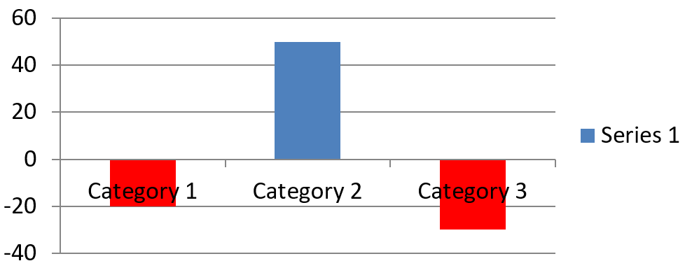

## **Обзор**

Диаграмма может хранить построенные значения в ячейках рабочей книги или непосредственно как числовые литералы. [IChartSeries](https://reference.aspose.com/slides/java/com.aspose.slides/ichartseries/) представляет один набор связанных значений, а каждый [IChartDataPoint](https://reference.aspose.com/slides/java/com.aspose.slides/ichartdatapoint/) представляет точку в этом наборе. Объекты [IChartCategory](https://reference.aspose.com/slides/java/com.aspose.slides/ichartcategory/) предоставляют подписи или значения группировки, общие для серий. В диаграммах, созданных с данными по умолчанию, имена серий, категории и значения точек используют объекты [IChartDataCell](https://reference.aspose.com/slides/java/com.aspose.slides/ichartdatacell/) из рабочей книги диаграммы.

Для типичной категориальной диаграммы рабочая книга по умолчанию использует строку 0 для имён серий, столбец 0 для имён категорий и остальные ячейки для значений серий. Индексы листа, строки и столбца, передаваемые в [IChartDataWorkbook.getCell](https://reference.aspose.com/slides/java/com.aspose.slides/ichartdataworkbook/#getCell-int-int-int-), нумеруются с нуля. Такой макет полезен, когда вы создаёте диаграмму с данными по умолчанию, но не следует предполагать, что каждая существующая диаграмма использует его. Для загруженной презентации проверьте ячейки, на которые ссылаются серии, категории и точки данных, прежде чем менять значения в рабочей книге.

Настройки диаграммы имеют три разных уровня:

- Настройки уровня серии, такие как [IChartSeries.getFormat](https://reference.aspose.com/slides/java/com.aspose.slides/ichartseries/#getFormat--), задают внешний вид по умолчанию для всех точек в одной серии.
- Настройки отдельной точки данных, такие как [IChartDataPoint.getFormat](https://reference.aspose.com/slides/java/com.aspose.slides/ichartdatapoint/#getFormat--), переопределяют внешний вид серии для одной точки.
- Настройки группы применяются к совместимым сериям, принадлежащим одному [IChartSeriesGroup](https://reference.aspose.com/slides/java/com.aspose.slides/ichartseriesgroup/). Доступ к группе осуществляется через [IChartSeries.getParentSeriesGroup](https://reference.aspose.com/slides/java/com.aspose.slides/ichartseries/#getParentSeriesGroup--) , когда нужно установить параметры, такие как перекрытие или ширина промежутка.

Если явное заполнение точки или серии не задано, стиль и тема диаграммы определяют автоматический внешний вид. Когда присутствуют как форматирование серии, так и точки, форматирование точки имеет приоритет для этой точки.


Для кластеризованной цилиндрической диаграммы посмотрите, как [изменение 3D типа серии или формы столбца](/slides/ru/java/3d-chart/#change-the-3d-series-type-and-bar-shape) влияет на первую серию.

## **Установить значения серии, используя числовые литералы**

Используйте числовые литералы, когда значения серии поступают из данных приложения или вычислений и не требуют ссылок на ячейки листа. Вызовите [setDataSourceTypeForValues](https://reference.aspose.com/slides/java/com.aspose.slides/ichartdatapointcollection/#setDataSourceTypeForValues-int-) с [DataSourceType.DoubleLiterals](https://reference.aspose.com/slides/java/com.aspose.slides/datasourcetype/#DoubleLiterals) перед присвоением результата [getValue](https://reference.aspose.com/slides/java/com.aspose.slides/ichartdatapoint/#getValue--) каждой точки через [setAsLiteralDouble](https://reference.aspose.com/slides/java/com.aspose.slides/idoublechartvalue/#setAsLiteralDouble-double-).

Параметр коллекции управляет типом источника всех значений точек в этой серии. Метод [getDataSourceType](https://reference.aspose.com/slides/java/com.aspose.slides/ibasechartvalue/#getDataSourceType--) каждой точки возвращает выбранный тип; измените его через параметр коллекции. При `Worksheet` используйте [getAsCell](https://reference.aspose.com/slides/java/com.aspose.slides/isinglecellchartvalue/#getAsCell--) , чтобы получить доступ к ссылочной ячейке. При `DoubleLiterals` используйте [getAsLiteralDouble](https://reference.aspose.com/slides/java/com.aspose.slides/idoublechartvalue/#getAsLiteralDouble--) или `setAsLiteralDouble` для прямого чтения или записи числа.

В следующем примере создаётся столбчатая диаграмма с сериями и категориями по умолчанию, после чего присваиваются вычисленные значения 10, 20 и т.д. существующим точкам первой серии. Пример сохраняет презентацию, открывает её снова и выводит сохранённые значения.

```java
import com.aspose.slides.*;

Presentation presentation = new Presentation();
try {
    ISlide slide = presentation.getSlides().get_Item(0);

    IChart chart = slide.getShapes().addChart(ChartType.ClusteredColumn, 20, 20, 500, 300);
    IChartSeries series = chart.getChartData().getSeries().get_Item(0);

    series.getDataPoints().setDataSourceTypeForValues(DataSourceType.DoubleLiterals);
    for (int i = 0; i < series.getDataPoints().size(); i++) {
        series.getDataPoints().get_Item(i).getValue().setAsLiteralDouble((i + 1) * 10);
    }

    presentation.save("numeric_literals.pptx", SaveFormat.Pptx);
} finally {
    presentation.dispose();
}

Presentation reopenedPresentation = new Presentation("numeric_literals.pptx");
try {
    ISlide reopenedSlide = reopenedPresentation.getSlides().get_Item(0);
    IChart reopenedChart = (IChart) reopenedSlide.getShapes().get_Item(0);
    IChartSeries reopenedSeries = reopenedChart.getChartData().getSeries().get_Item(0);
    for (IChartDataPoint point : reopenedSeries.getDataPoints()) {
        System.out.println(point.getValue().getAsLiteralDouble());
    }
} finally {
    reopenedPresentation.dispose();
}
```

Тип источника значения точки отдельный от [IChartData.getDataSourceType](https://reference.aspose.com/slides/java/com.aspose.slides/ichartdata/#getDataSourceType--), который определяет конфигурацию внутренней или внешней рабочей книги диаграммы. Использование числовых литералов само по себе не удаляет встроенную рабочую книгу. В этом примере рабочая книга остаётся доступной для меток категорий, имён серий и остальных серий. Смотрите [Рабочая книга диаграммы](/slides/ru/java/chart-workbook/) для управления рабочей книгой.

Для точечных и пузырьковых диаграмм используйте [setDataSourceTypeForXValues](https://reference.aspose.com/slides/java/com.aspose.slides/ichartdatapointcollection/#setDataSourceTypeForXValues-int-) и [setDataSourceTypeForYValues](https://reference.aspose.com/slides/java/com.aspose.slides/ichartdatapointcollection/#setDataSourceTypeForYValues-int-), чтобы выбрать источники для [getXValue](https://reference.aspose.com/slides/java/com.aspose.slides/ichartdatapoint/#getXValue--) и [getYValue](https://reference.aspose.com/slides/java/com.aspose.slides/ichartdatapoint/#getYValue--). Пузырьковые диаграммы также используют [setDataSourceTypeForBubbleSizes](https://reference.aspose.com/slides/java/com.aspose.slides/ichartdatapointcollection/#setDataSourceTypeForBubbleSizes-int-) для [getBubbleSize](https://reference.aspose.com/slides/java/com.aspose.slides/ichartdatapoint/#getBubbleSize--). Установите каждый соответствующий источник в `DoubleLiterals` перед присвоением чисел через метод `setAsLiteralDouble` данного значения.

## **Установить перекрытие серий диаграммы**

[IChartSeries.getOverlap](https://reference.aspose.com/slides/java/com.aspose.slides/ichartseries/#getOverlap--) сообщает, насколько столбцы или колонки перекрываются в 2‑D диаграмме, от -100 до 100 процентов. Это только для чтения проекция настройки в родительской группе серий. Используйте [IChartSeriesGroup.setOverlap](https://reference.aspose.com/slides/java/com.aspose.slides/ichartseriesgroup/#setOverlap-byte-) , чтобы обновить все совместимые серии в этой группе. Эта опция применяется к типам диаграмм, отображающих группированные столбцы или колонки; она не влияет на несвязанные группы серий в комбинированной диаграмме.

В следующем примере задаётся перекрытие для группы, содержащей первую серию:

```java
import com.aspose.slides.*;

final int firstSlideIndex = 0;
final int firstSeriesIndex = 0;
final byte overlapPercent = 30;

Presentation presentation = new Presentation();
try {
    ISlide slide = presentation.getSlides().get_Item(firstSlideIndex);

    // Новая диаграмма содержит примерные серии, категории и значения.
    IChart chart = slide.getShapes().addChart(ChartType.ClusteredColumn, 20, 20, 500, 200);

    IChartSeries series = chart.getChartData().getSeries().get_Item(firstSeriesIndex);
    series.getParentSeriesGroup().setOverlap(overlapPercent);

    presentation.save("series_overlap.pptx", SaveFormat.Pptx);
} finally {
    presentation.dispose();
}
```

Результат:


## **Изменить цвет заливки серии**

Используйте [IChartSeries.getFormat](https://reference.aspose.com/slides/java/com.aspose.slides/ichartseries/#getFormat--) , чтобы задать заливку по умолчанию для всей серии. Если у точки уже задана явная заливка, её настройка [IChartDataPoint.getFormat](https://reference.aspose.com/slides/java/com.aspose.slides/ichartdatapoint/#getFormat--) переопределяет заливку серии для этой точки.

В следующем примере применяется сплошная синяя заливка к первой серии:

```java
import com.aspose.slides.*;
import java.awt.Color;

final int firstSlideIndex = 0;
final int firstSeriesIndex = 0;

Presentation presentation = new Presentation();
try {
    ISlide slide = presentation.getSlides().get_Item(firstSlideIndex);

    IChart chart = slide.getShapes().addChart(ChartType.ClusteredColumn, 20, 20, 500, 200);

    IChartSeries series = chart.getChartData().getSeries().get_Item(firstSeriesIndex);
    series.getFormat().getFill().setFillType(FillType.Solid);
    series.getFormat().getFill().getSolidFillColor().setColor(Color.BLUE);

    presentation.save("series_color.pptx", SaveFormat.Pptx);
} finally {
    presentation.dispose();
}
```

Результат:


## **Изменить имя серии**

Имя серии хранится в рабочей книге данных диаграммы и обычно отображается в легенде. В рабочей книге по умолчанию, созданной для кластеризованной столбчатой диаграммы, ячейка B1 находится в строке 0, столбце 1 и содержит имя первой серии. Именованные константы в следующем примере делают эту структуру явной:

```java
import com.aspose.slides.*;

final int firstSlideIndex = 0;
final int worksheetIndex = 0;
final int seriesNameRowIndex = 0;
final int firstSeriesColumnIndex = 1;

Presentation presentation = new Presentation();
try {
    ISlide slide = presentation.getSlides().get_Item(firstSlideIndex);

    IChart chart = slide.getShapes().addChart(ChartType.ClusteredColumn, 20, 20, 500, 200);

    IChartDataWorkbook workbook = chart.getChartData().getChartDataWorkbook();
    IChartDataCell seriesNameCell = workbook.getCell(worksheetIndex, seriesNameRowIndex, firstSeriesColumnIndex);
    seriesNameCell.setValue("Revenue");

    presentation.save("series_name.pptx", SaveFormat.Pptx);
} finally {
    presentation.dispose();
}
```

Вы также можете обновить ячейку, уже используемую [IChartSeries.getName](https://reference.aspose.com/slides/java/com.aspose.slides/ichartseries/#getName--) . Этот подход позволяет не предполагать конкретную строку и столбец в существующей диаграмме:

```java
import com.aspose.slides.*;

final int firstSlideIndex = 0;
final int firstSeriesIndex = 0;
final int firstNameCellIndex = 0;

Presentation presentation = new Presentation();
try {
    ISlide slide = presentation.getSlides().get_Item(firstSlideIndex);

    IChart chart = slide.getShapes().addChart(ChartType.ClusteredColumn, 20, 20, 500, 200);

    IChartSeries series = chart.getChartData().getSeries().get_Item(firstSeriesIndex);
    IChartDataCell seriesNameCell = series.getName().getAsCells().get_Item(firstNameCellIndex);
    seriesNameCell.setValue("Revenue");

    presentation.save("series_name.pptx", SaveFormat.Pptx);
} finally {
    presentation.dispose();
}
```

Результат:


### **Создать серию с именем из нескольких ячеек**

Составное имя серии полезно, когда название продукта и период отчёта хранятся в отдельных ячейках рабочей книги. Например, вы можете объединить `Product A` в B1 и `2026` в C1 в одно имя серии, сохраняя обе части привязанными к их исходным ячейкам.

Используйте [IChartDataWorkbook.getCellCollection](https://reference.aspose.com/slides/java/com.aspose.slides/ichartdataworkbook/#getCellCollection-java.lang.String-boolean-) , чтобы получить диапазон имён, затем передайте эту коллекцию в [IChartSeriesCollection.add](https://reference.aspose.com/slides/java/com.aspose.slides/ichartseriescollection/#add-com.aspose.slides.IChartCellCollection-int-). Параметр `skipHiddenCells` определяет, включать ли скрытые ячейки: `true` исключает их, `false` — включает. В этом примере используется `false`, чтобы включить каждую ячейку в диапазон имён.

В следующем примере создаётся презентация с одной серией и двумя точками данных. Ячейки B1:C1 содержат только имя серии; A2:A3 — метки категорий, а B2:B3 — числовые значения.

```java
import com.aspose.slides.*;

Presentation presentation = new Presentation();
try {
    ISlide slide = presentation.getSlides().get_Item(0);

    IChart chart = slide.getShapes().addChart(ChartType.ClusteredColumn, 50, 50, 620, 180);

    chart.getChartData().getSeries().clear();
    chart.getChartData().getCategories().clear();
    chart.setLegend(true);

    IChartDataWorkbook workbook = chart.getChartData().getChartDataWorkbook();
    workbook.clear(0);

    // Эти две ячейки задают имя серии.
    workbook.getCell(0, 0, 1, "Product A");
    workbook.getCell(0, 0, 2, "2026");
    IChartCellCollection nameCells = workbook.getCellCollection("Sheet1!$B$1:$C$1", false);
    IChartSeries series = chart.getChartData().getSeries().add(nameCells, ChartType.ClusteredColumn);

    // Отдельные ячейки задают категории и числовые точки данных.
    IChartDataCell northCategory = workbook.getCell(0, 1, 0, "North");
    IChartDataCell southCategory = workbook.getCell(0, 2, 0, "South");
    chart.getChartData().getCategories().add(northCategory);
    chart.getChartData().getCategories().add(southCategory);
    IChartDataCell northValue = workbook.getCell(0, 1, 1, 120);
    IChartDataCell southValue = workbook.getCell(0, 2, 1, 150);
    series.getDataPoints().addDataPointForBarSeries(northValue);
    series.getDataPoints().addDataPointForBarSeries(southValue);

    presentation.save("composite_series_name.pptx", SaveFormat.Pptx);
} finally {
    presentation.dispose();
}
```

Получившееся имя серии — `Product A 2026`, с пробелом между двумя значениями ячеек. Легенда отображает его как одну запись для обеих колонок. Ниже изображён результат:


## **Получить автоматический цвет заливки серии**

[IChartSeries.getAutomaticSeriesColor](https://reference.aspose.com/slides/java/com.aspose.slides/ichartseries/#getAutomaticSeriesColor--) возвращает цвет, вычисленный на основе индекса серии и стиля диаграммы. Это цвет, используемый, когда заливка серии не задана явно. Вызов метода считывает вычисленный цвет; он не назначает новую заливку.

В следующем примере выводится автоматический цвет каждой серии по умолчанию:

```java
import com.aspose.slides.*;
import java.awt.Color;

final int firstSlideIndex = 0;

Presentation presentation = new Presentation();
try {
    ISlide slide = presentation.getSlides().get_Item(firstSlideIndex);

    IChart chart = slide.getShapes().addChart(ChartType.ClusteredColumn, 20, 20, 500, 200);

    int seriesCount = chart.getChartData().getSeries().size();
    for (int seriesIndex = 0; seriesIndex < seriesCount; seriesIndex++) {
        IChartSeries series = chart.getChartData().getSeries().get_Item(seriesIndex);
        Color automaticColor = series.getAutomaticSeriesColor();
        System.out.println("Series " + seriesIndex + ": " + automaticColor);
    }
} finally {
    presentation.dispose();
}
```

Пример вывода для стиля диаграммы по умолчанию:

```text
Series 0: java.awt.Color[r=79,g=129,b=189]
Series 1: java.awt.Color[r=192,g=80,b=77]
Series 2: java.awt.Color[r=155,g=187,b=89]
```

Точные цвета зависят от стиля диаграммы и темы.

## **Установить инвертированный цвет заливки для серии диаграммы**

Для серий типа столбец, колонка и пузырь, [IChartSeries.setInvertIfNegative](https://reference.aspose.com/slides/java/com.aspose.slides/ichartseries/#setInvertIfNegative-boolean-) может отображать отрицательные значения другой заливкой. Установите обычную заливку серии как сплошную, включите инверсию и задайте цвет отрицательного значения через [IChartSeries.getInvertedSolidFillColor](https://reference.aspose.com/slides/java/com.aspose.slides/ichartseries/#getInvertedSolidFillColor--) . Отрицательные числа в рабочей книге остаются неизменными; меняется только цвет их отображения.

В следующем примере заменяются данные диаграммы по умолчанию одной серией. В листе строка 0 содержит имя серии, столбец 0 — названия категорий, а столбец 1 — значения:

```java
import com.aspose.slides.*;
import java.awt.Color;

final int firstSlideIndex = 0;
final int worksheetIndex = 0;
final int headerRowIndex = 0;
final int categoryColumnIndex = 0;
final int firstSeriesColumnIndex = 1;
final int firstDataRowIndex = 1;

String[] categoryNames = { "Category 1", "Category 2", "Category 3" };
int[] seriesValues = { -20, 50, -30 };

Presentation presentation = new Presentation();
try {
    ISlide slide = presentation.getSlides().get_Item(firstSlideIndex);

    IChart chart = slide.getShapes().addChart(ChartType.ClusteredColumn, 20, 20, 500, 200);
    IChartData chartData = chart.getChartData();
    IChartDataWorkbook workbook = chartData.getChartDataWorkbook();

    chartData.getSeries().clear();
    chartData.getCategories().clear();

    IChartDataCell seriesNameCell = workbook.getCell(worksheetIndex, headerRowIndex, firstSeriesColumnIndex, "Series 1");
    int chartType = chart.getType();
    IChartSeries series = chartData.getSeries().add(seriesNameCell, chartType);

    for (int categoryIndex = 0; categoryIndex < categoryNames.length; categoryIndex++) {
        int dataRowIndex = firstDataRowIndex + categoryIndex;
        String categoryName = categoryNames[categoryIndex];
        int seriesValue = seriesValues[categoryIndex];

        IChartDataCell categoryCell = workbook.getCell(worksheetIndex, dataRowIndex, categoryColumnIndex, categoryName);
        chartData.getCategories().add(categoryCell);

        IChartDataCell valueCell = workbook.getCell(worksheetIndex, dataRowIndex, firstSeriesColumnIndex, seriesValue);
        series.getDataPoints().addDataPointForBarSeries(valueCell);
    }

    Color automaticSeriesColor = series.getAutomaticSeriesColor();
    series.getFormat().getFill().setFillType(FillType.Solid);
    series.getFormat().getFill().getSolidFillColor().setColor(automaticSeriesColor);
    series.setInvertIfNegative(true);
    series.getInvertedSolidFillColor().setColor(Color.RED);

    presentation.save("inverted_solid_fill_color.pptx", SaveFormat.Pptx);
} finally {
    presentation.dispose();
}
```

Результат:



Можно включить инверсию для одной точки через [IChartDataPoint.setInvertIfNegative](https://reference.aspose.com/slides/java/com.aspose.slides/ichartdatapoint/#setInvertIfNegative-boolean-). В следующем примере инверсия отключена для серии и включена только для выбранной точки. Точке также присвоено отрицательное значение, чтобы эффект был виден:

```java
import com.aspose.slides.*;
import java.awt.Color;

final int firstSlideIndex = 0;
final int firstSeriesIndex = 0;
final int targetDataPointIndex = 2;
final int negativeValue = -30;

Presentation presentation = new Presentation();
try {
    ISlide slide = presentation.getSlides().get_Item(firstSlideIndex);

    IChart chart = slide.getShapes().addChart(ChartType.ClusteredColumn, 20, 20, 500, 200);

    IChartSeries series = chart.getChartData().getSeries().get_Item(firstSeriesIndex);
    Color automaticSeriesColor = series.getAutomaticSeriesColor();
    series.getFormat().getFill().setFillType(FillType.Solid);
    series.getFormat().getFill().getSolidFillColor().setColor(automaticSeriesColor);
    series.getInvertedSolidFillColor().setColor(Color.RED);
    series.setInvertIfNegative(false);

    IChartDataPoint dataPoint = series.getDataPoints().get_Item(targetDataPointIndex);
    dataPoint.getValue().getAsCell().setValue(negativeValue);
    dataPoint.setInvertIfNegative(true);

    presentation.save("data_point_invert_color_if_negative.pptx", SaveFormat.Pptx);
} finally {
    presentation.dispose();
}
```

## **Очистить значение конкретной точки данных**

Чтобы сделать одну точку пустой, не удаляя остальные, установите её ячейку в рабочей книге в `null`. Для столбчатой диаграммы отображаемое значение доступно через [IChartDataPoint.getValue](https://reference.aspose.com/slides/java/com.aspose.slides/ichartdatapoint/#getValue--) . Точка остаётся на той же позиции категории, но диаграмма рассматривает её значение как пустое согласно настройкам пустых значений диаграммы.

В следующем примере очищается только вторая точка первой серии:

```java
import com.aspose.slides.*;

final int firstSlideIndex = 0;
final int firstSeriesIndex = 0;
final int targetDataPointIndex = 1;

Presentation presentation = new Presentation();
try {
    ISlide slide = presentation.getSlides().get_Item(firstSlideIndex);

    IChart chart = slide.getShapes().addChart(ChartType.ClusteredColumn, 20, 20, 500, 200);

    IChartSeries series = chart.getChartData().getSeries().get_Item(firstSeriesIndex);
    IChartDataPoint dataPoint = series.getDataPoints().get_Item(targetDataPointIndex);
    dataPoint.getValue().getAsCell().setValue(null);

    presentation.save("clear_data_point_value.pptx", SaveFormat.Pptx);
} finally {
    presentation.dispose();
}
```

Точечные диаграммы используют отдельные ячейки X и Y, а пузырьковые диаграммы также используют ячейку размера. Очищайте только ячейку, представляющую значение, которое вы хотите удалить. Не вызывайте [IChartDataPointCollection.clear](https://reference.aspose.com/slides/java/com.aspose.slides/ichartdatapointcollection/#clear--) , если хотите сохранить остальные точки, поскольку этот метод удаляет все точки данных из коллекции.

## **Управление отображением пустых ячеек**

Скрытые ячейки, содержащие значения, являются отдельным случаем от пустых ячеек. Чтобы включать или исключать данные из скрытых строк и столбцов листа, смотрите [Включать данные из скрытых строк и столбцов](/slides/ru/java/chart-workbook/#include-data-from-hidden-rows-and-columns).

Пустая ячейка рабочей книги представляет отсутствующие данные; ячейка, содержащая `0`, представляет известное числовое значение. Вызовите [IChartDataCell.setValue](https://reference.aspose.com/slides/java/com.aspose.slides/ichartdatacell/#setValue-java.lang.Object-) с `null`, чтобы сделать ячейку пустой. Числовой ноль остаётся нулём независимо от настройки пустой ячейки.

Используйте [IChart.setDisplayBlanksAs](https://reference.aspose.com/slides/java/com.aspose.slides/ichart/#setDisplayBlanksAs-int-) , чтобы выбрать способ отображения пустых ячеек в диаграмме. Эта настройка применяется ко всей диаграмме. Она меняет способ построения пустых мест, не заполняя пустую ячейку рабочей книги нулём или интерполированным значением.

В следующем автономном примере создаётся линейная диаграмма с одной серией, очищается значение для Дня 3 и сохраняется та же диаграмма в каждом режиме. Входной файл не требуется. [IChartDataWorkbook](https://reference.aspose.com/slides/java/com.aspose.slides/ichartdataworkbook/) использует лист 0, столбец 0 для меток категорий и столбец 1 для значений; строка 0 содержит имя серии. Финальные данные: `10, 20, empty, 30, 40`.

```java
import com.aspose.slides.*;

Presentation presentation = new Presentation();
try {
    ISlide slide = presentation.getSlides().get_Item(0);

    IChart chart = slide.getShapes().addChart(ChartType.LineWithMarkers, 40, 40, 640, 400);
    IChartData chartData = chart.getChartData();
    IChartDataWorkbook workbook = chartData.getChartDataWorkbook();

    chartData.getSeries().clear();
    chartData.getCategories().clear();

    IChartDataCell seriesNameCell = workbook.getCell(0, 0, 1, "Measurements");
    IChartSeries series = chartData.getSeries().add(seriesNameCell, chart.getType());
    int[] values = { 10, 20, 25, 30, 40 };

    for (int i = 0; i < values.length; i++) {
        IChartDataCell categoryCell = workbook.getCell(0, i + 1, 0, "Day " + (i + 1));
        chartData.getCategories().add(categoryCell);
        IChartDataCell valueCell = workbook.getCell(0, i + 1, 1, values[i]);
        series.getDataPoints().addDataPointForLineSeries(valueCell);
    }

    // Оставить день 3 действительно пустым, сохраняя его категорию и точку данных.
    workbook.getCell(0, 3, 1).setValue(null);

    int[] modes = { DisplayBlanksAsType.Gap, DisplayBlanksAsType.Zero, DisplayBlanksAsType.Span };
    String[] modeNames = { "Gap", "Zero", "Span" };
    for (int i = 0; i < modes.length; i++) {
        chart.setDisplayBlanksAs(modes[i]);
        presentation.save("empty_cells_" + modeNames[i] + ".pptx", SaveFormat.Pptx);
    }
} finally {
    presentation.dispose();
}
```

Каждый выходной файл сохраняет режим, установленный перед сохранением: `empty_cells_Gap.pptx`, `empty_cells_Zero.pptx` и `empty_cells_Span.pptx`. Чтобы сохранить только одну версию, задайте нужный режим и сохраните презентацию один раз вместо перебора режимов.

Сравнение ниже показывает одинаковые данные во всех трёх файлах. День 3 пуст в рабочей книге в каждом случае:


Видимый эффект зависит от типа диаграммы. Линейная диаграмма позволяет легко сравнивать все три режима. Для столбчатых и колонных диаграмм нет линии для соединения через отсутствующую категорию, поэтому `Span` не может создать соединительный сегмент, показанный выше; отсутствующий столбец и столбец нулевой высоты могут выглядеть одинаково. Аналогично, точечная диаграмма только с маркерами не имеет соединительной линии. Не ожидайте трёх разных результатов для каждого типа диаграммы; проверьте вывод для используемого типа.

## **Установить ширину промежутка между сериями**

Ширина промежутка — это пространство между соседними кластерами столбцов или колонок, выраженное в процентах от ширины столбца или колонки. Как и перекрытие, она относится к родительской группе серий, а не к отдельной серии. Вызовите [IChartSeriesGroup.setGapWidth](https://reference.aspose.com/slides/java/com.aspose.slides/ichartseriesgroup/#setGapWidth-int-) один раз для группы. Большое значение создаёт больше пространства между кластерами; меньшее — делает их плотнее.

В следующем примере изменяется ширина промежутка и сохраняется только окончательная презентация:

```java
import com.aspose.slides.*;

final int firstSlideIndex = 0;
final int firstSeriesIndex = 0;
final int gapWidthPercent = 30;

Presentation presentation = new Presentation();
try {
    ISlide slide = presentation.getSlides().get_Item(firstSlideIndex);

    IChart chart = slide.getShapes().addChart(ChartType.StackedColumn, 20, 20, 500, 200);

    IChartSeries series = chart.getChartData().getSeries().get_Item(firstSeriesIndex);
    series.getParentSeriesGroup().setGapWidth(gapWidthPercent);

    presentation.save("gap_width_30.pptx", SaveFormat.Pptx);
} finally {
    presentation.dispose();
}
```

Результат:


## **Показать или скрыть линии серии**

Линии серии визуально соединяют связанные части диаграммы. Используйте [IChartSeriesGroup.setSeriesLines](https://reference.aspose.com/slides/java/com.aspose.slides/ichartseriesgroup/#setSeriesLines-boolean-) , чтобы показать или скрыть их в поддерживаемых сложенных столбчатых и OfPie диаграммах. В двумерных сложенных столбчатых и колонных диаграммах они соединяют соответствующие границы стеков между категориями. В диаграммах Pie of Pie и Bar of Pie они соединяют основной график со вторичным. Эта настройка не является универсальным соединителем для других типов диаграмм.

Получите доступ к группе через [IChartSeries.getParentSeriesGroup](https://reference.aspose.com/slides/java/com.aspose.slides/ichartseries/#getParentSeriesGroup--) . Настройка применяется ко всем сериям в этой группе. [IChartSeries.hasSeriesLines](https://reference.aspose.com/slides/java/com.aspose.slides/ichartseries/#hasSeriesLines--) только для чтения и отражает настройку родительской группы; вызовите сеттер группы, чтобы обновить её.

В следующем примере создаётся одна диаграмма [PieOfPie](https://reference.aspose.com/slides/java/com.aspose.slides/charttype/#PieOfPie) с данными по умолчанию. Она сохраняет одну и ту же диаграмму с включёнными линиями серии, а затем с отключёнными, получая две презентации для сравнения.

```java
import com.aspose.slides.*;

Presentation presentation = new Presentation();
try {
    ISlide slide = presentation.getSlides().get_Item(0);

    IChart chart = slide.getShapes().addChart(ChartType.PieOfPie, 50, 50, 600, 400);
    IChartSeries series = chart.getChartData().getSeries().get_Item(0);
    IChartSeriesGroup seriesGroup = series.getParentSeriesGroup();

    seriesGroup.setSeriesLines(true);
    presentation.save("series_lines_enabled.pptx", SaveFormat.Pptx);

    seriesGroup.setSeriesLines(false);
    presentation.save("series_lines_disabled.pptx", SaveFormat.Pptx);
} finally {
    presentation.dispose();
}
```

| Линии серии включены | Линии серии отключены |
| --- | --- |
|  |  |
| Эти две линии соединяют главный пирог со вторичным пирогом. | Оба пирога остаются видимыми, но соединительные линии скрыты. |

Линии серии отличаются от линий-указателей меток данных, которые соединяют подписи с их точками; от сеточных линий, отмечающих интервалы по осям диаграммы; и от линий в линейной диаграмме, представляющих значения данных. Эта настройка не управляет этими элементами.

## **FAQ**

**Какие типы диаграмм поддерживают серии данных?**

Все типы диаграмм, представленные перечислением [ChartType](https://reference.aspose.com/slides/java/com.aspose.slides/charttype/) , используют данные диаграммы, но их серии не имеют одинаковой структуры значений или настроек. Например, категориальные диаграммы используют категории и значения, точечные — значения X и Y, а пузырьковые добавляют размеры пузырей. Используйте метод создания точек данных, соответствующий типу серии. Параметры, такие как перекрытие и ширина промежутка, применяются только к совместимым группам столбцов или колонок.

**Что такое группа серий диаграммы?**

[IChartSeriesGroup](https://reference.aspose.com/slides/java/com.aspose.slides/ichartseriesgroup/) содержит совместимые серии, которые делят настройки построения на уровне группы. Комбинированная диаграмма может содержать более одной группы, поэтому изменение группы, полученной через одну серию, не обязательно изменит все серии в диаграмме.

**Содержит ли вновь созданная диаграмма данные по умолчанию?**

Да. По умолчанию [IShapeCollection.addChart](https://reference.aspose.com/slides/java/com.aspose.slides/ishapecollection/#addChart-int-float-float-float-float-) создаёт примерные серии, категории и значения. Вы можете изменить эти ячейки или очистить как коллекции серий, так и категорий перед добавлением полностью пользовательского набора данных. Перегрузка может также создать диаграмму без данных по умолчанию.

**Как объекты диаграммы связаны с ячейками рабочей книги?**

Имена серий, подписи категорий и значения точек данных ссылаются на ячейки в [IChartDataWorkbook](https://reference.aspose.com/slides/java/com.aspose.slides/ichartdataworkbook/). Изменение ссылочной ячейки обновляет соответствующий элемент диаграммы. При построении пользовательских данных сохраняйте выравнивание строк категорий и строк значений серий, чтобы каждая точка была построена под нужной категорией.

**Как очистить одну точку, а не всю серию?**

Установите соответствующую ячейку значения в `null`, чтобы сохранить позицию категории точки как пустую точку. Используйте [IChartDataPointCollection.clear](https://reference.aspose.com/slides/java/com.aspose.slides/ichartdatapointcollection/#clear--) только когда хотите удалить все точки из этой серии. Если вы также удаляете категории, обновите каждую серию, чтобы их значения оставались согласованными с коллекцией категорий.

**Как отображаются пустые точки?**

Результат зависит от типа диаграммы и значения, настроенного через [IChart.setDisplayBlanksAs](https://reference.aspose.com/slides/java/com.aspose.slides/ichart/#setDisplayBlanksAs-int-) . Поддерживаемые диаграммы могут отображать пустоты как разрывы, как нулевые значения или соединяя соседние точки. Выберите настройку, соответствующую смыслу отсутствующих данных в вашей презентации. Смотрите [Управление отображением пустых ячеек](#control-the-display-of-empty-cells) для полного примера и визуального сравнения.

**Как форматируются отрицательные значения?**

Для поддерживаемых столбчатых, колонных и пузырьковых серий вызовите [IChartSeries.setInvertIfNegative](https://reference.aspose.com/slides/java/com.aspose.slides/ichartseries/#setInvertIfNegative-boolean-) и задайте цвет, возвращаемый [IChartSeries.getInvertedSolidFillColor](https://reference.aspose.com/slides/java/com.aspose.slides/ichartseries/#getInvertedSolidFillColor--) . Вы можете переопределить поведение для отдельной точки с помощью [IChartDataPoint.setInvertIfNegative](https://reference.aspose.com/slides/java/com.aspose.slides/ichartdatapoint/#setInvertIfNegative-boolean-) . Эти методы влияют на форматирование, а не на сохранённые числовые значения.

**Какое форматирование имеет приоритет, когда одновременно отформатированы серия и точка?**

Явное форматирование отдельной точки имеет приоритет для этой точки. Остальные точки продолжают использовать явный формат серии или, если формат серии не определён, автоматический стиль и тему диаграммы. Настройки группы, такие как перекрытие и ширина промежутка, управляют расположением и не являются переопределениями формата на уровне точек.

**Есть ли ограничение на количество серий в диаграмме?**

Aspose.Slides не накладывает отдельного фиксированного ограничения на количество серий. На практике ограничения файлов презентации, доступная память, время рендеринга и читаемость диаграммы определяют практический предел.

**Что следует изменить, когда столбцы слишком близко друг к другу или слишком далеко?**

Вызовите [IChartSeriesGroup.setGapWidth](https://reference.aspose.com/slides/java/com.aspose.slides/ichartseriesgroup/#setGapWidth-int-) для соответствующей родительской группы серий. Увеличьте значение, чтобы расширить пространство между кластерами, или уменьшите его, чтобы собрать кластеры ближе.